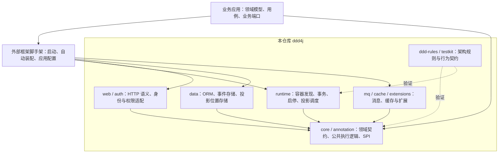
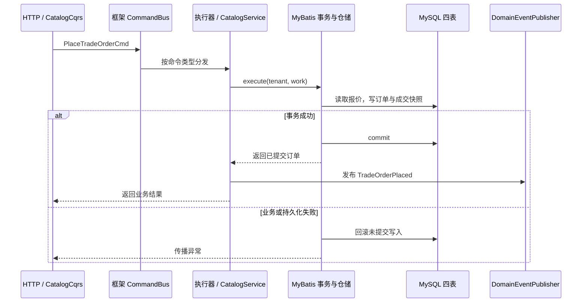

# DDD4J 项目指南与协作约定

本文件帮助进入仓库的 Agent 判断：项目提供什么、改动应落在哪个模块、哪些行为必须保持、如何验证。模块内的 `AGENTS.md` 提供更细的源码与测试入口；当前任务的明确要求优先。

## 1. 项目定位与架构边界

`ddd4j`（`io.ddd4j`）是一套供不同 Java 框架复用的 DDD / CQRS / Event Sourcing 基础库，已有公共 API、持久化及发布契约，按 Brownfield 维护。业务应用通过外部 `ddd4j-boot`、`ddd4j-quarkus`、`ddd4j-javalin` 等脚手架接入本库；应用启动与完整自动装配主要由这些外部仓库承担。



维护时遵守三个边界：

- **公共契约与公共算法放在 core，容器差异放在 runtime，存储及协议差异放在对应适配器。** 不在每种框架中复制命令路由、事件回放或投影算法。
- `ddd4j-core`、`ddd4j-annotation`、`ddd4j-mq-core` 不引入 Spring / MyBatis / Servlet 耦合、starter、`@AutoConfiguration` 或 `spring.factories`。框架无关允许使用已有 Jackson、Commons、TTL 等基础组件，并不要求零第三方依赖。
- 本库提供能力与接入契约；事务原子性、跨实例协调、持久化恢复等保证必须落实到具体适配和应用装配，不能从接口名称推断已经具备。

## 2. 模块地图：先确定改动归属

模块是否参与当前构建，以根 [pom.xml](pom.xml) 及递归 POM 为准。README 和历史架构快照用于背景参考。

| 模块 / 入口 | 负责什么 | 修改时关注什么 |
|---|---|---|
| [core](ddd4j-core/AGENTS.md)、[annotation](ddd4j-annotation/) | 聚合、仓储、领域事件、命令与查询、事件存储、投影、身份和上下文 SPI | 公共签名、默认行为、序列化、调用方兼容性 |
| [kit](ddd4j-kit/) | 字符串、集合、加密、文本、Web 等工具 | 先复用现有组件，不重复封装通用能力 |
| [data](ddd4j-data/AGENTS.md) | MyBatis / MyBatis-Plus / JPA；JPA / Panache / JDBI / R2DBC / ESDB 事件存储；crypto / external / logs | 领域与 PO 映射、事务参与、版本冲突、数据库方言 |
| [runtime](ddd4j-runtime/AGENTS.md) | Spring、Guice、Quarkus、Micronaut、Vert.x、Helidon、Dropwizard 容器接线及公共 testkit | 处理器发现、命令事务、资源所有权、调度与关闭；Javalin 使用 Guice 接线 |
| [web](ddd4j-web/AGENTS.md) | web-core 公共 HTTP 语义、web-testkit、各框架 Web 适配 | 请求上下文、认证策略、异常映射、幂等、API 版本和请求结束清理 |
| [auth](ddd4j-auth/AGENTS.md) | Sa-Token、Spring Security、Shiro、许可证及 Spring 桥接 | Subject 与身份语义、会话及权限边界 |
| [mq](ddd4j-mq/AGENTS.md) | mq-core、Spring 桥接、Kafka / RabbitMQ 等 broker 实现 | 原生确认与重投、Outbox/Inbox、启动回滚和连接所有权 |
| [cache](ddd4j-cache/) | Caffeine、Guava、Hutool、Jedis、Lettuce、Redisson、Memcached、JetCache 等适配 | SPI 位于 core；区分本地缓存与远端缓存语义 |
| [metrics](ddd4j-metrics/)、[extensions](ddd4j-extensions/) | 投影指标；Excel、许可证、OTel、二维码、QLExpress、监控、PF4J 等扩展 | 可选依赖、资源生命周期及宿主兼容性 |
| [ddd-rules](ddd4j-ddd-rules/) | ArchUnit Clean / COLA 架构规则 | 规则本身与规则自测，不能为通过检查放宽边界 |
| [samples](ddd4j-samples/AGENTS.md) | 共享商品交易业务及七种框架的普通 / CQRS / Sa-Token / Shiro 入口 | 先改共享业务，再验证受影响框架入口 |
| [bom](ddd4j-bom/AGENTS.md) / [dependencies](ddd4j-dependencies/AGENTS.md) / [parent](ddd4j-parent/AGENTS.md) | 对外工件版本 / 第三方版本目录 / 下游构建配置 | 三者职责不同，不能只改属性就认定实际依赖已经升级 |

## 3. 核心链路及必须保持的契约

### 3.1 聚合与仓储

入口：[AggregateRoot](ddd4j-core/src/main/java/io/ddd4j/core/ddd/model/AggregateRoot.java)、[Repository](ddd4j-core/src/main/java/io/ddd4j/core/ddd/repository/Repository.java)、[RepositoryRegistry](ddd4j-core/src/main/java/io/ddd4j/core/ddd/repository/RepositoryRegistry.java)。

- `Repository<M, ID>` 的最小实现承诺是 `findById`、`save`。分页、条件查询、批量操作等按实现提供，部分默认抛出不支持异常；业务端口只声明用例需要的能力。
- 领域代码可以显式调用仓储，也可使用聚合的 `save/update/delete` 便捷入口；便捷入口依赖 `RepositoryRegistry` 已注册对应仓储，不能漏掉启动接线。
- `apply(event)` 执行事件处理并登记未提交事件；`loadFromHistory` 回放历史，不产生新的未提交事件。处理器优先匹配 `@EventHandler`，兼容 `on<Type>`，缺失处理器会失败。
- [Query](ddd4j-core/src/main/java/io/ddd4j/core/cqrs/query/Query.java) 是持久化条件 DSL；`QueryBus` 接收的是业务查询对象。两者不可混为一层。涉及 PO 字段时使用已有 `withPO(...)` 范围表达能力。

### 3.2 命令、查询与事务

```text
框架发现 CommandExecutor
  → 组装 DefaultCommandBus 路由
  → 运行时命令入口建立事务（适用时）
  → 按命令精确运行时类型选择执行器
  → 返回 core R<T> 或传播异常
```

[DefaultCommandBus](ddd4j-core/src/main/java/io/ddd4j/core/cqrs/command/DefaultCommandBus.java) 负责公共路由：重复注册在装配阶段失败，未注册命令在执行时失败；缺失路由发现钩子供运行时扩展，成功发现后缓存。[DefaultQueryBus](ddd4j-core/src/main/java/io/ddd4j/core/cqrs/query/DefaultQueryBus.java) 直接返回查询处理器结果，不额外套一层 `R`。

[SpringCommandBus](ddd4j-runtime/ddd4j-runtime-spring/src/main/java/io/ddd4j/spring/command/SpringCommandBus.java) 在单例初始化后发现执行器，组合委派给 core，并通过事务代理包装 `execute`。**现有 Spring 契约是：正常返回提交，返回业务失败 `R` 也提交，抛出运行时异常回滚。** 当前入口与兼容入口由 `SpringCommandTransactionTest` 使用真实 Spring 代理和 H2 验证。不能把“失败 `R` 未回滚”直接当作缺陷，也不能在修复中默默改变传播方式、执行线程或异常契约。设计依据见 [命令总线 ADR](docs/adr/0004-command-bus-design.md)。

### 3.3 事件存储与事件溯源仓储

[EventStore](ddd4j-core/src/main/java/io/ddd4j/core/cqrs/eventstore/EventStore.java) 提供追加、聚合全量读取、版本区间读取、全局位置读取。三个参数含义必须分开：

| 概念 | 含义 |
|---|---|
| `version` | 单个聚合事件流内部的版本 |
| `position` | 跨聚合事件流的全局读取位置 |
| `expectedVersion` | 本次追加的乐观并发前提；冲突应整批失败，不允许部分写入 |

[DefaultEventSourcingRepository](ddd4j-core/src/main/java/io/ddd4j/core/ddd/repository/DefaultEventSourcingRepository.java) 读取事件后通过 `loadFromHistory` 重建聚合，保存时追加未提交事件，**追加成功后才清理待提交事件**。当前版本跟踪按聚合对象身份隔离，同 ID 的两个副本各自保留加载版本；不能改回按 ID 共用版本，否则旧副本会被错误接受。未被当前仓储跟踪的外部实例仍保留读取当前流版本的既有回退，不把该兼容行为描述为外部快照的并发保护。

修改 SPI 或后端时同时看 [事件存储 ADR](docs/adr/0005-event-store-spi.md) 与对应 data 模块指引，特别验证版本冲突、历史区间和全局位置分页。

### 3.4 投影与检查点

[ProjectionRunner](ddd4j-core/src/main/java/io/ddd4j/core/cqrs/readmodel/ProjectionRunner.java) 的处理顺序：

```text
读取检查点 → 读取事件块 → 更新视图 → 保存事件块的 nextEventNumber → 上报指标
                              └─ 处理失败：传播或按调用模式隔离，不推进本次检查点
```

- 检查点采用源事件块的 `nextEventNumber`，不能自行用过滤后事件数量计算；过滤结果为空但源位置前进时，仍可能需要推进检查点。
- 首次运行会产生默认位置值对象，持久化适配器必须转换成自己的实体。[SpringJpaProjectionPositionRepository](ddd4j-runtime/ddd4j-runtime-spring/src/main/java/io/ddd4j/spring/cqrs/SpringJpaProjectionPositionRepository.java) 已处理这个转换，不能恢复为直接强转。
- 运行器只提供同一实例内、同一 `streamId` 的互斥。视图写入与检查点保存是否同事务、多个应用实例如何协调，要检查具体适配和装配。
- 多视图执行支持失败传播或单视图失败隔离；连续失败回调是告警信号，不能据此认定已暂停消费。

### 3.5 MQ 可靠投递与生命周期

`MQClient` 统一初始化、生产、消费和启停接口；broker 适配器负责原生确认、offset/ack、重投和路由语义。**调用返回、broker 确认、业务处理完成、消费提交是不同阶段。**

| 入口 | 实际保证与修改边界 |
|---|---|
| [MQOutboxDispatcher](ddd4j-mq/ddd4j-mq-core/src/main/java/io/ddd4j/mq/delivery/MQOutboxDispatcher.java) | 领取带租约的记录，在存储事务外发送，再按租约所有者确认。发送成功而落库确认失败时保留租约等待接管，后续可能重发；按至少一次交付设计消费方。 |
| [MQInboxProcessor](ddd4j-mq/ddd4j-mq-core/src/main/java/io/ddd4j/mq/delivery/MQInboxProcessor.java)、[MQInboxStore](ddd4j-mq/ddd4j-mq-core/src/main/java/io/ddd4j/mq/delivery/MQInboxStore.java) | 按 `consumerId + messageId` 去重；去重标记必须与业务写入在同一事务。接口存在不能证明接入方已满足事务契约。 |
| [KafkaMQClient](ddd4j-mq/ddd4j-mq-kafka/src/main/java/io/ddd4j/mq/kafka/KafkaMQClient.java) | 同一 `poll()` 可包含多个分区。某分区失败时不得遗失其他分区已拉取但未处理的记录，也不能提交越过失败记录的 offset。 |
| [RabbitMQClient](ddd4j-mq/ddd4j-mq-rabbitmq/src/main/java/io/ddd4j/mq/rabbitmq/RabbitMQClient.java) | `basicConsume()` 的注册结果必须进入启动状态机；不能异步吞掉订阅失败后仍报告 READY。 |

启动状态为 `NEW → STARTING → READY / DEGRADED / FAILED → STOPPED`。启动 checkpoint 用于失败清理：必选监听器失败回滚并阻断启动，可选监听器失败清理本次资源后降级；关闭时遵守资源依赖顺序与所有权，不销毁外部传入的连接。详见 [MQ 启动生命周期计划](docs/superpowers/plans/2026-09-10-mq-startup-lifecycle.md)。

### 3.6 ORM、Web 与上下文

**ORM：**原生 MyBatis 与 MyBatis-Plus 适配在同一应用中二选一，两者有意使用相同根包及同职责类型名。分别复用 `io.github.easy4j:mybatis-enhance-extension` 与 `io.github.easy4j:mybatis-plus-enhance-extension`，不要在本仓库重造上游通用增强能力。依据见 [MyBatis 集成规格](docs/superpowers/specs/2026-11-24-mybatis-enhance-integration.md)。

MyBatis-Plus 的 [Ddd4jMybatisConfigurer](ddd4j-data/ddd4j-data-mybatisplus/src/main/java/io/ddd4j/data/mybatis/config/Ddd4jMybatisConfigurer.java) 组织租户、权限、乐观锁、防全表更新删除、分页、可选加密与签名、结果回填及 SQL 观察；数据范围与自定义权限处理器入口互斥。[Ddd4jTenantContext](ddd4j-data/ddd4j-data-mybatisplus/src/main/java/io/ddd4j/data/mybatis/context/Ddd4jTenantContext.java) 将增强组件桥接到 DDD4J `ThreadContext`。涉及这些问题时先查接线与作用域，再改 Mapper。

**Web / 鉴权：**公共认证链路由 [WebRequestLifecycle](ddd4j-web/ddd4j-web-core/src/main/java/io/ddd4j/web/core/context/WebRequestLifecycle.java) 协调：

```text
认证策略 DISABLED / OPTIONAL / REQUIRED
  → 需要认证时调用 BearerSubjectAuthenticator
  → Contexts 查找 SubjectProvider → Subject.verify(token) → AuthPrincipal
```

`Contexts` 优先线程作用域，再回退全局 `BaseContext`。[WebContextScope](ddd4j-web/ddd4j-web-core/src/main/java/io/ddd4j/web/core/context/WebContextScope.java) 进入时保存上下文与 MDC，退出时恢复，嵌套调用必须配对关闭；跨线程不能假定作用域自动正确传播。[WebIdempotencyLifecycle](ddd4j-web/ddd4j-web-core/src/main/java/io/ddd4j/web/core/idempotency/WebIdempotencyLifecycle.java) 使用租约及租户、方法、路径、幂等键组合；业务支付幂等另有业务规则，不能用 HTTP 防重替代。

**能力边界：**[UnitOfWork](ddd4j-core/src/main/java/io/ddd4j/core/cqrs/uow/UnitOfWork.java) 管理提交/回滚回调与状态；[Saga](ddd4j-core/src/main/java/io/ddd4j/core/cqrs/saga/Saga.java) 在内存中顺序执行、失败逆序补偿。它们本身不提供数据库事务管理或持久化工作流恢复。

## 4. 用商品交易样例理解完整调用路径

样例共享 `goods_spu`、`goods_sku`、`trade_order`、`trade_order_item` 四表，按以下职责拆分：

```text
order-domain       聚合、值对象、领域规则、业务仓储端口
order-application  命令/查询执行、事务编排、读模型
order-jdbc         MyBatis Mapper、PO、仓储、数据库事务（名称虽为 jdbc，实际使用 MyBatis）
order-adapter      共享 HTTP 请求与响应适配
order-start        业务、持久化及事件发布器组装
order-testkit      跨框架验收支持
```

以 CQRS 下单为例：



实现入口：[CatalogService](ddd4j-samples/ddd4j-sample-order-application/src/main/java/io/ddd4j/sample/order/app/CatalogService.java)、[CatalogDatabase](ddd4j-samples/ddd4j-sample-order-jdbc/src/main/java/io/ddd4j/sample/order/infrastructure/CatalogDatabase.java)、[CatalogOrderView](ddd4j-samples/ddd4j-sample-order-application/src/main/java/io/ddd4j/sample/order/app/projection/CatalogOrderView.java)。支付、取消和履约先锁定现有订单，再执行业务状态变更。

样例读侧是按租户与订单号组织的内存快照，可从已提交订单显式重建；它演示四表写模型与独立读模型分离，没有承诺从 EventStore 重放。事务执行返回后直接发布领域事件，也不等同于持久 Outbox。改业务规则先验证共享模块，改接入再验证对应框架；验收以 [四表交易规格](docs/superpowers/specs/2026-11-25-catalog-trade-sample.md) 和 [样例说明](ddd4j-samples/README.md) 为准。

## 5. 开发入口与验证方法

### 5.1 从已有事实继续

- 先确认真实仓库、分支、工作区与暂存区，读取相关目录指令。保留已有修改，**禁止使用 worktree**。已核实且未变化的事实直接复用。
- 仓库沿用 [Superpowers specs](docs/superpowers/specs/) / [plans](docs/superpowers/plans/)；复杂变更先找已有规格及未完成任务，简单文档修正不另建流程。不更改验收标准来迁就缺陷。
- 有 `.codegraph/` 时优先用 `codegraph_explore` 或 `codegraph explore "具体符号或问题"` 定位源码与调用关系。索引过时、工具不可用或结果不足时说明限制，回退到定向 `rg` 和当前文件；不自行初始化或重建索引。静态调用图不证明运行时验收。
- 缺陷修复遵循目标回归红灯 → 最小实现 → 目标及受影响回归。依赖解析、编译或环境失败不算行为红灯；不因修复一个文件而清理全部历史风格。

### 5.2 核心链路的现有回归入口

| 修改范围 | 优先检查 / 执行的测试 |
|---|---|
| 命令路由、返回契约 | [DefaultCommandBusCompatibilityTest](ddd4j-core/src/test/java/io/ddd4j/core/cqrs/command/DefaultCommandBusCompatibilityTest.java)、core `RTest`；涉及 Spring 事务时加 `SpringCommandTransactionTest` |
| 事件追加、聚合副本版本 | [EventStoreContractTest](ddd4j-core/src/test/java/io/ddd4j/core/cqrs/eventstore/EventStoreContractTest.java)、[DefaultEventSourcingRepositoryMustTest](ddd4j-core/src/test/java/io/ddd4j/core/ddd/repository/DefaultEventSourcingRepositoryMustTest.java)，以及所改后端的存储契约 |
| Spring 首次检查点与重启续读 | [SpringJpaProjectionPositionDatabaseTest](ddd4j-runtime/ddd4j-runtime-spring/src/test/java/io/ddd4j/spring/cqrs/SpringJpaProjectionPositionDatabaseTest.java) |
| Kafka 多分区失败重投 | [KafkaConsumerBatchRetryTest](ddd4j-mq/ddd4j-mq-kafka/src/test/java/io/ddd4j/mq/kafka/KafkaConsumerBatchRetryTest.java)，以及原生 broker 往返测试 |
| RabbitMQ 订阅与启动清理 | [RabbitMQConsumerStartupTest](ddd4j-mq/ddd4j-mq-rabbitmq/src/test/java/io/ddd4j/mq/rabbitmq/RabbitMQConsumerStartupTest.java)，以及原生消费确认测试 |
| 容器 / Web 公共语义 | 相应 runtime-testkit / web-testkit 契约及目标框架测试；不能只测共享层而遗漏接线 |

命令从仓库根目录执行，使用 `./mvnw`。`-am` 构建上游；测试在消费模块时选择消费模块。下面第一条是定向回归，第二条用于受影响模块完整验证，不要求无关任务执行。

```sh
./mvnw -pl ddd4j-core -am -Dtest=DefaultCommandBusCompatibilityTest,EventStoreContractTest,DefaultEventSourcingRepositoryMustTest -Dsurefire.failIfNoSpecifiedTests=false test
./mvnw -pl ddd4j-core -am verify
```

`failIfNoSpecifiedTests=false` 仅允许上游缺少同名用例；必须在目标 Surefire 报告中看到测试实际执行。原生 broker / 数据库契约使用现有 Testcontainers，缺少 Docker 或服务时明确未验证范围，不用 Mock 或编译通过代替。已通过的检查仅在相关源码、输入或环境变化时重跑。

### 5.3 门禁与交付证据

Java / 构建变更提交前按影响范围执行下列检查及模块要求；脚本修改还需运行对应自测。纯文档修改检查内容、链接与 `git diff --check`，不机械启动 Maven。

```sh
python3 scripts/check_no_records.py
bash scripts/verify-java-style.sh
bash scripts/verify-architecture.sh
bash scripts/check-bom-alignment.sh
```

- [verify.yml](.github/workflows/verify.yml) 包含单元/契约、原生容器集成、覆盖率及供应链门禁。覆盖率有模块白名单，不能把局部阈值说成全仓覆盖率；实际范围以工作流与 POM 为准。
- [release-candidate.yml](.github/workflows/release-candidate.yml) 另有公开 API、性能及云 MQ 等发布证据要求。公共 API 变更需检查消费方，并使用项目已有兼容性门禁，不能只凭当前 reactor 编译成功判断兼容。
- 提交、推送、部署按当前授权执行；明确授权无需重复确认。提交前核对暂存范围，推送后核对远端 SHA；要求跟踪 CI 时跟踪对应提交到终态，分别报告成功、失败、取消、跳过及未运行。
- 历史失败与本轮新增失败分开报告，既不冒充通过，也不扩大无关修复。后续提交取消旧工作流时先检查包含关系，不擅自重跑旧任务干扰新一轮 CI。交付包含实际验证、剩余问题及工作区状态，不把 CI 通过等同于部署成功。

## 6. 三线兼容与依赖维护

| 分支 | JDK | Spring 基线 | Spring 适配器命名空间 |
|---|---|---|---|
| `feature/1.0.x` | 8 | 5.3.x | `javax` |
| `feature/2.0.x` | 17 | 6.x | `jakarta` |
| `feature/3.0.x`（本线） | 21 | 7.x | `jakarta` |

具体版本、Wrapper、Servlet/JPA API 以本线 POM 和 `.mvn/` 为准。其他运行时按各自平台 BOM 核对，不能机械替换全部 `javax` / `jakarta`。

- 当前分支修复不自动授权其他线；授权同步后保留各线基线，先同步行为与同义回归，再适配语法和依赖 API。需隔离时使用独立临时克隆，不扰动已有脏目录。
- [三线映射策略](config/parity/three-line-policy.json) 的哈希锁定源码与验证依据。验证对应行为后只更新相关精确映射，不能仅刷新哈希、扩大排除或降低门禁来接受未经验证的差异。
- 第三方版本集中维护在 [ddd4j-dependencies/pom.xml](ddd4j-dependencies/pom.xml)，家族归属见 `dependency-version-owners.policy`；必要时同步 [.github/dependency-policy.json](.github/dependency-policy.json)。属性、直接管理项、导入 BOM、模块实际依赖是不同层次，须检查有效模型和解析树。
- 依赖维护只在任务需要时进行。可用已有 Versions 插件查询候选，结合官方发行说明、元数据和安全公告，保持本线 JDK、命名空间、公共 API。默认稳定版本，拒绝新引入 preview / Alpha / Beta / RC / MD 候选；已确认使用的预发布依赖可做授权范围内的必要修复。
- 版本变更验证属性布局、家族归属、实际解析和受影响回归。未被 reactor 使用的管理制品也须确认可解析性与 JDK 字节码基线，不能用聚合构建成功代替。
- CVE 报告说明坐标、版本、上游来源、修复版本和命中范围，区分实际依赖、管理目录及重复命中。企业制品不可用或修复跨越兼容基线时记录阻塞并继续其他可修复项；不删元数据、不擅加豁免、不降低阈值。坐标迁移、依赖退出和自行回补须明确其影响。

依赖维护时先执行本线的 BOM 对齐检查，并以当前工作流所调用的脚本验证版本来源。

## 7. 编码与协作约定

- **所有版本、修复、集成及备份分支禁止声明 Java `record`**，覆盖生产、测试、样例及受 Git 管理的 Java 文档片段。不可变值对象用普通 final 类、final 字段、显式构造器；保留访问器、构造验证、值相等性与 JSON 契约。类型迁移须验证编译、序列化和行为。`check_no_records.py` 忽略字符串和注释；修改检查器时运行 `python3 -m unittest discover -s scripts -p test_check_no_records.py`。
- 新增及修改的 Java 代码使用完整花括号；null 判断用已 import 的 `Objects.isNull` / `Objects.nonNull`，参数校验可用 `Objects.requireNonNull`；日志使用 SLF4J 与 Lombok `@Slf4j`，Bean 按实际需要使用 Lombok。
- 通用操作先查模块已有用法及实际依赖。Spring 模块优先已有 Spring 工具，纯 Java 模块优先已有 `StrKit`；核实字符串空值、空串和空白的语义。复用已有 Jackson、Hutool、Commons 等能力；确需新增通用工具依赖时先评估 Hutool，不重复实现解析器或增加同名转调工具。
- Easy4J 组件只使用 `io.github.easy4j`，不引入 `com.github.hiwepy`。MyBatis-Plus 模块优先 Lambda API，复杂逻辑用 XML，不引入 `JdbcTemplate`。
- Javadoc 保留 `doclint=all`，中文说明契约及复杂逻辑。历史格式问题、无关重构、全仓格式化不顺带处理。
- 分析与审查默认只读；实现任务持续完成已授权工作。不擅自创建或切换分支、安装升级工具、初始化迁移规格体系、覆盖他人修改或重写已推送历史。正常范围内的局部编辑不重复请求授权。
- 不在代码、文档、日志或命令输出中暴露凭据；Git 远端可能包含认证信息，只报告脱敏地址。与当前任务无关的环境或数据库信息不写入项目指南。

## 8. 文档与进一步阅读

- 设计决策先查 [docs/adr](docs/adr/)；变更规格与任务查 [specs](docs/superpowers/specs/) / [plans](docs/superpowers/plans/)；集成迁移按功能查 `REFACTOR_MIGRATION.md`。历史报告与 CodeGraph 快照不作为当前验收结论。
- 文档、Javadoc 和交付说明中文优先；公开说明按需同步英文镜像。架构及复杂流程用 Mermaid 表达主体、调用、数据和失败路径，不仅堆文字。
- 独立可视化默认 HTML + SVG，放在 `html/{分类}/`；普通工程任务不强制绘图。白底、中文、圆角、自定义蓝绿橙配色，保持对比度；分层图默认左侧标层、右侧分组，间距按内容调整。
- 仅在绘图时参考 [架构图规则](draw_architecture_rules.mdc)、[Mermaid 规则](draw_mermaid_rules.mdc)、[思维导图规则](draw_mindmap_rules.mdc)。Marked / Mermaid / SimpleMindMap 锁定所用版本并核实初始化；插件按需启用，不把历史 CDN 示例当作当前 API，`mindMapContainer` 不添加 Mermaid 类名。
