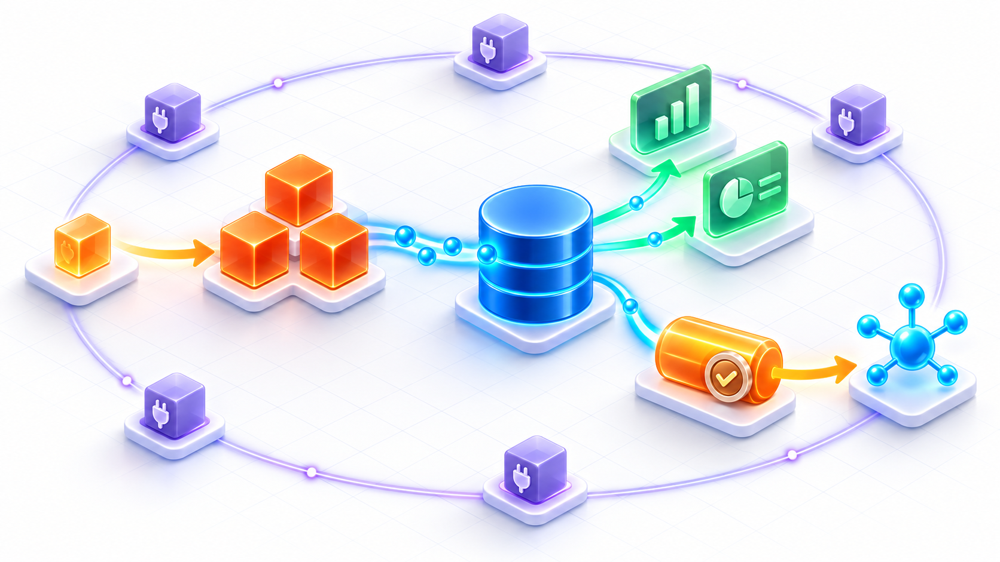

# Ddd4j — Framework-Agnostic DDD, CQRS and Event Sourcing Foundation

<p align="center">
  
</p>

<p align="center">
  <strong>Connect domain models, commands, events, projections, and reliable delivery through framework-agnostic Java contracts.</strong><br>
  A reusable foundation for DDD, CQRS, Event Sourcing, multi-runtime integration, and production-oriented messaging.
</p>

<p align="center">
  
</p>

<p align="center">
  <a href="README.md">简体中文</a> ·
  <a href="ddd4j-samples/README.md">Samples</a> ·
  <a href="REFACTOR_MIGRATION.md">Integration and Migration (Chinese)</a> ·
  <a href="docs/8、ddd4j-Architecture.zh_CN.md">System Architecture</a> ·
  <a href="docs/5、ddd4j-技术方案与路线.md">Technical Plan</a> ·
  <a href="docs/superpowers/plans/2026-09-10-mq-startup-lifecycle.md">MQ Startup Lifecycle</a>
</p>

> **Ddd4j** is a framework-agnostic Java foundation for Domain-Driven Design, CQRS, and Event Sourcing. It keeps the
> domain contracts independent from a concrete container and can be integrated by Spring Boot, Quarkus, Javalin,
> Micronaut, Vert.x, Helidon, Dropwizard, and Guice runtimes.
>
> The DDD, CQRS, and Event Sourcing abstractions are all implemented in-house inside `ddd4j-core`, following the
> canonical Eric Evans and Vaughn Vernon theory. API shape is inspired
> by [ddd-4-java](https://github.com/fuinorg/ddd-4-java) and [cqrs-4-java](https://github.com/fuinorg/cqrs-4-java)
> (reference only — not a runtime dependency).

---

## 1. Positioning

| Dimension       | Description                                                                                                                                                                                                   |
|:----------------|:--------------------------------------------------------------------------------------------------------------------------------------------------------------------------------------------------------------|
| **Purpose**     | Framework-agnostic DDD / CQRS / ES foundation (not a Spring Boot application)                                                                                                                                 |
| **JDK support** | Java 8 (1.0.x) · Java 17 (2.0.x) · Java 21 (3.0.x) — three active lines                                                                                                                                       |
| **Consumers**   | `ddd4j-boot` (Spring Boot) · `ddd4j-quarkus` · `ddd4j-javalin` · first-party Vert.x / Helidon / Micronaut / Dropwizard / Guice business applications                                                          |
| **Foundation**  | Zero third-party DDD frameworks; the DDD / CQRS / ES abstractions are all implemented in `ddd4j-core`                                                                                                         |
| **Iron rule**   | Core / annotation / mq-core base contract layer has **zero** `@AutoConfiguration`, **zero** `spring.factories`, **zero** `starter`; framework adapters use only explicit `@Configuration` / `@Component` glue |

## 2. At a glance

<p align="center">
  
</p>

> A basic DDD application can use application services, aggregates, and repositories directly.
> Applications that opt into event sourcing and separate read models can use
> `Command → Aggregate → Event Store → Projection / Query View`.
> For reliable messaging, an outbox records events in the business transaction and a dispatcher publishes them to the
> selected broker.

### 2.1 Three-layer architecture

```
┌─────────────────────────────────────────────────────────────────────┐
│ Layer 1 · Business application (consumer project)                     │
│   User's Spring Boot / Quarkus / Javalin / Micronaut / Vert.x app     │
└──────────────────────────┬──────────────────────────────────────────┘
                           │  depends on a framework starter
                           ▼
┌─────────────────────────────────────────────────────────────────────┐
│ Layer 2 · Framework starter (auto-config + glue)                       │
│   ddd4j-boot / ddd4j-quarkus / ddd4j-javalin / first-party Vert.x    │
│   contains: @AutoConfiguration · starter · Bean wiring · filter · …  │
└──────────────────────────┬──────────────────────────────────────────┘
                           │  depends on base contract layer
                           ▼
┌─────────────────────────────────────────────────────────────────────┐
│ Layer 3 · ddd4j base contract layer (this repository)                  │
│   Pure-Java contracts · SPI · abstract base types · DDD building     │
│   blocks · ArchUnit rules                                          │
└──────────────────────────┬──────────────────────────────────────────┘
           ┌───────────────┼───────────────┐
           ▼               ▼               ▼
        DDD building    CQRS abstracts    ES abstracts
       (ddd4j-core)    (ddd4j-core)    (ddd4j-core)
```

## 3. Three-line release strategy

ddd4j evolves along **three active lines** in parallel; HEADs always push the same MQ hardening commit together:

| Line              |  JDK   |     Maven      |            Jackson            |            JPA namespace             | Current HEAD            | Role                                    |
|:------------------|:------:|:--------------:|:-----------------------------:|:------------------------------------:|:------------------------|:----------------------------------------|
| **feature/1.0.x** | **8**  |   **3.9.16**   |           Jackson 2           |         `javax.persistence`          | `41f690b7` (2026-09-15) | Production + three-line governance hub  |
| **feature/2.0.x** | **17** |   **3.9.16**   |           Jackson 2           | `jakarta.persistence` (in migration) | `e3ceb44e` (2026-09-15) | Production mainline                     |
| **feature/3.0.x** | **21** | **4.0.0-rc-6** | **Jackson 3 / tools.jackson** |            fully jakarta             | `d21e90a4` (2026-09-15) | Forward-looking line (JDK 21 + Maven 4) |

> **Three-line alignment contract.** The strict audit of 2026-09-09 found **zero** structural / class / public-API /
> CodeGraph-signature differences between **2.0.x and 3.0.x**. Between **1.0.x and 2.0.x** the audit found 19 public JVM
> API differences and 231 method-body differences that are rooted in JDK 8 bytecode constraints (no
> `java.net.http.HttpClient`, no Helidon 3.2 on JDK 8, etc.) — see [
`docs/superpowers/reports/2026-09-09-three-line-source-parity-audit.md`](docs/superpowers/historical-evidence-index.md).

## 4. Maven modules

| Module               | Role                               | Key artifacts                                                                                                                                           |
|:---------------------|:-----------------------------------|:--------------------------------------------------------------------------------------------------------------------------------------------------------|
| `ddd4j-bom`          | BOM version manager                | unified version for downstream projects                                                                                                                 |
| `ddd4j-dependencies` | third-party dependency coordinator | Spring 6.x · Jackson 2.22 · Reactor                                                                                                                     |
| `ddd4j-annotation`   | DDD annotations + API annotations  | `@DomainEntity` `@DomainService` `@ApplicationService` `@DomainRepository`                                                                              |
| `ddd4j-core`         | **pure-Java contract layer**       | `AggregateRoot` · `Repository<M,ID>` · `Query<T>` (lambda-rich query) · `Page` · `R` · `DomainEvent` · `EventSourcingRepository` · `SFunction` · `LambdaKit` |
| `ddd4j-kit`          | toolbox                            | Hutool-style utilities for cache / lang / web                                                                                                           |
| `ddd4j-ddd-rules`    | DDD architecture rules             | `CleanDDDLayerRules` · `ColaDDDLayerRules` (ArchUnit)                                                                                                   |
| `ddd4j-data`         | data abstractions                  | three ORM tracks + crypto / data-permission / external-service / logging                                                                                |
| `ddd4j-mq`           | message-queue abstractions         | `MQBrokerAdapter` SPI + Spring bridge + 12 broker implementations                                                                                       |
| `ddd4j-web`          | web abstractions                   | WebMVC / WebFlux / Javalin / Quarkus / Vert.x / Micronaut / Helidon / Dropwizard                                                                        |
| `ddd4j-auth`         | auth abstractions                  | `Subject` SPI + Sa-Token / Security / Shiro                                                                                                             |
| `ddd4j-cache`        | cache abstractions                 | cache SPI and implementations                                                                                                                           |
| `ddd4j-runtime`      | multi-framework runtime binders    | Spring / Guice / Quarkus / Micronaut / Helidon / Vert.x / Dropwizard with shared test support in testkit                                                |
| `ddd4j-extensions`   | cross-domain extensions            | akka / excel / jackson / license / monitor / pf4j / qlexpress / qrcode / validation / otel                                                              |
| `ddd4j-parent`       | Maven parent POM                   | build / package / release rules                                                                                                                         |
| `ddd4j-samples`      | sample applications                | shared Order domain with 28 samples across seven runtimes, covering default DDD, CQRS, Sa-Token, and Shiro                                              |

## 5. Multi-runtime binding

| Framework   | Runtime binder             | DI container         | Event publishing        | Web framework        |
|:------------|:---------------------------|:---------------------|:------------------------|:---------------------|
| Spring Boot | `ddd4j-runtime-spring`     | `ApplicationContext` | `AppCtx.publishEvent()` | Spring MVC / WebFlux |
| Quarkus     | `ddd4j-runtime-quarkus`    | Arc (CDI)            | `Event<T>.fire()`       | RESTEasy / JAX-RS    |
| Javalin     | `ddd4j-runtime-guice`      | Guice Injector       | `EventBus.post()`       | Javalin              |
| Micronaut   | `ddd4j-runtime-micronaut`  | Micronaut Context    | `publishEvent()`        | Micronaut HTTP       |
| Vert.x      | `ddd4j-runtime-vertx`      | explicit Runtime     | Vert.x EventBus         | Vert.x Web           |
| Helidon     | `ddd4j-runtime-helidon`    | CDI / BeanManager    | CDI Event               | Helidon WebServer    |
| Dropwizard  | `ddd4j-runtime-dropwizard` | explicit Bundle      | Listener collection     | Jersey               |

To use CQRS, select the runtime for your framework from the table above. The runtime provides command bus and projection
wiring. Choose persistence adapters from `ddd4j-data` as needed. The default DDD samples use application repositories
directly. See the [sample guide](ddd4j-samples/README.md) for each framework.

## 6. ArchUnit boundary enforcement

CI tests enforce the core boundaries below. The catalog sample also applies the COLA dependency rules to its compiled business classes and tests that a reversed dependency is rejected.

| Rule                             | Description                                                        |
|:---------------------------------|:-------------------------------------------------------------------|
| `no_autoconfiguration_in_ddd4j`  | no module may contain `@AutoConfiguration`                         |
| `no_spring_in_core_modules`      | core / kit / annotation must not depend on `org.springframework.*` |
| `no_spring_messaging_in_mq_core` | mq-core must not depend on `org.springframework.messaging.*`       |
| `no_spring_factories_in_core`    | core must not reference `AutoConfiguration.imports`                |
| `no_hutool_all_in_core`          | core must not depend on the all-in-one Hutool jar                  |
| `core_no_mybatis`                | core must not depend on `com.baomidou.*`                           |
| `core_no_servlet`                | core must not depend on `jakarta.servlet.*`                        |
| `core_no_validator`              | core must not depend on `org.hibernate.validator.*`                |
| `core_no_aspectj`                | core must not depend on `org.aspectj.*`                            |

## 7. Usage

### 7.1 Import via BOM (recommended)

```xml

<dependencyManagement>
    <dependencies>
        <dependency>
            <groupId>io.ddd4j</groupId>
            <artifactId>ddd4j-bom</artifactId>
            <version>${ddd4j.version}</version>
            <type>pom</type>
            <scope>import</scope>
        </dependency>
    </dependencies>
</dependencyManagement>
```

```xml

<dependencies>
    <!-- core contracts (required) -->
    <dependency>
        <groupId>io.ddd4j</groupId>
        <artifactId>ddd4j-core</artifactId>
    </dependency>
    <!-- data tier (optional) -->
    <dependency>
        <groupId>io.ddd4j</groupId>
        <artifactId>ddd4j-data-mybatis</artifactId>
    </dependency>
    <!-- web tier (optional) -->
    <dependency>
        <groupId>io.ddd4j</groupId>
        <artifactId>ddd4j-web-webmvc</artifactId>
    </dependency>
    <!-- runtime binder (optional) -->
    <dependency>
        <groupId>io.ddd4j</groupId>
        <artifactId>ddd4j-runtime-spring</artifactId>
    </dependency>
</dependencies>
```

### 7.2 Run the catalog and trade example

Use the [sample run instructions](ddd4j-samples/README.md#启动默认订单示例) to select a runtime and configure a dedicated MySQL database. Startup initializes the four business tables. The documented HTTP check covers product registration, order placement, payment validation, fulfillment, and tenant isolation.

Start with an application service and explicit domain repositories. Add command routing through the runtime's `CommandBus` and `CommandExecutor` when needed. Commands return `R<T>`. A plain input object is enough for `QueryHandler` and `QueryBus`.

### 7.3 Select persistence capabilities

`Repository<M, ID>` requires `findById` and `save`. Concrete adapters define support for paging, batch operations, and conditional writes. Use the persistence `Query<M>` DSL when the application needs dynamic conditions. Use `EventStore` and `EventSourcingRepository` for event replay. Declare Reactor explicitly when using `AsyncEventStore` or reactive projection APIs. The R2DBC adapter already declares it.

## 8. Recommended project layout (COLA V5)

```
order-service/
├─ src/main/java/com/example/order/
│  ├─ adapter/        # inbound: Web / MQ / RPC
│  ├─ client/         # outbound API + DTOs
│  ├─ app/            # use-case orchestration, transaction boundaries
│  ├─ domain/         # core domain (zero external deps)
│  └─ infrastructure/ # technical adapters
└─ pom.xml
```

Dependency direction: `adapter → app → domain ← infrastructure`.

## 9. Documentation

| Document                                                                                                                                             | Description                                                                                  |
|:-----------------------------------------------------------------------------------------------------------------------------------------------------|:---------------------------------------------------------------------------------------------|
| [8、ddd4j-Architecture.zh_CN.md](./docs/8、ddd4j-Architecture.zh_CN.md)                                                                              | System architecture (layers, runtime, deps, security, deployment)                            |
| [5、ddd4j-技术方案与路线.md](./docs/5、ddd4j-技术方案与路线.md)                                                                                      | Current technical plan: MQ startup lifecycle + License Gate Hardening + three-line alignment |
| [6、ddd4j-产品与版本规划.md](./docs/6、ddd4j-产品与版本规划.md)                                                                                      | **Three-line governance · upgrade paths · tech compatibility matrix · support window**       |
| [7、ddd4j-领域模型设计.md](./docs/7、ddd4j-领域模型设计.md)                                                                                          | Bounded contexts, aggregates, event contracts                                                |
| [1.0.x/8、ddd4j-1.0.x-Architecture.zh_CN.md](./docs/8、ddd4j-1.0.x-Architecture.zh_CN.md)                                                            | 1.0.x version-level architecture with three-line diff table                                  |
| [docs/superpowers/specs/2026-07-15-current-source-architecture-design.md](./docs/superpowers/specs/2026-07-15-current-source-architecture-design.md) | Current source-code architecture tour (CodeGraph)                                            |
| [docs/superpowers/specs/2026-06-29-ddd4j-boundary-rules-design.md](./docs/superpowers/specs/2026-06-29-ddd4j-boundary-rules-design.md)               | Architecture boundary rules                                                                  |
| [docs/superpowers/reports/2026-09-09-three-line-source-parity-audit.md](./docs/superpowers/historical-evidence-index.md)                             | Three-line strict-parity audit report                                                        |

---

**Document version**: V1.0.0 **Last updated**: 2026-09-18 **Document status**: ✅ Pending review **Aligned to**: HEAD
`41f690b7`