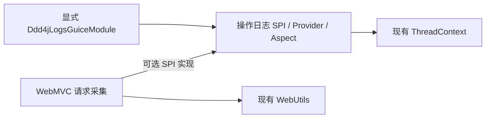

# 多平台接入与迁移

默认 DDD 应用使用 `ddd4j-core` 的聚合、仓储和应用服务，配上所选框架的运行时与 Web
适配。查询可以直接读取业务仓储。需要独立读模型时，再接入事件来源、投影和位置存储。Sa-Token 和 Shiro 也可以按业务需要独立选用。

七个框架各有默认、CQRS、Sa-Token、Shiro 四种示例，共 28 个入口。Guice 配套 Javalin，Spring 提供 WebMVC 和 WebFlux 两种 Web 接入。
`ddd4j-runtime-testkit` 用于共享测试。各场景的启动命令见[示例总览](ddd4j-samples/README.md)。

## 选择运行时和投影入口

下表中的 Maven 坐标使用 `io.ddd4j` 和当前发布线的 BOM 版本。基础用法优先选择对应的 `ddd4j-runtime-*`。

| 运行时                           | 显式投影入口                                                                                                                                                                         |
|----------------------------------|--------------------------------------------------------------------------------------------------------------------------------------------------------------------------------------|
| `ddd4j-runtime-spring`           | 导入 `SpringProjectionConfig`，提供 `TaskScheduler`、`ProjectionRunner` 和业务视图。`SpringCoreConfig` 可用于基础接入。                                                              |
| `ddd4j-runtime-guice`（Javalin） | 将 `Ddd4jGuiceModule.basic()` 与 `new Ddd4jProjectionGuiceModule(views)` 一同传给 `Guice.createInjector(...)`，并绑定 `EventChunkReader<Object>` 和 `ProjectionPositionRepository`。 |
| `ddd4j-runtime-quarkus`          | 构建时配置 `ddd4j.quarkus.cqrs.projection.mode=durable`，配置 Quartz、JTA、事件来源、位置仓储和业务视图。旧 cron 模式沿用现有配置。                                                  |
| `ddd4j-runtime-micronaut`        | 设置 `ddd4j.cqrs.projection.enabled=true` 时提供唯一的真实事件读取器和持久位置仓储。                                                                                                 |
| `ddd4j-runtime-helidon`          | MP 显式设置 `ddd4j.cqrs.projection.enabled=true` 并提供来源、持久位置和视图。SE 继续通过公开工厂和应用生命周期手动接线。                                                             |
| `ddd4j-runtime-vertx`            | 应用显式装配 `VertxProjectionScheduler` 和共享投影管理器，随应用启停。基础入口为 `Ddd4jVertxRuntime.create(...)`。                                                                   |
| `ddd4j-runtime-dropwizard`       | 通过 `Ddd4jBundle.withProjection(...)` 提供位置仓储、事件读取器和视图，由 Bundle 管理生命周期。                                                                                      |

Java 8 的 Quarkus CQRS 示例默认运行内存流程。持久模式的 `durable-order` 和 `durable`
用法见 [Quarkus CQRS 示例](ddd4j-samples/ddd4j-sample-quarkus-cqrs/README.md)。

持久位置仓储可按应用技术栈选择 JPA、Panache、Jdbi 或 R2DBC。EventStore 保留 ESDB、JPA、Panache、Jdbi 和
R2DBC。按应用已有事务和一致性要求组合。只有读侧依赖独立投影的业务才需要同时运行对应的事件消费和更新逻辑。

## 投影与持久化选择

七个框架按上表的 runtime 入口启用投影。采用 Handler 按事件类型分发时，从 `ddd4j-core` 的
`io.ddd4j.core.cqrs.readmodel.handler` 接入。需要重启后续跑的应用按技术栈选择 JPA、Panache、Jdbi 或 R2DBC
位置存储，沿用事件数据、视图标识与原位置。

十二个独立投影模块已从 Java 8、17、21 的源码、构建清单和 BOM 直接退出。旧坐标、转接依赖及兼容 JAR 已退出。JPA、Panache、Jdbi、R2DBC
的位置存储由 `ddd4j-data-event-store-*` 对应构件提供，Spring Data 适配在 `ddd4j-runtime-spring`。Quarkus 使用 Panache
位置仓储时，设置 `ddd4j.quarkus.cqrs.projection.position-store=panache`，并在 ORM 中选择实际使用的实体包。命令装配由对应的
runtime 提供。七个旧 CQRS 构件随 R15
第三批一并退出，验证见 [R15 实施清单](docs/superpowers/plans/2026-10-10-three-line-product-convergence.md#r15退出旧实现模块并保持可回退交付)。

当前 CQRS 应用通过选定的 runtime 注入或显式创建 `CommandBus`。Quarkus 通过 CDI 使用 `CommandBus`，应用可注册自己的 Bean。原
`io.ddd4j.quarkus.command.QuarkusSnapshotCommandBus` 随旧 CQRS 门面退出；命令执行统一走 runtime 的默认总线，处理器由 CDI
发现，执行时激活并恢复请求上下文。

---

## 历史迁移记录

以下保留每批实现和审查时点的原始记录。各批次的范围、当时的构件和验证证据适用于对应时间点。当前接入方式以上文为准。

## data 平台实现迁移兼容清单（R00）

2026-11-18 新建此文件；此前根目录不存在同名文档。事实源为现行架构 AC01—AC12 与三线活动计划。当前状态：R01—R12、S00—S07
已通过各自独立审查，M01—M14 与全部28场景的逐批验证边界见下文；R00 三线基线和完整消费者/回退门禁仍 OPEN。

## 范围和源码基线

主线 data 31→17；沿用
M01—M14。其他已认可模块仅承接必要改动；R01回归现有用法，auth不独立重构，不追加17→12拆合。七框架样例28项，初始POM基线已有16、缺12；S01后当前已有20、缺8，存在与本轮运行验收分开记录。

| 线/来源                 | 当前核实 SHA                               | JDK | Wrapper    | 限制                                                   |
|-------------------------|--------------------------------------------|-----|------------|--------------------------------------------------------|
| ddd4j-convergence-1.0.x | `6bca6659fe0530427aff6673ec2c7b0b5caba778` | 1.8 | 3.9.16     | 既有独立克隆，仅作历史基线；未构建                     |
| ddd4j                   | `fda1e4b1f4768a7cb9342c42fc86aa29f355dd01` | 17  | 3.9.16     | 当前工作副本含无关未提交修改；证据按文件哈希           |
| ddd4j-convergence-2.0.x | `6d9f00dcb44d6a1503df41f83f4f26e830bc2ae4` | 17  | 3.9.16     | 既有独立克隆，仅作历史基线；未构建                     |
| feature/3.0.x Git对象   | `970f8fe288f0f11113f4971d5eb6ba6b75933638` | 21  | 4.0.0-rc-6 | 只核实Git对象；本轮未定位已验证的当前独立检出/运行基线 |

1.0.x POM 的 maven.version=3.6.3 与实际 Wrapper3.9.16 不同，按Wrapper执行但保留该差异。JDK17已由主会话实际
`./mvnw -version` 核实；本R00未运行三线构建。旧GAV格式为 `io.ddd4j:<原模块>:<本线revision>`，revision分别是
`1.0.x.20260630-SNAPSHOT`、`2.0.x.20260630-SNAPSHOT`、`3.0.x.20260630-SNAPSHOT`。

## M01—M14 固定映射

下表及后续 M01—M14
明细记录迁移前的旧类名、启用方式和依赖。投影条目中的旧坐标、源码路径和兼容计划均属于该基线。现行投影接入见本页 [选择运行时和投影入口](#选择运行时和投影入口)
；十二个旧投影坐标已退出。七个平台的现行 runtime
验收及历史消费者证据见 [R15 实施清单](docs/superpowers/plans/2026-10-10-three-line-product-convergence.md#r15退出旧实现模块并保持可回退交付)。

| 项  | 原模块                             | 旧入口/容器标识与启用                                                                                                                                            | 目标所有者                             | 配置/扫描/消费者基线                                                                                                                                     |
|-----|------------------------------------|------------------------------------------------------------------------------------------------------------------------------------------------------------------|----------------------------------------|----------------------------------------------------------------------------------------------------------------------------------------------------------|
| M01 | `ddd4j-data-cqrs-spring`           | `SpringCommandBus`；@Component 默认名 springCommandBus；ComponentScan发现，构造注入共享CommandRegistry；execute方法级@Transactional                              | `ddd4j-runtime-spring`；存储归data     | 该旧模块无自有属性开关、实体或资源扫描配置；调用方需显式提供Registry/执行器或Runner/View/Scheduler；同包模块测试是已知调用者，外部消费者未知，旧坐标保留 |
| M02 | `ddd4j-data-projection-spring`     | `SpringProjectionScheduler / SpringProjectionViewManager`；@Component默认名springProjectionScheduler / springProjectionViewManager；扫描与SmartLifecycle自动启停 | `ddd4j-runtime-spring`；存储归data     | 该旧模块无自有属性开关、实体或资源扫描配置；调用方需显式提供Registry/执行器或Runner/View/Scheduler；同包模块测试是已知调用者，外部消费者未知，旧坐标保留 |
| M03 | `ddd4j-data-cqrs-javalin`          | `JavalinCommandBus`；静态create(app, ...)手动注册；构造时执行器快照；事务由调用者管理；无容器Bean名                                                              | `ddd4j-runtime-guice`；存储归data      | 该旧模块无自有属性开关、实体或资源扫描配置；调用方需显式提供Registry/执行器或Runner/View/Scheduler；同包模块测试是已知调用者，外部消费者未知，旧坐标保留 |
| M04 | `ddd4j-data-projection-javalin`    | `JavalinProjectionScheduler / JavalinProjectionViewManager`；静态create(app, ...)手动注册；应用启动/停止回调；无容器Bean名                                       | `ddd4j-runtime-guice`；存储归data      | 该旧模块无自有属性开关、实体或资源扫描配置；调用方需显式提供Registry/执行器或Runner/View/Scheduler；同包模块测试是已知调用者，外部消费者未知，旧坐标保留 |
| M05 | `ddd4j-data-cqrs-quarkus`          | `QuarkusCommandBus`；@ApplicationScoped / @Inject；默认CDI限定符，构造收集执行器；保留受保护无参代理构造                                                         | `ddd4j-runtime-quarkus`；存储归data    | 该旧模块无自有属性开关、实体或资源扫描配置；调用方需显式提供Registry/执行器或Runner/View/Scheduler；同包模块测试是已知调用者，外部消费者未知，旧坐标保留 |
| M06 | `ddd4j-data-projection-quarkus`    | `QuarkusProjectionScheduler / QuarkusProjectionViewManager`；@ApplicationScoped / @Inject；默认CDI限定符，StartupEvent/ShutdownEvent；保留受保护无参代理构造     | `ddd4j-runtime-quarkus`；存储归data    | 该旧模块无自有属性开关、实体或资源扫描配置；调用方需显式提供Registry/执行器或Runner/View/Scheduler；同包模块测试是已知调用者，外部消费者未知，旧坐标保留 |
| M07 | `ddd4j-data-cqrs-micronaut`        | `MicronautCommandBus`；@Singleton / @Inject；默认限定符；编译期Bean定义，构造以BeanContext发现执行器；无代理无参构造声明                                         | `ddd4j-runtime-micronaut`；存储归data  | 该旧模块无自有属性开关、实体或资源扫描配置；调用方需显式提供Registry/执行器或Runner/View/Scheduler；同包模块测试是已知调用者，外部消费者未知，旧坐标保留 |
| M08 | `ddd4j-data-projection-micronaut`  | `MicronautProjectionScheduler / MicronautProjectionViewManager`；@Singleton / @Inject；默认限定符；编译期Bean定义和容器启动/关闭；保留代理构造                   | `ddd4j-runtime-micronaut`；存储归data  | 该旧模块无自有属性开关、实体或资源扫描配置；调用方需显式提供Registry/执行器或Runner/View/Scheduler；同包模块测试是已知调用者，外部消费者未知，旧坐标保留 |
| M09 | `ddd4j-data-cqrs-helidon`          | `HelidonCommandBus`；@Singleton / @Inject；ServiceLoader发现及显式接线，不把注解单独当成容器启动证据                                                             | `ddd4j-runtime-helidon`；存储归data    | 该旧模块无自有属性开关、实体或资源扫描配置；调用方需显式提供Registry/执行器或Runner/View/Scheduler；同包模块测试是已知调用者，外部消费者未知，旧坐标保留 |
| M10 | `ddd4j-data-projection-helidon`    | `HelidonProjectionScheduler / HelidonProjectionViewManager`；@Singleton / @Inject；ServiceLoader发现及显式接线，不把注解单独当成容器启动证据                     | `ddd4j-runtime-helidon`；存储归data    | 该旧模块无自有属性开关、实体或资源扫描配置；调用方需显式提供Registry/执行器或Runner/View/Scheduler；同包模块测试是已知调用者，外部消费者未知，旧坐标保留 |
| M11 | `ddd4j-data-cqrs-vertx`            | `VertxCommandBus`；静态create(vertx, ...)手动注册；执行器快照；不参与事务；无Bean名                                                                              | `ddd4j-runtime-vertx`；存储归data      | 该旧模块无自有属性开关、实体或资源扫描配置；调用方需显式提供Registry/执行器或Runner/View/Scheduler；同包模块测试是已知调用者，外部消费者未知，旧坐标保留 |
| M12 | `ddd4j-data-projection-vertx`      | `VertxProjectionScheduler / VertxProjectionViewManager`；静态create(vertx, ...)手动注册；关闭hook与调度资源；无Bean名                                            | `ddd4j-runtime-vertx`；存储归data      | 该旧模块无自有属性开关、实体或资源扫描配置；调用方需显式提供Registry/执行器或Runner/View/Scheduler；同包模块测试是已知调用者，外部消费者未知，旧坐标保留 |
| M13 | `ddd4j-data-cqrs-dropwizard`       | `DropwizardCommandBus`；静态create(Application, executors)手动接线；事务由调用者管理；无Bean名                                                                   | `ddd4j-runtime-dropwizard`；存储归data | 该旧模块无自有属性开关、实体或资源扫描配置；调用方需显式提供Registry/执行器或Runner/View/Scheduler；同包模块测试是已知调用者，外部消费者未知，旧坐标保留 |
| M14 | `ddd4j-data-projection-dropwizard` | `DropwizardProjectionScheduler / DropwizardProjectionViewManager`；静态create(Application/Environment, ...)手动接线；Managed生命周期；无Bean名                   | `ddd4j-runtime-dropwizard`；存储归data | 该旧模块无自有属性开关、实体或资源扫描配置；调用方需显式提供Registry/执行器或Runner/View/Scheduler；同包模块测试是已知调用者，外部消费者未知，旧坐标保留 |

## 精确源码API与依赖快照

下列声明从当前21个生产源文件提取（含公开/受保护构造器、工厂、生命周期及内部任务/句柄方法；内部类方法不表示外层类直接暴露该API）；逐文件原文、行号、POM及SHA-256位于 [R00证据](.superpowers/sdd/2026-10-10-three-line-product-convergence/R00-evidence/)
。隐式默认构造器及继承自DefaultCommandBus/ViewManager/ViewScheduler的方法继续保留，源码声明不是编译后二进制清单。

### M01 / ddd4j-data-cqrs-spring

当前直接依赖：`ddd4j-core (compile)`、`spring-context (compile)`、`spring-tx (compile)`。迁移后须用隔离消费者确认需要补充的显式依赖，不把依赖管理当作实际引入。

`io.ddd4j.data.cqrs.spring.SpringCommandBus`
([源码](ddd4j-data/ddd4j-data-cqrs-spring/src/main/java/io/ddd4j/data/cqrs/spring/SpringCommandBus.java))：

- `public SpringCommandBus(ApplicationContext context, CommandRegistry registry)`
- `public <T> R<T> execute(Command command)`

### M02 / ddd4j-data-projection-spring

当前直接依赖：`ddd4j-data-projection (compile)`、`spring-context (compile)`、`spring-tx (compile)`
。迁移后须用隔离消费者确认需要补充的显式依赖，不把依赖管理当作实际引入。

`io.ddd4j.data.projection.spring.SpringProjectionScheduler`
([源码](ddd4j-data/ddd4j-data-projection-spring/src/main/java/io/ddd4j/data/projection/spring/SpringProjectionScheduler.java))：

- `public SpringProjectionScheduler(TaskScheduler taskScheduler)`
- `public ViewScheduleHandle schedule(String viewName, String cron, Runnable task)`
- `public void start()`
- `public void stop()`
- `public boolean isRunning()`
- `public int getPhase()`
- `public void cancel()`
- `public boolean isActive()`

`io.ddd4j.data.projection.spring.SpringProjectionViewManager`
([源码](ddd4j-data/ddd4j-data-projection-spring/src/main/java/io/ddd4j/data/projection/spring/SpringProjectionViewManager.java))：

-

`public SpringProjectionViewManager(ViewScheduler scheduler, ProjectionRunner<?> runner, Collection<ProjectionView<?>> views)`

- `public void start()`
- `public void stop()`
- `public boolean isRunning()`
- `public boolean isAutoStartup()`
- `public int getPhase()`
- `public void triggerOnce()`

### M03 / ddd4j-data-cqrs-javalin

当前直接依赖：`ddd4j-core (compile)`、`javalin (compile)`。迁移后须用隔离消费者确认需要补充的显式依赖，不把依赖管理当作实际引入。

`io.ddd4j.data.cqrs.javalin.JavalinCommandBus`
([源码](ddd4j-data/ddd4j-data-cqrs-javalin/src/main/java/io/ddd4j/data/cqrs/javalin/JavalinCommandBus.java))：

- `public static JavalinCommandBus create(Javalin app, Collection<CommandExecutor<?>> executors)`

### M04 / ddd4j-data-projection-javalin

当前直接依赖：`ddd4j-data-projection (compile)`、`javalin (compile)`。迁移后须用隔离消费者确认需要补充的显式依赖，不把依赖管理当作实际引入。

`io.ddd4j.data.projection.javalin.JavalinProjectionScheduler`
([源码](ddd4j-data/ddd4j-data-projection-javalin/src/main/java/io/ddd4j/data/projection/javalin/JavalinProjectionScheduler.java))：

-

`public static JavalinProjectionScheduler create(Javalin app, Collection<ProjectionView<?>> views, ProjectionRunner<?> runner)`

- `public void shutdown()`
- `public ViewScheduleHandle schedule(String viewName, String cron, Runnable task)`
- `public void run()`
- `public void cancel()`
- `public boolean isActive()`

`io.ddd4j.data.projection.javalin.JavalinProjectionViewManager`
([源码](ddd4j-data/ddd4j-data-projection-javalin/src/main/java/io/ddd4j/data/projection/javalin/JavalinProjectionViewManager.java))：

-

`public static JavalinProjectionViewManager create(Javalin app, Collection<ProjectionView<?>> views, ProjectionRunner<?> runner)`

- `public void start()`
- `public void stop()`
- `public boolean isRunning()`
- `public void triggerOnce()`

### M05 / ddd4j-data-cqrs-quarkus

当前直接依赖：`ddd4j-core (compile)`、`quarkus-arc (compile)`。迁移后须用隔离消费者确认需要补充的显式依赖，不把依赖管理当作实际引入。

`io.ddd4j.data.cqrs.quarkus.QuarkusCommandBus`
([源码](ddd4j-data/ddd4j-data-cqrs-quarkus/src/main/java/io/ddd4j/data/cqrs/quarkus/QuarkusCommandBus.java))：

- `public QuarkusCommandBus(Instance<CommandExecutor<?>> executors)`
- `protected QuarkusCommandBus()`

### M06 / ddd4j-data-projection-quarkus

当前直接依赖：`ddd4j-data-projection (compile)`、`quarkus-arc (compile)`。迁移后须用隔离消费者确认需要补充的显式依赖，不把依赖管理当作实际引入。

`io.ddd4j.data.projection.quarkus.QuarkusProjectionScheduler`
([源码](ddd4j-data/ddd4j-data-projection-quarkus/src/main/java/io/ddd4j/data/projection/quarkus/QuarkusProjectionScheduler.java))：

- `public ViewScheduleHandle schedule(String viewName, String cron, Runnable task)`
- `public void run()`
- `public void cancel()`
- `public boolean isActive()`

`io.ddd4j.data.projection.quarkus.QuarkusProjectionViewManager`
([源码](ddd4j-data/ddd4j-data-projection-quarkus/src/main/java/io/ddd4j/data/projection/quarkus/QuarkusProjectionViewManager.java))：

-

`public QuarkusProjectionViewManager(ViewScheduler scheduler, ProjectionRunner<?> runner, Instance<ProjectionView<?>> views)`

- `protected QuarkusProjectionViewManager()`
- `public void start()`
- `public void stop()`
- `public boolean isRunning()`
- `public void triggerOnce()`

### M07 / ddd4j-data-cqrs-micronaut

当前直接依赖：`ddd4j-core (compile)`、`micronaut-core (compile)`、`micronaut-inject (compile)`、
`micronaut-runtime (compile)`。迁移后须用隔离消费者确认需要补充的显式依赖，不把依赖管理当作实际引入。

`io.ddd4j.data.cqrs.micronaut.MicronautCommandBus`
([源码](ddd4j-data/ddd4j-data-cqrs-micronaut/src/main/java/io/ddd4j/data/cqrs/micronaut/MicronautCommandBus.java))：

- `public MicronautCommandBus(BeanContext context, CommandRegistry registry)`

### M08 / ddd4j-data-projection-micronaut

当前直接依赖：`ddd4j-data-projection (compile)`、`micronaut-inject (compile)`、`micronaut-runtime (compile)`
。迁移后须用隔离消费者确认需要补充的显式依赖，不把依赖管理当作实际引入。

`io.ddd4j.data.projection.micronaut.MicronautProjectionScheduler`
([源码](ddd4j-data/ddd4j-data-projection-micronaut/src/main/java/io/ddd4j/data/projection/micronaut/MicronautProjectionScheduler.java))：

- `public MicronautProjectionScheduler()`
- `public ViewScheduleHandle schedule(String viewName, String cron, Runnable task)`
- `public void run()`
- `public synchronized void cancel()`
- `public synchronized boolean isActive()`

`io.ddd4j.data.projection.micronaut.MicronautProjectionViewManager`
([源码](ddd4j-data/ddd4j-data-projection-micronaut/src/main/java/io/ddd4j/data/projection/micronaut/MicronautProjectionViewManager.java))：

- `public MicronautProjectionViewManager(ViewScheduler scheduler, ProjectionRunner<?> runner, BeanContext context)`
- `protected MicronautProjectionViewManager()`
- `public void start()`
- `public void stop()`
- `public boolean isRunning()`
- `public void triggerOnce()`

### M09 / ddd4j-data-cqrs-helidon

当前直接依赖：`ddd4j-core (compile)`、`helidon-common-service-loader (compile)`、`jakarta.inject-api (compile)`
。迁移后须用隔离消费者确认需要补充的显式依赖，不把依赖管理当作实际引入。

`io.ddd4j.data.cqrs.helidon.HelidonCommandBus`
([源码](ddd4j-data/ddd4j-data-cqrs-helidon/src/main/java/io/ddd4j/data/cqrs/helidon/HelidonCommandBus.java))：

- `public HelidonCommandBus(HelidonServiceLoader<? extends CommandExecutor<?>> executors, CommandRegistry registry)`
- `public static HelidonCommandBus discover(CommandRegistry registry)`

### M10 / ddd4j-data-projection-helidon

当前直接依赖：`ddd4j-data-projection (compile)`、`helidon-common-service-loader (compile)`、`jakarta.inject-api (compile)`
。迁移后须用隔离消费者确认需要补充的显式依赖，不把依赖管理当作实际引入。

`io.ddd4j.data.projection.helidon.HelidonProjectionScheduler`
([源码](ddd4j-data/ddd4j-data-projection-helidon/src/main/java/io/ddd4j/data/projection/helidon/HelidonProjectionScheduler.java))：

- `public void shutdown()`
- `public ViewScheduleHandle schedule(String viewName, String cron, Runnable task)`
- `public void run()`
- `public void cancel()`
- `public boolean isActive()`

`io.ddd4j.data.projection.helidon.HelidonProjectionViewManager`
([源码](ddd4j-data/ddd4j-data-projection-helidon/src/main/java/io/ddd4j/data/projection/helidon/HelidonProjectionViewManager.java))：

-

`public HelidonProjectionViewManager(ViewScheduler scheduler, ProjectionRunner<?> runner, Collection<ProjectionView<?>> views)`

- `public void start()`
- `public void stop()`
- `public boolean isRunning()`
- `public void triggerOnce()`

### M11 / ddd4j-data-cqrs-vertx

当前直接依赖：`ddd4j-core (compile)`、`vertx-core (compile)`。迁移后须用隔离消费者确认需要补充的显式依赖，不把依赖管理当作实际引入。

`io.ddd4j.data.cqrs.vertx.VertxCommandBus`
([源码](ddd4j-data/ddd4j-data-cqrs-vertx/src/main/java/io/ddd4j/data/cqrs/vertx/VertxCommandBus.java))：

- `public static VertxCommandBus create(Vertx vertx, Collection<CommandExecutor<?>> executors)`

### M12 / ddd4j-data-projection-vertx

当前直接依赖：`ddd4j-data-projection (compile)`、`vertx-core (compile)`。迁移后须用隔离消费者确认需要补充的显式依赖，不把依赖管理当作实际引入。

`io.ddd4j.data.projection.vertx.VertxProjectionScheduler`
([源码](ddd4j-data/ddd4j-data-projection-vertx/src/main/java/io/ddd4j/data/projection/vertx/VertxProjectionScheduler.java))：

-

`public static VertxProjectionScheduler create(Vertx vertx, Collection<ProjectionView<?>> views, ProjectionRunner<?> runner)`

- `public void shutdown()`
- `public ViewScheduleHandle schedule(String viewName, String cron, Runnable task)`
- `public void run()`
- `public void cancel()`
- `public boolean isActive()`

`io.ddd4j.data.projection.vertx.VertxProjectionViewManager`
([源码](ddd4j-data/ddd4j-data-projection-vertx/src/main/java/io/ddd4j/data/projection/vertx/VertxProjectionViewManager.java))：

-

`public static VertxProjectionViewManager create(Vertx vertx, Collection<ProjectionView<?>> views, ProjectionRunner<?> runner)`

- `public void start()`
- `public void stop()`
- `public boolean isRunning()`
- `public void triggerOnce()`

### M13 / ddd4j-data-cqrs-dropwizard

当前直接依赖：`ddd4j-core (compile)`、`dropwizard-core (compile)`。迁移后须用隔离消费者确认需要补充的显式依赖，不把依赖管理当作实际引入。

`io.ddd4j.data.cqrs.dropwizard.DropwizardCommandBus`
([源码](ddd4j-data/ddd4j-data-cqrs-dropwizard/src/main/java/io/ddd4j/data/cqrs/dropwizard/DropwizardCommandBus.java))：

- `public static DropwizardCommandBus create(Application<?> app, Collection<CommandExecutor<?>> executors)`

### M14 / ddd4j-data-projection-dropwizard

当前直接依赖：`ddd4j-data-projection (compile)`、`dropwizard-core (compile)`。迁移后须用隔离消费者确认需要补充的显式依赖，不把依赖管理当作实际引入。

`io.ddd4j.data.projection.dropwizard.DropwizardProjectionScheduler`
([源码](ddd4j-data/ddd4j-data-projection-dropwizard/src/main/java/io/ddd4j/data/projection/dropwizard/DropwizardProjectionScheduler.java))：

-

`public static DropwizardProjectionScheduler create(Environment env, Collection<ProjectionView<?>> views, ProjectionRunner<?> runner)`

- `public void shutdown()`
- `public ViewScheduleHandle schedule(String viewName, String cron, Runnable task)`
- `public void run()`
- `public void cancel()`
- `public boolean isActive()`

`io.ddd4j.data.projection.dropwizard.DropwizardProjectionViewManager`
([源码](ddd4j-data/ddd4j-data-projection-dropwizard/src/main/java/io/ddd4j/data/projection/dropwizard/DropwizardProjectionViewManager.java))：

-

`public static DropwizardProjectionViewManager create(Environment env, Collection<ProjectionView<?>> views, ProjectionRunner<?> runner)`

- `public void start()`
- `public void stop()`
- `public boolean isRunning()`
- `public void triggerOnce()`

## 现有启用、存储及兼容风险

- 14个旧模块自身未定义属性开关；启用来自容器扫描、构造/静态create及生命周期。新基础入口默认不启用是目标行为，不能假称已有统一enabled键。R06—R12须增加明确选择路径并保留旧入口行为。
- Guice现有 `Ddd4jGuiceModule` 绑定内存位置仓库、ViewManager/Scheduler，安装命令模块；没有读取器时使用NoopEventChunkReader。
  `ddd4j.view-manager.thread-pool-size` 的@Named默认2；保留旧键，持久化新路径不能静默回落。
- Quarkus现有 `QuarkusCqrsProducer` 的@DefaultBean提供内存位置仓库/服务/Runner，缺读取器时Noop。此为旧行为，不冒充显式持久化模式通过。
- Spring和Quarkus runtime已有JPA实体/仓库，不能简单复制到data引起重复实体扫描。旧Spring仓库构造依赖
  `JpaRepository<SpringJpaProjectionPosition,String>`；R04固定旧构造和扫描入口后统一实现。
- 四种data位置存储：jpa、panache、jdbi、r2dbc；共同表名 `ddd4j_projection_position`，键 `stream_id`，位置 `next_event_number`
  。runtime历史映射须分别验证大小写/实体类型，不能仅按相同语义判断数据库可读。不得新增DDL、重置位置或默认重放。
- 五种EventStore：esdb、jpa、panache、jdbi、r2dbc，全保留，位置存储与EventStore不强制成对。MQ/auth/扩展场景仅承接受影响回归；不删除有效场景。

## 旧构件、样本和消费者缺口

只读检查现有独立克隆、三套外部脚手架POM、当前data/runtime/samples源码与默认Maven缓存。14个旧模块在
`~/.m2/repository/io/ddd4j`
均无JAR；runtime-spring/core虽有2026-10-21缓存，未证明匹配当前BASE或构成可运行消费者，因此不采用为冻结基线。现有1.0.x/2.0.x克隆仍为旧SHA，3.0.x只固定Git引用；未创建克隆或切换分支。

当前POM检索仅发现旧模块自声明/BOM管理；未找到三套外部脚手架直接依赖14旧坐标的POM，源码import检索也不足以确定外部消费者。模块自身同包测试仍引用旧入口；未找到外部引用绝不表示无人使用。R13须保留未知消费者的旧坐标。

2026-11-18 增量：已从冻结 BASE 归档在独立目录构建 JDK17 旧基线并通过独立规格/质量审查：18个目标JAR、387个依赖JAR、224类javap
API、14个独立旧客户端JAR（42class）和11个旧格式样本。14探针在旧构件上编译/运行均成功；两个旧JPA/H2快照只读重开校验成功，哈希不变。探针为合成客户端，样本为旧实现生成的夹具，
**不代表生产消费者、生产历史数据、候选兼容或平台验收**。构件构建跳过测试，仅用于冻结旧二进制。

证据入口：[基线报告](.superpowers/sdd/2026-10-10-three-line-product-convergence/task-R00-binary-report.md)、[审查](.superpowers/sdd/2026-10-10-three-line-product-convergence/task-R00-binary-review.md)、[固定输入](.superpowers/sdd/2026-10-10-three-line-product-convergence/R00-evidence/binary-baseline/)
。旧/候选使用各自 `maven-old/`、`maven-candidate/`；后续候选必须运行已冻结旧客户端字节，不重新编译，不覆盖旧 SNAPSHOT。样本包含
checkpoint10/20、20条旧事件及11/19→sourceNext20的间隙输入。

后续：R01本地原版用法已验收，R02继续命令契约。JDK17的M01迁移已具备所需冻结输入，仍须逐平台行为与兼容验证；JDK8/21先补各线旧基线，具体跨线检出遵守既有授权，不新建worktree。R00整项保持OPEN。R13负责旧/新/混合依赖组合及候选读回、回退验收；未知消费者的旧坐标继续保留。

## AC01—AC12 证据责任索引

下表区分本轮已验证切片与后续门禁；除明确记录的切片外，其余仍为待验证：

| AC   | 当前测试/证据入口                                                             | 后续责任/缺口                                                              |
|------|-------------------------------------------------------------------------------|----------------------------------------------------------------------------|
| AC01 | R01：上述回归及MySQL真实用例；verify654全通过、MySQL8实际执行                 | R01当前源码用法已验收；R00/R13旧消费者兼容仍待验证                         |
| AC02 | DefaultCommandBusTest；各旧平台CommandBus测试及runtime CommandBus测试         | R02/R06—R12：唯一路由、重复注册、错误/事务等价                             |
| AC03 | ProjectionRunnerTest、ProjectionDispatcherTest、ProjectionHandlerRegistryTest | R03：间隙源位置、同事件多View                                              |
| AC04 | JpaManagedParticipationTest、JpaProjectionPositionRepositoryTest、各存储IT    | R03/R04及平台：同库原子提交、跨库幂等失败重试                              |
| AC05 | AbstractCqrsRuntimeContractTest和各平台派生契约                               | R06—R12：基础/旧入口/显式启用缺配置三模式                                  |
| AC06 | ProjectionJpaModuleIndependenceTest；GuiceOptionalCapabilitiesTest待新增      | R04—R07：非Spring JPA、基础Spring不强绑JPA、Guice不强绑WebMVC              |
| AC07 | 七runtime平台契约、八web平台测试、S00—S07                                     | R06—R12/R14：真实平台启动/生命周期/同步与响应式/全部28场景                 |
| AC08 | 本清单API、克隆/POM快照；JDK17旧探针14个已冻结                                | R13：隔离实际构件源/二进制/Bean/配置/格式兼容                              |
| AC09 | 四位置存储及runtime JPA测试；JDK17旧实现生成的11个固定样本                    | R03/R04/R13：历史位置续跑和真实回退                                        |
| AC10 | 四projection存储、五event-store模块现有Test/IT                                | R14：保留每种有效场景；MQ/auth/扩展受影响回归，后端缺证据保持OPEN          |
| AC11 | clone-baseline.json、jdk21-ref-baseline.json                                  | R14：本线JDK/Wrapper、当前源码三线/容器/远端分别验收                       |
| AC12 | M01—M14、完整28样例矩阵                                                       | R00 的历史验收入口。十二个独立投影坐标与七个独立 CQRS 坐标的退出证据见 R15 |

## R04 JPA 持久化边界与兼容裁定（2026-11-18）

公共 JPA 操作归 `ddd4j-data-projection-jpa`：新入口 `EntityManagerProjectionPositionRepository(EntityManager)`
无需 Spring 容器，使用既有 `ProjectionPositionEntity`；`JpaProjectionPositionStore<E>` 供中立入口和 Quarkus 旧仓库共同执行
JPA 操作。
调用方管理 EntityManager、事务和线程范围；写操作要求已加入事务，失败时由调用方回滚。中立仓库 flush 写入但不提交、关闭或清空整个上下文。

旧 `JpaProjectionPositionRepository(SpringDataProjectionPositionRepository)`、其 Spring Data 接口、`@Repository` Bean
名称及传递 Spring 依赖保留在原坐标/FQCN，作为显式兼容入口。
不将其迁到 runtime 再反向依赖而形成模块环，也不通过 optional 化原依赖破坏已有消费者。 **本次统一持久化操作，不宣称所有
Spring 类型已移出 data。**
非 Spring 接入使用中立类并排除 `org.springframework:*` 与 `org.springframework.data:*`；runtime-quarkus 的新依赖已显式设置这两组排除。
Boot/平台 Bean 自动装配仍由接入层负责，本次未新增自动启用或实体扫描配置。

| 入口                                  | 实体/表映射                                                  | 查询列表/值                | 缺行 reset   |
|---------------------------------------|--------------------------------------------------------------|----------------------------|--------------|
| 新中立 JPA + 原 data Spring Data 入口 | `ProjectionPositionEntity` / `ddd4j_projection_position`     | 不可修改列表、不可变值快照 | 创建零位置   |
| 原 Spring runtime 入口                | `SpringJpaProjectionPosition` / `DDD4J_PROJECTION_POSITION`  | 不可修改列表、保留实体类型 | 创建零位置   |
| 原 Quarkus runtime 入口               | `QuarkusJpaProjectionPosition` / `DDD4J_PROJECTION_POSITION` | 可修改列表、保留实体类型   | 只更新已有行 |

保留每个旧实体的 FQCN、JPQL entity name、表名大小写、列映射，以及 Spring/Quarkus 实体本地声明的 Java 序列化字段和
`serialVersionUID=1`。
没有新增实体、字段、迁移脚本或把旧字段移动到父类。接入方必须为每个持久化单元明确选择对应实体，不能把所有旧映射无差别一起扫描。
本片证明中立显式映射和旧 data Spring 测试上下文的单实体/单仓库，以及 Quarkus 立面显式映射；实际 Quarkus 自动发现与混合依赖扫描仍由
R08/R13 验收。

R04 证据见 [报告](.superpowers/sdd/2026-10-10-three-line-product-convergence/task-R04-report.md)：
规定两模块 verify 734 测试通过（0 跳过），Quarkus 受影响契约 4 测试通过；无 Spring JVM 读取冻结旧 H2 副本，事件与 checkpoint
同事务失败回滚、成功提交后关闭重开读回；
已编译旧 reader/writer 字节直接在候选 JAR 上运行成功，旧输入哈希保持不变。
MySQL/PostgreSQL 容器仅用临时 tmpfs 解决 Docker 数据盘耗尽，证据仅代表真实引擎事务/连接行为；文件 H2 另证跨
EntityManagerFactory 重开持久性。
生产数据库、容器重启后持久性、JDK8/21、实际平台自动装配和完整新旧混合/回退矩阵尚未由本片验收。

## R05 操作日志与 HTTP 依赖边界（2026-11-18）

`ddd4j-data-logs` 不再依赖 WebMVC 或 Servlet，默认日志提供者与切面通过日志专用 `ApiOperationLogRequestContext` 读取现有
ThreadContext 的 request-id/http-path/client-ip。
HTTP 采集实现在 `ddd4j-web-webmvc`，复用 WebUtils，作为可选日志依赖的 ServiceLoader provider；没有日志的普通 WebMVC
初始化和请求分派不加载桥接类。

存在 RequestContextHolder 请求时保留旧 requestId 参数优先于 X-Request-Id、再生成 Snowflake 的顺序，并保留
URI、X-Forwarded-For/X-Real-IP/remoteAddr 和原 Servlet 参数筛选条件。
没有当前 Servlet 请求时回退到 WebContextScope 已绑定的中立值。原构造器、public/protected 日志 API、saveLog
扩展、回调隔离、wrapThrowing、业务结果和 MDC 清理保持。
ServiceLoader 使用日志模块类加载器可见的首个 provider；部署须保留 META-INF/services，多个 provider
的选择顺序和额外模块系统/原生镜像配置不在本片验证范围。

R05 的规定三模块 `-am verify` 在 JDK17 上通过 1,274 个测试，0 失败/错误/跳过；两个隔离 JVM 证明无 WebMVC/Servlet
的日志执行，以及无日志依赖的 MVC 初始化/组件扫描/真实请求分派。
四个旧公开/保护 API 描述符一致；一次编译的本地旧 API 探针原 class 字节在候选隔离运行时通过。
日志边界通过不代表 R07 的 Guice 基础装配/ORM 可选化、实际生产接入、JDK8/21 或 R13 的完整新旧混合/回退矩阵已通过。
详见 [R05 报告](.superpowers/sdd/2026-10-10-three-line-product-convergence/task-R05-report.md) 与 `R05-evidence/`。

## R06 / M01—M02：Spring 运行时归属与兼容入口

- `io.ddd4j.data.cqrs.spring.SpringCommandBus`、`io.ddd4j.data.projection.spring.SpringProjectionScheduler`、
  `SpringProjectionViewManager` 的唯一类提供者迁为 `ddd4j-runtime-spring`。旧两个 GAV 保留，依赖 runtime；旧
  FQCN、公开构造器、组件名、事务注解和扫描入口保留。旧包源码不再在旧构件重复打包。
- 新项目通过 `@Import(SpringCommandConfig.class)` 显式启用命令；通过 `@Import(SpringProjectionConfig.class)`
  显式启用投影。两者在普通用户 Bean 定义之后装配，复用已声明的总线/管理器；投影要求业务提供 `TaskScheduler`、
  `ProjectionRunner` 和实际事件/位置配置，不提供内存生产回退。`SpringCoreConfig` 基础启动不激活投影，不要求 JPA/EventStore。
- 原两个 SpringCommandBus 都使用 `springCommandBus` 名称，历史上的同时宽扫描两个命令包仍会冲突。保留任一原有效单包扫描，或改用一个显式启用入口；不要同时扫描两套命令入口。旧/新
  GAV 共存不自动选择业务语义。
- 旧命令构造期发现、NullPointerException/缺路由原消息保留；runtime 命令在单例完成后发现、IllegalArgumentException/null
  和原扩展诊断保留，使用共享 DefaultCommandBus 执行。重复发现失败不会发布半张新路由表。
- Spring 原有事务语义保持：成功与 `R.fail` 正常返回提交，符合回滚规则的异常回滚；失败结果不是自动回滚策略。
- 旧投影管理器仅适配 Spring 生命周期，执行/句柄管理委托共享 DefaultViewManager/ProjectionRunner。原生 CronTrigger
  的命名月份、特殊日期、默认时区语义保留。SpringJpaViewManager 的三个公开构造器、手动 schedule 和子类 triggerOnce
  保留，容器关闭会取消任务。
- JPA 与 Spring Data JPA 在 runtime 中改为可选依赖；使用旧 JPA 实体/仓储的消费者需要显式声明对应 JPA
  技术栈。实体表名/字段/序列化未改，无数据库迁移。数据存储实现仍在 data 层，旧 SpringData 仓储适配保留。
- 回退：恢复 R06 前两个旧模块源码/POM、runtime 与本批测试/文档；不改动数据库、公共 FQCN 或用户业务数据。本批没有提交、推送或部署。

R06 已通过独立审查及 Fix1 复审。显式入口识别 singleton、prototype 和自定义 scope 的已有 Bean，并保持不提前实例化。两个旧兼容
JAR 仅含转接说明资源，资源不参与 Bean 激活。初轮 1,226 项 verify、15 项 JAR 激活组合及冻结旧客户端运行属于 Fix1 前构件证据；Fix1
当前源码有 24 项定向回归。S01 以当前源码重新构建消费，完整新旧混合、三线和部署回退仍由 R13/R14
验收。详见 [R06 报告及修复时点](.superpowers/sdd/2026-10-10-three-line-product-convergence/task-R06-report.md)
与[复审](.superpowers/sdd/2026-10-10-three-line-product-convergence/task-R06-fix1-review.md)。

## S01：Spring 四类消费入口（2026-11-18）

四个样例已纳入 samples 聚合并通过独立审查；复用当前 R06/runtime/web/auth 与共享 Order，Boot 自动装配仍由外部 ddd4j-boot
拥有。default 走普通业务，持久化 CQRS 使用实际事件源游标、独立查询存储和现有位置表；Sa-Token/Shiro 使用原生认证。根路径与
`/sample` 均已验证权限允许/拒绝及服务器请求清理，没有改变示例账号权限。

外部 Boot、Easy4J 使用已有源版本构建的隔离候选依赖；未改 owning 仓库、切分支、覆盖全局 SNAPSHOT
或发布。当前源码/包指纹和精确构建组合见 [S01 报告](.superpowers/sdd/2026-10-10-three-line-product-convergence/task-S01-report.md)
，I1 修复后的两 auth JAR 证据独立保存，不与初轮构件混用。

默认 WebFlux 为显式手动装配并复用外部 locale resolver；原生认证当前验收 MVC。PostgreSQL 证据覆盖提交/回滚和应用/EMF
重开；测试使用 tmpfs，不表示宿主机或数据库容器重启耐久。外部完整 Javadoc、漏洞扫描、远端 CI 与生产部署未通过本批代验。完整 28
场景、三线及消费者回退仍由后续任务验收，旧 GAV 继续保留。

## R07 / M03—M04：Guice/Javalin 运行时归属与能力选择

`JavalinCommandBus`、`JavalinProjectionScheduler`、`JavalinProjectionViewManager` 的旧 FQCN 和工厂描述符保留，唯一实现移至
`ddd4j-runtime-guice`。旧 `ddd4j-data-cqrs-javalin` / `ddd4j-data-projection-javalin` GAV 在 R07 当时依赖
runtime，供此前兼容阶段解析公开类。

基础入口为 `Guice.createInjector(Ddd4jGuiceModule.basic())`，提供核心 SPI
及空闲命令总线，允许继续使用既有执行器绑定规则，但不装配位置仓储、EventStore、投影服务或调度。已有 `new Ddd4jGuiceModule()`
保持旧内存位置和无 reader 时的 Noop 默认，两个 runtime 公开构造器仍拒绝 null 命令总线。旧默认是兼容策略，不表示生产持久化配置。

显式投影使用 `Ddd4jGuiceModule.basic()` 配合 `new Ddd4jProjectionGuiceModule(views)`，必须提供
`ProjectionPositionRepository` 及带泛型的 `EventChunkReader<Object>` 绑定。缺少任一项时 Injector 创建失败，不回退到内存或
Noop；内存测试模式也必须由调用方明确绑定。持久化使用已有仓储实现，本批不新增存储引擎或业务表。显式模块拥有一份
GuiceViewManager，共享 DefaultViewManager/ProjectionRunner 执行事件；应用关闭时调用 Ddd4jGuiceRuntime.close ()
取消任务并关闭线程池。单独使用旧 Javalin 管理器可用新增 close () 释放其线程池；stop () 保留可重新 start 的原语义。

GuiceCommandBus 只保留 null 错误兼容和动态发现，路由、执行与缓存全部交给 DefaultCommandBus。共享内核新增 protected
缺路由钩子，默认返回 null，普通构造快照不变；Guice 从内核提供的只读已注册执行器视图补查，保留初始无路由执行器不可晚注册、已缓存路由不丢失、声明只在初次注册和缺路由时读取的行为。失败
Result 和异常原样返回/传播，Guice/Javalin 不新增事务拦截：提交与回滚仍由业务执行器或外层事务拥有者负责。

Javalin 六段 CRON 改用共享 ProjectionCron，保留原生调度线程和取消语义；Guice 旧固定间隔方言及各公开构造器保留。投影启动失败不再留下
running=true。cache、crypto、logs、mybatisplus、Javalin 在 runtime 的 POM 中为可选依赖；使用对应能力时须显式声明其依赖并安装已有模块，基础消费者无需这些依赖。

回退使用 R07-before 快照恢复本批两个旧模块、runtime、经协调的共享命令钩子和测试，恢复旧 GAV
解析即可；本批没有数据库迁移、分支操作、提交、发布或部署。当前测试、未重编译旧客户端及 JAR
单一类提供者证据见 [R07 报告](.superpowers/sdd/2026-10-10-three-line-product-convergence/task-R07-report.md)
。本批已通过独立审查及[Fix1复审](.superpowers/sdd/2026-10-10-three-line-product-convergence/task-R07-fix1-review.md)
：显式投影成功启动后才发布本实例
SPI/GuiceContext，失败保留先前状态并释放本次调度资源。初轮1,227项是Fix1前证据；修复后runtime范围106项和当前JAR旧客户端回放通过。Javalin
四类业务样例仍属于 S02，完整三线及混合/部署回退矩阵属于 R13/R14。

## S02：Guice/Javalin 四类消费入口（2026-11-18）

四个既有模块已通过独立审查及 [I1 复审](.superpowers/sdd/2026-10-10-three-line-product-convergence/task-S02-fix1-review.md)
。default 的 main 使用直接共享业务的 startBasic，不要求认证、命令总线或投影；旧 start/startJdbc 的入口与所有权行为保留。CQRS
使用 R07 basic 与显式投影、既有 JDBC/Outbox/JPA EventStore/位置存储；源位置空洞、查询提交后检查点失败、重试及关闭重开均有真实
PostgreSQL HTTP 证据。

Javalin CQRS 的共享持久路由为 `/sample/orders` 和 `/sample/orders/query`；原 `/api/orders`、旧 Money/lineCount DTO、Goods
保留为内存兼容路径，不能作为持久投影证明。现有读表未增加字段，查询不回退到写仓储或事件源。默认及两个认证例没有新增第二套
Order 路由。

Sa-Token/Shiro 使用原生引擎与共享 Order，保留既有 RBAC、DTO、折扣和 Goods。I1
修复把权限选择放到实际匹配路由之后：普通与尾斜杠取消路径均验证无权限403且订单不变、有权限真实取消成功；Servlet finally
清理保留。Sa-Token 内存示例关闭后台定时清扫并保留访问时过期，避免保存旧 DAO 时的 getter 意外创建线程；只读 nullable 旧 DAO
与原生恢复行为见[报告](.superpowers/sdd/2026-10-10-three-line-product-convergence/task-S02-report.md)。

初轮40模块/1,976项 verify 是后续 DAO/权限修复前证据；当前 auth 完整 verify
为201+157项全通过，新两JAR权限探针与四入口运行时依赖打包检查分别保存，均实际关闭端口并自然退出。旧 RBAC
两次响应差异在诊断后的一次完整验证中未再发生，根因仍未知；失败和成功记录均保留，不声称已修复该旧现象。

本批范围是单活动原生应用/配对关闭及失败启动恢复，不承诺任意第三方 DAO 无扰动、多应用乱序关闭、多实例中继或跨库原子事务。包级
CQRS 冒烟为内存兼容入口，持久证明来自 PostgreSQL 集成测试；在线check、三线、完整旧消费者/回退和生产部署由后续门禁分别核验。旧
GAV 继续保留。

## R08 / M05—M06：Quarkus 兼容入口和显式投影装配

本批保留两个旧 GAV；旧 JAR 提供原公开 CDI facade，真实装配实现进入 `ddd4j-runtime-quarkus`，命令执行、位置推进与视图生命周期复用
core。旧包名没有在 runtime JAR 中复制第二份。旧 facade 附带标准 `META-INF/beans.xml`，使独立 JAR 消费时的 ArC 发现与
reactor 内一致。

| 旧入口 / 新入口                                                 | 实现及兼容边界                                                                                                                                                                                                                                      |
|-----------------------------------------------------------------|-----------------------------------------------------------------------------------------------------------------------------------------------------------------------------------------------------------------------------------------------------|
| `io.ddd4j.data.cqrs.quarkus.QuarkusCommandBus`                  | 原旧 GAV 中保留 `@ApplicationScoped`、`@ActivateRequestContext`、公开 Instance 构造器和 protected 代理构造器；继承 runtime `QuarkusSnapshotCommandBus`，仍由构造期 CommandRegistry 严格收集并冻结。                                                 |
| `io.ddd4j.quarkus.command.QuarkusCommandBus`                    | 原 runtime FQCN/无参构造/executeVoid/null 错误模型保留；启动发现和缺路由 CDI 补查由 shared DefaultCommandBus 委派承接。`@DefaultBean` 使旧 facade 或应用明确 Bean 优先。                                                                            |
| `io.ddd4j.data.projection.quarkus.QuarkusProjectionScheduler`   | 旧 GAV CDI facade；数值六段 cron/daemon 线程池位于 runtime `QuarkusNumericProjectionScheduler`，解析复用 core ProjectionCron。原反射 shutdown 入口仍声明在 facade，访问扩大为 public；该入口关闭同一个线程池。                                      |
| `io.ddd4j.data.projection.quarkus.QuarkusProjectionViewManager` | 原构造器、代理构造器、StartupEvent/Shutdown 观察者保留；runtime adapter 委派 DefaultViewManager。旧 GAV 仍是明确安装的 numeric/View 路径，优先于 runtime 默认 manager/scheduler。                                                                   |
| `QuarkusJpaViewManager` / `QuarkusJpaProjectionService`         | 默认无自定义 legacy service、无原 cron 配置时不注册无业务空任务。真实 CDI 自定义 service 子类，或原 `ddd4j.quarkus.cqrs.projection.cron` 配置，仍启用旧 runOnce/pullAndApply；原默认 `*/30 * * * * ?`、配置表达式、off/disabled 和原事务边界保持。  |
| `ddd4j.quarkus.cqrs.projection.mode=durable`                    | 明确启用 shared View/Runner 管线，要求唯一真实事件源、唯一持久位置仓储和 JTA；缺失/歧义、Noop 事件源或内存位置不得静默回退。应用选择现有 Quartz 与 ORM/存储扩展并提供 View/Reader Bean。每个 view 的执行和进度更新处于同一个 JTA 事务。             |
| 旧 `QuarkusJpaProjectionPosition` / Repository                  | 原实体名、表/列映射和公开方法保留；仓储实例仍可按具体旧类型注入。默认 SPI 生产者按已有 ORM 选择该实例；应用明确的 Panache/自定义仓储优先。未装 ORM 的基础模式不解析实体管理器。共享 ProjectionPosition 值可转换到旧实体边界，无表、字段或迁移新增。 |

旧 `QuarkusCqrsProducer` 的公开工厂方法及 legacy 内存/Noop 行为保留，基础模式不消费这些惰性默认对象；durable 初始化拒绝这些回退。
`mode=legacy` 可明确选择旧服务，但已有业务子类/原 cron 配置无需新增该配置。基本运行时不要求业务命令执行器、投影事件源、Quartz
或 ORM。

当前 Quarkus 3.40.1.2 有一个原生初始化限制：NORMAL 模式没有任何声明式调度方法时，不创建编程式 Quartz Scheduler；build-time
CronParser 又拒绝 literal `cron="off"`，只有配置表达式求值支持禁用。原 package-private `scheduled()` 因此保留一个默认禁用的
`@Scheduled(cron="${ddd4j.quarkus.cqrs.projection.bootstrap-cron:off}")` 声明；保留键只能是 off/disabled，其他值启动失败。它仅保留原生
Quartz 初始化，绝不作为业务能力开关，不需要用户配置；未来平台支持无声明的惰性初始化或 literal-off 后可移除该兼容措施。真实业务任务只由
manager 按原 cron 键注册一次。此注解值变化属于反射差异，外部反射消费者留待 R13 兼容矩阵核实，不据本批退休旧坐标。

原生 Quartz 方言（名称、L、年字段等）继续交给 Quartz；旧 numeric 路径只使用 core 数值方言及其八年搜索上限。关闭取消任务并清理所属资源。运行时只负责
CDI/JTA/调度装配，不接管事件源或持久化实现。版本 family 沿用当前中央 Quarkus 选择；旧兼容 GAV 的局部 dependencyManagement
防止其父级用 Vert.x 5 覆盖已选择的 Vert.x 4，不改变全局依赖基线。

durable 为 Quarkus 构建期明确选择：在 augmentation 时设置 `ddd4j.quarkus.cqrs.projection.mode=durable` 才注册带 JTA 拦截的
runner；仅在已按基础模式打包后改运行时属性不会静默使用 legacy 无事务 runner，而是清晰失败。Panache JAR 添加标准 bean
discovery 元数据，使其公开仓储在独立打包消费者中真实优先于 runtime 默认仓储；没有新增隐藏激活标记。

StartupEvent 先验证能力/构造路由，再发布既有 SPI，最后启动业务任务；重复 StartupEvent 不丢失共享 manager 的已有句柄。正常
ShutdownEvent 保留，既有初始化器与 manager 的幂等 `@PreDestroy` 为失败启动兜底，按原对象身份恢复先前
SPI/Subject/I18n；不引入多应用全局所有权框架。独立进程探针覆盖缺存储、非法 cron、缺 Quartz，以及 SPI
和真实任务已安装后的晚期失败；全部确认先前状态恢复、manager 停止、注册表清空和原生 scheduler 关闭。

本批证据与剩余限制见 `.superpowers/sdd/2026-10-10-three-line-product-convergence/task-R08-report.md`；S03 四类 Quarkus
样例、R13 全量外部兼容、R14 三线门禁不由本批代验收。

### R08 Fix1：定时上下文与 mixed durable 启动所有权

独立审查发现普通 Quartz Job 不继承原 @Scheduled invoker 的请求上下文，且被覆盖的 @DefaultBean manager 观察者仍会执行。修复将
legacy timer callback 包在原生 ArC ManagedContext 中：只负责创建/释放本次缺失的上下文，保留调用方已有状态；public
runOnce/protected pullAndApply 与原事务规则不变。durable 校验仍执行，但只有 CDI 实际选择的 manager 实例才能创建/启动自己的
delegate；旧 GAV 混用时继续由旧 manager 负责唯一管线。

除默认 verify 外，必须执行旧 projection 模块的 `mixed-durable-test` profile 原生回归；默认 verify 不覆盖该组合。精确命令和隔离方式见
`ddd4j-data/ddd4j-data-projection-quarkus/src/test/README.md`。Fix1
已通过[独立复审](.superpowers/sdd/2026-10-10-three-line-product-convergence/task-R08-fix1-review.md)，I1/I2 均已关闭，新增
Critical/Important 为0。普通回归74项通过，默认跳过的1个新增专属用例由附加 profile
实际1/1执行闭合；当前JAR20条定点结果符合预期。初轮1,170项及冻结客户端4次运行仍保留原时点，未冒充修复后全量重跑。失败启动清理已有
warning 留作后续 Minor，未声称解决；S03/R13/R14和native-image等原限制不变。

## S03：Quarkus 四类消费入口（2026-11-18）

四个既有样例已通过[独立审查](.superpowers/sdd/2026-10-10-three-line-product-convergence/task-S03-review.md)
，无阻塞发现。default原`/api/orders`保持，默认免强制Bearer；原策略可显式启用，原Web幂等缓存通过现有CacheKit装配。auth原
`/orders`
复用共享Order，保留DTO/币种/明细/折扣/Goods/RBAC；Shiro原匿名列表200是明确的只读兼容例外，写及详情仍原生鉴权。同步原生REST的成功、401/403、业务异常、退出和客户端取消均有只读清理观察，未代验任意异步线程传播。

CQRS原`/orders`、`/api/orders/query`为内存/缓存兼容路径；新增`/sample/orders`展示已有持久六字段读模型，查询不回读写库或事件源。事件采用原Outbox
ID及真实source position；旧事件是失效通知，处理器读已提交订单快照，并非事件溯源重建。订单/Outbox本地事务、事件JTA及查询本地事务/checkpoint
JTA各自边界保留，通过幂等重试覆盖查询已提交但检查点失败和Outbox确认回滚窗口，未宣称跨资源原子性。

四样例有效244测试全部通过，规定构建与受影响续跑的历史失败原样保留。四个实际fast-jar、CQRS同库第二JVM共5次运行已验证HTTP/读模型/关闭；events3/next4/queries1重开不变，关闭为主动SIGTERM143及端口释放。47个内部运行依赖实例与当前reactor产物相同。详细命令、时间边界、源码/748实际JAR指纹与环境修正见[报告](.superpowers/sdd/2026-10-10-three-line-product-convergence/task-S03-report.md)
。默认/auth与支付幂等键仍为内存示例；多节点协调、跨进程幂等键、native-image、CI和生产未代验。模块README的一处Shiro登录表述矛盾作为非阻塞文档项留待最终收尾，代码的公开列表例外已验收。

### R09 / M07—M08：Micronaut 兼容委派（2026-11-18，已通过独立审查与 Fix1 复核）

- `ddd4j-data-cqrs-micronaut` 的旧 `io.ddd4j.data.cqrs.micronaut.MicronautCommandBus` 保留构造器、原生 BeanDefinition 与旧
  GAV；真实构造快照装配移至 `io.ddd4j.micronaut.command.MicronautCommandBus`，分发仍由 core `DefaultCommandBus`
  拥有。构造后注册不回灌；业务执行器的事务/异常边界不由总线接管。
- `ddd4j-data-projection-micronaut` 保留旧 scheduler/manager 类、默认及代理构造器和生命周期入口；真实实现迁入
  runtime，视图生命周期/事件处理委派 core `DefaultViewManager`/`ProjectionRunner`，六段数值解析委派 `ProjectionCron`。旧
  GAV 的无开关行为仍按原生 singleton 的发现、获取和生命周期规则激活，要求应用提供原有 `ProjectionRunner`。
- **新增 runtime 接入开关** `ddd4j.cqrs.projection.enabled=true`：显式要求持久投影；缺省不启用。它不是旧配置重命名。需恰好一个真实
  `EventChunkReader` 和一个持久 `ProjectionPositionRepository`，缺失/歧义/已知 Noop
  reader/内存仓储在启动前拒绝。默认不会提供业务事件源或位置存储；可提供应用
  runner/service/scheduler，事务由应用负责。旧、新混合入口在此开关下同样验证，旧 facade 不绕开校验。
- runtime-only 基础容器仅装配可为空的命令总线和原有核心 SPI，无投影任务、事件源、数据库要求。旧 GAV 依赖 runtime，允许清晰的原生兼容
  facade；每个 FQCN 仅一份，旧/新/mixed 均只有一个实际 manager/scheduler/后台任务。
- 调度保留 daemon 线程、完成后重调度、Future 代际取消保护及旧 LocalDateTime 墙上时间语义（不新增 DST 换算）；保留数值六段语法，不接受
  `?`。共享解析器可寻找八年内下次执行，修复旧百万秒搜索截断使年度任务无后续执行的限制；非法零步长会立即拒绝。
- runtime 工厂显式 `@Bean(preDestroy="close")` 配对启动注册与 Context 关闭，恢复原有
  SPI；启动失败取消已建立的视图句柄。应用提供的持久资源仍由应用管理；框架关闭其拥有的调度器。
- 证据见 `.superpowers/sdd/2026-10-10-three-line-product-convergence/task-R09-report.md` 与 `R09-evidence/`。当前 JAR
  原生上下文、冻结 M07/M08 字节码和复制的旧格式 H2 检查点均有实际运行；没有生产部署或外部数据库验收。R09 已通过任务门禁，S04
  四类样例仍待独立实施与验收。

Fix1 仅在旧 `ddd4j-data-projection-micronaut` POM 恢复原有 `ddd4j-data-projection` compile 依赖，确保旧消费者仍可使用
`ProjectionHandler`、`ProjectionHandlerRegistry`、`ProjectionDispatcher`；新 runtime 不反向依赖 data。无 parent、仅声明该旧
GAV 的独立消费者，真实 Maven 依赖闭包下先编译失败，再经单 POM 修复后 package/运行成功；未手工补 JAR 或借用冻结夹具总
classpath。[定点复审](.superpowers/sdd/2026-10-10-three-line-product-convergence/task-R09-fix1-review.md)确认 I1 关闭，新增
Critical/Important 为0。

验证时点分开记录：规定构建702测试通过但 Javadoc 失败、文档修正续跑403（重叠16）；生命周期修复后72项通过；最后 DST
修复的定向19项及19次原生/冻结客户端运行通过。Fix1 为 POM-only
消费者编译/运行验证，未重跑不受影响的平台矩阵。原生负例在调度前拒绝，部分任务已调度后的失败清理尚无独立原生证据，保留到
R14；共享回滚测试不能代替该平台窗口。H2 + 应用 ResourceLocal 事务不代表 Micronaut-data/JTA、生产数据或外部消费者全量验收。日志提供器/测试连接池
warning 保留为最终审查的非阻塞项。

### S04：Micronaut 四类样例（2026-11-18，已通过独立审查）

默认例保留 `/api/orders` 与可显式启用的 Bearer/支付幂等契约，默认可直接调用共享业务；新增 Sa-Token、Shiro 入口复用共享
Order 与原生认证引擎，Micronaut 线程传播及前值恢复、允许/拒绝、错误凭证、业务异常、注销和断连均有真实 HTTP 验证。Sa 原生与 DDD
权限通过既有桥接组件使用同一数据源。同步 JSON、单活跃应用的证据不自动代表任意用户线程/流式响应或多应用并发。

CQRS 保留旧 `/orders` 内存兼容 DTO，新增 `/sample/orders` 使用现有独立读表，未新增字段；事件、Outbox、查询与检查点通过真实
PostgreSQL/JPA/JDBC 验证跨资源幂等恢复，未声称 JTA/跨资源原子提交。事件库与 Outbox
为该样例独占，回调按已提交写侧快照刷新查询，不提供仅凭事件重建历史状态的承诺。模块 README 已补充事件库独占文字，文档增量待最终审查。

有效聚合证据为248 suites/1,361
tests，其中四样例9项；不同失败/续跑/仅导入整理后跳测试打包的时点保留。当前生产JAR46项HTTP断言、5次成功main关闭和容器/应用同库重开通过：订单PAID/20、检查点
`micronaut-orders|4`
保持。成功main均主动SIGTERM143，另一次旧动态端口启动失败exit1单列。全仓record检查与OWASP限制仍由R14处理，不以本批样例通过代替。详见[报告](.superpowers/sdd/2026-10-10-three-line-product-convergence/task-S04-report.md)
及[独立审查](.superpowers/sdd/2026-10-10-three-line-product-convergence/task-S04-review.md)
。当前样例聚合29项=7共享+22入口，剩余6项认证入口由S05—S07交付。

## R10 / M09—M10 Helidon 迁移交付（2026-11-18，已通过独立审查）

- 新命令入口为 `io.ddd4j.helidon.command.HelidonCommandBus`；旧
  `io.ddd4j.data.cqrs.helidon.HelidonCommandBus` 保留原构造器、静态 `discover`、
  `@Singleton` / `@Inject`，委派 runtime 的 SE 发现适配器。原生
  `HelidonServiceLoader` 的快照、优先级/排除与注册失败传播仍生效。
- 新投影入口为 `io.ddd4j.helidon.cqrs.HelidonProjectionScheduler` 和
  `HelidonProjectionViewManager`；旧包类为兼容子类。执行分别复用 core 的
  `ProjectionCron`、`DefaultViewManager`、`ProjectionRunner`。旧 SE 继续人工
  `start/stop/shutdown`；移入 runtime 不会自动启动 MP。旧数字 CRON 拒绝问号和范围步长，
  保留本地墙上时间及一百万秒搜索窗口；非法零步长会立即失败。
- 旧两个 GAV 继续传递原 core/data-projection、Helidon ServiceLoader、Jakarta Inject
  编译 API，对新增 runtime 依赖排除其传递树。两个 parentless、sole-old-GAV
  Maven 消费者均编译成功；SE 实际 classpath 无 CDI API，ServiceLoader、人工启停均可用。
- MP 继续由原 `META-INF/services/jakarta.enterprise.inject.spi.Extension` 发现
  `Ddd4jHelidonExtension`。默认不创建投影管理器、调度器、事件来源或位置存储。
  显式配置 `ddd4j.cqrs.projection.enabled=true` 时，应用必须提供唯一默认 CDI
  `EventChunkReader` 和 `ProjectionPositionRepository`，以及业务 `ProjectionView`。
  缺少/歧义来源或位置、Noop 来源、内存位置均在启动期失败；正常作用域的接口代理也检查
  同一 CDI 上下文中的真实对象，业务执行保留原代理，不额外创建实例。
  命令执行器、事件读取器和视图通过 CDI 通配泛型类型查询发现，支持具体业务泛型 producer。
- MP 可借用应用提供的 `ViewScheduler`；Extension 只取消自己创建管理器的句柄，
  不关闭借用调度器。没有自定义调度器时拥有默认调度器并在关闭时释放线程。
  部分启动失败取消先前任务并恢复此前 SPI。兼容类不参与 MP 自动装配，因此旧/新
  GAV 混合时只有一个管理器和一套任务。
- 事务仍由应用执行器、投影调用边界或应用调度包装提供，本次不增加 JTA/存储实现。
  原生 SE 和 MP 都在冻结 H2 数据库副本的既有表上验证了回滚、历史位置 10 恢复、
  过滤后推进源游标到 20、重新进程打开不重复消费；这不表示生产数据库或 JTA 已验收。
- 证据：`.superpowers/sdd/2026-10-10-three-line-product-convergence/task-R10-report.md`
  与 `R10-evidence/`。冻结 M09/M10 client 字节未变，旧基线、候选旧坐标和混合坐标
  均运行成功。回退保持旧 GAV/冻结基线可用，未删除旧模块、发布构件或修改 S05 样例。

R10 独立规格与质量审查通过，C0/I0/M1。验证时点为初版规定 verify 1,106项、取消修复后57项、最终 runtime/web
41项；最终11次原生运行全部退出0，不将这些计数相加。借用调度器不被关闭有源码所有权分支依据，但现有关闭后 schedule/cancel
探针尚不足以证明任务实际执行，强化断言保留至R14。旧基线客户端可运行也不代表新版本写入后切回旧构件的完整持久数据回退，该项保留至R13。S05四业务样例与全仓record/OWASP/三线/CI/生产仍开放。详见[独立审查](.superpowers/sdd/2026-10-10-three-line-product-convergence/task-R10-review.md)。

### S05：Helidon 四类样例（2026-11-18，已通过独立审查）

默认例补齐真实 MP main/start 与生产 beans.xml，默认可直接调用业务，原 `/api/orders`、显式 REQUIRED Bearer、缺支付幂等键400保留。新增
Sa-Token/Shiro 两入口复用共享 Order，真实登录、权限允许/拒绝、退出失效与业务异常通过；产品仅同步 JAX-RS，不声称任意异步传播。

CQRS 原 `/orders` 内存与createdAt DTO保留，新增 `/sample/orders` 使用既有 JDBC/Outbox、JPA事件源/检查点、R10
Runner和独立读表；查询无写侧回退，实际验证append/ack、query/checkpoint失败恢复、源游标空洞及重开。仅单实例专用Outbox/事件库，独立事务幂等恢复，不声称JTA或事件载荷历史重建。

38模块规定verify一次成功，249 suites/1,342
tests无失败/错误/跳过；后续nullable权限数据源恢复修复只复验两认证模块3项，当前四样例10项全通过。5个实际main、46次HTTP和同PostgreSQL容器/应用重开通过，检查点
`helidon-orders|4`
保持，5进程均SIGTERM143并关闭端口。源码/实际运行依赖指纹及验证时点见[报告](.superpowers/sdd/2026-10-10-three-line-product-convergence/task-S05-report.md)。

[独立审查](.superpowers/sdd/2026-10-10-three-line-product-convergence/task-S05-review.md)
为C0/I0/M1：两认证各24次FINISHED是聚合记录，不能独立对应到断连请求；R14补该请求的专属完成信号和只读清理断言，不把聚合记录宣称为逐请求证明。产品cleanup无已发现缺陷。S04前身同一nullable数据源恢复问题另列最终定点修复；全仓record、OWASP、三线与CI继续开放。当前聚合31项=7共享+24场景，S06/S07仍需补4项认证入口并逐项验收。

## R11 / M11—M12 Vert.x 迁移交付（2026-11-18，已通过独立审查及复审）

- 命令实现位于 `io.ddd4j.vertx.command.VertxCommandBus`；旧 `io.ddd4j.data.cqrs.vertx.VertxCommandBus`
  保留 `create(Vertx, Collection)` 与同步 `execute`，继承 runtime 的共享快照路由。
  ServiceLoader 仍由应用枚举，事务仍由应用执行器或调用边界拥有；同步总线不会自动避开事件循环。
- 投影实现位于 `io.ddd4j.vertx.cqrs`，旧两个静态工厂委派 runtime；公共
  `ddd4j-data-projection` 编译 API 仍由旧 GAV 传递。共享 `DefaultViewManager`、
  `ProjectionRunner`、`ProjectionCron` 承载注册/失败恢复/执行/解析，不复制存储。
- 保留旧六段数字 CRON、本地墙上时间、一百万秒搜索窗口；旧方言不接受问号、范围步长。
  调度从旧 JDK 私有线程池改为 Vert.x 原生单次 timer，实际同步工作转入原生 `executeBlocking`。
  不创建私有调度线程；每次 task 成功/失败均恢复 worker 上下文；错误后可继续调度。
- 旧管理器仍显式 `start/stop/triggerOnce`，`stop()` 取消自有 timer 后可重新 `start()`；
  新增 `close()` 为终止关闭，之后拒绝启动和手动触发。借用调度器不关闭，调用方 Vertx/worker 池不关闭。
  取消排队任务和后续调度不表示中断已经执行的业务，也不回滚已提交事务。
- `Ddd4jVertxRuntime.create` 默认无投影；`createWithProjection` 显式要求 reader/位置仓储/视图，
  缺少配置及已知 Noop/内存兜底在 SPI/timer 发布前拒绝。`triggerProjections` 提供原生 worker Future；
  旧同步接口由应用选择调用线程。部分启动失败取消首个句柄、恢复 SPI，旧/新混合不会自动双装配。
- 规定 `-am verify` 一次通过 1,114 项；自审发现终止关闭后仍可触发，RED 1 项后修复，最终受影响四模块
  verify 56 项通过。独立 parentless 旧/新/混合闭包、仅旧 CQRS/投影 GAV 公共 API 编译、冻结 M11/M12
  字节回放通过。真实原生 worker 在复制的旧 H2 格式上验证历史位置 10、失败不推进、重试源游标 20、
  重开不重复消费及应用事务的提交/回滚；不代表原生 Vert.x 事务或生产持久化已验收。
- 完整命令、当前源码/JAR/闭包指纹、生命周期与冻结数据证据见
  `.superpowers/sdd/2026-10-10-three-line-product-convergence/task-R11-report.md` 与 `R11-evidence/`。
  未提交、推送、部署；S06 样例、R13 持久数据完整回退、R14 全仓检查/OWASP 仍独立开放。

R11 Fix1（I1已关闭，2026-11-18，复审C0/I0/M0）：controller 扩展授权至共享 `ProjectionCron` 两个 core 文件。
撤销对正步长大于字段宽度的拒绝，使用 long 递增避免 int 溢出；旧 `*/120`、`0/120` 和列表项恢复为合法起点集合。
零/负步长、非法值及 Vert.x 原方言/搜索窗口不变。core/Vert.x 6 项定向测试通过，当前 core/runtime 的旧/新/混合
CRON 与工厂烟测 6 次、冻结 M12 回放 2 次均成功；旧基线 JAR 下一执行时间另有实证。上文 1,114/56 项及15次 native
仍对应 Fix1 前构件，未冒称为新 core 的全矩阵验证。详见原 R11 报告 Fix1 追加段与 `R11-fix1-evidence/`。

## S06：Vert.x 四类入口（2026-11-18，已通过独立审查及Fix1复审）

默认main直接复用共享Order且无需认证，旧二参REQUIRED router和TokenResponse保持；CQRS主入口沿用/orders五字段，旧public
static内存API/createRouter保持。持久模式使用已有JDBC/Outbox/JPA、独立读表与源游标，失败不推进、原事件ID去重、UPSERT恢复及同运行库独立JVM重开已有证据。两新认证模块使用真实SaToken/Shiro及既有Subject桥，原生worker作用域、权限允许/拒绝、logout和逐请求断连完成清理已验证。

独立审查纠正了把Vertx.close当排空屏障的假设。Fix1只在已有runtime增加借用ViewScheduler的六参工厂，保留五参工厂及共同严格配置校验；样例跟踪已接纳请求和完整timer
Runner，封闭准入/停止后续调度，等任务结束后释放Vertx/JPA。runtime.close自身仍不承诺等待已进入业务，不关闭借用scheduler。没有新增平台support模块、存储框架或业务schema；专用Order事件源、单实例中继、各资源独立事务及内存支付幂等边界保留。

初轮required构建因Javadoc失败后仅恢复四模块，245个去重suites/1,329
tests通过、当时四样例20项。Fix1两条真实提前关闭RED后，受影响runtime/default/CQRS正常verify32项通过；当前JAR的断连held
callable、默认产品main及CQRS实际timer
SQL锁下关闭证明通过。初轮六个main/38次HTTP为旧runtime时点；修复后两个产品main退出143、驱动0，原生timer在锁释放前close保持pending/checkpoint0，释放后读模型1行/checkpoint2才关闭。未重跑未变auth和上游，不把历史全量冒充新runtime全量。

初轮普通Docker卷启动失败、错误busy409驱动断言、首次CQRS
verbose日志被覆盖均保留；现有tmpfs仅证明同运行数据库上的JVM重开，不证明DB/容器重启。优雅关闭等待已接纳任务，没有永久阻塞任务的强制超时策略。完整来源/当前构件/命令/分层证据见[报告](.superpowers/sdd/2026-10-10-three-line-product-convergence/task-S06-report.md)
和[独立审查及复审](.superpowers/sdd/2026-10-10-three-line-product-convergence/task-S06-review.md)
。本批最终C0/I0/M0；当前样例33项=7共享+26入口，Dropwizard仍缺两个认证入口，R12/S07及R00/R13—R15继续开放。

## R12 / M13—M14 Dropwizard 迁移（2026-11-18，已通过独立审查）

- 本节记录投影退役前的 Dropwizard 候选及冻结探针。当时验证了旧坐标和历史数据。现行投影入口按 R15 批次直接使用 runtime。
- 命令实现移至 `io.ddd4j.dropwizard.command.DropwizardCommandBus`；旧静态 `create(Application, Collection)`
  保持返回类型、快照注册、重复冲突及错误语义。原 Bundle 同样消费这一实现；没有新事务框架或扫描机制。
- 投影调度/管理移至 `io.ddd4j.dropwizard.cqrs`，旧两个工厂为兼容桥；公共 `ddd4j-data-projection` 编译依赖保留。执行/句柄/解析复用
  `ProjectionRunner`、`DefaultViewManager`、`ProjectionCron`。保留六段数字、本地时间、一百万秒搜索窗口和合法大步长，不引入新存储。
- 旧 create 不自动启动、不自行注册 Managed；`triggerOnce` 继续共享 `runAll` 的 fail-fast 语义。自有管理器 stop
  取消句柄并释放自有线程池，成功停止后可重启；借用调度器不关闭。自有 shutdown 最多等待五秒，未退出即报错；外部同步 trigger
  和借用任务由应用排空。
- 新 `Ddd4jBundle.withProjection(repository, reader, views[, scheduler])` 返回保留原服务快照的
  Bundle。默认无投影资源；显式缺配置/已知内存或 Noop兜底在发布资源前拒绝。沿用现有请求日志适配、health和 Managed
  原生生命周期，启动失败取消首句柄、关闭自有池并恢复此前SPI/Subject所有者。
- 规定22模块 `-am verify` 一次通过1123项（0失败/错误/跳过）；后续仅稳定实际线程退出断言并定向验证。parentless
  旧/新/混合闭包及sole旧GAV公共API编译通过；冻结M13/M14原字节六次回放、当前JAR十八个原生CLI/server模式通过。旧H2历史位置10→失败保持10→重试源游标20→独立JVM重开不重复消费，应用事务提交/回滚均有实证。
- reactor 实际依赖为
  Dropwizard5.0.2/Jetty12.1.13/Jersey3.1.12/logback1.6.7；parentless则为5.0.2/12.1.9/3.1.11/1.5.33，两者access均2.0.12且仍提示期望core1.5.32，未擅自调整依赖族。
- 详细命令、失败尝试、当前源码/源JAR/目标JAR/全部CP指纹、冻结输入和关闭结果见
  `.superpowers/sdd/2026-10-10-three-line-product-convergence/task-R12-report.md` 与 `R12-evidence/`。S07精确接入说明见
  `R12-to-S07.md`
  。未提交/推送/部署；S07业务/Auth样例、R13完整持久数据回退及R14/R15整体门禁仍独立开放，R12独立审查为C0/I0/M1：既有logback-access版本及测试支持CDS告警保留，未发现阻塞性问题；报告见
  `task-R12-review.md`。

## S07：Dropwizard 四入口（2026-11-18，已通过独立审查）

默认例直接复用共享Order且默认无认证，显式REQUIRED仍可用；CQRS旧静态/memory/API/createdAt DTO保留，持久/sample/orders使用共享JDBC
Order/Outbox、JPA EventStore/position和R12 Runner，查询只读独立模型。两认证分别使用真实Sa-Token/Shiro，验证原生权限、退出失效、异常及逐请求断连完成清理，前任nullable
owner与后任owner保护有测试。
原生Jetty/Managed验证数据库锁阻塞HTTP、已进入timer和启动失败的资源顺序；采用原生5秒调度器/30秒Jetty关闭期限，未承诺超限仍完整排空。独立提交以消息ID去重、UPSERT及失败不推进位置恢复；单实例专用Order
EventStore+Outbox、内存支付幂等和旧memory模式均明确标注，无新schema/字段/迁移。
规定verify初轮1,339项后因Javadoc失败，修注释仅恢复三模块22项，去重253类/1,348项全部通过；四样例26项。当前四JAR的5次main
JVM/36次HTTP通过，实际失败位置0→重试4→同库JVM重开PAID/4及timer推进；5进程SIGTERM143，tmpfs数据库不证明容器/断电恢复。源码、JAR/实际CP、日志与检查见[报告](.superpowers/sdd/2026-10-10-three-line-product-convergence/task-S07-report.md)、[独立审查](.superpowers/sdd/2026-10-10-three-line-product-convergence/task-S07-review.md)
。C0/I0/M3：错误状态断言精度和两处平台注释留R14定点收尾，继承的版本告警归依赖治理。当前35模块=7共享+28框架场景；R00三线基线、R13完整兼容/回退、R14/R15整体门禁仍开放。未提交、推送或部署。

## R13：当前 JDK17 旧坐标、公开 API 和停机数据回退证据（2026-11-18，待独立审查）

本节记录 R15 投影退役前的 JDK 17 兼容基线。以下结果来自合成消费者与旧实现生成的数据夹具。现行投影入口以 R15 退役批次为准。

七个平台对应七个 runtime：Spring、Guice（承载 Javalin）、Quarkus、Micronaut、Helidon、Vert.x、Dropwizard；`ddd4j-runtime-testkit`
只是共享测试支持，不是第八 runtime。35 个 reactor 外独立 Maven `verify` 已完成：7×旧/新/混合 + 14 个 sole-GAV；实际 JAR
闭包无重复产品类。新基础入口按各平台原生契约选择能力，不统一发明配置键。

| M   | 保留旧 artifactId（groupId 均 io.ddd4j） | 当前提供模块/依赖变化                                                                | 配置、实体或启用迁移                                                                                      |
|-----|------------------------------------------|--------------------------------------------------------------------------------------|-----------------------------------------------------------------------------------------------------------|
| M01 | ddd4j-data-cqrs-spring                   | 兼容壳显式传递 runtime-spring；旧 FQCN 仅 runtime 提供                               | 旧单包扫描及 Bean identity 保留；新应用显式 SpringCommandConfig                                           |
| M02 | ddd4j-data-projection-spring             | runtime-spring + 保留 data-projection 公共 SPI 编译边                                | 旧扫描保留；显式 SpringProjectionConfig；持久化自行选择 JPA 仓库/原实体，基础模式不强制 JPA               |
| M03 | ddd4j-data-cqrs-javalin                  | 兼容壳显式传递 runtime-guice；旧 FQCN 仅 runtime 提供                                | Ddd4jGuiceModule.basic/旧默认入口区分；实际 Javalin 继续复用 Guice                                        |
| M04 | ddd4j-data-projection-javalin            | runtime-guice + 保留 data-projection 公共 SPI 编译边                                 | 旧 create 工厂保留；Ddd4jProjectionGuiceModule 为显式新路径；持久 reader/repository 由应用绑定            |
| M05 | ddd4j-data-cqrs-quarkus                  | 旧立面依赖 runtime-quarkus；核心命令管线由 runtime/core 提供                         | 保留 CDI/事务语义；旧构造器不删除                                                                         |
| M06 | ddd4j-data-projection-quarkus            | runtime-quarkus→data-projection-jpa→data-projection 保持编译闭包；Panache 仍单独选择 | 保留旧 cron/request context；durable 需要构建期 mode、Quartz、真实 reader/store；旧实体与 data 实体不混扫 |
| M07 | ddd4j-data-cqrs-micronaut                | 旧立面依赖 runtime-micronaut                                                         | 旧 Bean/构造器保留，命令路由不另建实现                                                                    |
| M08 | ddd4j-data-projection-micronaut          | runtime-micronaut + 直接 data-projection，sole-GAV 公共 SPI 可编译                   | 新基础默认关闭；旧入口仍有 legacy 默认；显式 enabled 严格校验 reader/store；Bean 名称/限定符保留          |
| M09 | ddd4j-data-cqrs-helidon                  | 旧 SE 依赖公共命令核心，不强加 MP/CDI；新应用另选 runtime-helidon                    | 保留 ServiceLoader/旧构造器；MP 由原 Extension 装配                                                       |
| M10 | ddd4j-data-projection-helidon            | 旧 SE 与 runtime-helidon MP 路径分别保持；公共 SPI 可单独消费                        | MP `ddd4j.cqrs.projection.enabled` 默认 false；旧手动生命周期保留；事务仍由应用提供                       |
| M11 | ddd4j-data-cqrs-vertx                    | 旧立面依赖 runtime-vertx                                                             | 旧 create(Vertx,Collection) 和同步命令返回保持；阻塞操作由应用显式 worker 包装                            |
| M12 | ddd4j-data-projection-vertx              | 旧立面依赖 runtime-vertx，公开 ProjectionDispatcher 闭包保留                         | 旧五参/新借用 scheduler 入口保持；原生 timer/worker/close 所有权见 R11/S06；不改数据库映射                |
| M13 | ddd4j-data-cqrs-dropwizard               | 旧立面依赖 runtime-dropwizard                                                        | 旧 Application/create/构造器保持；基础 Bundle 不隐式启用投影                                              |
| M14 | ddd4j-data-projection-dropwizard         | 旧立面依赖 runtime-dropwizard，公开 ProjectionDispatcher 闭包保留                    | 新 Bundle.withProjection 显式接线；旧 factory 不自动注册 Managed，应用继续负责旧生命周期；持久层显式选择  |

每个 M 的三种消费闭包与实际 JAR
哈希见 [consumer-closures.json](.superpowers/sdd/2026-10-10-three-line-product-convergence/R13-evidence/consumer-closures.json)
；14 个旧客户端原字节各在 old/mixed
运行共28次，另做14份独立源码编译。21个旧公开类型的87条构造器/公开及受保护方法/字段等签名在候选含继承面均保留，详见 [API比较](.superpowers/sdd/2026-10-10-three-line-product-convergence/R13-evidence/api-surface-comparison.json)
。源兼容和二进制兼容分别计数，不用 relocation 声明替代运行。

实际停机回退使用每平台一份旧 H2 库副本：候选 JpaEventStore 追加事件21并将旧位置10推进21；进程结束后，完整冻结旧 core、旧平台
manager、旧 JPA EventStore/位置仓库读取候选
JSON/Java序列化数据并追加22、推进21→22；再次切回候选追加23、推进22→23。7×3个阶段均通过，各阶段来源、数据哈希、关闭结果见 [data-rollback-results.json](.superpowers/sdd/2026-10-10-three-line-product-convergence/R13-evidence/data-rollback-results.json)
。所有数据库用 `IFEXISTS=TRUE`/`validate`，不建 schema/字段、不清零、不只用 SQL 查询代替旧实现。平台原生自动装配/定时上下文/单一任务另由当前
JAR 原生探针验证；该数据链本身使用公开 manager 构造/工厂与显式事务，不能代替所有生产容器/后端验收。

有界 auth-datascope 兼容桥已补齐：auth 显式编译依赖同版本 validation 扩展（2026-11-24 已合并原 data-datascope 模块），旧
`auth.DataScopeProvider` 扩展中立接口并将其原默认非null策略委派到已有 `nonNullAllowed()`。旧 FQCN、default 方法、匿名实现、自定义策略及
Spring Bean 名称/按旧类型解析保持；缺 provider 与 null 行为不变。旧 auth JAR/客户端先冻结，旧字节在候选运行通过；RED/GREEN
和7个受影响测试见 [R13报告](.superpowers/sdd/2026-10-10-three-line-product-convergence/task-R13-report.md)。没有改变两种注解身份、两种
License 格式或 validation 职责，data 仍不依赖 Spring。

四种位置存储（JPA/Panache/Jdbi/R2DBC）和五种
EventStore（ESDB/JPA/Panache/Jdbi/R2DBC）的现有场景及源码全部保留，见 [9项保留清单](.superpowers/sdd/2026-10-10-three-line-product-convergence/R13-evidence/nine-storage-scenario-retention.json)
。本轮 source-install 的强制测试额外执行 JPA51项全绿（含 PostgreSQL8、MySQL3）、ESDB单测9项全绿，但ESDB
IT容器启动失败1项，原始失败未隐藏且不计通过。JDK8/21基线、全真实后端、远端CI/安全门禁和主机/容器崩溃耐久性属于R14；本JDK17兼容批不替代它们，也不自行关闭总体退出旧实现门禁。

**2026-11-18 R13 兼容验收：** 当前 JDK17 的旧、新、混合及单旧坐标共 35 个独立消费者通过构建；冻结旧客户端、当前原生装配和七平台真实旧实现续写回退已验证。独立审查
C0/I0/M2，产物来源与冻结输入已核验。这里始终为七个 runtime 实现，加一个不计平台数的 runtime-testkit。ESDB
容器启动错误仍未解决，JDK8/21、完整后端矩阵与 CI 留在 R14；未执行 R15 旧实现退出。详见活动计划 R13、`task-R13-report.md`、
`task-R13-review.md` 和 `R13-evidence/controller-verification.json`。

## R00 三线旧基线验收（2026-11-18）

三线旧构件、可运行旧客户端和旧格式数据已冻结，独立审查 C0/I0/M2。JDK8 和 JDK21 各固定了 18 个旧构件、14 个客户端及 11
个夹具。JDK21 源码归档对应原提交 `970f8fe`，回放保留隔离 Maven 缓存与旧源码目录下的 Maven 4 项目解析目录。JDK8 原提交
`6bca665` 在 Maven 模型阶段无法解析 `io.github.easy4j:docx4j-template-bom:1.0.1.RELEASE`。可回放基线来自候选适配前有文件哈希的工作快照，其
9 个旧模块生产源码与原提交存在差异。JDK8 客户端按首轮、第二轮和 M09 第三轮的最终成功结果汇总，夹具由同一工作快照构建的旧
JPA 实现生成。

基线供后续候选兼容和数据回退验证。生产数据、实际业务消费者及跨线平台验收仍以相应门禁的证据为准。[独立审查及证据入口](.superpowers/sdd/2026-10-10-three-line-product-convergence/task-R00-cross-line-review.md)
