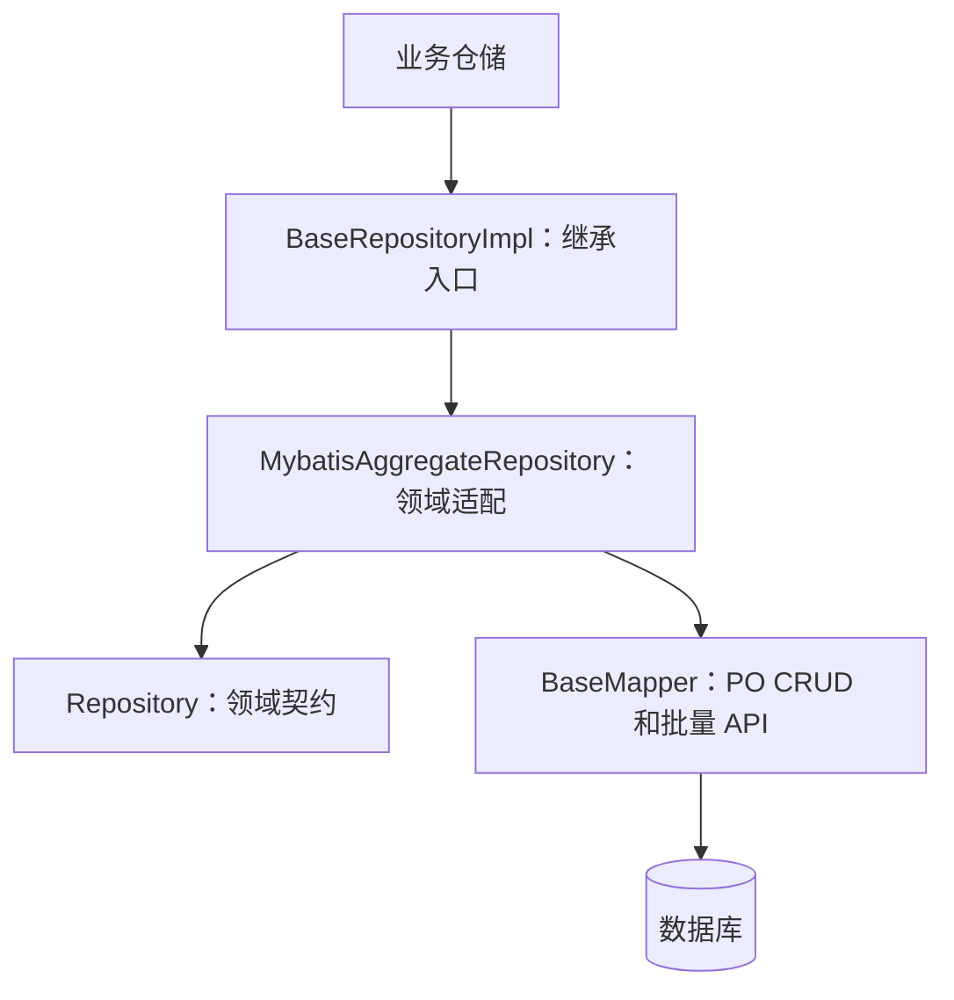

# MyBatis-Plus 聚合仓储

业务仓储继续使用 `BaseRepositoryImpl`。它是统一继承入口，泛型解析、领域 CRUD、查询翻译和填充由 `MybatisAggregateRepository`
实现一次。

```java
public class OrderRepositoryImpl
        extends BaseRepositoryImpl<OrderMapper, Order, OrderPO, OrderQuery, Long>
        implements OrderRepository {
}
```

五个泛型参数依次是 Mapper、聚合根、PO、查询、ID。`Order` 必须继承 `AggregateRoot<Long>`，`OrderQuery` 必须继承 `Query<Order>`
；聚合根使用 String ID 而仓储声明 Long ID 的组合会被编译器拒绝。手动装配使用 `setBaseMapper`，Guice 的 `bindRepository` /
`initRepositories` 同样支持该入口。



领域仓储组合 Mapper，不再同时继承面向 PO 的 `AbstractRepository`，避免领域对象 M 与持久化对象 P 共用同名方法产生泛型擦除冲突。

## 调用方式调整

| 旧调用                                        | 当前调用                                                                    |
|-----------------------------------------------|-----------------------------------------------------------------------------|
| `get(id)`                                     | `findById(id)`，返回 `Optional<M>`                                          |
| `list(query)` / `first(query)` / `one(query)` | `findList(query)` / `findFirst(query)`                                      |
| `exist(query)`                                | `exists(query)`                                                             |
| `update(model)` / `saveOrUpdate(model)`       | `updateById(model)` / `save(model)`                                         |
| `delete(id)` / `delete(query)`                | `deleteById(id)` / `deleteByQuery(query)`                                   |
| `setMapper(mapper)`                           | `setBaseMapper(mapper)`                                                     |
| PO 的 `getById`、`getOne`、`removeById` 等    | 直接使用 `getBaseMapper().selectById`、`selectOne`、`deleteById` 等组件 API |
| PO 的带 batchSize 批量包装                    | 直接使用 Mapper 的 `insert`、`updateById`、`insertOrUpdate` 集合 API        |
| 四个链式查询/更新别名                         | 直接使用 MyBatis-Plus 的 `ChainWrappers`                                    |

领域 `insertOrUpdate(model)` 继续由 core `Repository` 的默认实现转调 `save(model)`。`queryWrapper` 和
`queryWrapperIgnoreTenant` 保留，它们包含 DDD4J 的默认上下文条件。

## 主键与 Model/PO 映射

领域身份由 `DomainModel.id()` 返回；PO 的字段、数据库列及生成策略由 MyBatis-Plus 的 `@TableId` / `TableInfo`
决定，支持父类声明的主键。实体中的普通 `id` 属性不会覆盖显式声明的主键。

例如 Model 的 `businessId` 对应 PO 的 `orderKey`、数据库的 `order_pk`：在领域字段上使用
`@DomainField(poField = "orderKey")`，在 PO 上使用 `@TableId("order_pk")`。查询翻译会读取完整 TableInfo，包括主键。对象转换仍实现既有
`toModel` / `toPersistenceObject`；该注解不替代对象转换。单条、列表、批量及写后回填统一经过这些转换入口。

原生 MyBatis 模块对应复用 ResultMap 的显式 ID 映射（XML `<id>` 或 `@Result(id = true)`），未声明时使用 insert 的
`keyProperty`，仍未声明才兼容 `id` 属性。主键值为空不会改用普通 `id`；多主键映射在写入前拒绝。若业务对原生 Mapper
另加代理装饰，仓储可覆盖 `persistenceIdProperty()` 提供对应属性。

## 领域批量契约

- `saveBatch(Collection<M>)`：只插入，返回按输入顺序排列的原聚合根，并回写主键和填充字段。
- `updateBatchById(Collection<M>)`：只更新，记录不存在时计 0。
- `insertOrUpdateBatch(Collection<M>)`：根据主键处理新增与更新，保留各自填充规则和字段回写。
- null 或空集合返回空列表/0；集合内存在 null 时，在查询或写入前拒绝整个输入。
- 更新与 upsert 返回 JDBC 影响行数；驱动返回 `SUCCESS_NO_INFO` 时按一条成功语句计数。失败标记抛出持久化异常。
- 批量成功后清除原 Mapper 会话的一级缓存，避免后续查询返回批量写入前的数据。

批量 SQL、会话和提交/回滚直接使用当前 MyBatis-Plus 组件实现。此处没有 `@Transactional`，不承诺批量 API
自动加入外层事务。单次批量失败回滚已通过真实 MySQL 验证；需要与其他写操作共同提交/回滚的业务必须明确装配并验证事务边界。

2026-11-25 的改动涉及上述旧方法及继承关系的调整，消费方应重新编译。`BaseRepositoryImpl` 的包名和五泛型入口保持。
