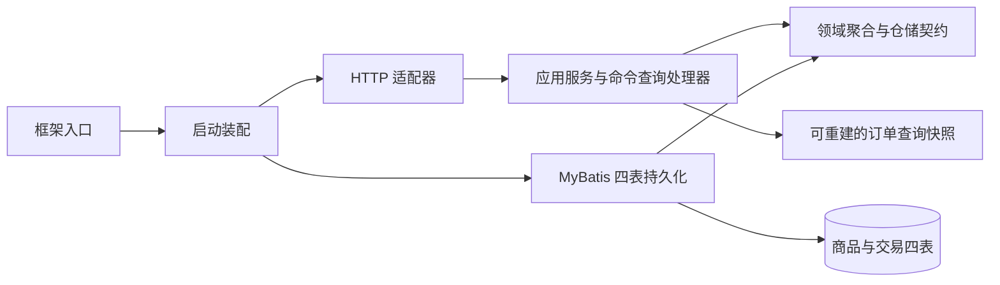

# ddd4j 示例工程

本目录提供七个运行时的 28 个订单示例，每个平台各有默认 DDD、CQRS、Sa-Token 和 Shiro 四个入口。Guice 配套 Javalin，Spring 提供 WebMVC 和 WebFlux 两种接入。28 个样例复用商品目录和订单交易模型，Spring 的四个入口沿用外部 `ddd4j-boot` 自动配置。

## 示例矩阵

聚合 POM 管理 6 个共享商品交易模块和 28 个独立样例。点选对应模块查看代码与运行说明。每个模块可独立构建和运行。

| Runtime | Web 接入 | 默认 | CQRS | Sa-Token | Shiro |
| --- | --- | --- | --- | --- | --- | --- |
| Spring | WebMVC、WebFlux | [默认](ddd4j-sample-spring/README.md) | [CQRS](ddd4j-sample-spring-cqrs/README.md) | [Sa-Token](ddd4j-sample-spring-satoken/README.md) | [Shiro](ddd4j-sample-spring-shiro/README.md) |
| Guice | Javalin | [默认](ddd4j-sample-javalin/README.md) | [CQRS](ddd4j-sample-javalin-cqrs/README.md) | [Sa-Token](ddd4j-sample-javalin-satoken/README.md) | [Shiro](ddd4j-sample-javalin-shiro/README.md) |
| Quarkus | Quarkus | [默认](ddd4j-sample-quarkus/README.md) | [CQRS](ddd4j-sample-quarkus-cqrs/README.md) | [Sa-Token](ddd4j-sample-quarkus-satoken/README.md) | [Shiro](ddd4j-sample-quarkus-shiro/README.md) |
| Micronaut | Micronaut | [默认](ddd4j-sample-micronaut/README.md) | [CQRS](ddd4j-sample-micronaut-cqrs/README.md) | [Sa-Token](ddd4j-sample-micronaut-satoken/README.md) | [Shiro](ddd4j-sample-micronaut-shiro/README.md) |
| Helidon | Helidon | [默认](ddd4j-sample-helidon/README.md) | [CQRS](ddd4j-sample-helidon-cqrs/README.md) | [Sa-Token](ddd4j-sample-helidon-satoken/README.md) | [Shiro](ddd4j-sample-helidon-shiro/README.md) |
| Vert.x | Vert.x | [默认](ddd4j-sample-vertx/README.md) | [CQRS](ddd4j-sample-vertx-cqrs/README.md) | [Sa-Token](ddd4j-sample-vertx-satoken/README.md) | [Shiro](ddd4j-sample-vertx-shiro/README.md) |
| Dropwizard | Dropwizard | [默认](ddd4j-sample-dropwizard/README.md) | [CQRS](ddd4j-sample-dropwizard-cqrs/README.md) | [Sa-Token](ddd4j-sample-dropwizard-satoken/README.md) | [Shiro](ddd4j-sample-dropwizard-shiro/README.md) |


## 启动默认订单示例

七个现有默认启动类共用同一套商品交易流程。先在专用 MySQL 8.0.16+ 实例准备一个空数据库，再为应用进程设置连接环境变量。首次启动通过 MyBatis 执行仓库中的原始 DDL，仅创建四张业务表。再次启动只补建缺失的表并保留数据。数据库用户需要在该示例库内建表和读写的权限。

```bash
export CATALOG_JDBC_URL='jdbc:mysql://127.0.0.1:3306/catalog_demo'
export CATALOG_DB_USER='catalog_demo'
# 将此账号的密码通过运行环境的 CATALOG_DB_PASSWORD 传入
```

| HTTP 方法 | 路径 | 行为 |
| --- | --- | --- |
| POST | `/api/goods/{spuCode}` | 建立套餐商品和一个不限量规格，并绑定可售门店 |
| GET | `/api/goods/{spuCode}` | 按商品编码读取商品及规格 |
| POST | `/api/orders/{orderNo}` | 根据门店、SKU 和购买数量计算金额，并在同一事务保存订单和行快照 |
| GET | `/api/orders/{orderNo}` | 按订单号读取下单时的名称、数量及单价 |
| POST | `/api/orders/{orderNo}/payment` | 确认支付，JSON 请求使用整数 `paidAmountCent` |
| POST | `/api/orders/{orderNo}/cancel` | 取消订单，已支付订单进入退款处理中 |
| POST | `/api/orders/{orderNo}/fulfill` | 确认履约完成 |

每次请求携带 `X-Tenant-Id`。默认入口按请求头演示租户数据隔离。商品和订单业务编码分别在租户内唯一。金额以分计。下面以 Vert.x 默认端口为例。

```bash
base=http://127.0.0.1:8084
curl -i -X POST "$base/api/goods/LUNCH" -H 'X-Tenant-Id: shop-demo' -H 'Content-Type: application/json' \
  -d '{"spuName":"午间套餐","skuCode":"LUNCH-1","skuName":"单人份","salePriceCent":1250,"shopId":7}'
curl -i -X POST "$base/api/orders/T001" -H 'X-Tenant-Id: shop-demo' -H 'Content-Type: application/json' \
  -d '{"shopId":7,"items":[{"skuCode":"LUNCH-1","quantity":2}]}'
curl -s "$base/api/orders/T001" -H 'X-Tenant-Id: shop-demo'
```

最后一个请求返回 `grossAmountCent=2500`，第一条订单明细的 `unitPriceCent=1250`。从仓库根目录执行 `python3 ddd4j-samples/scripts/check_catalog_trade.py "$base"` 可验证完整 HTTP 流程，每次使用独立演示租户。

用 `-am` 从根目录打包时，上游模块显式启用的测试仍会执行，例如 MyBatis 的 MySQL 用例。已有本线依赖构件时，可以去掉 `-am`，仅打包所选样例。

### Spring 和 Quarkus

Quarkus 的默认包可直接启动。

```bash
./mvnw -pl ddd4j-samples/ddd4j-sample-quarkus -am \
  -Dmaven.test.skip=true -Dmaven.javadoc.skip=true package
java -jar ddd4j-samples/ddd4j-sample-quarkus/target/quarkus-app/quarkus-run.jar
```

Spring 先按[本线依赖说明](ddd4j-sample-spring/README.md#源码依赖与构建)准备 Boot 装配依赖，再使用同一个 Maven 本地仓库打包。

```bash
./mvnw -Dmaven.repo.local="$DDD4J_MAVEN_REPO" \
  -pl ddd4j-samples/ddd4j-sample-spring -am \
  -Dmaven.test.skip=true -Dmaven.javadoc.skip=true package
```

若配置的 Maven 仓库已能解析本线 Boot 构件，可省略 `-Dmaven.repo.local` 参数。用 `java -jar` 运行该模块 `target` 中的 `ddd4j-sample-spring-<version>.jar`。默认业务 profile 为 `catalog-trade`。

### Javalin、Micronaut、Helidon、Vert.x 和 Dropwizard

这些入口使用本模块 JAR 和 Maven `runtime` 依赖。下面以 Vert.x 为例，将 `<version>` 换成构建产物的实际版本。

```bash
module=ddd4j-samples/ddd4j-sample-vertx
./mvnw -pl "$module" -am -Dmaven.test.skip=true -Dmaven.javadoc.skip=true \
  -DincludeScope=runtime -Dmdep.outputFile=target/runtime-classpath.txt \
  package dependency:build-classpath
java -cp "$module/target/ddd4j-sample-vertx-<version>.jar:$(cat "$module/target/runtime-classpath.txt")" io.ddd4j.sample.vertx.VertxOrderApplication
```

Vert.x 默认监听本机 8084。端口已占用时，可在 `java` 后添加 `-Dsample.port=0`，并从启动日志读取实际端口。使用上方商品和订单接口验证。

切换样例时换用对应目录、JAR 文件名和下表的主类。

| 默认样例 | 启动主类或产物 | 默认端口 | 订单路径 |
| --- | --- | --- | --- |
| Spring | `ddd4j-sample-spring-<version>.jar` | `8080` | `/api/orders/{orderNo}` |
| Guice/Javalin | `io.ddd4j.sample.javalin.JavalinSample` | `7000` | `/api/orders/{orderNo}` |
| Quarkus | `target/quarkus-app/quarkus-run.jar` | `8080` | `/api/orders/{orderNo}` |
| Micronaut | `io.ddd4j.sample.micronaut.MicronautOrderApplication` | `8083` | `/api/orders/{orderNo}` |
| Helidon | `io.ddd4j.sample.helidon.HelidonOrderApplication` | `8080` | `/api/orders/{orderNo}` |
| Vert.x | `io.ddd4j.sample.vertx.VertxOrderApplication` | `8084` | `/api/orders/{orderNo}` |
| Dropwizard | `io.ddd4j.sample.dropwizard.DropwizardOrderApplication` | `8086` | `/api/orders/{orderNo}` |

Dropwizard 在主类名后加 `server ddd4j-samples/ddd4j-sample-dropwizard/src/main/resources/dropwizard-order.yml`。

## 普通 DDD 示例

COLA 包分布在已有的共享模块中。HTTP 适配器把输入转换成 Cmd 和 Query。应用服务通过领域仓储接口完成业务，MyBatis 在同一事务读写商品、规格、订单和明细。

`domain.model.GoodsSpu`、`GoodsSku`、`TradeOrder`、`TradeOrderItem` 分别对应 `goods_spu`、`goods_sku`、`trade_order`、`trade_order_item`。四个模型使用表字段的业务名称，商品和订单额外携带各自的子项集合。 商品和订单继承 DDD4J 的 `AggregateRoot`，规格和订单明细实现 `Entity`。应用以 `Repository` 保存聚合，命令由 `CommandExecutor` 执行，查询由 `QueryHandler` 执行。

| 现有模块 | 包及职责 |
| --- | --- |
| `ddd4j-sample-order-domain` | `domain.model` 保存商品、规格、可购报价、订单与明细，`domain.gateway` 声明仓储接口 |
| `ddd4j-sample-order-application` | `client.command`、`client.query` 定义用例输入，`app.CatalogService` 编排建档、下单及查询 |
| `ddd4j-sample-order-jdbc` | `infrastructure.persistence.po` 映射四表，`CatalogMapper` 和 `MybatisRepositories` 实现持久化，`db/catalog-trade` 保存原始 DDL |
| `ddd4j-sample-order-adapter` | HTTP 协议适配、状态码映射和命令总线调用 |
| `ddd4j-sample-order-start` | 组装应用、适配器、四表持久化和领域事件 |
| `ddd4j-sample-order-testkit` | 共享 HTTP 测试传输和鉴权断言 |
| 28 个框架样例 | 在原生启动生命周期初始化四表，并将原生 HTTP 请求交给共享应用 |



推荐先阅读：

```bash
./mvnw -pl ddd4j-samples/ddd4j-sample-quarkus -am test -DskipTests=false
./mvnw -pl ddd4j-samples/ddd4j-sample-javalin -am test -DskipTests=false
./mvnw -pl ddd4j-samples/ddd4j-sample-micronaut -am test -DskipTests=false
./mvnw -pl ddd4j-samples/ddd4j-sample-vertx -am test -DskipTests=false
./mvnw -pl ddd4j-samples/ddd4j-sample-helidon -am test -DskipTests=false
./mvnw -pl ddd4j-samples/ddd4j-sample-dropwizard -am test -DskipTests=false
```

## 商品交易专项入口

CQRS、Sa-Token 和 Shiro 使用各自现有的启动类和配置。启动进程使用上方三个 `CATALOG_*` 数据库环境变量。业务端点使用 `/orders/catalog` 前缀，例如 `POST /orders/catalog/goods/LUNCH`。各模块的 README 提供原生入口、监听端口和其他运行参数。商品交易模式的旧订单创建路径返回 404，原生登录和退出仍按各框架说明调用。

CQRS 的写用例由各运行时的命令总线执行。订单创建后，读侧先返回 404。调用 `POST /orders/catalog/projections/orders/{orderNo}` 投影指定租户的订单后，GET 返回成交快照。此视图可从四表重新构建。重启后再次调用投影接口可恢复视图。交易事务提交后，通过各框架的 DDD4J 发布器分发进程内事件。同一订单的投影重建串行读取并发布独立查询快照。

```bash
python3 ddd4j-samples/scripts/check_catalog_trade.py http://127.0.0.1:8081 --mode cqrs --check-legacy-routes
```

认证样例沿用各自的登录、角色权限和退出流程。认证后使用有写权限的演示账号运行商品交易。Spring 的写账号为 `writer`，只读账号为 `alice`。其他框架的请求头和现有账号见对应模块说明。

## CQRS 命令总线

| 框架 | 命令总线 |
| --- | --- |
| Spring | SpringCommandBus |
| Guice / Javalin | GuiceCommandBus |
| Quarkus | QuarkusCommandBus |
| Micronaut | MicronautCommandBus |
| Helidon | DefaultCommandBus，由 CDI 装配 |
| Vert.x | VertxCommandBus |
| Dropwizard | DropwizardCommandBus |

## Auth 示例

在上表选一个框架的 Sa-Token 或 Shiro 模块。Spring 和 Quarkus 使用各自的可执行包，其余框架使用模块 JAR 与 Maven 运行时依赖。启动、登录和权限示例见对应模块的 README。

业务层使用 ddd4j 的 `Subject`、`SubjectProvider` 和 `AuthRequest` 契约。各鉴权引擎的会话和权限配置由对应样例和适配层提供。

```bash
./mvnw -pl ddd4j-samples/ddd4j-sample-micronaut-satoken -am test
```

## 当前约束

- 模块清单以 `ddd4j-samples/pom.xml` 为准。Java 8 和 17 使用 Maven 3 的 `modules`，Java 21 使用 Maven 4 的 `subprojects`。
- Spring 的业务入口位于本目录，Boot 自动配置由外部 `ddd4j-boot` 仓库维护。
- Quarkus/Javalin 专属脚手架能力分别归外部 `ddd4j-quarkus`、`ddd4j-javalin`，本目录只保留可对照的业务样例。

## 历史验收记录

以下记录对应商品交易迁移前的样例。

<details>
<summary>历史验收与旧接口</summary>

已有默认模块命名为 `ddd4j-sample-<framework>`，其他三类带 `-cqrs`、`-satoken`、`-shiro` 后缀；Spring四项见[运行说明](ddd4j-sample-spring/README.md)，本批 S01 已通过独立审查。共享 order-* 不计入28。S01 在 Java 17 验证了 Spring 默认例的 WebMVC 和 WebFlux。两类认证例的 HTTP 证据覆盖 WebMVC。Javalin四项已通过S02审查：默认简单入口、持久CQRS、两原生认证及运行时依赖下的打包启动/关闭均有证据。认证按实际匹配路由判权，保留普通及尾斜杠URL。Quarkus四项已通过S03审查：默认沿用`/api/orders`且不强制Bearer，CQRS有独立持久查询与同库重开，两原生认证有真实请求完成清理。Shiro保留匿名`GET /orders`公开列表，其余受保护订单操作按原生权限控制。Micronaut运行时R09与四类样例S04均已通过审查：默认例支持直接业务调用，CQRS已验证持久失败恢复及数据库容器/应用重开，两认证例验证原生权限与线程传播清理；Helidon四入口S05也已通过审查，当前10项样例测试与46项实际main HTTP通过，持久CQRS有数据库容器/应用同库重开证据。两原生认证的聚合结束观察通过，断连请求的精确完成关联留R14强化。Vert.x运行时R11与四类样例S06已通过独立复审：真实持久投影和原生认证完成，应用等待已进入worker及定时投影后关闭资源。Dropwizard四类样例S07已完成本地实现与验证：26项样例测试、36次生产JAR/main HTTP和同库独立JVM恢复；独立审查已通过（C0/I0/M3），验证边界见任务报告。

共同验收：default不强制bus/ES/projection/MQ/auth；CQRS覆盖读写链和失败恢复；satoken/shiro各覆盖登录、允许/拒绝、退出失效、异常及请求结束后上下文清理。所有入口保留普通业务调用，真实平台启动与业务测试结果进入R14/R15完整28场景门禁。详见[活动计划](../docs/superpowers/plans/2026-10-10-three-line-product-convergence.md#architecture-convergence-tasks-20261118)。

### S04 Micronaut 四入口

`ddd4j-sample-micronaut`（`/api/orders` 默认无强制认证）、`ddd4j-sample-micronaut-cqrs`（显式 PostgreSQL/JPA 的 `/sample/orders`，保留内存 `/orders`）、`ddd4j-sample-micronaut-satoken`、`ddd4j-sample-micronaut-shiro` 均使用原生 Micronaut main、编译期 BeanDefinition 及共享 Order。各模块 README 说明实际端点、原生认证和事务/线程边界。S04 工程验证见 `.superpowers/sdd/2026-10-10-three-line-product-convergence/task-S04-report.md`；独立审查状态由控制器确定。

### S05 Helidon 四入口

Helidon default/cqrs/satoken/shiro 使用真实 MP/CDI/JAX-RS 主入口，复用共享 Order。default 保留 `/api/orders` 和显式 REQUIRED Bearer/支付幂等契约；CQRS 保留 `/orders` 内存 DTO，通过独立 `/sample/orders` 验证 PostgreSQL、R10 Runner、失败恢复和重开；两认证入口使用原生会话/权限及同步生命周期。各模块 README 说明真实边界，工程证据位于 `.superpowers/sdd/2026-10-10-three-line-product-convergence/task-S05-report.md`，独立接受由控制器确认。


### S06 Vert.x 四入口

Vert.x default/cqrs/satoken/shiro 均提供 native main 与同源 callable lifecycle。default 主入口无强制认证并保留原 REQUIRED router；CQRS 主入口在既有 `/orders` 五字段契约下复用共享 Order/JDBC/Outbox、R11 源感知 Runner 与持久查询；两认证入口使用真实 Sa-Token/Shiro worker 作用域。详见四模块 README 和 `.superpowers/sdd/2026-10-10-three-line-product-convergence/task-S06-report.md`；S06已通过独立审查及Fix1复审（C0/I0/M0）。关闭先停止准入和后续定时任务，等待已进入的业务/完整投影，再释放资源；初轮1,329项与修复后受影响32项分时记录，详见报告。

R13 验收时，用户确认没有业务项目使用当时清单中的 14 个旧 CQRS 和平台投影坐标。样例和独立消费者验证了当时保留的构件、API、配置及数据格式，覆盖范围为样例和兼容性测试。现行构件状态见 [R15 实施清单](../docs/superpowers/plans/2026-10-10-three-line-product-convergence.md#r15退出旧实现模块并保持可回退交付)。

### Dropwizard 四入口（S07）

- [default](ddd4j-sample-dropwizard/README.md)：共享 Order 直接业务，默认无需认证，保留显式 Bearer。
- [cqrs](ddd4j-sample-dropwizard-cqrs/README.md)：旧 memory API 与独立持久 `/sample/orders`，原生 Bundle/Managed。
- [satoken](ddd4j-sample-dropwizard-satoken/README.md)：原生 Sa-Token 凭证、权限、会话及请求作用域。
- [shiro](ddd4j-sample-dropwizard-shiro/README.md)：原生 Shiro Realm、权限、会话及请求作用域。


### 2026-11-18 R13 兼容验收

当时 Java 17 的旧、新、混合及单旧坐标构成的 35 个独立消费者均通过构建。验收覆盖冻结的旧客户端、当时的原生装配和七平台旧实现的续写与回退。独立审查 C0/I0/M2，核验了产物来源和冻结输入。当时共有七个 runtime 实现，另有一个 runtime-testkit。随后 R14 在投影坐标退役前完成了三线独立消费者复验。真实后端矩阵和远端 CI 的当前状态见 R14。此次历史验收详见活动计划 R13、`task-R13-report.md`、`task-R13-review.md` 和 `R13-evidence/controller-verification.json`。

</details>
