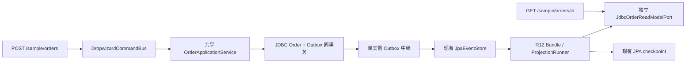

# Dropwizard CQRS

## 当前商品交易入口

此模块以 CQRS 方式运行共享商品交易。先按[示例总览](../README.md#启动默认订单示例)配置 MySQL。以下命令从仓库根目录运行，使用实际
Maven 版本替换 `<version>`。

```bash
module=ddd4j-samples/ddd4j-sample-dropwizard-cqrs
./mvnw -pl "$module" -am -DskipTests -Dmaven.javadoc.skip=true -DincludeScope=runtime -Dmdep.outputFile=target/runtime-classpath.txt package dependency:build-classpath
java -cp "$module/target/ddd4j-sample-dropwizard-cqrs-<version>.jar:$(cat "$module/target/runtime-classpath.txt")" io.ddd4j.sample.dropwizard.cqrs.DropwizardCqrsApplication server "$module/src/main/resources/dropwizard-cqrs.yml"
```

业务请求携带 `X-Tenant-Id`。商品地址为 `/orders/catalog/goods/{spuCode}`，订单地址为 `/orders/catalog/orders/{orderNo}`
。支付、取消和履约分别使用订单子路径 `/payment`、`/cancel`、`/fulfill`。支付请求必须提供非空 `Idempotency-Key`，重试时复用原键和实付金额。

写操作经命令总线执行。调用 `POST /orders/catalog/projections/orders/{orderNo}` 构建订单投影。

<details>
<summary>商品交易迁移前的说明</summary>

使用本线 JDK 按[运行时类路径构建说明](../README.md#启动默认订单示例)打包 `ddd4j-sample-dropwizard-cqrs`。运行主类
`io.ddd4j.sample.dropwizard.cqrs.DropwizardCqrsApplication`，从仓库根目录追加以下参数以使用样例配置。

```text
server ddd4j-samples/ddd4j-sample-dropwizard-cqrs/src/main/resources/dropwizard-cqrs.yml
```

样例配置的应用端口为 `8088`，管理端口为 `8089`。只追加 `server` 时使用 Dropwizard 默认端口 `8080`、`8081`。

未提供 JDBC 配置时保留旧 `/orders` demo-memory 路由、静态 API 和含 createdAt 的 DTO，并通过 native Managed
配对启停。此路径不是持久性证明。

设置 YAML `jdbcUrl`、`jdbcUser`、`jdbcPassword`，或 JVM `sample.jdbc.url`、`sample.jdbc.user`、`sample.jdbc.password` 后，同时启用
`/sample/orders` 持久场景。数据库必须已有 shared order-jdbc 与 EventStore/ProjectionPosition 表，生产入口仅
validate，不创建/修改 schema。原生持久流程：



`POST /sample/orders/{id}/lines`、`POST /sample/orders/{id}/pay` 更新共享订单；支付使用 `Idempotency-Key`。
`POST /sample/projections/orders/run` 是运维触发，调用 Bundle 的同一个公共 Runner；默认 cron `0/5 * * * * *`，可用
`-Dsample.projection.cron=...` 设置。查询仅返回已投影六字段模型，未投影返回 404；旧 `/orders` DTO 保持不变。

订单 Outbox 由该样例独占。投影读取全局 EventStore，按完整源页末尾推进位点，只投影 `Order`
聚合。其他聚合独占一页时也会推进位点。事件库会先解码整页，无法解码的记录或载荷类型错误的订单事件会阻止该页提交位点。Outbox
原始消息 ID/事件类型/载荷保留；JDBC、事件追加和 checkpoint 使用独立提交，追加成功/Outbox 确认失败靠同一 ID
去重，查询先提交/checkpoint 失败靠幂等 UPSERT 重放。单实例中继不是多实例并发协议或 JTA；投影刷新当前写快照，不宣称可仅凭历史事件重建。支付幂等端口为内存，持久
Order.pay 规则仍阻止重复状态变迁。

存储 Managed 先启动，Bundle 后启动；Jetty graceful shutdown 排空 HTTP，Bundle 自有调度池停止并等待后，反序关闭 JPA。自有调度池遵循
R12 的中断和 5 秒停止界限，服务器使用默认 30 秒 graceful deadline；超限停止不能视为完整排空。本样例无异步 Jersey 或外部线程直接
trigger 的并发关闭保证。集成验证覆盖真实数据库锁下的 HTTP 排空、已进入 timer 的中断/释放/提交/关闭和非法 cron 启动失败回滚。

</details>
