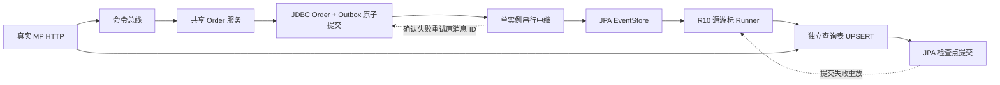

# Helidon CQRS 订单样例

使用当前发行线要求的 JDK、原生 Helidon MP/CDI/JAX-RS 和共享 Order domain/application。主入口与持久化 HTTP 测试使用同一 `start(int)` 装配；没有 test-only 服务器替代产品入口。`server.port` 默认为8080；停止时配对 `Server.stop()`。

入口：`io.ddd4j.sample.helidon.cqrs.HelidonCqrsApplication`。

构建：仓库根执行 `./mvnw -pl ddd4j-samples/ddd4j-sample-helidon-cqrs -am verify`，使用当前分支 JDK。按[运行时类路径构建说明](../README.md#启动默认订单示例)准备模块 JAR 和 Maven runtime 依赖，再运行主入口。

保留原 `/orders` 创建/查询与 `createdAt` DTO，其 Order/EventStore/投影是内存兼容演示，不作为持久证据。

真实持久路径使用 `-Dddd4j.cqrs.projection.enabled=true`、`-Dsample.jdbc.url=jdbc:postgresql://.../owned_database`、`-Dsample.jdbc.user=...`、`-Dsample.jdbc.password=...`。持久模式使用已准备好的 PostgreSQL schema。先准备现有 [Order JDBC 迁移](../ddd4j-sample-order-jdbc/src/main/resources/db/migration/)、JPA EventStore 和 ProjectionPosition 对应表。默认 `sample.jpa.schema=validate` 仅校验 JPA 实体对应的表。JDBC 表由前述迁移在应用启动前准备。测试只在自身临时数据库执行现有共享 JDBC fixture 与既有 JPA 实体建表。

持久端点：POST `/sample/orders` 创建；POST `/sample/orders/lines` 接受 orderId/goodsId/goodsName/quantity/unitPrice；POST `/sample/orders/{id}/payment?key=...`；GET `/sample/orders/{id}` 只读独立查询表，未投影404；POST `/sample/orders/query` 按 buyerId/status/page/size 筛选；POST `/sample/projections/orders/run` 运维触发与定时器使用同一个 R10 Runner。默认 cron `0/5 * * * * *`，可通过 `sample.projection.cron` 设置。

此入口使用专用 Outbox 和单实例串行中继。保持原消息 ID、订单 ID、事件类型和业务载荷。写库/Outbox 同一 JDBC 事务，EventStore、查询和 checkpoint 是独立 ResourceLocal/JDBC 事务，没有 JTA 假设。先 append 再确认；查询提交先于 checkpoint，靠原消息 ID 去重与查询 UPSERT 恢复。投影使用已持久写模型重建最新快照；HTTP 查询没有写仓储 fallback，不声称逐事件历史快照。原内存 CDI 类型用 `@Typed` 与 R10 默认 reader/view/manager 隔离。

投影按事件库的全局位置读页，只处理 `Order` 聚合，检查点推进到已扫描页尾的下一位置。事件库会先解码整页；无法解码的事件、载荷类型错误的订单事件和缺失的订单写模型都会阻止本批检查点提交。修复数据后可从原位重试。
