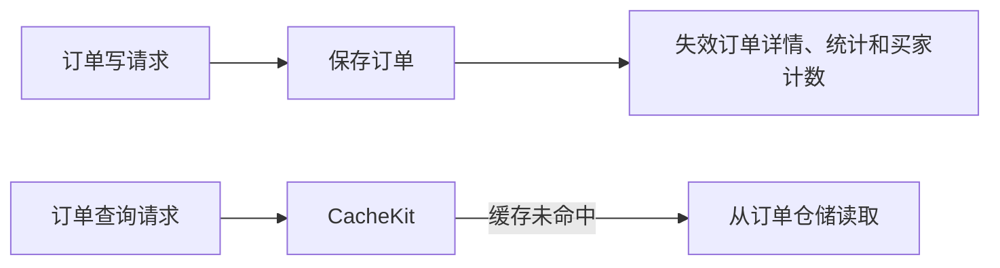

# ddd4j-sample-javalin-cqrs

## 当前商品交易入口

此模块以 CQRS 方式运行共享商品交易。先按[示例总览](../README.md#启动默认订单示例)配置 MySQL。以下命令从仓库根目录运行，使用实际
Maven 版本替换 `<version>`。

```bash
module=ddd4j-samples/ddd4j-sample-javalin-cqrs
./mvnw -pl "$module" -am -DskipTests -Dmaven.javadoc.skip=true -DincludeScope=runtime -Dmdep.outputFile=target/runtime-classpath.txt package dependency:build-classpath
java -cp "$module/target/ddd4j-sample-javalin-cqrs-<version>.jar:$(cat "$module/target/runtime-classpath.txt")" io.ddd4j.sample.javalin.cqrs.JavalinCqrsApplication
```

业务请求携带 `X-Tenant-Id`。商品地址为 `/orders/catalog/goods/{spuCode}`，订单地址为 `/orders/catalog/orders/{orderNo}`
。支付、取消和履约分别使用订单子路径 `/payment`、`/cancel`、`/fulfill`。支付请求必须提供非空 `Idempotency-Key`，重试时复用原键和实付金额。

写操作经命令总线执行。调用 `POST /orders/catalog/projections/orders/{orderNo}` 构建订单投影。

<details>
<summary>商品交易迁移前的说明</summary>

## S02 持久共享 Order 与兼容入口

本模块保留原 `/api/orders`、`/api/orders/query/*`、`/api/goods` 及原 DTO。它们仍是 **内存/缓存兼容演示**，不能作为持久投影验收。原
Order DTO 包含 Money 与 lineCount，而既有共享查询表没有明细字段；为保留接口且不增加字段，仅 CQRS 使用明确的过渡主入口
`/sample/orders`。

启动 `JavalinCqrsApplication.main` 时设置 JVM 属性 `sample.jdbc.url`、`sample.jdbc.username`、`sample.jdbc.password`
，即调用同一个 `start(port, SharedCqrsRuntime)` 装配持久主场景；未设置 URL 或只填写普通空白时，启动旧内存示例。非空值原样交给
JDBC 驱动，含不换行空格 U+00A0 的无效 URL 会报错退出。已有订单表使用 order-jdbc 原迁移，事件表/位置表使用现有 JPA 映射，产品启动只
validate，未增加 SQL、表或业务字段。

- POST `/sample/orders`、`/sample/orders/lines`、`/sample/orders/{id}/payment?key=...`：R07 `Ddd4jGuiceModule.basic()` 的
  GuiceCommandBus → 共享 Order → JDBC 写模型/Outbox 同事务。
- `Ddd4jProjectionGuiceModule` 显式接入真实事件读取器和 JPA 检查点，后台每 5 秒处理；POST `/sample/projections/orders/run`
  可显式执行一次。
- GET `/sample/orders/{id}`、POST `/sample/orders/query`：只读独立查询仓储，不回退写模型、Outbox 或 EventStore。
- 中继单实例串行处理，按原 Outbox 消息 ID 去重；查询提交后再提交检查点，检查点失败依赖 UPSERT 重放。未声称跨库原子事务或多实例中继协议。

`SharedCqrsHttpTest` 通过真实 PostgreSQL/Javalin/Guice 验证 S00 契约、投影失败、检查点提交失败、真实源位置空洞、重试和应用关闭/重开；同一启动中的旧
Order lineCount/Money 与 Goods 路由另做实际 HTTP 回归。测试关闭调度以控制批次，运行器仍是实际 R07 显式模块提供的公共
Runner。


> ddd4j Javalin 平台的 **Order + Goods 双业务 / CQRS** 示例：第二轨（Order 充血模型） +
> 第三轨（Goods Model/Query CRUD） + 命令/查询分离 + CacheKit 缓存读侧 +
> 进程内事件总线 + Javalin EndpointGroup 路由。

---

## 1. 这是什么

Javalin 本身 **没有 DI 容器**，所以本示例在 `main` 中手动 new 出所有 Bean 并通过
`EndpointGroup` 注册路由；同时演示两个业务轨道 + CQRS 读写分离：

| 轨道                      | 业务包                     | 风格                                                                  |
|---------------------------|----------------------------|-----------------------------------------------------------------------|
| **第二轨**（充血模型）    | `order/`                   | `Order` 聚合根 + 5 个领域事件 + `OrderApplicationService`（手动 new） |
| **第三轨**（Model/Query） | `goods/`                   | `Goods` PO + `RichRepository` + `GoodsQuery`（手动 new）              |
| **CQRS 增强**             | `cache/` + 读侧 Controller | `CacheKit` 缓存读侧统计                                               |
| **事件处理器示例**        | `event/`                   | `OrderEventListener` 提供可注册到 `TypedEventDispatcher` 的处理器     |

### Javalin 平台的 SPI 注入

`JavalinCqrsApplication.start(...)` 使用 `SpiRegistrationScope` 登记领域事件发布器、主体提供器和国际化提供器。关闭样例时恢复该作用域持有的注册。

业务代码通过 ddd4j 的 `Contexts` 获取这些 SPI。

| 框架        | DI 容器  | ddd4j runtime 模块      | SPI 注入方式                                  |
|-------------|----------|-------------------------|-----------------------------------------------|
| Spring      | ✅       | `ddd4j-runtime-spring`  | 容器启动期扫描 `@Bean` 注入 BaseContext       |
| Quarkus     | ✅ (CDI) | `ddd4j-runtime-quarkus` | CDI Observer 启动期注入 BaseContext           |
| Guice       | ✅       | `ddd4j-runtime-guice`   | `Ddd4jGuiceModule#configure` 注入 BaseContext |
| **Javalin** | ❌       | 默认样例手动装配        | `start` 内由 `SpiRegistrationScope` 登记      |

---

## 2. 演示的数据流

订单兼容入口在保存成功后失效对应缓存。下一次查询从仓储加载最新值。



## 3. 项目结构

```
ddd4j-sample-javalin-cqrs/
├── pom.xml
├── README.md
└── src/main/java/io/ddd4j/sample/javalin/cqrs/
    ├── JavalinCqrsApplication.java           # main：装配 + 启动 Javalin
    ├── config/Ddd4jSampleConfig.java         # SPI 注入 + CacheKit 域初始化
    ├── spi/                                  # 4 个 SPI 示例实现
    │   ├── AnonymousSubjectProvider.java
    │   ├── DefaultI18nProvider.java
    │   ├── NoOpDomainEventPublisher.java
    │   └── NoOpMQEventPublisher.java
    ├── cache/                                # CQRS 缓存层
    │   ├── OrderCacheService.java
    │   └── GoodsCacheService.java
    ├── event/
    │   └── OrderEventListener.java           # TypedEventDispatcher 多事件处理
    ├── order/
    │   ├── domain/
    │   │   ├── model/                        # Order / OrderLine / OrderStatus / Money
    │   │   ├── event/                        # 5 个 Order*Event
    │   │   └── repository/OrderRepository.java
    │   ├── application/OrderApplicationService.java
    │   ├── infrastructure/
    │   │   ├── InMemoryOrderRepository.java
    │   │   ├── OrderPO.java                  # PO 持久化对象
    │   │   └── OrderLinePO.java
    │   └── web/
    │       ├── OrderController.java          # 写侧（EndpointGroup）
    │       └── OrderCQRSQueryController.java # 缓存读侧（/api/orders/query/*）
    └── goods/
        ├── domain/
        │   ├── Goods.java
        │   ├── GoodsId.java
        │   ├── GoodsStatus.java
        │   ├── GoodsRepository.java
        │   └── GoodsQuery.java
        ├── application/GoodsApplicationService.java
        ├── infrastructure/InMemoryGoodsRepository.java
        └── web/
            ├── GoodsController.java          # 写侧（EndpointGroup）
            └── GoodsReadController.java      # 缓存读侧（/api/goods/query/*）
```

---

## 4. REST API

### 4.1 Order 命令侧（写）

| 方法   | 路径                      | 说明         |
|--------|---------------------------|--------------|
| `POST` | `/api/orders`             | 创建草稿订单 |
| `POST` | `/api/orders/{id}/lines`  | 添加订单行   |
| `POST` | `/api/orders/{id}/pay`    | 支付订单     |
| `POST` | `/api/orders/{id}/ship`   | 发货订单     |
| `POST` | `/api/orders/{id}/cancel` | 取消订单     |

### 4.2 Order 查询侧（读）

| 方法  | 路径                                      | 说明                        |
|-------|-------------------------------------------|-----------------------------|
| `GET` | `/api/orders/{id}`                        | 按 ID 查询                  |
| `GET` | `/api/orders/by-no`                       | 按订单编号查询              |
| `GET` | `/api/orders/query/list`                  | 分页占位                    |
| `GET` | `/api/orders/query/stats`                 | **CQRS 缓存读**：订单统计   |
| `GET` | `/api/orders/query/buyer/{buyerId}/count` | **CQRS 缓存读**：买家订单数 |
| `GET` | `/api/orders/query/detail/{id}`           | **CQRS 缓存读**：订单详情   |

### 4.3 Goods 命令侧（写）

| 方法     | 路径                     | 说明         |
|----------|--------------------------|--------------|
| `POST`   | `/api/goods`             | 创建商品     |
| `PUT`    | `/api/goods/{id}`        | 更新商品     |
| `PUT`    | `/api/goods/{id}/status` | 调整商品状态 |
| `DELETE` | `/api/goods/{id}`        | 软删除商品   |

### 4.4 Goods 查询侧（读）

| 方法  | 路径                         | 说明                        |
|-------|------------------------------|-----------------------------|
| `GET` | `/api/goods/{id}`            | 按 ID 查询                  |
| `GET` | `/api/goods/by-code`         | 按编码查询                  |
| `GET` | `/api/goods/page`            | 充血分页查询                |
| `GET` | `/api/goods/list`            | 充血列表查询                |
| `GET` | `/api/goods/count`           | 充血计数                    |
| `GET` | `/api/goods/query/list`      | **CQRS 缓存读**：商品列表   |
| `GET` | `/api/goods/query/{id}`      | **CQRS 缓存读**：商品详情   |
| `GET` | `/api/goods/query/by-status` | **CQRS 缓存读**：按状态查询 |

---

## 5. 运行

### 5.1 启动 HTTP 服务

```bash
mvn -pl ddd4j/ddd4j-samples/ddd4j-sample-javalin-cqrs exec:java
```

启动后会看到：

```
[Bootstrap] DomainEventPublisher ready: NoOpDomainEventPublisher
[Bootstrap] CacheKit domain initialized: order-stats / buyer-order-count / goods-detail / goods-list
[Bootstrap] Repositories registered: Order / Goods
Javalin (CQRS) started on http://localhost:7001
```

### 5.2 体验完整 CQRS 流程

```bash
# 1. 创建商品
curl -X POST http://localhost:7001/api/goods \
     -H 'Content-Type: application/json' \
     -d '{"code":"SKU-001","name":"iPhone","price":"5999.00","stock":100}'

# 2. 创建订单
curl -X POST http://localhost:7001/api/orders \
     -H 'Content-Type: application/json' \
     -d '{"orderNo":"O-001","buyerId":"u-001","buyerName":"Alice"}'

# 3. 添加订单行
curl -X POST http://localhost:7001/api/orders/{id}/lines \
     -H 'Content-Type: application/json' \
     -d '{"goodsId":"1","goodsName":"iPhone","quantity":1,"unitPrice":"5999.00"}'

# 4. 支付
curl -X POST http://localhost:7001/api/orders/{id}/pay

# 5. CQRS 缓存读：订单统计
curl http://localhost:7001/api/orders/query/stats

# 6. CQRS 缓存读：商品列表
curl http://localhost:7001/api/goods/query/list
```

### 5.3 运行测试

```bash
mvn -pl ddd4j/ddd4j-samples/ddd4j-sample-javalin-cqrs test
```

---

## 6. 替换真实实现

本示例所有组件都是 In-Memory 版本。生产环境替换点：

| 示例实现                                  | 生产替换                                                                |
|-------------------------------------------|-------------------------------------------------------------------------|
| `InMemoryOrderRepository`                 | MyBatis-Plus / JDBI / Hibernate                                         |
| `InMemoryGoodsRepository`                 | 同上                                                                    |
| `OrderCacheService` / `GoodsCacheService` | 替换为 Caffeine / Redis / Redisson 后端（业务代码通过 `CacheKit` 解耦） |
| `NoOpDomainEventPublisher`                | Guava EventBus / Reactor Sinks / Akka Actor                             |
| `NoOpMQEventPublisher`                    | Kafka / RabbitMQ / RocketMQ 适配                                        |
| `AnonymousSubjectProvider`                | sa-token / shiro / spring-security 适配                                 |

业务代码（`order/domain/`、`goods/domain/`、`application/`） **完全不需要修改**。

---

## 7. 关键技术细节

### 7.1 进程内事件总线（`OrderEventListener`）

`OrderEventListener` 通过 ddd4j `TypedEventDispatcher` 按事件类型分派：

```java
TypedEventHandler<OrderCreatedEvent> onCreated = event -> log.info("订单已创建: {}", event.source());
TypedEventHandler<OrderPaidEvent>     onPaid   = event -> log.info("订单已支付: {}", event.source());
// ...5 个事件分别处理
```

内存兼容入口通过保存后的缓存失效来刷新读侧。应用使用事件分发时，可以将这些处理器注册到自己的 `TypedEventDispatcher`。

### 7.2 CacheKit 缓存读侧

`OrderCacheService` / `GoodsCacheService` 使用 ddd4j `CacheKit` 缓存门面：

```java
// 读：cache-first
Object cached = CacheKit.get(BIZ_ORDER_STATS, STATS_KEY);
if (cached instanceof Map) return (Map<String, Object>) cached;
// miss：实时计算并 put
List<Order> all = repository.findAll();
CacheKit.put(BIZ_ORDER_STATS, STATS_KEY, stats);

// 写后失效缓存
CacheKit.invalidate(BIZ_ORDER_STATS, STATS_KEY);
```

切换缓存后端（Caffeine → Redis）业务代码零修改。

### 7.3 双轨业务并存

- **第二轨**（Order）：充血聚合，业务规则全部下沉到 `Order.addLine() / pay() / ship() / cancel()`，
  5 个 `Order*Event` 在领域方法中注册。
- **第三轨**（Goods）：PO + `RichRepository<Goods, GoodsId, GoodsQuery>`，充血查询对象 `GoodsQuery`
  支持多条件组合查询（`code like / name like / status / price range`）。

两个轨道共用 `ddd4j-core` 的 `R<T>` 响应包装和 Jackson JSON 序列化，业务响应格式一致。

---

## 8. 相关项目

- [`ddd4j-sample-javalin`](../ddd4j-sample-javalin/README.md) — Javalin 框架启动示例（非 CQRS 版本）
- 外部 `ddd4j-boot-samples/ddd4j-boot-sample-order` — Spring Boot CQRS 对照
- [`ddd4j-sample-quarkus-cqrs`](../ddd4j-sample-quarkus-cqrs) — 同 CQRS 思路在 Quarkus 平台
- ddd4j 核心抽象：`ddd4j-core`（`io.ddd4j.core.ddd.*`、`io.ddd4j.core.context.*`）

</details>
