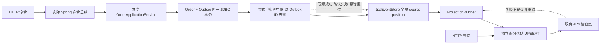

# Spring 四个独立 Order 入口

四个模块分别产出可执行 JAR，共用已有 `order-domain/application/local/jdbc`，没有新增业务对象副本或第五个支撑模块。

| 模块 | 默认端口 | 装配及已设定验证范围 |
| --- | --- | --- |
| `ddd4j-sample-spring` | 8080 | `demo-memory` 支持 MVC 和 WebFlux，`postgres` 复用已有 JDBC 持久化 |
| `ddd4j-sample-spring-cqrs` | 8081 | PostgreSQL；实际命令总线、Outbox 中继、JPA EventStore、独立查询投影及持久检查点 |
| `ddd4j-sample-spring-satoken` | 8082 | MVC；原生 Sa-Token 令牌、权限校验和退出失效 |
| `ddd4j-sample-spring-shiro` | 8083 | MVC；原生 Shiro Realm、Servlet 会话、权限校验和退出失效 |

`demo-memory` 重启丢失数据，不能作为持久化方案。PostgreSQL 模式的订单、Outbox、查询行使用现有 JDBC 适配器；支付幂等键仍为演示用进程内存，未声明跨重启支付幂等。认证账号为只读演示账号 `alice / demo-password`，权限仅 `order:read`。认证测试覆盖 MVC；没有据此宣称认证 WebFlux 已通过。

## 源码依赖与构建

选择当前分支对应的 JDK，并将 `JAVA_HOME` 指向该 JDK。三线均使用仓库 Maven Wrapper。表中的版本来自 R14 本线默认样例的归档 JAR。

| 分支 | JDK | `DDD4J_VERSION` | 外部 `io.ddd4j.boot` 版本 | 实际 Spring Boot | Spring Framework | Reactor |
| --- | --- | --- | --- | --- | --- | --- |
| 1.0.x | 8 | `1.0.x.20260630-SNAPSHOT` | `2.7.x.20260630-SNAPSHOT` | 核心 2.7.7，自动配置 2.7.18 | 5.3.39 | 3.8.6 |
| 2.0.x | 17 | `2.0.x.20260630-SNAPSHOT` | `3.4.x.20260630-SNAPSHOT` | 3.5.16 | 6.2.19 | 3.8.8 |
| 3.0.x | 21 | `3.0.x.20260630-SNAPSHOT` | `4.0.x.20260630-SNAPSHOT` | 4.0.8 | 7.0.9 | 3.8.6 |

将 `DDD4J_VERSION` 设置为表中对应值。从源码准备构件时，先执行下方步骤，再使用准备好的 Maven 本地仓库从主仓库根目录打包默认示例。若配置的 Maven 仓库已能解析本线外部构件，可省略 `-Dmaven.repo.local` 参数。

```bash
./mvnw -Dmaven.repo.local="$DDD4J_MAVEN_REPO" \
  -pl ddd4j-samples/ddd4j-sample-spring -am \
  -Dmaven.test.skip=true -Dmaven.javadoc.skip=true package
```

从源码准备外部构件时，将 `DDD4J_MAVEN_REPO` 设置为独立 Maven 本地仓库的绝对路径，将 `DDD4J_BOOT_DIR` 设置为本线的外部 `ddd4j-boot` 源码目录。从主仓库根目录执行。第一步准备 Boot 源码依赖的主仓库父 POM、BOM 和框架构件，第二步准备四个 Spring 样例所需的 Boot 构件。

```bash
./mvnw -Dmaven.repo.local="$DDD4J_MAVEN_REPO" \
  -pl :ddd4j-parent,:ddd4j-bom,:ddd4j-core,:ddd4j-runtime-spring,:ddd4j-web-webmvc,:ddd4j-web-webflux,:ddd4j-auth-satoken,:ddd4j-auth-shiro,:ddd4j-auth-spring \
  -am -Dmaven.test.skip=true -Dmaven.javadoc.skip=true install
(
  cd "$DDD4J_BOOT_DIR"
  sh ./mvnw -Dmaven.repo.local="$DDD4J_MAVEN_REPO" \
    -pl ddd4j-boot-core,ddd4j-boot-web/ddd4j-boot-web-webmvc,ddd4j-boot-web/ddd4j-boot-web-webflux,ddd4j-boot-auth/ddd4j-boot-auth-satoken,ddd4j-boot-auth/ddd4j-boot-auth-shiro \
    -am -Dmaven.test.skip=true -Dmaven.javadoc.skip=true install
)
```

- Java 8 R14 外部 Boot 源码提交为 `72a51123347927b48e0caa144c5e0eddbc729d02`。安装记录位于 `R14-evidence/jdk8-boot2-*-source-install`。Sa-Token 样例使用 Boot 2 Servlet starter 1.44.0。
- Java 17 S01 外部 Boot 源码和 Maven 仓库位于计划证据根目录下的 `S01-build`。外部源码 POM 声明 Boot 3.4.13，默认样例实际打包的 Boot 版本见上表。旧 `spring-extension` 二进制仍调用已移除的 `Mono.subscriberContext`。在任意对应源码目录内，用相同 Maven 本地仓库执行 `sh ./mvnw -Dmaven.repo.local="$DDD4J_MAVEN_REPO" -Dtest=ReactiveRequestContextFilterTest install` 安装 Easy4J `spring-extension` 的 `feature/2.0.x` 源码提交 `8386dec0e00ed6b23a853188db2028c3eb92bedc`。S01 测试使用 Sa-Token 1.45.0 和 Shiro 3.0.2。S01 外部认证模块的完整 Javadoc 构建因原有标签缺失失败。
- Java 21 R14 使用外部 Boot `4.0.x` 源码提交 `f5ae36355e83259eded49ba018a8e3c8d9ecacab`。源码与安装记录位于 `R14-evidence/boot4-source-origin.json` 和 `R14-evidence/boot4-source-install-online.json`。

上述跳过测试和 Javadoc 的命令只用于准备构件。继续使用同一个 Maven 本地仓库验证四个样例。

```bash
./mvnw -Dmaven.repo.local="$DDD4J_MAVEN_REPO" \
  -pl ddd4j-samples/ddd4j-sample-spring,ddd4j-samples/ddd4j-sample-spring-cqrs,ddd4j-samples/ddd4j-sample-spring-satoken,ddd4j-samples/ddd4j-sample-spring-shiro \
  -am verify
```

## 启动与调用

从仓库根目录运行。常规启动采用 MVC 和 `demo-memory`。切换到 WebFlux 时同时显式指定 `demo-memory`。

```bash
"$JAVA_HOME/bin/java" -jar "ddd4j-samples/ddd4j-sample-spring/target/ddd4j-sample-spring-${DDD4J_VERSION}.jar"
"$JAVA_HOME/bin/java" -jar "ddd4j-samples/ddd4j-sample-spring/target/ddd4j-sample-spring-${DDD4J_VERSION}.jar" \
  --spring.main.web-application-type=reactive --spring.profiles.active=demo-memory
```

三线打包入口均已验证创建订单、添加明细、支付及查询。命令行切换 Web 应用类型时，Spring Boot 会转换环境并丢失配置阶段设置的默认 profile。仅传入 reactive 类型会选择 `default`，使订单应用服务缺失并中止启动。

`POST /orders` 接收 `{"orderNo":"demo-1","buyerId":"buyer-1","buyerName":"Alice"}`；`POST /orders/lines` 接收共享 `AddOrderLineCommand`；`POST /orders/{id}/payment?key=unique-payment-key` 支付；`GET /orders/{id}` 查询；`POST /orders/query` 接收 `{"buyerId":"buyer-1","status":"PAID","page":1,"size":100}`。端点使用已有 `@RawResponse`，返回实际 DTO/标识，字符串可能由实际消息转换器输出为 JSON 字符串。

默认业务直接调用共享应用服务，不要求执行器、EventStore、后台投影、MQ 或认证资源。真实外部 `Ddd4jRepositoryAutoConfiguration` 仍提供仓储注册及一个未使用的空 CommandBus，样例保留该配置，不能将其描述为“容器中没有 bus”。

持久化模式以 `SAMPLE_JDBC_URL`、`SAMPLE_JDBC_USERNAME`、`SAMPLE_JDBC_PASSWORD` 指定独立样例数据库。default JAR 添加 `--spring.profiles.active=postgres`；CQRS JAR 默认即 PostgreSQL。数据库应先应用已有 order-jdbc 三个 SQL 夹具，CQRS 还需已有 `StoredEventEntity` / `ProjectionPositionEntity` 对应表。生产默认只校验 JPA 表，不自动新增字段。测试在隔离 PostgreSQL 中复用原 SQL，并以既有实体生成事件/检查点测试表，没有新增迁移脚本。

```bash
"$JAVA_HOME/bin/java" -jar ddd4j-samples/ddd4j-sample-spring-cqrs/target/ddd4j-sample-spring-cqrs-${DDD4J_VERSION}.jar
"$JAVA_HOME/bin/java" -jar ddd4j-samples/ddd4j-sample-spring-satoken/target/ddd4j-sample-spring-satoken-${DDD4J_VERSION}.jar
"$JAVA_HOME/bin/java" -jar ddd4j-samples/ddd4j-sample-spring-shiro/target/ddd4j-sample-spring-shiro-${DDD4J_VERSION}.jar
```

认证两个入口均为 `POST /auth/login`（表单 `username`、`password`）、`GET /auth/me`、`POST /auth/logout`。Sa-Token 后续使用原生 `satoken` 请求头；Shiro 使用原生 `JSESSIONID` cookie。只读账号可调用订单查询，写入/取消权限会拒绝。原生异常由样例最小状态映射优先返回 401/403；未使用自建 token/session 引擎。测试异常来自真实缺失订单查询，没有新增产品调试接口。

## CQRS 一致性边界



`POST /projections/orders/run` 是绑定 localhost 的显式样例运维入口，执行有界中继和一批投影，不启动隐藏调度器。写侧的同步投影端口明确延后；查询直接读取独立表，不调用 `OrderApplicationService.find` 的写模型回退。

本 CQRS 入口独占自己的 Outbox/事件/检查点表，不与 MQ 发布器或其他消费者共同确认消息。中继以原 Outbox ID 持久去重，仅承诺单实例串行执行；跨 JDBC/事件库采用至少一次、幂等重试，并未构造分布式事务。查询提交后检查点失败，可按订单主键 UPSERT 重放。验收注入上述两个窗口并检查真实源事件数、原消息 ID、查询行和持久游标，随后关闭并重开应用验证数据与位置。

WebFlux 的 HTTP handler 使用按 `X-Language` 解析的 `localeContextResolver`。Java 8 提前导入 `DefaultWebFluxConfiguration`，保留 Boot 2 的原生 WebFlux 装配。Java 17/21 使用 `DelegatingWebFluxConfiguration`，把 Spring 原生备用解析器命名为 `nativeWebFluxLocaleContextResolver`，为外部装配保留既有 bean 名。三线的实际 HTTP 用例均验证 `X-Language: fr-CA` 被解析为 `fr-CA`。

Java 8 的 DDD4J 请求过滤器使用 Reactor `contextWrite` 保存 exchange、request 和 response。直接调用外部 `spring-extension:1.0.x.20260630-SNAPSHOT` 的旧 `ReactiveRequestContextHolder` 访问器，还需要使用兼容当前 Reactor 的构件。

默认 PostgreSQL 测试在隔离容器内使用 tmpfs 数据目录，并对同一数据库关闭和重开应用。该测试覆盖 SQL 持久化与连接重开，数据库宿主机耐久性需单独验证。
