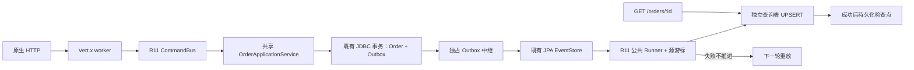

# Vert.x CQRS 订单样例

主入口 `io.ddd4j.sample.vertx.cqrs.VertxCqrsApplication`，默认端口 8085。必须提供 `-Dsample.jdbc.url=... -Dsample.jdbc.user=... -Dsample.jdbc.password=...`，连接本样例既有订单表与事件源。先准备现有 [Order JDBC 迁移](../ddd4j-sample-order-jdbc/src/main/resources/db/migration/)、JPA EventStore 和 ProjectionPosition 对应表。默认 `sample.jpa.schema=validate` 仅校验 JPA 实体对应的表。JDBC 表由前述迁移在应用启动前准备。测试仅在一次性 PostgreSQL fixture 上运行既有 V1–V3 与既有 JPA 实体建表；没有新增表、字段、迁移。

`POST /orders` 保留 201 `{success,orderId}` / 重复 409；`GET /orders/:id` 只读独立查询表，投影前 404，成功严格保持 `orderId,orderNo,buyerId,buyerName,status` 五字段。补充明细、支付路由是 `/orders/:id/lines`、`/orders/:id/pay`（Idempotency-Key）。`POST /projections/orders/run` 手动运行同一公共 Runner；默认原生 timer 每五秒触发，可通过 `sample.projection.cron` 配置六段数字 cron。



中继保留原消息 ID/业务载荷，先提交事件再确认 Outbox；确认失败按事件 ID 去重。查询先提交，检查点后提交；失败靠 UPSERT 重放，不宣称跨 JDBC/JPA 的分布式事务。事件通知刷新当前已提交 Order 快照，不能脱离写仓储作历史事件重建。投影只处理聚合类型为 `Order` 的事件，以整页最后一条源事件的位置推进检查点。事件库先解码整页；无法解码的事件或载荷类型错误的订单事件会使本次投影失败，检查点保留在原位。中继为单实例串行示例，Outbox 由本样例独占。支付幂等端口仍为内存演示，不能作为跨重启支付幂等保证。

旧 public static 内存对象和 `createRouter(Vertx)` 保持兼容，属于显式 demo-memory API；主入口使用 `PersistentOrders.start`。应用通过借用 ViewScheduler 的 runtime 重载，在完整 Runner Runnable（位置读取至检查点提交）边界登记原生 timer 工作；请求与手动触发同样在提交前登记。关闭封闭准入、停止后续 timer，等待所有已登记任务完成，再关闭 HTTP/runtime/Vert.x/JPA；数据源借用调用方。等待已登记任务由样例负责。客户端断连不意味着回滚已提交工作。

使用当前发行线要求的 JDK 和仓库 `./mvnw`。四场景的 required 检查为：

```sh
./mvnw -pl ddd4j-samples/ddd4j-sample-vertx,ddd4j-samples/ddd4j-sample-vertx-cqrs,ddd4j-samples/ddd4j-sample-vertx-satoken,ddd4j-samples/ddd4j-sample-vertx-shiro -am verify
```

按[运行时类路径构建说明](../README.md#启动默认订单示例)准备模块 JAR 和 Maven runtime 依赖。`sample.port` 可覆盖默认端口，绑定 `127.0.0.1`。`main` 与测试调用的 `start` 共用业务路由；关闭 hook 等待自身资源退出。详细当前构件验证和独立审查状态见 S06 任务报告。
