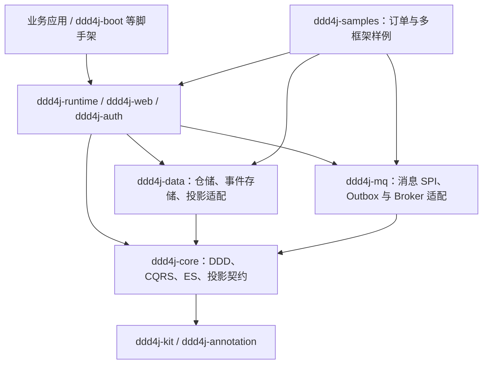
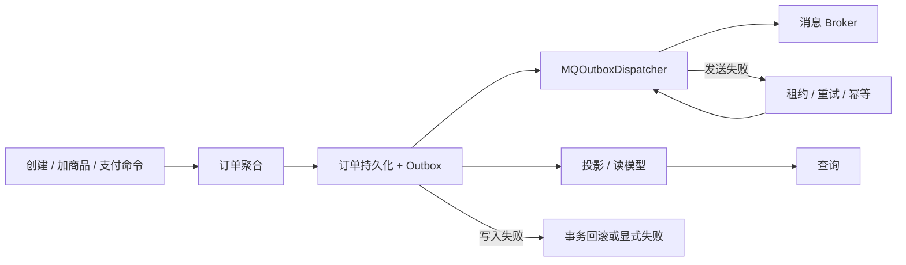

# ddd4j 通用基础框架架构

ddd4j 提供 DDD、CQRS、事件溯源、投影和消息投递的基础契约，以及按框架和中间件拆分的适配模块。它是 `ddd4j-boot` 等应用脚手架的底层依赖，本仓库不是只服务于某一个 Spring Boot 版本的应用工程。旧版“Ddd4j Boot 架构与模块关系”文档的原文及文件摘要可从[历史证据索引](../superpowers/historical-evidence-index.md)定位。

## 三条兼容线

| Git 分支 | JDK 基线 | ddd4j 快照版本 | Easy4J 普通组件线 |
|---|---:|---|---|
| `feature/1.0.x` | 8 | `1.0.x.20260630-SNAPSHOT` | `io.github.easy4j:*:1.0.x.20260630-SNAPSHOT` |
| `feature/2.0.x` | 17 | `2.0.x.20260630-SNAPSHOT` | `io.github.easy4j:*:2.0.x.20260630-SNAPSHOT` |
| `feature/3.0.x` | 21 | `3.0.x.20260630-SNAPSHOT` | `io.github.easy4j:*:3.0.x.20260630-SNAPSHOT` |

三线保持相同的 ddd4j 自有业务契约；各线分别维护 Maven 模型、Java 语法、Spring/Jackson 等第三方依赖及 `javax`/`jakarta` 适配。版本表只描述普通组件；Spring Boot starter 按自己的 Boot 版本线发布，并依赖对应的 Easy4J 组件线。实际依赖坐标和版本以各分支的 [BOM](../../ddd4j-bom/pom.xml) 与 [dependencies](../../ddd4j-dependencies/pom.xml) 为准。

## 模块边界

- [`ddd4j-core`](../../ddd4j-core/pom.xml) 定义聚合根、CommandBus、EventStore、ProjectionRunner 等自有契约；[`ddd4j-kit`](../../ddd4j-kit/pom.xml) 与 [`ddd4j-annotation`](../../ddd4j-annotation/pom.xml) 提供基础工具与注解。
- [`ddd4j-data`](../../ddd4j-data/pom.xml) 按 JPA、JDBI、R2DBC、Panache、框架 CQRS 等拆分持久化与投影实现；[`ddd4j-mq`](../../ddd4j-mq/pom.xml) 将消息客户端、可靠投递与各 Broker 实现分层。
- [`ddd4j-runtime`](../../ddd4j-runtime/pom.xml) 提供 Spring、Quarkus、Guice、Micronaut、Vert.x、Helidon、Dropwizard 等容器绑定；Web/Auth/Cache 另在各自聚合模块，应用脚手架负责自动装配。
- [`ddd4j-samples`](../../ddd4j-samples/pom.xml) 含共享订单领域与应用样例，以及各框架入口；[`ddd4j-bom`](../../ddd4j-bom/pom.xml)、[`ddd4j-dependencies`](../../ddd4j-dependencies/pom.xml)、[`ddd4j-parent`](../../ddd4j-parent/pom.xml) 管理发布坐标、依赖和构建约定。

## 订单与事件链路

[`OrderApplicationService`](../../ddd4j-samples/ddd4j-sample-order-application/src/main/java/io/ddd4j/sample/order/application/OrderApplicationService.java) 是共享订单应用入口；[`MQOutboxDispatcher`](../../ddd4j-mq/ddd4j-mq-core/src/main/java/io/ddd4j/mq/delivery/MQOutboxDispatcher.java) 负责已持久化消息的调度。需要数据库原子性的场景必须注入并验证真实事务端口；默认的非事务构造路径不能证明订单与 Outbox 同事务。Broker 原生行为、容器启动、云服务和生产环境分别验收，不因模块或样例存在而自动视为已验证。

## 构建与验证入口

各线使用该分支的 Maven Wrapper 和对应 JDK。根聚合由 [`pom.xml`](../../pom.xml) 定义；完整收敛要求以[三线实施计划](../superpowers/plans/2026-10-10-three-line-product-convergence.md)及实际测试/CI 证据核验。构建通过只能证明对应构建门禁，不能代替行为、容器或云端验收。
