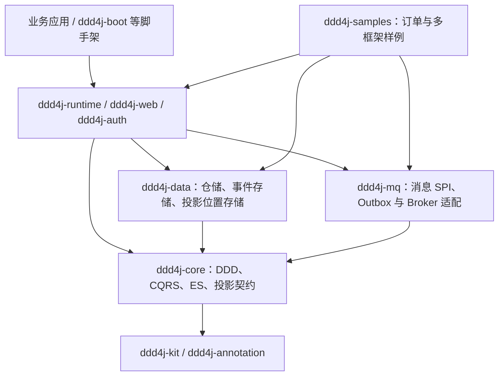
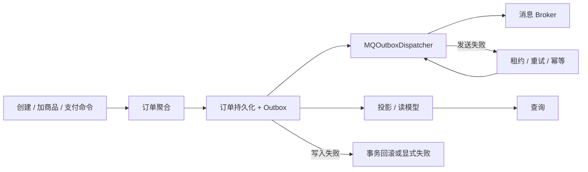
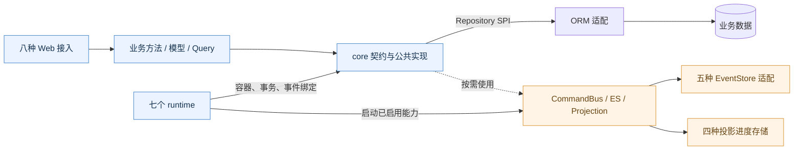

# ddd4j 通用基础框架架构

> 架构收敛采用本页的[设计和验收契约](#architecture-convergence-20261118)，按[实施任务 R00—R15](../superpowers/plans/2026-10-10-three-line-product-convergence.md#architecture-convergence-tasks-20261118)推进。投影的装配归各平台 runtime，公共实现和持久化按下文归属。新框架直接使用现行坐标。旧投影与 CQRS 构件已按 R15 退出。R14 继续整体验收。

ddd4j 提供 DDD、CQRS、事件溯源、投影和消息投递的基础契约，以及按框架和中间件拆分的适配模块。它是 `ddd4j-boot` 等应用脚手架的底层依赖，本仓库不是只服务于某一个 Spring Boot 版本的应用工程。旧版“Ddd4j Boot 架构与模块关系”文档的原文及文件摘要可从[历史证据索引](../superpowers/historical-evidence-index.md)定位。

## 三条兼容线

| Git 分支 | JDK 基线 | ddd4j 快照版本 | Easy4J 普通组件线 |
|---|---:|---|---|
| `feature/1.0.x` | 8 | `1.0.x.20260630-SNAPSHOT` | `io.github.easy4j:*:1.0.x.20260630-SNAPSHOT` |
| `feature/2.0.x` | 17 | `2.0.x.20260630-SNAPSHOT` | `io.github.easy4j:*:2.0.x.20260630-SNAPSHOT` |
| `feature/3.0.x` | 21 | `3.0.x.20260630-SNAPSHOT` | `io.github.easy4j:*:3.0.x.20260630-SNAPSHOT` |

三线保持相同的 ddd4j 自有业务契约；各线分别维护 Maven 模型、Java 语法、Spring/Jackson 等第三方依赖及 `javax`/`jakarta` 适配。版本表只描述普通组件；Spring Boot starter 按自己的 Boot 版本线发布，并依赖对应的 Easy4J 组件线。实际依赖坐标和版本以各分支的 [BOM](../../ddd4j-bom/pom.xml) 与 [dependencies](../../ddd4j-dependencies/pom.xml) 为准。

## 模块边界

- [`ddd4j-core`](../../ddd4j-core/pom.xml) 定义聚合根、CommandBus、EventStore、ProjectionRunner 等自有契约；[`ddd4j-kit`](../../ddd4j-kit/pom.xml) 与 [`ddd4j-annotation`](../../ddd4j-annotation/pom.xml) 提供基础工具与注解。
- [`ddd4j-data`](../../ddd4j-data/pom.xml) 提供仓储适配、事件存储和按技术栈选择的投影位置存储；[`ddd4j-mq`](../../ddd4j-mq/pom.xml) 将消息客户端、可靠投递与各 Broker 实现分层。
- [`ddd4j-runtime`](../../ddd4j-runtime/pom.xml) 提供 Spring、Guice（配套 Javalin）、Quarkus、Micronaut、Helidon、Vert.x、Dropwizard 的容器绑定，以及按需启用的命令与投影装配；Web/Auth/Cache 另在各自聚合模块，应用脚手架负责自动装配。
- [`ddd4j-samples`](../../ddd4j-samples/pom.xml) 含共享订单领域与应用样例，以及各框架入口；[`ddd4j-bom`](../../ddd4j-bom/pom.xml)、[`ddd4j-dependencies`](../../ddd4j-dependencies/pom.xml)、[`ddd4j-parent`](../../ddd4j-parent/pom.xml) 管理发布坐标、依赖和构建约定。

## 订单与事件链路

以下是启用可靠消息和读模型后的增强用例。普通业务的默认路径仍是业务方法调用模型、Query 和仓储；不要求每个用例都接入 CommandBus、Outbox、EventStore 或 Projection。

[`OrderApplicationService`](../../ddd4j-samples/ddd4j-sample-order-application/src/main/java/io/ddd4j/sample/order/application/OrderApplicationService.java) 是共享订单应用入口；[`MQOutboxDispatcher`](../../ddd4j-mq/ddd4j-mq-core/src/main/java/io/ddd4j/mq/delivery/MQOutboxDispatcher.java) 负责已持久化消息的调度。需要数据库原子性的场景必须注入并验证真实事务端口；默认的非事务构造路径不能证明订单与 Outbox 同事务。Broker 原生行为、容器启动、云服务和生产环境分别验收，不因模块或样例存在而自动视为已验证。

## 构建与验证入口

各线使用该分支的 Maven Wrapper 和对应 JDK。根聚合由 [`pom.xml`](../../pom.xml) 定义；完整收敛要求以[三线实施计划](../superpowers/plans/2026-10-10-three-line-product-convergence.md)及实际测试/CI 证据核验。构建通过只能证明对应构建门禁，不能代替行为、容器或云端验收。

## 2026-11-18 架构收敛设计（实施中）

### 范围、事实源与状态

- 用户已授权按现有计划实施，主线是 data 收敛及七框架样例；其他模块仅作承接迁移所需调整。分支、提交、推送、发布、部署和数据迁移不在本次授权内；禁止 worktree。
- 本节是本轮模块收敛的设计事实源；实施步骤统一进入现有三线计划的 R00—R15，不另建规格体系或平行任务清单。三线既有共同契约和 JDK 8/17/21 边界继续有效。
- 源码分析基线为 2026-11-18 的 `feature/2.0.x`。原版 ddd4j 和三个参考项目的 CodeGraph 对照用于说明来源；静态分析不证明所有平台已经可运行。
- 原版 Model/Query/仓储提供日常开发方式；ddd-4-java 的聚合与事件历史能力、cqrs-4-java 的 View/进度处理和示例工程提供可选择的增强能力。普通 DDD、命令查询分离、事件溯源、投影分别建模，不能自动捆绑启用。
- [ADR-0003](../adr/0003-multi-runtime-strategy.md)和[2026-08-24 自研计划](../superpowers/plans/2026-08-24-multi-runtime-self-implementation.md)保留为历史决策与任务记录。本节取代其中“每项能力再单独建立各平台模块、重复维护各平台投影循环”的目标；多平台支持、存储能力和已确认的行为要求继续保留。不得直接重跑旧计划中的建模块、提交或发布步骤。
- 十二个旧投影模块已完成 R15 两批本地退出，R14 继续验证三线和完整后端。以下为 R00—R13 与 S00—S07 的分项证据。Spring 认证例已修复并验证根路径及非根 Servlet context path 的权限检查；默认 WebFlux 与认证 MVC 的证据分别记录，不代表认证 WebFlux 已通过。Guice 新基础入口已经过依赖剥离验证；显式投影启动失败会在全局上下文发布前结束，并保留先前运行实例。Javalin 四类样例已验证共享业务、持久投影失败恢复和原生认证；普通及尾斜杠取消路径按实际匹配路由检查权限。Quarkus 已验证基础零投影资源、实际 CDI/JTA/Panache、旧定时请求上下文及混合持久模式单任务；普通回归与附加 mixed profile 分别记录。Quarkus 四类样例已通过244项有效测试与实际fast-jar HTTP/关闭；CQRS验证查询提交后检查点失败、Outbox确认回滚去重及同库跨JVM重开。默认/auth为内存示例，查询与检查点非跨资源原子；完整三线/外部消费者和 native-image 尚未代验。Micronaut 已验证原生发现、基础零投影资源、显式启用及旧/新混合单任务、历史检查点续跑和 Context 关闭；旧投影坐标的公开 SPI 传递依赖已由独立 Maven 消费者验证，部分调度后启动失败的原生窗口仍留待 R14。Micronaut 四类样例已验证默认可选认证、两种原生权限及线程传播、PostgreSQL 持久失败恢复和容器/应用重开；9项样例测试与46项实际 main HTTP 断言分别记录。Helidon 四入口已通过独立审查，产品 main 的 CDI 发现、默认可选认证及两原生认证、PostgreSQL 失败恢复和容器/应用重开均有证据；当前10项样例测试与46项实际 HTTP 分别记录。认证日志提供聚合请求结束观察，断连请求与 FINISHED 的精确关联仍留 R14 强化，未称该关联已通过。Vert.x 运行时已验证原生 timer/worker、上下文恢复、排队取消与已执行业务边界、借用资源和历史位置续跑；旧正步长 CRON 兼容问题已修复并复审通过，基础入口仍零投影资源。Vert.x四类样例S06已通过独立审查及关闭问题复审：默认无强制认证，CQRS沿用原五字段/orders并验证持久失败恢复/独立JVM重开，两原生认证有逐请求worker清理；新增可选借用调度器入口，应用等待已进入请求及完整定时投影后才释放资源。初轮1,329项与修复后受影响32项分时记录，tmpfs不证明数据库容器重启。Dropwizard运行时及两个旧入口已通过独立审查：默认Bundle无投影资源，显式Managed启停、部分失败恢复、旧手动工厂和自有/借用资源边界保留；1,123项规定验证、18种原生模式与6次冻结回放有本地证据。Dropwizard四类业务/Auth也已通过S07独立审查：当前26项样例测试、36次main HTTP，持久失败位置0→4及同库JVM重开；期限内HTTP/timer排空及原生认证逐请求清理有证据，完整回退/三线仍由后续门禁处理。两个旧 RBAC 测试曾出现响应差异，诊断后的当前完整验证通过，历史异常根因仍待后续定点定位。JDK17 旧构件、14 个合成旧客户端、11 个由旧实现生成的数据夹具及隔离解析目录已冻结并通过独立审查；R13 已补齐当前 JDK17 候选的旧客户端/API/配置/数据回退证据，仍不代表生产消费者或生产历史数据。用户已确认目前无业务项目使用这14个旧模块，真实业务迁移清单为空；JDK8/21 的旧构件、冻结客户端和数据夹具已补齐并通过 R00 独立审查。JDK8 可运行基线来自候选适配前工作快照，原提交的指定 BOM 解析失败单独保留。跨线候选验证继续按 R14 执行。后续 R/S 任务按实现与验证推进；不重跑已完成的历史 T 批次。

### 目标与边界

1. 保留原版简洁用法：模型的 `save/update`、`Query.one/list/page/exist`、基础仓储转换与填充、上下文和领域事件。公共业务 API 不因模块合并而强制改成 CommandBus/Executor 链路。
2. 保留 7 个运行时实现，分别是 Spring、Guice、Quarkus、Micronaut、Helidon、Vert.x 和 Dropwizard。`ddd4j-runtime` 聚合还有一个公共测试支持模块 `ddd4j-runtime-testkit`，合计 8 个 Maven 子模块。Javalin 隶属 Web 接入，使用 `ddd4j-runtime-guice`。Spring 的 WebMVC 和 WebFlux 共用 `ddd4j-runtime-spring`，Web 接入总计 8 种。
3. 合并 14 个平台功能模块的实现；四种投影进度存储、五种 EventStore、现有 ORM、MQ、认证、缓存和扩展能力保留。
4. 每项公共能力有一套执行规则，平台只负责必须不同的容器、事务、事件和生命周期绑定。复用既有 SPI，不新增通用平台管理框架。
5. 本轮不为模块数量目标搬走所有 core 公开类型，不改变 Java 公共包名、业务数据格式或 JDK 基线。状态持久化和事件历史处理在内部拆清，兼容入口保留。

下图表示目标运行协作；实际编译依赖必须朝向 core 契约，core 不依赖具体 ORM、runtime 或应用脚手架。

### 模块保留与合并清单

下表花括号表示现存模块后缀集合；“保留”不代表基础接入必须传递引入或启动该能力。

| 模块 | 决定 | 收敛职责 |
|---|---|---|
| `ddd4j-annotation`、`ddd4j-kit`、`ddd4j-core` | 保留 | 注解、工具、模型/查询/仓储/事件/上下文契约与轻量公共实现 |
| `ddd4j-runtime-{spring,guice,quarkus,micronaut,helidon,vertx,dropwizard}` | 全部保留 | 接收平台功能代码，避免重复执行内核；基础运行时不强绑具体 ORM |
| `ddd4j-runtime-testkit`、`ddd4j-web-testkit` | 保留 | 共用契约测试，不进入普通业务运行依赖 |
| `ddd4j-web-core`、`ddd4j-web-{webmvc,webflux,quarkus,javalin,micronaut,helidon,vertx,dropwizard}` | 全部保留 | HTTP 适配；保持同步和响应式差异 |
| `ddd4j-data-{mybatis,mybatisplus,jpa}` | 全部保留 | 各自仓储能力；公共转换和上下文可以复用，不强行合并 ORM 语义 |
| `ddd4j-data-projection` | 合并至 `ddd4j-core` | Handler、注册和分发共用 `ProjectionRunner` |
| `ddd4j-data-projection-{jpa,panache,jdbi,r2dbc}` | 合并至同技术 `ddd4j-data-event-store-*` | 可选位置存储。Spring Data 适配归 `ddd4j-runtime-spring` |
| `ddd4j-data-event-store-{esdb,jpa,panache,jdbi,r2dbc}` | 全部保留、可选 | 事件存储与同技术的位置存储各自装配。Quarkus 按用途选择 ORM 实体包 |
| `ddd4j-data-{crypto,datascope,external,logs}` | 保留、可选 | 加密、数据权限、外部数据、操作日志；日志模块解除 WebMVC 反向依赖 |
| `ddd4j-cache`、`ddd4j-metrics`、`ddd4j-mq/*` | 全部保留、可选 | 保留现有缓存、指标、消息、Outbox 和可靠投递能力 |
| `ddd4j-auth/*` | 保留、可选 | 认证方案及兼容入口；`auth-datascope` 作为旧接口/平台桥，底层判断统一到 `data-datascope` |
| `ddd4j-extensions/*`、`ddd4j-web-validation`（Java 8、21） | 保留、可选 | Java 17 的 validation 扩展直接集成 Easy4j 通用约束与文件 API，原 Web 校验模块已移除。Java 8、21 当前使用各自的 Web 字段校验和文件内容校验模块。两种 License 的旧格式兼容保留 |
| `ddd4j-ddd-rules-{clean,cola}` | 保留、测试时选择 | 不强制业务同时采用两套架构规则 |
| `ddd4j-samples/*` | 保留 | 平台启动和特有示例保留；共用已有 Order domain/application/testkit，迁移测试而非删除测试 |
| 根及分组聚合 POM、parent、dependencies、BOM | 保留 | 后续更新模块清单和依赖关系，不以删聚合文件冒充运行复杂度下降 |

14 个模块按固定顺序迁移；同平台先命令侧再投影侧。具体步骤见任务 R06—R12。

| 顺序 | 任务 | 原模块 | 目标运行时 |
|---|---|---|---|
| M01 | R06 | `ddd4j-data-cqrs-spring` | `ddd4j-runtime-spring` |
| M02 | R06 | `ddd4j-data-projection-spring` | `ddd4j-runtime-spring` |
| M03 | R07 | `ddd4j-data-cqrs-javalin` | `ddd4j-runtime-guice` |
| M04 | R07 | `ddd4j-data-projection-javalin` | `ddd4j-runtime-guice` |
| M05 | R08 | `ddd4j-data-cqrs-quarkus` | `ddd4j-runtime-quarkus` |
| M06 | R08 | `ddd4j-data-projection-quarkus` | `ddd4j-runtime-quarkus` |
| M07 | R09 | `ddd4j-data-cqrs-micronaut` | `ddd4j-runtime-micronaut` |
| M08 | R09 | `ddd4j-data-projection-micronaut` | `ddd4j-runtime-micronaut` |
| M09 | R10 | `ddd4j-data-cqrs-helidon` | `ddd4j-runtime-helidon` |
| M10 | R10 | `ddd4j-data-projection-helidon` | `ddd4j-runtime-helidon` |
| M11 | R11 | `ddd4j-data-cqrs-vertx` | `ddd4j-runtime-vertx` |
| M12 | R11 | `ddd4j-data-projection-vertx` | `ddd4j-runtime-vertx` |
| M13 | R12 | `ddd4j-data-cqrs-dropwizard` | `ddd4j-runtime-dropwizard` |
| M14 | R12 | `ddd4j-data-projection-dropwizard` | `ddd4j-runtime-dropwizard` |

Spring 先处理已有重复；Guice 随后验证非 Spring 装配并解除默认能力绑定；Quarkus 验证 CDI/Panache，再迁移 Micronaut、Helidon；Vert.x 单独验收事件循环边界；Dropwizard 完成受管生命周期接入。该顺序不表示后续平台可以削减能力。

### 本轮主线与样例门禁

用户已认可 web/runtime/mq/metrics/kit/extensions/dependencies/core/cache/bom/auth/annotation 的总体设计；主线仅收敛 data。`ddd4j-data/pom.xml` 初始有 31 项，全部 12 个独立投影模块退出后为 19 项。R15 第三批再收敛七个独立 CQRS 模块，data 剩余 12 项。R01 优先运行现有 AggregateRoot/Query 用法回归，不主动重构；auth 仅保留接口和受影响迁移，不开展独立改造。

`ddd4j-samples` 必须包含 Spring、Guice/Javalin、Quarkus、Micronaut、Helidon、Vert.x、Dropwizard，每框架 default、cqrs、satoken、shiro 四个独立入口，共 28 场景；共享 order-* 不计数。2026-11-18 初始基线为 16 项已存在、12 项缺失；S07 后当前 POM 已纳管全部28场景，七框架各四场景均已逐批独立审查；三线完整矩阵仍由R14验收。详见[样例矩阵](../../ddd4j-samples/README.md)和活动计划 S00—S07。

Spring 样例纳入本目录，复用外部 Boot 装配；Boot 自动配置不复制到 core。WebMVC/WebFlux 是 Spring 的两种接入形态。默认例不强制 CommandBus、ES、Projection、MQ 或 auth；CQRS 例验证读写链与失败恢复；认证例验证登录、允许/拒绝、退出失效与请求上下文清理。R14/R15 必须验收完整 28 场景，不能只验证现有 16 项。

### 公共实现和依赖归属

| 现有职责 | 目标归属 | 兼容方式 |
|---|---|---|
| 命令发现、注册、路由 | `DefaultCommandBus` 承担唯一分发；runtime 收集执行器和绑定事务 | 旧总线类保留签名并委派，不维护第二套路由规则 |
| 投影拉取、批处理、进度推进 | 复用 core 的 `ProjectionRunner`；`ProjectionDispatcher` 接入同一规则 | Handler 入口适配成 View，两种方式共用位置推进规则 |
| 视图状态、重复启动保护、公共调度逻辑 | core 既有 readmodel 契约及必要的轻量默认实现；runtime 仅接平台生命周期/调度 | 共享公共规则，保留平台 CRON 语法、时区和线程语义的兼容验证 |
| 投影实体、JPA 仓储 | 对应 data 存储模块 | runtime 中旧实体/仓储的公开引用按兼容清单迁移，不重复扫描实体 |
| JPA 与 Spring Data | 公共持久化以 JPA API 为边界；Spring Data 桥和 Boot 装配在具体 Spring 接入层 | 不能把当前依赖 Spring Data 的适配器直接视为平台中立；构造器兼容单独验证 |
| Guice 的 MyBatis-Plus/日志装配 | 专用模块显式安装，基础 Injector 不加载相应类型 | 旧入口委派时保留原启用策略；新基础入口采用按需策略 |
| 日志处理与 HTTP 采集 | `data-logs` 保留日志模型/处理；HTTP/切面接入归 `web-*` | 消除 `runtime-guice → data-logs → web-webmvc` 的基础依赖路径 |

具体框架脚手架继续负责 Boot 自动装配，遵守[现有边界规范](../superpowers/specs/2026-06-29-ddd4j-boundary-rules-design.md)。runtime 不为容纳合并代码而强制传递引入 JPA、EventStore 驱动或全部高级能力。

### 可选能力与启用契约

| 能力 | 新基础接入的行为 | 显式启用后的要求 |
|---|---|---|
| 模型、Query、仓储、领域事件 API | 保留简洁调用；选定存储即可使用普通 CRUD | runtime 提供相应仓储和本地事件绑定 |
| CommandBus | 不要求普通业务采用；无须强制注册命令执行器 | 保持命令路由、重复注册检测、返回与异常契约 |
| ES、历史重放、快照 | 不因使用领域事件而启用 | 明确事件存储和事件溯源仓储；保留版本和历史兼容 |
| Projection | 不创建后台任务，不要求事件源或进度表 | 注册 View 并提供所需事件源和位置存储；缺配置明确失败 |
| MQ、Outbox、重试、外部缓存/数据源 | 不因基础 runtime 启动而连接外部服务 | 选定实现和配置后验证交付、恢复与资源关闭 |
| 鉴权、数据权限、License、加密、日志、监控及其他扩展 | 按应用需求选择 | 既有已启用策略不能在升级后静默关闭 |

“可选”同时约束依赖、装配和副作用，不能仅修改 Maven optional 标志。需要 CQRS 时由对应的 runtime 装配。应用采用现行默认配置时，按实际启用的能力验收。空事件读取器、内存位置仓储仅在调用者明确选择对应模式时使用，不得在需要持久恢复的配置缺失时静默替代。配置键先沿用现有定义，旧新映射进入 R00/R13 清单，不在本设计中虚构已经存在的开关。

### 十二个独立投影模块退出

框架尚无业务消费者，十二个独立投影模块直接退出。首批将 M02、M04、M06、M08、M10、M12、M14 的平台装配归入七个 runtime，第二批归并公共投影和四个位置存储模块。三线已经移除旧目录、Maven 坐标和 BOM 条目。旧坐标转接、兼容 JAR、冻结旧客户端和新旧投影混用退出交付范围。应用直接使用现行模块。具体验收见 R15。

公共 Handler、Registry 和 Dispatcher 归 `ddd4j-core`。JPA、Panache、Jdbi、R2DBC 位置存储随各自已有存储模块提供。Spring Data 位置仓储归 Spring runtime，仍按需选择。默认应用直接读写业务仓储。CQRS 应用选择事件源与位置存储，沿用现有表结构和检查点。Quarkus 通过 `ddd4j.quarkus.cqrs.projection.position-store=panache` 启用 Panache 位置仓储，并通过 `quarkus.hibernate-orm.packages` 选择实际使用的实体包，例如仅选 `io.ddd4j.data.projection.panache` 用作位置存储。

### 七个独立 CQRS 模块退出

框架当前无业务项目依赖这七个旧坐标。Java 8、17、21 的现行平台入口统一使用原有七个 runtime。Spring、Guice/Javalin、Quarkus、Micronaut、Helidon、Vert.x 和 Dropwizard 的旧 CQRS 源码模块、Maven 坐标及独立发布入口全部退出。

保留各平台现场验证的命令注册、重复执行器拒绝、执行异常和事务传递，以及已有容器生命周期和请求上下文能力。runtime 中已有实现的边界测试继续有效，有独立行为的测试和装配资源随职责迁移。一个场景只装配一个有效的 CommandBus。应用可继续按需启用 CQRS，普通业务直接使用仓储。七种框架的 28 个示例、四种投影位置存储和五种 EventStore 继续覆盖现行入口。

### 兼容、退出和回退

旧构件、旧消费者和回退演练归档在 R13 与 R15。当前投影和 CQRS 使用前两节的现行入口。

- 每个实际交付的全限定类名由一个构件提供。适配器的现行入口归对应 runtime。
- 应用按需显式依赖所选持久化模块。R15 的独立消费者测试使用现行 runtime 坐标。
- 保持事件类型名、JSON/Java 序列化、异常、泛型、Bean 名/限定符、实体扫描和配置绑定契约；构造器签名兼容与类加载兼容分别验证。
- 保留既有表/列、视图标识、stream/position 键和读取位置。模块重排不授权新增字段、DDL、重置进度或全量重放；出现必须迁移数据的情况应先列清影响，再取得对应授权。
- 单个视图只由一个入口调度。回退使用已验证的上一版本与对应配置，继续读取原位置。回退验收须包含事件和位置数据读取。
- 三线分别保持 JDK 8/17/21 及本线第三方生态，不能靠升级 JDK、删平台、删测试或扩大豁免实现一致。

### 验收契约

每条要求必须在实施任务中找到对应证据；这里没有任何“已通过”的运行结论。

| 编号 | 可观察的通过条件 | 任务 |
|---|---|---|
| AC01 | 原版风格保存/更新、查询/分页/存在性判断、对象转换/填充、租户隔离和本地事件行为保持；不必经过 CommandBus | R00、R01 |
| AC02 | 同一平台只有一套命令路由规则；重复执行器在组装期报错；现行入口保留结果、异常和事务行为 | R02、R06—R12 |
| AC03 | View 和旧 Handler 入口共用执行规则；按真实事件位置推进；同类事件可驱动多个独立视图 | R03、R06—R12 |
| AC04 | 同库读模型更新与位置保存按既有事务契约原子提交；跨存储验证幂等重试，失败不得越过未完成事件 | R03、R04、R06—R12 |
| AC05 | 新基础模式缺少事件源/进度表仍可正常启动，无投影任务或相关连接；显式启用而缺必要配置时明确失败；既有受支持模式保留其行为 | R05—R12、R13 |
| AC06 | 基础 Spring 接入不强带投影 JPA；基础 Guice 接入不经日志引入 WebMVC；非 Spring JPA 用例不需要 Spring 容器 | R04—R07 |
| AC07 | 七个 runtime 和八种 Web 接入各有真实平台验证；已支持的同步/响应式、线程/上下文和生命周期语义保持 | R06—R12、R14 |
| AC08 | 继续交付的公开 API、Bean 标识、序列化和配置保持同线兼容；独立消费者使用实际构件构建 | R00、R06—R13 |
| AC09 | 历史投影位置继续生效，重启不从零重放；回退不重置数据；已有表名、类型名和事件格式可读取 | R03、R04、R06—R13 |
| AC10 | 四种投影位置存储、五种 EventStore 和其他已有能力的有效测试场景保留；缺少真实后端证据标为未验证 | R00、R13、R14 |
| AC11 | JDK 8/17/21 共同契约与各线适配有当前源码证据；本地、容器、远端 CI、真实服务结论分开记录 | R14 |
| AC12 | 十二个旧投影模块和对应 Maven 坐标直接退出，现行 runtime、core 和存储模块提供按需启用的投影。公共分发、四种位置存储、现有数据续跑和有效测试须保留。七个旧 CQRS 坐标直接退出，软件能力和测试由现行 runtime 承担 | R13—R15 |

**2026-11-18 R13 兼容验收：** 当前 JDK17 的旧、新、混合及单旧坐标共 35 个独立消费者通过构建；冻结旧客户端、当前原生装配和七平台真实旧实现续写回退已验证。独立审查 C0/I0/M2，产物来源与冻结输入已核验。这里始终为七个 runtime 实现，加一个不计平台数的 runtime-testkit。ESDB 容器启动错误仍未解决，JDK8/21、完整后端矩阵与 CI 留在 R14；未执行 R15 旧实现退出。详见活动计划 R13、`task-R13-report.md`、`task-R13-review.md` 和 `R13-evidence/controller-verification.json`。
