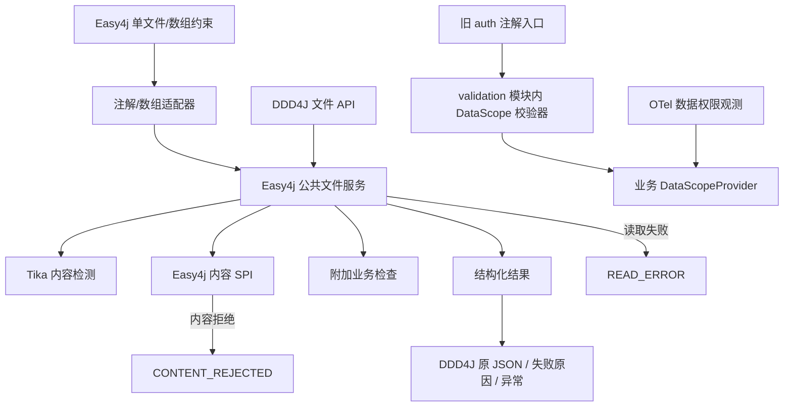

# Validation 深度整合报告

日期：2026-11-24。对应规格：[Validation 与 DataScope 整合](../superpowers/specs/2026-11-24-validation-integration.md)。

## 后续直接集成修正

用户明确要求删除旧名字包装。当前源码已经删除 12 个 DDD4J 文件类型和 Web 的 8 个通用约束类型，
直接使用 Easy4j 对象、服务、结果、注解和 SPI；空的 `ddd4j-web-validation` 已从 reactor/BOM 移除。
文件及通用约束行为测试迁入 validation 扩展；只保留上游没有的数据权限扩展。
同时移除 `ddd4j-kit` 依赖，POI 由 Tika Microsoft 解析模块传递提供，不再以 test scope 覆盖运行依赖。

本节以下为修正前历史记录，兼容包装、JSON 保留及 903 项测试结论不代表当前源码验收。
本轮验收：

- `./mvnw -o -pl :ddd4j-extension-validation,:ddd4j-auth-datascope,:ddd4j-extension-otel -am clean verify`：
  12 个项目成功，**897 项测试，0 失败、0 错误、0 跳过**。validation 13 项；其他模块分别为 26、76、591、91、96、4 项。
- 删除的测试只针对退役包装的值对象格式、JSON 往返和旧构造器；文件内容、真实 Office、大小、空值、伪造文件、SPI 和权限联动的行为验证保留。
  Web 四类约束测试迁入 validation，直接导入 Easy4j 注解。首次执行因测试生成 OOXML 缺少 schema 报错，补充 test-only `poi-ooxml-lite` 后完整验收通过。
- 检查最终 JAR 仅含 3 个 DataScope 类，不含已删除的 20 个重复类型；旧 Web 模块目录、reactor/BOM 引用已移除。
- 独立 Java 进程使用 Maven runtime classpath（不含测试类和测试依赖），通过真实 DOCX、XLSX 检测；实际加载的 Easy4j JAR 与组件源码仓库 target 构件 SHA-256 相同。
- 无 record 扫描和检查器 7 项自测通过，修改范围 `git diff --check` 通过。
- 当前 2.0.x 场景证据已迁移。其他版本线未修改，三线整体 API/结构一致性未验收；不修改校验规则来掩盖其他线尚未迁移的差异。
- 本次落实直接集成和去重，数据权限默认策略及上游异常原因丢失问题仍是独立待处理项；没有在本轮修改授权行为。
- 未提交、推送、发布或运行 CI。上游本轮未改动；上游 131 项测试为前一轮证据。

证据：[本轮构建日志](2026-11-24-validation-integration/direct-integration-clean-verify.log)、
[结构与运行验证摘要](2026-11-24-validation-integration/direct-integration-evidence.json)。

## 修正前交付结果

`ddd4j-data-datascope` 目录及 Maven 模块已经移除。其三个生产类型和原测试迁入
`ddd4j-extension-validation`，Java 包名保持不变。reactor、BOM、auth 和 OTel 依赖已更新。
权限校验只有一份实现；旧 Spring 校验器保留取 Bean 和注解兼容入口，委派中立校验器。

文件通用规则由 `io.github.easy4j.validation.file.FileValidationService` 统一实现。
Easy4j 注解适配器和 DDD4J 服务均调用这一入口。DDD4J 的原公开对象保留为兼容适配，
不再独立持有文件元数据、策略规范化、大小/后缀/MIME 校验以及 PDF/OLE/ZIP 解析实现。

## CodeGraph 与组件边界

用户授权后为 `validation-api-extension` 创建本地索引：72 个文件、958 个节点、1,638 条关系；
最终 `codegraph status` 显示最新。执行了引擎、上传适配/SPI、常用约束三组精确查询。
DDD4J 原索引有待同步项，因此其关键迁移位置和消费方结合当前源码核实，没有将旧索引作为验收证据。

| 能力 | 实际归属与调用关系 | 整合决定 |
|---|---|---|
| 常用 Bean Validation | `constraints` → 对应 `ConstraintValidator`；手机号使用 libphonenumber，正则使用现有工具/资源 | 直接通过 Easy4j 依赖暴露，不新建同名 DDD4J 校验器 |
| 上传对象 | `UploadFileAdapters.adapt` 对已有 `UploadFile` 直接返回；其他对象通过 SPI 选择唯一适配器，多个匹配会拒绝 | DDD4J `ValidatableFile` 继承 `UploadFile`，已有实现使用默认方法兼容 |
| 默认文件对象 | `DefaultUploadFile` 保存元数据与输入流工厂 | `DefaultValidatableFile` 委派该对象 |
| 文件注解 | `FileNotEmptyValidator` / `FilesNotEmptyValidator` → `FileValidationEngine` | engine 只适配注解与数组，共用公开的文件服务 |
| 类型检测 | `TikaFileTypeDetector` → `TikaUtil.detectContentMimeType` | 不传客户端文件名参与内容判断；DDD4J 检测器仅限制 Office/PDF 范围 |
| 内容 SPI | `FileContentCheckStrategy.load` → ServiceLoader → 按扩展名选择 provider，支持通配回退，重复扩展名拒绝 | 默认 DDD4J 服务也执行此策略；旧多规则回调仅作为附加业务适配 |
| 数据权限 | Easy4j 中没有业务 DataScope 约束 | 保留 DDD4J 专用契约，迁入 validation，不强塞到通用外部库 |

CodeGraph 将部分注解动态调用标为「未找到测试」；实际 Hibernate Validator 测试已执行，
静态图的未发现不能解释为没有测试，也不能替代运行证据。
原始查询：[引擎](2026-11-24-validation-integration/codegraph-engine.txt)、
[上传与 SPI](2026-11-24-validation-integration/codegraph-spi.txt)、
[常用约束](2026-11-24-validation-integration/codegraph-constraints.txt)。

## 兼容性与依赖

- 原 DataScope FQCN、已有构造器、注解身份、消息、null 行为和自定义 provider 保留；迁移的是 Maven 坐标。
- 文件校验结果的 Jackson 属性、既有失败枚举和异常保持。旧自定义检测器及内容回调仍可使用。
- 两个入口原有不同语义通过显式策略保留：注解空白名单不检测类型、非严格模式按文件名推断 MIME、零字节上限；
  DDD4J 默认严格检测，无白名单也核对内容与后缀，非严格模式使用声明 MIME，零表示无限制。
- 原 OOXML 夹具仅包含路径名和无效 XML；改用 POI 生成真实 Word/Excel，新增损坏容器拒绝验证。
  这意味着只伪造 Office ZIP 路径的文件现在被拒绝，不继续视为有效文档。
- Easy4j 当前代码使用 Tika 4.0.0，DDD4J 原 BOM 压制为 3.3.2；BOM 已对齐 4.0.0。
  标准解析器在上游是 `provided`，因此 DDD4J 显式装配 Microsoft 解析模块，未引入全量标准解析器。
  最终测试 classpath 中 Tika 核心、Microsoft、ZIP、HTML、文本及 XML 组件均为 4.0.0。
  检查本地 Tika 4 基础 class 的最大 major 为 61，与 JDK 17 匹配。
- 未触碰其他版本线、ORM 数据范围、数据库或工作区其他既有改动。没有创建分支或 worktree。

## 验证证据

1. 红灯：新增两项整合测试均因真实目标缺失失败。旧 DDD4J 上传对象不能被 Easy4j 注解接受；
   Easy4j 的 PDF 内容 provider 拒绝标记未进入 DDD4J 流程。[日志](2026-11-24-validation-integration/tdd-red.log)
2. 上游 `JAVA_HOME=<Corretto 17.0.21> mvn -o clean install`：**131 项测试，0 失败、0 错误、0 跳过**。
   保留原 122 项，并增加公共引擎结果、边界、兼容策略、SPI、异常及业务回调测试。
   [日志](2026-11-24-validation-integration/easy4j-clean-install.log)
3. DDD4J `./mvnw -o -pl :ddd4j-extension-validation,:ddd4j-auth-datascope,:ddd4j-extension-otel -am clean verify`：
   **12 个 Maven 项目成功，903 项测试，0 失败、0 错误、0 跳过**。
   annotation 26、kit 76、core 591、mq-core 91、validation 19、OTel 96、auth-datascope 4。
   Javadoc 严格配置未放宽。[日志](2026-11-24-validation-integration/ddd4j-clean-verify.log)
4. `python3 scripts/check_no_records.py` 通过；检查器自测 7 项通过。两仓 `git diff --check` 通过。
5. 检查最终 validation JAR 包含原三个 DataScope 类；旧模块目录已经消失；测试 classpath 不含旧 datascope JAR。
   消费的上游 JAR 与本次构建 JAR 的 SHA-256 一致：
   `152ba18d82c568ba84a260b486ffd3944ca065aab8c0f8570ad657deea621cea`。

## 状态与限制

本地实现和验收完成，规格与任务已更新。变更尚未提交、推送或部署。
上游构件只安装到了本机 Maven 缓存；后续远端发布必须先提供新增公共 API 的 Easy4j snapshot，
再发布 DDD4J，外部消费者改用 `ddd4j-extension-validation` 坐标并删除旧 datascope 依赖。

上游现有 JaCoCo 配置仍报告 **84% < 90%**，构建成功不代表覆盖率目标达成；本次没有放宽配置。
此次执行的是受影响模块及依赖回归，没有运行整个 DDD4J 所有模块、跨版本线 CI 或生产验收。
