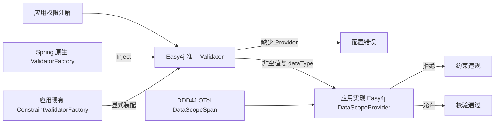

# 数据权限实现下沉到 validation-api-extension

日期：2026-11-25。范围：两仓的 feature/1.0.x、feature/2.0.x、feature/3.0.x。
规格事实源：`../superpowers/specs/2026-11-24-validation-integration.md` 的「数据权限下沉到 Easy4j」段落；既有历史阶段保留以便追溯。

## 交付行为

- Easy4j 提供唯一的 `constraints.RequiresDataPermissions`、`constraintvalidators.RequiresDataPermissionsValidator`、`provider.DataScopeProvider`。
- 删除 DDD4J validation/auth 两套注解、Provider、Validator 和 auth 的旧 DataScopeAutoConfiguration，共 7 个生产类型，并移除过时的自动配置注册文件。
- 未提供 Provider 时，首次执行权限约束即报配置错误，包括 null 输入；不再提供 nonNullAllowed 或默认放行 Bean。已配置策略时 null 仍拒绝，业务拒绝表现为标准约束违规，策略异常继续传播。
- Spring 使用 LocalValidatorFactoryBean / SpringConstraintValidatorFactory 和标准 Inject 注入业务 Provider，保留多候选歧义报错。无静态上下文、全局注册表或重复工厂。纯 Bean Validation 可通过现有 ConstraintValidatorFactory 显式传入 Provider。
- auth、OTel 直接依赖上游。auth 和 validation 保留 Maven jar 依赖入口，jar 中没有生产 Java 类型；validation 保留已有 Office 文件解析器依赖。OTel 保留允许、拒绝和异常观测。
- 上游 feature/2.0.x 缺少另外两线及 DDD4J 已使用的公共文件校验 API，本次从已有实现补齐该前置及测试；保留该分支已有依赖版本，未合入整个 Tika 兼容开发分支。



## 验证结果

先通过真实 Bean Validation 暴露旧实现缺陷：缺失 Provider 的非空值和 null 两个测试均未抛错，红灯日志为 `ddd4j-2.0.x-red.log`。修复后新增上游 8 个测试，以及 Spring 原生容器 4 个测试；DDD4J 权限/文件集成 3 个和 OTel 数据权限 7 个测试覆盖接入回归。

| 版本线 | JDK / 命名空间 | 上游 clean install | DDD4J 受影响 reactor clean verify |
| --- | --- | ---: | ---: |
| 1.0.x | 8 / javax | 136 | 795 |
| 2.0.x | 17 / jakarta | 135 | 896 |
| 3.0.x | 21 / jakarta | 135 | 795 |

全部为零失败、零错误、零跳过。DDD4J 每条线构建 12 个模块，包括三个消费模块及其依赖；其中 auth 为 4 项、validation 为 12 项、OTel 为 96 项。总数差异来自原分支基线，不代表权限实现分叉。

关键验证：缺失 Provider、允许/拒绝/null、dataType 隔离、groups/message/payload、策略异常传播、独立 ValidatorFactory/容器隔离、共享 Validator 的并发请求隔离、Spring 多 Provider 歧义、文件约束并用与 OTel 回归。

三条线无 record 扫描通过，DDD4J 检查器自测分别 5/7/5 项通过。权限相关 8 个源码/测试文件在 javax/jakarta、Java 8 显式局部类型和注释格式差异之外一致。确认旧权限类及其源码引用已移除；确认上游本地安装 jar 与本次构建 jar 的 SHA-256 一致，消费测试的实际 classpath 指向匹配版本。

复现命令（在对应分支副本中使用匹配的 JAVA_HOME）：

```sh
# validation-api-extension
bash mvnw -o clean install
# DDD4J
bash mvnw -o -pl :ddd4j-web-testkit,:ddd4j-extension-otel -am clean verify
python3 scripts/check_no_records.py
python3 -m unittest discover -s scripts -p test_check_no_records.py
```

## 迁移与交付边界

消费者必须把旧 data/auth 权限类型 import 改为 Easy4j 原生类型，提供真实的业务权限策略并重新编译。旧类和默认策略不保留兼容壳，直接依赖旧 DataScopeAutoConfiguration 的应用需要移除旧导入。业务权限后端、HTTP/Redis、生产流量未纳入本次本地组件验证；SQL 数据权限机制保持独立。

本次只落地本地版本分支并安装本地 Maven 构件，未推送、远端发布或部署，未运行远端 CI。远端消费者需要发布匹配版本的上游构件后才能构建。

使用独立 clone 完成其他版本线，不使用 worktree、不切换两个原工作目录。上游原目录当前位于 feature/REQ-20261118-wandl-tika4-compat，保留其原分支与文件状态；实现位于要求的 feature/1.0.x、feature/2.0.x、feature/3.0.x 分支。DDD4J 原有 65 项暂存新增/工作区删除状态保留，未包含在本次提交中。

本地完整构建日志、产物摘要、来源基线及分支提交保存在 `workspace-ddd4j-boot/deliveries/validation-permission-20261125/`：`manifest.json`、`verification.json`、`delivery.json`；以该目录的实际日志为证据。
