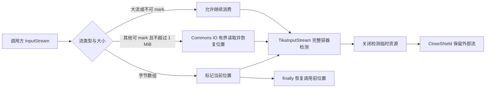

# REQ Tika 兼容功能三线适配交付

日期：2026-11-25。来源：validation-api-extension 的 `feature/REQ-20261118-wandl-tika4-compat`，固定提交 `d408b1881f7a7f1573c823ee34442083cb6e1d78`。
目标：`feature/1.0.x`、`feature/2.0.x`、`feature/3.0.x`。规格事实源继续使用 DDD4J 的 `docs/superpowers/specs/2026-11-24-validation-integration.md` 中本次追加授权段落。

## 结果与实现边界

来源分支的 41 个生产文件已逐一核对：40 个在命名空间、Java 8 Optional 写法和注释格式适配之外已等价；TikaUtil 的流处理能力完成移植。来源 19 个测试类中的 131 个 @Test 方法全部保留，既有权限、文件服务、约束、SPI 测试没有回退。

- 字节数组流恢复调用前位置；其他可 mark 流在 1 MiB 内完整检测并恢复位置。大流不因缓冲阈值拒绝或只检查前缀，允许向前消费。
- 外部 InputStream 不被关闭；UploadFile 自行获取的流由组件关闭。读取异常继续传播；内容检测不信任文件名。
- 直接复用 Commons IO 的 IOUtils、BoundedInputStream、CloseShieldInputStream，以及 TikaInputStream。没有增加自写流复制器、关闭屏蔽类或并行校验实现。
- 补齐 Tika 2 的 OLE 容器适配，真实 XLS 在字节数组、BufferedInputStream 和不可 mark 流入口都识别为 Excel；保留原 UploadFile 适配。
- 2/3 线提供 `tika4-compatibility` profile，使用 Tika 4.0.0 和 POM 类型的标准解析器聚合构件；默认仍使用原 Tika 3 基线，1 线保留 Tika 2 / Java 8。
- 补齐来源分支的 release、api-compatibility 插件绑定；保留强制 90% LINE 门禁，不移植来源分支较宽松的 haltOnFailure=false。
- CI 保留版本分支触发，加入 main/test/*，使用对应 JDK 与已有 Maven Wrapper。2/3 线同时验证默认基线和 Tika 4，三个 workflow 均通过 actionlint。
- 文档修正命名空间、版本坐标、解析器版本、公共文件服务、构建要求、流契约及实际 CI 能力。



## 依赖与版本适配

| 项目 | 1.0.x | 2.0.x | 3.0.x |
| --- | --- | --- | --- |
| JDK / Validation | 8 / javax | 17 / jakarta | 21 / jakarta |
| 默认 Tika | 2.9.4 | 3.3.1 | 3.3.2 |
| Tika 4 兼容 profile | 不适用 JDK 8 | 4.0.0 | 4.0.0 |
| libphonenumber | 9.0.39 | 9.0.39 | 9.0.39 |
| Hutool | 5.8.46 | 5.8.46 | 保留 5.8.47 |
| JUnit | 保留 5.11.4 | 6.1.3 | 6.1.3 |
| Surefire / Javadoc | 3.6.0 / 3.12.0 | 3.6.0 / 3.12.0 | 3.6.0 / 3.12.0 |
| Maven Wrapper | 保留 3.9.16 | 保留 3.9.16 | 保留 4.0.0-rc-5 |

Java 8 支持通过实际 JDK 8 构建和运行确认；新增选用构件也核对了类版本与插件最低 JDK 要求。没有统一覆盖各线的 javax/jakarta、Hibernate Validator、EL 或 Maven 模型。

## 验证

| 配置 | 测试 | 行覆盖率 | 结果 |
| --- | ---: | ---: | --- |
| 1.0.x-baseline | 150 | 93.42% | 零失败、零错误、零跳过 |
| 2.0.x-baseline | 149 | 93.43% | 零失败、零错误、零跳过 |
| 2.0.x-tika4 | 149 | 93.43% | 零失败、零错误、零跳过 |
| 3.0.x-baseline | 149 | 93.43% | 零失败、零错误、零跳过 |
| 3.0.x-tika4 | 149 | 93.43% | 零失败、零错误、零跳过 |

最终验收日志以 `*-acceptance.log` 为准；其他日志保留定位和红灯证据，不作为完成依据。

- Tika 4 修复前，两条支持线各有 3 个来源测试失败，真实暴露流位置丢失；修复后通过。新增非零起点、缓冲边界、短读、读取异常及真实 OLE 多流入口用例。每个配置均执行 24 个 TikaUtil 测试。
- Java 8 额外发现原有 OLE UploadFile 适配不可丢失，并用原测试恢复约束；公开 InputStream 的通用 OLE 误识别也经红灯验证后修复。
- 三条默认线完成 `clean install`，两个 Tika 4 profile 完成 `clean verify`；实际 JaCoCo LINE 门槛 0.90、haltOnFailure=true 全部通过。字节码主版本为 52/61/65。
- DDD4J 每条线的 validation 消费 reactor 为 4 个模块、12 个测试，使用最终本地安装的对应 Easy4j 构件；PDF、OLE、OOXML、文件规则、通用约束和权限并用回归通过。
- release/API profile 完成实际 effective-pom 装载与七个插件绑定核验。Clirr 在三个 JDK 上实际运行成功；这里使用本地同版本构件自检工具执行能力，不声称已验证任意历史版本的二进制兼容。
- 三条线无 record 扫描通过；DDD4J 检查器自测 5/7/5 项通过。新权限实现保持直接复用，缺失 Provider 的配置错误语义保留。
- 构建 jar 与本地 Maven 安装 jar 的 SHA-256 一致，消费测试 classpath 已核实。

复现：在对应版本分支使用匹配的 JAVA_HOME。

```sh
# 三条默认线
bash ./mvnw -o clean install
# 仅 JDK 17/21
bash ./mvnw -o -Ptika4-compatibility clean verify
# DDD4J
bash ./mvnw -o -pl :ddd4j-extension-validation -am clean verify
```

## 来源提交逐项处理

| 来源提交 | 处理与原因 |
| --- | --- |
| `d2cdf95` | CI 的 main 验证能力并入版本分支/main/test 触发范围。 |
| `dc5369c` | Maven 插件版本属性在目标线已采用标准命名，保留并核验。 |
| `3185e7c` | 公共约束、上传模型、SPI 等生产功能已存在；通过全部 41 个生产文件对照核验。 |
| `a03cf30` | 纯 POM 缩进/分组格式，不覆盖各线已有格式。 |
| `0a0b7a9` | 纯 POM 缩进/分组格式，不作为功能重复移植。 |
| `c4110c6` | 批量作者 Javadoc 格式不影响功能，不做无关全量改写。 |
| `9274ae3` | Maven 选择适配为各线已有 Wrapper：1/2 用 Maven 3，3 用 Maven 4，不复制源分支的固定安装脚本。 |
| `3e6996c` | Jakarta 依赖在 2/3 线保留；1 线使用 javax，3 线保留较新的 Hibernate Validator，不倒退。 |
| `7aebb7c` | 三线同步 Javadoc 3.12.0，构件要求 JDK 8，兼容三线。 |
| `52c7da3` | 三线同步 libphonenumber 9.0.39，包括手机号元数据更新，主类字节码为 Java 8。 |
| `db79270` | 三线同步 Surefire 3.6.0，并通过全部实际测试。 |
| `7299873` | 三线 CI 同步 setup-java v6。 |
| `bcf6be3` | 2/3 线同步 JUnit 6.1.3；1 线因 Java 8 保留 JUnit 5.11.4。 |
| `7f97b76` | 2/3 线新增 Tika 4 兼容 profile，标准解析器依赖类型为 POM；移植 MIME 行为测试。 |
| `41ddeba` | 保留 Surefire 延迟 argLine，补齐空 argLine 默认值，覆盖率仍为强制 90%。 |
| `06d2eed` | 移植可 mark 流的位置恢复和外部流所有权契约。 |
| `cef350c` | 移植完整容器识别及有界缓冲；Java 8 使用已有 Commons IO API。 |
| `444f661` | 大流不因缓冲阈值报错，执行完整检测；流可能前移但不关闭调用方流。 |
| `2d41bd0` | CI 覆盖 feature 版本分支、test/* 与 main；使用 Maven Wrapper 和本线 JDK。 |
| `9043c9a` | FileValidationEngine 对公共服务的委托已经进入三线，核验保留。 |
| `d408b18` | 公共文件策略、结果、检测器及服务已进入三线；保留新增数据权限实现，不携带会话缓存。 |

这是功能移植，不以整分支强行合并来统一版本基线。来源分支的 `.mimosa` 会话缓存、`.codegraph` 本地索引相关文件以及纯格式变更没有带入。三条线继续保留已完成的数据权限下沉与更完整的回归测试。

## 交付与证据边界

本次落地到两个仓库的本地版本分支：组件包含实现、测试、配置、文档；DDD4J 只更新同一规格、实施记录和本报告。没有切换原工作目录、使用 worktree、推送远端、部署或发布 Maven 构件。GPG 签名、远端发布及远端 CI 未执行。

上游原目录仍位于 `feature/REQ-20261118-wandl-tika4-compat`；目标版本分支通过本地独立副本实施，并回写原仓库对应版本分支引用。DDD4J 原有 65 项未提交状态保留，提交范围与原有修改隔离。

完整本地证据位于 `workspace-ddd4j-boot/deliveries/validation-req-parity-20261125/`：manifest.json、commit-mapping.json、source-audit-before/after.json、test-and-profile-audit.json、verification.json、delivery.json、各组日志及 reports/ 下的 Surefire/JaCoCo 原始报告。版本分支最终提交以 delivery.json 为准。
