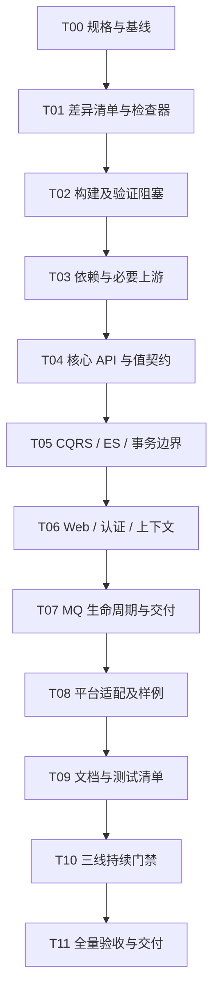

# ddd4j 三线产品收敛实施计划

> **For agentic workers:** REQUIRED SUB-SKILL: Use superpowers:executing-plans to implement this plan task-by-task. Steps use checkbox (`- [ ]`) syntax for tracking.
> 执行方式：当前会话按任务顺序实施；本计划不要求委派子 Agent。每项经过目标验证与审查后再推进依赖它的任务。

**Goal:** 将 ddd4j 1.0.x、2.0.x、3.0.x 收敛为同一个产品的三条兼容线：共同业务能力、对象/API、协议、测试场景和产品文档一致，差异仅来自经过说明和验证的版本适配。

**Architecture:** 以 2.0.x 承载共同契约整合，取三线有效实现和测试的兼容并集；分别向 JDK 8 和 JDK 21 适配。共同契约不以任何单分支的当前实现为最终正确性证明；框架和第三方差异收口到明确的适配边界。

**Tech Stack:** JDK 8/17/21、各分支 Maven Wrapper、JUnit、现有 Testcontainers、Python 标准库、JDK Compiler Tree API、javap、Git。CodeGraph 只作定位，过期索引不进入验收事实源。

**Spec:** 延续 `docs/superpowers/specs/2026-09-06-three-line-parity.md`。该规格当前存在于 1.0.x；T00 将其增量补充并同步到三线，保留历史验收记录。禁止 record 的既有规格继续生效。本文是该规格的后续执行计划，不初始化 OpenSpec/Spec Kit。

**Status:** 执行中。T00—T10 已有局部实现与验证；当前 Java 源码和 JDBI 原生数据库时区用例的三线默认根 reactor 均通过 `clean verify`（JDK 8 首次 Testcontainers Ryuk 启动故障后完整重跑通过）。严格结构/依赖目录/场景门禁仍失败，独立平台与远端 CI 验收未完成；T00—T11 均未达到整项验收。三线各自保留 JDK、Maven 与第三方依赖适配，仅以自有逻辑和可观察行为收敛。

## 一、范围、基线与完成定义

### 1. 基线

仓库：`/Users/redacted-legacy-family/workspaces/workspace-ddd4j/workspace-ddd4j-boot/ddd4j`。

| 分支 | 2026-10-10 核实的 HEAD | JDK | ddd4j / Easy4J 目标版本 |
|---|---|---|---|
| feature/1.0.x | 6bca6659fe0530427aff6673ec2c7b0b5caba778 | 8 | 1.0.x.20260630-SNAPSHOT |
| feature/2.0.x | 6d9f00dcb44d6a1503df41f83f4f26e830bc2ae4 | 17 | 2.0.x.20260630-SNAPSHOT |
| feature/3.0.x | 6867f9742eae083673c163babe8307d158a510f7 | 21 | 3.0.x.20260630-SNAPSHOT |

编写时当前 checkout 为 3.0.x，只有一个工作副本，既往计划提到的 `ddd4j-v2.0.x`、`ddd4j-v3.0.x` 目录不存在。上述 SHA 只用于起始对照；实施前若已变化，重算受影响差异，不覆盖新改动。

### 2. 本计划的默认范围

- 默认 A：共同能力必须一致；确受 JDK 限制的平台适配逐项列明。18 个缺失 POM 不是自动豁免清单，不要求用空模块或不能运行的代码凑齐数量。
- 默认 B：允许计划覆盖阻塞 ddd4j 的必要 Easy4J 上游修复，范围限于实际依赖坐标及其对应版本，不扩展为整个 Easy4J 生态重构。
- 上述两项是此前未收到选择答复时采用的推荐假设，不表示用户已单独批准新的平台非目标或任意上游重构。T00 明列实际平台支持边界；新增无法保持的核心能力须提出具体影响，不静默降级。
- 本轮交付的是计划。实施后的默认交付是三线本地源码、差异清单和验证证据；提交、推送、远端发布及生产部署按后续明确授权执行。
- 不把历史 backup、集成、修复分支纳入业务收敛目标；已有全分支禁止 record 的约束仍须遵守，不借本计划回退该规则。

### 3. Global Constraints

- 共同业务功能取有效并集；禁止删除已有能力、公开调用方式或测试以降低差异数。
- 自有包名、类型名、方法名、参数名/类型/顺序、返回值、泛型、可见性和异常契约一致。确由第三方类型引起的差异采用精确映射，不做全局字符串替换。
- 保留普通类的组件名访问器与已有 bean getter、构造校验、值相等、hashCode、toString、JSON 字段和序列化约定；三线均禁止 Java record。
- JDK 固定为 8/17/21；三线第三方依赖坐标、版本及框架 API 按各自生态独立维护，不以 POM 或字节码逐字相同为收敛目标。只有 ddd4j 自有业务逻辑、公开行为与产品契约应对齐；`javax`/`jakarta` 等 API 差异须逐项说明、精确映射并验证，不得掩盖业务变化。既有 Maven 3/4、Spring、Jackson 适配基线分别维护，不为统一方便整体升级。
- 禁止初始化/重建 CodeGraph，禁止安装新 CLI 或插件，禁止读取/输出与任务无关的凭据。
- 执行前先寻找可复用独立 checkout；确无时采用三个独立本地 clone，使用对应既有分支和不带凭据的本地路径作为源，禁用硬链接。不使用 Git worktree，不在用户当前目录切换分支，不建立新的业务分支。
- 隔离副本路径在 T00 写入执行清单并持续保留，不能交付后删除未提交成果；原仓库分支引用不自动移动。后续授权提交时，从各副本对应既有分支交付，并核对原仓库是否有并行更新。
- 旧规格中的 checkout 路径与执行限制保留为历史记录；新执行目录以 T00 实测清单为准。准备隔离副本只在授权实施后进行，本轮不执行。
- 行为修改执行 RED → 最小实现 → GREEN → 受影响回归；环境故障单列，不冒充行为红灯。
- 不把静态扫描、API 相同、单元测试、容器集成、云服务和生产验证相互替代。

### 4. 完成定义

产品收敛完成须同时满足：T00—T11 完成；共同能力不存在未解释的结构/API/行为/测试/文档差异；声明支持的各线模块可用对应 JDK 构建及验证；Easy4J 对应版本构件解析与受影响契约通过；流水线能识别单线遗漏。

客观平台不支持必须有精确坐标、版本、原因、证据和明确支持边界。该状态只作用于平台实现，不豁免共同领域能力。缺少构件、测试未运行、CI 未运行均保持未验证，不能转换成平台不支持。

交付报告分别给出“共同契约收敛”“各线本地验证”“CI 配置验证”“远端 CI 执行”“云端/生产验证”状态。计划不以发布成功或所有文件数相等为完成定义。

## 二、实施顺序与审查重点



T03 某个上游坐标阻塞时，继续处理不依赖它的 T04—T09 子项；依赖它的验证保持未完成。每个任务以一组可独立审查的三线改动交付，不作整分支覆盖合并。

**Review Focus：**

1. 老版本调用者的构造器、Lombok 生成 API 与 null 重载选择：T04 验证，不只比较源码方法数。
2. 状态已修改但事件追加/Outbox 写入失败：T05/T08 验证原子性、重试和事件保留。
3. 请求结束、线程复用和异步取消后的租户/Subject 泄漏：T06 验证恢复、清理及异常路径。
4. 消费者初始化中途失败、关闭竞争、投递成功但确认丢失：T07 验证资源归属、至少一次语义和幂等。
5. 缺失源文件、旧 target、旧报告或被扩大排除规则产生假绿：T01/T10 验证失败关闭与指纹绑定。

## 三、任务清单

### T00：续接规格并固定执行基线

**输入：** 本文三线 SHA、既有一致性规格/计划、当前人工修改和模块差异文档。
**产出：** 三线相同的有效规格正文，以及不可混淆的起始快照和执行目录清单。

- [ ] 读取三线指令、分支状态及适用规格，记录变化；将当前工作树修改与本任务范围分开保护。
- [ ] 准备三线独立工作副本，验证其 HEAD、JDK、Wrapper、分支名，记录原仓库与副本映射；不提交推送。
- [ ] 从 1.0.x 读取并增量更新 `docs/superpowers/specs/2026-09-06-three-line-parity.md`：纳入本轮共同能力、精确适配原则及完成定义；保留既往批次与证据的历史属性，同步有效正文到三线。
- [ ] 建立 `config/parity/three-line-policy.json` 和 `target/three-line-parity/baseline.json`：政策文件包含共同模块、平台支持项、精确类型映射、文档分类；快照包含仓库 SHA、工作树输入指纹、JDK/Wrapper 和实际目录。
- [ ] 对 18 个缺失 POM 逐项归因：可恢复的兼容实现、第三方硬限制、样例遗漏分别记录。Micronaut 样例不能因为与 Quarkus 同批删除就自动豁免。

**验收：** 规格与计划无冲突；每一分支可追溯到精确输入；没有把未知项记为不支持。此时只建立清单，不把任何业务差异标成已修复。

### T01：恢复并扩展差异检查器，先取得真实 RED

**Files：** 复用 1.0.x 的 `scripts/verify-three-line-structure-api-parity.py`，补齐三线；新增其自测与 `verification/three-line-parity/` 下的源码扫描辅助工具；保留现有值契约脚本。
**接口：** 保留 `--roots ROOT8 ROOT17 ROOT21 --output DIR`；增加 `--policy FILE --phase inventory|verify`。inventory 输出差异；verify 在未解释差异、缺失输入或证据失效时非零退出。

- [ ] 增加检查器自测：漏一个生产类型、漏一个测试、方法返回类型变化、只有 Lombok 生成 getter、文档改业务描述、批准的精确命名空间适配、漏构件、旧指纹。前五项未解释差异必须失败；批准映射只豁免被匹配的项。
- [ ] 文件扫描覆盖三线并集及当前新增文件，排除 Git/索引/IDE/build 输出，识别重命名；生产、测试、样例、文档、构建配置分别计数。
- [ ] 当前源码用 JDK Compiler Tree API 提取声明；不依赖旧 CodeGraph 节点，不以正则统计替代 API 判定。编译后使用各线 `javap -protected -s -v` 覆盖公开/受保护成员、泛型、异常与参数元数据。
- [ ] 同线前后做真实 API 兼容比较；跨线仅对政策中列明的第三方类型做规范化。忽略内部实现类型不能掩盖公开签名引用它的变化。
- [ ] 输出 `inventory.json`、`differences.csv`、`summary.md`。差异项包含稳定 ID、路径/符号、所属能力、各线状态、原因、修复任务和证据引用；原始差异不可丢弃。
- [ ] 用冻结基线运行并保存 RED，确认至少识别独有 CQRS/Web 功能、Easy4J 配置差距、3.0.x 缺探针及独有测试；运行检查器自测后再进入修复。

**验收：** 差异能复现、能定位、不会因新增忽略目录或旧索引产生假绿。源码声明统计明确不等同于二进制 API。

### T02：修复构建与验证工具的直接阻塞

**输入：** T01 清单、重复接口声明证据、既有迁移规格中的构建限制。
**产出：** 三线能够进入共同模块测试和后续完整构建流程。

- [ ] 在 JDK 8 当前源码下复现 `EventSourcingRepository.read(ID)` 重复声明；删除重复声明，保留读取当前状态与读取指定历史版本两个合法重载及准确文档。
- [ ] 将现有 `ValueContractProbe.java` 补齐到 3.0.x；验证缺探针时显式失败，四对象探针在对应 JDK 下使用当前源码编译执行。
- [ ] 复现 ActiveMQ JMS 类型缺失、`FileValidationServiceTest` AssertJ import 等历史阻塞；若当前已修复则记录并跳过，不重复修改。仍存在则按各线 JMS 契约和实际依赖修复，不加入不兼容 API 只求编译。
- [ ] 核对根 reactor、样例 reactor、Surefire/Failsafe/profile 的真实执行方式，记录三个分支各模块测试类型与命令；后续 IT 必须有执行数量证据，不能只看 `verify` 返回 0。

**验收：** 受影响模块 test-compile 和目标测试通过；未涉及的全仓结果不提前宣称通过。

### T03：统一依赖规则并处理必要 Easy4J 上游

**Files：** 各线根/BOM/dependencies/模块 POM，既有 `config/dependencies/` 与 `scripts/verify_dependency_alignment.py`；上游只涉及已登记坐标对应仓库。
**接口：** 保留现有依赖验证 CLI；Easy4J 普通组件按 1.0/2.0/3.0 线断言。Boot starter 不建立组件式三分支：Boot 2.3.x/2.7.x 依赖组件 1.0.x，Boot 3.0.x—3.5.x 依赖组件 2.0.x，Boot 4.0.x/4.1.x 依赖组件 3.0.x；快照后缀为 `.20260630-SNAPSHOT`，待发布版本后缀为 `.20260630`，相应 starter 发布 tag 按 Boot 版本建立。三线第三方依赖的坐标、版本、配置与 Java API 各自维护，只要求 ddd4j 自有逻辑和可观察契约一致；跨线不同不作为依赖门禁错误。

- [ ] 先增加失败测试：Easy4J 错线版本、显式重复坐标、属性未解析、缺失构件、仅藏入 profile、JAR 字节码超限和改名无映射均被识别。
- [ ] 以共同业务能力取并集，对每线独立维护显式坐标，核实 Easy4J 本地仓库的实际 artifactId、分支版本和 API；旧坐标拆分/合并建立逐项映射，不把 BOM 间接导出的所有第三方历史组件复制进来，也不强求三线第三方清单相同。
- [ ] 将普通 `io.github.easy4j` 组件版本集中绑定本线 `revision`，可使用 `easy4j.version` 属性承接；Boot starter 保留独立 Boot 版本属性。现有组件属性继续保留可读名称。`easyexcel:5.0.1` 与 1.0.x 的旧版本声明按真实上游产物修正。
- [ ] 必要上游修复逐仓库读取规范、保护修改，并按其既有规格执行最小适配及测试。成功后本地 Maven install 用于验证，不擅自发布远端构件；不能把本地 install 记为远端可解析。
- [ ] 各线生成新的 effective POM，运行现有 `--strict-artifacts` 检查及受影响模块回归；基础字节码目标分别为 52/61/65，multi-release JAR 按现有规则区分基础与版本目录。
- [ ] 保持未取得的构件为未验证，区分仓库不可达、版本未发布、坐标错误及 API 不兼容；继续可独立推进的任务。

**验收：** ddd4j 显式 Easy4J 普通组件坐标使用本线版本，Boot starter 使用对应 Boot 线版本并依赖对应组件线；映射、effective POM、构件来源与本地测试可追溯；本地构件验证和远端发布状态分开记录。

### T04：统一核心 API、值对象与序列化契约

**范围：** core/annotation/kit，关联公共异常、响应、缓存/加密公共契约及三个分支 API 差异项。
**接口决定：** 自有公共 API 取兼容并集；异常同时保留已有 `ApiCode` 与 `CustomApiCode` 重载，通过委托实现统一逻辑，验证 null 实参重载选择；禁止为了统一删除旧构造器。

- [ ] 同步并补充契约测试，覆盖构造校验、null/空集合、集合防御性复制、组件访问器/getter、equals/hashCode/toString、错误码类型与 JSON round-trip。
- [ ] 对同一路径的 API 差异逐项核实 Lombok 和编译器生成成员，避免把未显式手写 getter 误判为缺失。
- [ ] 收敛真实差距。共同代码采用可读的等价实现；仅必要处保留 JDK/API 适配，Java 规范与禁止 record 规则同时满足。
- [ ] 执行同线前后 API 对比和跨线 API 对比；同一固定输入在各 JDK 产生同一业务 JSON/错误结果，Jackson 包名差异仅作精确映射。

**验收：** 已登记核心 API 差异为零；所有旧调用样例可编译；不能仅凭方法数相同通过。

### T05：收敛 CQRS、ES、投影及事务边界

**来源：** 1.0.x QueryBus/Saga/UnitOfWork/DefaultEventSourcingRepository 作为候选共同实现；另外两线补全的有效测试纳入并集。
**接口：** 保留 `DefaultQueryBus(Collection<? extends QueryHandler<?, ?>>)`、`<R> R ask(Object)`、`QueryHandler.queryType()/handle()`、`Saga.step()/execute()/state()/failure()`、`UnitOfWork.begin()/execute()/commit()/rollback()/close()` 及 ES 仓储既有读写重载；不另造同名替代体系。

- [ ] 将现有 MustTest 同步到缺失分支取得缺类型/行为 RED，再补充查询重复路由/未知类型、Saga 逆序补偿及补偿失败、UoW 终态重复操作/回调失败/嵌套边界测试。框架不能自动证明任意 QueryHandler 没有外部副作用，不宣称静态实现了这一保证。
- [ ] 以有效规格定义嵌套 UoW 归属与原始异常传播，验证真实实现，禁止把回调协调器描述成自动开启数据库事务。
- [ ] ES 验证新聚合 expectedVersion=0、历史区间读取、当前版本读取、并发冲突、追加失败不丢未提交事件、回放不产生新事件。
- [ ] 三线统一事件路径首段断言；修改前加入合法 AggregateRootId 与非法 EntityId 两种用例，核实样例事件 ID，修复合法模型的接线，不能通过放松断言迁就错误数据。
- [ ] 统一未知事件处理：沿用当前共同实现的失败策略，回放未知处理器抛异常；`ignoreOnReplay` 只影响标注处理器。同步修正过时 ADR 描述，不改变其他已确认事件契约。
- [ ] 投影覆盖处理失败不推进位置、空批次、过滤事件后的位点推进、重放、不同视图隔离和失败指标；重置操作验证真实数据库状态，注释声称执行不能替代 UPDATE 证据。

**验收：** 三线核心行为测试一致；支持的 EventStore 后端完成所需容器集成。不得通过在快照仓储中调用 ES 接口伪造整合。

### T06：统一 Web、认证和上下文

**来源：** 1.0.x 的 API 版本模型/解析/注册/分派及 WebMVC/WebFlux 接线；三线既有 Web testkit 和认证 Provider 测试。
**接口：** 保留既有八参 `WebRequestContext` 构造器，增加已有九参 API 版本重载及访问器；版本解析优先级、缺省值、严格/兼容模式取冻结 1.0.x 有效契约与测试，跨线不得另作设计。

- [ ] 先固定 header/path/default 版本解析、版本冲突、未知版本、缺注册处理器与禁用版本功能的现有行为，再移植生产接线及测试。
- [ ] 同步 TraceContextBridge 与上下文协议；测试请求成功、认证失败、异常、线程复用和异步取消时的租户/Subject/trace 传播及清理。
- [ ] 保留 Bearer 缺失/无效/过期、匿名可选认证、401/403、错误码、RawResponse、重复幂等请求等共同 Web 契约。
- [ ] 继续保留历史三线规格中缺请求头错误码、Feign 系统 ID 默认值和拦截器路径规则，增加回归防止新同步覆盖这些修复。

**验收：** 每个声明支持的 Web 适配器运行共同场景；同步 ThreadLocal 测试不能替代 WebFlux 的异步上下文验证。

### T07：统一 MQ 因果链、生命周期与可靠投递

**范围：** mq-core、所有声明支持的 Broker 适配器、Spring 桥接、订单 Outbox 接线。
**接口决定：** 三线保留并统一 `MQEvent.headerMap()`、correlationId/causationId 及冻结 header 名；现有载荷兼容策略保留。公共可靠投递采用租约领取、事务外发送、条件确认的 `MQOutboxDispatcher` 契约。

- [ ] 因果链测试覆盖无字段、单字段、两字段、原生 Broker header round-trip 和线程上下文恢复；不能只对 JSON payload 自测。
- [ ] 用同一组用例比较 Kafka 两种实现：必需/可选监听器失败、初始化中途异常、关闭与 poll 竞争、重复 close、关闭后重建资源、失败回退 offset、成功确认、调用方注入 producer 的资源归属。统一为满足全部用例的实现，不按提交时间选择胜者。
- [ ] 把生命周期及确认契约推广到其他 Broker，保留各原生协议差异；原生不支持的能力必须显式表达，不能把 mock 成功当原生能力。
- [ ] Outbox 验证并发领取不重复持有有效租约、过期接管、发送失败退避、次数耗尽、发送成功但确认丢失，以及消费者幂等。
- [ ] 订单样例默认可靠投递路径接到公共 Dispatcher；保留旧 `TransactionalOutboxPublisher` 公共入口并标明长事务行为及兼容状态，不删除或静默改变其事务语义。

**验收：** 三线相同失败场景得到相同业务状态；容器 Broker 验证与 ONS/TDMQ 等外部云端验证分项记录。

### T08：逐模块补齐平台适配与样例主链路

**输入：** T00 平台支持矩阵、T03 上游可用构件、T04—T07 共同契约。
**产出：** 支持范围明确的真实适配和端到端样例；不新增框架或拆新仓库。

- [ ] 逐项处理 18 个缺失 POM；共同业务样例和可兼容的 Micronaut 等旧版适配优先补齐。平台确不支持 JDK8 的项，保留同一能力说明与显式状态，不在默认 reactor 放不可运行模块。
- [ ] 三线同步 `MicrometerProjectionMetrics` 等缺失能力，实际 MeterRegistry/ProjectionMetrics 断言不能只检查 Bean 存在。
- [ ] 所有适配器构造时注册与关闭时撤销遵循共同 SPI/仓储契约，测试多容器实例、重复初始化和失败恢复。
- [ ] 共享订单场景固定为创建→加商品→支付→事件/Outbox→读模型→查询；补充重复支付、写库失败、Outbox 失败、事务回滚、发送重试、查询回退与资源关闭。
- [ ] 对需要事务原子性的 JDBC 场景显式注入真实事务端口，验证同一连接/事务内写入；默认 noop 构造路径仅作非事务样例并明确文档，不以其通过替代事务验收。

**验收：** 所有支持矩阵中的可用项有相应构建与测试证据；模块排除均有精确原因，不能排除整个 samples 目录以通过。

### T09：同步产品文档与测试场景清单

**范围：** README、架构/技术路线/产品规划/领域模型文档、ADR、使用说明、样例说明、三线规格和测试清单。

- [x] 将五份架构文档统一放入 `docs/`，修复 README 和其他引用；旧路径保留跳转说明并验证链接。
- [ ] 同步 1.0.x 独有的有效共同能力文档；产品正文三线一致，命令/坐标采用同一三线表，不给三个版本各写一套互相漂移的正文。
- [ ] 对 `.superpowers` 历史记录及既往报告按原来源、SHA、时间保存并建立统一索引；不修改历史 PASS/FAIL，不把历史产物充作本轮验证证据。
- [ ] 为每个共同场景赋稳定 ID，并映射各线测试、支持平台和最后证据；17 个 3.0.x 独有测试逐个纳入适用分支，只有确属平台 API 的部分允许适配。
- [ ] 文档门禁只允许明确的版本参数/历史证据差异；新增业务正文差异必须失败。检查失效文件链接和引用不存在的脚本。

**验收：** 共同文档路径和正文一致、测试场景无遗漏；历史资料数量不强制相同，但每份保留资料都能从统一索引定位。

### T10：把三线收敛变成持续交付门禁

**范围：** T01 检查器、现有 verify/release-candidate 工作流、各线测试 profile 和证据输出。
**接口：** 新增 `scripts/verify-three-line-convergence.py` 作为总入口，参数固定 `--roots ROOT8 ROOT17 ROOT21 --jdks JDK8 JDK17 JDK21 --policy FILE --output DIR --phase inventory|verify`；复用现有检查器，不在总入口隐式修改代码、同步索引或下载另一条未固定分支。

- [ ] 总入口报告包含 runId、三线 Git SHA/工作树输入指纹、JDK/Wrapper、policy hash、模块/场景全集、各项 PASS/FAIL/BLOCKED/NOT_RUN/PLATFORM_UNSUPPORTED、日志与构件指纹。
- [ ] 有 FAIL/BLOCKED/NOT_RUN 的必需门禁返回非零；三线输入在运行中变化即失效。报告不能因少发现一个模块或没有测试报告而视为通过。
- [ ] 修复候选发布工作流固定 Java17/2.0.x 基线的问题：每线使用自身 JDK 和同线历史基线；三线 API 对比另行运行，不用 2.0.x 发布 JAR 代替其他两线前后兼容检查。
- [ ] CI 固定三个明确 SHA：当前被测提交加两条对应引用的解析结果。每条分支的变更触发比较；同一轮收敛修复未全部到位时允许检查保持红灯，禁止暂时关闭检查。
- [ ] 共同必需构建/测试移除大范围 samples/Quarkus 排除及 `continue-on-error`。需要外部云凭据的验证置于显式受保护作业，未执行则报告未验证，不能静默通过。
- [ ] 为门禁加入故障注入回归：删除生产文件、删除测试映射、改变一个错误码、跨线 Easy4J 版本、缺报告、旧构件、变更指纹、扩大豁免范围，均必须被检测。

**验收：** 本地总入口和 workflow 静态检查通过，故障注入全部失败如预期；远端 CI 如未触发，单列 NOT_RUN，不宣称已通过。

### T11：执行最终验收并形成三线交付包

- [ ] 固定最终输入，在三个 JDK 下分别执行适用 reactor 的 `clean verify` 和独立样例 reactor；如本地依赖安装是必要前置，先执行并记录构件来源，再运行最终 clean 构建。
- [ ] 根据 T02 核实的绑定执行全部必需 IT/profile，核对每个场景存在真实测试报告、执行数量和退出码，不允许缺失测试以成功命令代替。
- [ ] 运行禁止 record、自测、BOM、依赖严格检查、架构规则、同线 API 兼容、跨线 API/行为/文档检查及 T10 总入口。
- [ ] 审查三线变更，重点覆盖 Review Focus；复查没有混入无关格式化、用户修改或非必要依赖升级。
- [ ] 保存 `summary.md`、差异清单、场景矩阵、支持矩阵及原始报告；将路径、输入指纹、失败/未运行项写入最终交付说明。
- [ ] 只有满足完成定义才勾选本任务。未满足的门禁保持开放；后续提交授权到来时分别提交三线及必要上游，报告 SHA、远端核验、工作区与实际 CI，不能把本地报告标为远端 CI。

**验收：** 可由另一工程师按相同输入重现结论；共同能力差异清零，保留差异全部可解释；无外部验证时不作生产就绪承诺。

## 四、命令约定与证据保管

以下变量在 T00 的执行清单中写入实测绝对路径，不使用旧计划中的假定目录：`ROOT8/ROOT17/ROOT21`、`JDK8/JDK17/JDK21`、`REPORT_DIR`。不同 JDK 构建使用各自 Wrapper 与 JAVA_HOME，不复用另一线的 target。

现有门禁调用示例（在相应 checkout 执行）：

```sh
python3 scripts/check_no_records.py
python3 -m unittest discover -s scripts -p test_check_no_records.py
python3 -m unittest discover -s scripts -p test_dependency_alignment.py
./scripts/check-bom-alignment.sh
./scripts/verify-architecture.sh
```

值契约和依赖验证沿用当前 CLI，执行时参数为已核实路径：

```sh
python3 scripts/verify-three-line-value-parity.py \
  --roots "$ROOT8" "$ROOT17" "$ROOT21" \
  --jdks "$JDK8" "$JDK17" "$JDK21" --output "$REPORT_DIR/values"

python3 scripts/verify_dependency_alignment.py \
  --roots "$ROOT8" "$ROOT17" "$ROOT21" \
  --effective "$REPORT_DIR/effective-8.xml" "$REPORT_DIR/effective-17.xml" "$REPORT_DIR/effective-21.xml" \
  --policy config/dependencies/alignment-policy.json --strict-artifacts \
  --output "$REPORT_DIR/dependencies"
```

effective POM 必须分别用对应线的 JDK/Wrapper 从该线 `ddd4j-dependencies/pom.xml` 新生成；不能使用其他分支或旧报告。T01/T10 新接口在实现前仅是计划接口，不宣称当前已经可运行。

报告默认写入执行副本的 `target/three-line-parity/<run-id>/`；最终验收证据另存到执行清单登记的持久目录，清理 target 前保留，仓库只提交规格、政策、脚本和简明证据索引。证据不得包含 Maven 凭据、数据库密码或 Broker 密钥。

## 五、执行跟踪

| 任务 | 当前状态 | 结束证据 |
|---|---|---|
| T00 规格与基线 | 进行中：18 个原缺失平台项中 Micronaut 两项、Helidon 六项及 Quarkus CQRS/投影数据适配两项、Quarkus 运行时、Panache 投影位置/事件存储及 Web 适配四项、Quarkus 普通/CQRS/Sa-Token/Shiro 样例四项共十八项已恢复并通过三线测试；此结论仅覆盖原缺失平台项的目标测试，完整结构/API 与 reactor 验收仍待完成 | 三线快照、有效规格、支持矩阵 |
| T01 差异检查器 | 进行中：当前源码清单 1496 项差异、869 项 OPEN（另有 170 项编译 API 等价、11 项精确平台 API 适配）；三线检查器已将全部当前差异按路径/类别初步路由到 T00—T10，0 项 UNASSIGNED，当前 21 项结构清单自测通过；路由不代表差异已解释或通过；第三方类型归一化已改为逐项政策映射（含 Jackson 2/3 的 ObjectMapper、JavaType、TypeReference，以及 Validation 的 Payload、ConstraintValidator、ConstraintValidatorContext）；扫描器已排除私有嵌套类 API 误报；漏生产类、漏测试、文档差异和陈旧 target 自测在三线通过；编译 API 解析已覆盖泛型、异常、字段常量及参数名，三线各 28 项检查器自测（含各 8 项精确类型映射自测）通过；编译 API 已独立执行，JDK 17/21 逐项一致，JDK 8 与后两线仍有待分类差异 | 检查器自测、基线 RED |
| T02 构建阻塞 | 进行中：重复声明、缺探针及错误 BOM 坐标已修复；目标 core/MQ/Web 测试通过；三线全 reactor clean compile 已成功，完整 reactor 测试尚未验收 | 复现日志、修复后目标回归 |
| T03 依赖与上游 | 进行中：EasyExcel 三线完整测试通过；MyBatis Plus Enhance 三线各 125 项主模块测试与 64 项独立对齐测试通过，聚合坐标已按 POM 管理，九个实际模块 JAR 通过对应 JDK 字节码检查；Undertow Metrics Prometheus 三线各 55 项测试通过，本地三个 JAR 的 JDK 8/17/21 字节码检查通过。starter 按 Boot 2.7/3.4/4.0 版本线管理，九个本地 starter 构件的版本和基础字节码已通过检查。此前总门禁输入指纹稳定，当时结构有 1478 项 OPEN；此前严格依赖检查有 2638 项错误、2571 个未核验构件（4305 个组件/线别条目），reactor 与场景矩阵仍被前置门禁阻断。spring-extension 3.0.x 已迁移至 Spring 7.0.8/Jakarta Servlet 6.1、替换 Commons FileUpload 旧 API 与主题解析适配，并恢复路径尾斜杠/后缀匹配；当前 235 项本地测试通过、基础字节码为 JDK 21，已本地 install；JaCoCo 行覆盖率实测 21.16%，POM 的 90% 目标尚未达成。spring-security-extension 3.0.x 已对齐 Spring Framework 7.0.6，补回 accessDeniedUrl 配置契约并修复空远端 IP 处理；本地 771 项测试通过并 install。security starter 4.1.x 已补回 MySessionRegistryImpl，迁移旧测试到组件包和 Jackson 3，并修复会话配置绑定及无认证提供者时 ProviderManager 导致的启动错误；本地 clean test 共 385 项通过，其中两项 Boot 4.1 WebApplicationContextRunner 场景验证自动配置。Redis 多节点会话语义与完整 Boot 应用启动尚未验收；4.1.x 生产能力主要依赖拆出的组件，仍需继续核实能力归属。spring-extension 2.0.x 已迁移至 Spring 6.2.6/Jakarta Servlet 6.0，JDK 17 clean install/verify 的 235 项测试通过，JAR 的 164 个类均为 major 61；JaCoCo 行覆盖率实测 20.63%，POM 的 90% 目标尚未达成。Boot 3.4 security starter 的 2 项 WebApplicationContextRunner 测试及 Redis starter 的 1 项 ApplicationContextRunner 测试通过。Redis starter 同时修复了自动配置排序环与缺少 MeterRegistry 时的启动错误；真实 Redis 收发、完整 Boot 应用启动及 Boot 4 的完整自动配置仍未验收 | effective POM、严格报告、上游映射 |
| T04 核心契约 | 进行中：业务异常构造器、EntityIdPath 与认证事件 JSON/Bean 契约三线已验证；JDK 8 认证事件 Jackson 构造器标注已补齐，core 回归分别 377/414/420 项通过（JDK 17/21 新增聚合根路由与因果重放测试，并对齐合法事件标识）；ReadinessResult/ReadinessReport 与 PropertyRef 的值、JSON、空值和序列化契约三线目标测试各 6 项通过；七类异常的 ApiCode/CustomApiCode 构造器双签名三线已验证且对应 14 项源码 API 差异清零，先前 core 编译 API 报告中的 3 个日志 Marker 常量值差异已按统一 io.ddd4j 契约修复并经目标测试验证，完整编译 API 已重跑但跨 JDK 8 仍 FAIL；kit 三线 46 类/414 个公开成员经精确类型映射后一致且 JSON 类型契约各 3 项通过，完整 API/JSON 差异仍未验收 | 源码/编译 API 与值/JSON 契约 |
| T05 CQRS/ES | 进行中：QueryBus/Saga/UoW 与内存 ES 三线用例通过；UoW 原始异常被回滚回调 Error 覆盖的缺陷经三线 RED→GREEN 修复，并验证后续回滚回调继续执行、嵌套边界独立；重放因果与聚合根路径首段 fail-fast 三线定向用例通过；事件追加容量基线三线各生成 3 项、每项 2000 样本的本地报告，JDBI/H2 重试与冲突隔离三线各 2 项通过；投影 SPI 注册、分发及模块独立性三线各 21 项通过，其他数据库及投影适配未验收 | 三线行为及数据库集成报告 |
| T06 Web/认证 | 进行中：API 版本核心、WebMVC/WebFlux 三线 Maven 用例及 TraceContextBridge 四例通过；WebFlux 取消后的租户、Subject 与幂等租约清理和缺失 Bearer 失败路径三线定向用例通过；Helidon Web 契约与 OTel 各线 6/5 项通过，Quarkus Web 各线 13 项测试通过；JDK 17 自定义约束错用 javax 导致 Jakarta Provider 忽略四项约束，已按本线命名空间修复并以三线各 1 项实际 Provider 测试验证；其余适配待验收 | HTTP、版本、上下文与认证报告 |
| T07 MQ | 进行中：mq-core、Kafka Header 与生命周期三线 Maven 用例通过；PostgreSQL 租约接管、发送失败重试及 Kafka 确认丢失重投三线容器用例通过；12 个 MQ 适配模块的本地契约每线 41 项通过；Redis Streams 原生因果字段、失败重试及显式启用的 PEL 接管已通过；Order 默认入口已接公共 Dispatcher，三线各 6 项本地测试及 5 项 PostgreSQL/Redis/Kafka 原生容器闭环通过；RabbitMQ 原生连接、AMQP header、关闭后失败、监听异常重投、ACK/NACK 及必需/可选监听初始化失败、单一关闭竞争时序三线容器用例通过；其他交错时序、NATS 与云 Broker 仍未验收 | 生命周期、因果链、可靠交付报告 |
| T08 平台/样例 | 进行中：三线 Helidon 运行时各 23 项测试（含真实 Server/CDI 启动）、Helidon Web 各 11 项测试、Helidon CQRS/投影数据适配各 7/7 项测试、Helidon 普通/CQRS 样例各 1/3 项 HTTP 集成测试、Quarkus CQRS/投影数据适配各 6/8 项测试及 Quarkus 运行时各 34 项测试（均含真实 ArC 启动与关闭事件）、Panache 投影位置适配各 7 项测试（含真实 H2 数据库）、Panache 事件存储各 22 项测试（含 PostgreSQL 容器与 JTA 回滚）、Quarkus 普通/CQRS/Sa-Token/Shiro 样例各 37/73/46/45 项 HTTP 与业务测试、三线 Javalin CQRS 样例各 86 项及 Micronaut 普通/CQRS 样例各 1/3 项测试通过；Goods、Order 与 OrderQuery 响应 DTO、OrderApplication 命令及 Money 的 Bean/组件访问器、JSON 及分别 28/49/17/24/13 个公开描述符三线一致；真实 PostgreSQL 事务回滚及 PostgreSQL/Kafka 可靠投递目标场景三线通过，Javalin Shiro 的 CreateUserRequest/UpdateUserRequest 已补齐三线无参/全参构造、Bean/组件访问器、数组值语义及可继承性，目标契约与用户授权 HTTP 回归各线 39 项通过；Javalin Sa-Token 八个授权 DTO 已补齐 Bean/组件访问器、构造和值契约，顺序运行的三线目标契约及 HTTP 用例各 69 项通过；普通 Javalin 的商品/订单五个 DTO 已对齐构造、Bean/组件访问与值语义，三线各 43 项目标契约及 HTTP 用例通过；Javalin Sa-Token/Shiro 的 OrderResponse 与嵌套行响应补齐只读 Bean/组件访问和值契约，目标响应/订单 HTTP 用例分别每线 25/36 项通过；订单应用层五个值对象的 Bean/组件访问与值语义已三线对齐，目标测试和应用/Outbox 回归每线 11 项通过；订单领域层 Money/OrderQuery 的值语义和公开访问器已三线对齐，各线目标与订单应用回归 10 项通过；Javalin Sa-Token/Shiro 登录与权限检查五个请求对象已恢复三线一致的可变 Bean/JSON 契约并阻止密码进入 toString，目标契约与 HTTP 回归每线 107 项通过；Javalin Sa-Token/Shiro 订单样例的命令、Money 和 DiscountView 共八个值对象已三线对齐，目标契约与 HTTP 回归每线 65 项通过；Javalin Shiro 角色/权限三个请求及用户/角色/权限三个视图对象已三线对齐，目标契约与授权 HTTP 回归每线 40 项通过；其余 Broker 端到端仍未验证 | 逐平台结果与订单闭环 |
| T09 文档/测试 | 进行中：五份正文三线逐字一致，文档/README 链接门禁通过；79 个场景 ID 已建立部分映射（新增 BROKER-ADAPTER-CONTRACTS），3 个线别场景明确 pending，历史索引与完整场景并集仍需补齐 | 文档一致性、链接及场景覆盖报告 |
| T10 持续门禁 | 进行中：总入口已落地且输入指纹稳定，文档和值探针通过；结构和严格依赖未通过，reactor 被阻断，部分场景矩阵返回 BLOCKED；SHA 固定与远端 CI 未完成 | 故障注入、workflow 检查、CI 状态 |
| T11 最终验收 | 进行中：三线 121 模块主 reactor 已在对应 JDK 严格 clean verify PASS；独立 IT/profile、总门禁及 CI 未验收 | 绑定最终输入的完整交付包 |

**2026-10-11 编译 API 增量证据：** 三线全 reactor 在各自 JDK/Wrapper 下 `clean compile` 成功；结构校验不再因 OPEN 提前跳过编译 API。逐项映射后公开成员数为 10782/10476/10476，JDK 17↔21 为 0/0，JDK 8↔17 为 533/227（双向独有成员）；文件/源码清单 1612 项差异，其中 1479 项仍 OPEN。JDK 17 DataScope 的 javax→Jakarta Validation 已经真实 Hibernate Validator Provider 测试验证；Jackson 异常仅对两个精确类型建立命名空间映射。ActiveMQ Jakarta JMS 漏 import 和 Javalin 样例 DTO 漏 import 已修复，目标测试通过。`clean compile` 不代替全量测试、实际 Broker、严格依赖或场景验收。原始报告与三线编译日志位于 `/Users/redacted-legacy-family/workspaces/workspace-ddd4j/workspace-ddd4j-boot/three-line-convergence-evidence/2026-10-11-compiled-api/`。

**2026-10-12 样例对象第一批：** Sa-Token 与 Shiro 两个 Javalin 样例的 `CreateGoodsRequest`、`AddOrderLineRequest` 共四个对象，均按兼容并集补齐三线 Bean getter/setter、无参/全参构造、组件名访问器、值相等/hashCode/toString；不使用 record。四个对象各线经编译描述符逐项比较均为 18 个成员，三组差异均为 0/0。三线各运行 Sa-Token 的契约/商品 HTTP/订单 HTTP 共 1+29+1+24 项、Shiro 共 1+32+1+35 项，合计 372 项，零失败；原始 Surefire XML 与哈希清单保存在 `/Users/redacted-legacy-family/workspaces/workspace-ddd4j/workspace-ddd4j-boot/three-line-convergence-evidence/2026-10-12-javalin-dto-tests.json`。本结论仅覆盖这四个对象与目标 HTTP 路径，其他 DTO、整体样例和全量 API 门禁仍开放。

**2026-10-12 全量复核：** 四个 Javalin DTO 变化后，三线全 reactor 再次 `clean compile` 成功；当前编译 API 成员数 10782/10516/10516，JDK 17↔21 差异 0/0，JDK 8↔17 从上轮 533/227 降至 489/223。源码清单为 1648 项差异、1515 项 OPEN；增加的 36 项源自显式 getter/setter 与 JDK 8 Lombok 生成成员在源码扫描中的表示差异，四个目标对象均经当前 class 描述符证明公开 API 一致，此结论未自动豁免其他 OPEN。报告位于 `/Users/redacted-legacy-family/workspaces/workspace-ddd4j/workspace-ddd4j-boot/three-line-convergence-evidence/2026-10-12-compiled-api/`。

**2026-10-12 编译证据归类：** 三线再次全 reactor `clean compile` 成功。检查器仅在当前 class 存在于三线且该类没有公开 JVM API 差异时，将源码声明差异标为 `COMPILED_API_EQUIVALENT`；类有实际编译漂移、构建失败或只运行 inventory 时仍保持 OPEN。三线各 25 项检查器测试通过。当前 1648 项结构/源码差异中，1451 项 OPEN、133 项 HISTORICAL、64 项经编译 API 证明等价；这 64 项包括四个 Javalin DTO 的 52 项 Lombok/显式成员差异。全量编译 API 仍为 FAIL：JDK 8↔17 为 489/223，JDK 17↔21 为 0/0。报告位于 `/Users/redacted-legacy-family/workspaces/workspace-ddd4j/workspace-ddd4j-boot/three-line-convergence-evidence/2026-10-12-compiled-api-classified/`。

**2026-10-12 T03 依赖门禁复核：** 三线重新生成 effective POM，并运行 `--strict-artifacts`；4305 个组件/线别条目中有 2598 项错误，其中 2531 项为本地缺少对应 JAR 的未核验状态，另 67 项为缺失覆盖或明确的平台不支持，严格门禁仍 FAIL。逐模块 POM 核对后，实际直接声明的 Easy4J 依赖为 7 种坐标、13 个线别/坐标组合、16 处声明；这些对应线别的本地 JAR 均为 `bytecode-pass`，不代表所有 dependencyManagement 目录构件已验证，更不代表远端可解析。原始 effective POM、严格报告及逐模块引用清单位于 `/Users/redacted-legacy-family/workspaces/workspace-ddd4j/workspace-ddd4j-boot/three-line-convergence-evidence/2026-10-12-dependencies/`。

**2026-10-12 样例对象第二批及全量复核：** Sa-Token 与 Shiro 样例的 `UpdateGoodsRequest` 共两个对象按兼容并集补齐三线 Bean/组件访问器、无参/全参构造、可继承类修饰符和 Lombok 子类相等/hashCode/toString 语义；子类契约在 JDK 17 先失败再修复。两个对象三线各 12 个公开/受保护成员描述符一致，类修饰符一致；三线契约测试与商品 HTTP 回归共 189 项零失败，原始 Surefire XML 与哈希清单位于 `/Users/redacted-legacy-family/workspaces/workspace-ddd4j/workspace-ddd4j-boot/three-line-convergence-evidence/2026-10-12-update-goods-tests.json`。其后按三线 JDK/Wrapper 执行全 reactor `clean compile` 均成功；当前结构/源码 1658 项差异中，1443 项 OPEN、133 项 HISTORICAL、82 项 COMPILED_API_EQUIVALENT。编译 API 成员数 10782/10528/10528，JDK 8↔17 双向差异降至 475/221，JDK 17↔21 为 0/0，全量门禁仍 FAIL；报告位于 `/Users/redacted-legacy-family/workspaces/workspace-ddd4j/workspace-ddd4j-boot/three-line-convergence-evidence/2026-10-12-compiled-api-update-goods-final/`。

**2026-10-12 样例对象第三批及全量复核：** Sa-Token 与 Shiro 样例的 `CreateOrderRequest` 共两个对象按三线兼容并集补齐 Bean/组件访问器、无参/全参构造、可继承类修饰符及 Lombok 子类相等/hashCode/toString 语义。两个对象三线各 15 个公开/受保护成员描述符一致、类修饰符一致；契约测试与订单 HTTP 回归共 183 项零失败，原始 Surefire XML 与哈希清单位于 `/Users/redacted-legacy-family/workspaces/workspace-ddd4j/workspace-ddd4j-boot/three-line-convergence-evidence/2026-10-12-create-order-tests.json`。随后三线全 reactor `clean compile` 均成功；当前结构/源码 1672 项差异中，1435 项 OPEN、133 项 HISTORICAL、104 项 COMPILED_API_EQUIVALENT。编译 API 成员数 10782/10544/10544，JDK 8↔17 双向差异降至 457/219，JDK 17↔21 为 0/0，全量门禁仍 FAIL；报告位于 `/Users/redacted-legacy-family/workspaces/workspace-ddd4j/workspace-ddd4j-boot/three-line-convergence-evidence/2026-10-12-compiled-api-create-order-final/`。

**2026-10-12 T01/T06 校验入口与 Servlet 适配：** 旧 `--compile` 入口此前在三线 clean compile 后尝试读取缺失的旧 CodeGraph 数据库而崩溃；已复用当前源码清单与编译 API 门禁。新增测试先复现无报告失败，再验证真实三线命令现在生成 `inventory.json`/`compiled-api.json`，并因真实差异正常非零退出。对 `HttpServletRequest`、`HttpServletResponse`、`Cookie` 建立逐类型精确 `javax`→`jakarta` 映射，未映射 `HttpSession`；三线 `WebKit` Cookie 读写/删除契约测试各 1 项通过。映射暴露出 JDK 17/21 PF4J 模块仍公开 `javax.servlet`，已将五个源码文件及该模块 POM 迁至 Jakarta；三线 PF4J 插件接口与 Bearer 提取测试各 1 项通过，模块 14 类、各 42 个编译 API 成员经映射后双向差异均为 0。检查器新增逐文件精确 import 适配规则，只有整份文件在批准替换后完全一致才标记 `PLATFORM_ADAPTED`，额外方法改动的自测仍保持 OPEN；三线各 28 项检查器测试通过。当前全量结构/源码 1679 项差异：1435 OPEN、133 HISTORICAL、104 COMPILED_API_EQUIVALENT、7 PLATFORM_ADAPTED；三线全 reactor `clean compile` 成功，编译 API 成员数 10782/10544/10544，JDK 8↔17 双向差异 412/174、JDK 17↔21 为 0/0，门禁仍 FAIL。原始报告位于 `/Users/redacted-legacy-family/workspaces/workspace-ddd4j/workspace-ddd4j-boot/three-line-convergence-evidence/2026-10-12-exact-platform-import-final/`；测试 XML/哈希分别位于同级 `2026-10-12-servlet-mapping-tests/`、`2026-10-12-pf4j-jakarta-tests/`。该轮 PF4J 子 POM 的直接依赖声明差异当时仍待判定，后续已处理，见下一段。

每轮只汇报已发生的状态变化：任务、三线实际结果、剩余差异、阻塞及不依赖阻塞的下一项。不得将中间批次通过描述为整项计划完成。

**2026-10-12 三方依赖边界复核：** 按用户明确约束，三线第三方依赖及框架 API 按各自 JDK/Boot 版本线保持独立，只要求业务逻辑和可观察契约一致。PF4J 子模块在 JDK 17/21 移除多余的直接 Servlet 依赖声明，改由各线 `ddd4j-extensions` 父 POM 提供对应 API：JDK 8 的 effective POM 为 `javax.servlet-api:4.0.1`（compile），JDK 17/21 为 `jakarta.servlet-api:6.1.0`（compile）；子 POM 文本相同不代表三方依赖相同。JDK 17/21 目标契约测试在该调整后重新通过。最新三线全 reactor `clean compile` 均成功；结构/源码 1678 项差异中，1434 OPEN、133 HISTORICAL、104 COMPILED_API_EQUIVALENT、7 PLATFORM_ADAPTED；编译 API JDK 8↔17 为 412/174，JDK 17↔21 为 0/0，整体门禁仍 FAIL。原始报告位于 `/Users/redacted-legacy-family/workspaces/workspace-ddd4j/workspace-ddd4j-boot/three-line-convergence-evidence/2026-10-12-pf4j-pom-converged-final/`；effective POM 及目标测试 XML/哈希分别位于同级 `2026-10-12-pf4j-effective-after-{17,21}.xml` 和 `2026-10-12-pf4j-jakarta-tests/`。

**2026-10-12 T03 Java EE/Jakarta 坐标适配：** JDK 21 线不再管理 `javax.annotation-api`、`javax.inject`、`javax.persistence-api`，但当前 effective POM 分别管理 `jakarta.annotation-api:3.0.0`、`jakarta.inject-api:2.0.1`、`jakarta.persistence-api:3.2.0`；JPA 等模块的当前源码使用对应 Jakarta 命名空间。三项逐坐标替代政策先经缺失测试复现，再通过三线各 14 项依赖检查器测试。用对应 JDK 和 Maven Wrapper 重新生成三份 effective POM 后，严格门禁从 2598 项错误降至 2595 项，未核验构件仍有 2531 项，4305 个组件/线别条目未缩减；剩余错误和上游构件继续开放。原始模型、门禁报告与日志位于 `/Users/redacted-legacy-family/workspaces/workspace-ddd4j/workspace-ddd4j-boot/three-line-convergence-evidence/2026-10-12-dependencies-jakarta-replacements/`。

**2026-10-12 Javalin Shiro 用户 DTO：** `AuthorizationController.CreateUserRequest` 与 `UpdateUserRequest` 在 JDK 8 原有无参构造、Bean getter/setter 和 Lombok 数组值语义，而 JDK 17/21 仅有不可变构造与引用数组比较。新增三线同一契约测试，JDK 8 通过，JDK 17/21 先因无参构造与 Bean 方法缺失编译失败；随后仅在后两线补齐兼容并集，并以三线各 2 项契约和 37 项真实用户授权 HTTP 用例验证。两个对象合计各线 39 个编译公开/受保护 API 成员，8↔17 与 17↔21 差异均 0/0；三线全 reactor `clean compile` 成功。当前结构/源码 1672 项差异：1426 OPEN、133 HISTORICAL、106 COMPILED_API_EQUIVALENT、7 PLATFORM_ADAPTED；全量编译 API 8↔17 降为 388/172、17↔21 为 0/0，整体门禁仍 FAIL。原始测试 XML/哈希和两对象 API 清单位于 `/Users/redacted-legacy-family/workspaces/workspace-ddd4j/workspace-ddd4j-boot/three-line-convergence-evidence/2026-10-12-javalin-shiro-user-dto/`，全量清单位于其 `full-verify/`。

**2026-10-12 Javalin Sa-Token 授权 DTO：** `AuthorizationController` 中用户、角色、权限创建/更新及分配共八个请求对象，三线字段和顺序相同，但 JDK 8 有可变 Bean/值语义，JDK 17/21 原仅保留不可变构造。新增四组跨线契约测试，JDK 8 先通过，JDK 17/21 因无参构造和 Bean 方法缺失先编译失败；后两线补齐兼容并集，保留各线 Jackson 适配。三线每线 117 个目标编译公开/受保护成员一致，8↔17 与 17↔21 均 0/0。顺序执行时，各线四项契约、29 项授权资源 HTTP、36 项认证/RBAC HTTP 测试均通过。首次并发启动三线 Maven 回归时 JDK 8/17 各一次 HTTP 请求失败；不改代码、顺序重跑通过，并发不稳定性仍需排查，不能据此宣称并发门禁通过。三线全 reactor `clean compile` 成功；当前结构/源码 1648 项差异：1394 OPEN、133 HISTORICAL、114 COMPILED_API_EQUIVALENT、7 PLATFORM_ADAPTED；全量编译 API JDK 8↔17 为 318/164，JDK 17↔21 为 0/0，整体门禁仍 FAIL。原始测试 XML/哈希、失败和成功日志、目标 API 清单与全量报告位于 `/Users/redacted-legacy-family/workspaces/workspace-ddd4j/workspace-ddd4j-boot/three-line-convergence-evidence/2026-10-12-javalin-satoken-rbac-dto/`。

**2026-10-12 普通 Javalin 商品与订单 DTO：** `GoodsController.CreateGoodsRequest/UpdateGoodsRequest` 与 `OrderController.CreateOrderRequest/AddOrderLineRequest/OrderResponse` 五个对象按三线公开契约兼容并集调整：JDK 8 保留原 Bean 访问并补齐组件名访问器，JDK 17/21 保留本线 Jackson 注解并补齐 Bean/值语义；订单响应继续保留只读字段和全参构造。共同测试先在 JDK 8 因组件名访问器缺失、在 JDK 17/21 因 Bean/无参构造缺失编译失败，修复后三线各 3 项 DTO 契约、36 项商品 HTTP、4 项订单 HTTP 测试通过。五个对象合计各线 84 个编译公开/受保护 API 成员，8↔17 与 17↔21 均 0/0。三线全 reactor `clean compile` 成功；当前结构/源码 1612 项差异：1353 OPEN、133 HISTORICAL、119 COMPILED_API_EQUIVALENT、7 PLATFORM_ADAPTED；全量编译 API JDK 8↔17 为 270/138，JDK 17↔21 为 0/0，整体门禁仍 FAIL。原始测试 XML/哈希、目标 API 清单及全量报告位于 `/Users/redacted-legacy-family/workspaces/workspace-ddd4j/workspace-ddd4j-boot/three-line-convergence-evidence/2026-10-12-plain-javalin-dto/`。

**2026-10-12 Javalin Sa-Token/Shiro 订单响应：** 两个样例各自的 `OrderResponse` 与 `OrderLineResponse` 在 JDK 8 使用 Lombok `@Value`，JDK 17/21 原手写版本缺少 Bean getter，且手写 `toString` 与 JDK 8 不同。保留后两线当前 Jackson 构造注解及组件名访问器，恢复 `@Value` 生成的只读 Bean、值相等/hashCode/toString 契约；未修改三线第三方依赖。共同契约测试先在 JDK 8 通过，JDK 17/21 因 getter 缺失编译失败，修复后每线 Sa-Token 响应 1 项与订单 HTTP 24 项、Shiro 响应 1 项与订单 HTTP 35 项通过。四个对象合计每线 76 个编译公开/受保护 API 成员，8↔17 与 17↔21 均 0/0。三线全 reactor `clean compile` 成功；当前结构/源码 1600 项差异：1337 OPEN、133 HISTORICAL、123 COMPILED_API_EQUIVALENT、7 PLATFORM_ADAPTED；全量编译 API JDK 8↔17 为 238/134，JDK 17↔21 为 0/0，整体门禁仍 FAIL。原始测试 XML/哈希、目标 API 清单与全量报告位于 `/Users/redacted-legacy-family/workspaces/workspace-ddd4j/workspace-ddd4j-boot/three-line-convergence-evidence/2026-10-12-javalin-order-response/`。

**2026-10-12 订单应用层值对象：** `CreateOrderCommand`、`AddOrderLineCommand`、`OrderReadModel`、`OutboxDispatchResult`、`OutboxMessage` 的 JDK 8 版本已有 Lombok `@Value` 生成的 Bean getter 和值语义，JDK 17/21 原手写版本缺 getter，`hashCode`/`toString` 也不同。新增三线共同契约测试：JDK 8 先通过，JDK 17/21 因缺 getter 编译失败；仅在后两线恢复相同的公开访问和值语义，保留现有 Jackson 构造器、组件名访问器及原有 `OrderReadModel` getter，三线第三方依赖配置各自保留。每线 3 项值契约、3 项幂等端口、5 项订单应用/Outbox 回归通过；五个对象每线 64 个编译公开/受保护成员，8↔17 与 17↔21 均 0/0。全 reactor 三线 `clean compile` 成功；当前结构/源码 1585 项差异：1311 OPEN、133 HISTORICAL、134 COMPILED_API_EQUIVALENT、7 PLATFORM_ADAPTED；全量编译 API JDK 8↔17 为 217/129，JDK 17↔21 为 0/0，整体门禁仍 FAIL。原始 RED/GREEN 日志、Surefire XML/哈希和全量报告位于 `/Users/redacted-legacy-family/workspaces/workspace-ddd4j/workspace-ddd4j-boot/three-line-convergence-evidence/2026-10-12-order-application-values/`。

**2026-10-12 订单领域层值对象：** `Money` 与 `OrderQuery` 在 JDK 8 原有 Lombok 值语义与 Bean/组件访问器，JDK 17/21 原手写版本缺少 Bean getter 且 `hashCode`/`toString` 行为不同。共同契约测试先在 JDK 8 通过，JDK 17/21 因缺 getter 编译失败；仅调整后两线自有值对象，保留 `Money` 的校验、金额归一化和反序列化防护，以及本线 Jackson 注解，未改三线第三方依赖。修复后每线领域 2 项、订单应用值契约 3 项及订单应用/Outbox 回归 5 项通过；两对象每线 24 个编译公开/受保护成员，8↔17 与 17↔21 均 0/0。三线全 reactor `clean compile` 成功；当前结构/源码 1579 项差异：1305 OPEN、133 HISTORICAL、134 COMPILED_API_EQUIVALENT、7 PLATFORM_ADAPTED；全量编译 API JDK 8↔17 为 209/127，JDK 17↔21 为 0/0，整体门禁仍 FAIL。RED/GREEN 日志、Surefire XML/哈希与全量报告位于 `/Users/redacted-legacy-family/workspaces/workspace-ddd4j/workspace-ddd4j-boot/three-line-convergence-evidence/2026-10-12-order-domain-values/`。

**2026-10-12 JPA/CDI 精确平台类型映射：** 编译 API 报告中 JPA EventStore 的 `EntityManager` 与 Quarkus 命令总线的 CDI `Instance` 参数仅因 JDK 8 Java EE 对 JDK 17/21 Jakarta EE 的公开类型适配而不同。政策只增加 `javax.persistence.EntityManager`→`jakarta.persistence.EntityManager` 和 `javax.enterprise.inject.Instance`→`jakarta.enterprise.inject.Instance` 两项精确映射；`EntityManagerFactory`、`InstanceHandle` 负例仍显示差异，不扩大到包前缀。映射自测先在三线失败，修复后三线各 9 项通过；JPA EventStore/受管事务测试每线 29 项，Quarkus 命令总线真实 ArC 测试每线 3 项通过。三线全 reactor `clean compile` 成功，结构/源码仍为 1579 项差异、1305 OPEN；跨线编译 API JDK 8↔17 由 209/127 降至 198/116，JDK 17↔21 为 0/0，整体门禁仍 FAIL。原始日志、Surefire XML/哈希及全量报告位于 `/Users/redacted-legacy-family/workspaces/workspace-ddd4j/workspace-ddd4j-boot/three-line-convergence-evidence/2026-10-12-jpa-cdi-mappings/`。

**2026-10-12 Javalin 认证请求 DTO：** Sa-Token 的 `LoginRequest`、`KickoutRequest`、`RoleCheckRequest`、`PermissionCheckRequest` 及 Shiro 的 `LoginRequest` 在 JDK 8 有无参/全参构造、Bean getter/setter 和组件名访问器，JDK 17/21 原手写版本缺少可变 Bean 契约。共同测试先在 JDK 17/21 因缺无参构造与 Bean 方法编译失败；JDK 8 的测试同时暴露登录请求 `toString` 泄漏密码。修复后高版本线保留本线 Jackson 构造注解并恢复可变值契约，三线统一排除密码字符串输出；equals/hashCode 仍覆盖密码。每线 3 项 DTO 契约、Sa-Token 67 项认证 HTTP、Shiro 37 项认证 HTTP（总计 107 项）通过；五对象各线编译公开/受保护 API 51 项，8↔17 与 17↔21 双向均 0/0。全 reactor 三线 `clean compile` 成功；当前结构/源码 1564 项差异：1285 OPEN、133 HISTORICAL、139 COMPILED_API_EQUIVALENT、7 PLATFORM_ADAPTED；全量编译 API JDK 8↔17 为 169/111，JDK 17↔21 为 0/0，整体门禁仍 FAIL。RED/GREEN 与 HTTP 回归日志、Surefire XML/哈希和全量报告位于 `/Users/redacted-legacy-family/workspaces/workspace-ddd4j/workspace-ddd4j-boot/three-line-convergence-evidence/2026-10-12-javalin-authentication-requests/`。

**2026-10-12 Javalin 订单样例自有值对象：** Sa-Token/Shiro 两个订单样例各自的 `CreateOrderCommand`、`AddOrderLineCommand`、`Money` 与 `OrderResource.DiscountView` 在 JDK 8 已有 Lombok `@Value` 的 Bean/组件访问和值语义，JDK 17/21 原手写版本缺 getter 且 hash/toString 不同。共同契约测试先在 JDK 17/21 因 getter 缺失编译失败；嵌套 `DiscountView` 的初版测试错误假定简单类名前缀，按 JDK 8 实际字段表示修正后 JDK 8 通过。只在后两线恢复相同值契约，保留本线 Jackson 注解、`Money` 构造校验及反序列化防护，三线第三方依赖均未变更。每线 6 项值契约、Sa-Token 24 项订单 HTTP、Shiro 35 项订单 HTTP（共 65 项）通过；八对象每线 90 个编译公开/受保护成员，8↔17 与 17↔21 均 0/0。三线全 reactor `clean compile` 成功；当前结构/源码 1540 项差异：1255 OPEN、133 HISTORICAL、145 COMPILED_API_EQUIVALENT、7 PLATFORM_ADAPTED；全量编译 API JDK 8↔17 为 137/103，JDK 17↔21 为 0/0，整体门禁仍 FAIL。原始 RED/GREEN 与回归日志、Surefire XML/哈希、全量报告位于 `/Users/redacted-legacy-family/workspaces/workspace-ddd4j/workspace-ddd4j-boot/three-line-convergence-evidence/2026-10-12-javalin-order-values/`。

**2026-10-12 Javalin Shiro 角色/权限请求与视图：** `AuthorizationController` 的 `CreateRoleRequest`、`UpdateRoleRequest`、`CreatePermissionRequest` 在 JDK 8 使用可变 Bean/数组值语义，`UserView`、`RoleView`、`PermissionView` 使用只读值语义；JDK 17/21 原手写版本缺无参/Bean 方法，数组以引用比较且 hash/toString 不同。新增共同契约测试先在 JDK 8 通过，JDK 17/21 因缺方法编译失败；仅在后两线补齐这六类，保留先前用户请求修改、现有 Jackson 构造注解和各线依赖。修复后三线每线 3 项值契约与 37 项 Shiro 角色/权限/用户 HTTP 回归通过；六对象各线 69 个编译公开/受保护成员，8↔17 与 17↔21 均 0/0。三线全 reactor `clean compile` 成功；当前结构/源码 1522 项差异：1231 OPEN、133 HISTORICAL、151 COMPILED_API_EQUIVALENT、7 PLATFORM_ADAPTED；全量编译 API JDK 8↔17 为 102/97，JDK 17↔21 为 0/0，整体门禁仍 FAIL。RED/GREEN 与回归日志、Surefire XML/哈希及全量报告位于 `/Users/redacted-legacy-family/workspaces/workspace-ddd4j/workspace-ddd4j-boot/three-line-convergence-evidence/2026-10-12-shiro-role-permission/`。

**2026-10-12 JMS 平台类型精确映射：** 依照三线第三方依赖独立维护原则，只将 ActiveMQ 公开签名涉及的 `javax.jms` / `jakarta.jms` `Session`、`Message`、`Destination`、`JMSException` 逐类型映射；`Connection` 负例仍保留差异，未更换任一线依赖或业务源码。映射测试先失败后通过，三线各 10 项检查器测试及各 3 项 ActiveMQ 适配器行为测试通过，模块编译 API 8↔17 与 17↔21 均 0/0。全量三线 `clean compile` 成功，结构/源码仍有 1522 项差异、1231 OPEN；JDK 8↔17 编译 API 降至 95/90，JDK 17↔21 为 0/0，整体门禁仍 FAIL。`equals` 生成参数名、Dropwizard/JAX-RS/Micronaut 等其他平台接口差异和自有契约差异均继续逐项审核。Surefire XML/哈希及全量报告位于 `/Users/redacted-legacy-family/workspaces/workspace-ddd4j/workspace-ddd4j-boot/three-line-convergence-evidence/2026-10-12-jms-exact-mappings/`。

**2026-10-12 JAX-RS 容器上下文精确映射：** 为 `ContainerRequestContext`、`ContainerResponseContext` 增加逐类型 `javax`/`jakarta` 映射，未映射 `ResourceInfo` 的负例仍显示差异。映射自测先失败后通过，三线各 11 项检查器测试；每线 Quarkus Web/OTel、Dropwizard OTel 和 Helidon Web 共 15 项实际测试通过。三线全 reactor `clean compile` 成功，结构/源码仍有 1522 项差异、1231 OPEN；JDK 8↔17 编译 API 降至 84/79，JDK 17↔21 仍为 0/0，整体门禁 FAIL。Quarkus 1.x 的 JAX-RS Filter 与 3.x 的 Reactive Filter 存在真实入口/类结构差异，仍按各版本路径分别验证行为，不强行统一类或依赖。Surefire XML/哈希与全量报告位于 `/Users/redacted-legacy-family/workspaces/workspace-ddd4j/workspace-ddd4j-boot/three-line-convergence-evidence/2026-10-12-jaxrs-context-mappings/`。

**2026-10-12 Dropwizard CQRS 订单自有对象：** `CreateOrderCommand` 和 `OrderResource.CreateOrderRequest` 在 JDK 8 分别有 Lombok 只读值、可变 Bean 契约；JDK 17/21 手写对象缺 Bean getter、无参构造和 setter，而 JDK 8 请求缺高版本已有的组件名访问器。共同测试先在三线因对应方法缺失而编译失败；修复后 JDK 8 只增加请求组件访问器，后两线恢复值/Bean 语义并保留原有 Jackson 构造注解和各线 Dropwizard 依赖。每线 2 项值契约及 3 项真实 HTTP 订单回归通过，两个对象的编译公开 API 在 8↔17、17↔21 均为 0/0。三线全 reactor `clean compile` 成功；结构/源码 1513 项差异中仍有 1220 OPEN、153 COMPILED_API_EQUIVALENT、133 HISTORICAL、7 PLATFORM_ADAPTED；全量编译 API JDK 8↔17 为 71/74、JDK 17↔21 为 0/0，整体门禁仍 FAIL。Surefire XML/哈希及全量报告位于 `/Users/redacted-legacy-family/workspaces/workspace-ddd4j/workspace-ddd4j-boot/three-line-convergence-evidence/2026-10-12-dropwizard-order-values/`。

**2026-10-12 Dropwizard 令牌响应 DTO：** `DropwizardOrderResource.TokenResponse` 在 JDK 8 有可变 Bean 契约，JDK 17/21 手写对象只有只读组件访问；共同测试先分别因组件访问器和 getter/setter 缺失编译失败。JDK 8 只补 `token()`，后两线恢复可变 Bean/值语义，保留已有 Jackson 构造注解及各线依赖。每线 1 项 DTO 契约和 1 项资源测试通过，目标类编译公开 API 在 8↔17、17↔21 均 0/0。三线全 reactor `clean compile` 成功；结构/源码 1509 项差异中仍有 1215 OPEN、154 COMPILED_API_EQUIVALENT、133 HISTORICAL、7 PLATFORM_ADAPTED；全量编译 API JDK 8↔17 为 67/72、JDK 17↔21 为 0/0，整体门禁仍 FAIL。Surefire XML/哈希及全量报告位于 `/Users/redacted-legacy-family/workspaces/workspace-ddd4j/workspace-ddd4j-boot/three-line-convergence-evidence/2026-10-12-dropwizard-token-response/`。

**2026-10-12 Vert.x 订单值对象：** `ddd4j-sample-vertx-cqrs.CreateOrderCommand` 在 JDK 8 的 Lombok 只读值契约有 Bean getter，JDK 17/21 手写版缺失；`ddd4j-sample-vertx.TokenResponse` 在 JDK 8 缺组件名访问器，JDK 17/21 缺 Bean getter。共同测试先在对应线因目标方法缺失编译失败；修复后仅补齐自有对象的访问器/值语义，保留高版本 Jackson 构造注解和三线各自的 Vert.x 依赖。三线每线 2 项值契约及 4 项既有路由/CQRS 回归通过；目标两类公开 API 的 8↔17、17↔21 均为 0/0。三线全 reactor `clean compile` 成功；结构/源码 1502 项差异中仍有 1206 OPEN、156 COMPILED_API_EQUIVALENT、133 HISTORICAL、7 PLATFORM_ADAPTED；全量编译 API JDK 8↔17 为 61/69，JDK 17↔21 为 0/0，整体门禁仍 FAIL。Surefire XML/哈希及全量报告位于 `/Users/redacted-legacy-family/workspaces/workspace-ddd4j/workspace-ddd4j-boot/three-line-convergence-evidence/2026-10-12-vertx-order-values/`。

**2026-10-12 Dropwizard/JAX-RS 平台类型精确映射：** 仅对 Dropwizard 的 `Application`、`Configuration`、`ConfiguredBundle`、`Bootstrap`、`Environment` 五个跨版本包路径以及 JAX-RS `ExceptionMapper` 增加逐类型映射；`io.dropwizard.setup.Command`、JAX-RS `MessageBodyReader` 负例继续显示差异，未改变三线依赖或业务源码。映射测试先失败后通过，三线各 13 项检查器测试；每线 26 项 Dropwizard 命令总线、投影、Bundle、Web、样例行为测试通过。六个 Dropwizard 模块及 Helidon Web 编译 API 经映射后双向均 0/0；Quarkus Web 仍有 3 项旧线过滤器入口差异。三线全 reactor `clean compile` 成功；结构/源码仍有 1502 项差异、1206 OPEN，JDK 8↔17 编译 API 降至 41/49，JDK 17↔21 为 0/0，整体门禁仍 FAIL。Surefire XML/哈希及全量报告位于 `/Users/redacted-legacy-family/workspaces/workspace-ddd4j/workspace-ddd4j-boot/three-line-convergence-evidence/2026-10-12-dropwizard-exact-mappings/`。

**2026-10-12 WebMVC Validation 与 JDK 8 消息源装配：** 对 `ValidationException`、`ConstraintViolationException`、`ConstraintDeclarationException`、`ConstraintDefinitionException`、`GroupDefinitionException`、`UnexpectedTypeException` 六个已审核的 `javax`/`jakarta` 异常类型逐项映射；`ConstraintViolation` 负例仍显示差异。共同响应测试每线新增 2 项、既有异常处理 14 项通过，测试源码除六个 import 外完全一致，已精确标记为 `PLATFORM_ADAPTED`。进一步核对发现 JDK 8 WebMVC 配置创建 `org.springframework.extension.context.NestedMessageSource`，异常处理器却注入旧 `org.springframework.biz` 类型并使用旧上传异常；新增三线容器装配/上传响应测试先在 JDK 8 因异常参数类型不匹配编译失败，高线通过。JDK 8 只替换两处 import，保留本线 `spring-extension:1.0.x` 依赖；修复后每线 2 项装配/上传测试、2 项 Validation 响应测试和 14 项既有异常测试通过，WebMVC 模块编译公开 API 8↔17、17↔21 均为 0/0。三线全 reactor `clean compile` 成功；当前结构/源码 1503 项差异中 1206 OPEN、156 COMPILED_API_EQUIVALENT、133 HISTORICAL、8 PLATFORM_ADAPTED；全量编译 API JDK 8↔17 为 33/41，JDK 17↔21 为 0/0，整体门禁仍 FAIL。`ddd4j-runtime-spring` 尚沿用旧 `spring-biz` 消息源，跨模块装配需另行验证。测试 XML/哈希及全量报告位于 `/Users/redacted-legacy-family/workspaces/workspace-ddd4j/workspace-ddd4j-boot/three-line-convergence-evidence/2026-10-12-webmvc-spring-extension/`。

**2026-10-12 Spring 运行时消息源跨模块装配：** 三线 WebMVC 都创建各自版本 `spring-extension` 的嵌套消息源，而 `SpringI18nProvider` 仅注入旧 `spring-biz` 类型；JDK 21 容器测试先因找不到旧 Bean 失败。三线 `runtime-spring` 各增加由本线 BOM 管理的 `spring-extension` 依赖（依次为 1.0.x、2.0.x、3.0.x），保留旧公开构造器，容器优先接入扩展消息源并兼容旧 Bean。旧 Bean 的容器测试也先暴露只标注新构造器会失败，修复后新旧来源用例及 WebMVC 异常、Validation 回归每线共 6 项通过；`git diff --check` 与 record 检查均通过。三线全 reactor `clean compile` 成功；结构/源码仍有 1503 项差异、1206 OPEN，编译公开 API JDK 8↔17 为 33/41、JDK 17↔21 为 0/0，整体门禁仍 FAIL。`I18nKit` 静态消息查询仍依赖旧 `spring-biz` 上下文，尚未完成单独行为验证。测试 XML/哈希与全量报告位于 `/Users/redacted-legacy-family/workspaces/workspace-ddd4j/workspace-ddd4j-boot/three-line-convergence-evidence/2026-10-12-runtime-spring-i18n/`。

**2026-10-12 JDK 8 JPA EntityManager 精确别名：** 当前 JDK 8 源码同时存在 EventStore 的 `javax.persistence.EntityManager` 与通用 JPA Repository 的 `jakarta.persistence.EntityManager`，原映射只覆盖前者，把后者的构造器和受保护字段误计为 API 差异。检查器新增每线逐类型别名和独立证据路径，政策仅为 JDK 8 的这个 Jakarta 类型添加别名，不放行整个 JPA 包；测试先因别名缺失失败，修复后三线各 15 项映射检查通过，且 `EntityManagerFactory` 负例保持不等价。三线 Repository 各 7 项测试通过，目标对象各 29 项编译公开 API 在 8↔17、17↔21 均为 0/0。全量三线 reactor `clean compile` 成功；整体结构/源码仍有 1503 项差异、1206 OPEN，JDK 8↔17 编译 API 差异由 33/41 降为 31/39，JDK 17↔21 为 0/0，整体门禁仍 FAIL。无三方依赖或业务源码变更。测试 XML/哈希与全量报告位于 `/Users/redacted-legacy-family/workspaces/workspace-ddd4j/workspace-ddd4j-boot/three-line-convergence-evidence/2026-10-12-jpa-entitymanager-alias/`。

**2026-10-12 Object.equals 参数名噪声：** 编译 API 清单中的 19 对差异仅为 `equals(Object)` 形参名 `o`/`obj`，不影响 Java 覆写签名；检查器仅对精确的 `equals(Ljava/lang/Object;)Z` 忽略参数名，其他方法继续检查参数名，测试先失败再通过。三线各 22 项编译元数据/类型映射测试通过。全量三线 reactor `clean compile` 成功；编译 API JDK 8↔17 由 31/39 降为 12/20，JDK 17↔21 为 0/0；1503 项结构/源码差异中 1187 OPEN、175 COMPILED_API_EQUIVALENT、133 HISTORICAL、8 PLATFORM_ADAPTED，整体门禁仍 FAIL。此调整只修正报告噪声，未把任何对象的值语义或行为测试视为自动通过。全量报告位于 `/Users/redacted-legacy-family/workspaces/workspace-ddd4j/workspace-ddd4j-boot/three-line-convergence-evidence/2026-10-12-equals-metadata/full-verify/`。

**2026-10-12 Helidon CDI BeanManager 精确适配：** `HelidonDomainEventPublisher` 构造器在 JDK 8 使用 `javax.enterprise.inject.spi.BeanManager`，JDK 17/21 使用 `jakarta` 对应类型。逐类型政策映射测试先失败再通过；未映射的 `Bean` 类型仍不等价。三线各 23 项检查器测试、各 4 项事件发布器与 4 项运行时扩展测试通过；目标类每线 3 项编译公开 API，在 8↔17、17↔21 均为 0/0。全量三线 reactor `clean compile` 成功，JDK 8↔17 编译 API 由 12/20 降为 11/19，17↔21 为 0/0；其余差异继续开放。没有统一 Helidon/CDI 三方依赖或更改业务源码。测试 XML/哈希与全量报告位于 `/Users/redacted-legacy-family/workspaces/workspace-ddd4j/workspace-ddd4j-boot/three-line-convergence-evidence/2026-10-12-cdi-bean-manager-mapping/`。

**2026-10-12 普通 Javalin 应用句柄：** 三线共同测试先复现 JDK 8 同值句柄不相等、高线 `toString()` 泄露 token。JDK 8 补齐与高线相同的 `equals`、`hashCode` 值规则；三线 `toString()` 均遮蔽 token，保留各线 Javalin 启动/路由适配与 token 访问方法。修复后三线各 2 项句柄契约、3 项既有 DTO 契约和 4 项订单 HTTP 测试通过；目标类每线 8 项编译公开 API，8↔17 与 17↔21 均为 0/0。全量三线 reactor `clean compile` 成功，编译 API JDK 8↔17 为 11/16、17↔21 为 0/0；1500 项结构/源码差异中 1184 OPEN、175 COMPILED_API_EQUIVALENT、133 HISTORICAL、8 PLATFORM_ADAPTED，整体门禁仍 FAIL。测试 XML/哈希与全量报告位于 `/Users/redacted-legacy-family/workspaces/workspace-ddd4j/workspace-ddd4j-boot/three-line-convergence-evidence/2026-10-12-javalin-application-contract/`。

**2026-10-12 Micronaut 请求状态值契约：** 三线共同测试先在 JDK 8 复现同值对象不相等、在 JDK 17/21 复现 Bean getter 缺失。JDK 8 补齐高线现有的 `equals`、`hashCode`、`toString`；高线各补 `getRequestContext`、`getSubject`，不改三线各自的 Micronaut 请求传播机制。修复后三线各 2 项共同值契约、7 项 HTTP 契约、1 项 OTel 作用域测试通过，高线各 7 项现有传播测试也通过；目标类编译 API 中共同的读取和值方法对齐，剩余 JDK 8 `set/clear/openContext` 与高线 `update/restoreThreadContext` 为平台传播入口差异。全量三线 reactor `clean compile` 成功，JDK 8↔17 编译 API 为 9/13、JDK 17↔21 为 0/0；1495 项结构/源码差异中 1179 OPEN、175 COMPILED_API_EQUIVALENT、133 HISTORICAL、8 PLATFORM_ADAPTED，整体门禁仍 FAIL。测试 XML/哈希与全量报告位于 `/Users/redacted-legacy-family/workspaces/workspace-ddd4j/workspace-ddd4j-boot/three-line-convergence-evidence/2026-10-12-micronaut-context-value/`。

**2026-10-12 天气 HTTP 业务契约：** 三线 `WeatherTemplate` 保留本线传输实现：JDK 8 使用 Hutool HTTP，JDK 17/21 使用 `java.net.http.HttpClient`，不统一第三方依赖或公共平台构造器。新增逐字一致的本地 HTTP 契约测试，以包内 URL 模板入口验证 200 JSON 响应被解析和缓存、503 响应返回 null 且不会缓存；测试先因缺少该入口编译失败，修复后三线各 2 项通过，原始 Surefire XML 和 SHA-256 清单位于 `/Users/redacted-legacy-family/workspaces/workspace-ddd4j/workspace-ddd4j-boot/three-line-convergence-evidence/2026-10-12-weather-http-contract/`。三线 `git diff --check` 与无 record 检查通过，全 reactor `clean compile` 各成功；结构/源码仍为 1495 项差异、1179 OPEN，编译 API 的 JDK 8↔17 仍为 9/13、JDK 17↔21 为 0/0，整体门禁仍 FAIL。这只证明该 HTTP/JSON/缓存路径的本地行为一致，不代表其余外部适配器、严格依赖和全量场景已验收。

**2026-10-12 地区解析 Unicode 空白契约：** `NestedRegionTemplate` 原先 JDK 8 使用 `String.trim()`，JDK 17/21 使用 `String.strip()`，导致 U+2003 包围的 IP 在 JDK 8 原样传给解析器。共同测试通过公开 `getLocationByIp` 与注入的 `IpRegionTemplate` 先在 JDK 8 产生目标失败，后两线通过；三线随后统一调用已有纯 Java `StrKit.trimWhitespace`，不改动任何第三方依赖或平台构造器。修复后三线各 1 项地区测试和 2 项天气 HTTP 回归通过，地区源码与测试均逐字一致；Surefire XML/哈希见 `/Users/redacted-legacy-family/workspaces/workspace-ddd4j/workspace-ddd4j-boot/three-line-convergence-evidence/2026-10-12-region-unicode-whitespace/`。三线 `git diff --check` 与无 record 检查通过，全部 reactor `clean compile` 成功；结构/源码差异从 1495 降至 1494，其中 1178 OPEN，编译 API JDK 8↔17 仍为 9/13、JDK 17↔21 为 0/0，整体门禁仍 FAIL。此证据仅覆盖该地区解析输入路径，不证明其他地区服务或第三方依赖收敛。

**2026-10-12 Easy4J `jackson-extension` 本地构件核验：** 从已有 `feature/1.0.x`、`feature/2.0.x`、`feature/3.0.x` 分支建立/复用独立 checkout，不切换原仓库分支，分别在 JDK 8/17/21 完成本地 `clean install`；1.0.x/2.0.x 克隆缺少未受 Git 跟踪的 Maven Wrapper JAR，改用与 POM 一致的本机 Maven 3.9.16，3.0.x 使用自身 Wrapper。三个版本分别运行 3/3/89 项测试，零失败；发布 JAR 基础 class major 分别为 52/61/65，SHA-256、原始 Surefire XML、checkout 和构件路径记录于 `/Users/redacted-legacy-family/workspaces/workspace-ddd4j/workspace-ddd4j-boot/three-line-convergence-evidence/2026-10-12-jackson-extension-upstream/`。三线新生成 effective POM 后重新运行原有 `--strict-artifacts`：共 4305 个组件/线别条目、2586 个错误及 2522 个未验证构件，整体仍 FAIL；相较上一报告，9 个未验证条目转为可核验，其中本次目标构件仅 JDK 17/21 两项，另 7 项为本地 Maven 缓存新增的其他构件。JDK 8 的 ddd4j effective POM 并未管理 `jackson-extension`，因此仅证明上游 1.0.x 构件存在，不把它冒充 ddd4j 依赖验收。上游三线测试数量差异 3/3/89 仍需独立判断覆盖范围，本地 install 不代表远端发布。

**2026-10-12 R2DBC H2 三线目标场景与依赖门禁复核：** 严格报告中的 JDK 8 `io.r2dbc:r2dbc-h2:1.0.0.RELEASE` 为投影和事件存储模块实际测试依赖，原本地仓库只有 POM、无 JAR；在 JDK 8 下取得原版本 JAR 后核验其 81 个基础 class 均为 major 52。`ProjectionPositionR2dbcIT`、`R2dbcEventStoreTest`、`R2dbcAsyncEventStoreTest` 三线分别在本线 JDK、Maven 与依赖版本下各运行 5+2+10 项，均零失败；原始 Surefire XML/哈希及构件哈希位于 `/Users/redacted-legacy-family/workspaces/workspace-ddd4j/workspace-ddd4j-boot/three-line-convergence-evidence/2026-10-12-jackson-extension-upstream/`。基于同批 fresh effective POM 重跑原 `--strict-artifacts` 后，未验证构件从 2522 降至 2521、总错误从 2586 降至 2585，整体仍 FAIL。按 `groupId:artifactId` 初步核对各模块顶层直接依赖，剩余未验证条目中 JDK 8/17/21 分别仅有 4/1/1 项直接坐标匹配；这份限定范围清单位于 `strict-direct-usage-audit.json`，不含继承、profile 或传递依赖，也不核对 classifier，不能据此豁免其余 2515 项。后续需明确区分 BOM 目录完整性与实际模块运行/测试依赖，再调整验收口径或取得构件；当前严格门禁未放宽。

**2026-10-12 严格依赖排障精度与 JDK 8 直接构件：** 三线依赖检查器新增精确 type/classifier 的未验证构件消息，避免把 `org.apache.kafka:kafka-clients:jar:test:4.3.1` 误写为普通主 JAR；另输出 `module-usage.json`，将 BOM 未验证项与默认模块 POM 直接声明的精确变体关联，但不改变原有 `--strict-artifacts` 失败规则。新增测试首次运行因缺少 `module_dependencies` 导入而无法加载测试模块；实现后包含精确 classifier 断言在内的三线各 16 项检查器测试通过。当前 fresh effective POM 下，四个 JDK 8 默认直接声明且原缺失的构件 `rest-assured:5.3.0`、Testcontainers `junit-jupiter:1.17.3`、`postgresql:1.17.3`、`testcontainers-rabbitmq:2.0.5` 已取得，本地 JAR 的基础 class 均不超过 major 52；RabbitMQ 适配契约 5 项、Quarkus 商品 HTTP 31 项通过。PostgreSQL 容器集成测试在 `postgres:16-alpine` 启动时容器以 code 1 退出、1 项测试 ERROR，未进入业务断言，不计通过。重跑严格门禁仍 FAIL：4305 个组件/线别条目、2581 个错误、2517 个未验证构件；精确默认直接依赖清单中未验证项为 0，但该清单不覆盖继承、profile 和传递依赖，不能据此豁免余项。JAR/测试 XML 哈希、失败 XML 与两次严格报告位于 `/Users/redacted-legacy-family/workspaces/workspace-ddd4j/workspace-ddd4j-boot/three-line-convergence-evidence/2026-10-12-strict-dependency-usage/`。

**2026-10-12 已解析依赖树与 JDK 8 测试栈适配：** 三线在各自 JDK 下均成功生成 121 个模块的 test-scope Maven 依赖树，原始归档与哈希位于 `/Users/redacted-legacy-family/workspaces/workspace-ddd4j/workspace-ddd4j-boot/three-line-convergence-evidence/2026-10-12-resolved-dependency-trees/`。与上一轮严格 BOM 报告按 group/artifact/type/classifier/version 精确交叉时，JDK 8 仅有 4 个已解析但原缺失的构件；取得原版本 JAR 后，ESDB 5 项及 RocketMQ 消息头/确认契约各 2 项测试通过。严格 BOM 门禁仍 FAIL：2577 个错误、2513 个未验证构件；当前已解析模块树与剩余未验证坐标的精确交集为 0，不代表整个 BOM 目录或生产运行通过。逐 JAR 字节码检查发现 JDK 8 的两个 Spring 适配模块误用 Boot 3.4.4 测试包（Boot 测试类 major 61）。仅 JDK 8 的 `ddd4j-data-cqrs-spring` 和 `ddd4j-data-projection-spring` 已改用 BOM 现有 `spring-boot2-it.version=2.7.18`，JDK 17/21 的各自依赖保持原样；目标模块及其 reactor 上游在 JDK 8 下 `-DskipTests test-compile` 通过，新树不再含 Boot 3.4.4，目标模块当前无 `src/test`，故尚无真实 Spring 容器验收。新树中 Boot 测试包为 2.7.18，既有依赖管理还将部分 Boot 运行包选为 2.7.7，后续需做同线版本一致性及真实容器验证。ArchUnit JAR 内少量高版本 Java 模块导入类属于按运行时选择的实现，已有 JDK 8 架构测试可运行，不能仅凭 JAR 最高 class major 判定它整体不兼容；Netty io_uring 亦需按实际加载路径单独核实。三线只对齐逻辑和可观察契约，第三方依赖必须分别按 JDK/框架线验证，不以同版本或同 POM 作为收敛目标。

**2026-10-12 Spring/JPA 三线测试栈与共同场景补齐：** 对三线实际 test-scope Maven 依赖树逐模块核验，JDK 8 的 CQRS/Projection Spring 原先误用 Boot 3.4.4 测试栈，JDK 17 的三个 Spring/JPA 模块混用 Boot 3.4.4/3.5.10，JDK 21 的 CQRS/Projection Spring 在 Spring Framework 7 下仍用 Boot 3.4.4。现分别按本线适配：JDK 8 两模块采用 Boot 2.7.18，并仅在模块内对齐 Boot 传递包，保留 Framework 5.3.39；为真实容器测试使用已有 `snakeyaml-boot2.version=1.33`，不改全局 SnakeYAML 2.6。JDK 17 的 Boot 3 测试属性统一为 3.5.10，保留 Framework 6.2。JDK 21 两模块改用 Boot 4.0.8，CQRS 测试显式引入 Boot 4 拆出的 `spring-boot-transaction`；Framework 7 与其他 JDK 21 依赖保持本线版本。JDK 8 从另外两线补齐这两个模块原缺失的 11 个测试/夹具文件，仅将 `Set.of` 适配为 Java 8 集合写法；初次真实容器执行因 Boot 2.7 对 SnakeYAML 2.6 的 `Representer()` ABI 冲突 RED，局部修复后通过。JDK 21 切换 Boot 4 后先由事务代理断言得到 RED，引入 Boot 4 事务模块后通过。最终每线同一组 6 个测试类共 23 项、零失败/错误/跳过；三个模块的已解析 Boot 节点分别全部为 2.7.18、3.5.10、4.0.8。`DATA-CQRS-SPRING`、`DATA-PROJECTION-SPRING`、`DATA-PROJECTION-JPA` 已加入三线相同场景矩阵，共 49 个场景，矩阵检查仍 BLOCKED（另有 3 个既有 pending 项）。原始 Surefire XML、三线模块依赖树、POM/日志哈希与限定范围报告位于 `/Users/redacted-legacy-family/workspaces/workspace-ddd4j/workspace-ddd4j-boot/three-line-convergence-evidence/2026-10-12-spring-test-lines/report.json`。这是三个 Spring/JPA 模块的定向验收，不能代替全 reactor、严格依赖目录、其他适配器或最终 T10/T11 门禁；T03/T05/T08/T09/T10/T11 仍开放。

**2026-10-12 当前输入严格依赖门禁复核：** 三线对应 JDK/Wrapper 重新生成 effective POM，并以原 `--strict-artifacts` 规则复核，结果仍为 4305 个组件/线别条目、2577 个错误、2513 个未验证构件，非零退出。原始报告位于 `/Users/redacted-legacy-family/workspaces/workspace-ddd4j/workspace-ddd4j-boot/three-line-convergence-evidence/2026-10-12-spring-test-lines/strict-after-spring/`。本轮三个 Spring/JPA 模块的 test-scope 依赖树已分别验证 Boot 主线一致，这不改变全量 BOM 目录严格检查的失败状态。

**2026-10-12 MQ 适配器本地契约与原生 Broker 边界：** 12 个适配模块在各自 JDK 和依赖栈下运行相同测试选择器，三线各 18 个测试类、41 项测试，零失败、错误和跳过。JDK 8 补齐 Disruptor 的 namespace/topic 路由与配置回退逻辑，使其满足后两线已有的 3 个额外用例；Mica MQTT 测试用 JDK 8 所在 Mockito 4 的 inline mock-maker 适配 final 客户端，不调整三线第三方版本。RabbitMQ 容器测试已在三线设置有效 Erlang cookie；JDK 21 的真实容器试跑先因 cookie 为空失败，修正后又因 Docker overlay 文件系统 100% 满、RabbitMQ 无法写 PID/feature flags 而在启动阶段 ERROR，未执行 AMQP 断言。NATS 容器和外部 ONS/TDMQ 未运行。只将本地契约 `BROKER-ADAPTER-CONTRACTS` 标为 supported，原 `BROKER-ADAPTERS` 三线均保持 pending；本地证据、原始 Surefire XML、RabbitMQ 失败 XML、Maven 日志与哈希见 `/Users/redacted-legacy-family/workspaces/workspace-ddd4j/workspace-ddd4j-boot/three-line-convergence-evidence/2026-10-12-broker-adapter-contracts/report.json`。T07 的原生协议、生命周期和云端验收仍开放。

**2026-10-12 Spring MQ 桥接目标用例：** 三线在各自 JDK/依赖下运行 `MQListenerLifecycleContractTest` 与 `SpringMqBridgeContractTest`，每线 2 个测试类、3 项用例，零失败、错误和跳过。覆盖监听器发现、必需客户端初始化失败传播、逆序释放与重复关闭；该组测试使用 stub client，没有原生 Broker 协议交互。矩阵新增 `MQ-SPRING-BRIDGE` supported，原生 `BROKER-ADAPTERS` 保持 pending。源码/原始 Surefire XML 的 SHA-256 和范围说明见 `/Users/redacted-legacy-family/workspaces/workspace-ddd4j/workspace-ddd4j-boot/three-line-convergence-evidence/2026-10-12-mq-spring-bridge/report.json`。

**2026-10-12 核心查询值对象三线契约：** `LambdaConditionValueContractTest` 先在 JDK 8 得到 2 项断言失败和 1 项 JSON 构造错误，在 JDK 17 得到 `PropertyRef.domain` 多余 JSON 字段的回读错误；JDK 21 初始 3 项通过。随后仅在 JDK 8 的 `LambdaCondition` 补齐 Jackson 构造/组件字段、Java 反序列化校验及值描述；三线均以 `@JsonIgnore` 明确排除 `isOrderBy`、`isDomain`、`isPersistence` 这些计算属性，保持 JSON 只有三个构造字段。各线在自己的 Jackson/JDK 组合上执行 `ddd4j-core -am test`，JDK 8/17/21 分别 380/417/423 项，零失败、错误和跳过；结果覆盖整个 core reactor 目标，但不代表其余模块或全量门禁通过。新增 `CORE-LAMBDA-CONDITION-VALUE` 场景，原始 Surefire XML、源码哈希和测试计数见 `/Users/redacted-legacy-family/workspaces/workspace-ddd4j/workspace-ddd4j-boot/three-line-convergence-evidence/2026-10-12-lambda-condition-value/report.json`。

**2026-10-12 核心查询值对象变更后全量静态门禁：** 使用当前三线源码及对应 JDK/Wrapper 重新执行 `--phase verify`，三线全 reactor `clean compile` 均为 exit 0；编译公开 API 数为 10816/10820/10820，JDK 17↔21 差异为 0/0，JDK 8↔17 仍为 9/13。源码文件差异共 1493 项，其中 1177 项 OPEN，故总检查按预期 FAIL。原始 `inventory.json`、`differences.csv`、`compiled-api.json` 及三线编译日志位于 `/Users/redacted-legacy-family/workspaces/workspace-ddd4j/workspace-ddd4j-boot/three-line-convergence-evidence/2026-10-12-lambda-condition-value/full-verify/`；此前 core 测试通过不豁免这些差异，也不证明全 reactor 测试通过。

**2026-10-12 投影状态值契约：** `ProjectionStatusValueContractTest` 首次在 JDK 8 暴露 JSON 无构造器（ERROR）与 `running=true` 哈希不一致（FAIL），JDK 17/21 同一初始用例通过。JDK 8 仅补齐 Jackson 六字段构造/访问器声明、布尔哈希和值描述；三线分别使用本线 Jackson/JDK，新增非空 `Instant` JSON 回读也通过。完整 `ddd4j-core -am test` 在 JDK 8/17/21 分别运行 383/420/426 项，零失败、错误和跳过；原始 Surefire XML、Maven 日志及源码哈希见 `/Users/redacted-legacy-family/workspaces/workspace-ddd4j/workspace-ddd4j-boot/three-line-convergence-evidence/2026-10-12-projection-status/report.json`。矩阵新增 `CORE-PROJECTION-STATUS-VALUE`，T05 其他事件存储/投影适配与全量门禁仍开放。

**2026-10-12 事件块与投影运行信息契约：** 新增共同场景后，JDK 8 `EventChunk` 对含 null 事件的列表未抛错（目标 FAIL），`ProjectionRunInfo` 缺 JSON Creator 导致带时间戳的三字段回读 ERROR；JDK 17/21 在各自版本的测试 import 下通过。JDK 8 的事件块现在逐项拒绝 null，保留防御性拷贝和不可变列表；运行信息补齐 Jackson 构造/组件声明，不调整第三方版本。三线目标测试各 16 项通过；JDK 8 完整 `ddd4j-core -am test` 385 项通过、零失败/错误/跳过。新增 `CORE-EVENT-CHUNK-NULL-EVENT` 与 `CORE-PROJECTION-RUN-INFO-JSON` 两个稳定场景；原始 Surefire XML、JDK 8 完整日志与源码哈希见 `/Users/redacted-legacy-family/workspaces/workspace-ddd4j/workspace-ddd4j-boot/three-line-convergence-evidence/2026-10-12-projection-core-batch/report.json`。JDK 17/21 的完整 core 回归沿用上一批未改生产代码时的结果，本批仅重跑目标测试；全 reactor 与 T05 其余适配尚未重新验收。

**2026-10-12 投影位置读取失败指标：** 三线共同 `ProjectionRunnerFailureContractTest` 先在位置读取异常路径得到 RED：原实现于 `try/catch` 之前调用 `readProjectionPosition`，不会调用 `onRunFailed`；处理器失败不推进位置的对照用例通过。三线仅将位置读取移入原有失败处理块，保留各自 JDK 语法和依赖。目标测试两项及完整 `ddd4j-core -am test` 均通过：JDK 8/17/21 分别 387/424/430 项，零失败/错误/跳过。新增 `CORE-PROJECTION-FAILURE-METRICS` 场景；原始 Surefire XML、Maven 日志、源码哈希见 `/Users/redacted-legacy-family/workspaces/workspace-ddd4j/workspace-ddd4j-boot/three-line-convergence-evidence/2026-10-12-projection-runner-failure/report.json`。本证据使用本地模拟位置服务，不替代真实数据库事务、重置或 Broker 集成验收。


**2026-10-12 Redis Streams 原生因果字段：** 三线共同的 `RedisStreamMQClientTest` 首次在原生字段断言得到 RED（correlation ID 缺失）；三线生产者改为将 `MQEvent.headerMap()` 写入 Redis Stream fields，保留原有 payload/tag 路由，各线 POM 与第三方依赖不变。三线在本线 JDK/Surefire fork 下运行 `ddd4j-mq-redis-stream -am test` 均 exit 0；目标客户端用例每线 10 项通过。三线真实 Redis 消费用例随后得到 RED（监听方法收到的 correlation ID 为 null）；消费端现从原生字段恢复两个因果 ID 后再调用监听方法。隔离本地 Redis 8.4.0（127.0.0.1:16379、无持久化）上，各线 `RedisStreamNativeCausalityIT` 各 2 项通过：直接读取原生 Stream 字段验证无字段、仅关联 ID、两个 ID 三种发布情况，并验证真实消费者收到两个因果值；服务已停止。矩阵仅新增 `MQ-REDIS-STREAM-NATIVE-CAUSALITY` supported，`BROKER-ADAPTERS` 仍 pending：尚未覆盖 Redis 确认/重试、其他原生 Broker 与云端验收。原始 Surefire XML、源码哈希与执行边界见 `/Users/redacted-legacy-family/workspaces/workspace-ddd4j/workspace-ddd4j-boot/three-line-convergence-evidence/2026-10-12-redis-stream-native-causality/report.json`。三线的第三方依赖及版本继续各自维护，逻辑和可观察契约对齐。

**2026-10-12 Redis Streams 确认关联与失败重投：** 原生消费新增确认对象关联 ID 断言后首次 RED：`Acknowledgment.correlationId()` 返回业务消息 UUID，原因是构造确认对象时重复传入 msgId；三线现传入恢复后的 `mqEvent.getCorrelationId()`。真实 Redis 用例还验证首次监听处理异常时消息留在同一 consumer 的 PEL、下一次投递成功后 `XPENDING=0`、客户端重复关闭安全。三线使用各自 JDK/Surefire fork 和原有第三方依赖，完整 `ddd4j-mq-redis-stream -am test` 均 exit 0；客户端目标用例各 10 项，隔离 Redis 8.4.0 原生用例各 3 项，零失败/错误/跳过；服务已停止。矩阵将 `MQ-REDIS-STREAM-NATIVE-CAUSALITY` 指向当前源码的新证据，并新增 `MQ-REDIS-STREAM-ACK-RETRY` supported；`BROKER-ADAPTERS` 仍 pending，跨 consumer PEL 接管、确认丢失、其他原生 Broker 与云端能力尚未验收。原始 XML、日志及源码哈希见 `/Users/redacted-legacy-family/workspaces/workspace-ddd4j/workspace-ddd4j-boot/three-line-convergence-evidence/2026-10-12-redis-stream-ack-retry/report.json`。

**2026-10-12 Redis Streams XACK 失败状态：** 三线新增同一 `RedisStreamBrokerAdapterTest.failedXackMustRemainRetryableOnSameAcknowledgment` 用例；JDK 21 首次 RED 显示 XACK 抛错后本地 `isAcknowledged()` 错误地变为 true。三线 `RedisStreamAcknowledgment` 现串行执行确认，仅在原生 XACK 成功后置已确认；XACK 抛错时原确认对象保持可重试。完整 `ddd4j-mq-redis-stream -am test` 三线 exit 0，目标 SPI 各 5 项、客户端各 10 项，真实 Redis 原生因果/失败重投各 3 项均通过；各线 JDK 与依赖配置未变。矩阵新增 `MQ-REDIS-STREAM-XACK-FAILURE` supported，前两项 Redis 场景指向当前源码证据；此 XACK 抛错用例使用模拟客户端，未证明网络确认丢失后的跨 consumer 接管。原始 XML、日志及源码指纹见 `/Users/redacted-legacy-family/workspaces/workspace-ddd4j/workspace-ddd4j-boot/three-line-convergence-evidence/2026-10-12-redis-stream-ack-failure/report.json`。

**2026-10-12 Redis Streams 空闲 PEL 跨消费者接管：** 新增真实 Redis 场景，先复现配置的 `consumerName` 未出现在原生消费者组，再复现 `worker-a` 留下 PEL 后 `worker-b` 无法接管。三线客户端现使用显式配置的消费者名前缀与监听方法名；默认 `ddd4j` 保留原方法名身份以减少既有部署变化。新增 `autoClaimEnabled=false`、`claimMinIdleMillis=30000`；只有显式启用时才用 [Redis XAUTOCLAIM](https://redis.io/docs/latest/commands/xautoclaim/) 接管空闲消息，因此启用该能力要求 Redis 6.2+，默认 Redis 5 协议路径不变。隔离 Redis 8.4.0 的原生用例在 JDK 8/17/21 每线各 5 项通过，受影响模块完整测试三线 exit 0；POM 与各线第三方依赖未改。矩阵新增 `MQ-REDIS-STREAM-PEL-TAKEOVER` supported 并将既有 Redis 场景指向当前源码证据；全量 `BROKER-ADAPTERS` 仍 pending，Redis 5 负向运行、跨主机崩溃边界及其他原生 Broker 未验收。原始 XML、日志与源码指纹见 `/Users/redacted-legacy-family/workspaces/workspace-ddd4j/workspace-ddd4j-boot/three-line-convergence-evidence/2026-10-12-redis-stream-pel-takeover/report.json`。

**2026-10-12 Order 默认可靠投递接线：** 三线 `ReliableOrderOutboxPublisher` 使用 `JdbcMQOutboxStore` 与公共 `MQOutboxDispatcher`，按 ID 从 `JdbcOutboxPort` 重建完整 `OutboxMessage` 后调用原 `IntegrationEventPublisher`；旧 `TransactionalOutboxPublisher` 保留原事务语义并注明 broker 等待期间占用行锁。订单完整容器测试已改接新入口。三线各 6 项本地测试通过（入口、失败重试、事务内调用拒绝、JDBC 封装还原和事务回滚）；三线各 5 项 PostgreSQL 16、Redis 7.2、Kafka 3.9.1 原生容器闭环已通过；PostgreSQL 测试数据目录使用 512 MiB 临时内存盘以绕开 Docker overlay 空间不足，先前失败报告保留为历史环境证据。其他 Broker 与运行时调度接线仍开放，证据见 `/Users/redacted-legacy-family/workspaces/workspace-ddd4j/workspace-ddd4j-boot/three-line-convergence-evidence/2026-10-12-order-reliable-dispatch/report.json`。

**2026-10-12 T08 POM 与投影指标复核：** 当前三线各有 121 个同路径 `pom.xml`，默认 reactor 均可到达；以三线 Git 引用重建的历史 18 个 JDK 8 缺失 POM 现已全部存在并纳入默认 reactor。此项只证明结构恢复，不代替逐模块构建、运行或平台支持验收。Guice、Spring、Quarkus 的 `MicrometerProjectionMetricsTest` 在各线各执行 21 项（含 Surefire 单独记录的 `@Nested` 用例），全部通过，断言读取真实 `SimpleMeterRegistry` 的计数器和计时器。T08 其他缺失能力、平台生命周期和订单端到端仍开放。报告及全部 XML 见 `/Users/redacted-legacy-family/workspaces/workspace-ddd4j/workspace-ddd4j-boot/three-line-convergence-evidence/2026-10-12-t08-pom-micrometer/report.json`。

**2026-10-12 RabbitMQ 原生容器恢复：** 在 Docker overlay 只剩约 6 MiB 时，测试容器将 `/var/lib/rabbitmq` 挂载到 512 MiB 临时内存盘；RabbitMQ 4.1.8 的真实 AMQP 连接、消息与 header 往返、连接关闭后生产失败，RabbitMQClient 监听异常经 broker NACK 重投，RabbitAcknowledgment 原生 NACK 重入队后 ACK 移除，必需监听失败回滚、可选监听降级后原生产者继续发布，以及处理中的未确认消息在客户端关闭后由 broker 重新入队，三线各 8 项通过。先前因容器写层不足的失败保留为历史环境证据。本次范围仍不包括消费者成功 ACK 的全部竞争场景、其他关闭交错、重复初始化、NATS 或外部云 Broker。原始 Surefire XML 与源码哈希见 `/Users/redacted-legacy-family/workspaces/workspace-ddd4j/workspace-ddd4j-boot/three-line-convergence-evidence/2026-10-12-rabbitmq-native-tmpfs/report.json`。

**2026-10-12 三线独立依赖与当前 API 门禁复核：** 使用三线各自 Maven/JDK 对全部默认 reactor 执行 `clean compile`，三线均 BUILD SUCCESS；重新执行 T01 比较器得到文件差异 1498 条，其中 OPEN 1182、编译后等价 175，compiled API 总门禁仍 FAIL。编译后公开成员计数为 10823/10827/10827；JDK 17 与 JDK 21 双向差异为零，JDK 8 相对 JDK 17 的双向差异为 9/13，集中在 JDK 8 HTTP 客户端及 Javalin/Micronaut/Quarkus 适配签名，尚需逐项认定，不将它们自动归为业务缺失或自动豁免。另以三线各自 Maven Wrapper 和 JDK 重跑 `ProjectionPositionJpaIT`，真实 Spring/H2 集成场景各 5 项通过（reset 数据库读回、缺行插入、流隔离、持久化往返）；测试类路径实际使用 Spring Boot 2.7.18/3.5.10/4.0.8、Hibernate 5.6.15.Final/6.6.40.Final/7.2.6.Final。这一结果验证了“依赖独立、同一逻辑契约”的局部切片，不代表 PostgreSQL、所有 EventStore 后端或全量 T01/T05 验收。编译门禁见 `/Users/redacted-legacy-family/workspaces/workspace-ddd4j/workspace-ddd4j-boot/three-line-convergence-evidence/2026-10-12-current-compiled-api/`，原始 Surefire XML、源码及日志哈希与依赖版本见 `/Users/redacted-legacy-family/workspaces/workspace-ddd4j/workspace-ddd4j-boot/three-line-convergence-evidence/2026-10-12-projection-jpa-three-line/report.json`。

**2026-10-12 T01 词法等价审计：** 三线检查器增加保守的 Java token 比较，仅将注释和空白差异归为 `LEXICALLY_EQUIVALENT`；字符串/字符字面量、运算符、import、方法实现、文本块与 Unicode escape 均不被粗略归一化，后两者保持待审。先观察格式差异测试 RED，修复后每线 17 项检查器自测通过（包含改字符串、方法名、包名、返回语句仍 OPEN 的反例）。当前三线全 reactor `clean compile` 再次通过；1498 条文件/源码差异中，183 条词法等价、175 条编译 API 等价、8 条精确平台适配、133 条历史文档，OPEN 从 1182 降至 999；这 999 条仍须按能力审查，其中生产源码 501 条、测试 245 条、POM 120 条。编译后 API 仍 FAIL：成员数 10823/10827/10827、JDK 8 与后两线双向 9/13、JDK 17 与 JDK 21 双向 0/0。POM 未被词法规则自动豁免；三线第三方坐标和版本继续独立，后续以各自构建/依赖验收而非 POM 文本相同证明适配。新报告与三线编译日志见 `/Users/redacted-legacy-family/workspaces/workspace-ddd4j/workspace-ddd4j-boot/three-line-convergence-evidence/2026-10-12-lexical-compiled-api/`。T01 与后续业务任务仍开放。

**2026-10-12 订单应用值对象 JSON 契约：** 在三线增加同一组命令、读模型、Outbox 结果/消息 JSON 往返场景。首次运行 JDK 8 的读模型回读为 null（RED），JDK 17/21 通过；补充其余对象后 JDK 8 又有四项回读失败，JDK 17 的 Outbox 消息因 Jackson 2 默认 mapper 不支持 `Instant` 而失败，JDK 21 通过。仅 JDK 8 的五个值对象补齐显式 `@JsonCreator`/`@JsonProperty` 构造器；JDK 8/17 各在现有 Jackson 2 `SimpleModule` 中注册 UTC ISO `Instant` 编解码，JDK 21 的 Jackson 3 实现不改，三线 POM 与第三方版本不改。最终每线订单应用值契约 8 项通过；`ddd4j-kit`、`ddd4j-core`、订单领域和订单应用四模块完整 `test` 分别为 JDK 8/17/21 的 460/497/503 项，零失败/错误/跳过。实际测试类路径中 Jackson databind 为 2.22.2/2.21.2/3.2.1，依赖仍按本线独立。新增矩阵场景 `ORDER-APPLICATION-VALUE-JSON` 为三线 supported；矩阵整体仍因三线 `BROKER-ADAPTERS` pending 而 BLOCKED。RED/最终日志、原始 Surefire XML、源码和日志哈希、矩阵检查见 `/Users/redacted-legacy-family/workspaces/workspace-ddd4j/workspace-ddd4j-boot/three-line-convergence-evidence/2026-10-12-order-readmodel-json/report.json`。这是订单应用值对象局部验收；变更后 T01 当前源码 inventory 为 1493 条差异、1169 条 OPEN（未重跑全量 compiled API，先前 9/13 差异仅属变更前报告），见 `/Users/redacted-legacy-family/workspaces/workspace-ddd4j/workspace-ddd4j-boot/three-line-convergence-evidence/2026-10-12-order-json-structure/`。T08 全适配器/完整订单主链路及 T10/T11 仍开放。

**2026-10-12 Outbox 发送后确认异常：** 三线同一 `MQOutboxDispatcherTest` 先得到行为 RED：Broker `send` 成功后 `markPublished` 抛异常，旧实现将消息立即 `reschedule`，结果为 `rescheduled=1, confirmationLost=0`。现只区分发送阶段与确认阶段；确认阶段异常记为 `confirmationLost=1`、发出失败观测，不主动重排，保留原租约等待到期接管；发送失败原重试/耗尽路径保持不变。三线目标 MQ Core 测试各 8 项通过；`ddd4j-mq-core -am test` 中 Kit/Core/MQ Core 的测试总数分别为 508/545/551，零失败/错误/跳过。真实 PostgreSQL 16＋Kafka 3.9.1＋Redis 7.2 的 `OrderInfrastructureRoundTripTest` 三线各 6 项通过，包含确认返回 false 与确认抛异常后跨 owner 接管、Kafka 重投的两种至少一次闭环。矩阵新增 `OUTBOX-CONFIRMATION-EXCEPTION` 为三线 supported，整体矩阵仍因 `BROKER-ADAPTERS` pending 而 BLOCKED。RED/绿灯日志、原始 Surefire XML、源码哈希与矩阵检查见 `/Users/redacted-legacy-family/workspaces/workspace-ddd4j/workspace-ddd4j-boot/three-line-convergence-evidence/2026-10-12-outbox-confirmation-exception/report.json`。确认异常由包装器在持久化边界注入，并非真实数据库断网；其他 Broker、竞争时序、外部云服务与 T07/T10/T11 整项验收仍开放。

**2026-10-12 支付提交后幂等完成失败：** 三线同一 `OrderApplicationContractTest` 先复现 RED：订单事务提交后 `idempotency.complete` 抛错，旧实现错误释放支付键。应用服务现只在持久化成功前失败时释放键；持久化已返回成功而完成幂等状态失败时保留键，避免同键重试再次发起支付。三线订单 testkit reactor 回归分别为 467/504/510 项，零失败/错误/跳过。真实 PostgreSQL 16＋Redis 7.2＋Kafka 3.9.1 的 `OrderInfrastructureRoundTripTest` 三线各 7 项通过；新增场景证实支付状态和三条 Outbox 记录已入库、键未释放、同键立即重试不新增事件。矩阵新增 `ORDER-PAYMENT-COMPLETION-FAILURE` 为三线 supported；测试代码使用各线自己的 Jackson 2＋JavaTimeModule 或 Jackson 3 配置，未统一 POM 或三方依赖。RED/回归/容器日志、Surefire XML 与源码哈希见 `/Users/redacted-legacy-family/workspaces/workspace-ddd4j/workspace-ddd4j-boot/three-line-convergence-evidence/2026-10-12-order-payment-completion/report.json`。Redis 完成失败由真实 Redis 端口外层包装器注入，未模拟网络断连；键 TTL 过期与并发支付未验收，T08 整项及 T10/T11 仍开放。

**2026-10-12 RabbitMQ 与 NATS 原生 Broker 验证：** 复用本地已缓存的 RabbitMQ 4.1.8 镜像，在三线各自 JDK/Wrapper/依赖下运行完整 `RabbitMQContainerIntegrationTest`，每线 8 项、零失败/错误/跳过，覆盖真实 AMQP Header、失败重投、关闭后发布及生命周期。NATS 2.14.6 镜像首次运行时已连接但 JetStream 建流因容器存储资源不足报 10047；测试夹具改用 512 MiB tmpfs 的 `/data` 文件存储后，三线各 3 项原生测试通过。新增经过 `NatsMQClient` 的发布、稳定消息 ID Header、消费与 Broker 确认、调用方注入连接关闭归属测试；三线生产 POM 与第三方版本未改。矩阵新增 `BROKER-RABBITMQ-NATIVE`、`BROKER-NATS-NATIVE` 为 supported，原总项 `BROKER-ADAPTERS` 仍在三线 pending（其余原生 Broker 和云端 ONS/TDMQ 未验收），矩阵共 65 个场景、仍 BLOCKED。三线 RabbitMQ＋NATS 模块与上游 reactor 完整 `test` 共 527/564/570 项，零失败/错误/跳过。NATS 文件存储位于测试容器 tmpfs，不证明进程重启后的持久性。日志、原始 Surefire XML、源码和日志哈希及矩阵结果见 `/Users/redacted-legacy-family/workspaces/workspace-ddd4j/workspace-ddd4j-boot/three-line-convergence-evidence/2026-10-12-broker-native-rabbit-nats/report.json`。T07/T10/T11 整项仍开放。

**2026-10-12 Paho MQTT v3 原生 Broker 往返：** 三线按各自 JDK/Wrapper/依赖在真实 Mosquitto 2.0.22 容器上运行 `MqttContainerIntegrationTest`，各 2 项通过、零跳过。测试经 `MqttMQClient` 发布与消费，断言业务消息 ID 随 payload 往返；独立原生 Paho 订阅者从 Broker 观察到 QoS 1 与相同 payload；适配器关闭后调用方注入的 Paho 连接仍打开。另以持久会话让处理器首次失败且不确认，显式断线重连后真实 Broker 重投，第二次处理成功。三线 MQTT 模块及上游 reactor 完整 `test` 分别为 512/549/555 项，零失败/错误/跳过。仅各线 POM 增加受本线依赖管理控制的 test-scope Testcontainers，不统一生产依赖或语法。矩阵新增 `BROKER-MQTT-PAHO-NATIVE` supported，总项 `BROKER-ADAPTERS` 仍 pending：MQTT v3 无原生 user properties，业务 ID 不被声明为 Broker Header；不中断连接期间的重投、mica MQTT 与其余 Broker/云端尚未验收。66 场景矩阵仍 BLOCKED；原始 Surefire XML、日志、源码哈希及矩阵结果见 `/Users/redacted-legacy-family/workspaces/workspace-ddd4j/workspace-ddd4j-boot/three-line-convergence-evidence/2026-10-12-mqtt-paho-native/report.json`。T07/T10/T11 整项继续开放。

**2026-10-12 mica MQTT 原生 Broker 往返：** 三线各自 JDK/Wrapper/依赖下，新增 `MicaMqttContainerIntegrationTest` 在真实 Mosquitto 2.0.22 运行，每线 1 项通过、零跳过；经 `MicaMqttMQClient` 发布与消费，消息 ID 随 payload 往返，适配器关闭不关闭调用方注入的原生 mica 客户端。三个 mica MQTT 模块与上游 reactor 完整 `test` 分别为 512/549/555 项，零失败/错误/跳过。各线 POM 仅加 test-scope Testcontainers，生产三方依赖保持独立。矩阵新增 `BROKER-MQTT-MICA-NATIVE` supported，共 67 个场景；总 `BROKER-ADAPTERS` 三线仍 pending、矩阵 BLOCKED。mica 库的协议 PUBACK 由内部处理，本场景没有证明业务失败时原生 nack 重投，也没有声称出站 user property Header 往返；其余 Broker 与云端仍开放。日志、原始 Surefire XML、源码哈希和矩阵检查见 `/Users/redacted-legacy-family/workspaces/workspace-ddd4j/workspace-ddd4j-boot/three-line-convergence-evidence/2026-10-12-mica-mqtt-native/report.json`。T07/T10/T11 整项仍开放。

**2026-10-12 原生 Broker 测试纳入三线 CI：** 现有 `infrastructure-integration` 作业此前只显式选择 Kafka，未选择三线已验证的 RabbitMQ、NATS、Paho MQTT、mica MQTT 模块；工作流中的“RabbitMQ 仅 mock”注释也与当前测试事实不符。先在各线 `test_workflow_line_baseline.py` 增加必需模块断言，三线均因缺少四项而 RED；随后仅增量扩充各线原有 `-pl` 列表和作业说明，保留 JDK 8/17/21 与其余线别配置。三线各 4 项工作流测试及 `actionlint` 均通过；在隔离夹具中删去 mica 模块，三线测试均按预期失败。配置哈希、日志和故障注入见 `/Users/redacted-legacy-family/workspaces/workspace-ddd4j/workspace-ddd4j-boot/three-line-convergence-evidence/2026-10-12-native-broker-ci/report.json`。这是 T10 的本地静态门禁验证；变更尚未提交/推送，远端 GitHub Actions 为 NOT_RUN，T10 整项与三线总验收仍开放。

**2026-10-12 Artemis JMS 原生 Broker 与三线依赖边界：** 三线 `ddd4j-mq-activemq` 实际接入 Artemis JMS；1.0.x 使用 Artemis JMS 客户端 2.19.0＋`javax.jms`，2.0.x/3.0.x 使用 Artemis Jakarta 客户端 2.44.0＋`jakarta.jms`。真实 Broker 采用官方 `apache/activemq-artemis:2.44.0-alpine`，客户端依赖与编译 API 保持各线独立。共同场景验证适配器发布时 JMS 原生观察者可读取业务消息 ID 属性、业务处理首次失败后由 Broker 重投并第二次成功、关闭后发布失败。首次 1.0.x 测试发现 `javax.json.JsonValue` 缺失：该线 Artemis 2.19 仍引用 `javax.json`，而解析出的 `jakarta.json-api:2.0.1` 已变更包名；仅在 1.0.x 模块补充 `javax.json-api:1.1.4`。Docker 可写层空间不足，测试容器改用允许执行的 512 MiB tmpfs。三线原生测试各 1 项通过，ActiveMQ 模块及上游 reactor 分别 538/575/581 项，零失败/错误/跳过。CI infrastructure job 三线都加入该模块；工作流基线测试先 RED，修复后各 4 项及 `actionlint` 通过，远端 CI 未运行。矩阵新增 `BROKER-ARTEMIS-NATIVE` supported，共 68 场景；总 `BROKER-ADAPTERS` 仍 pending，整体 BLOCKED。原始日志、Surefire XML、源码哈希与矩阵检查见 `/Users/redacted-legacy-family/workspaces/workspace-ddd4j/workspace-ddd4j-boot/three-line-convergence-evidence/2026-10-12-artemis-native/report.json`。Broker 重启持久性、其余适配器与云端、T07/T10/T11 整项继续开放。

**2026-10-12 Kafka poll 异常退出资源清理：** 按 T07 同一逻辑契约给三线 `KafkaMQClientLifecycleContractTest` 增加“poll 抛未预期异常后，无需等待 client.close 就释放原生 Consumer”场景。JDK 8/17 各 9 项生命周期测试先通过；JDK 21 目标测试 RED（Consumer 2 秒内未关闭），定位到该线匿名消费任务退出后未执行清理。仅调整 3.0.x 自有 `KafkaMQClient` 为消费者工作单元：异常退出时关闭 Consumer 和执行器，显式关闭仍由生命周期接线处理；三线 Kafka 三方依赖未统一或升级。由于本机 Docker 可写层已满，首次真实 Kafka 容器在 `/tmp/kafka-logs` 写入失败，第二次又在 `/opt/kafka/logs` 写 GC 日志失败；三线测试容器只把这两个临时目录挂为 tmpfs，随后真实 Kafka 发布/消费往返均通过。三线 Kafka 模块及上游 reactor 完整 `test` 分别 550/587/593 项，零失败/错误/跳过；生命周期各 9 项、原生往返各 1 项。矩阵新增 `MQ-KAFKA-POLL-FAILURE-CLEANUP` supported，共 69 场景；总 `BROKER-ADAPTERS` 仍 pending，整体 BLOCKED。RED/回归日志、Surefire XML、源码哈希及矩阵结果见 `/Users/redacted-legacy-family/workspaces/workspace-ddd4j/workspace-ddd4j-boot/three-line-convergence-evidence/2026-10-12-kafka-poll-failure-cleanup/report.json`。poll 异常由 MockConsumer 注入，真实 Broker 故障下的 poll 竞争及 T07/T10/T11 整项仍开放。

**2026-10-12 Kafka 执行器创建失败清理与当前源码复验：** 复查 T07 消费者初始化中途异常路径，三线同一 `KafkaMQClientLifecycleContractTest` 新增“原生 Consumer 已创建、执行器创建失败”场景，三线均先 RED：异常正确抛出，但 Consumer 关闭次数为 0。三线 `KafkaMQClient` 现均在构造消费者工作单元失败时关闭已创建的 Consumer，不改各线 Kafka 三方依赖。目标生命周期测试各 10 项通过；带真实 Apache Kafka 3.9.1 Broker 往返的模块及上游 reactor 完整 `test` 分别 551/588/594 项，零失败/错误/跳过。矩阵新增 `MQ-KAFKA-EXECUTOR-INIT-CLEANUP` supported，共 70 场景；总 `BROKER-ADAPTERS` 三线仍 pending，整体 BLOCKED。当前源码、两项 RED、GREEN、原始 Surefire XML 和哈希统一绑定在 `/Users/redacted-legacy-family/workspaces/workspace-ddd4j/workspace-ddd4j-boot/three-line-convergence-evidence/2026-10-12-kafka-lifecycle-convergence/report.json`；前一份 poll 清理报告保留为当时阶段证据，不用于证明此次修改后的源码。真实 Broker 故障下的 poll 竞争、其余适配器及 T07/T10/T11 整项仍开放。

**2026-10-12 Outbox 消息头值语义对齐：** 三线保持各自 JDK、Maven Wrapper 与第三方依赖；仅统一自有 `MQOutboxRecord` 的消息头行为。共同测试先在 JDK 8 复现空值被接受（RED），而高线 `Map.copyOf` 拒绝空值且不保证输入顺序。三线现对合并稳定消息 ID 后的头执行空键/空值校验，再保存不可变 `LinkedHashMap` 快照，保证插入顺序与调用方后续修改隔离。每线目标测试 4 项、`ddd4j-mq-core -am test` 合计 508/545/551 项通过，零失败/错误/跳过；矩阵新增 `MQ-OUTBOX-HEADER-VALUE-PARITY` supported，共 71 场景。变更前按三线独立依赖完成全 reactor `clean compile`，三线均成功；其编译后 API 为 JDK 17↔21 0/0、JDK 8↔17 9/13，源码差异 1495 项、1000 项 OPEN；该全量 API 报告早于本次消息头方法体修改，不作为修改后全量通过证据。RED、当前源码与目标测试哈希、Surefire XML、日志见 `/Users/redacted-legacy-family/workspaces/workspace-ddd4j/workspace-ddd4j-boot/three-line-convergence-evidence/2026-10-12-post-kafka-full-verify/outbox-header-parity-report.json`。总 `BROKER-ADAPTERS` 仍 pending，T07/T10/T11 整项及全量门禁开放。

**2026-10-12 Pulsar 原生属性因果映射契约：** 三线 `PulsarMQClient` 原先只写稳定业务消息 ID，未把 `X-Correlation-Id`、`X-Causation-Id` 写入 Pulsar property，消费时也未恢复。共同发布测试三线先 RED（缺少因果 property），仅改为遍历 `MQEvent.headerMap()` 写入标准原生属性；随后共同消费测试三线先 RED（关联 ID 为 null），现从 property 恢复事件因果值，并将关联 ID 传给 `PulsarAcknowledgment`。三线使用本线 Pulsar Client 2.10.6/4.2.2/4.2.2、JDK 与 Maven Wrapper，未统一 POM/第三方依赖；相同测试覆盖无因果、单关联、两字段、稳定消息 ID、消费确认关联 ID。`ddd4j-mq-pulsar -am test` 各线 513/550/556 项通过，目标类各 4 项，零失败/错误/跳过。矩阵新增 `MQ-PULSAR-PROPERTY-CONTRACT` 为三线 supported，共 72 场景；本项只是 mock Pulsar SDK 属性映射，不证明真实 Broker 往返、重投、持久性或并发关闭。原始 RED/GREEN、Surefire XML、当前源码/测试哈希见 `/Users/redacted-legacy-family/workspaces/workspace-ddd4j/workspace-ddd4j-boot/three-line-convergence-evidence/2026-10-12-pulsar-causality/report.json`。`BROKER-ADAPTERS` 及 T07/T10/T11 整项仍开放。

**2026-10-12 Pulsar 修改后全量结构/API 复验：** 使用三线当前源码、各自 JDK/Wrapper 执行 `verify-three-line-structure-api-parity.py --phase verify`；三线全 reactor `clean compile` 均 exit 0。编译后公开 API 成员数 10823/10827/10827，JDK 17↔21 双向差异 0/0，JDK 8↔17 仍为 9/13；与 Pulsar 修改前相同，未出现新的公开 API 漂移。文件/源码清单 1495 项差异中仍有 1000 项 OPEN，故全量门禁按预期 FAIL，不能将局部 Pulsar 测试解释为 T01 或 T07 完成。报告、差异 CSV 与三线编译日志见 `/Users/redacted-legacy-family/workspaces/workspace-ddd4j/workspace-ddd4j-boot/three-line-convergence-evidence/2026-10-12-pulsar-causality/current-full-api/`。

**2026-10-12 T01 三线 POM 版本配置归类：** 用户明确三线第三方依赖与 Maven 配置独立，只有自有逻辑/契约收敛。检查器原将 120 个均存在于三线的 POM 内容差异列为 OPEN，即使模块身份与聚合拓扑相同；现按 XML 解析 `groupId/artifactId`、`packaging`、子模块集合，并将 Maven 3 `<modules>` 与 Maven 4 `<subprojects>` 精确归一。只有三线身份和拓扑相等才标为 `PLATFORM_CONFIG`；漏 POM、坐标/打包/子模块变化、无效结构仍 OPEN。新增测试先 RED（期望 `PLATFORM_CONFIG` 实际为 OPEN），修复后 18 项结构清单自测通过；三线检查器和测试文件 SHA 相同。当前三线全 reactor 各自 `clean compile` 均成功，完整比较器仍 FAIL：1495 项清单差异中 OPEN 从 1000 降为 880，120 项为 `PLATFORM_CONFIG`；编译后 API 计数仍 10823/10827/10827，JDK 8↔17 为 9/13、JDK 17↔21 为 0/0。该归类仅证明模块结构，**不证明依赖和插件配置正确**；T03 `--strict-artifacts` 仍以原失败状态独立阻塞，未修改任何 POM 或第三方版本。路径清单、当前编译日志、源码哈希和差异报告见 `/Users/redacted-legacy-family/workspaces/workspace-ddd4j/workspace-ddd4j-boot/three-line-convergence-evidence/2026-10-12-pom-topology-report.json`。T01/T03/T10/T11 整项仍开放。

**2026-10-12 RocketMQ 原生属性因果映射：** 三线共同测试先因缺少 `restoreCausality` 未能编译；补齐消费映射后，确认对象测试再次 RED，暴露 `RocketAcknowledgment#correlationId()` 仅返回 RocketMQ keys。现三线均遍历 `MQEvent.headerMap()` 写入原生 user properties，在消费回调中以非空原生关联/因果头覆盖 payload 镜像；无原生头时保留 payload 值。确认对象优先返回标准关联头，旧消息回退 keys。三线保持各自 JDK、Maven Wrapper 和 RocketMQ 第三方客户端；`ddd4j-mq-rocketmq -am test` 各线 exit 0，目标模块各 8 项，其中消息头测试 6 项，零失败/错误/跳过。矩阵新增 `MQ-ROCKETMQ-PROPERTY-CONTRACT`，共 73 场景；该项只验证 SDK 属性和本地确认对象，未运行真实 RocketMQ Broker，`BROKER-ADAPTERS`、T07/T10/T11 及 T03 严格依赖门禁继续开放。RED/GREEN 日志、原始 Surefire XML、当前源码哈希与范围声明位于 `/Users/redacted-legacy-family/workspaces/workspace-ddd4j/workspace-ddd4j-boot/three-line-convergence-evidence/2026-10-12-rocketmq-causality/report.json`。本轮 T03 只读审计核对剩余 2577 个严格错误：2513 个 BOM 构件未在本地核验、44 个缺失、20 个明确不支持；默认模块直接声明和高线默认父 POM 依赖均未命中剩余未核验清单，这不覆盖 profile、传递依赖或 BOM 目录完整性，不能豁免严格门禁。

**2026-10-12 地理编码跨 JDK HTTP 契约：** T01 编译 API 余项中，`GeoBaiduTemplate(HttpClient,String)` 只存在于 JDK 17/21；JDK 8 无 `java.net.http.HttpClient`，不能为追求同名 API 把高线构造器复制到低线。三线新增逐字一致的本地 HTTP 契约测试，最初因缺少包内 URL 模板入口编译 RED；现各线保留原有公开构造器和传输实现（JDK 8 Hutool，JDK 17/21 JDK HttpClient），只增包内 URL 注入入口。四项场景验证中文地址编码、坐标 JSON、IP 查询与空值、HTTP 503、上游业务错误的可观察行为；`ddd4j-data-external -am test` 三线均 exit 0，目标模块各 7 项测试零失败/错误/跳过。矩阵新增 `DATA-GEO-HTTP-CONTRACT`，共 74 场景，整体仍因 `BROKER-ADAPTERS` pending 而 BLOCKED。RED/GREEN 日志、Surefire XML 与当前源码 SHA 位于 `/Users/redacted-legacy-family/workspaces/workspace-ddd4j/workspace-ddd4j-boot/three-line-convergence-evidence/2026-10-12-geo-http-contract/report.json`。这是本地传输逻辑等价证据，尚未把平台专属公开构造器从 T01 差异中豁免；其他六个 HttpClient 构造器、远端百度服务、T03 与全量门禁继续开放。

**2026-10-12 T01 平台专属公开 API 精确归类：** 为避免把 JDK 8 缺少 `java.net.http.HttpClient` 误判成地理编码业务功能缺失，三线政策仅登记 `GeoBaiduTemplate(HttpClient,String)` 的完整 JVM 描述符、源码声明与共同 `GeoBaiduHttpContractTest`；规格同步限定这一项。检查器新增严格校验：构件证据文件须三线存在，成员只允许 2.0.x/3.0.x 均存在且 1.0.x 缺失，源码声明高线必须一致；映射失效、参数名或签名漂移继续 FAIL。新增检查器用例先 RED（政策存在仍报未解释 API），实现后基于当前脚本的三线完整自测各 42 项通过；收紧高线声明后目标反例三线各 1 项通过。最终三线全 reactor `clean compile` 均 exit 0，原始公开 API 差异仍原样保留：JDK 8↔17 为 9/13、JDK 17↔21 为 0/0；其中只将这 1 项列为 `PLATFORM_API_ADAPTED`，未解决 API 仍为 9/12，文件/源码 1495 项差异中 OPEN 为 879，T01 总门禁仍 FAIL。报告和三线编译日志位于 `/Users/redacted-legacy-family/workspaces/workspace-ddd4j/workspace-ddd4j-boot/three-line-convergence-evidence/2026-10-12-platform-api-geo-final-verify/`；本轮规格/计划说明在该编译报告生成后增量更新，不用于声称新的运行时验收。其余 6 个 HttpClient 构造器、Web 框架适配 API、T03 严格依赖与整体收敛继续开放。

**2026-10-12 外部 HTTP 平台构造器与区域查询契约：** 延续 T01 精确公开 API 规则，三线保持各自第三方依赖、JDK 与 Maven 配置。新增相同的 `PconlineRegionHttpContractTest`（3 项）和 `BaiduRegionHttpContractTest`（3 项），先因包内 URL 注入入口缺失在三线 test-compile RED；现只给两类增加包内测试入口，原公开构造器与 JDK 8 Hutool/JDK 17、21 JDK HTTP 传输不变。共同场景覆盖有效 IP 与缓存、30 分钟/次日 TTL、空或上游错误结果不缓存、HTTP 503、非法 IP 提前拒绝；先前 Geo（4 项）和 Weather（2 项）、NestedRegion（1 项）连同新增测试，使 `ddd4j-data-external` 每线 13 项目标测试零失败/错误/跳过。JDK 17/21 的 `-am test` 完整 reactor exit 0；JDK 8 的完整 reactor 在上游 `ddd4j-cache:LettuceCacheRedisTest` 因 Testcontainers Ryuk 无法连接而 1 项 ERROR、提前中止，不能计为完整回归通过；随后 JDK 8 `-am` 仅选择外部数据 5 个测试类运行 exit 0。原始日志、XML、当前源码哈希分别位于 `/Users/redacted-legacy-family/workspaces/workspace-ddd4j/workspace-ddd4j-boot/three-line-convergence-evidence/2026-10-12-pconline-http-contract/report.json` 与 `/Users/redacted-legacy-family/workspaces/workspace-ddd4j/workspace-ddd4j-boot/three-line-convergence-evidence/2026-10-12-baidu-region-http-contract/report.json`。矩阵新增 `DATA-PCONLINE-HTTP-CONTRACT`、`DATA-BAIDU-REGION-HTTP-CONTRACT`，共 76 场景，`BROKER-ADAPTERS` 三线仍 pending。

**2026-10-12 外部 HTTP 精确 API 复验：** T01 政策当前只登记 Geo 1、BaiduRegion 2、PconlineRegion 2、Weather 1 共六个有三线本地行为测试的 JDK HTTP 平台构造器；规格正文已同步这六项，未将其他同类差异顺手豁免。三线当前源码全 reactor `clean compile` 均 exit 0，原始公开 API 差异仍为 JDK 8↔17 的 9/13、JDK 17↔21 的 0/0；六项完整签名与高线声明均命中、无陈旧政策项，扣除精确适配后未解决 API 为 JDK 8↔17 的 9/7。文件/源码差异仍 1495 项，其中 874 OPEN、6 `PLATFORM_API_ADAPTED`，T01 全量门禁仍 FAIL。报告、原始差异和三线编译日志见 `/Users/redacted-legacy-family/workspaces/workspace-ddd4j/workspace-ddd4j-boot/three-line-convergence-evidence/2026-10-12-region-http-platform-api-verify/`；当前场景矩阵 76 项仍 BLOCKED。加密服务的最后一个 HttpClient 构造器、Web 框架 API、其余源码/文档差异及 T03 严格依赖门禁均未完成。

**2026-10-12 加密服务三线逻辑修复与平台边界：** `FlksecCryptoStrategy.decrypt` 原先三线均把输入密文 `value` 当 JSON 解析，忽略远端成功响应的 `data`；共同本地 HTTP 测试先 RED，三线最小修复后分别通过 3 项加解密、HMAC 与远端业务错误契约。1.0.x 继续使用 Hutool HTTP/Jackson 2，2.0.x 使用 JDK HTTP/Jackson 2，3.0.x 使用 JDK HTTP/Jackson 3；各线公开构造器和原默认 HTTPS 地址保留。仅供本地测试的包内 HTTP scheme 入口不改变公开 API。JDK 8 加密模块增补该线依赖管理下的 test-scope JUnit，不替换生产第三方依赖。RED/GREEN 日志、三线 Surefire XML 与源码/POM SHA 见 `/Users/redacted-legacy-family/workspaces/workspace-ddd4j/workspace-ddd4j-boot/three-line-convergence-evidence/2026-10-12-flksec-crypto-http-contract/report.json`；本地契约不代表真实远端加密服务验收。

**2026-10-12 加密 HTTP 构造器精确适配与 T01 复验：** 政策新增且仅新增 `FlksecCryptoStrategy(ObjectMapper,HttpClient,String,String)` 一个 JDK 8 不存在的公开构造器，绑定完整 JVM 描述符、源码声明及三线本地测试；原始差异不删除。加密契约测试中 Jackson 2→3 的 `ObjectMapper` import 只在 3.0.x 精确替换，三线其余测试正文逐字一致；检查器反例证明改变断言后恢复 OPEN。检查器当前 20 项自测通过。当前政策 SHA 为 `d4f1e581c7ba17b16d8e9df038524cfbf35e0f722e19dfae53181737768f7b3b`；全量 T01 用三线各自 JDK/Wrapper `clean compile` 均 exit 0，公开 API 数为 10823/10827/10827；原始 JDK 8↔17 差异 9/13、17↔21 为 0/0。七项平台 API 映射命中且无陈旧项，扣除后仍有 9/6 个未解决 API；文件/源码差异 1496 项，其中 873 OPEN、7 PLATFORM_API_ADAPTED、9 PLATFORM_ADAPTED，T01 仍 FAIL。当前 77 场景矩阵仍因 BROKER-ADAPTERS 三线 pending 而 BLOCKED；T03 严格依赖、T07 原生 Broker、T10/T11 仍开放。全量报告与各线编译日志见 `/Users/redacted-legacy-family/workspaces/workspace-ddd4j/workspace-ddd4j-boot/three-line-convergence-evidence/2026-10-12-flksec-final-verify/`。

**2026-10-12 当前 POM 的 T03 严格依赖复验：** 加密模块新增 test-scope JUnit 后，已分别用 1.0.x/JDK 8、2.0.x/JDK 17、3.0.x/JDK 21 的 Maven Wrapper 重新生成 `ddd4j-dependencies` effective POM，并基于当前模块 POM 重跑 `--strict-artifacts`。4305 个组件/线别条目中仍有 2577 项错误：2513 个本地未核验构件、44 个缺失、20 个明确不支持；默认模块直接声明的依赖未命中未核验条目。T03 仍 FAIL，不把未核验构件推断成可用。当前 crypto POM SHA、effective POM、严格报告与直接依赖使用清单见 `/Users/redacted-legacy-family/workspaces/workspace-ddd4j/workspace-ddd4j-boot/three-line-convergence-evidence/2026-10-12-flksec-dependencies/`。

**2026-10-12 Javalin 版本入口与 T01/T06 复验：** JDK 8 线 `Ddd4jJavalinWeb.configure(Javalin)` 和 JDK 17/21 线 `configure(JavalinConfig)` 保留各线框架 API 与依赖；三线共同 `Ddd4jJavalinWebContractTest` 各 6 项本地 HTTP 契约零失败/错误/跳过，`-am` 目标构建 exit 0。检查器新增仅 JDK 8 存在的精确公开成员规则，低线完整 JVM 签名和源码声明均需命中；先 RED，再通过目标反例及当前 21 项检查器自测。政策仅为上述 Javalin 两个签名新增登记，原始 API 差异照常输出。三线各自 JDK/Wrapper 全 reactor `clean compile` 均 exit 0，公开 API 数为 10823/10827/10827；原始 JDK 8↔17 差异仍为 9/13、17↔21 为 0/0。九项精确平台映射命中且无陈旧项，未解决 API 为 8/5；文件/源码差异 1496 项中 871 OPEN、9 PLATFORM_API_ADAPTED、9 PLATFORM_ADAPTED，T01 仍 FAIL。78 项场景矩阵因 BROKER-ADAPTERS 三线 pending 而 BLOCKED；其他 Web 适配、T03 严格依赖、T07/T10/T11 均未验收。Javalin 测试日志/XML、检查器 RED/GREEN/自测和矩阵副本位于 `/Users/redacted-legacy-family/workspaces/workspace-ddd4j/workspace-ddd4j-boot/three-line-convergence-evidence/2026-10-12-javalin-platform-config/`；当前政策 SHA `792d8b5f60a2ddbe7152326f8bb380711b1685518ff3e325f36f7cc9336db4fa` 的全量结构/API 报告与编译日志位于 `/Users/redacted-legacy-family/workspaces/workspace-ddd4j/workspace-ddd4j-boot/three-line-convergence-evidence/2026-10-12-javalin-platform-final-verify/`。本地契约不代表生产部署。

**2026-10-12 Quarkus 过滤器平台入口与 T01/T06 复验：** 1.0.x 的 RESTEasy `Ddd4jQuarkusWebFilter.filter(ContainerRequestContext)` 与独立 `Ddd4jQuarkusWebResponseFilter.filter(ContainerRequestContext,ContainerResponseContext)`，分别对应高两线 `@ServerRequestFilter`／`@ServerResponseFilter` 注册入口；三线保留各自 Quarkus/JAX-RS 依赖和命名空间。共同 Quarkus Web 契约各 6 项、本地 OTel scope 清理契约各 2 项均零失败/错误/跳过，目标构建各线 exit 0。政策仅登记低线两个显式 `filter` 方法的完整 JVM 签名、源码声明和三线测试证据；低线独立响应过滤器的隐式公开构造器仍未解释，不能因同类推断豁免。当前政策 SHA 为 `eeebd5bb23097c9d941193f6f4fad57c70d327bbf96a2e4a174a660f6ae64bf2`；三线全 reactor `clean compile` 均 exit 0，公开 API 数为 10823/10827/10827，原始 JDK 8↔17 差异仍为 9/13，17↔21 为 0/0；十一项精确平台 API 适配命中、无陈旧项，未解决 API 为 6/5。文件/源码差异 1496 项中 869 OPEN、11 PLATFORM_API_ADAPTED，T01 继续 FAIL；79 项场景矩阵仍因 BROKER-ADAPTERS 三线 pending 而 BLOCKED，T06 其他适配未验收。测试日志、XML 和当前源码 SHA 见 `/Users/redacted-legacy-family/workspaces/workspace-ddd4j/workspace-ddd4j-boot/three-line-convergence-evidence/2026-10-12-quarkus-platform-filter/report.json`；全量 API 报告见 `/Users/redacted-legacy-family/workspaces/workspace-ddd4j/workspace-ddd4j-boot/three-line-convergence-evidence/2026-10-12-quarkus-platform-final-verify/`。
**2026-10-12 Javalin 样例 Map 平台语法与共同逻辑复验：** 1.0.x 的两个 `Java8Maps` 原先允许 null/重复键且返回可变 Map，与 2.0.x/3.0.x 的 `Map.of` 行为不同；低线测试先对目标行为 RED，修复后低线两个样例各 4 项目标测试通过，高两线保持标准库 `Map.of` 并各运行同样的 4 项可观察契约。1.0.x 的奇数参数由 helper 运行时拒绝，高线固定参数的 `Map.of` 在编译期拒绝；三线第三方依赖和 Maven 配置没有归并。选定控制器回归在 1.0.x、3.0.x 各 133 项通过；2.0.x 组合运行在 96 项中有 1 项 `AuthControllerTest.updateUser_shouldReturn200` 返回 400，尽管该类隔离运行 36/36、单用例 1/1 通过，因此该组合回归仍开放。原始 RED/GREEN 日志、Surefire XML 与当前源码哈希见 `/Users/redacted-legacy-family/workspaces/workspace-ddd4j/workspace-ddd4j-boot/three-line-convergence-evidence/2026-10-12-java8maps-parity/report.json`。检查器 21 项自测通过；新增仅 1.0.x 存在的 `Java8Maps.of(Object[])` 精确公开签名政策后，三线各自 JDK/Wrapper 的全 reactor `clean compile` 均 exit 0，公开 API 数 10823/10827/10827；原始 8↔17 差异 9/13、17↔21 0/0，12 项精确平台 API 映射命中且无陈旧项，未解决 API 5/5。1498 项文件/源码差异中 870 OPEN，T01 继续 FAIL；新增场景矩阵为 80 项，BROKER-ADAPTERS 仍 pending。全量清单和编译日志见 `/Users/redacted-legacy-family/workspaces/workspace-ddd4j/workspace-ddd4j-boot/three-line-convergence-evidence/2026-10-12-java8maps-final-verify/`。
**2026-10-12 Micronaut 同步失败清理与依赖边界：** 根据用户最新确认，三线第三方依赖集合/版本、Maven 配置和框架 API 各自独立，统一目标限定为 ddd4j 自有逻辑与可观察行为；三线有效规格已明确这一边界。Micronaut 4 的 JDK 17/21 过滤器在下游 `continuation.proceed()` 同步抛错时未结束 OTel Span，而 Micronaut 3 低线已有异常清理；高线共同失败测试先以 `SpanProcessor.onEnd` 未调用产生目标 RED，随后高两线新增 RuntimeException 清理并原样重抛。三线各自框架 API 下的同步失败/OTel 契约各 2 项及 HTTP、上下文值契约合计各 11 项零失败，保留各线 Micronaut 依赖与注册接口。原始测试日志、Surefire XML、当前源码哈希见 `/Users/redacted-legacy-family/workspaces/workspace-ddd4j/workspace-ddd4j-boot/three-line-convergence-evidence/2026-10-12-micronaut-sync-failure/report.json`。当前三线全 reactor `clean compile` 均 exit 0，公开 API 数 10823/10827/10827；原始 JDK 8↔17 差异仍 9/13、17↔21 为 0/0，12 项精确平台映射命中且无陈旧项，未解决 API 仍 5/5。1498 项结构/源码差异中 870 OPEN，T01 FAIL；场景矩阵 81 项，BROKER-ADAPTERS 三线 pending。全量清单与编译日志见 `/Users/redacted-legacy-family/workspaces/workspace-ddd4j/workspace-ddd4j-boot/three-line-convergence-evidence/2026-10-12-micronaut-sync-final-verify/`。同步失败通过不代表 Micronaut 其余传播/取消逻辑、T03 严格依赖或整计划验收。
**2026-10-12 Micronaut 远端地址边界收敛：** 三线新增完全相同的 `Ddd4jMicronautRemoteAddressContractTest`，调用当前过滤器的地址采集路径。1.0.x 对缺失/未解析的 `InetSocketAddress` 两项测试直接通过；2.0.x/3.0.x 修复前分别出现 null 地址空指针和把未解析主机名写入 `clientIp` 的目标失败。高两线仅将这一路径对齐低线的 `unknown` 回退，不修改 Micronaut 3/4 各自的过滤器入口、第三方依赖或 Maven 配置。修复后三线各 2 项地址测试及 HTTP、OTel 清理、上下文值回归合计各 13 项零失败；原始 RED/GREEN 日志、Surefire XML、当前源码哈希见 `/Users/redacted-legacy-family/workspaces/workspace-ddd4j/workspace-ddd4j-boot/three-line-convergence-evidence/2026-10-12-micronaut-remote-address/report.json`。三线全 reactor `clean compile` 均 exit 0，公开 API 数 10823/10827/10827；原始 JDK 8↔17 API 差异 9/13、17↔21 0/0，12 项精确平台映射命中且无陈旧项，未解决仍为 5/5。1498 项结构/源码差异中 870 OPEN，T01 仍 FAIL；场景矩阵 82 项，BROKER-ADAPTERS 三线 pending。全量报告与编译日志见 `/Users/redacted-legacy-family/workspaces/workspace-ddd4j/workspace-ddd4j-boot/three-line-convergence-evidence/2026-10-12-micronaut-address-final-verify/`。此前 JDK 17 Javalin 控制器组合回归失败及 T03/T07/T10/T11 仍开放。
**2026-10-12 JDK 17 Javalin 控制器组合回归复跑：** 针对前次 Sa-Token 组合运行中 `AuthControllerTest.updateUser_shouldReturn200` 返回 400 的一次失败，当前源码/JDK 17 下重跑 Sa-Token 的三个控制器类及 Shiro 控制器类，共 133 项全部通过，Maven reactor exit 0；原始日志、四份 Surefire XML 与当前测试源码 SHA 见 `/Users/redacted-legacy-family/workspaces/workspace-ddd4j/workspace-ddd4j-boot/three-line-convergence-evidence/2026-10-12-javalin17-controller-rerun/report.json`。本次未修改测试或实现；先前失败原因尚未定位，单次重跑通过不证明顺序相关或偶发失败已根治，若再次发生需捕获响应体和请求上下文。此前失败日志继续保留在 Java8Maps 契约证据中。
**2026-10-12 Micronaut/Quarkus 精确平台 API 与编译桥接门禁：** 先为 1.0.x Micronaut 3 手动上下文入口补 6 项生命周期测试，与 2.0.x/3.0.x Micronaut 4 各 7 项现有 PropagatedContext 测试对照；三线既有 HTTP/OTel/异常契约继续作为过滤器行为证据。检查器原先把 JVM 泛型签名中的合法 `*` 当成宽泛通配，新增反例测试 RED 后改为只允许完整泛型段内的字符，路径/描述符通配仍拒绝。政策按七个显式 Micronaut 方法的完整签名登记，未经精确源声明和编译 API 命中不得消除原始差异。1.0.x Quarkus 独立响应 Provider 的编译器隐式公开构造器改为源码显式公开无参构造器，二进制签名不变；本线 6 项 HTTP 与 2 项 OTel 清理测试通过后精确登记。高线两个 Micronaut 泛型 bridge 方法经 `javap` 的 `ACC_BRIDGE, ACC_SYNTHETIC` 标记和关联显式方法、完整签名绑定，普通同名重载伪装的测试被拒绝。结构检查器 23 项、编译元数据检查器 8 项自测通过。三线当前 JDK/Wrapper 全 reactor `clean compile` 均 exit 0，公开 API 数 10823/10827/10827；原始 8↔17 差异仍 9/13、17↔21 为 0/0，20 个显式平台 API 与 2 个编译桥接签名命中，无陈旧映射，未解决编译 API 为 0/0，**编译 API 子门禁 PASS**。但 1499 项结构/源码差异中 863 OPEN，故 T01 整体仍 FAIL；83 项场景矩阵仍因 BROKER-ADAPTERS 三线 pending 而 BLOCKED，T03/T07/T10/T11 也未完成。原始清单、编译日志、自测日志与哈希报告见 `/Users/redacted-legacy-family/workspaces/workspace-ddd4j/workspace-ddd4j-boot/three-line-convergence-evidence/2026-10-12-generated-api-final-verify/report.json`，上下文测试和 Quarkus 构造器测试分别见 `2026-10-12-micronaut-explicit-apis/report.json` 与 `2026-10-12-quarkus-response-constructor/report.json`。三线第三方依赖与平台 API 保持各自版本，不以跨线同依赖作为验收目标。

**2026-10-12 EntityIdPath 空路径段异常契约：** JDK 8 的构造器对非空列表中的 null 元素显式抛出 `IllegalArgumentException`；JDK 17/21 的 `List.copyOf` 先抛 `NullPointerException`，遮蔽同一显式校验。三线共同测试先在 1.0.x 通过、2.0.x/3.0.x 目标失败，再仅在高两线把空元素校验移到复制之前，保留本线集合实现、JDK 与全部第三方依赖。三线路径相关目标测试各 27 项通过；完整 `ddd4j-core -am test` 分别 388/425/431 项通过，均零失败、错误、跳过。原始 RED/GREEN/完整回归日志、目标 Surefire XML 与当前源码 SHA 见 `/Users/redacted-legacy-family/workspaces/workspace-ddd4j/workspace-ddd4j-boot/three-line-convergence-evidence/2026-10-12-entity-id-path-null-element/report.json`。矩阵新增 `CORE-ENTITY-ID-PATH-NULL-ELEMENT`，共 84 项；此为 T04 一个行为子项，T01 仍有大量 OPEN，T03/T07/T10/T11 未完成。

**2026-10-12 EntityIdPath 修复后的全量静态门禁：** 当前三线源码各用本线 JDK/Wrapper 完成全 reactor `clean compile`，编译公开 API 子门禁 `PASS`，公开 API 数 10823/10827/10827，未解决公开 API 为 0/0；原始结构/源码差异 1499 项，其中 863 项 OPEN，因此 T01 整体按预期 FAIL。清单、编译 API、三线编译日志和差异 CSV 位于 `/Users/redacted-legacy-family/workspaces/workspace-ddd4j/workspace-ddd4j-boot/three-line-convergence-evidence/2026-10-12-entity-id-path-null-element/full-verify/`。修复仅统一 ddd4j 的输入异常行为，三线第三方依赖及其版本仍分别维护。

**2026-10-12 聚合根未处理事件诊断契约：** `AggregateRoot.apply` 的未知事件处理器分支中，JDK 8 异常消息包含事件类型、`rooted at Order:order-1` 与聚合类型，JDK 17/21 原先省略路径首段。三线相同测试先在 1.0.x 通过、2.0.x/3.0.x 目标失败；高两线只补回已校验的根路径文本，不修改第三方依赖、反射派发或公开 API。三线完整 `ddd4j-core -am test` 分别 388/425/431 项通过，均零失败/错误/跳过；原始 RED/完整回归日志、目标 Surefire XML、源码 SHA 见 `/Users/redacted-legacy-family/workspaces/workspace-ddd4j/workspace-ddd4j-boot/three-line-convergence-evidence/2026-10-12-aggregate-unhandled-root-message/report.json`。矩阵新增 `CORE-AGGREGATE-UNHANDLED-ROOT-MESSAGE`，共 85 场景。此为 T05 一个错误结果子项，T01/T03/T07/T10/T11 仍开放。

**2026-10-12 聚合根诊断变更后的全量静态复验：** 三线当前源码分别使用本线 JDK/Wrapper 执行全 reactor `clean compile`，编译公开 API 子门禁 PASS；公开 API 数为 10823/10827/10827，跨线未解决公开 API 为 0/0。结构/源码差异 1499 项，其中 863 项 OPEN，T01 全量门禁仍按预期 FAIL。原始 `inventory.json`、`differences.csv`、`compiled-api.json` 与三线编译日志位于 `/Users/redacted-legacy-family/workspaces/workspace-ddd4j/workspace-ddd4j-boot/three-line-convergence-evidence/2026-10-12-aggregate-unhandled-root-message/full-verify/`；该结果不替代 T03 严格依赖及 T11 全量测试验收。

**2026-10-12 README 与旧架构文档入口收敛：** 三线 `README.md`/`README.en.md` 已逐字一致；英文版原差异仅为排版，中文版除排版外将 boot/quarkus/javalin 三个生态仓库链接统一为各自本地仓库 GitHub remote 指向的 `ddd-4-java` 组织。3.0.x 补回 1.0.x/2.0.x 已存在的五个旧架构文档路径迁移提示；三线七份文件 SHA 逐项一致，十五个旧路径链接目标逐项存在。没有复制低线的旧 `docs/architecture/architecture.md` 等版本/路径陈旧正文，也没有把 `fuin-api-patterns` 历史任务勾选直接推广到高线。当前源码 inventory 由 1499 项差异降到 1492 项，产品文档 OPEN 由 45 降到 38；本次只运行 inventory，编译 API 标为 NOT_RUN，上一轮 API PASS 不充作本次新运行。证据见 `/Users/redacted-legacy-family/workspaces/workspace-ddd4j/workspace-ddd4j-boot/three-line-convergence-evidence/2026-10-12-shared-readme-legacy-links/report.json` 与 `/Users/redacted-legacy-family/workspaces/workspace-ddd4j/workspace-ddd4j-boot/three-line-convergence-evidence/2026-10-12-shared-readme-legacy-links/inventory`。T09 其余文档及链接验收仍开放。

**2026-10-12 T10 子检查产物与矩阵漂移门禁：** 总入口新增必需检查项清单，退出码为 0 但预期报告缺失、空文件或 JSON 无法解析时改为 FAIL，并记录各报告 SHA；库存阶段仅可标 `INVENTORY`，必需检查缺项为 BLOCKED。三线外部 `--policy` 文件加入运行前后 SHA 对比，避免仓库树未变却更换政策后仍判输入稳定。场景矩阵由只读 3.0.x 改为先要求三线文件都存在且 SHA 相同，再验证每线测试映射；低线漂移故障注入从误报 BLOCKED 转为目标 FAIL。三线同一脚本/测试哈希，各 11 项自测通过，`py_compile` 与 `git diff --check` 通过。当前源码 inventory 实跑状态 `INVENTORY`、输入稳定；矩阵直接检查为 85 场景、`BROKER-ADAPTERS` 三线 pending。矩阵校验改动前一版总入口 verify 实跑按预期 FAIL：structure、严格依赖 FAIL，reactor/矩阵 BLOCKED；产物哈希齐全。该 verify 报告不能冒充矩阵改动后的完整复跑，也不证明远端 CI。证据及各报告 SHA 见 `/Users/redacted-legacy-family/workspaces/workspace-ddd4j/workspace-ddd4j-boot/three-line-convergence-evidence/2026-10-12-t10-artifact-gate/summary.json`。T10 的 reactor 测试报告覆盖、workflow 三线固定 SHA 和最终故障注入仍开放。

**2026-10-12 T10 reactor 测试报告失败关闭：** 总入口在每线 `clean test` 命令启动前记时，完成后从当前默认 POM 的 `modules/subprojects` 拓扑核对带 Surefire 命名测试源码的模块；要求每模块产生本轮新生成且可解析的 `TEST-*.xml`，累计执行数大于 0，失败/错误/跳过为 0，并将 XML SHA、模块计数与汇总报告写入证据。缺报告、旧报告和零测试的故障注入先 RED 后 GREEN，三线同一脚本与测试各 12 项自测通过。对当前仅完成 `clean compile`、没有本轮 reactor `clean test` 的工作区做负向扫描，三线均正确 FAIL（默认 reactor 各 121 POM）；这只是失败关闭反例，**不是**完整 reactor 测试已运行。当前脚本的 inventory 实跑为 `INVENTORY` 且输入稳定；完整 verify 仍受 T01/T03 前置门禁阻塞，真实 reactor 报告检查路径尚待前置修复后执行。报告见 `/Users/redacted-legacy-family/workspaces/workspace-ddd4j/workspace-ddd4j-boot/three-line-convergence-evidence/2026-10-12-t10-reactor-report-gate/summary.json`。T10/T11 保持开放。

**2026-10-12 T03 第三方依赖平台范围校正：** 用户再次明确三线第三方依赖集合、版本与 Maven 生态独立，只有 ddd4j 自有逻辑和可观察行为需要收敛。既有检查器把 JDK 8 普通第三方 BOM 目录条目强制要求在 JDK 17/21 出现，造成 42 项跨线缺失误报；现只在本线检查普通第三方显式声明与历史基线，Easy4J 及逐项登记的迁移继续核对跨线覆盖。另为 JDK 8 已使用的 `io.github.easy4j:shiro-j2cache`、`spring-javassist` 补齐旧 `com.github.redacted-legacy-family` 坐标的本线映射，消除余下两项旧坐标缺失。测试先 RED 后 GREEN，三线各 18 项检查器自测通过；当前三线各自 JDK/Wrapper 生成 effective POM 后，`--strict-artifacts` 仍以 2533 项错误 FAIL：2513 项本地 JAR 未核验、20 项策略登记的平台不支持；默认模块 POM 精确直接依赖命中的未核验项为 0，但不覆盖继承、profile、传递依赖或远端解析。4305 个目录条目、三线 POM/脚本/策略哈希和原始报告见 `/Users/redacted-legacy-family/workspaces/workspace-ddd4j/workspace-ddd4j-boot/three-line-convergence-evidence/2026-10-12-dependency-platform-scope/report.json`。本次未改三线 POM 和第三方版本；T03/T10/T11 仍开放。

**2026-10-12 T03 当前已解析依赖与基础字节码复核：** 三线使用各自 JDK/Wrapper 重新生成完整默认 reactor 的 test-scope Maven 依赖树，每线 121 个模块均成功；外部构件精确变体分别为 937/926/929。与当前严格 BOM 报告中的未核验条目按 group/artifact/type/classifier/version 交叉，三线命中均为 0；这只说明本轮已解析树与 BOM 未核验项没有精确重合，不豁免 2513 个目录构件。JDK 17 的两个 Micronaut 模块初始缺少 `junit-jupiter:5.14.0` 聚合 JAR，使用本线 Maven 取得后，三线树中所有外部 JAR 均在本地可读。扫描各线实际已解析 JAR 的基础 class：JDK 17/21 没有超过本线 JDK 的条目；JDK 8 有 ArchUnit 1.4.2 的 8 个 Java 11 模块导入类及 Netty io_uring 4.2.15.Final 的 78 个 Java 9 类，不能仅凭这两个 JAR 中的高版本类宣布全线兼容。当前 JDK 8 的两类 ArchUnit 架构测试及 RocketMQ 消息头/确认测试共 16 项通过，JDK 17 的两类 Micronaut 架构测试和两类容器 IT 共 12 项通过，均零失败/错误/跳过；它们仅覆盖所运行的加载路径。原始 363 份依赖树、Maven 日志、Surefire XML、JAR 扫描和输入哈希见 `/Users/redacted-legacy-family/workspaces/workspace-ddd4j/workspace-ddd4j-boot/three-line-convergence-evidence/2026-10-12-current-resolved-trees/report-final.json`。T03 的全 BOM `--strict-artifacts` 仍为 FAIL，完整 reactor 测试、远端解析及所有平台路径仍未验收。


**2026-10-12 三线默认 reactor 本地 `clean test` 首轮核验：** 三线分别在 JDK 8/17/21 与各自 Maven Wrapper 下运行默认 121 模块 reactor，保存日志、Surefire XML 和本轮新鲜报告门禁。JDK 8 为 100 个有测试模块、2515 项执行；JDK 17 为 101 个、2571 项；JDK 21 为 100 个、2575 项；三线最终轮均 0 失败、0 错误、0 跳过，报告门禁 PASS。初始轮曾分别遇到 Mica MQTT 订阅尚未就绪、JDK 17 Javalin-SaToken 创建订单空响应、JDK 21 Panache PostgreSQL SSL 握手超时：Mica 测试改为通过探针确认订阅后发送断言事件；Panache 本地容器测试 JDBC URL 显式 `sslmode=disable`，相关目标测试三线通过；Javalin 空响应在 JDK 8 的另一用例也复现，后来定向 5 次及全量轮通过，三线补充创建响应状态诊断，**根因仍未确认，不能称为已修复**。`StrPool.BYTES_NEW_LINE` 在非 UTF-8 默认编码下 JDK 17/21 先 RED，改用显式 UTF-8 后三线 GREEN；这仅统一自有常量行为，不统一第三方依赖。JDK 17/21 全量运行后另有 import 形式及订单诊断辅助方法的低风险源码改动，随后各线目标类 24 项测试和 kit 编译通过；因此全量结果与当前最终源码并非完全同一指纹，T11 必须按最终输入重跑 `clean verify`。原始失败和最终日志、XML、输入哈希分别位于 `/Users/redacted-legacy-family/workspaces/workspace-ddd4j/workspace-ddd4j-boot/three-line-convergence-evidence/2026-10-12-reactor-clean-test/` 和 `/Users/redacted-legacy-family/workspaces/workspace-ddd4j/workspace-ddd4j-boot/three-line-convergence-evidence/2026-10-12-strpool-charset-parity/`。这轮不包含全部 IT/profile、严格 BOM、T10 总入口、远端 CI 或生产验收；T01/T03/T07/T10/T11 及其余未清差异仍开放。

**2026-10-12 当前输入清单复跑：** 三线本地 `clean test` 后，总入口 `--phase inventory` 以当前三线输入和同一 policy 运行，状态 `INVENTORY`、输入指纹稳定；结构与产品文档子检查 PASS，values、dependencies、reactor、scenario-matrix 在此阶段明确 NOT_RUN。文件数分别为 2242/2060/2071；1492 项差异中 1046 OPEN、184 LEXICALLY_EQUIVALENT、133 HISTORICAL、120 PLATFORM_CONFIG、9 PLATFORM_ADAPTED。该清单不是 verify 通过，也没有把三线不同的第三方依赖按同版要求比较。原始报告：`/Users/redacted-legacy-family/workspaces/workspace-ddd4j/workspace-ddd4j-boot/three-line-convergence-evidence/2026-10-12-current-clean-test-checkpoint/b7165ec9a11f44ca9745d098529c82f8/report.json`。

**2026-10-12 当前输入总入口 verify：** 当前三线输入稳定，总状态按预期 `FAIL`；product-docs、values、三线 effective POM 子检查 PASS，compiled API 检查 PASS，但 structure 子检查仍有 856 项 OPEN（1492 项原始差异中另有 170 COMPILED_API_EQUIVALENT、184 LEXICALLY_EQUIVALENT、133 HISTORICAL、120 PLATFORM_CONFIG、20 PLATFORM_API_ADAPTED、9 PLATFORM_ADAPTED），故 structure FAIL。严格依赖检查仍为 2533 项错误：2513 个 BOM 目录 JAR 未核验、20 项登记的平台不支持；dependencies FAIL。总入口的 reactor-8/17/21 和场景矩阵因前置门禁 BLOCKED，不能拿上述独立的本地 `clean test` PASS 代替它们。当前默认 test-scope 依赖树与 2513 个未核验精确变体交集为 0，说明主要是 BOM 目录全量核验范围，不能据此删除全 BOM 要求或称远端可解析。原始报告：`/Users/redacted-legacy-family/workspaces/workspace-ddd4j/workspace-ddd4j-boot/three-line-convergence-evidence/2026-10-12-current-clean-test-checkpoint/edb222047e98481aa7112d5253764c19/report.json`。

**2026-10-12 Javalin-SaToken 间歇性失败复核：** 保留最初 JDK 8 与 JDK 17 的创建订单空响应失败样本；新增状态诊断后，JDK 8 单独订单目标类连续 25 轮、同模块所有测试类连续 5 轮均通过，三线当前目标类各 24 项也通过，但未再次捕获失败时的 HTTP 状态。只能判定本轮未复现，不能判定根因已消除；不加重试或跳过。日志与哈希见 `/Users/redacted-legacy-family/workspaces/workspace-ddd4j/workspace-ddd4j-boot/three-line-convergence-evidence/2026-10-12-reactor-clean-test/javalin-repetition-summary.json`。T08/T11 对此保留风险项。

**2026-10-12 平台不支持条目与当前解析树交叉：** 将 `config/dependencies/alignment-policy.json` 中按 JDK 登记的 20 个 unsupported 行逐坐标与三线各 121 份新生成的默认 test-scope 依赖树交叉，三线命中均为 0；这些条目目前是 BOM 目录支持边界，而非默认测试 reactor 实际加载的构件。原始结果：`/Users/redacted-legacy-family/workspaces/workspace-ddd4j/workspace-ddd4j-boot/three-line-convergence-evidence/2026-10-12-current-resolved-trees/unsupported-resolved-intersection.json`。此证据不覆盖其他 profile、下游使用者、远端解析，也不将严格依赖门禁改为 PASS。

**2026-10-12 T05 JDBI/MySQL 容器场景补齐：** JDK 8 已有的 4 项 MySQL 容器测试（事件载荷往返、乐观锁拒绝、跨聚合全局 position 顺序、payload 列的 MySQL `TEXT` 类型）在 JDK 17/21 缺失。两条高版本线新增同场景测试和容器夹具，模块 POM 仅加入本线托管的 `testcontainers-mysql` 与 `mysql-connector-j` 测试依赖；生产 JDBI 实现未改。实际解析：JDK 8 Testcontainers MySQL 2.0.5，JDK 17/21 为 2.0.3；三线 JDBC 驱动当前均为 9.7.0。高版本夹具按 Testcontainers 2.x 的非泛型 `org.testcontainers.mysql.MySQLContainer` 适配，JDK 8 保留其现有泛型兼容 API。三线目标测试各 4 项真实执行，失败/错误/跳过均为 0；JDK 17/21 受影响模块完整回归各 30 项通过，含原有 PostgreSQL 容器 1 项。库存中两份测试文件的 `missing` 差异已消失，但因导入与容器 API 差异仍列 `content/OPEN`，需按 T01 精确解释；其他 ESDB/JPA/R2DBC 缺失 IT 未因此关闭。原始 XML、日志、实际依赖树、源码/POM 哈希见 `/Users/redacted-legacy-family/workspaces/workspace-ddd4j/workspace-ddd4j-boot/three-line-convergence-evidence/2026-10-12-jdbi-mysql-parity/report.json`。T05/T11 整项仍开放。

**2026-10-12 T05 JPA/MySQL 容器场景补齐：** JDK 8 已有的 3 项 JPA/MySQL 容器测试（载荷往返、乐观锁拒绝、payload 列 `TEXT`）补至 JDK 17/21。两条高线仅增加测试、容器夹具与本线测试依赖，并作 `javax.persistence`→`jakarta.persistence`、Hibernate `MySQL8Dialect`→`MySQLDialect` 的精确适配；JPA EventStore 生产实现未改。JDK 21 还在自己的依赖管理中补齐旧 Testcontainers `mysql:1.20.6` 条目，与本模块已有 PostgreSQL/JUnit 1.20.6 保持一致，不影响 JDBI 模块所用新命名模块。实际解析：JDK 8 `testcontainers-mysql:2.0.5`，JDK 17/21 `mysql:1.20.6`，三线 JDBC 驱动当前均为 9.7.0。三线 MySQL 目标测试各 3 项真实执行，失败/错误/跳过均为 0；JDK 17/21 JPA 模块完整回归各 46 项通过，含原有 PostgreSQL 和事务测试。原始 XML、日志、依赖树及源码/POM 哈希见 `/Users/redacted-legacy-family/workspaces/workspace-ddd4j/workspace-ddd4j-boot/three-line-convergence-evidence/2026-10-12-jpa-mysql-parity/report.json`。其他 ESDB/R2DBC 缺失 IT、最终全 reactor/CI 与 T05/T11 整项仍开放。

**2026-10-12 T05 ESDB 冲突与因果场景补齐：** JDK 8 独立 ESDB 容器测试额外验证 stale version 拒绝后仅保留已写事件、派生事件 correlationId/causationId 回指 root eventId；JDK 17/21 原有容器测试仅覆盖读写/范围读取。两条高线在原 `EsdbEventStoreIT` 各增加这两项断言并复用原容器与各线客户端依赖，不增第二容器、POM 或生产实现。JDK 8 原测试 2 项、JDK 17/21 扩展后各 3 项实际执行，均 0 失败/错误/跳过；高线受影响 ESDB 模块各 8 项回归通过。高线不复制 JDK 8 的单独夹具文件，源文件数差异是测试组织方式而非缺失业务场景，T01 应据实登记，不能以文件名缺失直接判定该场景未覆盖。XML、日志及源码哈希见 `/Users/redacted-legacy-family/workspaces/workspace-ddd4j/workspace-ddd4j-boot/three-line-convergence-evidence/2026-10-12-esdb-causality-parity/report.json`。T05/T11 仍开放。

**2026-10-12 容器场景后清单复跑：** 在本轮 JDBI/JPA/ESDB 测试改动后，总入口 `--phase inventory` 状态 `INVENTORY`、输入稳定；三线原始差异 1491，OPEN 1045。测试类的 `missing` 项由此前 20 降为 16，其中 JDBI/MySQL 与 JPA/MySQL 两组文件已经三线存在；ESDB 高线仍无 JDK 8 的单独夹具/测试文件，但同两个业务场景已在原有 ESDB 容器类中实测，不能把文件名差异等同于场景缺失。其余 16 项仍需逐项核对是否为 JDK 测试工具适配或真实验收缺口。报告见 `/Users/redacted-legacy-family/workspaces/workspace-ddd4j/workspace-ddd4j-boot/three-line-convergence-evidence/2026-10-12-eventstore-container-scenarios/52195ea5294243f28364acf3bde0f70d/report.json`；此为 inventory，不是 verify PASS。

**2026-10-12 T05 R2DBC/PostgreSQL 容器场景补齐：** 1.0.x 原有真实 PostgreSQL IT 覆盖载荷/元数据往返、版本区间与聚合类型隔离、跨聚合全局 position 顺序、stale version 冲突后无额外写入；2.0.x/3.0.x 原来各只覆盖首项。两条高线在现有容器类补充后三项，不改生产实现或三方依赖，各自沿用本线 R2DBC/PostgreSQL 与 Testcontainers API。又发现普通模块 `test` 在 1.0.x/3.0.x 不选中 `*IT`，仅在这两个模块的 Surefire 配置追加 `*Test.java` 与 `*IT.java`，保持 2.0.x 既有规则；随后三线各自 JDK 的 `./mvnw -pl ddd4j-data/ddd4j-data-event-store-r2dbc -am test` 均真实执行 16 项，其中 PostgreSQL 容器 4 项，全部零失败/错误/跳过。原始模块日志、Surefire XML 摘要与当前文件哈希见 `/Users/redacted-legacy-family/workspaces/workspace-ddd4j/workspace-ddd4j-boot/three-line-convergence-evidence/2026-10-12-r2dbc-postgres-parity/report.json`。3.0.x 修正门禁前的普通模块 `test` 只执行 12 项，不能算容器验收；此处按修正后 16 项报告。修改后的总入口 inventory 输入稳定，仍有 1491 项差异、1045 项 OPEN、16 个 `missing` 测试文件；其中部分为测试组织方式差异，不能据此宣称场景缺失或差异已消除。三个 121 模块的最终 `clean verify`、总入口 verify、远端 CI 尚未在本次修改后重跑，T05/T10/T11 仍开放。

**2026-10-12 T04 文件类型值契约对齐：** 三线 `DetectedFileType` 的构造/Bean/组件访问、值相等、固定哈希、`toString` 与 Jackson JSON 往返用同一契约测试验证。1.0.x 先 RED：`toString` 使用花括号而高线使用方括号，且无 Jackson Creator 导致反序列化失败；仅 1.0.x 自有类型补齐 `@JsonCreator`/属性映射并对齐哈希和字符串结果。三线测试中分别使用本线 Jackson 2 或 Jackson 3 的 ObjectMapper，未统一或升级第三方依赖。修复后三线目标各 2 项、受影响模块完整测试各 5 项通过，零失败/错误/跳过。RED 日志、当前源码/测试哈希及 Surefire XML 摘要见 `/Users/redacted-legacy-family/workspaces/workspace-ddd4j/workspace-ddd4j-boot/three-line-convergence-evidence/2026-10-12-detected-file-type-contract/report.json`。这是该值对象的行为证据，尚未覆盖全仓 T04/T11 验收。

**2026-10-12 T07 可靠投递策略值契约对齐：** 三线共同 `MQDeliveryPolicyValueContractTest` 验证五项租约/退避设置的值语义、固定字符串形式及 JSON 往返。1.0.x 先 RED：字符串使用花括号，且缺少 Jackson Creator 无法反序列化；2.0.x/3.0.x 同组测试通过。仅 1.0.x 自有 `MQDeliveryPolicy` 补齐构造参数与访问器的 JSON 属性映射并改为三线共同字符串形式，保留已有退避公式、租约与异常规则；三线 Maven/第三方依赖未统一或升级。修复后在各自 JDK 下执行 MQ Core 及其上游 reactor `test` 均成功，MQ Core 各 64 项、零失败/错误/跳过。T01 政策只对该测试的 Jackson 2→3 `JsonMapper` import 作精确映射，新增检查器反例确认断言变化会重新判为 OPEN。RED/回归原始日志、当前源码/测试及 Surefire XML 摘要位于 `/Users/redacted-legacy-family/workspaces/workspace-ddd4j/workspace-ddd4j-boot/three-line-convergence-evidence/2026-10-12-mq-delivery-policy-contract/report.json`。三线最终 `clean verify`、严格依赖门禁、总入口 verify、远端 CI 仍开放。

**2026-10-12 T11 三线主 reactor 验证：** 在各自 JDK/Wrapper 和不同的三方依赖下，2.0.x/3.0.x 的严格 `./mvnw clean verify` 分别 121/121 项成功；Surefire XML 为 461/460 份、测试 2593/2598 项，零失败/错误/跳过。3.0.x 首次完整运行在 Javalin Sa-Token 样例遇到 HTTP 响应头前 EOF；将该测试类调整为每例启动并关闭独立 `HttpClient`/Javalin 后，目标 29 项、模块 167 项及再次完整 `clean verify` 均通过。1.0.x 的严格 `clean verify` 先后暴露 core、Panache、Kafka/Spring/Quarkus/Micronaut 模块的 Javadoc 语法或缺标签问题；修复前段文档后，最后一次严格 `-fae clean verify` 仍在 4 个 Quarkus 样例模块因大量既有 Javadoc 缺项返回 FAIL。为先验证业务主链路，1.0.x 另执行显式 `./mvnw clean verify -Dmaven.javadoc.skip=true`，121/121 项成功，448 份 Surefire XML、2529 项测试零失败/错误/跳过；此条件化通过不等于严格发布门禁通过。三线均无 Failsafe XML，独立 IT/profile、T01 OPEN 差异、T03 严格 BOM、T10 总入口和远端 CI 仍待验收。三线原始日志、XML 归档与命令/结果摘要见 `/Users/redacted-legacy-family/workspaces/workspace-ddd4j/workspace-ddd4j-boot/three-line-convergence-evidence/2026-10-12-full-reactor-clean-verify/`。本轮未统一任何三方依赖、POM 版本或 JDK API；T11 整项保持开放。

**2026-10-12 T01/T10 主 reactor 后清单：** 在上述三线验证后的当前源码/计划输入上重跑总入口 `--phase inventory`，输入稳定，状态为 `INVENTORY`，记录 1499 项差异，其中 1045 项仍为 `OPEN`、16 项为测试文件 `missing`。3.0.x Javalin Sa-Token `AuthorizationControllerTest` 的 JDK 21 专用 `HttpClient.close()` 生命周期调整当前仍是 `content/OPEN`，须在 T01 按平台 API 差异与共同测试行为核对后精确登记；1.0.x 本轮 Javadoc 文档修复也不代表生产语义差异关闭。清单见 `/Users/redacted-legacy-family/workspaces/workspace-ddd4j/workspace-ddd4j-boot/three-line-convergence-evidence/2026-10-12-full-reactor-clean-verify/inventory/33b3826f3abf4bad8e5bb59ee9df8a19/report.json`。inventory 不执行依赖/场景/总 verify 门禁，不是产品收敛 PASS。

**2026-10-12 T10 当前输入总门禁复核：** `--phase verify` 返回 `FAIL` 且三线输入稳定。结构与编译 API 检查中编译 API 为 `PASS`，经精确平台映射后 1.0.x↔2.0.x 仍有原始公开成员 9/13 双向差异、2.0.x↔3.0.x 为 0/0，但未解释源码/文件差异仍有 855 项 OPEN，结构整体 `FAIL`。值探针、产品文档、三线 effective POM 生成均 `PASS`。严格依赖检查有 2526 项错误，其中 2506 项为本地缺少目录构件 JAR；默认模块直接声明的未核验构件为 0，另外 20 项明确不支持或覆盖差距仍须逐项处理。总入口的三线 reactor 与场景矩阵被前置门禁 `BLOCKED`，并不能替代本轮独立执行的 Maven 主 reactor 结果。完整报告见 `/Users/redacted-legacy-family/workspaces/workspace-ddd4j/workspace-ddd4j-boot/three-line-convergence-evidence/2026-10-12-full-reactor-clean-verify/total-verify/30fa4eee1e0d491988c8b7119cafacd7/report.json`。严守三线第三方依赖独立、只收敛共同逻辑；未以放宽 strict-artifacts 或压低差异数冒充整项通过。

**2026-10-12 T11 JDK 8 严格主 reactor 补验：** 1.0.x 的 4 个 Quarkus 样例此前因 Javadoc 失效链接、未转义 HTML 和缺少方法参数/返回标签阻断。只修本线样例 Javadoc，不改变业务方法、第三方依赖或 POM；四模块及其上游的 `-DskipTests package` 先通过，然后在 JDK 8/本线 Wrapper 执行不跳过 Javadoc 的 `./mvnw clean verify`，121/121 项成功。当前 448 份 Surefire XML、2529 项测试，零失败/错误/跳过；无 Failsafe XML。原始日志、XML 归档与修改清单见 `/Users/redacted-legacy-family/workspaces/workspace-ddd4j/workspace-ddd4j-boot/three-line-convergence-evidence/2026-10-12-full-reactor-clean-verify/jdk8-strict-success-summary.json`。至此三线默认主 reactor 均严格 PASS，但 T01 差异、T03 严格依赖、独立 IT/profile、T10 总门禁和远端 CI 尚未验收，T11 整项保持开放。

**2026-10-12 T01 Quarkus 响应入口平台适配：** JDK 8 的 Quarkus 1.x 使用独立 `ContainerResponseFilter` Provider，JDK 17/21 的 Quarkus REST 使用共同过滤器中的 `@ServerResponseFilter`。三线仍以共同 HTTP 行为契约判断逻辑一致，不复制彼此的第三方 API 或依赖。JDK 8 严格主 reactor 中 HTTP 契约 6 项和 OTel 清理 2 项通过；检查器新增仅适用于此文件的精确 SHA-256、三线 counterpart 与测试证据校验，源码变化或证据缺失会使清单失败。检查器 25 项自测通过，当前 inventory 的 1505 项原始差异中 1044 项仍 OPEN；本轮只将该文件从 OPEN 归类为 `PLATFORM_ADAPTED`，未宣称 T01/T10 通过。证据清单见 `/Users/redacted-legacy-family/workspaces/workspace-ddd4j/workspace-ddd4j-boot/three-line-convergence-evidence/2026-10-12-quarkus-platform-entry/`。

**2026-10-12 T05/T11 EventStoreDB 容器 IT 纳入 JDK 8 默认构建：** 2.0.x/3.0.x 先前严格 reactor 的 Surefire XML 各证明 3 项 EventStoreDB IT 已执行且零跳过；1.0.x 原模块 POM 只匹配 `*Test`，其 1+2 项 `*IT` 虽存在却未进入此前的 2529 项主 reactor 结果。JDK 8 单独指定两组 IT 后，真实 EventStoreDB 容器中的读取、过期版本拒绝及因果元数据回读 3 项通过；仅在 1.0.x 此模块的 Surefire includes 增加 `**/*IT.java`，不改变生产代码或任一线的第三方依赖。默认模块及上游 `test` 通过，模块自身 8 项测试全通过；随后 JDK 8 不跳过 Javadoc 的全量 `clean verify` 再次 121/121 成功，450 份 Surefire XML 共 2532 项测试，零失败/错误/跳过。原始日志、XML、源码/POM 哈希及三线用例对照见 `/Users/redacted-legacy-family/workspaces/workspace-ddd4j/workspace-ddd4j-boot/three-line-convergence-evidence/2026-10-12-esdb-independent-it/report.json`。当前输入 inventory 稳定，1505 项差异中 1044 OPEN；此独立场景通过不代表全部 IT/profile、T01、T03 或 T10 通过。

**2026-10-12 T05/T07/T11 其余显式 IT 与默认构建核对：** 逐个将三线各 35 个 `*IT.java` 与对应严格构建 Surefire XML 归档对照，原先 1.0.x 另有 JDBI PostgreSQL/MySQL 两组容器 IT 未进入默认构建；只在本线 JDBI 模块的 Surefire includes 加入 `**/*IT.java`，真实 PostgreSQL 3 项、MySQL 4 项目标测试全通过且零跳过。此后 JDK 8 全量严格 `clean verify` 最终 121/121 成功、452 份 XML 共 2539 项测试，零失败/错误/跳过；中间一次全量运行在 Javalin Shiro `GoodsResourceTest` 遇到 HTTP EOF，目标 32 项和最终全量重跑通过，保留失败日志，不把该次失败抹除。当前三线默认 reactor 均执行 35 个 IT 类中的 33 个；剩余的 Redis Stream 原生测试按隔离 Redis URL 独立运行，三线各 5 项真实 Redis 7.2 用例通过，零跳过，容器已停止；EventStore 追加容量基线按显式分支参数独立运行，三线各 1 项通过并产出本地非 JMH 基线 JSON。IT 执行清单、原始日志/XML、最终 JDK 8 归档与容量报告分别见 `/Users/redacted-legacy-family/workspaces/workspace-ddd4j/workspace-ddd4j-boot/three-line-convergence-evidence/2026-10-12-esdb-independent-it/`、`2026-10-12-redis-native-independent-it/`、`2026-10-12-capacity-baseline-it/`。这覆盖当前 35 个 IT 类的执行证据，不自动覆盖其他命名的集成测试、profile、T01/T03/T10 或远端 CI。

**2026-10-12 T03 Easy4J 上游构件续查：** 对严格目录中缺少本地 JAR 的 165 个 Easy4J 快照坐标，按 POM `groupId:artifactId` 在指定的 Easy4J 与 starter 源码工作区查到 153 个对应源码 POM；其余 12 个版本坐标涉及 `disruptor-biz`、`pf4j3-extension`、`security-guard-sdk`、`shiro-biz-sdk`、`soaputils`、`spring-security-extension2` 六种 artifactId。找到源码 POM 仅表示仓库可定位，不证明该版本分支、构件或 API 可用。`zxing-extension` 从已有三线分支分别在 JDK 8/17/21 完成 `clean verify`，各 188 项测试零失败/错误/跳过，基础 class major 为 52/61/65，并本地 install。`javassist-extension` 原 POM 跳过全部测试；按线启用后，JDK 8 用项目自有带参数名调试信息的 fixture 代替依赖本机 `String.substring` 调试信息的测试，JDK 17 增加仅用于编译测试的 `javax.jws-api`，JDK 17/21 的 Surefire 显式打开 `java.base/java.lang`；三线各 351 项测试零失败/错误/跳过，28 个基础类分别为 major 52/61/65，均已本地 install。JDK 17/21 未加 `--add-opens` 的生产动态生成路径尚未验收。使用原三线 effective POM、未放宽的 `--strict-artifacts` 再检查，4308 个目录条目中仍有 2520 项错误、2500 项本地未核验构件，整体 FAIL；ddd4j 当前只管理 Javassist 的 2.0.x/3.0.x 坐标，两项从未核验转为 `bytecode-pass`，不能把上游 1.0.x install 记作 ddd4j 依赖门禁通过。源码定位、原始测试/安装日志、构件哈希和严格报告位于 `/Users/redacted-legacy-family/workspaces/workspace-ddd4j/workspace-ddd4j-boot/three-line-convergence-evidence/2026-10-12-easy4j-upstream-source-inventory/`。继续保持三线第三方依赖、POM 和 JDK API 各自适配，只对齐逻辑与可观察契约；T03/T10 仍开放。

**2026-10-12 T04 就绪状态共同契约与诊断顺序修复：** 三线 `ReadinessReportTest` 使用完全相同的源码，验证诊断 Map、结果 List 的不可修改输入快照，null Contributor 跳过、空结果/异常关闭就绪，以及诊断 Map 输入迭代顺序在 `ReadinessResult.toString()` 中保持稳定。四个碰撞键的顺序测试先在 JDK 17/21 复现失败，JDK 8 通过；高线原 `Map.copyOf` 的迭代顺序还在独立 JVM 中观察到变化。三线现共用同一份 Java 源码：`ReadinessResult` 使用 `LinkedHashMap` 加不可修改快照，`ReadinessReport` 使用共同聚合实现；未改变第三方依赖、POM 或公开 API。修复后三线目标各 6 项测试零失败/错误/跳过，core、MQ core、Web core 及上游模块的 `test` 均 `BUILD SUCCESS`；当前 class 的公开方法与 JVM 描述符逐项一致，core 回归包含既有 JSON 往返测试。当前 `--phase inventory` 输入稳定，1500 项原始差异中 1039 项 OPEN，已无这两个生产文件、共同测试文件及其源码 API 差异行；清单状态仍只是 `INVENTORY`。规格、RED/GREEN 日志、受影响模块日志、Surefire XML、源码/公开 API 哈希与清单见 `/Users/redacted-legacy-family/workspaces/workspace-ddd4j/workspace-ddd4j-boot/three-line-convergence-evidence/2026-10-12-readiness-contract/report.json`。本轮未重跑最终三线 121 模块 `clean verify`、严格依赖、总验收或远端 CI；T01/T04/T10/T11 继续开放。

**2026-10-12 T04/T06 认证事件源码与内存 Subject 发布链路：** `AuthFailedEvent`、`AuthSucceededEvent` 的三线字段、构造器、值/JSON 语义和编译公开方法核对后，2.0.x/3.0.x 采用与 1.0.x 相同的自有源码；未更改各线 Jackson、Lombok、其他三方依赖或 Maven 配置。三线 `AuthEventValueContractTest` 各 5 项通过。新增完全相同的 `InMemorySubjectAuthEventContractTest`，实际登录成功/非法登录各 1 项，分别核对成功事件的请求、令牌、主体和时间，以及失败事件的请求、原因、原异常和匿名状态；三线各 2 项通过。三线 `ddd4j-cache -am test` 均成功，cache 模块各 46 项零失败/错误/跳过。当前源码、公开 JVM 描述符、测试哈希及原始日志见 `/Users/redacted-legacy-family/workspaces/workspace-ddd4j/workspace-ddd4j-boot/three-line-convergence-evidence/2026-10-12-auth-event-common-source/report.json`；该测试仅覆盖内存 Subject，不代替 Sa-Token、Shiro、Spring Security 的登录路径。严格依赖、完整 121 模块最终 `clean verify`、总门禁和远端 CI 仍开放。

**2026-10-12 T06 Bearer 认证结果值与 JSON 契约：** 三线新增完全相同的 `BearerAuthenticationValueContractTest`，验证构造器、组件访问器、JavaBean getter、值相等/hashCode/toString，以及 token 非空、principal/subject 为 null 的 `JsonKit` JSON 往返。原始 RED 在 1.0.x 复现 Jackson 无法构造 `Authentication`，2.0.x/3.0.x 各 2 项通过；1.0.x 补齐 `@JsonCreator`/`@JsonProperty` 后目标转绿，三线自有 `BearerSubjectAuthenticator` 采用同一份源码，公开 JVM 方法描述符逐项一致。三线 `ddd4j-web-core -am test` 均成功，Web Core 模块各 133 项零失败/错误/跳过。原始 RED/GREEN/回归日志、当前源码和测试哈希、公开 API 与清单见 `/Users/redacted-legacy-family/workspaces/workspace-ddd4j/workspace-ddd4j-boot/three-line-convergence-evidence/2026-10-12-bearer-authentication-contract/report.json`。三线 Jackson 等第三方依赖、POM 与 JDK 仍保持各线适配；该用例未覆盖非空主体 JSON 或全部 Bearer 认证失败/过期路径。T01/T03/T06/T10/T11 仍开放。

**2026-10-12 T06 请求上下文 API 版本 JSON 往返：** 三线完全相同的 `WebRequestContextApiVersionTest` 新增非空 `apiVersion` JSON 往返断言，原始 RED 各 1 项：1.0.x 缺少 `WebRequestContext` Jackson Creator；2.0.x 的 `ApiVersion` 被写为 `{}` 且无 Creator；3.0.x 忽略九参版本而恢复为 null。三线现使用同一份自有 `WebRequestContext` 与 `ApiVersion` 源码：九参构造器承担 JSON 反序列化并保留八参兼容入口，`ApiVersion` 以 `major.minor.patch` 字符串序列化并委托既有 `parse` 恢复；数值比较与构造归一化未改。各线原有 Jackson 等第三方依赖、POM 与 JDK 配置保持独立。修复后三线定向各 7 项、完整 Web Core 各 134 项均零失败/错误/跳过，`-am test` 均 `BUILD SUCCESS`。RED/GREEN、当前源码/测试哈希与清单见 `/Users/redacted-legacy-family/workspaces/workspace-ddd4j/workspace-ddd4j-boot/three-line-convergence-evidence/2026-10-12-web-request-context-json/report.json`。此证据不代替完整 Web 适配器、严格依赖、121 模块 `clean verify` 或远端 CI；T01/T03/T06/T10/T11 继续开放。

**2026-10-12 T06 Web 值对象 JSON 共同契约：** 新增三线完全相同的 `WebPayloadJsonContractTest`，覆盖 `WebRequestData` 请求元数据、`WebRequestFailure` 方法/路径/空原因、`WebError` 状态/字符串编码/消息/数据、`ReadinessResponse` 布尔状态的 `JsonKit` 往返。RED：1.0.x 四项均因缺少 Jackson Creator/属性映射失败，2.0.x/3.0.x 各四项通过。JDK 8 只补齐四个 ddd4j 自有类型的 `@JsonCreator`/`@JsonProperty`，然后三线共用保留 JDK 8 文档注释的源码；各线 Jackson、其他第三方依赖、POM 与 JDK 配置未修改。GREEN 后三线各四项目标测试和完整 Web Core 各 138 项均零失败/错误/跳过，`-am test` 均成功；四类的公开 JVM 方法描述符逐项一致。RED/GREEN/完整回归日志、源码/测试哈希及清单见 `/Users/redacted-legacy-family/workspaces/workspace-ddd4j/workspace-ddd4j-boot/three-line-convergence-evidence/2026-10-12-web-payload-json/report.json`。本组仅涵盖指定值形态，未证明异常 cause、多态 data 或全部 Web 适配器运行；T01/T03/T06/T10/T11 继续开放。

**2026-10-12 T06 幂等租约与 Duration JSON 契约：** 三线新增同一份 `IdempotencyLeaseJsonContractTest`，核对 key、ownerToken、30 秒 TTL 的 JSON 往返，并断言 TTL 为 ISO-8601 字符串 `PT30S`。原始 RED：1.0.x/2.0.x 默认 Jackson 2 mapper 缺少 Duration 处理，3.0.x Jackson 3 已通过且输出 `PT30S`。JDK 8/17 仅在各线自有 `JsonKit` 的现有 `SimpleModule` 注册 Duration ISO 字符串编解码器，JDK 21 保留 Jackson 3 自动处理；三线 `IdempotencyLease` 统一为带 Creator/属性映射、保留原有文档注释与公开 API 的同一份源码。未统一或升级三线 Jackson 依赖/POM。修复后三线目标各 1 项、kit 各 60 项、Web Core 各 139 项均零失败/错误/跳过，`-am test` 均成功；租约公开 JVM 方法描述符一致。RED/GREEN/完整回归日志、当前哈希和清单见 `/Users/redacted-legacy-family/workspaces/workspace-ddd4j/workspace-ddd4j-boot/three-line-convergence-evidence/2026-10-12-idempotency-lease-json/report.json`。此证据只覆盖默认 JsonKit 的该租约值形态；Redis mapper、所有存储后端并发和全部 Web 适配器仍另行验收，T01/T03/T06/T10/T11 继续开放。

**2026-10-12 T06 WebMVC 版本/上下文拦截器顺序：** 三线新增同一份 `WebMvcInterceptorRegistrationOrderTest`，用各自 Spring WebMVC 的实际 `InterceptorRegistry` 在“先注册上下文、后注册版本解析”的逆序情况下核对执行排序，并验证关闭版本解析时上下文仍先于语言拦截器。RED：1.0.x 两项通过；2.0.x/3.0.x 因上下文与版本解析均使用 `Integer.MIN_VALUE` 而让先注册的上下文抢先运行，各一项失败。高两线仅将上下文/语言顺序调整为 `Integer.MIN_VALUE + 1`/`+ 2`，与 1.0.x 已有优先级契约一致，保留各线 Spring/Servlet/Jackson 适配。GREEN 后三线目标各 2 项、WebMVC 完整模块各 58 项零失败/错误/跳过，`-am test` 均成功。RED/GREEN/模块回归日志、源码哈希及清单见 `/Users/redacted-legacy-family/workspaces/workspace-ddd4j/workspace-ddd4j-boot/three-line-convergence-evidence/2026-10-12-webmvc-interceptor-order/report.json`；这证明注册排序，不代替所有真实 Boot 部署路径或其它 Web 适配器验收，T01/T03/T06/T10/T11 继续开放。

**2026-10-12 T01 当前三线编译公开 API 复核：** 使用当前政策 SHA `739bdb1f40b609586ddf4a056591de8231a34fb76b9c007874fde85986f9c223` 对三线完整 reactor 执行 `clean compile`，均 exit 0；编译公开 API 成员数为 10823/10827/10827。精确登记的 20 项平台适配全部命中、无陈旧登记，1↔2、2↔3、1↔3 均无未解释的公开 JVM 成员差异，编译 API 门禁 `PASS`。同轮结构/源码复核仍有 1477 项原始差异、842 项 OPEN（489 生产源码、246 测试、38 产品文档、23 配置、46 其他），故总体校验 exit 1，T01 未完成。完整三线编译日志、`compiled-api.json`、`differences.csv` 和输入摘要见 `/Users/redacted-legacy-family/workspaces/workspace-ddd4j/workspace-ddd4j-boot/three-line-convergence-evidence/2026-10-12-current-compiled-api-audit/`。此结果证明当前公开编译 API，经类型映射与精确平台入口登记后一致；不证明源码行为、严格依赖目录、完整 `clean verify`、场景矩阵、远端 CI 或发布验收。

**2026-10-12 Spring 静态 I18nKit 消息源接线：** 三线 `SpringI18nProvider` 已优先使用各自 Easy4J `spring-extension` 消息源，但 `I18nKit.getMessage` 仍硬查旧 `spring-biz` Bean。共同 3 项测试先在三线复现：仅有新 Bean 时抛 `NoSuchBeanDefinitionException`，新旧并存时错误地返回旧消息；旧 Bean 单独使用通过。三线静态入口改为按各线当前 `spring-extension` 类型优先获取、缺失时回退旧 `spring-biz` 类型，两个 `getMessage` 重载共用选择逻辑；生产和测试源码三线字节一致，第三方依赖及 Maven 配置均未改。JDK 8/17/21 各 3 项本地目标测试通过，Surefire XML、源码哈希和验证边界见 `/Users/redacted-legacy-family/workspaces/workspace-ddd4j/workspace-ddd4j-boot/three-line-convergence-evidence/2026-10-12-spring-i18n-kit-source/`。本项仅补齐静态入口行为，不代表 T06 或全线总门禁完成。

**2026-10-12 T11 当前源码三线默认 reactor 严格复核：** 在三线 `I18nKit` 接线及共同测试改动后，分别使用 JDK 8/17/21 与各自 Maven Wrapper 执行未跳过测试/Javadoc 的默认根 reactor `./mvnw clean verify`；三线均 `BUILD SUCCESS`、121/121 模块成功。清理后新生成的 Surefire XML 分别为 458/467/466 份，实际执行 2558/2612/2617 项，三线均零失败、零错误、零跳过。原始 Maven 日志、逐文件 XML 哈希与归档、构建相关源码/配置输入指纹及精确统计见 `/Users/redacted-legacy-family/workspaces/workspace-ddd4j/workspace-ddd4j-boot/three-line-convergence-evidence/2026-10-12-current-reactor-verify/report.json`。本轮不改变各线第三方依赖或 Maven 配置；结果只证明当前默认 121 模块 reactor 的本地严格构建，不能代替 T01 尚有 OPEN 的跨线结构/源码门禁、T03 仍 FAIL 的全 BOM 严格构件门禁、独立 IT/profile、T10 总入口、远端 CI 或生产验证。T11 继续开放。

**2026-10-12 T09 共同使用指南与依赖边界：** 核对当前 Sa-Token、WebMVC、WebFlux、CQRS/ES 源码后，纠正 1.0.x 四份旧指南中的 `ddd4j-cmpt`、`io.ddd4j.boot`、`ApiRestResponse` 等过时入口，并将四份共同业务指南同步到三线。共同正文仅定义认证、请求处理、异常映射和 CQRS/ES 行为；JDK、Spring、Jackson、Sa-Token、Reactor 等第三方依赖、Maven 配置与适配继续由三线各自维护，未同步或修改 POM。文档门禁增加四份指南；新增正文漂移测试先 RED（旧门禁误通过），修正后三线各 4 项测试通过，三线实仓文档检查 `PASS`、0 正文差异、0 失效链接。当前 inventory 中产品文档 OPEN 从 38 降至 34；该 inventory 未运行编译 API，不能与此前 842 项总 OPEN 直接比较。证据见 `/Users/redacted-legacy-family/workspaces/workspace-ddd4j/workspace-ddd4j-boot/three-line-convergence-evidence/2026-10-12-shared-usage-docs/`。其余历史资料、样例、场景映射与 T09 整体验收仍开放。

**2026-10-12 T04 StrKit 字面量替换契约：** 三线 `StrKit.replaceAll(src, tar, str)` 原以字节遍历、平台默认字符集和错误的尾段长度计算实现；1.0.x 输入使用 UTF-8，而 2.0.x/3.0.x 使用默认字符集，既有非 ASCII/重复替换会抛 `StringIndexOutOfBoundsException`。共同测试先在 JDK 8/17/21 各自 RED（11 项中各 1 错误），然后只将三线该自有方法改为 JDK 8 即可用的 `String.replace` 字面量替换，保留各线其他 Java 语法、第三方依赖和 POM。GREEN 后三线 Kit 各 61 项零失败/错误/跳过；包含直接调用方的 MyBatis、MyBatis-Plus `-am test` reactor 在三线各自成功。RED XML、GREEN XML、回归日志、当前源码/测试/POM SHA 见 `/Users/redacted-legacy-family/workspaces/workspace-ddd4j/workspace-ddd4j-boot/three-line-convergence-evidence/2026-10-12-strkit-literal-replace/report.json`。这证明该方法及受影响 reactor 的本地回归，不代替 T01 全部源码差异、T03 严格构件目录、完整 121 模块 `clean verify` 或总门禁；T04/T11 整项仍开放。

**2026-10-12 T11 StrKit 修复后的默认 reactor 增量测试：** 在三线 `replaceAll` 修复和共同测试之后，各自使用 JDK 8/17/21 与本线 Maven Wrapper 执行根 `./mvnw test`，三线均 121/121 模块 `BUILD SUCCESS`。本轮日志逐类执行数与 Surefire XML 对齐：JDK 8 为 458 类、2559 项，JDK 17 为 467 类、2613 项，JDK 21 为 466 类、2618 项，三线均零失败、零错误、零跳过。原始日志、XML 归档及逐文件 SHA 已补入 `/Users/redacted-legacy-family/workspaces/workspace-ddd4j/workspace-ddd4j-boot/three-line-convergence-evidence/2026-10-12-strkit-literal-replace/report.json`。此次为增量 `test`，不覆盖 Javadoc/package/安装阶段，不代替修改后完整 `clean verify`；T01/T03/T10/T11 总验收及远端 CI 仍开放。

**2026-10-12 T04 BeanKit 忽略字段三线行为：** 当前 `BeanKit.toMap(..., ignoreFields)` 在 JDK 8 使用 `LinkedHashSet(Arrays.asList(...))`，允许重复和 null 忽略项；JDK 17/21 使用 `Set.of(...)`，对同一输入分别抛 `IllegalArgumentException`/`NullPointerException`。新增完全相同的共同 2 项测试，原始 JDK 8 PASS、高两线各 2 错误；只在高两线改用可去重且容忍 null 的集合构造，保持原字段过滤语义与各线三方依赖/POM 不变。修复后三线 Kit 各 63 项测试零失败/错误/跳过，包含 `ddd4j-data-mybatisplus` 的各线 8 模块 `-am test` reactor 均成功。RED/GREEN XML、日志、源码/测试/POM SHA 见 `/Users/redacted-legacy-family/workspaces/workspace-ddd4j/workspace-ddd4j-boot/three-line-convergence-evidence/2026-10-12-beankit-ignore-contract/report.json`。前一轮完整根 `test` 早于本项高线改动，不能证明当前最终源码；T01/T03/T04/T10/T11 整项仍开放。

**2026-10-12 T03 严格依赖门禁的缺席不支持项判定：** 原检查器在某构件已被本线平台政策声明不支持、且当前 effective POM 完全未包含它时仍直接报错，使三线清单出现 20 项不支持错误。新测试先 RED；三线检查器现把确实缺席的 18 个逐线坐标记录为 `unsupported-absent`，但若本线直接声明却未进入 effective POM 仍报缺失，实际出现在 effective POM 的不兼容构件仍报不支持。三线检查器各 20 项自测通过。使用当前三线各自 JDK/Wrapper 新生成的 effective POM 运行 `--strict-artifacts`，结果仍 `FAIL`：4308 条构件/版本行、2469 项错误，其中 2467 项本地目录构件未取得、2 项为 JDK 8 effective POM 实际包含的 `oracle-r2dbc` 与 `log4j-jpl` 不支持版本；默认模块直接声明的未验证构件为 0。未修改任何三方版本、POM 或严格构件核验范围。详细输入哈希、日志、清单见 `/Users/redacted-legacy-family/workspaces/workspace-ddd4j/workspace-ddd4j-boot/three-line-convergence-evidence/2026-10-12-unsupported-absence/report.json`。T03 仍开放，不能把误报减少算作严格门禁通过。

**2026-10-12 Kafka 原生消费组生命周期补齐：** 1.0.x 的 Kafka 容器测试原先只核对消息往返，现以 Java 8 兼容写法补齐与 2.0.x/3.0.x 同一可观察契约：消费组 `billing-onPaid` 有成员、重复关闭安全、关闭后成员清空；未统一或更改三线第三方依赖、POM 版本与 JDK API。三线各自 JDK/Wrapper 运行 `KafkaMQClientRoundTripTest`，均启动 `apache/kafka:3.9.1` 原生容器，Surefire XML 各 1 项、零失败/错误/跳过。矩阵新增 `BROKER-KAFKA-NATIVE-LIFECYCLE` supported；广义 `BROKER-ADAPTERS` 仍 pending，其他 Broker 与失败路径尚未验收。原始 Maven 日志、Surefire XML 和当前源码/POM 哈希见 `/Users/redacted-legacy-family/workspaces/workspace-ddd4j/workspace-ddd4j-boot/three-line-convergence-evidence/2026-10-12-kafka-native-lifecycle/report.json`。

**2026-10-12 Kafka 场景补齐后当前源码三线严格全量验证：** 各线保留自己的 JDK、三方依赖及 POM，分别执行 `./mvnw -B clean verify`，最终 1.0.x/2.0.x/3.0.x 均为 121/121 模块成功；Surefire XML 分别为 459/468/467 份、2561/2615/2620 项测试，失败/错误/跳过均为 0。JDK 8 首次运行因本机缺少 Testcontainers Ryuk 0.14.0 镜像在 EventStore 容器启动阶段失败；补齐镜像后原生 ESDB 目标测试及严格全量复跑通过。JDK 21 首次运行的 `Ddd4jMicronautWebContractTest.shouldPropagateTenantAcrossReactorScheduler` 曾出现 HTTP 400（期望 200）；单类、完整模块、额外五次单类及严格全量复跑均通过，**间歇性根因仍未定位，不记为已修复**。原始失败与复跑日志、三线 Surefire XML 归档、源码/POM/矩阵哈希见 `/Users/redacted-legacy-family/workspaces/workspace-ddd4j/workspace-ddd4j-boot/three-line-convergence-evidence/2026-10-12-post-kafka-native-clean-verify/report.json`。此结果仅覆盖本地默认 reactor；T01 结构差异、T03 严格依赖、T07 广义 `BROKER-ADAPTERS`、T10 总入口、远端 CI/发布仍开放，T11 整项不勾选。

**2026-10-12 StrKit 字符切分行为收敛：** 三线 `StrKit.split(String, char)` 原先都丢失最后一段，且低线与高线的字节编码路径不同；共同契约测试先在三线对 `甲|乙|丙` 得到目标 RED（仅返回前两段）。现用 Java 字符索引切分，保留 Unicode、相邻/末尾空片段及 null 输入约定，消除默认编码影响；三线自身源码与测试逻辑一致，第三方依赖、POM、JDK 语法适配均未统一或修改。三线 Kit 模块各 64 项测试通过、零失败/错误/跳过；矩阵新增 `KIT-STR-SPLIT-CHAR` supported。公开方法的旧缺陷行为会改变，依赖旧的丢末段结果的外部调用方需关注；仓库内未找到该 char 重载的生产调用。原始 RED/GREEN 日志、目标 Surefire XML 与源码哈希见 `/Users/redacted-legacy-family/workspaces/workspace-ddd4j/workspace-ddd4j-boot/three-line-convergence-evidence/2026-10-12-strkit-character-split/report.json`。此前三线全 reactor `clean verify` 结果早于本次源码改动，不能用于证明当前最终输入；T11 仍开放。

**2026-10-12 T10 三线固定 SHA 工作流与总入口：** 三线相同的 `.github/workflows/three-line-convergence.yml` 在三个 `feature` 分支的 push 上触发，固定当前被测提交与另外两条引用的完整 SHA，分别检出后以 JDK 8/17/21 和各线自身 Maven/第三方依赖执行总入口；总入口增加 `--expected-shas`，校验每个 HEAD 及本线 POM revision，保留本地命名分支入口。结构检查器优先接收总入口核验过的 JDK 路径，避免 Linux CI 依赖 macOS `java_home`；编译日志使用报告内可解析的相对路径。三线 `actionlint`、`git diff --check` 和各 39 项 Python 门禁自测均通过，固定 SHA 库存实跑为 `INVENTORY` 且输入稳定。当前源码固定 SHA 总 `verify` 实跑为 `FAIL` 且输入稳定：三线 `clean compile` 和编译 API 为 PASS，产品文档、值探针、三线 effective POM 为 PASS；仍有 838 项未解释结构/源码差异，严格依赖有 2467 个未核验构件和 2 个 JDK 8 不支持项；reactor 与广义 Broker 场景受前置门禁阻断。归档的三线编译日志均存在，报告在 `/Users/redacted-legacy-family/workspaces/workspace-ddd4j/workspace-ddd4j-boot/three-line-convergence-evidence/2026-10-12-t10-fixed-sha/final-verify/ad99d1101568471da26675ba0a28b8f0/report.json`。工作流尚未提交/推送，远端 CI 为 NOT_RUN；T01/T03/T07/T10/T11 整项继续开放。本项只统一框架检查逻辑，不统一第三方依赖、Maven 配置或 JDK 语法。

**2026-10-12 T05 JPA 投影位置快照契约：** 三线共同的真实 H2 集成测试验证 `JpaProjectionPositionRepository.findAll()` 返回不可修改的值对象快照。修复前 1.0.x 测试因可修改列表 RED，高两线各 6 项通过；低线仅用 JDK 8 可用的 `Collections.unmodifiableList` 包裹当前收集结果，保留其 JPA/Spring 依赖和 POM，高两线继续使用本线 `Stream.toList()`。修复后 1.0.x 的 `-pl ddd4j-data/ddd4j-data-projection-jpa -am test` 成功，目标 JPA IT 6 项、目标模块 11 项均零失败/错误/跳过；三线矩阵新增 `PROJECTION-JPA-IMMUTABLE-SNAPSHOT`，现为 88 个场景，`BROKER-ADAPTERS` 仍 pending。RED/GREEN/高线基线日志、三线目标 Surefire XML、源码/测试/POM 哈希见 `/Users/redacted-legacy-family/workspaces/workspace-ddd4j/workspace-ddd4j-boot/three-line-convergence-evidence/2026-10-12-projection-jpa-snapshot/report.json`。另外对 `LambdaCondition.hashCode()` 两种写法增加共同值契约，各线 4 项测试均通过，证明该处只是写法不同，不记录为缺陷或擅改实现；日志位于 `/Users/redacted-legacy-family/workspaces/workspace-ddd4j/workspace-ddd4j-boot/three-line-convergence-evidence/2026-10-12-lambda-condition-hash/`。本轮目标测试不能代替修改后完整三线 `clean verify`；T01/T03/T05/T07/T10/T11 整项仍开放。

**2026-10-12 T05 JPA 投影位置读回竞争：** `incrementBy` 在数据库原子 UPDATE 返回成功、紧接着读回行消失时，低线原来抛无流 ID 的 `IllegalStateException("mandatory")`，高两线抛 `NoSuchElementException`。三线同一 Mockito 测试先各 1 项目标 RED，现统一抛含流 ID 的 `IllegalStateException`；不改变成功路径、第三方依赖或各线 POM。随后三线各自 JDK/Wrapper 运行 `ddd4j-data-projection-jpa -am test` 全受影响模块均 `BUILD SUCCESS`；目标模块各 12 项（含 6 项真实 H2 IT、1 项竞争测试），零失败/错误/跳过。当前生产源码、两份测试、POM、RED/GREEN 日志与三线 Surefire XML 已绑定于 `/Users/redacted-legacy-family/workspaces/workspace-ddd4j/workspace-ddd4j-boot/three-line-convergence-evidence/2026-10-12-projection-jpa-convergence/report.json`，矩阵现 89 场景，新添 `PROJECTION-JPA-INCREMENT-RELOAD-RACE` 并更新快照场景到此最终输入；`BROKER-ADAPTERS` 继续 pending。本地单元故障注入模拟竞争，并未证明实际数据库并发调度时一定发生该竞态；T05/T11 全项仍开放。

**2026-10-12 T11 当前源码三线严格根构建与 Sa-Token 测试夹具：** 三线各自 JDK 8/17/21、Maven Wrapper、POM 与第三方依赖执行默认根 reactor `clean verify`，最终均 `BUILD SUCCESS`；Surefire XML 分别 460/469/468 份，测试 2565/2619/2624 项，三线失败、错误、跳过均为 0。前一轮 JDK 17 根构建曾在 Sa-Token HTTP 测试夹具的启动探针中失败：`/api/goods/count` 已注册且返回 403 `Not authorized`，夹具只接受 200，误判为服务未就绪。三线测试夹具现使用 `127.0.0.1`，对该已注册路由接受 200 或 403 作为启动完成信号；JDK 17 目标 reactor 与修改后三线严格根构建均通过。此前出现过的偶发 404 和无状态行响应，其根因及彻底消除尚未证明，不能据单轮成功关闭稳定性问题。当前输入哈希、最终 Maven 日志、Surefire 统计及 JDK 17 的 403 RED 证据见 `/Users/redacted-legacy-family/workspaces/workspace-ddd4j/workspace-ddd4j-boot/three-line-convergence-evidence/2026-10-12-satoken-ipv4/report.json`。修改后 T10 总入口 `inventory` 为 `INVENTORY` 且 `inputStable=true`，报告位于 `/Users/redacted-legacy-family/workspaces/workspace-ddd4j/workspace-ddd4j-boot/three-line-convergence-evidence/2026-10-12-satoken-ipv4/final-inventory/02742742e87a49339f83362f502e0c93/report.json`，只证明当前输入库存稳定。这些默认根构建不覆盖独立 IT/profile、T01 结构/源码差异、T03 Easy4J 严格依赖、T07 广义 Broker、T10 总门禁及远端 CI；T11 整项继续开放。

**2026-10-12 T07 Pulsar 带 tag 原生路由与因果头：** 三线 `PulsarMQClient` 原来在生产端把 tag 拼进物理 topic，但消费端只订阅无 tag 的逻辑 topic，随后通过原生属性做 tag 过滤。共同 Mockito 契约在三线各 1 项目标 RED（额外创建 `orders:priority` 生产者）；现在仅把生产端 topic 改为同一逻辑 topic，保留 tag 原生属性、消费者过滤、公共 `PulsarProperties#physicalTopic` 方法和各线第三方版本。各线新增真实 `PulsarContainerIntegrationTest`：JDK 8/Pulsar Client 2.10.6 使用 Broker 2.10.6，JDK 17/21 的 Pulsar Client 4.2.2 使用 Broker 4.2.4；带 tag 的事件经 Broker 到达适配器消费者，稳定消息 ID、tag、correlationId、causationId 及确认对象关联 ID 均一致；消费者首次抛异常后，原生 negative acknowledgment 触发第二次投递并完成确认。三线 `ddd4j-mq-pulsar -am test` 各执行 553/590/596 项，零失败/错误/跳过；目标模块各 4 项 SDK 契约加 2 项真实 Broker 测试。当前源码/POM/测试哈希、RED/GREEN 日志、原始 Surefire XML 与镜像 ID 见 `/Users/redacted-legacy-family/workspaces/workspace-ddd4j/workspace-ddd4j-boot/three-line-convergence-evidence/2026-10-12-post-final/pulsar-native-tag/report.json`。矩阵新增 `BROKER-PULSAR-NATIVE-TAG-CAUSALITY` 与 `BROKER-PULSAR-NATIVE-NEGACK-RETRY`，现 91 场景；`BROKER-ADAPTERS` 仍 pending，矩阵 BLOCKED。此测试未证明 Pulsar 分区顺序、Broker 故障和关闭竞争；本轮修改后的三线完整根 `clean verify` 尚未重跑，T07/T10/T11 整项开放。

**2026-10-12 ESDB 行为映射与当前源码全量验证：** 三线独立使用 JDK 8/17/21 完成各自 121 模块默认 reactor 的 `clean verify`，Surefire 分别执行 2567/2621/2626 项，失败、错误、跳过均为零。JDK 17/21 首轮曾在 Javalin + Sa-Token 样例的 20 次短时就绪探针遇到连接提前断开；三线仅将测试探针改为有 5 秒上限的真实 HTTP 等待，受影响样例各 167 项通过，随后三线完整 `clean verify` 通过，首轮失败日志继续保留。真实 EventStoreDB 容器下，三线均验证追加与范围/全局读取、过期版本拒绝且不部分写入、correlationId/causationId 回读；1.0.x 使用 `EsdbEventStoreIT` + `EsdbEventStoreContainerIT`，2.0.x/3.0.x 将三项放在 `EsdbEventStoreIT`。这是测试组织差异，不要求测试文件数量相同，也不合并三线各自三方依赖。源码/POM/测试指纹、全量日志、目标 XML 与首次失败日志见 `/Users/redacted-legacy-family/workspaces/workspace-ddd4j/workspace-ddd4j-boot/three-line-convergence-evidence/2026-10-12-post-pulsar-clean-verify/report.json`（SHA-256 `53fc2d03d7112f03c958c5d68bf1ce6bd34973d729fde40b9708e3c97f95765f`）。三线场景矩阵增至 94 项，ESDB 新增 3 个原生行为 ID；矩阵检查为 BLOCKED（仍有 3 个已声明 pending 的线别场景），清单阶段输入稳定且结构/产品文档检查通过。默认 reactor 通过不能替代仍开放的严格结构、依赖目录、外部云服务和 CI 验收；T05/T09/T10/T11 整项继续开放。

**2026-10-12 Pulsar 版本适配的精确分类与严格门禁：** 上述新增原生 Pulsar 测试在 1.0.x 使用 2.10.6 镜像，在 2.0.x/3.0.x 使用 4.2.4 镜像；测试正文除此版本字符串外完全一致。三线共同策略新增这一文件的单字符串映射，检查器仅接受此固定路径与版本对，其余正文变化仍返回 OPEN；先由新增单元测试验证旧检查器拒绝，再改动检查器并验证业务内容变更仍会被发现。检查器 44 项单元测试通过。更新策略后严格总入口报告为 `/Users/redacted-legacy-family/workspaces/workspace-ddd4j/workspace-ddd4j-boot/three-line-convergence-evidence/2026-10-12-post-pulsar-clean-verify/strict-final-policy/b8603d30fd834e32a77d61c69deceb30/report.json`：输入稳定，产品文档、共同值契约、三线 effective POM 与编译 API 比较通过；结构差异 1474 项中 838 项仍 OPEN，依赖检查 2467 个构件未验证、2 个 JDK 8 构件不支持，场景矩阵 94 项中 3 个线别场景 pending，故总体 FAIL、总入口 reactor 因前置项未通过保持 BLOCKED。独立运行的三线全量 `clean verify` 已通过，但不替代这些门禁；T01/T03/T09/T10/T11 仍开放。

**2026-10-12 T06 数据权限与 T07 Disruptor 进程内场景：** 三线统一使用 `RequiresDataPermissionsValidationTest` 验证 Bean Validation 提供者发现数据权限注解；测试类、方法与断言正文一致，1.0.x 仅适配 `javax.validation` 的两个 import，2.0.x/3.0.x 使用 `jakarta.validation`。策略只允许这两个 import 精确映射，其余测试变化继续 OPEN；三线各自 JDK 下的受影响模块 `clean test` 各 1 项通过，输入、日志、XML 与结构清单见 `/Users/redacted-legacy-family/workspaces/workspace-ddd4j/workspace-ddd4j-boot/three-line-convergence-evidence/2026-10-12-datascope-validation-aligned/report.json`（SHA-256 `8d00312f3ccb4792e0a77847c924ac40513e1ad3d76663a1668a5b50b9d69494`）。本轮较早的 1.0.x/3.0.x 完整 `clean verify` 曾分别通过 2568/2627 项；3.0.x 首轮有 Helidon Web 6 个连接重置，目标和完整复跑随后通过，但不能断言偶发问题已根治。最终测试类改名发生在这些完整构建之后，故当前源码的完整 reactor 仍需重跑。另核实三线 Disruptor 相同的 5 项真实进程内 RingBuffer 契约，覆盖路由、稳定 ID、配置命名空间回退、nack 本地重入队和重复关闭；证据见 `/Users/redacted-legacy-family/workspaces/workspace-ddd4j/workspace-ddd4j-boot/three-line-convergence-evidence/2026-10-12-disruptor-contract/report.json`（SHA-256 `1507fddd225e45020a160923c81b59d68e34b279fad97e0a4eb80262bb0712eb`），不代表外部 Broker 持久化。矩阵现为 96 个场景，BROKER-ADAPTERS 仍有 3 个线别状态 pending；T06/T07/T09/T11 整项继续开放。

**2026-10-12 当前严格门禁复核：** 中性名称的 `RequiresDataPermissionsValidationTest` 在三线通过各自受影响模块 `clean test`，精确 `javax`/ `jakarta` import 适配后已被结构检查记为 PLATFORM_ADAPTED。当前严格总入口报告 `/Users/redacted-legacy-family/workspaces/workspace-ddd4j/workspace-ddd4j-boot/three-line-convergence-evidence/2026-10-12-datascope-validation-aligned/strict-current/2365327b30434196ae4fe26095d2a733/report.json` 输入稳定；产品文档、共同值契约、三线 effective POM 与编译 API 比较 PASS；结构差异 1474 项中 837 项 OPEN，依赖目录 2467 个构件未验证、2 个 JDK 8 BOM 管理构件不支持，场景矩阵 96 项中 BROKER-ADAPTERS 三线 pending，总状态 FAIL，入口 reactor 依前置失败保持 BLOCKED。两个不支持坐标位于导入 BOM 的管理目录，不可把默认 reactor 构建成功说成该目录已经 JDK 8 兼容，也不能简单统一三线第三方版本来消除告警。T01/T03/T07/T09/T10/T11 仍开放。

**2026-10-12 T07 RocketMQ 命名空间路由修复：** 三线 RocketMQ 客户端原先计算了物理 topic，却在原生 `Message` 与 `subscribe` 调用中继续使用未带 namespace 的业务 topic；本地 SDK 参数契约的两项新增用例在 1.0.x 得到预期 RED（实际 `orders`、预期 `tenant.orders`）。现三线仅将 namespace 与业务 topic 拼接为物理 topic，tag 仍交给 RocketMQ 原生 Message tag 与订阅表达式；不把 tag 再拼入物理 topic。三线各自 JDK、RocketMQ 依赖和 POM 均保留，目标模块 `-am test` 成功，`RocketMessageHeaderTest` 各 8 项通过。当前源码、目标 Surefire XML 与哈希见 `/Users/redacted-legacy-family/workspaces/workspace-ddd4j/workspace-ddd4j-boot/three-line-convergence-evidence/2026-10-12-rocketmq-namespaced-route/report.json`（SHA-256 `f2aaf0a914972677898c5deda585ec0bcc3c2bdec847f02612ba1c8300bf012f`）。矩阵增至 97 个场景；这一证据使用 mock 原生 producer/consumer，未运行 NameServer/Broker，故 `BROKER-ADAPTERS` 三线仍 pending，T07/T10/T11 整项未完成；本轮修改后的三线完整根 `clean verify` 仍须重跑。

**2026-10-13 当前源码完整 reactor 首轮与 Javalin 定向复跑：** RocketMQ 命名空间路由修复及统一数据权限测试名之后，三线各自 JDK/Wrapper 执行默认根 `clean verify`，均在 `ddd4j-sample-javalin-satoken` 的启动就绪探针处以 1 个错误退出：1.0.x 的一次响应是 426，2.0.x/3.0.x 各一次是 404；三线该轮 Surefire 已执行 2343/2501/2507 项，失败 0、错误各 1。完整日志、退出码、测试数和哈希保存在 `/Users/redacted-legacy-family/workspaces/workspace-ddd4j/workspace-ddd4j-boot/three-line-convergence-evidence/2026-10-12-rocketmq-namespaced-route/full-clean-verify/report.json`。同一源码下，随后对失败样例分别运行 `-pl ddd4j-samples/ddd4j-sample-javalin-satoken -am test`，三线目标模块各 167 项全部通过，证据在同目录的 `javalin-targeted/report.json`。定向通过不能覆盖完整 reactor 失败；426/404 的根因与稳定性仍需查明，不能直接扩充探针的成功状态码。T11 仍开放；上一轮严格结构与依赖门禁仍 FAIL。

**2026-10-13 T07 NATS JetStream 原生因果链：** 复用三线已有的相同 `NatsJetStreamIntegrationTest`，先在真实 NATS JetStream 容器上验证原有 3 项发布/消费/确认用例每线均执行且无跳过。新增原生因果 Header 与 Header 优先于 payload 镜像用例在 1.0.x 得到 2 项行为 RED；确认对象优先读取原生 correlation Header 的本地用例得到 1 项 RED。三线现统一遍历 `MQEvent.headerMap()` 写入 NATS 原生 Headers，消费端恢复原生 correlationId/causationId，确认对象优先读取原生关联 ID、无 Header 时保留旧 replyTo 回退。三线各自 JDK、POM 和第三方依赖保持不变；`ddd4j-mq-nats -am test` 三线各 8 项通过，其中 4 项为真实 JetStream 容器用例，零失败、错误、跳过。镜像 ID、RED/GREEN 日志、当前源码/POM 哈希与原始 Surefire XML 见 `/Users/redacted-legacy-family/workspaces/workspace-ddd4j/workspace-ddd4j-boot/three-line-convergence-evidence/2026-10-13-nats-jetstream-native/causality-report.json`（SHA-256 `81b2a6f7149f2c8c824be1e06e0f72ee19afa55d23cf15ef967394f0ea83a805`）。矩阵现 98 场景；NATS 故障重投、Broker 崩溃恢复、RocketMQ 及外部云端等仍未完成，`BROKER-ADAPTERS` 保持三线 pending。前述全量 `clean verify` 的 Javalin 启动错误尚未根治，T07/T11 均不标记完成。

**2026-10-13 T07 NATS JetStream 真实 NAK 重投：** 三线在既有 NATS 原生测试上新增监听器首次抛错的容器用例。首轮 1.0.x 已观察到两次投递，稳定消息 ID 与关联 ID 一致；测试误将 JetStream 的确认消费者投递序号预期为 1，实际重投后的正确序号为 2，此处是测试断言错误而非产品 RED，已修正。三线各自 JDK、POM 和第三方依赖不变，`ddd4j-mq-nats -am test` 各 9 项通过，其中各 5 项为真实 JetStream 容器用例，无失败、错误、跳过；新增场景验证首次处理异常经 NAK 重投、第二次成功处理并确认。当前源码、容器镜像 ID、初次测试错误日志、三线测试日志与原始 Surefire XML 见 `/Users/redacted-legacy-family/workspaces/workspace-ddd4j/workspace-ddd4j-boot/three-line-convergence-evidence/2026-10-13-nats-jetstream-native/retry/report.json`（SHA-256 `d24b1ebd9f17d2424eec441ea39f5be0442affb5a17013cd92586de5fb1e3f07`）。矩阵增至 99 场景；该结果不能代替 Broker 崩溃恢复、RocketMQ/云端验收或当前源码的全量 `clean verify`。Javalin 夹具偶发 404/426 根因仍开放，T07/T11 均不标记完成。

**2026-10-13 T11 Javalin IPv4 端口冲突与当前根构建：** 前一轮根构建的 Javalin-SaToken 就绪响应 426/404、随后 JDK 8 Javalin-Shiro 登录响应 `Cannot POST /auth/login`，与 `lsof` 中 Electron/webcodex 对相同数字端口的 `127.0.0.1` IPv4 监听精确吻合；原夹具 `app.start(0)` 使用的监听地址族与 HTTP 客户端访问地址不一致，导致请求误入其他本机服务。三线四个 Javalin 样例测试夹具均改为 `app.start("127.0.0.1", 0)`，测试 URL 同步显式使用 `127.0.0.1`；只改测试绑定与诊断，不改业务逻辑、POM、各线第三方依赖或 JDK。三线四模块及上游目标测试各 420 项通过，之后各线独立 Wrapper/JDK 的默认根 `./mvnw -q clean verify` 均成功，Surefire 分别 462/470/470 份、2573/2626/2632 项，失败/错误/跳过均为零。当前源码、POM、日志哈希、Surefire XML 归档和端口证据见 `/Users/redacted-legacy-family/workspaces/workspace-ddd4j/workspace-ddd4j-boot/three-line-convergence-evidence/2026-10-13-javalin-ipv4-binding/full-clean-verify/report.json`（SHA-256 `ca6799c843d4fc97d537740f809398846671cb6d7957a8718bbf56870c5d0824`）及同目录 `occupied-ports.txt`。三线 `git diff --check` 与 `scripts/check_no_records.py` 通过。当前严格总入口输入稳定但状态 FAIL：1474 处结构差异中 837 OPEN，编译 API/产品文档/值契约/各线 effective POM PASS；依赖目录 2467 个构件未验证，另有 2 个 JDK 8 BOM 管理构件不支持；99 个场景中 BROKER-ADAPTERS 三线仍 pending，严格入口的 reactor 因前置门禁失败标记 BLOCKED（这不否定上面的独立根构建成功）。严格报告见 `/Users/redacted-legacy-family/workspaces/workspace-ddd4j/workspace-ddd4j-boot/three-line-convergence-evidence/2026-10-13-javalin-ipv4-binding/strict/96fd390a3a63445c9fe9084b78094128/report.json`。T01/T03/T07/T10/T11 继续开放；三线只能对齐 ddd4j 自有逻辑和可观察行为，第三方版本、POM 与 Java 平台语法分别适配。

**2026-10-13 T07 RocketMQ 原生 topic 命名约束修正：** 先前仅用 mock 断言的 `tenant.orders` 物理 topic 与真实 RocketMQ 5.3.2 不兼容：官方 `mqadmin updateTopic` 对带点号的 topic 报 `The specified topic contains illegal characters`，`tenant_orders` 创建成功；新增真实 NameServer/Broker 的 `RocketMQNativeIntegrationTest` 在 3.0.x 首次行为 RED，生产者抛出同一非法 topic 异常。修正契约为 RocketMQ 专属 `namespace_topic` 物理 topic，tag 继续保留原生 Message tag 与 subscribe 表达式，逻辑 namespace/topic/tag 不变；其他 Broker 的拼接符不变。三线分别使用各自 JDK、POM 和客户端依赖实现同一可观察契约，先让原生测试转绿，再做三线目标模块及受影响回归。此前 `namespace.topic` 只属 mock 证据，不能认作 Broker 已验收。

**2026-10-13 T07 RocketMQ 三线原生路由与失败重投：** 原生测试的 3.0.x RED 明确显示 `tenant.orders` 被 RocketMQ 客户端以非法 topic 字符拒绝；仅 RocketMQ 适配器的默认物理拼接符改为 `_`，三线均在各自源码保留独立 JDK、POM 与客户端依赖，业务 namespace/topic/tag 和原生 tag 订阅表达式不变。新 `RocketMQNativeIntegrationTest` 由官方 `apache/rocketmq:5.3.2` NameServer/Broker 容器实际执行，测试夹具等待 Broker 注册、预建合法 topic，验证 `tenant_orders` 的发布/订阅、tag、稳定消息 ID、原生 correlationId/causationId 回读，以及监听首次抛错后的 Broker 重投与第二次成功确认。三线 `ddd4j-mq-rocketmq -am test` 均 exit 0，目标模块各 12 项，其中原生 2 项，失败/错误/跳过为零；源码/POM 哈希、镜像 digest、日志和 Surefire XML 见 `/Users/redacted-legacy-family/workspaces/workspace-ddd4j/workspace-ddd4j-boot/three-line-convergence-evidence/2026-10-13-rocketmq-native/rocket-module-report.json`（SHA-256 `d13bbd980a06967c75665d25d32dd784ce5b290668b4cae59a258a5e9e8374cb`）。场景矩阵增至 100，原生 RocketMQ 路由/因果/重投场景 supported；ONS/TDMQ 云端与其他故障/竞争路径未验收，`BROKER-ADAPTERS` 三线保持 pending，T07/T10/T11 不据此完成。随后三线各自 JDK/Wrapper 的默认根 `./mvnw -q clean verify` 均 exit 0，Surefire 分别 463/471/471 份、2575/2628/2634 项，失败/错误/跳过均为零，且新增两项原生测试三线均实际执行、零跳过；根日志、当前源码/POM/矩阵哈希与 XML 归档见 `/Users/redacted-legacy-family/workspaces/workspace-ddd4j/workspace-ddd4j-boot/three-line-convergence-evidence/2026-10-13-rocketmq-native/full-clean-verify/report.json`（SHA-256 `839137d76f5162281ae0b87e1c829fb1e3f073bd708b22667638de265e7385d9`）。

**2026-10-13 RocketMQ 修正后严格门禁：** 当前输入稳定，编译 API 成员数 10824/10828/10828，编译 API、产品文档、值契约及三线各自 effective POM PASS；结构差异 1474 项中仍有 837 项 OPEN。依赖目录 2467 个构件未验证，另有 2 个 JDK 8 BOM 管理构件不支持；场景矩阵 100 项中 `BROKER-ADAPTERS` 三线 pending，严格总状态 FAIL，严格入口 reactor 因前置门禁失败而 BLOCKED（与上段独立根构建 PASS 分开记录）。报告：`/Users/redacted-legacy-family/workspaces/workspace-ddd4j/workspace-ddd4j-boot/three-line-convergence-evidence/2026-10-13-rocketmq-native/strict/b93407dd8d03480083f760852f72cc05/report.json`。T01/T03/T07/T10/T11 继续开放。

**2026-10-13 T03 未验证构件作用域复核：** 本轮严格报告的 `dependencies/module-usage.json` 显示默认项目直接依赖中 `declared_unverified_count=0`，2467 项全部归入 `catalog_unverified_count`；其中 160 项为 `io.github.easy4j` 的 BOM/管理目录构件，并非默认项目直接依赖已解析失败。另 2 个 JDK 8 不支持坐标也属于管理目录。此分类不豁免目录验证，更不能把三线依赖统一成一套：T03 后续应按各线真实可取得的构件、JDK 基础字节码和上游仓库版本逐项取证，并继续区分默认 reactor PASS 与完整 BOM/发布范围未验收。数据源：`/Users/redacted-legacy-family/workspaces/workspace-ddd4j/workspace-ddd4j-boot/three-line-convergence-evidence/2026-10-13-rocketmq-native/strict/b93407dd8d03480083f760852f72cc05/dependencies/module-usage.json` 及同目录 `components.csv`。

**2026-10-13 T05 JDBI 事件时间跨时区契约：** 三线新增完全相同的 H2 契约：写入进程默认时区为 `Asia/Shanghai`、读回切为 `UTC`，同一事件的数据库 `TIMESTAMP` 本地值应为 UTC `03:04:05`，读回应代表原事件的同一 `Instant`。JDK 8 当前生产实现绑定 `Timestamp.from(Instant)`，测试行为 RED：数据库实际保存 `11:04:05`；JDK 17/21 的 UTC `LocalDateTime` 实现各 1 项通过。修复仅应对齐 JDK 8 的数据库编码/读回语义，保留三线 JDK、JDBI/JDBC/JSON 依赖与 POM 的独立适配，并在目标模块及根构建回归中验证。原始基线日志见 `/Users/redacted-legacy-family/workspaces/workspace-ddd4j/workspace-ddd4j-boot/three-line-convergence-evidence/2026-10-13-jdbi-timezone/`；这是 H2 证据，不能替代 PostgreSQL/MySQL 跨时区验收。

**2026-10-13 T05 JDBI UTC 编码修复与模块回归：** JDK 8 在新时区契约中先 RED（UTC `03:04:05` 实际持久化为上海本地 `11:04:05`）；仅本线把写入绑定改为 `LocalDateTime.ofInstant(..., UTC)`，读回改为 `ResultSet#getObject(..., LocalDateTime.class)` 并按 UTC 建立时间，保持 JDK 8 可用 Java API。JDK 17/21 原实现、POM 与第三方依赖未改。三线同一 H2 时区用例各 1 项通过，JDBI 模块完整测试分别 27/31/31 项，均零失败/错误/跳过；包含各线真实 PostgreSQL/MySQL 容器既有用例，但这些用例尚未验证跨时区。RED/GREEN 原始日志、XML、当前源码/POM 哈希见 `/Users/redacted-legacy-family/workspaces/workspace-ddd4j/workspace-ddd4j-boot/three-line-convergence-evidence/2026-10-13-jdbi-timezone/jdbi-module-report.json`（SHA-256 `fafe694d8384227afa51ce2611a5ef4173321ea079bf829bcea56842d8bcbd07`）。矩阵新增 `EVENTSTORE-JDBI-UTC-TIMESTAMP`，共 101 场景；T05/T10/T11 仍开放。


**2026-10-13 T11 JDBI 修复后三线根构建：** 当前源码在各线自身 JDK、Maven Wrapper 和第三方依赖下运行 `./mvnw -q clean verify`：JDK 8 为 464 份 Surefire XML、2576 项测试；JDK 17 为 472 份、2629 项；JDK 21 为 472 份、2635 项，最终三线均退出码 0、零失败/错误/跳过。JDK 21 首次在 R2DBC PostgreSQL 容器初始化时无法连接 Testcontainers Ryuk（尚未执行该测试断言），同环境下目标模块重跑及全根重跑均通过；首次失败与成功重跑日志均保留。完整日志、逐 XML 哈希与归档、输入文件哈希见 `/Users/redacted-legacy-family/workspaces/workspace-ddd4j/workspace-ddd4j-boot/three-line-convergence-evidence/2026-10-13-jdbi-timezone/full-clean-verify/final-report.json`（SHA-256 `7ade9aeb2a390d5a10811badfd79fe1b56f761e2616d2c153a1232782bd33b16`）。此结果是三线本地默认根构建证据，不代替严格收敛门禁、远端 CI 或既有数据迁移验收。

**2026-10-13 T01/T03/T10 严格门禁复核与历史数据风险：** 同一源码输入的三线严格入口总状态仍为 FAIL：编译 API、产品文档、值契约及各线 effective POM 均 PASS；结构差异 1474 项中 837 项 OPEN；依赖目录 2467 个构件未验证，另有 JDK 8 BOM 中 2 个明确不支持构件，当前模块直接声明未验证数为 0；101 个场景中 `BROKER-ADAPTERS` 三线 pending，严格 reactor 因前置门禁失败而 BLOCKED。报告见 `/Users/redacted-legacy-family/workspaces/workspace-ddd4j/workspace-ddd4j-boot/three-line-convergence-evidence/2026-10-13-jdbi-timezone/strict/f231303b467a4de29b16d43df19da0da/report.json`（SHA-256 `1cd395ec4a9cf64be1460624a1fafe20d132550d4b6dbc35ca8089d4829f916e`）。三线各自的 POM/第三方依赖是平台适配边界，不以相同版本作为收敛条件。JDK 8 旧版曾按写入机器默认时区把 `Instant` 写为 SQL `TIMESTAMP`；新 UTC 读法会使该时期已存数据产生时间偏移。发布前须盘点旧记录、写入时区和可回填范围，制定并验证一次性迁移或兼容读取方案；不能仅凭本轮新写入测试声称历史数据安全。T01/T03/T05/T10/T11 继续开放。


**2026-10-13 T05 JDBI 原生数据库跨时区验收：** 将同一写入 `Asia/Shanghai`、读取 `UTC` 的事件时间断言复用到三线 PostgreSQL/MySQL 容器 IT，直接检查 SQL `TIMESTAMP` 的 UTC 本地值和读回的 `Instant`；H2 契约继续保留。三线分别在本线 JDK/驱动/数据库依赖下运行 `ddd4j-data-event-store-jdbi -am test`，目标模块 29/33/33 项均零失败、错误、跳过；新增 PostgreSQL 与 MySQL 用例六线组合均在 Surefire XML 中实际执行。日志、XML 哈希和归档、源码/POM 输入哈希见 `/Users/redacted-legacy-family/workspaces/workspace-ddd4j/workspace-ddd4j-boot/three-line-convergence-evidence/2026-10-13-jdbi-native-timezone/native-report.json`（SHA-256 `c8713b7d2d6f66f3daa06f2d82f96c0f11be2c2bd15ce0485ec266ab169717dd`）。场景矩阵 `EVENTSTORE-JDBI-UTC-TIMESTAMP` 现映射三种数据库。此证据覆盖新写入/读取，不证明 JDK 8 历史 `TIMESTAMP` 数据自动兼容；旧数据迁移评估仍开放。由于本次增加测试与矩阵映射，上轮根 `clean verify` 和严格报告不能直接作为本轮最终输入的完整验收，T05/T10/T11 继续开放。


**2026-10-13 JDBI 原生时区用例后的严格门禁：** 当前输入指纹稳定；三线编译 API、产品文档、值契约和各自 effective POM 均 PASS。结构差异仍为 1474 项、其中 837 OPEN；依赖目录 2467 个构件未验证与 JDK 8 的 2 个不支持 BOM 构件仍使依赖门禁 FAIL（模块直接声明未验证数 0）；101 个场景中 `BROKER-ADAPTERS` 三线 pending，严格 reactor BLOCKED。总报告 `/Users/redacted-legacy-family/workspaces/workspace-ddd4j/workspace-ddd4j-boot/three-line-convergence-evidence/2026-10-13-jdbi-native-timezone/strict/96c99de09ac04721900ea1030e0341f0/report.json`（SHA-256 `b2fc0a9bf37e0c312ec3858369826488f5bda902e26b7032fffc56ab0ba55eef`）。本轮只扩展共同 JDBI 契约测试，未统一或升级三线第三方依赖；T01/T03/T07/T10/T11 继续开放。


**2026-10-13 T01 Java 导入顺序的安全等价分类：** 三线结构检查器现在仅在 Java `import` 语句可完整解析时对导入声明排序；注释、空白与导入顺序之外的每个 token 仍逐项比较，导入目标变化和通配导入替换继续 OPEN。先加入失败用例，再修复检查器；同一脚本和测试同步至三线，28 项自测通过。当前严格运行中 1474 项结构差异的 OPEN 从 837 降到 822，新增 15 项 `LEXICALLY_EQUIVALENT`（10 个生产、5 个测试文件）；其他状态未因本分类放宽。产品文档、值契约、编译 API、各线 effective POM 仍 PASS；依赖目录 2467 构件未验证和 JDK 8 的 2 个不支持构件仍 FAIL，`BROKER-ADAPTERS` 三线 pending，严格总状态 FAIL。自测日志与当前输入报告分别见 `/Users/redacted-legacy-family/workspaces/workspace-ddd4j/workspace-ddd4j-boot/three-line-convergence-evidence/2026-10-13-import-order-inventory/unittest.log`（SHA-256 `547c64efa41743709357fce18207686c3ee782dc0bf7ebc091b6e9b5fef3291a`）及 `/Users/redacted-legacy-family/workspaces/workspace-ddd4j/workspace-ddd4j-boot/three-line-convergence-evidence/2026-10-13-import-order-inventory/strict/5ba4bd451b774ed780ff42fef46694b1/report.json`（SHA-256 `e9af50057277cac818467c7c992f6137ded276e4f215f6aae773c63d8e7ccf3f`）。T01/T03/T07/T10/T11 仍开放。


**2026-10-13 T11 当前输入三线根 `clean verify`：** 在三线新增 JDBI PostgreSQL/MySQL 跨时区测试及 T01 检查器导入顺序分类后，各自使用 JDK 8/17/21 和本线 Maven Wrapper 顺序执行默认根 `./mvnw -q clean verify`。JDK 8 首次在 R2DBC PostgreSQL 容器初始化阶段无法连接 Testcontainers Ryuk（尚未执行该用例断言），完整重跑退出码 0；JDK 17/21 首次退出码 0。最终 Surefire XML 分别为 464/472/472 份，执行 2578/2631/2637 项，三线均零失败、错误、跳过；新增 JDBI PostgreSQL 与 MySQL 时区用例各线实际执行。首次故障与重跑日志、逐文件 XML 哈希与归档、当前构建相关源码/POM/矩阵/检查器哈希见 `/Users/redacted-legacy-family/workspaces/workspace-ddd4j/workspace-ddd4j-boot/three-line-convergence-evidence/2026-10-13-current-native-clean-verify/final-report.json`（SHA-256 `de8b12297629c8ad715e35f3d41beac88eb743fc796578486257a14abb66edb9`）。该本地根构建通过不替代仍失败的 T01/T03/T10 严格门禁、独立平台验收、远端 CI 或 JDK 8 历史时间戳迁移验证；T11 保持开放。

**2026-10-13 T05 ESDB 损坏元数据共同契约：** 三线新增同一行为测试，要求读取含无效 JSON 的 ESDB 用户元数据时在载荷反序列化前明确抛出 `IllegalStateException("Invalid ESDB event metadata")`。修复前 1.0.x 抛旧 `RuntimeException`，2.0.x/3.0.x 的 `JsonKit.toMap` 吞掉解析错误并继续到无关的空值异常；RED 日志保留。三线分别用本线 Jackson 2/3 解析 API 修复，不统一三方依赖或 POM。修复后三线 ESDB 单测各 6 项通过；各自 JDK/Wrapper 默认根 `./mvnw -q clean verify` 均退出 0，Surefire 为 2579/2632/2638 项，失败、错误、跳过均为 0。共同场景矩阵增加 `EVENTSTORE-ESDB-MALFORMED-METADATA`，现为 102 项。RED/GREEN/根构建日志、Surefire XML 归档及源码/POM/矩阵哈希见 `/Users/redacted-legacy-family/workspaces/workspace-ddd4j/workspace-ddd4j-boot/three-line-convergence-evidence/2026-10-13-esdb-malformed-metadata/report.json`（SHA-256 `abf9082a55f8e094ed8b27b6ad282c55a90354b104ecbe9547f0ca1f070261aa`）。使用正确三线 parity policy 的严格入口当前输入稳定但状态仍为 FAIL：编译 API、产品文档、值契约与三线 effective POM PASS；1474 项结构差异中 822 OPEN（含 ESDB 生产/测试文件，尚需 T01 精确适配分类），依赖目录 2467 个构件未验证，JDK 8 BOM 另有 2 个不支持构件；`BROKER-ADAPTERS` 三线 pending，严格 reactor BLOCKED。严格报告见 `/Users/redacted-legacy-family/workspaces/workspace-ddd4j/workspace-ddd4j-boot/three-line-convergence-evidence/2026-10-13-esdb-malformed-metadata/strict/0497280fc6ae43729464def344d88d6b/report.json`（SHA-256 `b5e16d168549875948eb1e24587723241045a359285c3048604a03fafbbb3f14`）。本地根构建与该 ESDB 契约通过不代表 T01/T03/T05/T10/T11 整项完成。

**2026-10-13 T05 Spring JPA 投影位置真实重置：** 三线 `SpringJpaProjectionPositionRepository.resetToZero` 原先均为空方法；3.0.x 还误称具体类方法上的 Spring Data `@Query` 会执行 SQL。共同单测先 RED（已有位置、缺失位置均未调用保存），随后在适配器事务中读取并保存零位置，并新增供 Spring Data 实际生成代理的 JPA 仓储接口。各线仅用自己的 Boot 2/3/4、Hibernate/JPA/H2 测试栈验证，不统一第三方依赖。三线 Spring 容器均实际扫描到仓储接口；H2 测试直接从数据库表读出重置后的零值和缺失流的新零行，各线目标单测 2 项、数据库测试 2 项全部通过。受影响 Spring runtime 模块及各自默认根 `./mvnw -q clean verify` 均退出 0；最终 Surefire 分别为 2583/2636/2642 项，零失败、错误、跳过。共同矩阵新增 `PROJECTION-SPRING-JPA-RESET-DATABASE`；RED/GREEN、数据库与全量日志、XML 归档、源码/POM/矩阵哈希见 `/Users/redacted-legacy-family/workspaces/workspace-ddd4j/workspace-ddd4j-boot/three-line-convergence-evidence/2026-10-13-spring-jpa-reset/report.json`（SHA-256 `fdde84000b66cab0cc8c2b5bdb49f7a590f62d83fd2722e84ca1921448757fb2`）。这只关闭该 Spring runtime 投影重置缺陷；T01/T03/T05/T10/T11 整项仍待其余门禁和场景。

**2026-10-13 T07 PostgreSQL Outbox 并发租约共同契约：** 三线保持各自 JDK、Maven 与全部第三方依赖配置，仅在同一业务行为上补充真实 PostgreSQL 测试：两个独立 `JdbcOrderTransactionPort` 同时领取一条待发记录，只允许一个租约持有者成功，另一持有者不能确认；获胜者可确认。测试时间固定为隔离的历史时间，避免同类用例遗留消息干扰。三线目标测试类各 8 项零失败、错误、跳过；在最终源码上各自执行默认根 `./mvnw -q clean verify`，分别为 2584/2637/2643 项，均零失败、错误、跳过。JDK 17 首次并行根构建的 Vert.x 合约出现一次 404、根构建失败；该类单独重跑通过，随后串行根构建退出 0，首次失败仍保留在证据中。矩阵新增 `OUTBOX-JDBC-CONCURRENT-LEASE`，共 104 场景。日志、Surefire XML 归档和当前源码/POM/矩阵哈希见 `/Users/redacted-legacy-family/workspaces/workspace-ddd4j/workspace-ddd4j-boot/three-line-convergence-evidence/2026-10-13-outbox-concurrent-lease/report.json`（SHA-256 `4754b147d387f908113d59dad0f3f12a7eece8500454118ed34c313715632227`）。这只验证 PostgreSQL 租约竞争，`BROKER-ADAPTERS` 的 ONS/TDMQ 外部服务与故障路径仍 pending；T01/T03/T07/T10/T11 整项继续开放。

**2026-10-13 T03 不兼容 BOM 目录项与实际依赖区分：** 三线第三方依赖仍独立维护，本次未修改任何 POM、JDK 版本或生产依赖。依赖检查器原先把 1.0.x 由外部 BOM 带入 effective POM 的 `oracle-r2dbc` 与 `log4j-jpl` 管理版本误报为 JDK 8 实际使用不兼容 JAR；三线共同修正为仅在本项目显式管理或模块默认依赖真正声明该坐标时失败，纯导入目录项保留 `unsupported-catalog-only` 可审计状态。新增行为测试先 RED（目录项误报，模块使用保护测试已通过），修复后三线依赖检查器各 22 项通过。以现有三线 effective POM 重跑严格构件检查后，原 2 项不兼容误报变为 2 项目录记录；实际不兼容错误为 0，但导入目录仍有 2467 个未取得构件，`--strict-artifacts` 继续失败，未把未知构件伪装成已验证。日志、CSV、检查器测试及输入哈希见 `/Users/redacted-legacy-family/workspaces/workspace-ddd4j/workspace-ddd4j-boot/three-line-convergence-evidence/2026-10-13-dependency-catalog-classification/report.json`（SHA-256 `f9576ea6221904e3ab5eab532c61e66b0ffedb51b4a961ee095cfff2ff9fbf1b`）。T03/T10/T11 整项继续开放。

**2026-10-13 T01 JDK `@Serial` 字段注解精确分类：** 三线 Java 源码与第三方依赖均未改动。结构检查器此前把 JDK 17/21 在未变的 `serialVersionUID` 字段上增加 `java.io.Serial` 导入及 `@Serial` 注解的差异判为 OPEN；现在只在两个较新分支移除且仅移除这一导入和该字段注解后，所有 Java token 与 JDK 8 完全一致时归类 `PLATFORM_ADAPTED`。测试先 RED；正例及字段值、方法返回值、错误注解位置反例在三线各 29 项结构检查器完整测试套件中通过。当前清单中 18 个原 OPEN 生产文件转为该适配分类；清单阶段未运行编译 API 分类，不能把其 OPEN 总数当作严格门禁最终数字。日志、清单和脚本哈希见 `/Users/redacted-legacy-family/workspaces/workspace-ddd4j/workspace-ddd4j-boot/three-line-convergence-evidence/2026-10-13-serial-field-platform/report.json`（SHA-256 `7fe2fb92e86c8b7efb27c51aca0946987fe444ca8143eb774f86ed4faa489e0c`）。其他源码差异仍 OPEN；T01/T10/T11 整项继续开放。

**2026-10-13 T05 投影读取器事件类型参数不可变契约：** 三线使用同一行为测试，验证 `ProjectionDispatcher` 交给 `EventChunkReader` 的事件类型名集合是不可变快照，读取器无法修改过滤参数。修复前 1.0.x 的 `Collectors.toList()` 返回可修改列表，目标测试因未抛 `UnsupportedOperationException` 而 RED；2.0.x/3.0.x 的 `Stream.toList()` 已通过。1.0.x 在本线 JDK 8 语法下对收集结果加不可变视图，三线 SPI Javadoc 明确读取器应视参数为只读且该分发器提供不可变快照；没有改动第三方依赖或其他分支的生产逻辑。三线投影模块及上游 `test` 均退出 0，目标类各 8 项通过；在当前源码上默认根 `./mvnw -q clean verify` 分别执行 2585/2638/2644 项 Surefire 测试，均零失败、错误、跳过。矩阵新增 `DATA-PROJECTION-IMMUTABLE-READER-EVENT-TYPES`，共 105 场景。RED/GREEN、模块与根日志、XML 归档、源码/POM/矩阵哈希见 `/Users/redacted-legacy-family/workspaces/workspace-ddd4j/workspace-ddd4j-boot/three-line-convergence-evidence/2026-10-13-projection-reader-immutable-types/report.json`（SHA-256 `40ef565f7e3dc4c944c154abcf7c030f3dfa463ff8b9e4bd5bcc0da387a3eecd`）。本项只关闭投影读取参数的差异，T01/T03/T05/T07/T10/T11 整项及外部 Broker 验收继续开放。

**2026-10-13 T07 Kafka offset 提交失败重投契约：** 三线保持各自 JDK、Kafka 依赖及 Maven 配置，新增共同的两层测试：`commitSync` 抛普通异常时确认状态仍为未完成并可再次提交，消费处理必须 `seek` 到当前 offset 且中断当前批次。修复前三线各 2 项因状态误置与未回退而 RED；修复后只在原生提交成功后设置已确认，并用同步保护重复调用。三线目标 7 项、Kafka 模块 19 项均通过；按各自 JDK 顺序运行默认根 `./mvnw -q clean verify`，分别 2587/2640/2646 项，零失败、错误、跳过。JDK 17 一次并行模块试跑在测试工作线程出现堆内存耗尽并中断，单独完整重跑与后续根构建均通过；日志及 XML 见 `/Users/redacted-legacy-family/workspaces/workspace-ddd4j/workspace-ddd4j-boot/three-line-convergence-evidence/2026-10-13-kafka-commit-failure/report.json`。本次注入失败使用本地 Consumer mock，不能替代真实 Broker 故障验证；`BROKER-ADAPTERS` 三线仍 pending，T07 未整体完成。

**2026-10-13 Kafka offset 提交失败修复后的严格门禁：** 三线当前输入稳定；产品文档、数值契约和三份 effective POM 为 PASS，编译 API 等价。总状态仍 FAIL：结构清单 805 项 OPEN，依赖目录有 2467 项未验证构件，三个 reactor 严格阶段 BLOCKED，106 场景矩阵因 `BROKER-ADAPTERS` 三线 pending 而 BLOCKED；证据见 `/Users/redacted-legacy-family/workspaces/workspace-ddd4j/workspace-ddd4j-boot/three-line-convergence-evidence/2026-10-13-kafka-commit-failure/strict-summary.json`。三线各自的默认根 `clean verify` 已单独通过，不能代替这些严格门禁。

**2026-10-13 T03 公开构件本地字节码核验：** 三线各自第三方依赖、Maven 配置与源码均未改动；对本次 effective POM 的 2467 条原缺失记录，以现有 Maven 配置取得 29 个公开 JAR，并从 Maven Central 精确地址取得和保存其余 1021 个 JAR，记录每个文件哈希。使用检查器现有 `--extra-cache --strict-artifacts` 对固定缓存重新扫描后，3537 条 JAR/线记录为 `bytecode-pass`，无字节码超限错误；仍有 336 条未验证（232 个唯一版本：Easy4J 快照 160、Central 精确地址 404 的 70、当前 Maven 端点失败的 2）。Easy4J 缺失 artifactId 共 74 个，指定的两个上游工作区找到 68 个源码，6 个仍未定位；64 个匹配仓库/工作树中 61 个已有三线 feature 分支。详见 `/Users/redacted-legacy-family/workspaces/workspace-ddd4j/workspace-ddd4j-boot/three-line-convergence-evidence/2026-10-13-dependency-public-sample/report.json`。本地 JAR 与字节码通过不能证明 Maven 远端解析、传递依赖和业务兼容；总 T03/严格门禁仍 FAIL，不将缺失项豁免。

**2026-10-13 T03 已检出 Easy4J 3.0.x 上游安装：** 不切换分支或统一第三方依赖，读取现有上游 feature 分支 POM 后确认 160 条缺失快照中 132 条源码声明与目标版本一致、14 条版本不符、14 条缺对应源码或分支。在已检出且工作区原本干净的 3.0.x 仓库中，13 个组件完成本地 `clean install`；其中 `canal-client-plus-sdk`、`faceplusplus-java-sdk`、`fetion4j-sdk` 原先测试源码因缺 JUnit 5/Mockito 依赖编译失败，最小增补仅测试作用域依赖后通过。13 个组件合计 2708 项测试，零失败/错误、10 项跳过；`calibre-invoker` 无 Surefire 用例，只证明构建和本地安装。独立 `--extra-cache --strict-artifacts` 复核后未验证记录 336→323，字节码超限错误仍为 0；13 个 JAR/POM、测试日志及哈希见 `/Users/redacted-legacy-family/workspaces/workspace-ddd4j/workspace-ddd4j-boot/three-line-convergence-evidence/2026-10-13-dependency-public-sample/upstream-report.json`。这些构件仅本地可用，远端发布与三线全部上游版本未完成，T03 仍 FAIL。

**2026-10-13 T03 上游第二批本地安装与精确复核：** 保持 JDK 8/17/21 三线各自第三方依赖、Maven 配置及 Java 语法，不切换或新建分支；仅修复当前已检出 Easy4J 工作树中的构建/测试依赖、错误的 Wrapper URL、无效 Javadoc 引用和 3.0.x 内部快照引用。31 个上游工作树本地 `clean install` 产出 36 个 JAR/POM（含 JDK 8 `hermes-java-sdk`，其余为已检出 3.0.x）；当前 Surefire XML 共 5193 项、零失败/错误、4 项跳过，部分仓库无用例，只证明构建。三线固定 effective POM 加外部 JAR 缓存的独立 `--strict-artifacts` 复核使未验证记录 323→287（Easy4J 111、公开构件 176），字节码超限错误为 0；原始日志、每个 JAR 哈希和校验结果见 `/Users/redacted-legacy-family/workspaces/workspace-ddd4j/workspace-ddd4j-boot/three-line-convergence-evidence/2026-10-13-dependency-public-sample/next-upstream-summary.json`（SHA-256 `bfa644e439784984cd26d8613e42046c53aca2862bfe74bdaf546f0b0126c8ba`）。`metrics-biz` 外部 InfluxDB 测试、`pac4j-otp-extension` 依赖收集、`soapui-template` 测试类路径、`spring-data-redis-extension` 五项断言及 `rocketmq-extension` 仅有聚合 POM 尚未取得目标 JAR。此处是固定输入的本地构件字节码证据，不证明远端解析、传递依赖、全三线产物发布或根严格门禁；T03 仍 FAIL。


**2026-10-13 T03 三线独立上游构建与 ShardingSphere 精确坐标：** 未创建或切换分支；对已有 Easy4J 1.0.x/2.0.x/3.0.x Git ref 使用只读 `git archive` 获取快照，再用对应 JDK/Wrapper 构建。1.0.x 七条目标构件记录全部安装；2.0.x 48 个仓库尝试中 36 个成功、12 个构建或测试失败；3.0.x 四个尝试中两个成功、一个测试失败、一个生成 artifactId 与 ddd4j 所需坐标不同。失败项不计通过；独立原始报告和 ref SHA 见证据目录 `upstream-{1x,2x,3x}-archive-report.json`。另按 Apache ShardingSphere 5.5.3 BOM 将三线各自 POM 的六个过时 `shardingsphere-parser-sql-{dialect}` 坐标改为官方 `shardingsphere-parser-sql-engine-{dialect}`；同步更新 3.0.x 严格检查器的共同基线坐标，不统一三线第三方依赖版本、POM 配置或 Java 语法。六个官方 JAR 均完成哈希与字节码核验，最高 classfile major 52；三线各自 JDK 的 effective POM 重新生成、`ddd4j-dependencies validate` 通过，检查器 22 项单测通过，三线 POM `git diff --check` 通过。对当前输入和外部构件缓存的独立 `--strict-artifacts` 复核从 233 条未验证降为 215 条（Easy4J 57、公开构件 158），无其他错误，仍为 FAIL；此检查使用额外缓存，不等于根严格入口通过，也不证明远端发布或传递依赖可解析。上述 POM 变更后的三线根 `clean verify` 尚未重跑。可复核的输入哈希、有效 POM、构件清单、报告和限制见 `/Users/redacted-legacy-family/workspaces/workspace-ddd4j/workspace-ddd4j-boot/three-line-convergence-evidence/2026-10-13-dependency-public-sample/shardingsphere-refresh/report.json`（SHA-256 `e39082e12e4003d4d99de40ae26896d746ad488e2ed193b1630cb1ae9c8fec35`）。T03 和总计划继续 OPEN。


**2026-10-13 ShardingSphere 坐标修改后的三线根验证：** 在前项记录所述 POM 改动后，按 JDK 8、17、21 顺序分别运行三线默认根 `./mvnw -q clean verify`，三条命令退出码均为 0。对应 Surefire 分别 466/474/474 份、2587/2640/2646 项测试，失败、错误、跳过均为 0；本次日志和 POM 的 SHA-256、逐线统计见 `/Users/redacted-legacy-family/workspaces/workspace-ddd4j/workspace-ddd4j-boot/three-line-convergence-evidence/2026-10-13-dependency-public-sample/shardingsphere-refresh/root-clean-verify-report.json`（SHA-256 `a4c0bb47c24dd3cf741c59fd12696c4f73262da063d92bc38bce4051a3734d99`）。这更新了上一项“尚未重跑”的时间点状态。默认根构建通过不等于严格依赖目录通过：带外部缓存的独立严格检查仍有 215 个未验证构件，总计划及 T03 仍 OPEN。


**2026-10-13 T03 RocketMQ 聚合坐标与上游测试修复：** `rocketmq-extension` 的三个上游版本分支实际均声明 `<packaging>pom</packaging>`；ddd4j JDK 8 目录无该项，JDK 17/21 目录原先误登记为默认 JAR。本次只将后两线各自 POM 中的该项改为 `type=pom`，并同步更新共同依赖基线；JDK 17 所需的 2.0.x 聚合 POM 从现有 Git ref 只读归档后在 JDK 17 本地安装。三线依旧按自身第三方版本、Maven 配置与 Java 语法分别适配。3.0.x `spring-data-redis-extension` 的五个失败用例原先 mock 错误重载/调用路径；修正测试桩后完整 `clean install` 520 项通过，业务源码未改。3.0.x `metrics-biz` 测试原来访问固定外部 InfluxDB 地址，改为本地 HTTP 请求夹具后 `clean install` 169 项通过；只证明客户端请求流程，未验证真实 InfluxDB 服务。2.0.x `metrics-biz` 和 `spring-data-redis-extension`、3.0.x `soapui-template` 仅取得可编译 JAR 与字节码证据，测试仍失败；2.0.x `soapui-template` 因上游 SoapUI 描述符无法解析，未取得 JAR。这些失败不计测试通过。三线当前 effective POM 与外部缓存的独立 `--strict-artifacts` 检查从上一轮 215 条降至 208 条（Easy4J 50、公开构件 158），仍为 FAIL；本次改动后的根 `clean verify` 尚未重跑。输入哈希、源码 ref、构件哈希、测试/编译日志及严格检查结果见 `/Users/redacted-legacy-family/workspaces/workspace-ddd4j/workspace-ddd4j-boot/three-line-convergence-evidence/2026-10-13-dependency-public-sample/rocketmq-type-refresh/report.json`（SHA-256 `b1d61b2858cde82933b5abd0f0e2e0fb794cc671b272be8e914d70e6a9e1b828`）。T03 与总计划继续 OPEN。


**2026-10-13 T03 JDK 8 两个 SDK 快照版本对齐：** `claudecode-java-sdk`、`codex-java-sdk` 当前已检出的 1.0.x 工作树均原本声明 `1.0.x.20260730-SNAPSHOT`，与 ddd4j 已确定的 `1.0.x.20260630-SNAPSHOT` 不符；只改这两个上游 POM 的版本，未切换分支，也未改 2.0.x/3.0.x 依赖。两仓库分别以 JDK 8 完成 `clean install`，Surefire 201/200 项均通过、零失败/错误/跳过，JAR 的最高 classfile major 均为 52。`codex-java-sdk` 的旧 Wrapper 脚本因缺少 `maven-wrapper.jar` 不能启动；补入同版本 Maven Wrapper 3.3.4 JAR，并修正 `.gitignore` 中失效的例外规则后，仓库 `./mvnw clean install` 已通过；Windows Wrapper 未运行。当前 effective POM 加本地构件缓存的独立 `--strict-artifacts` 复核从 208 降至 206 条未验证（Easy4J 48、公开构件 158），仍为 FAIL；2.0.x/3.0.x 对应 SDK 和另两个 1.0.x 日期不符的 SDK 仍待处理。本地 install、字节码检查不证明远端可解析或严格总入口通过。构件/Wrapper 哈希、测试结果、输入与检查报告见 `/Users/redacted-legacy-family/workspaces/workspace-ddd4j/workspace-ddd4j-boot/three-line-convergence-evidence/2026-10-13-dependency-public-sample/rocketmq-type-refresh/jdk8-sdk-report.json`（SHA-256 `d44d6651d550e96cef92bb0b95be6092da26404f9d4b5c5d7a0709de66374501`）。T03 继续 OPEN。


**2026-10-13 T03 ImageJ 官方仓库与版本修正：** 三线依赖目录原均将 `net.imagej:imagej-ui-swing` 版本误写为 `imagej-ui-swing-1.0.1`，官方 SciJava Maven 仓库的实际版本是 `1.0.1`；仅分别修正三线该声明，并分别在各线根 POM 增加 `scijava-releases` 发布仓库。`imagej:2.16.0` 和 `imagej-ui-swing:1.0.1` 的官方 POM/JAR 已按精确地址留存、计算 SHA-256，两 JAR 最高 classfile major 52；三线各自 JDK 的 `ddd4j-dependencies validate` 和新 effective POM 通过。当前用户级 Maven wildcard mirror 会将 SciJava 仓库重定向至阿里云，默认配置下 `dependency:get` 失败；仅为验证临时生成的 settings 排除该镜像后，两构件从项目声明的 SciJava 仓库解析成功，全局 settings 未修改。因此本机默认 Maven 远端解析仍有环境限制。使用本地官方 JAR 缓存的独立 `--strict-artifacts` 检查从 206 降至 200 条未验证（Easy4J 48、公开构件 152），仍为 FAIL；此次 POM 改动后的三线根 `clean verify` 尚未重跑。官方 POM/JAR 哈希、各线输入、新 effective POM、原始日志和限制见 `/Users/redacted-legacy-family/workspaces/workspace-ddd4j/workspace-ddd4j-boot/three-line-convergence-evidence/2026-10-13-dependency-public-sample/imagej-refresh/report.json`（SHA-256 `53bb793b224e367f581aa283fdaa4a99356302fce0d1c7cdcc5f6537c868edca`）。T03 与总计划继续 OPEN。

**2026-10-13 T07 SQS SDK 原生属性契约：** 三线保留各自 JDK 8/17/21、AWS SDK 版本、Maven 配置和 Java 语法，只对齐 SQS 消息行为。新增测试在 3.0.x 修复前确认发布缺少 `X-Correlation-Id`/`X-Causation-Id`，且消费时 payload 旧值错误压过原生属性；确认对象还把 SQS 运输 ID 当作业务稳定 ID。三线生产者现写入 `MQEvent.headerMap()` 的冻结属性，消费者以属性值覆盖 payload 镜像，确认对象优先返回稳定业务 ID 并暴露关联 ID，缺少稳定属性时保留运输 ID 回退。各线 `./mvnw -q -pl ddd4j-mq/ddd4j-mq-sqs -am test` 在本线 JDK 下退出 0；目标类每线 4 项测试，零失败、错误、跳过。新增矩阵 `MQ-SQS-SDK-HEADER-CONTRACT` 仅代表 mocked `SqsClient` 的 SDK 请求/消息契约，未运行 SQS 模拟服务或 AWS 云端，`BROKER-ADAPTERS` 三线继续 pending；T07 总体未完成。RED 日志、最终 Surefire XML、各线源码/POM 哈希和范围边界见 `/Users/redacted-legacy-family/workspaces/workspace-ddd4j/workspace-ddd4j-boot/three-line-convergence-evidence/2026-10-13-sqs-header-contract/report.json`（SHA-256 `92b70182393ca15db1819f9943dc6b94f5af8c253861009a1f45aecbfc4056ed`）。

**2026-10-13 T07 SQS 修复后的三线根回归：** 在上述 SQS 代码与此前 ImageJ、RocketMQ/ShardingSphere POM 调整均存在的当前源码上，分别以 JDK 8/17/21 串行执行默认根 `./mvnw -q clean verify`，三线全部退出 0；本轮 Surefire XML 统计分别为 2589/2642/2648 项，失败、错误、跳过均为 0。原始根日志 SHA-256、报告数量和汇总见 `/Users/redacted-legacy-family/workspaces/workspace-ddd4j/workspace-ddd4j-boot/three-line-convergence-evidence/2026-10-13-sqs-header-contract/root-validation.json`（SHA-256 `acd9e94745b606cdb3fef314ba71602bc1ea67bc5e0db668d5099ec92f3577a2`）。根本地构建通过只确认当前源码的本地 reactor；T01 结构差异、T03 严格构件目录及传递依赖、T07 原生 SQS/ONS/TDMQ 与其余故障路径、总严格验收继续 OPEN。

**2026-10-13 T03 Claude/Codex SDK 两条上游线快照对齐：** 对 `claudecode-java-sdk`、`codex-java-sdk` 现有 feature/2.0.x 与 feature/3.0.x 分支分别建立无硬链接的独立本地克隆，未切换或覆盖原 Easy4J 用户工作树。四个 POM 原均声明 20260730 快照，版本断言先 RED；仅将各线 `project.version` 改为 ddd4j 指定的 `(2.0.x/3.0.x).20260630-SNAPSHOT` 后 GREEN，各自保留 JDK 17/21 的第三方依赖、Maven 3/4 配置及 Java 语法。Codex 2.0.x 克隆原缺 Maven Wrapper 脚本/JAR，恢复同版本 Wrapper 并修正 `.gitignore` 例外顺序。四个克隆在本线 JDK 下 `./mvnw -q clean install` 均退出 0：Claude 两线各 201 项测试通过；Codex 两线各 258 项、零失败/错误、各 2 项跳过。JAR 基础类最高 classfile major 分别为 61/65，本地安装 JAR 哈希与构建产物一致。固定三线 effective POM 加独立构件缓存的 `--strict-artifacts` 目录复核从 200 降至 196 条未验证，仍为 FAIL；该复核不证明远端可解析或传递依赖完整。原始日志、版本 RED/GREEN、源码 ref、JAR/POM SHA 和限制见 `/Users/redacted-legacy-family/workspaces/workspace-ddd4j/workspace-ddd4j-boot/three-line-convergence-evidence/2026-10-13-sdk-upstream/report.json`（SHA-256 `e94ee424312b1f2611738678f214adceeb69b4c5e0b62894df0c7846b43e9b9a`）。T03 继续 OPEN。

**2026-10-13 当前总门禁复核：** 使用三线当前源码、各自 JDK、共同 parity policy 执行 `verify-three-line-convergence.py --phase verify`，输入指纹稳定但总状态 FAIL；结构 1476 项差异中 806 项 OPEN，产品文档/值契约/三线 effective POM PASS，本机默认 Maven 仓库的严格依赖目录仍有 2198 个未验证线别构件，前置失败使根 reactor 与场景矩阵在该总入口标记 BLOCKED。此总入口没有运行 reactor；本轮单独取得的三线根 `clean verify` 通过证据见上文，不拿它覆盖严格入口失败。报告见 `/Users/redacted-legacy-family/workspaces/workspace-ddd4j/workspace-ddd4j-boot/three-line-convergence-evidence/2026-10-13-current-gate/15f30a82306145dabbd6a3b95df3a8ad/report.json`。T01/T03/T07/T10/T11 继续开放。

**2026-10-13 T03 Kimi/Dreamina SDK 六条上游快照：** `kimi-java-sdk` 的 1.0.x/2.0.x/3.0.x 源码均仍声明 20260730，`dreamina-java-sdk` 三线均声明 20260830；在各自既有分支的六个无硬链接独立克隆中，版本断言先 RED，改为本线 20260630 快照后 GREEN，原上游工作树未切换或覆盖。Kimi 1.0.x 原 Wrapper 指向需要 JDK 17 的 Maven 4，修为本线 Maven 3.9.16；Dreamina 1.0.x/2.0.x 旧脚本依赖缺失的 Wrapper JAR，换成同版本 only-script 入口，继续使用 Maven 3.9.16；3.0.x 的 Maven 4/Java 21 配置保留。六线各自 `./mvnw -q clean install` 均退出 0：Kimi 101/101/97 项、零失败/错误/跳过；Dreamina 592/591/591 项、零失败/错误、各 17 项跳过。基础字节码最高分别为 52/61/65，JAR 本地安装哈希与构建产物一致；未改各线第三方依赖或业务源码。独立缓存的 `--strict-artifacts` 未验证数从 196 降到 190，仍 FAIL，远端发布与传递依赖未验证。Kimi 3.0.x ACP 测试布局与前两线不同，不能由测试数量认定逻辑已收敛；该差异仍需场景级审查。源码 ref、Wrapper 故障、RED/GREEN、日志及构件哈希见 `/Users/redacted-legacy-family/workspaces/workspace-ddd4j/workspace-ddd4j-boot/three-line-convergence-evidence/2026-10-13-ai-sdk-upstream/report.json`（SHA-256 `5c622efcacb6bfa990defbe624088b2413f7f66a70b3d63f21155eb19bcf1e4c`）。T03/T01 继续 OPEN。

**2026-10-13 T03 Dubbo/LZ4 真实构件坐标与分线字节码：** 三线 `ddd4j-dependencies` 原将 Dubbo 3.3.6 声明为 `com.alibaba:dubbo`、LZ4 1.8.1 声明为仅迁移 POM 的 `org.lz4:lz4-java`。先以三线坐标门禁复现 RED，再将 Dubbo 改为 `org.apache.dubbo:dubbo`：JDK 8/17 线取基础类全为 major 52 的 3.2.19，JDK 21 线取含 major 65 类的 3.3.6；LZ4 三线改为实际 JAR 坐标 `at.yawk.lz4:lz4-java:1.8.1`，基础类最高 major 51。同步精准调整三线依赖基线键，不统一第三方版本或 Java 源码。门禁 GREEN；三线各自 `ddd4j-dependencies validate`、effective POM 生成及原有 22 项依赖门禁测试通过。额外构件缓存的严格检查中目标 6 个构件/线项均为 `bytecode-pass`，未验证目录项由 190 降至 184，整体仍 FAIL、传递依赖和远端发布未证明。三线默认根 `clean verify` 分别 2589/2642/2648 项、零失败/错误/跳过；并行 JDK 21 曾因 Quarkus 样例 8081 端口冲突退出 1，独占端口串行重跑退出 0。官方 POM/JAR、RED/GREEN、effective POM、严格检查、原始构建日志、哈希和边界见 `/Users/redacted-legacy-family/workspaces/workspace-ddd4j/workspace-ddd4j-boot/three-line-convergence-evidence/2026-10-13-public-relocation/report.json`（SHA-256 `a79e2504a7f10d6697e1cd4e40efc0dd4793011326879aa33e9dbcb71eaa03fa`）。T03/T10/T11 整项保持 OPEN。

**2026-10-13 T07 ONS SDK 原生头契约：** 三线分别保留 ONS SDK 1.8.8.Final / 2.0.11.Final / 2.0.11.Final、JDK 与 Maven 配置，统一 ddd4j 消息行为。三线同一目标测试先 RED：生产者缺少冻结的 `X-Correlation-Id`、`X-Causation-Id` 原生属性，确认对象返回 ONS 运输 ID 而非稳定业务 ID，各线 4 项中 2 项失败；修复后生产者遍历 `MQEvent.headerMap()` 写入原生属性，消费端以原生消息 ID、租户、因果头覆盖 payload 镜像，确认对象优先返回稳定 ID 与原生关联 ID，并保留旧 ID/Key 回退。三线目标测试和 `ddd4j-mq-ons -am test` 均 exit 0，各线 ONS 模块 8 项、零失败/错误/跳过。新增矩阵 `MQ-ONS-SDK-HEADER-CONTRACT` 为三线 supported，矩阵 108 场景，仍因 `BROKER-ADAPTERS` 三线 pending 而 BLOCKED。测试只覆盖真实 ONS SDK `Message` 与 mocked `Producer`，未运行阿里云 ONS 服务；本次改动后的完整根 `clean verify` 未重跑。RED/GREEN、回归、源码哈希与范围见 `/Users/redacted-legacy-family/workspaces/workspace-ddd4j/workspace-ddd4j-boot/three-line-convergence-evidence/2026-10-13-ons-header-contract/report.json`（SHA-256 `e512160efb2d84ab235784a8b0bb0d53ae13d6fb18c7405ca8f6746af31ed709`）。T07/T10/T11 仍 OPEN。

**2026-10-13 T07 TDMQ 元数据 SPI 本地契约：** 三线均不在 `ddd4j-mq-tdmq` 中直接依赖腾讯云 SDK；保留原 `BrokerPublisher.publish(topic, tag, tenantId, key, payload)` 与 `BrokerSubscriber.subscribe(..., MessageHandler)` 两个单抽象方法，增量提供带 `Map<String,String>` 原生头的默认重载与处理器。先由三线同一内存链路测试复现 RED：payload 旧消息 ID 错误保留、旧发布器对因果头静默丢弃（每线 2/2 失败）。修复后内存发布/订阅传递不可变冻结头，消费端优先应用原生稳定 ID/关联/因果字段，确认对象采用稳定 ID；业务侧实现可覆写元数据重载映射真实 SDK。旧发布器仍可发布无因果字段消息，遇单个关联或因果字段时明确失败，避免伪称已写入原生头。三线 `ddd4j-mq-tdmq -am test` 退出 0，各线 TDMQ 模块 6 项零失败/错误/跳过；本线编译后的三个 SPI 类型方法描述符一致，JDK 8 与高线的 Jackson 注解/Java 语法差异保留。矩阵新增 `MQ-TDMQ-SPI-HEADER-CONTRACT` 为三线 supported，共 109 场景，但 `BROKER-ADAPTERS` 仍三线 pending；未运行腾讯云服务或厂商 SDK，完整根构建亦未在本次改动后重跑。RED、回归、公开描述符、源码/POM 哈希与边界见 `/Users/redacted-legacy-family/workspaces/workspace-ddd4j/workspace-ddd4j-boot/three-line-convergence-evidence/2026-10-13-tdmq-header-spi/report.json`（SHA-256 `eda5b796d91ee29df5050375a3e7670cc13fc873ca2dac7f51a1b48be4e0717a`）。T07/T10/T11 保持 OPEN。

**2026-10-13 T07/T11 ONS/TDMQ 改动后根工程回归：** 使用各线对应 JDK 8/17/21 与各自 Maven Wrapper，串行执行三线根 `./mvnw -q clean verify`，退出码均为 0；Surefire XML 分别为 2595/2648/2654 项，失败、错误、跳过均为 0。验证仅说明当前默认 reactor 在各自版本适配下通过，不要求三线三方依赖、Maven 配置、Java 语法或测试数量相同；业务语义、公开契约与可观察行为继续逐项对齐。原始日志哈希、XML 汇总和执行边界见 `/Users/redacted-legacy-family/workspaces/workspace-ddd4j/workspace-ddd4j-boot/three-line-convergence-evidence/2026-10-13-ons-tdmq-root-regression/report.json`（SHA-256 `d2f4a300c4216f1e159b9a0498db36162a7bc29fd493218244b88a26c14d1a15`）。独立 IT/profile、严格结构/依赖门禁、云 Broker 和远端 CI 尚未由本次回归验证；T07/T10/T11 保持 OPEN。

**2026-10-13 T01/T03/T10 当前总门禁复核：** 使用当前三线根源码、对应 JDK 和正确的结构政策 `config/parity/three-line-policy.json` 执行 `--phase verify`，输入指纹稳定；产品文档、值契约、三线 effective POM 均 PASS。结构检查仍有 806 项 OPEN（生产源码 461、测试 241、其他 46、产品文档 34、配置 24），编译 API 检查 PASS；严格依赖目录 4308 个线别/构件条目中 2189 个本地构件未核验，故总门禁 FAIL，内部门禁 reactor 与场景矩阵按设计 BLOCKED。三线默认根 reactor 已另行串行 `clean verify` 通过，不能把总门禁的 BLOCKED 说成根构建失败。OPEN 需逐项区分真实业务差异与合法版本适配；未核验构件不能推断为跨线版本应相同或不兼容。原始总门禁、结构清单与依赖报告见 `/Users/redacted-legacy-family/workspaces/workspace-ddd4j/workspace-ddd4j-boot/three-line-convergence-evidence/2026-10-13-ons-tdmq-root-regression/gate-correct/gate-summary.json`（SHA-256 `58514d9e242daa6293633652f8688844464eee9955e46faf0a310092e7cf15f5`）。T01/T03/T10/T11 继续 OPEN。

**2026-10-13 T01/T07 BrokerType 版本语法分类与行为契约：** `BrokerType.from/toConfigValue` 的 JDK 8 传统 switch 与 JDK 17/21 switch 表达式保留原线语法；新增三线逐字一致的 `BrokerTypeContractTest`，覆盖别名/大小写/下划线、空白与未知配置、所有枚举配置值往返，各线 3/3 项通过。结构检查器新增逐文件三线源码 SHA-256 与共同契约测试 SHA-256 锁定的 `platformSyntaxMappings`；检查器 30 项自测通过，故意变更任一线源码或测试的 fixture 会回到 OPEN。当前完整结构/API 复核编译 API PASS，OPEN 从 806 降至 805；其余差异与严格依赖目录仍未通过，不能由本条目推断所有版本语法差异已验证。原始测试/结构报告、源码/测试/日志哈希见 `/Users/redacted-legacy-family/workspaces/workspace-ddd4j/workspace-ddd4j-boot/three-line-convergence-evidence/2026-10-13-ons-tdmq-root-regression/broker-type-syntax-report.json`（SHA-256 `7615720e524eb06adae7b0d1c6029ad1b944bdaf210cd6cd560719aba045629d`）。新测试加入后的三线根 `clean verify` 尚未重跑；T01/T07/T10/T11 继续 OPEN。

**2026-10-13 T07 NATS 原生 tag 路由与过滤确认：** 真实 NATS JetStream RED 用例复现：旧生产者把 tag 拼入物理 subject，通配/排除式监听器订阅基础 subject，带 tag 消息 10 秒内不可达。三线现保留各自 JDK/客户端依赖，统一让 ddd4j 生产者/消费者使用逻辑 subject，将 tag 写入 `ddd4j.destination.tag` 原生头；消费者优先用原生头覆盖 payload tag，按 `TagMatcher` 过滤，并确认被过滤的 JetStream 消息。新增场景验证 blocked/allowed/无 tag 与 payload/header 冲突四条消息：仅 allowed 与无 tag 进入业务，四条均被 Broker 确认；三线 NATS 模块各 10 项零失败/错误/跳过。三线规格、场景矩阵（110 项）与新测试正文一致，产品文档/链接门禁 PASS。带 tag 的物理 subject 从 `namespace.topic.tag` 变为 `namespace.topic`，外部订阅者与 Stream 配置在部署前须评估迁移；本地容器测试不代表生产兼容已验收。RED、三线 XML、源码/日志哈希与限制见 `/Users/redacted-legacy-family/workspaces/workspace-ddd4j/workspace-ddd4j-boot/three-line-convergence-evidence/2026-10-13-ons-tdmq-root-regression/nats-native-tag-report.json`（SHA-256 `e414a6da800942636049561f20dd457e1e4a380b29bb7bc39fd7903bb7ff4643`）。三线根 `clean verify` 尚未在本次 NATS 改动后重跑；其他 Broker 故障/竞争与云服务仍 OPEN，T07/T10/T11 未完成。

**2026-10-13 BrokerType/NATS 改动后的三线默认根回归：** 在三线各自 JDK、Maven 与第三方依赖配置下，`./mvnw -q clean verify` 均以 exit 0 完成；JDK 8/17/21 分别产出 468/476/476 个 Surefire XML、2599/2652/2658 项测试，三线失败、错误、跳过均为 0。原始日志、全部 XML 压缩包、退出码、源码输入与报告 SHA-256 见 `/Users/redacted-legacy-family/workspaces/workspace-ddd4j/workspace-ddd4j-boot/three-line-convergence-evidence/2026-10-13-broker-nats-root-regression/report.json`（SHA-256 `bd3a441f18a2c6a0538273404326a289cea140d7472ed2ccafc3987798547fe1`）。此结果补足前两条记录中“尚未重跑”的默认根验证；独立 IT/profile、严格结构与依赖目录、云服务、远端 CI 和生产迁移仍各自待验证。三线依赖差别属于预期适配，不据此要求版本统一；NATS 物理 subject 变化需外部订阅者/Stream 配置迁移评审。T01/T03/T07/T10/T11 继续 OPEN。

**2026-10-13 当前总门禁复核：** `verify-three-line-convergence.py --phase verify` 输入稳定、报告完整，但总体 FAIL：编译公开 API、产品文档、值契约与三线 effective POM 子门禁 PASS；结构差异 1476 项中 805 OPEN（production 460、test 241、other 46、product-document 34、configuration 24），依赖清单 4308 行中 2189 个构件仍缺严格来源核验，故根 reactor 子门禁按前置条件 BLOCKED，场景矩阵 `BROKER-ADAPTERS` 三线 pending。三线默认根 `clean verify` 的独立运行及 XML 证据见上条，不将总门禁中的 BLOCKED 误写为根构建失败。805 项须逐条区分自有行为差异、第三方/JDK 合法适配和历史内容；不能要求三线统一第三方版本。原始总门禁报告见 `/Users/redacted-legacy-family/workspaces/workspace-ddd4j/workspace-ddd4j-boot/three-line-convergence-evidence/2026-10-13-broker-nats-root-regression/gate-current/8c4b18da37f14dbcab80f38a2dfc567e/report.json`（SHA-256 `22133ffda332fea0f80a5bee6e7a5c38e55a8d4618e1b3cf0af8ab7a8c1f8207`）。T01/T03/T07/T10/T11 继续 OPEN。

**2026-10-13 T04 JsonKit 日期时间契约：** 围绕 Jackson 2/3 不同 API 实现新增三线完全相同的 `JsonKitDateTimeContractTest`，验证 `LocalDate`、`LocalDateTime`、`Instant`、`Duration` 的公开 JSON 字符串格式与往返值；三线各 4 项全部通过。三线规格增量明确这一行为边界，场景矩阵增至 111 项并绑定原始 XML、日志和源码哈希；产品文档门禁 PASS、链接 0 断链，矩阵仍因 `BROKER-ADAPTERS` 三线 pending 而 BLOCKED。此项是日期时间局部契约证据，不能覆盖 `JsonKit` 其他方法或将其整个结构差异标为已收敛。证据见 `/Users/redacted-legacy-family/workspaces/workspace-ddd4j/workspace-ddd4j-boot/three-line-convergence-evidence/2026-10-13-jsonkit-date-contract/report.json`（SHA-256 `1ffc2105fa848d44840b910878e56a3a0d22c396c5b1e0353a581a3287d97494`）。T04/T09/T10/T11 继续 OPEN。

**2026-10-13 T05 EventPayloadSerializer 未知字段前向兼容：** CodeGraph 定位事件存储四种实现的载荷读写入口；现有 1.0.x 忽略未知字段，2.0.x/3.0.x 在传入严格 mapper 时分别由 Jackson 2/3 的 `UnrecognizedPropertyException` 复现目标 RED。两条高线仅在各自复制/重建的内部 mapper 上关闭 `FAIL_ON_UNKNOWN_PROPERTIES`，传入 source mapper 保持严格，继续由调用方显式传入事件类型且不启用 `@class` 多态。GREEN 后三线各自 `EventPayloadSerializerTest` 为 5/9/9 项零失败；完整 `ddd4j-core` 加 JPA/JDBI/R2DBC/ESDB 四个事件存储模块的本地测试分别 491/535/541 项、失败/错误/跳过均 0。三线规格明确载荷前向兼容，场景矩阵增至 112 项；产品文档门禁 PASS，矩阵仍因 Broker 场景 pending 而 BLOCKED。原始 RED/GREEN 日志、五模块 XML 压缩包、当前源码哈希和验证限制见 `/Users/redacted-legacy-family/workspaces/workspace-ddd4j/workspace-ddd4j-boot/three-line-convergence-evidence/2026-10-13-event-payload-unknown/report.json`（SHA-256 `90401bc3f4a732bb1315e5ba7bd148525551ac4422243e778573e084a811ec91`）。本次生产源码修改后尚未重跑三线完整根 `clean verify`、独立 IT 与总门禁；T05/T10/T11 继续 OPEN。

**2026-10-13 T05 未知 `@class` 安全回归与当前根验证：** 在三线 `EventPayloadSerializerTest` 中注入 `@class=java.lang.ProcessBuilder`，验证未知标记不能改选调用方显式传入的事件类型；三线目标测试 6/10/10 项零失败。最新源码的默认根 `./mvnw -q clean verify` 在 JDK 8/17/21 分别完成 2605/2658/2664 项 Surefire 测试，失败/错误/跳过均为 0，全部 XML 已归档。首次三线并行时 JDK 8 Quarkus 样例遇 `Address already in use`，原始 exit 1/日志保留；待 JDK 17/21 结束后 JDK 8 单独完整重跑 exit 0。JDK 17/21 根日志各有 41 处既有 Maven Javadoc 报告生成错误，尽管根命令 exit 0，不能宣称 Javadoc 门禁通过。三线规格和场景矩阵已补充入站 `@class` 安全契约（113 项）；独立 IT/profile、严格结构/依赖目录、云端与远端 CI 仍未通过。原始日志、退出码、全部 XML 压缩包、源码与规格哈希见 `/Users/redacted-legacy-family/workspaces/workspace-ddd4j/workspace-ddd4j-boot/three-line-convergence-evidence/2026-10-13-event-payload-class-marker/report.json`（SHA-256 `685c871db6f91584c3883b37ee2e69296fe39219471a1ca66ad7dfa57e42d983`）。T05/T10/T11 继续 OPEN。

**2026-10-13 最新总门禁：** 固定当前三线输入运行 `verify-three-line-convergence.py --phase verify`，输入指纹稳定；编译公开 API、产品文档、值契约和三个 effective POM 子门禁 PASS，总体仍 FAIL。结构差异 1476 项中 805 OPEN；依赖清单 4308 行中 2189 个构件仍缺严格来源核验；三线默认根 reactor 子门禁因前置结构/依赖失败而 BLOCKED，场景矩阵 113 项中 `BROKER-ADAPTERS` 三线 pending。默认根 `clean verify` 的独立 exit 0 与完整 XML 见上条，不能把总门禁中的 BLOCKED 写成根构建失败；同样不能用根构建通过代替结构、依赖、IT 或云端验收。三线第三方依赖差异继续按平台适配处理，不要求同坐标或同版本。原始总门禁报告见 `/Users/redacted-legacy-family/workspaces/workspace-ddd4j/workspace-ddd4j-boot/three-line-convergence-evidence/2026-10-13-event-payload-class-marker/gate-current/668275e31dea4cd18c2389ed07d70ba7/report.json`（SHA-256 `792c6c8a4b3d1e5f8059ca2624e666b05409471bddfdde8f00444c3fa7ceecef`）。T01/T03/T05/T07/T10/T11 继续 OPEN。

**2026-10-13 T07 Kafka 初始化/关闭竞态：** 以三线相同的 `closeWaitsForInFlightConsumerInitialization` 用例阻塞消费者创建并并发调用 `close()`：1.0.x/2.0.x 原实现直接 GREEN；3.0.x 目标 RED 显示 `close()` 在资源登记前返回。3.0.x 现与低两线一样在客户端锁内提交关闭状态、锁外释放拥有的资源，保留自身 AtomicBoolean 与 Kafka SDK 适配。修复后三线完整 Kafka 模块各 20 项测试均无失败、错误或跳过，原始 RED、XML、日志及源码哈希见 `/Users/redacted-legacy-family/workspaces/workspace-ddd4j/workspace-ddd4j-boot/three-line-convergence-evidence/2026-10-13-kafka-close-init-race/report.json`（SHA-256 `b983866e9f758f3f74d2f911210bc400db4c56e423967f5dd42338f7c5a357b1`）。三线规格和场景矩阵新增精确竞争契约（114 项）；这仅是 MockConsumer 局部证据，其他原生 Broker 故障/竞争、云端 ONS/TDMQ、独立 IT 仍开放。此生产源码修改后根 `clean verify` 与总门禁尚未重跑，T07/T10/T11 继续 OPEN。

**2026-10-13 T07 Artemis 连接启动失败资源归属：** 三线相同的 `shouldCloseConnectionWhenStartFails` 用例先在各自 JMS API 下得到 RED：`Connection.start()` 抛错后已创建的连接没有关闭。修复后三线均在启动失败时立即关闭连接、保留原始 `JMSException` 为初始化异常的原因；客户端后续 `close()` 不重复释放。JDK 8 保留 `javax.jms`，JDK 17/21 保留 `jakarta.jms`，未调整第三方依赖或 POM。目标测试转绿；各线 `ddd4j-mq-activemq -am test` 退出 0，适配器模块各 2 个测试类、5 项测试，失败/错误/跳过为 0，其中包含既有 Artemis 容器用例。三线规格与场景矩阵新增 `BROKER-ARTEMIS-START-FAILURE`，矩阵共 115 项；`BROKER-ADAPTERS` 和云端 ONS/TDMQ 验收继续开放。RED 输出仅在本次执行中观察、未单独归档；GREEN 原始 Surefire XML、源码指纹及验证限制见 `/Users/redacted-legacy-family/workspaces/workspace-ddd4j/workspace-ddd4j-boot/three-line-convergence-evidence/2026-10-13-artemis-start-failure/report.json`（SHA-256 `97c3ed95fd20db89d681542d960a2bc021d94e9e160194557ac563e83e59b6b8`）。此改动后未重跑三线根 `clean verify` 与总门禁，T07/T10/T11 仍 OPEN。

**2026-10-13 T03 当前严格构件来源复核：** 三线分别在对应 JDK 下重新生成 `ddd4j-dependencies` effective POM（均成功），再运行当前 `--strict-artifacts` 校验。4308 个组件/线别条目中，2189 项仍为未验证构件且严格检查退出 1；本轮没有其他类型错误。按默认模块直接依赖的精确坐标核对，未验证项为 0，说明当前失败集中在 BOM 目录构件来源，但不豁免 profile、继承、传递依赖或最终严格验收。41 个 Easy4J 未验证行涉及 29 个 artifactId：指定两个源码工作区中 23 个能找到同名项目 POM，6 个未找到同名项目 POM（`disruptor-biz`、`pf4j3-extension`、`security-guard-sdk`、`shiro-biz-sdk`、`soaputils`、`spring-security-extension2`），不能据此直接断言旧坐标无效或替代 API 等价。对当前干净的 `pac4j-otp-extension` 3.0.x 做本线 JDK 21 测试时，Maven 4 在依赖收集阶段报 `Invalid Collect Request`，未进入测试也未安装构件。有效 POM、严格清单、源码定位和失败日志见 `/Users/redacted-legacy-family/workspaces/workspace-ddd4j/workspace-ddd4j-boot/three-line-convergence-evidence/2026-10-13-dependency-current/report.json`（SHA-256 `070cafa4df2c8eeb1b618ed002bf96088503fa0edcced2dbad4fffb7d9ef3d9e`）。下一步逐坐标核实历史发布与替代 API、修复可构建的上游源码并本地安装；各线第三方依赖继续独立维护。T03/T10/T11 仍 OPEN。

**2026-10-13 T03 Easy4J `pac4j-otp-extension` 3.0.x 本地构件：** 当前 3.0.x 上游仓库的 POM 原先引用未定义的 `commons-not-yet-ssl.version`，JDK 21/Maven 4 在依赖收集阶段 RED。仅补充已有 `dependencyManagement` 条目的 `0.3.9` 版本属性后，3 项测试全部通过，`test install` 成功并在本地安装 `io.github.easy4j:pac4j-otp-extension:3.0.x.20260630-SNAPSHOT`；未发布远端。相同 ddd4j effective POM 输入下严格清单未验证项由 2189 降为 2188，该构件 JDK 21 基础字节码为 21 且状态 `bytecode-pass`；2.0.x 仍未验证，总严格门禁仍失败。上游 POM 差异、RED/GREEN 日志、Surefire XML、本地 JAR 与清单前后哈希见 `/Users/redacted-legacy-family/workspaces/workspace-ddd4j/workspace-ddd4j-boot/three-line-convergence-evidence/2026-10-13-dependency-current/pac4j-otp-3-report.json`（SHA-256 `a5936bbc58a395e5cb5e67a5e1b5e9bb9eaaa5a51f6fe72794ded64deadeb8c1`）。T03/T10/T11 继续 OPEN。

**2026-10-13 T03 Easy4J `pac4j-otp-extension` 2.0.x 本地构件：** 从已有 `feature/2.0.x` 提交建立 detached worktree，不切换原 3.0.x 工作区、不创建分支。2.0.x POM 同样缺失 `commons-not-yet-ssl.version`；本线 Maven 3.9.16 在修改前仍可执行测试，故不声称测试 RED，但发布 POM 的占位版本未解析。补充同一已有 dependencyManagement 条目的 `0.3.9` 属性后，JDK 17 的 3 项测试通过且本地 `test install` 成功；原 `mvnw` 脚本为 CRLF，使用与 wrapper 配置相同版本的已安装 Maven 3.9.16。严格 ddd4j 目录同输入下由 2188 降到 2187 个未验证项，2.0.x/3.0.x 该构件分别为基础字节码 17/21 的 `bytecode-pass`，1.0.x 原本不在此缺失列表。未发布远端，其他 2187 项仍使总门禁失败。POM/JAR/测试 XML、日志与前后清单哈希见 `/Users/redacted-legacy-family/workspaces/workspace-ddd4j/workspace-ddd4j-boot/three-line-convergence-evidence/2026-10-13-dependency-current/pac4j-otp-2-report.json`（SHA-256 `020fb1e5950b402af956112203a7177e7144ebed2310f7b8d2725d2a8df7f999`）。T03/T10/T11 继续 OPEN。

**2026-10-13 T03 Easy4J `schemacrawler-impala` 2.0.x 构件边界：** 从已有 `feature/2.0.x` 提交建立 detached worktree，不切换原工作区或新建分支。初次 JDK 17 构建在测试编译阶段因两个 `public class` 与文件名不一致而 RED；仅重命名文件并保持内容后，默认 `mvn test install` 成功，但默认 Surefire 未执行任何测试。显式执行 `TestBundledDistributionsIntg` 的 1 项测试因缺少 `com.cloudera.impala.jdbc41.Driver` 而 ERROR；故只确认源码编译、本地安装与构件基础字节码 17，不把它写成上游功能验收通过。ddd4j 同输入严格清单从 2187 降至 2186 个未验证项，总门禁仍失败；无远端发布。RED/GREEN/失败集成测试日志、XML、本地 JAR 与哈希见 `/Users/redacted-legacy-family/workspaces/workspace-ddd4j/workspace-ddd4j-boot/three-line-convergence-evidence/2026-10-13-dependency-current/schemacrawler-impala-2-report.json`（SHA-256 `44b1d2268ec03399f764c8c6dd53c4a81df05a87b9cf87f3ddc2f6229be79d71`）。缺驱动的真实 Impala 场景继续 OPEN，T03/T10/T11 继续 OPEN。

**2026-10-13 T03 `soapui-template` 3.0.x 上游测试阻塞：** 保留上游工作区已有 wrapper URL 修改，按 JDK 21 执行 `bash ./mvnw -q test`；314 项测试中 24 项 ERROR、0 项断言失败，涉及缺失代理库类、外部 WSDL/REST 资源与 JDK 21 反射字段。没有源码修改、安装或远端发布，不能把该构件标记为已验证。日志与测试统计见 `/Users/redacted-legacy-family/workspaces/workspace-ddd4j/workspace-ddd4j-boot/three-line-convergence-evidence/2026-10-13-dependency-current/soapui-template-3-report.json`（SHA-256 `92c74df8457f3c888a56cfc1474ccce1f4b1663b543881b1ff1c50bde6c29297`）。T03 继续 OPEN。

**2026-10-13 T10/T11 当前根构建及总门禁复验：** Artemis/Kafka 改动后的三线当前源码分别以 JDK 8/17/21 和本线 Maven Wrapper 顺序执行默认根 `clean verify`，退出码均为 0；本轮归档的 Surefire XML 分别为 469/477/477 份，实际测试 2607/2660/2666 项，失败、错误、跳过均为 0，未产生独立 Failsafe XML。JDK 17/21 的根日志各有 41 次 `MavenReportException: Error while generating Javadoc`（各 442 行 Javadoc error），故不能宣称 Javadoc 验收通过；独立 IT/profile、云端 Broker 和远端 CI 亦未覆盖。日志、全部 XML 归档、当前源码指纹与计数见 `/Users/redacted-legacy-family/workspaces/workspace-ddd4j/workspace-ddd4j-boot/three-line-convergence-evidence/2026-10-13-root-after-mq/report.json`（SHA-256 `cbd549b9cff964d5d2e0a78ae4fd67d70df78619ed560ace1c3ee5463b201644`）。随后当前三线输入稳定的 `verify-three-line-convergence.py --phase verify` 总状态仍为 `FAIL`：公开 API、产品文档、值契约和三线 effective POM 子门禁 PASS；1476 项结构差异中 805 项 OPEN，严格依赖目录 2186 个构件缺来源核验，故总门禁自身的三线 reactor 子检查因前置条件 BLOCKED；115 项场景矩阵中 `BROKER-ADAPTERS` 三线 pending。总门禁原始报告见 `/Users/redacted-legacy-family/workspaces/workspace-ddd4j/workspace-ddd4j-boot/three-line-convergence-evidence/2026-10-13-root-after-mq/gate-current/02d842aec85545bab51e4c638e19403e/report.json`（SHA-256 `44c4bd9cfc85aa13a7c0b95e9d1642f782e85ffb9cd33f2da2122950faeaa21e`）。三线分别保持自身第三方依赖集合与版本、Maven 配置及 JDK API；仅对齐 ddd4j 自有逻辑和可观察契约，不以依赖/POM 文本相同作为收敛条件。T01/T03/T07/T10/T11 继续 OPEN。

**2026-10-13 T01 四个事件标识值对象的平台语法精确映射：** `AggregateVersion`、`EventType`、`StringEntityType`、`EventId` 三线生产差异逐文件核实为 JDK 8 的显式 `instanceof`/强转与 JDK 17/21 的模式匹配及 `@Serial`；未改生产源码、Maven 配置或第三方依赖。三线新增逐字相同的 `EventIdentifierValueContractTest`，各 4 项测试验证值、非法输入、equals/hashCode、文本及 Java 序列化，失败/错误/跳过均为 0。检查器现以三线源码 SHA 和共同测试 SHA 精确锁定四个 `PLATFORM_ADAPTED` 项；原始 1476 项差异保持不变，当前完整结构/API 复核的 OPEN 从 805 降至 801，编译 API PASS；检查器 30 项自测通过。场景矩阵新增 `CORE-EVENT-IDENTIFIER-VALUE` 至 116 项，矩阵直接校验仍因 `BROKER-ADAPTERS` 三线 pending 而 BLOCKED。日志、独立归档的三线 Surefire XML、源码/政策/测试哈希与结构清单见 `/Users/redacted-legacy-family/workspaces/workspace-ddd4j/workspace-ddd4j-boot/three-line-convergence-evidence/2026-10-13-event-identifier-syntax/report.json`（SHA-256 `be078863196582278cef5238da952eb691353386560bd526fda296b8efedb626`）。本次测试/政策变更后未重跑默认根 `clean verify`、严格依赖总门禁、独立 IT 或远端 CI；T01/T03/T10/T11 继续 OPEN。

**2026-10-13 T10 Javadoc 报告错误失败关闭：** 总入口的 reactor 子门禁从 `clean test` 升级为各线对应 JDK/Wrapper 的 `clean verify`，保留本轮新鲜 Surefire XML/执行数检查，并新增 Javadoc 检查：含生产 Java 的默认 reactor 模块必须产生本轮新鲜 `*-javadoc.jar`，即使 Maven 退出 0，只要日志出现 `MavenReportException: Error while generating Javadoc` 仍判 FAIL。故障注入先因缺少新检查函数 RED，实施后检测被抑制异常、缺附件、旧附件及成功样本转 GREEN；三线总门禁自测各 14 项通过。真实模块复核中，JDK 8 `ddd4j-core -am -DskipTests package` 退出 0 且无 Javadoc 报告异常；JDK 17/21 相同范围命令均退出 0、各有 1 次 Javadoc 报告异常，而且 Javadoc JAR 仍存在，证明仅看退出码或附件存在会假绿。原始日志、附件和脚本哈希见 `/Users/redacted-legacy-family/workspaces/workspace-ddd4j/workspace-ddd4j-boot/three-line-convergence-evidence/2026-10-13-javadoc-gate/report.json`（SHA-256 `2ae8d5a57c242edfefa72bd0156959fbd69992a89004e1de1d0c0163603ac60c`）。总门禁当前仍因 T01 结构和 T03 严格依赖前置失败而未进入 reactor；JDK 17/21 文档错误本身尚未修复，不能宣称 T10/T11 PASS，也不能用模块 `-DskipTests package` 代替根 `clean verify`。三线第三方依赖及 Maven 配置继续独立。

**2026-10-13 T11 core Javadoc 报告错误修复：** 在上条失败关闭门禁后，先以 JDK 17/21 当前 `ddd4j-core -am -DskipTests package` 日志为 RED，核实 core 模块 42 个源码文件中的 36 个重复标题层级错误及 15 个其余唯一错误（失效链接、缺表格标题、方法注释标题和非法引用）；只改精确命中的 Javadoc 注释，不改方法体、POM 或三方依赖。JDK 8 对应注释中同样适用的标题和表格纠错也已同步，保留各线 Java 语法差异。重新执行三线同范围 `package` 均退出 0，Javadoc 源码错误和 `MavenReportException` 均为 0；JDK 17/21 先从每线 102 条日志错误降为 30 条，再降为 0。当前源码 inventory 为 1475 项差异、975 OPEN，未执行 compiled API；它不可与先前 verify 阶段的 801 OPEN 直接比较。原始前后日志、42 条目标路径、三线当前源码/Javadoc JAR 哈希及清单见 `/Users/redacted-legacy-family/workspaces/workspace-ddd4j/workspace-ddd4j-boot/three-line-convergence-evidence/2026-10-13-javadoc-gate/core-doclint-report.json`（SHA-256 `f8d380d8a4712da2dd8616f2457151c187cb8fda4fd1f4d204a861a8aec7d501`）。此为 core 局部文档验收，命令显式跳过测试；高两线其他模块既有 Javadoc 报告错误、三线根 `clean verify`、严格结构/依赖、独立 IT 与远端 CI 继续 OPEN。

**2026-10-13 T11 高线其余模块 Javadoc 标题修复与当前失败清单：** core 转绿后，以 JDK 17 全 reactor `-DskipTests package` 提取 164 个唯一 Javadoc 源码错误（99 文件、40 次 `MavenReportException`），其中 72 个均为精确定位的 `<h3>` 相对隐含 `<h1>` 跳级。只在命中源码注释处将标题改为 `<h2>`：JDK 17/21 各 72 处，JDK 8 的相同正文 71 处（另一处原本已不同）；没有更改业务方法、POM 或各线三方依赖。随后 JDK 17 和 JDK 21 分别完成同范围跳过测试的根 `package`，退出码均为 0，标题跳级错误全部消失；两线仍各有 92 个唯一 Javadoc 源码错误、46 个文件、25 次被 Maven 退出码掩盖的报告异常，主要是 58 个失效引用。原始前后日志、精确文件 SHA、剩余错误逐项清单见 `/Users/redacted-legacy-family/workspaces/workspace-ddd4j/workspace-ddd4j-boot/three-line-convergence-evidence/2026-10-13-javadoc-gate/root-heading-report.json`（SHA-256 `d3f00b5dd85118a800f5d35bd910bbd8651675f25147ee88e7a6a82027d2362f`）。这不是根 `clean verify` 或测试通过；T10/T11 的高线 Javadoc 与全量门禁保持 OPEN。

**2026-10-13 T11 JDK 8 文档同步后的根构建诊断：** 同步标题注释后，JDK 8 首次根 `./mvnw -q -DskipTests package` 在 `ddd4j-data-event-store-esdb` 仍执行容器测试，9 项中 2 项因 `ConnectionShutdownException` 报 ERROR，命令退出 1；日志中无 Javadoc 源码错误或报告异常，故不能把该失败归为文档回归，也不能把它写成完整测试通过。保留原始失败后，改用显式 `-Dmaven.test.skip=true package` 做文档专用复核，根命令退出 0，Javadoc 源码错误与报告异常均为 0；此命令跳过测试编译和执行，不替代 `clean verify`。两次原始日志哈希与边界见 `/Users/redacted-legacy-family/workspaces/workspace-ddd4j/workspace-ddd4j-boot/three-line-convergence-evidence/2026-10-13-javadoc-gate/jdk8-root-docs-report.json`（SHA-256 `36b16765b9c1352521e615c077c8aec48e05faa78f2a82bf4d681a2b8b472dd2`）。ESDB 容器间歇性连接关闭需独立复现/修复，T11 继续 OPEN。

**2026-10-13 T11 MQ core Javadoc 失效引用修复：** 继 core 与全根标题修复后，只修改三线 MQ core 的 Javadoc 注释。2.0.x/3.0.x 的 `MQClient`、`DomainEventCarrier`、`MQEvent`、`Acknowledgment` 中，失效链接指向 Lombok 生成的访问器或不存在的异常类型；经源码核对后改为可解析的字段引用或准确的代码文本。三线 `MQListener` 方法注释中的标题改为段落加粗，修复剩余的标题层级错误。每条线仍使用自己的 JDK、三方依赖和 Maven 配置，生产逻辑及 POM 未改。三线分别执行 `./mvnw -q -pl ddd4j-mq/ddd4j-mq-core -am -Dmaven.test.skip=true package`，命令均 exit 0，MQ core 日志无 Javadoc 源码错误与 `MavenReportException`，均产生对应版本 Javadoc JAR。原始日志、JAR、源码和 POM 哈希见 `/Users/redacted-legacy-family/workspaces/workspace-ddd4j/workspace-ddd4j-boot/three-line-convergence-evidence/2026-10-13-javadoc-gate/mq-core-doclint-report.json`（SHA-256 `a978a6bf0783414d7ab96f0b39cc449f06f5e1d578fe6a7ff4a504ec933556a4`）。本次显式跳过测试，仅关闭 MQ core 的文档错误；高两线其他模块的 Javadoc 错误、根 `clean verify`、严格门禁与远端 CI 仍 OPEN。

**2026-10-13 T11 JPA 模块 Javadoc 注释修复：** JDK 17 根错误清单显示 `ddd4j-data-jpa` 的注解示例被 Javadoc 当作块标签解析，且 `IdGenerationStrategy` 两个链接无法解析；JDK 21 同样适用。对照 1.0.x 已有的文档表达，仅在 2.0.x/3.0.x 注释中转义示例 `@`，将未在当前文档类路径中解析的 Hibernate 类型和不存在的 `IdGeneratorProducer` 改为代码文本；没有修改运行逻辑、POM、各线第三方依赖或 JDK 8 源码。两条高线分别执行本线 JDK/Wrapper 的 `ddd4j-data-jpa -am -Dmaven.test.skip=true package`，exit 0，Javadoc 源码错误与报告异常均为 0，Javadoc JAR 已生成。初次局部构建仍显示 Hibernate 链接错误，修正后重跑成功；前后原始日志、当前源码/POM/JAR 哈希见 `/Users/redacted-legacy-family/workspaces/workspace-ddd4j/workspace-ddd4j-boot/three-line-convergence-evidence/2026-10-13-javadoc-gate/jpa-doclint-report.json`（SHA-256 `d1a0aed7c058e85791cd5a25fdff2c63a0324893ab3c93b230c19635b8a71910`）。这只证明 JPA 局部文档构建；测试显式跳过，其他模块和 T10/T11 总门禁仍 OPEN。

**2026-10-13 T11 MQ/JPA 注释修复后的高线全根 Javadoc 清单：** 在上述局部修复后，JDK 17 和 JDK 21 分别用本线 Wrapper 执行根 `./mvnw -q -Dmaven.test.skip=true package`，两条命令均 exit 0，但各仍有 23 次 `MavenReportException: Error while generating Javadoc`；按源码路径、行号和错误文本去重，各有 69 个源码错误、38 个文件。相较前一份标题修复后的清单，每线由 92 个唯一错误/25 次报告异常降至 69/23；其中失效引用尚有 45 个。原始日志哈希与逐项清单见 `/Users/redacted-legacy-family/workspaces/workspace-ddd4j/workspace-ddd4j-boot/three-line-convergence-evidence/2026-10-13-javadoc-gate/root-after-mq-jpa-inventory.json`（SHA-256 `52e341dfebd8faea0647cabcf0e6f2b462875e5da6131dc973b1f6f9e9ecb213`）。Maven 退出 0 不能覆盖 Javadoc 失败；此命令跳过测试，T10/T11 的根门禁继续 OPEN。

**2026-10-13 T11 三线 Javadoc 错误清零与当前根构建复核：** 保持 1.0.x/2.0.x/3.0.x 各自完全独立的第三方依赖版本、JDK、Maven 配置和语法，仅修正 ddd4j 源码中的 Javadoc 注释与两处仅供文档解析的 Java import。JDK 17/21 全根 Javadoc 从每线 69 个唯一源码错误、23 次被 Maven 退出码掩盖的报告异常，先降至 45 个失效引用、19 次报告异常，最终降为 0/0。精确修复包括 HTML/注解示例转义、实际参数和构造器签名、Lombok 生成访问器引用、缺失类型 import；同时纠正事件存储文档的过时说法：未知事件类型实际抛 `IllegalStateException`，不会回退为 `Map`。两条高线各自根 `-Dmaven.test.skip=true package` 日志无 Javadoc 错误。随后三线分别以本线 JDK 和 Wrapper 顺序执行默认根 `./mvnw -q clean verify`，退出码均为 0；本轮新鲜 Surefire XML 在 JDK 8/17/21 分别执行 2605/2658/2664 项，失败、错误、跳过均为 0；默认 121 模块中各有 101 个测试模块、109 个生产 Java 模块，三线 Javadoc JAR 均为本轮新生成且报告异常为 0。原始日志、逐项 Surefire XML 哈希与归档、Javadoc JAR 哈希、POM 和修复源码哈希见 `/Users/redacted-legacy-family/workspaces/workspace-ddd4j/workspace-ddd4j-boot/three-line-convergence-evidence/2026-10-13-javadoc-gate/three-line-doclint-and-reactor-report.json`（SHA-256 `ee63cb2a1cd9079b59ef69c45e48facdb84ad2c6ff06986176fe75214229da86`）。产品文档检查仍 PASS，差异 0、失效链接 0。

**2026-10-13 Javadoc 修复后的严格总门禁：** 使用当前三线源码、共同 parity policy 与本线 JDK 执行 `verify-three-line-convergence.py --phase verify`，输入稳定但总状态仍 FAIL。编译 API、产品文档、值契约及三线 effective POM PASS；结构清单 1470 项差异中 802 项 OPEN，严格依赖目录 2186 个线别构件缺来源核验。严格入口因此把其内部 reactor 标为 BLOCKED；116 场景矩阵的 `BROKER-ADAPTERS` 三线仍 pending。原始报告见 `/Users/redacted-legacy-family/workspaces/workspace-ddd4j/workspace-ddd4j-boot/three-line-convergence-evidence/2026-10-13-javadoc-gate/gate-after-doclint/4ba6cde15a784828bc68ffd744abd7c8/report.json`（SHA-256 `65a51b1a9fe4ad266a6cf9b1dcaacd949b5e5bd86ebd5a241b77a9245edc6ca3`）。三线本地默认根构建和 Javadoc 通过不替代 T01/T03 严格门禁、独立 IT/profile、外部 Broker、远端 CI 或生产验收；T01/T03/T07/T10/T11 继续 OPEN。

**2026-10-13 T01/T08 Javalin 请求 DTO 继承与值契约收敛：** `ddd4j-sample-javalin-satoken` 与 `ddd4j-sample-javalin-shiro` 的 `CreateGoodsRequest`、`AddOrderLineRequest` 在 JDK 8 是 Lombok `@Data` 的可继承类，在 JDK 17/21 曾被手写为 `final` 且 equals/hashCode 直接读取字段。先由三线共同测试固定子类可用、`canEqual` 对称相等、覆写 getter 后的 equals/hashCode 及本线 `JsonKit` 往返：JDK 17 初始编译因 final RED；移除 final 后覆写 getter 用例仍 RED，证明字段直读偏离 JDK 8 的公开行为。仅在 JDK 17/21 各两个样例模块修复为可继承、使用 `canEqual` 与 getter；JDK 8 生产源码不改。保留每线自身 Jackson 注解、第三方版本、POM 和 JDK 语法，三线定向模块及上游 `-am test` 均通过；每线两个目标模块 301 项测试，失败/错误/跳过为 0。结构检查器在三线各 30 项自测通过；四个 DTO 源码差异以本线源码和共同测试 SHA-256 精确锁为 `PLATFORM_ADAPTED`。当前完整结构/API 复核编译 API PASS，1470 项差异仍有 798 项 OPEN，结构门禁整体仍未通过；产品文档 PASS（0 内容差异、0 失效链接），矩阵 117 场景中 `BROKER-ADAPTERS` 三线仍 pending。定向 RED/GREEN、XML 及源码/测试/POM 哈希见 `/Users/redacted-legacy-family/workspaces/workspace-ddd4j/workspace-ddd4j-boot/three-line-convergence-evidence/2026-10-13-javalin-dto-subclass-report.json`（SHA-256 `9a16bf2e1e508269ea3f1f623d4ea06ff0e3e2e0ec1d7bf28147e38e0302c1ed`）；最新结构清单见 `/Users/redacted-legacy-family/workspaces/workspace-ddd4j/workspace-ddd4j-boot/three-line-convergence-evidence/2026-10-13-javalin-dto-subclass-structure-verify/inventory.json`（SHA-256 `338451f1089bcf77066ddfce60113457845a10eb8baf5c1278fd6d3b0c2cc964`）。本次生产源码修改后未重跑三线默认根 `clean verify`、严格依赖门禁、独立 IT/profile 或远端 CI；T01/T03/T08/T10/T11 继续 OPEN。

**2026-10-13 T01/T08 Javalin 订单与商品请求 getter 值契约：** 沿用上一批 DTO 的共同契约，三线 Sa-Token/Shiro 的 `CreateOrderRequest` 与 `UpdateGoodsRequest` 新增相同测试，验证可继承、基类/子类双向 `canEqual` 相等、稳定的现有哈希与文本，以及子类覆写 JavaBean getter 后的 `equals/hashCode`。RED：JDK 8 的 Lombok 实现通过；JDK 17/21 手写实现各因直接读取字段而在 Sa-Token 模块两个新断言失败。只修改 JDK 17/21 两个样例模块中的八个请求类方法，以 getter 值比较和计算哈希；没有改变 JDK 8 生产源码、各线 Jackson 注解、POM 或第三方依赖。三线各用本线 JDK/Wrapper 执行受影响双模块及上游 `-am test` 均退出 0，目标模块每线 Sa-Token 175 项、Shiro 130 项，共 305 项零失败/错误/跳过。四个源码差异以三线源码和共同测试 SHA-256 精确锁定为 `PLATFORM_ADAPTED`；当前完整结构/API 复核编译 API PASS，1470 项差异中 794 项仍 OPEN，故结构总门禁仍失败。产品文档 PASS（0 内容差异、0 失效链接）；场景矩阵增至 118 项，`BROKER-ADAPTERS` 三线仍 pending。RED/GREEN 日志、逐项 XML 归档、源码/测试/POM 哈希见 `/Users/redacted-legacy-family/workspaces/workspace-ddd4j/workspace-ddd4j-boot/three-line-convergence-evidence/2026-10-13-javalin-dto-getter-report.json`（SHA-256 `1c430d1022917d9327ccab769da829d6cbb0f3a43f82403338da7d33fa85a1e5`）；当前结构清单见 `/Users/redacted-legacy-family/workspaces/workspace-ddd4j/workspace-ddd4j-boot/three-line-convergence-evidence/2026-10-13-javalin-dto-getter-structure-verify/inventory.json`（SHA-256 `60de355a0ae9a9e76137f3b5a8b2a34b9f607686b27d2248727c32775755a53d`）。本次源码修改后未重跑三线默认根 `clean verify`、严格依赖总门禁、独立 IT/profile 或远端 CI；T01/T03/T08/T10/T11 继续 OPEN。

**2026-10-13 T03 上游 `httpclient-extension` 2.0.x 可构建修复与当前严格依赖复核：** 严格依赖报告中三线默认模块直接声明的未核验坐标为 0，但完整管理目录仍有大量缺本地 JAR 项。对 `io.github.easy4j:httpclient-extension:2.0.x.20260630-SNAPSHOT`，从已有上游 `feature/2.0.x` 提交 `e9aac4ed0c826115f579627a9775f623452e4353` 建立独立检出，原上游 3.0.x 工作区保持不变。RED：原 POM 缺少测试源码已使用的 JUnit Jupiter 依赖，`clean install` 在 test-compile 失败；只在隔离 2.0.x 检出中增加本线已有 `${junit-jupiter.version}` 测试依赖和 Surefire 3.5.2，JDK 17/Maven 3.9.16 的 `clean install` 退出 0，12 份 Surefire XML 共 143 项测试、零失败/错误/跳过。安装 JAR 与构建 JAR SHA 相同，17 个基础 class 均为 major 61（JDK 17）；未发布远端。可复核的独立检出、补丁、RED/GREEN 日志、XML 归档和 JAR 哈希见 `/Users/redacted-legacy-family/workspaces/workspace-ddd4j/workspace-ddd4j-boot/three-line-convergence-evidence/upstream-builds/httpclient-extension-2.0.x-report.json`（SHA-256 `3b942a35d1c78d990a471f9bcb4dde8296b77e0b31df342f22400c941600c0ec`）。`hitool` 2.0.x 已有分支的隔离构建另暴露 crypto RSA 测试依赖前序测试状态、RSA 字符串往返失败，及 mail 测试无效 CC、缺 Spring 类与外部 SMTP 依赖；未跳过测试安装，诊断见 `/Users/redacted-legacy-family/workspaces/workspace-ddd4j/workspace-ddd4j-boot/three-line-convergence-evidence/upstream-builds/hitool-2.0.x-diagnostic.json`（SHA-256 `980d18d09eee929a2b887386a4b88c5d46c572cea5d5a911595824adae5f65e3`）。

**2026-10-13 T01/T03/T10 严格总入口复核：** 上述本地安装后以当前三线源码、各自 JDK/Wrapper 执行 `verify-three-line-convergence.py --phase verify`，输入稳定、总状态仍 FAIL。结构 1470 项差异中 794 OPEN，编译 API PASS；产品文档和值契约 PASS；三线 effective POM PASS。依赖管理目录未核验 2179 项（上次 2186；本轮本地缓存新增构件包括上述 `httpclient-extension`），其中 Easy4J 未核验快照从 38 降到 37，默认模块直接声明未核验仍为 0；三线第三方版本按各自生态独立维护，不因跨线不同而失败。场景矩阵 118 项的 `BROKER-ADAPTERS` 三线仍 pending；总入口 reactor 因结构/依赖前置项失败标记 BLOCKED，不等于最新源码根 `clean verify` 已运行或失败。原始报告见 `/Users/redacted-legacy-family/workspaces/workspace-ddd4j/workspace-ddd4j-boot/three-line-convergence-evidence/2026-10-13-httpclient-upstream-strict/7a1509c0e0384422be0cd3b01a70f8e8/report.json`（SHA-256 `8c40d8ace894540f81dfd20edc3f2c4c7035dd543edde3b4385b8376894ec6e1`）。T01/T03/T07/T08/T10/T11 继续 OPEN。

**2026-10-13 T10/T11 两批 Javalin DTO 行为修复后的三线默认根回归：** 在 `CreateGoodsRequest`/`AddOrderLineRequest` 与 `CreateOrderRequest`/`UpdateGoodsRequest` 的三线共同测试和高两线 getter/相等性修复后，分别以本线 JDK 8/17/21 与 Maven Wrapper 串行运行默认根 `./mvnw -q clean verify`，三条命令均退出 0。新鲜 Surefire XML 分别 470/478/478 份，执行 2627/2680/2686 项测试，失败、错误、跳过均为 0；每线 109 个生产模块 Javadoc JAR 已重新生成，日志无 `MavenReportException`，本轮无独立 Failsafe XML。每线日志、全部 XML 归档和哈希、Javadoc JAR 哈希、两批受影响源码及测试哈希、根与依赖 POM 哈希见 `/Users/redacted-legacy-family/workspaces/workspace-ddd4j/workspace-ddd4j-boot/three-line-convergence-evidence/2026-10-13-dto-root-regression/report.json`（SHA-256 `a962044460f8e01a87463493805b08ad60832e9b99c98e955e58f7d23ccbbc3a`）。此证据证明三线各自独立的本地默认 reactor 与 Javadoc 通过，不要求三方依赖、Maven 配置或 Java 语法相同；上次严格总入口仍因结构 794 OPEN、依赖目录 2179 未核验、`BROKER-ADAPTERS` 三线 pending 而 FAIL，其内部门禁 reactor 因前置失败标记 BLOCKED。独立 IT/profile、远端 CI、云服务和生产验收未由本次根构建覆盖；T01/T03/T07/T08/T10/T11 继续 OPEN。
**2026-10-13 T03 `ishumei-java-sdk` 2.0.x 上游 JDK 17 适配：** 从已有 `feature/2.0.x` 建立独立无硬链接检出，保留原上游 3.0.x 工作区的既有 POM 修改。RED：原 `clean install` 因缺 JUnit Jupiter 测试依赖在 test-compile 失败；补依赖及 Surefire 后，又暴露一处测试调用 JDK 21 才有的 `List.getFirst()`。仅在隔离检出补齐本线测试配置，并把该测试索引访问改为 JDK 17 可用的 `get(0)`，生产源码和第三方版本不动。JDK 17/Maven 3.9.16 `clean install` 退出 0，22 份 Surefire XML 共 226 项测试、零失败/错误/跳过；20 个基础 class 均为 major 61，安装 JAR 与构建 JAR SHA-256 一致。补丁、RED/GREEN 日志、XML 归档及产物哈希见 `/Users/redacted-legacy-family/workspaces/workspace-ddd4j/workspace-ddd4j-boot/three-line-convergence-evidence/upstream-builds/ishumei-java-sdk-2.0.x-report.json`（SHA-256 `2fb30d184cf36563fc5c30d32eac6eaf75c8fbcd2c9770a71cd7486cc1baff94`）。只做本地 install，未提交、推送或远端发布。

**2026-10-13 T01/T03/T10 严格总门禁复核：** 以上本地构件安装后，对当前三线源码及各自 JDK/Wrapper 执行 `verify-three-line-convergence.py --phase verify`，输入稳定、总状态仍 FAIL。结构差异 1470 项中 794 OPEN，编译 API PASS；产品文档和值契约 PASS；各线 effective POM PASS。依赖管理目录未核验 2178 项（比前次少 1），其中 Easy4J 快照未核验从 37 降至 36，默认模块直接声明未核验仍为 0；两项 JDK 8 BOM 管理构件不支持的既有边界仍需处理。118 个场景中 `BROKER-ADAPTERS` 三线 pending；总入口内部 reactor 由前置门禁标记 BLOCKED，这与已单独通过的三线默认根 `clean verify` 是不同证据层。原始报告见 `/Users/redacted-legacy-family/workspaces/workspace-ddd4j/workspace-ddd4j-boot/three-line-convergence-evidence/2026-10-13-ishumei-upstream-strict/c89e2b802e0546528414f3340329be01/report.json`（SHA-256 `608650e8451d48de72dad02a2ba25a099f7f6bdbdb4c8107eb12c7b5be868e65`）。T01/T03/T07/T08/T10/T11 继续 OPEN；第三方依赖保持三线独立适配，仅收敛 ddd4j 自有逻辑与可观察行为。
**2026-10-13 T03 `fetion4j-sdk` 2.0.x 与 `hermes-java-sdk` 3.0.x 上游验证：** 对两个已有线别分支分别建立隔离、无硬链接检出，原上游带修改工作区不动。`fetion4j-sdk` 原 POM 缺 JUnit Jupiter 测试依赖，JDK 17 的 RED 停在 test-compile；仅在隔离检出加入测试依赖及 Surefire 3.5.2 后，Maven 3.9.16 `clean install` 退出 0，47 份 XML 共 372 项测试、零失败/错误/跳过，69 个基础 class 均为 major 61，安装 JAR 与构建 JAR 哈希相同。`hermes-java-sdk` 3.0.x 使用 Maven 4 的 `modelVersion 4.1.0`：Maven 3 无法读取 POM 是工具版本错误；以仓库原有 Maven 4 Wrapper 和 JDK 21 `clean install` 退出 0，16 份 XML 共 90 项测试、零失败/错误/跳过，68 个基础 class 均为 major 65，安装产物哈希相同，无源码或 POM 修改。各自 RED/工具诊断、GREEN 日志、XML 归档、JAR 哈希及隔离路径见 `/Users/redacted-legacy-family/workspaces/workspace-ddd4j/workspace-ddd4j-boot/three-line-convergence-evidence/upstream-builds/fetion4j-sdk-2.0.x-report.json`（SHA-256 `1f76f1e3e88911b4277c8b84859dd59bb28c34d8482064f4ede031cba73b3696`）及 `/Users/redacted-legacy-family/workspaces/workspace-ddd4j/workspace-ddd4j-boot/three-line-convergence-evidence/upstream-builds/hermes-java-sdk-3.0.x-report.json`（SHA-256 `98d19ab60377f798b5245546752cb6fc357ad2746dad0eb8e10c3c6baf9d500e`）。均只在本地 install，未提交、推送或发布。

**2026-10-13 T01/T03/T10 两项新构件后的严格门禁：** 当前三线输入稳定，`verify-three-line-convergence.py --phase verify` 总状态仍 FAIL。结构 1470 项差异中 794 OPEN、编译 API PASS；产品文档和值契约 PASS；三线各自 effective POM PASS。依赖管理目录未核验 2176 项，其中 Easy4J 快照 34 项，默认模块直接声明未核验 0；118 个场景中 `BROKER-ADAPTERS` 三线仍 pending，严格入口 reactor 因前置门禁失败标为 BLOCKED。原始报告见 `/Users/redacted-legacy-family/workspaces/workspace-ddd4j/workspace-ddd4j-boot/three-line-convergence-evidence/2026-10-13-fetion-hermes-upstream-strict/3c1e33cf1e214a879916cd1aaac7405d/report.json`（SHA-256 `6db49b28ce434a1aad93cf982a3cf37bcbb9c4f2d2cf748de35e542bee4c6323`）。T01/T03/T07/T08/T10/T11 继续 OPEN；三线第三方依赖、Maven 和 JDK 分别适配，不把它们统一为一套。
**2026-10-13 T03 `metrics-biz` 2.0.x 诊断：** 在隔离 `feature/2.0.x` 检出以 JDK 17/Maven 3.9.16 首次执行未修改的 `clean install`，31 份 Surefire XML 共 169 项测试，0 断言失败、4 个错误：三个占位健康检查的 `check()` 返回 `null`，框架 `execute()` 解引用结果；`InfluxdbTest` 硬编码外部 InfluxDB URL，首次测试在 `createDatabase` 请求处 EOF。该测试确实尝试了外部请求，远端状态未核实；停止再次运行这条外部写入路径。未跳过测试、未安装 JAR，也未把此坐标改记为已验证。日志、输入 SHA 与隔离路径见 `/Users/redacted-legacy-family/workspaces/workspace-ddd4j/workspace-ddd4j-boot/three-line-convergence-evidence/upstream-builds/metrics-biz-2.0.x-diagnostic.json`（SHA-256 `e98b8951ab8f2179a3569874a87e6452ec434df22a97f36fb26ea4fc2a544732`）。该坐标保持 OPEN，后续需让本地测试不触达硬编码远端，并为占位健康检查确立真实返回契约。
**2026-10-13 T03 `metrics-biz` 2.0.x 线别修复与验证：** 在已有隔离 `feature/2.0.x` 检出中，先把三个占位健康检查的共同目标固定为“未配置探针时返回非空的不健康 `Result`”；目标测试 RED 为 `HealthCheck.execute()` 对三个 `null` 结果抛 NPE，最小生产修复后定向测试 GREEN。原 `InfluxdbTest` 使用硬编码外部地址，改为本机随机端口的进程内 HTTP 夹具，仍执行创建数据库、写入、查询、删除的客户端调用并断言请求数；真实 InfluxDB 集成仍未验证。JDK 17/Maven 3.9.16 `clean install` 退出 0，31 份 Surefire XML、169 项测试零失败/错误/跳过，35 个基础 class 均为 major 61，安装 JAR 与构建 JAR SHA-256 一致。隔离检出补丁、RED/GREEN 日志、XML 归档、源码与产物哈希见 `/Users/redacted-legacy-family/workspaces/workspace-ddd4j/workspace-ddd4j-boot/three-line-convergence-evidence/upstream-builds/metrics-biz-2.0.x-report.json`（SHA-256 `636bd707e979a552250fa7f1cf1ef6bdc08729bd61b029adf44e66227f4b49bc`）。仅本地 install，未提交、推送或远端发布。

**2026-10-13 T01/T03/T10 `metrics-biz` 后严格复核的证据边界：** 输入指纹稳定；产品文档、值契约及三线各自 effective POM PASS。依赖子报告独立给出管理目录未核验 2175 项（Easy4J 快照 33 项），默认模块直接声明未核验 0，`metrics-biz:2.0.x.20260630-SNAPSHOT` JDK 17 状态为 `bytecode-pass`。结构子检查在 `javap` 读取 JDK 8 class 文件时发现构建输出目录缺失，未生成本轮 `inventory.json`/`compiled-api.json`；JDK 8 `ddd4j-kit` 单独 `clean compile` 后 class 可正常生成并被 `javap` 读取，但尚未确定本轮输出消失的原因。故本次不能声称编译 API 或结构清单 PASS，也不能把上一次的 794 OPEN 当成本轮测得数字；总门禁继续 FAIL，严格入口 reactor 为 BLOCKED。原始报告见 `/Users/redacted-legacy-family/workspaces/workspace-ddd4j/workspace-ddd4j-boot/three-line-convergence-evidence/2026-10-13-metrics-upstream-strict/6f108eb70af749febe21ce6bda686f29/report.json`（SHA-256 `818b2eadca7c733d79b3c8cc1cc6e5b24acd78445cd1800feb3eb44c770cb004`）。T01/T03/T07/T08/T10/T11 仍 OPEN。
**2026-10-13 T01 结构子检查持久化复核：** 为定位上次总入口在 `javap` 读取 JDK 8 class 时缺文件的问题，单独运行相同的 `verify-three-line-structure-api-parity.py --phase verify`，把三线 `clean compile` 日志及结构产物保存到持久目录。三线编译均成功；本次 JDK 8 class 在后续两线编译期间保持存在，`javap` 完成，编译 API PASS，结构差异 1470 项中 794 项 OPEN。清单 `/Users/redacted-legacy-family/workspaces/workspace-ddd4j/workspace-ddd4j-boot/three-line-convergence-evidence/2026-10-13-metrics-structure-retry/inventory.json`（SHA-256 `60de355a0ae9a9e76137f3b5a8b2a34b9f607686b27d2248727c32775755a53d`），编译 API `/Users/redacted-legacy-family/workspaces/workspace-ddd4j/workspace-ddd4j-boot/three-line-convergence-evidence/2026-10-13-metrics-structure-retry/compiled-api.json`（SHA-256 `11e65b4b00475de76d8b58f956e08c2976d81ac110d1a2d70c76a1dca0308fe3`）。这补齐当前源码的独立结构/API 证据，但不把上次失败的严格总入口改写为 PASS；输出目录消失的触发条件仍未复现或解释，T01/T10 继续 OPEN。
**2026-10-13 T03 `spring-data-redis-extension` 2.0.x 上游验证：** 从已有 `feature/2.0.x` 建立隔离无硬链接检出，原上游 3.0.x 工作区及其测试修改不动。先审查测试连接路径，确认目标套件使用 Mockito 而非真实 Redis；原 `clean install` 在 test-compile 因缺 JUnit Jupiter/Mockito 依赖 RED。在本线 POM 中只补测试作用域依赖后，520 项测试实际执行，五个异常包装断言因测试桩没有命中 `long` 重载或 `RedisTemplate.execute(RedisCallback)` 真实调用而失败；精确修复五处测试桩，生产源码与生产依赖版本均不变。目标类 313 项与 JDK 17/Maven 3.9.16 全套 `clean install` 均退出 0；最终 12 份 Surefire XML 共 520 项、零失败/错误/跳过，12 个基础 class 为 major 61，安装 JAR 与构建 JAR SHA-256 相同。补丁、基线 RED、目标/全套 GREEN 日志、XML 归档及产物哈希见 `/Users/redacted-legacy-family/workspaces/workspace-ddd4j/workspace-ddd4j-boot/three-line-convergence-evidence/upstream-builds/spring-data-redis-extension-2.0.x-report.json`（SHA-256 `2428d22ae4142f0b2e3ec64e75459258a87c09738f0e83ed4695317251c1f6bd`）；五项中间失败的原日志未归档，不能以报告补写为独立 RED 证据。真实 Redis 集成、提交、推送与远端发布均未验证或执行。

**2026-10-13 T03 新生成 effective POM 后的严格依赖子检查：** 三线各自 Wrapper/JDK 重新生成 `ddd4j-dependencies` effective POM，随后运行现有 `verify_dependency_alignment.py --strict-artifacts`。`spring-data-redis-extension:2.0.x.20260630-SNAPSHOT` JDK 17 状态为 `bytecode-pass`；目录未核验 2174 项，其中 Easy4J 快照 32 项，默认模块直接声明未核验 0。原始组件目录 `/Users/redacted-legacy-family/workspaces/workspace-ddd4j/workspace-ddd4j-boot/three-line-convergence-evidence/2026-10-13-redis-dependency-recheck/dependencies/components.csv`（SHA-256 `c761da014ae1b6566e9f5e77901305123abc02e4ad47ff78983b0f1ad4af346d`），依赖结果 `result.json`（SHA-256 `5d182f6dd02da98c7dfc84ae2d740f4e1ebaad7a9471f9481917a9a73815d01e`）。依赖门禁仍 FAIL，完整总门禁未因这一构件变成 PASS；T03/T10/T11 继续 OPEN。

**2026-10-13 T05 JDK 8 JPA H2 强类型用例补齐：** `feature/1.0.x` 新增与高两线同路径的 `JpaEventStoreIT`，采用本线 Java 8/`javax.persistence`/Hibernate 5 写法，验证聚合根和事件 payload 往返、陈旧版本追加的强类型冲突及回滚、版本区间闭区间读取；未改三线第三方依赖或 Maven 配置。JDK 8 对应模块定向用例 3/3 通过，完整模块回归 6 份 Surefire XML、46 项测试通过（0 失败、0 错误、0 跳过），包含 PostgreSQL/MySQL 容器用例；禁用 record 检查通过。新结构 inventory 仍有 1470 项差异，JPA 测试由缺失改为内容差异并继续归属 T05 OPEN；inventory-only 的 968 OPEN 不能与此前 verify 阶段的 794 OPEN 直接比较，且本轮没有重新运行编译 API 或严格总门禁。证据报告 `/Users/redacted-legacy-family/workspaces/workspace-ddd4j/workspace-ddd4j-boot/three-line-convergence-evidence/2026-10-13-jpa-h2-parity-structure/jpa-h2-parity-report.json`（SHA-256 `d61967e9de7eb2cdbbd6e4037e86415fc2f3ba98576f0fb4734f3722b3c903f9`）。T05/T01/T10/T11 继续 OPEN。

**2026-10-13 T03 `hitool-crypto` 3.0.x RSA 修复与本线构件验证：** 上游 `feature/3.0.x` 的 Maven 4 Wrapper/JDK 21 首轮 `clean install` 揭出三个 RSA 测试跨 `@Test` 共享字段的错误；使各用例独立后，进一步暴露 RSA 字符串密文 UTF-8 损坏及默认 RSA Cipher 转换与显式解密转换不一致。修复为显式 RSA/ECB/PKCS1Padding、Base64 文本密文、Hex 适配器从解码后的原始字节解密，并让 Base64 用例调用自己的实现。定向 12 项测试及本模块 `clean install` 的 13 项 Surefire 测试均通过（0 失败/错误/跳过）；JAR 已本地安装，基础字节码 major 65。三线各自新生成 effective POM 后，严格依赖子检查仍 FAIL：管理目录 2173 个未核验构件，其中 Easy4J 快照 31 项，默认模块直接声明未核验 0；`hitool-crypto:3.0.x.20260630-SNAPSHOT` 为 JDK 21 `bytecode-pass`，2.0.x 同坐标仍未核验。字符串密文格式是上游公开行为变更，必须继续核查 1.0.x/2.0.x 的逻辑与兼容契约；本轮未切换这两条上游分支，也未改 ddd4j 三线的独立依赖配置。证据 `/Users/redacted-legacy-family/workspaces/workspace-ddd4j/workspace-ddd4j-boot/three-line-convergence-evidence/2026-10-13-hitool-crypto-dependency-recheck/hitool-crypto-report.json`（SHA-256 `9687a92ebd3b9555b5bb3c45ffa506eb448bc53316b78670ba143c7af7419160`）。T03/T10/T11 继续 OPEN。

**2026-10-13 T01/T04 三项 Java 语法精确适配：** 三线保留各自 Java 语法及依赖：JDK 8 的 `SpiRegistrationScope` 使用 `Optional.get()`，高两线使用无参 `orElseThrow()`；JDK 8 的 `CaffeineCache`、`GuavaCache` 匿名 `GetsResponse<V>` 显式类型参数，高两线使用菱形语法。三项源码均经直接 diff 确认仅存在所述表达式差异，现用 `platformSyntaxMappings` 锁定三线源码及共同测试 SHA-256；对齐原 `SpiRegistrationScopeTest` 的测试辅助对象，并新增三线相同的 `LocalCacheCasParityTest` 验证两种本地缓存回调式 CAS 的当前值读取与更新。三线对应 JDK/Wrapper 的目标测试各 4 项、失败/错误/跳过均为 0；检查器 30 项自测通过。当前 `verify-three-line-structure-api-parity.py --phase verify` 的编译 API 为 PASS，结构 1469 项差异中 790 项 OPEN；相较此前可比 verify 的 1470/794，关闭 3 项平台语法差异及 1 项测试内容差异。该阶段因剩余 OPEN 返回非零，未运行严格总入口、远端 CI 或全根回归；T01/T04/T10/T11 仍 OPEN。原始清单、编译 API、目标 Surefire XML、日志与输入 SHA 见 `/Users/redacted-legacy-family/workspaces/workspace-ddd4j/workspace-ddd4j-boot/three-line-convergence-evidence/2026-10-13-syntax-mappings-verify/syntax-adaptation-report.json`（SHA-256 `619d46da6f09c9a8836e7a3cf992d08c38d9c1a8960d06dc507c288a49a7baaf`）。

**2026-10-13 T01/T04 默认国际化提供者语法适配与契约验证：** 三线保留各自 JDK、第三方依赖与 Maven 配置；`I18nProvider` 默认实现的差异限于 JDK 8 匿名实现/嵌套辅助类与 JDK 17/21 lambda/接口私有静态方法，资源命中时的 `MessageFormat` 和未命中时的 SLF4J 占位符逻辑一致。新增三线字节相同的 5 项契约测试和资源 fixture，锁定空 key、资源格式化、未知 key 顺序替换、null 参数与无参行为；`platformSyntaxMappings` 锁定三线源码和共同测试 SHA-256。三线本线 JDK/Wrapper 的完整 `ddd4j-core -am test` 均 exit 0，core Surefire 分别 404/441/447 项，失败/错误/跳过均为 0。当前 `--phase verify` 编译 API PASS，结构差异 1469 项中 789 项 OPEN；相较上次可比的 790 项 OPEN，关闭 `I18nProvider` 一项。产品文档仍 0 差异、0 失效链接；剩余 OPEN 使结构检查按预期返回非零，本轮未运行严格总入口、远端 CI、外部集成或生产验证，T01/T04/T10/T11 仍 OPEN。原始 Surefire XML、编译日志、清单、源码/测试/fixture/策略哈希见 `/Users/redacted-legacy-family/workspaces/workspace-ddd4j/workspace-ddd4j-boot/three-line-convergence-evidence/2026-10-13-i18n-contract/i18n-contract-report.json`（SHA-256 `723266186518c8553e281d369b0290920f9664953e1940c10f9d78a16f809f02`）。

**2026-10-13 T01/T04 `ThreadContext` Java 语法适配：** 三线当前源码的线程资源复制、线程池隔离、嵌套 Scope 恢复、Map 防御性复制与清理逻辑一致；差异为 JDK 8 匿名 `TransmittableThreadLocal` 显式泛型、高两线菱形语法，以及 `Scope` 声明位置和注释。保持各线独立 JDK、TTL 依赖及 Maven 配置，用 `platformSyntaxMappings` 锁定三线源码与共同 `ThreadContextTest` SHA-256；同一轮已归档的三线 core 回归中此测试各 6/6 通过。首次全根 `--phase verify` 的 JDK 17 样例订单模块缺失已编译类型、JDK 21 Quarkus 报上游 `target/classes` 缺失，编译 API 为 BLOCKED；两模块随后各自 `-am clean compile` 通过。重跑完整 `--phase verify` 后三线编译 API PASS，结构 1469 项差异中 788 项 OPEN，比前一份可比 verify 的 789 项再降 1。首次构建失败原因未定位，保留原始日志；结构仍按预期 FAIL，未运行严格总入口、远端 CI、外部集成或生产验证，T01/T04/T10/T11 继续 OPEN。证据 `/Users/redacted-legacy-family/workspaces/workspace-ddd4j/workspace-ddd4j-boot/three-line-convergence-evidence/2026-10-13-thread-context-syntax/thread-context-report.json`（SHA-256 `ff0119e77efcb8566a844b5b32b9c23b60838f91f406fbd669c2ac8b36d65ae5`）。

**2026-10-13 T01/T04 `ProjectionStatus` 共同源码收敛：** 三线原有值契约测试分别通过，确认构造校验、六组件 JSON 往返、equals/hashCode/toString 的可观察结果一致；高两线生产源码与 JDK 8 的差异主要是代码排版、方法顺序和无作用的私有序列化常量。保留各线各自 Jackson 2/3 测试适配、JDK、依赖与 Maven 配置，仅将高两线 `ProjectionStatus.java` 收敛为 JDK 8 的共同可读实现，三线生产源码 SHA-256 同为 `f68b26ba6d5fa4e38c4cf8f36566a63302113939704e031996839d01df7953c7`。修改后 JDK 17/21 本线 core 全部 441/447 项通过，失败/错误/跳过均为 0；JDK 8 源码未改，其修改前目标值契约 3/3 通过。当前完整 `--phase verify` 三线编译 API PASS，结构差异 1468 项、787 项 OPEN；比前一份可比 verify 的 1469/788 各降 1。因剩余 OPEN，结构门禁仍 FAIL，未运行严格总入口、远端 CI、外部集成或生产验证，T01/T04/T10/T11 继续 OPEN。证据 `/Users/redacted-legacy-family/workspaces/workspace-ddd4j/workspace-ddd4j-boot/three-line-convergence-evidence/2026-10-13-projection-status-source/projection-status-report.json`（SHA-256 `ac276b252ad96925ac1bc12afe081a0fe4a822c14abc7b2d3eedf11ea88b5328`）。

**2026-10-13 T03 `hitool-mail` 3.0.x 本地构件与 `soapui-template` 阻塞核验：** 按当前三线独立依赖目录核对 31 个未验证 Easy4J 快照，19 个在两个指定工作区找到同 artifactId 源码，只有 3 个当前工作树的 POM 与缺失版本精确一致；不据此臆造分支或更改组件坐标。`soapui-template:3.0.x` 的 JDK 21 `clean test` 实际执行 314 项、24 个错误，主要由 vendored SoapUI 缺 `com.btr` 代理类、缺测试资源及外部 WSDL/JDK 21 反射用例造成；旧代理构件从当前 Maven 仓库不可解析，试探 POM 修改已撤回，原有 Wrapper 修改保留，未安装该构件。`hitool-mail:3.0.x` 的 3 个既有 JUnit 用例含真实发信；根 POM 硬编码 `skipTests=false` 导致第一次带 `-DskipTests` 的安装命令意外执行它们：1 项通过、2 项报错，日志显示 SMTP 连接失败，不能算邮件行为验收。随后仅以 `compile jar:jar install:install` 直接 goal 完成本地安装，不再进入测试阶段；JAR 16 个基础类均为 major 65。三线重新生成 effective POM 后严格目录仍 FAIL，未核验 2172 项（Easy4J 30 项，默认模块直接声明未核验 0），其中 `hitool-mail` 3.0.x 为 `bytecode-pass`，2.0.x 仍未核验。本地安装不等于远端发布或全部测试通过；T03/T10/T11 继续 OPEN。原始命令日志、JAR/目录/effective POM 哈希见 `/Users/redacted-legacy-family/workspaces/workspace-ddd4j/workspace-ddd4j-boot/three-line-convergence-evidence/2026-10-13-hitool-mail/t03-mail-soapui-report.json`（SHA-256 `c1b519e7d6dd71a3a9b4a468b6832042e288173116516a86914445e29e445b7f`）。

**2026-10-13 T01/T04 Readiness 注册表 Java 语法适配：** `RuntimeReadinessRegistry` 三线注册、过滤空检查器、汇总与不可变快照逻辑保持一致；JDK 8 使用 `Collections.emptyList` 和 `Collections.unmodifiableList(new ArrayList<>(...))`，JDK 17/21 使用 `List.of` 和 `List.copyOf`，保留各线语法适配。JDK 8 改为显式 `java.util` import；高两线测试输入改为相同的 Java 8 兼容写法，使三线 `RuntimeReadinessRegistryTest` 字节一致，并以三线源码 SHA 与共同测试 SHA 登记 `platformSyntaxMappings`。三线本线 JDK/Wrapper 的 core 完整回归分别 404/441/447 项，目标用例各 5 项，全部无失败/错误/跳过。当前 `--phase verify` 编译 API PASS，结构 1467 项差异中 785 项 OPEN；相较上一份可比 verify 的 1468/787，关闭一项生产语法差异与一项测试内容差异。总结构门禁仍 FAIL，未运行严格总入口、远端 CI、外部集成或生产验证，T01/T04/T10/T11 继续 OPEN。原始日志、Surefire XML、输入和输出哈希见 `/Users/redacted-legacy-family/workspaces/workspace-ddd4j/workspace-ddd4j-boot/three-line-convergence-evidence/2026-10-13-readiness-syntax/readiness-syntax-report.json`（SHA-256 `91817bc222d317f923d6f9b314446307cbbdfbf1bc362407980c15ec8cb108aa`）。

**2026-10-13 T01/T04 `IdKit` 共同源码收敛：** 三线保留各自 JDK、Hutool/Jackson 等第三方依赖及 Maven 配置；经当前源码比对，公开 ID API 一致，差异仅在私有 Snowflake 缓存键的等价写法、未被序列化使用的私有 Jackson 标注，以及测试中的 `var`。将 2.0.x/3.0.x 的 `IdKit.java` 和 `IdKitTest.java` 收敛为同一份 Java 8 可读源码，未改变缓存键五字段相等/hash 语义或公开方法。修改前后三线目标测试各 11/11 通过；修改后三线 `ddd4j-kit -am test` 各 68 项通过，失败/错误/跳过均为 0。当前完整 `--phase verify` 编译 API PASS，结构差异 1465 项、783 项 OPEN，较此前可比结果 1467/785 各降 2；产品文档 0 差异、0 失效链接。剩余 OPEN 使结构门禁按预期 FAIL；本轮未运行严格总入口、远端 CI、外部集成或生产验证，T01/T04/T10/T11 继续 OPEN。测试 XML、编译日志、清单、源码与策略哈希见 `/Users/redacted-legacy-family/workspaces/workspace-ddd4j/workspace-ddd4j-boot/three-line-convergence-evidence/2026-10-13-idkit-common-source/idkit-common-source-report.json`（SHA-256 `b0bb29db79297cb7ccf7d10a60f57b4b974d0cfcdefd227aada8996474ab890a`）。

**2026-10-13 T01/T04/T05 投影快照与 EventChunk 契约：** 三线第三方依赖、Maven 配置及 JDK API 继续各自维护。共同 `EventChunkTest` 新增 null 事件明确异常消息断言：JDK 8 原行为通过，JDK 17/21 先 RED（原 `List.copyOf` 抛无消息 NPE）；高两线在 `List.copyOf` 前按 JDK 8 一样先复制输入快照并校验 null，随后三线 15 项目标测试与完整 core 回归分别 404/441/447 项通过。`ProjectionRunInfo` 收敛为三线相同自有源码；`InMemoryProjectionPositionRepositoryTest` 收敛为同一份测试，并补充 `findAll` 与 `snapshot` 防御性复制、不可修改断言；对应目标测试各 11 项通过。两个生产文件的 JDK 8 Collections 与 JDK 17/21 `List.copyOf`/`Map.copyOf` 差异以当前源码 SHA 与共同测试 SHA 登记为精确语法适配，未统一依赖版本。下游 `ddd4j-data-projection -am test` 三线各 22 项通过，检查器 30 项自测通过，产品文档 0 差异、0 失效链接。当前完整 `--phase verify` 编译 API PASS，结构差异 1462 项、778 项 OPEN；与先前 1465/783 比较，关闭三项源码/测试差异并将两项平台适配登记为有证据差异。剩余 OPEN 使结构门禁按预期 FAIL；T01/T04/T05/T10/T11、严格总入口、远端 CI、外部集成及生产验收仍开放。RED/GREEN 日志、测试 XML、编译报告与输入 SHA 见 `/Users/redacted-legacy-family/workspaces/workspace-ddd4j/workspace-ddd4j-boot/three-line-convergence-evidence/2026-10-13-projection-snapshot/projection-snapshot-report.json`（SHA-256 `0bfbef0f424b2af2055b55bd32b110006b2e7d6ec4065cea40e3d2565bf391a2`）。

**2026-10-13 T03 Spring 6 扩展精确版本与当前严格目录复核：** 三线当前 `ddd4j-dependencies` POM 已不同于旧证据输入，分别以本线 JDK/Wrapper 重新生成 effective POM。Maven Central 对 `com.alibaba.fastjson2:fastjson2-extension-spring6:2.0.62` 的 POM/JAR 均返回 404，官方元数据列出的 2.0.61 JAR 基础字节码为 Java 17；[Spring 6 官方文档](https://docs.spring.io/spring-framework/docs/6.0.3/reference/html/overview.html)要求 Java 17+。因此只移除 JDK 8 BOM 中的 Spring 6 扩展，保留 Spring 5 扩展；JDK 17/21 为 Spring 6 扩展单设 2.0.61 属性，Fastjson2 主版本仍各线现有 2.0.62，未统一其他第三方依赖、Maven 配置或 Java 语法。政策将该扩展基线设为 JDK 17 并标记 JDK 8 不支持。三线 `ddd4j-dependencies validate`、新 effective POM、依赖检查器 22 项及属性布局 11 项自测通过；三线默认根 `clean verify` 分别有 467/480/480 份 Surefire XML、2607/2687/2693 项测试，失败/错误/跳过均为 0。额外构件缓存的严格复核：修正前 188 项未核验，坐标修正后 185 项，再用 Maven Central 的 8 个精确 JAR（逐项哈希/基础字节码校验）补证后 172 项，仍 FAIL；无额外缓存的默认严格复核为 2171 项未核验，亦 FAIL。98 个剩余唯一构件版本的 Central HEAD 检查中 8 项可下载、90 项返回 404；404 不证明私有或其他公开仓库缺失。默认模块直接声明的未核验数为 0，但不豁免目录、profile、继承、传递依赖。T03/T10/T11 继续 OPEN，未进行远端发布、远端 CI 或生产验收。原始 POM/JAR、有效 POM、构件缓存、三线构建/XML 与严格报告见 `/Users/redacted-legacy-family/workspaces/workspace-ddd4j/workspace-ddd4j-boot/three-line-convergence-evidence/2026-10-13-dependency-current-refresh/t03-fastjson-current-report.json`（SHA-256 `9529c38197eb5d604b2ea153b30af1cd8fa20bba84f53b866e07f9a3ebe4fad1`）。

**2026-10-13 T03 Swagger 旧适配器逐线校正：** `io.swagger` 旧家族 8 个构件原混用 1.6.x 与 2.0.0-rc2，其中 5 个适配器的 2.0.0-rc2 在 Maven Central 不存在。三线分别以 `swagger1.version` 维护完整旧家族：JDK 8 为 1.6.14，JDK 17/21 为 1.6.16；保留 `swagger.version` 属性名作本线 1.6.x 别名，`io.swagger.core.v3` 独立配置不变。16 个精确 JAR 的基础 class major 均为 51；各自 JDK/Wrapper 生成 effective POM 成功，依赖检查器 22 项、属性布局 11 项测试通过。严格目录中的 24 个旧 Swagger 构件/线别条目均为 `bytecode-pass`，额外构件缓存的未核验项从 172 降至 157，整体仍 FAIL。此前依赖 BOM 的 `io.swagger:2.0.0-rc2` 预发布版的下游需要兼容性验证；目录字节码不证明旧适配器或 Jakarta Swagger v3 运行时集成。T03/T10/T11 保持 OPEN。当前 POM/effective POM/JAR/严格清单指纹见 `/Users/redacted-legacy-family/workspaces/workspace-ddd4j/workspace-ddd4j-boot/three-line-convergence-evidence/2026-10-13-dependency-current-refresh/t03-swagger-line-specific-report.json`（SHA-256 `98ca8ab19d73428716e0f24cc8fc518e704a8291a87b5ccda2d596300c940a46`）。

**2026-10-13 T01/T06 Web Core Java 语法适配锁定：** 三线将 4 份共同契约测试统一为同一源码，保留 JDK 8 与 JDK 17/21 在 5 个生产文件中的 `Stream.toList`、switch 表达式、instanceof 模式匹配、`Duration.toSeconds` 与 `Optional.isEmpty` 等语法差异。逐文件的三线源码 SHA-256 与相同测试 SHA-256 已录入 `config/parity/three-line-policy.json`；检查器先复现这 5 项 OPEN，再转为 `PLATFORM_ADAPTED`，30 项检查器自测通过。三线 Web Core 完整模块测试各 25 份 XML/139 项，失败、错误、跳过均 0；完整结构 verify 的 compiled API PASS，OPEN 从前次同阶段 778 降到 769（5 个生产适配与 4 个测试正文收敛），仍因其余差异 FAIL。三线第三方依赖、Maven 配置和 Java 语法继续分别维护。本轮未验证所有 Web 适配器、远端 CI 或生产；T01/T06/T10/T11 继续 OPEN。当前源码/测试/清单/编译输出与 Surefire XML 指纹见 `/Users/redacted-legacy-family/workspaces/workspace-ddd4j/workspace-ddd4j-boot/three-line-convergence-evidence/2026-10-13-web-core-syntax/web-core-syntax-report.json`（SHA-256 `3ab273e7d9a617eea994fcfcc4811b03ac679d0bcb6ba7775bf39230408f43bc`）。

**2026-10-13 T01/T06 BaseErrorConfiguration 文档与顺序收敛：** 三线该自有生产文件的方法体原已一致，差异仅是 `httpStatusError` 位置与 Javadoc；将 JDK 17/21 与 JDK 8 对齐后，生产文件和既有共同测试均三线字节相同。高两线各 10 项目标测试通过；新一轮完整结构 verify 的编译 API PASS、OPEN 从 769 降为 768，整项结构门禁仍 FAIL。未改三方依赖、Maven 配置或各线 Java 语法，亦未验证全部 Web 适配器与远端 CI。当前源码/测试 SHA、目标 Surefire XML 与完整编译清单见 `/Users/redacted-legacy-family/workspaces/workspace-ddd4j/workspace-ddd4j-boot/three-line-convergence-evidence/2026-10-13-web-core-syntax/base-error-report.json`（SHA-256 `a93b533c49316292560686fde4d7523fb0a7faf7cd1505e8cc3d41ec17aaac48`）。T01/T06/T10/T11 继续 OPEN。

**2026-10-13 T06 WebMVC/WebFlux 公开路径空元素一致性：** 两个适配器的 `publicPaths` 配置数组含 null 时，JDK 8 的 `Arrays.asList` 允许后续 `PathWebAccessPolicy` 过滤，而 JDK 17/21 的 `List.of` 在进入策略前抛 NPE。先为三线两个适配器加入相同 `PublicPathPolicyContractTest`：JDK 8 两项通过，JDK 17/21 两项均按目标问题 RED；高两线只将两个调用点改为本线可用的 `Arrays.asList` 后，三线目标测试 GREEN。受影响 WebMVC/WebFlux 完整模块回归每线分别 59/28 项，失败/错误/跳过均 0；完整结构 verify 的 compiled API PASS，两个配置文件均转为 `LEXICALLY_EQUIVALENT`，OPEN 从 768 降至 766，整项仍 FAIL。场景 `WEB-PUBLIC-PATH-NULL-FILTER` 已纳入三线场景矩阵。未改各线第三方版本、Maven 配置或其他平台语法；Mock Environment 的本地契约测试不替代所有实际配置绑定形态、远端 CI 和生产验收。RED/GREEN 日志、Surefire XML、当前源码/测试与清单指纹见 `/Users/redacted-legacy-family/workspaces/workspace-ddd4j/workspace-ddd4j-boot/three-line-convergence-evidence/2026-10-13-web-core-syntax/public-path-report.json`（SHA-256 `ea40416a49238203d46a97ad395bd8b8a14a5defdfe874ecedfba119d6c691f8`）。T01/T06/T09/T10/T11 保持 OPEN。

**2026-10-13 T07 Kafka 生命周期三线实现收敛：** JDK 8/17 的 `consumerWorkers` 列表仅被增删清空，实际资源由 `MQClientLifecycle` 持有；采用单一所有权和原 JDK 21 的 `AtomicBoolean` 关闭状态收敛三线。先补回 JDK 21 生命周期测试中缺失的 `STOPPED` 断言，三线现有生命周期/持久投递测试基线通过；随后保持 JDK 8 switch 语句与高两线 switch 表达式这一精确语法适配，同步其余客户端逻辑。三线 Kafka 模块完整测试各 5 份 XML/20 项，失败、错误、跳过均 0，其中 Testcontainers Kafka round-trip 实际执行。检查器 30 项自测通过；完整结构 verify 编译 API PASS，Kafka 测试文件变为相同，客户端源码精确适配，OPEN 从 766 降至 764，整体仍 FAIL。场景矩阵中的 Kafka 条目引用本轮证据；`BROKER-ADAPTERS` 三线仍 pending，其他 Broker、云端 ONS/TDMQ、远端 CI 与生产未因此通过。各线第三方依赖/Maven 配置未改。源码/测试/策略 SHA、XML、日志与清单见 `/Users/redacted-legacy-family/workspaces/workspace-ddd4j/workspace-ddd4j-boot/three-line-convergence-evidence/2026-10-13-kafka-lifecycle/kafka-lifecycle-convergence-report.json`（SHA-256 `f3f46a2d8ce1452d24507e127b5022d90a4e6dbe7028bde52367f2f00aa06a2b`）。T01/T07/T09/T10/T11 保持 OPEN。

**2026-10-14 T07 RabbitMQ 原生因果 Header 往返：** `RabbitMQClient` 原先发布时只写消息 ID、租户 Header，消费时只恢复消息 ID，`RabbitAcknowledgment.correlationId()` 固定为 null。JDK 21 的新增真实容器用例先在非空关联 ID 的 AMQP Header 断言上 RED；三线随后以相同自有逻辑将 `MQEvent.headerMap()` 写入原生 Header，并在消费端以原生 Header 恢复关联 ID、因果 ID，确认对象使用恢复后的关联 ID。新增用例分别覆盖无因果字段、仅关联 ID、两者齐备，以及原生 Header 覆盖 payload 消息 ID 和确认关联 ID。三线各自 JDK/Wrapper 下的 RabbitMQ 模块及上游 `-am test` 均退出 0；RabbitMQ 模块每线 2 份 Surefire XML、14 项测试，失败/错误/跳过均为 0，其中真实 RabbitMQ 4.1.8 容器用例 9 项。三线第三方依赖、POM、Java 语法未统一或修改；场景矩阵仅更新 `BROKER-RABBITMQ-NATIVE` 的范围与证据，`BROKER-ADAPTERS` 仍为 pending。RED 观察、当前源码哈希、模块日志和原始 XML 归档见 `/Users/redacted-legacy-family/workspaces/workspace-ddd4j/workspace-ddd4j-boot/three-line-convergence-evidence/2026-10-14-rabbit-native-causality/report.json`（SHA-256 `25f58ee3a4104df808fc0b44b1cfa10d0375a088f852994d8375cb9475a8cb9e`）。T07/T10/T11 整项仍 OPEN。

**2026-10-14 T07 Artemis/JMS 原生因果属性往返：** `ActiveMQClient` 原先只写稳定消息 ID，未写关联/因果 ID；消费端也未从原生 JMS 属性恢复它们。JDK 21 真实 Artemis 容器用例先在关联 ID 属性断言 RED。三线随后各自保留 javax/jakarta JMS 依赖与 API，将冻结因果 Header 名经现有 `jmsProperty` 转换为合法 JMS 属性名后写入；同时写标准 `JMSCorrelationID` 供旧消费方使用。消费端以自定义关联属性为权威值，缺失时回退原有标准 `JMSCorrelationID`，确认对象使用恢复后的关联 ID。新增用例覆盖无因果字段、仅关联 ID、双字段，以及自定义属性与标准关联 ID 不同时的优先级和确认对象结果。三线各自 JDK/Wrapper 下的 ActiveMQ 模块与上游 `-am test` 均退出 0；模块每线 2 份 Surefire XML、6 项测试，失败/错误/跳过均为 0，其中真实 Artemis 2.44.0 容器用例 2 项。仅更新 `BROKER-ARTEMIS-NATIVE` 场景范围与证据，`BROKER-ADAPTERS` 三线仍 pending；未改三线第三方依赖、POM 或 Java 语法。RED 观察、当前源码哈希、日志及 XML 见 `/Users/redacted-legacy-family/workspaces/workspace-ddd4j/workspace-ddd4j-boot/three-line-convergence-evidence/2026-10-14-artemis-native-causality/report.json`（SHA-256 `372a24f7eef7d1b622cf6b25f68639c5267d55d3bc37233217c70cf56cddb1cd`）。检查器 31 项自测通过，最新 inventory 的 1457 项差异中 915 OPEN；ActiveMQ 源码与容器测试通过仅限 javax/jakarta 精确导入映射转为 PLATFORM_ADAPTED。该 inventory 不是完整 verify。T07/T10/T11 整项继续 OPEN。

**2026-10-14 T07 mica MQTT 5 原生因果属性往返：** `MicaMqttMQClient` 原先只在载荷保存消息 ID，发布时不写原生因果属性；消费侧使用的 mica 2.6.6 便捷 User Properties 读取方法又遗漏聚合属性。JDK 21 的真实 Mosquitto 用例先在关联 ID 回读断言 RED。三线随后以相同 ddd4j 自有逻辑把 `MQEvent.headerMap()` 写入 MQTT 5 User Properties，利用 JSON 正文合法的 UTF-8 payload format indicator 避开 mica 2.6.6 单独 User Property 的编码限制，并直接从底层属性集合恢复消息 ID、关联 ID、因果 ID；确认对象使用恢复后的关联 ID。真实容器用例覆盖无因果字段、仅关联 ID、双字段及注入连接归属。各线本线 JDK/Wrapper 下 `-pl ddd4j-mq/ddd4j-mq-mqtt-mica -am test` 均退出 0；mica 模块每线 3 份 Surefire XML、4 项测试，失败/错误/跳过均为 0。源码及测试三线字节一致，POM 仍三线不同且未改；inventory 仍为 1457 项差异、915 OPEN，仅验证了本模块局部收敛。`BROKER-MQTT-MICA-NATIVE` 已更新，`BROKER-ADAPTERS` 三线仍 pending。源码/POM哈希、日志、XML 与 inventory 见 `/Users/redacted-legacy-family/workspaces/workspace-ddd4j/workspace-ddd4j-boot/three-line-convergence-evidence/2026-10-14-mica-mqtt-native-causality/report.json`（SHA-256 `fe30a3cfe7a714cc7caba87fc44141031e0193979851ede16520dd589d8f9a45`）。T07/T10/T11 整项继续 OPEN。

**2026-10-14 T03 `hitool-crypto` RSA 字符串契约三线收敛：** 已获授权的 `feature/1.0.x`、`feature/2.0.x` 独立工作树分别位于 `/Users/redacted-legacy-family/workspaces/workspace-github-easy-4-java/hitool-convergence-1.0.x`、`/Users/redacted-legacy-family/workspaces/workspace-github-easy-4-java/hitool-convergence-2.0.x`，原 `feature/3.0.x` 工作区未覆盖。三线 RSA 核心都显式使用 RSA/ECB/PKCS1Padding，字符串密文使用 Base64，Hex 适配器从解码字节解密，文本与字节转换使用 UTF-8；专门的 RSA 字符串契约测试覆盖三线。后续在 JDK 8、17、21 下各自运行本线 `hitool-crypto -am test`，分别执行 15/16/16 项、零失败/错误/跳过；本地 `install -DskipTests` 退出 0，JAR 与本地仓库副本哈希一致，基础字节码分别为 52/61/65。另在默认字符集 ISO-8859-1 的独立探针中复现旧实现失败，并验证三线当前实现通过。各线 POM/第三方依赖保留独立，未做全仓库 verify、远端 CI 或发布；T03 的其余 Easy4J 依赖与 T10/T11 仍 OPEN。当前源码/POM 指纹与既有报告一致，测试 XML、日志、JAR 哈希及限制见 `/Users/redacted-legacy-family/workspaces/workspace-ddd4j/workspace-ddd4j-boot/three-line-convergence-evidence/2026-10-14-hitool-rsa-utf8-followup/report.json`（SHA-256 `20ff5bffa87a51979d876b4548c3bd434ec7cc79bcf387b79ee7b5e4a43187b6`）。

**2026-10-14 T07 MQ 投递策略非数值抖动边界：** 三线 `MQDeliveryPolicy` 的公开契约将抖动系数和随机输入限制在 `[0,1]`，但 Java 范围比较会放过 `Double.NaN`。先在三线加入同一契约用例，JDK 21 定向测试按目标缺陷 RED（构造函数未抛异常）；随后三线分别在构造与重试调度入口显式拒绝 NaN。各线本线 JDK/Wrapper 下 `-pl ddd4j-mq/ddd4j-mq-core -am test` 均退出 0；MQ Core 模块每线 17 份 Surefire XML、70 项测试，失败/错误/跳过均为 0。没有修改各线第三方依赖或 POM；场景矩阵新增 `MQ-DELIVERY-POLICY-NONFINITE-JITTER`，`BROKER-ADAPTERS` 和 T07 整项仍 pending。RED 日志、当前源码/POM哈希、模块日志及 XML 见 `/Users/redacted-legacy-family/workspaces/workspace-ddd4j/workspace-ddd4j-boot/three-line-convergence-evidence/2026-10-14-mq-policy-nan/report.json`（SHA-256 `b5197fdd40a613b6aef0be86b726bfd7e91100622d8ff17ca9e1e93ad9a0aed1`）。T07/T10/T11 继续 OPEN。

**2026-10-14 T03 PF4J 旧坐标到实际模块的迁移：** 上游 `pf4j-extension` 的文档确认旧 `io.github.easy4j:pf4j3-extension` 已并入 `pf4j-extension`，按 `core`、`spring`、`update` 三个模块选择能力。3.0.x 原工作区保持不变，JDK 21 `clean install` 通过三个模块 53 项测试；2.0.x 从现有 `feature/2.0.x` 建立不使用硬链接的独立本地 clone，Maven 3.9.16 首先因三个子 POM 的父版本 `${revision}` 无法解析而 RED，命令行传版本仍 RED。仅在这三个子 POM 将父版本固定为本线 `2.0.x.20260630-SNAPSHOT` 后，JDK 17 `clean install` 通过同样 53 项测试；两线均为零失败/错误/跳过，本地安装的 `core/spring/update` JAR 分别为基础字节码 17/21。ddd4j 的 JDK 17/21 BOM 保留 `pf4j-extension` 聚合 POM，移除未被模块直接引用的旧 `pf4j3-extension` 管理项，改为三个实际 JAR 的本线版本；JDK 8 BOM 不新增 PF4J 组件。三线策略文件记录精确的旧坐标拆分映射，组件目录与依赖说明同步。三线各自生成当前 effective POM，严格检查中这组 PF4J 坐标均无未核验项；但全目录仍有 2144 个未核验构件（其中 Easy4J 8 个），所以 T03 总门禁继续 FAIL。依赖检查器 24 项自测通过；属性布局检查仍因其他现存排序差异失败，未把局部变更称为整项完成。上游源码/POM/JAR、RED/GREEN 日志、40 份 Surefire XML、三线 effective POM、策略与严格清单指纹见 `/Users/redacted-legacy-family/workspaces/workspace-ddd4j/workspace-ddd4j-boot/three-line-convergence-evidence/2026-10-14-pf4j-coordinate/report.json`（SHA-256 `11d73288d81ea250655e4b2400cfd4f1ae7fdaf749829c3c6d6fdc49b1f1db53`）。仅本地安装，未进行远端发布、CI 或 ddd4j 插件运行时验收；T03/T10/T11 仍 OPEN。

**2026-10-14 T03 Spring Security 旧坐标归并：** 上游 `spring-security-extension` 的历史提交已将 `spring-security-extension2` 类合并进实际构件；当前 JDK 17/21 JAR 各包含合并包的 22 个类。三线策略记录旧坐标到实际坐标的逐线替代，JDK 17/21 BOM 改为管理各自 `2.0.x.20260630-SNAPSHOT`/`3.0.x.20260630-SNAPSHOT` 的 `spring-security-extension`，JDK 8 BOM 不新增组件；原历史组件矩阵保持快照语义。上游两线分别在本线 JDK 下通过 769/770 项测试，零失败/错误/跳过；本地重新 install 的 JAR 与目标副本哈希一致，基础字节码为 Java 17/21。三线 effective POM 和严格检查确认旧坐标均为 `replacement`、实际坐标两线均为 `bytecode-pass`，依赖检查器 24 项自测通过。全目录仍有 2142 个未核验构件，其中 Easy4J 余 6 个（`disruptor-biz`、`security-guard-sdk`、`shiro-biz-sdk` 各在 17/21 线），故 T03/T10/T11 仍 OPEN。源码/POM/策略指纹、归档的 266 份 Surefire XML、JAR 哈希及严格清单见 `/Users/redacted-legacy-family/workspaces/workspace-ddd4j/workspace-ddd4j-boot/three-line-convergence-evidence/2026-10-14-security-extension-coordinate/report.json`（SHA-256 `0f8bd89f8eb96fdb295a11a6a714f3022f6dbd7c34b3fe22dc3b9905e099d032`）。仅本地验证和安装，未做远端发布、CI 或完整应用运行时验收。

**2026-10-14 T03 Shiro Biz 源码拆分映射：** 已确认 `shiro-biz-sdk` 的源码归属为 `shiro-extension`。17/21 线在拆分提交之前各有 130 个生产 Java 源文件；当前 `shiro-extension-core` 与 `shiro-extension-spring` 合计仍有对应的 130 个路径，没有缺失。两线在各自 JDK/Maven 下 `clean install` 成功，分别执行 44/45 项测试，零失败/错误/跳过；两模块 JAR 与本地仓库副本哈希一致，基础字节码分别为 Java 17/21。JDK 17/21 BOM 原已管理这两个本线构件，本轮移除无法解析的 `shiro-biz-sdk` 管理项，并在三线策略登记旧坐标向两个实际构件的映射；JDK 8 BOM 不新增组件，旧 `com.github.redacted-legacy-family:shiro-biz` 保持独立。三线新 effective POM 与严格检查中，旧坐标在 17/21 为 `replacement`，两个实际模块均为 `bytecode-pass`；未核验构件由 2142 降为 2140，其中 Easy4J 余 4 个（`disruptor-biz` 与 `security-guard-sdk` 的 17/21 线）。路径保留及本地测试不等于完整二进制兼容或应用运行时验收；T03/T10/T11 继续 OPEN。源码/POM/策略指纹、clean install 日志、13 份 Surefire XML、JAR 哈希、严格清单见 `/Users/redacted-legacy-family/workspaces/workspace-ddd4j/workspace-ddd4j-boot/three-line-convergence-evidence/2026-10-14-shiro-extension-current/report.json`（SHA-256 `8e2e2b65ad59cdaf4fc22720aff73519be37b71830e6e2f173496f09ad56d372`）。未提交、推送或发布。

**2026-10-14 T07 Redis Streams 当前原生回归：** 使用独立、无持久化的 `redis:7-alpine` 容器（仅绑定 127.0.0.1 临时端口），在三线各自 JDK/Maven 下运行当前 `RedisStreamNativeCausalityIT`，每线 5 项测试均零失败/错误/跳过。实际覆盖原生因果字段、消费恢复、首次失败后的 PEL 重试、消费者名称及 XAUTOCLAIM 接管；三线统一场景矩阵中对应三个场景的最后证据更新至本轮源码指纹和 Surefire XML。隔离容器已移除。证据见 `/Users/redacted-legacy-family/workspaces/workspace-ddd4j/workspace-ddd4j-boot/three-line-convergence-evidence/2026-10-14-redis-stream-current-native/report.json`（SHA-256 `87c70381b5c98f32d14cf984e9adc1a1fc1481cfd1f1374c48e5b1efaf5bbc11`）。矩阵检查器 19 项自测通过；`BROKER-ADAPTERS` 仍 pending，ONS/TDMQ 与其余 Broker 故障/竞争路径未由本次 Redis 验证替代。T07/T10/T11 保持 OPEN。

**2026-10-14 T03 Security Guard 空骨架归档：** 用户确认 `security-guard-sdk` 当前没有已抽离的逻辑或可收敛代码。上游 `spring-security-guard` 的 1.0.x/2.0.x/3.0.x 分支均无生产 Java 源码；17/21 线 ddd4j 也没有模块直接引用该坐标。因此 17/21 BOM 不再宣称管理可用的空 SDK，三线依赖策略保留历史坐标与逐线排除原因；JDK 8 不新增。三线新 effective POM 和严格检查确认该坐标在 17/21 为 `excluded`，不把空 JAR 当通过。全目录仍有 2138 个未核验构件，其中 Easy4J 余 `disruptor-biz` 的 17/21 两项，T03/T10/T11 仍 OPEN。上游分支 SHA、POM、生产源文件数量、ddd4j 输入指纹与严格结果见 `/Users/redacted-legacy-family/workspaces/workspace-ddd4j/workspace-ddd4j-boot/three-line-convergence-evidence/2026-10-14-security-guard-readiness/report.json`（SHA-256 `0ae9063f2b97a4c3dbbf231772f682fe00e3077b08003d376dea72c51da61e45`）。另外已逐分支确认 `disruptor-extension` 确有生产代码，但各线产物名称均为 `disruptor-extension`，没有独立 `disruptor-biz` 模块；旧坐标的业务 API/归并方向待确认，没有擅自将两个 BOM 坐标等同。

**2026-10-14 T01/T07/T09 当前清单与订单样例边界复核：** 使用当前三线工作树重新运行结构/API `inventory`，得到 1457 项差异，其中 915 项 OPEN（生产源码 414、测试 231、API 174、其他 46、产品文档 26、配置 24）；这是静态待核对清单，不能把条目数当作行为缺陷数。`ProjectionDispatcher` 的本轮直接源码比较显示三线主要差在 JDK 8 与高线的语法/集合实现，已有投影读取器不可变参数的三线回归，未据此修改业务逻辑。订单 JDBC 样例的 `ReliableOrderOutboxPublisher` 有显式发布入口和测试，但运行时样例源码没有自动调用 `publishPending` 的调度接线；三线样例 README 已如实说明需接入应用定期调用，产品文档门禁 `product-docs=PASS differences=0 broken-links=0`。这不关闭 T07 默认调度接线、T08 样例运行时或 T11 验收。当前清单和文档检查输出位于 `/Users/redacted-legacy-family/workspaces/workspace-ddd4j/workspace-ddd4j-boot/three-line-convergence-evidence/2026-10-14-current-inventory/`。上游 `disruptor-extension` 在 feature/1.0.x、2.0.x、3.0.x 均有生产代码；全分支历史未找到 `disruptor-biz` 路径或构件声明，旧坐标仍需按业务 API 核对，不能只凭仓库有代码就视为同一构件。

**2026-10-14 T07/T08 订单 Outbox 定时工作器：** 三线 `ddd4j-sample-order-jdbc` 新增相同的 `ReliableOrderOutboxWorker`：显式启动、固定延迟逐批调用公共可靠发布入口、异常后下一轮继续、关闭后不可重启。目标测试先因类缺失 RED；JDK 8 首轮还暴露该线 Mockito 不能 mock final 发布器，测试随后统一改为真实发布器与 mock `MQOutboxStore`，没有变更依赖。三线各自 JDK/Maven 下目标单元测试均 3 项通过。真实 PostgreSQL/Redis/Kafka 订单闭环改由工作器触发投递，三线目标 IT 各 1 项通过，零失败/错误/跳过，Testcontainers 容器均已自动清理。三线场景矩阵新增 `ORDER-JDBC-SCHEDULED-OUTBOX`，138 场景结构校验仍因 `BROKER-ADAPTERS` 三线 pending 为 BLOCKED；产品文档门禁 PASS、差异 0、失效链接 0，总入口 inventory 成功且输入稳定。三线 README 明确工作器需要应用显式启动/关闭，现有 HTTP 样例仍未自动装配 JDBC 工作器；因此不关闭 T07 运行时默认接线、T08 全部样例或 T11。源码/POM/README 哈希、三线 Surefire XML、日志和限制见 `/Users/redacted-legacy-family/workspaces/workspace-ddd4j/workspace-ddd4j-boot/three-line-convergence-evidence/2026-10-14-order-outbox-worker/report.json`（SHA-256 `4aba8fa83543f8b64e9a3dd99cbcafca0ecc1cde41625bf4505afab3032d1f1d`）。未运行三线完整根验收、远端 CI 或外部云 Broker 验证。

**2026-10-14 T03 Disruptor 旧坐标归并：** 用户确认 `io.github.easy4j:disruptor-biz` 应归并到 `io.github.easy4j:disruptor-extension`。JDK 17/21 BOM 删除未发布的旧管理项和孤立版本属性，只保留各自 2.0.x/3.0.x 的实际构件；JDK 8 BOM 原本没有两个 Easy4J 坐标，不新增依赖。三线策略和依赖说明同步旧坐标的逐线替代，历史组件矩阵继续作为旧快照。三线当前 effective POM 均生成成功；严格检查中旧坐标在 JDK 17/21 为 `replacement`，实际 JAR 为 `bytecode-pass`，基础字节码分别为 61/65，JDK 8 两者均 `absent`。依赖检查器 24 项自测通过，产品文档门禁 PASS。全目录严格检查仍 FAIL：4320 项中 2151 个未核验；与上次 2138 个相比，本地另有 15 个无关 JAR 从 `bytecode-pass` 变为未核验，扣除本次两项旧坐标后净增 13，不将环境证据退化误算为本次迁移缺陷。属性布局检查仍因既有 swagger/fastjson 排序差异失败。当前源码/构件哈希、effective POM、严格清单与限制见 `/Users/redacted-legacy-family/workspaces/workspace-ddd4j/workspace-ddd4j-boot/three-line-convergence-evidence/2026-10-14-disruptor-coordinate/report.json`（SHA-256 `12c48c59c428cadc53cd72a7eede53f4c7f62d246208d8d56d131e604fb4abfd`）。这关闭本项坐标归属疑问，但 T03/T10/T11 整体验收继续 OPEN；未做远端发布或 CI。

**2026-10-14 T03/T10 OFDRW 与每周依赖审计：** 上游 OFDRW 2.4.0 的父 POM 声明 Java 8；JDK 8 实际解析 `org.ofdrw:ofdrw-full:2.4.0` 的 44 个运行时 JAR，所有基础 class 字节码不超过 major 52，其中 12 个 OFDRW 模块均为 major 52。三线各自在 BOM 新增 `ofdrw.version=2.4.0` 与 `ofdrw-core` 管理项；`ofdrw-full` 的转换器声明 PDFBox 2.0.27，与三线 BOM 管理的 PDFBox 3.0.7 存在 API 兼容疑问，完整转换能力待集成测试，三线对应 JDK/Maven 的 BOM `validate` 均通过；未将三线其他依赖强行统一。三线加入每周一 UTC 02:17 的依赖审计工作流、逐线固定/排除策略、最新稳定版检查器及其 7 项自测；本地 actionlint 与三线自测均通过。固定的 Disruptor 版本按线分别校验，Spring/Jackson 等显式排除；其余管理坐标查询 Maven Central 最新稳定版（仅有预览版时取最新预览版）并对落后/查询失败报错。Trivy 无密钥扫描 Maven POM 与逐线生成的管理版本 CycloneDX 清单，并以 HIGH/CRITICAL 漏洞为失败阈值；空 Maven 包报告或管理版本覆盖不足另行失败。三线初次完整版本查询实际运行，分别发现 1.0.x 的落后/查询失败为 626/62、2.0.x 为 734/58、3.0.x 为 733/63；随后针对 TLS 瞬时错误加重试、对仅有预览版的构件加回退规则并做自测，修订后的三线完整网络扫描未重跑。Trivy 远端漏洞扫描、GitHub CI 和自动调度均未运行；GitHub `schedule` 需工作流进入默认分支后才会激活。OFDRW 行为及应用集成尚未验证，T03/T10/T11 整项继续 OPEN。当前输入指纹、JDK 8 解析/字节码、三线 BOM 日志及边界见 `/Users/redacted-legacy-family/workspaces/workspace-ddd4j/workspace-ddd4j-boot/three-line-convergence-evidence/2026-10-14-ofdrw-weekly/report.json`（SHA-256 `767a8d7cb5c6d2699dd515725de828070e021997390d22c731316b91f5599c23`）。未提交、推送或发布。

**2026-10-14 T03/T10 远端交付与第二轮 CI（接续上条本地检查点）：** 经用户授权，本次范围的九个文件分别从干净的远端检出提交并推送至 `feature/1.0.x`、`feature/2.0.x`、`feature/3.0.x`；远端 SHA 依次为 `0b39d3a7a7094f950781300298f13d29f6c0fbf8`、`2ad1728deaf4e74c22419b4bbd356d4ea069d9ac`、`e56a4c86e4d1d165831779f1e93f66f7d7fe6410`，三个交付检出均干净，原三线会聚工作区的其他未提交改动未混入。GitHub 默认分支为 `feature/2.0.x`，每周工作流已在该分支激活；手动运行 [38504294432](https://github.com/ddd-4-java/ddd4j/actions/runs/38504294432) 完成且结论 FAIL，原因是实际发现的落后版本和 HIGH/CRITICAL 漏洞，非缺少 NVD 密钥。第二轮版本报告中，OFDRW 2.4.0 三线均为 current；其他落后坐标分别为 647/768/763，元数据查询失败各 19。直接管理版本的 SBOM 分别含 1060/1325/1331 个组件，Trivy 包记录与之逐线相等；HIGH/CRITICAL 分别为 50/15、33/16、45/21（扫描器报告，三线/扫描路径之间不可简单求和）。POM 文件扫描另有结果，3.0.x 因 Maven 4 根 POM 未被该扫描覆盖，只记录 500 个包且零告警，故以管理版本 SBOM 扫描防止假绿；该路径仍不等于应用传递依赖或实际可利用性验收。JDK 17/21 的干净远端 BOM `validate` 通过；JDK 8 干净远端基线受既有 `io.github.easy4j:docx4j-template-bom:1.0.1.RELEASE` 导入 POM 解析失败阻塞。版本检查器各线 7 项、漏洞报告/清单各线 4 项、no-record 检查器各线 5 项及 actionlint 均通过。证据见 `/Users/redacted-legacy-family/workspaces/workspace-ddd4j/workspace-ddd4j-boot/three-line-convergence-evidence/2026-10-14-weekly-delivery/delivery-report.json`（SHA-256 `f4887188993367ad172f8073098ca9c47d2b591daf2ba3ebf618886d29a179a2`）、对应 `ci-artifacts/v2-*` 和 `critical-and-high-triage.csv`。下一步应按三线 JDK、框架约束逐项研判和升级，不自动跨线统一第三方版本；T03/T10/T11 整体验收仍 OPEN，未做生产验证。

**2026-10-14 T03 旧文档 BOM 坐标纠正：** 用户指出 `com.github.redacted-legacy-family` 已停用，原先在 1.0.x 改回该坐标的方向已撤销，未提交。核对 `/Users/redacted-legacy-family/workspaces/workspace-github-easy-4-java/easydoc` 后确认新 BOM 为 `io.github.easy4j:easydoc-bom`，三线 20260630 正式版均已发布，而用户指定的三线 20260630 SNAPSHOT 在 Maven Central 不存在，1.0.x 在当前配置的 Maven 仓库亦不能解析。为先清除确定错误的旧依赖，1.0.x/2.0.x 删除旧 `docx4j-template-bom` import 和属性，3.0.x 删除未使用的旧属性；2.0.x/3.0.x 既有 `easydoc` 聚合管理保持不变，三线第三方版本不统一。远端提交分别为 `ab063215eee1af7e9abd220a2182972c211d6315`、`355eb61cecdd7c5bbc96258da564c32cb124bd0a`、`ab64029c10700bf7dd414fd80a6ee0b9a4b16500`，三个干净交付检出无未提交文件。对应 JDK 8/17/21 的独立 BOM validate 均通过；JDK 8 原远端缺失 BOM 导入阻塞解除，JDK 17 远端根 reactor 仍被既有 PF4J `javax.servlet-api` 缺版本阻断。三线 no-record 与 5 项自测、依赖工作流 24 项自测通过；原会聚工作区其他修改未提交。新 `easydoc-bom` 的正式版或 SNAPSHOT 选择仍待用户答复，故未添加导入，不能宣布 Easy4J 收敛完成。证据 `/Users/redacted-legacy-family/workspaces/workspace-ddd4j/workspace-ddd4j-boot/three-line-convergence-evidence/2026-10-14-weekly-delivery/easydoc-coordinate-correction.json`（SHA-256 `82a383fa115b8a0ac1449dbf1f71d57c463be785c7e58daa63057466f3c0cc44`）。

**2026-10-14 T02/T08 PF4J 远端 2.0.x 构建阻塞回移准备：** 会聚副本中 PF4J 三线目标契约在各自 JDK 下各 1 项通过；JDK 8 使用 `javax.servlet`，JDK 17/21 使用 `jakarta.servlet`。远端 2.0.x 干净检出仍有 `javax.servlet-api` 无受管版本，模块 Maven 模型在测试前失败。已在独立交付检出按现有会聚实现将五个公开扩展点的 Servlet import 改为 Jakarta、移除旧 API 依赖并加入相同契约测试；JDK 17 模块目标测试 1/1、根 BOM validate、no-record 及 5 项自测均通过。代码未提交/推送，正等待本次公共接口适配单独授权；这不代表远端 2.0.x 全 reactor 或 T08 完成。证据 `/Users/redacted-legacy-family/workspaces/workspace-ddd4j/workspace-ddd4j-boot/three-line-convergence-evidence/2026-10-14-weekly-delivery/pf4j-jakarta-backport.json`（SHA-256 `8c445b5703ba4291685c1928ca78610af75717a2ece65b98396f7545744b451b`）。

**2026-10-14 T01/T07 `TagMatcher` 共同源码收敛：** 三线匹配规则核对后，仅存在 JDK 8 的 `Collections.emptyList`/`Collectors.toList` 与 JDK 17/21 的 `List.of`/`Stream.toList` 内部写法差异；后两线改为同一份 Java 8 可读实现，三线测试统一为直接检验有序包含项的同一份源码，未改公开方法、第三方依赖或 Maven 配置。三线目标 `TagMatcherTest` 各 6 项、完整 `ddd4j-mq-core` 单元测试各 70 项通过，失败/错误/跳过均为 0；当前编译 class 的两个公开方法描述符一致。当前 inventory 差异 1464→1462、OPEN 922→920，消失的正好是生产与测试两个目标文件，无新增差异；未运行完整编译 API、严格总门禁、远端 CI 或原生 Broker。源码/测试/Surefire 指纹及限制见 `/Users/redacted-legacy-family/workspaces/workspace-ddd4j/workspace-ddd4j-boot/three-line-convergence-evidence/2026-10-14-tagmatcher-common/report.json`（SHA-256 `b676cf6cf206c8019fa35fa04b805e631c8a7d4d450bf48894a06a4c1ff1ea51`）。T01/T07/T10/T11 仍 OPEN。

**2026-10-15 T03 Easy4J 上游来源与远端快照复核：** 用户确认 `httpconn`、`httputils`、`metrics-druid` 的源码仓库分别为 `easy-4-java/httpconn`、`easy-4-java/httputils`、`easy-4-java/metrics-druid`；TongWeb 是不在 ddd4j 默认支持范围内的外部私有包。三个组件各自的 1.0.x/2.0.x/3.0.x 源码和产物版本已核对，按 JDK 8/17/21 分别验证；`metrics-druid` 三线修复了健康检查向 Druid 传入 null 的空指针，三线各 3 项测试和 7/7 行覆盖率通过，3.0.x 的 GitHub CI run 38739104041 成功。九个 `io.github.easy4j` 快照坐标已从现有快照仓库由全新隔离 Maven 本地仓库解析，JAR/POM 哈希与已验证候选一致，并通过传递依赖解析；证据 `/Users/wandl/workspaces/workspace-ddd4j/workspace-ddd4j-boot/three-line-convergence-evidence/2026-10-15-upstream-remote-resolution/report.json`（SHA-256 `1e4e896fb3eb319232cf9d4bb4c2d2aab4c7a33130393101a44459c71e49b7e6`）。三线当前 strict-artifacts 本地检查 4284 条、0 错误、0 未核验，仍不能代替全部组件的远端来源、原生行为和 T03/T11 完整门禁。

**2026-10-16 T07 MQ publisher 注册所有权与失败回滚：** 三线共同用例先复现两个行为缺口：必需监听器初始化失败会丢失同 broker 已注册的旧 publisher，正常关闭后本客户端 publisher 仍留在 `BaseContext`，目标测试每线 2/6 失败。首版修复又被两个回归场景检出：客户端复用同一个无状态 `Consumer` 时旧客户端误删新注册（MQ Core 每线 1/78 失败），旧客户端在新客户端初始化期间关闭后仍被失败回滚恢复（目标测试每线 1/8 失败）。现每次注册使用三线共同的包内 `MQPublisherRegistration` 标识所有权与活动状态，现有 `MQClientLifecycle` 在关闭/回滚时条件撤销，失败回滚仅恢复仍活动的旧 publisher。共同初始化测试每线 8/8 通过；各自 JDK/Maven 下 15 个 MQ 子模块 `test` 均退出 0，Surefire 分别为 195/197/196 项、零失败/错误；每线 25 项原生 Broker 用例因本机 Docker 不可用跳过，故 `BROKER-ADAPTERS` 与 T07 整项仍 pending。全仓 Java 风格脚本在三线均因其他既有文件违规失败，本次 MQ 文件未出现在违规输出中，不能据此宣称全仓风格门禁通过。源码、测试、RED/回归结果及限制见 `/Users/wandl/workspaces/workspace-ddd4j/workspace-ddd4j-boot/three-line-convergence-evidence/2026-10-16-mq-publisher-ownership/report.json`（SHA-256 `a080c7453a849ab0aac1bce877b5490ae6b211b703762f2f12ad88a127139d42`）。远端当前补丁的 CI 尚未运行，不计入本地验收。

**2026-10-16 T01/T03 精确依赖配置差异：** 三线依赖治理文件各自维护，不要求内容相同。结构检查器新增逐线 SHA-256 锁定的依赖配置映射；一线内容、存在状态或映射路径改变即失败关闭。三线检查器自测各 34 项通过，当前源码 inventory 中 alignment-policy.json、component-matrix.csv 和仅 JDK 21 使用的 bom-conflict-allowlist.tsv 三项由 OPEN 改为 PLATFORM_CONFIG，OPEN 1336→1333。此分类不代替各线 strict-artifacts 依赖门禁。

**2026-10-16 T07/T10 原生 Broker 三线 CI：** 在各自 JDK 的 GitHub Verify 中，八类原生报告 RabbitMQ、NATS、MQTT、Mica MQTT、Artemis、Pulsar、RocketMQ、Redis Stream 每线实际执行 29 项，三线运行 38788292931、38788292392、38788293898 均成功，报告校验要求正执行数且零跳过、错误、失败。证据见 /Users/wandl/workspaces/workspace-ddd4j/workspace-ddd4j-boot/three-line-convergence-evidence/2026-10-16-native-broker-ci/report.json（SHA-256 b30c823195bbe06d8dcfe88986b851fbb7611d96ecb7b084463616d435ad238a）；场景矩阵新增 BROKER-NATIVE-CONTAINERS，并继续将 BROKER-ADAPTERS 保持 pending：ONS/TDMQ/SQS 云端路径及其余故障、竞争路径尚未通过原生验收。

**2026-10-16 T09 共同 ADR 正文：** 三线统一 core 零外部依赖 ADR 中 EntityIdPath 的拒绝项与四处证据计数，2.0.x/3.0.x 同步参考文档已完成的 ADR 状态；三线产品文档门禁 PASS、差异 0、失效链接 0，本地结构 inventory 差异 2313→2311、OPEN 1333→1331。该文档对齐不代表 T09 其他产品文档与 T11 全量验收完成。

**2026-10-16 T01 源码 API 隐式构造器复核：** 三线源 API 扫描器现在识别 Java 对可见普通类生成的无参构造器，并区分 Lombok `@Value`、`@Data`、`@AllArgsConstructor`、`@RequiredArgsConstructor`、`@Builder` 与显式 `@NoArgsConstructor`，避免把 `StoredEventEntity` 和请求 DTO 的已有 public 构造器误报为缺失。新增及受影响自测按 RED→GREEN 验证，三线完整结构检查器自测各 36/36 通过；同一输入的 inventory 差异 2311→2296、OPEN 1331→1316，消失的 15 项均为无参构造器误报，未新增差异。编译 API 仍需独立验证，T01/T11 继续 OPEN。

**2026-10-16 T07/T10 Mica MQTT CI 探针等待：** GitHub Verify 1.0.x run 38791977598 的 Java 8 单测作业在 `MicaMqttContainerIntegrationTest` 的订阅探针处恰好达到 10 秒截止，Broker 回传尚未到达；同一基线先前原生报告曾通过。三线共同测试只把真实探针回传的等待上限从 10 秒扩为 30 秒，未弱化回传断言或改变生产代码。本机 Docker 不可用，必须由新提交的远端原生作业复验；本次不能据此宣称故障已消除。

**2026-10-16 T01 `Object.equals` 参数名误报：** 源码扫描器与既有编译 API 门禁统一，只对返回 `boolean`、单一 `Object` 参数的标准 `equals(Object)` 忽略形参名；其他公开方法仍逐项比较参数名。共同自测先因 `o`/`obj` 误报 RED，修正后 GREEN，并验证普通 `verify(Object)` 改名保持 OPEN；三线完整结构检查器自测各 37/37 通过。同一源码 inventory 差异 2296→2273、OPEN 1316→1293，消失的 23 项全是 `equals(Object)` 形参名差异，无新增差异。编译 API 与严格总入口仍需独立验收，T01/T11 保持 OPEN。

**2026-10-16 T01/T10 当前编译 API 门禁：** 在三线最新源码与各自 JDK 8/17/21 上运行结构检查器 --phase verify；三线根 clean compile 均退出 0，编译 API 子门禁 PASS。源码清单 2273 项差异中，385 项由实际 class API 证明 COMPILED_API_EQUIVALENT，另 20 项已有精确 PLATFORM_API_ADAPTED 映射；API 类别没有剩余 OPEN。其余 888 项 OPEN 分别是生产源码 499、测试 295、其他 49、产品文档 24、配置 21；总结构门禁按设计退出 1。原始报告在 /Users/wandl/workspaces/workspace-ddd4j/workspace-ddd4j-boot/three-line-convergence-evidence/2026-10-16-compiled-api-current/，不能将编译 API PASS 扩大为业务行为或 T01/T11 整体验收通过。

**2026-10-16 T03 当前三线严格依赖门禁：** 在提交 `9115009d2`、`d9bea4006`、`e05f7c90c` 上，分别使用 JDK 8/17/21 与各线 Maven Wrapper 重新生成 effective POM，`verify_dependency_alignment.py --strict-artifacts` 检查 4287 个组件/线别条目，结果 0 错误、0 未验证构件。`httpconn`、`httputils`、`metrics-druid` 三线源码分支与远端九个快照均已核对；`httpconn` 三线各 2 项、`httputils` 三线各 1 项，`metrics-druid` 的 JDK 8/17 当前远端源码各 3 项本地测试通过，JDK 21 当前源码 CI 成功，九个远端 JAR 的 class 内容与对应源码构建或本地已验证构件一致。TongWeb 是支持范围外的私有包，当前三线 BOM 不管理。严格依赖报告 `/Users/wandl/workspaces/workspace-ddd4j/workspace-ddd4j-boot/three-line-convergence-evidence/2026-10-16-current-strict-dependencies/summary.json`（SHA-256 `0f23e683867191c532717089f06270ac71a6259580a50acbf629748c3aed657a`），上游证据 `/Users/wandl/workspaces/workspace-ddd4j/workspace-ddd4j-boot/three-line-convergence-evidence/2026-10-16-easy4j-upstream-source/report.json`（SHA-256 `0c95e2acfe1256c3605dc5c868d3f4fa479d989e2d3ed00043be7bf4206a30d4`）。这证明当前本地严格构件门禁通过，不证明全部条件 profile、上游组件运行兼容或 T11 总验收。

**2026-10-16 T01/T04 核心平台语法映射续验：** 三线 `RuntimeReadinessRegistry` 与 `SpiRegistrationScope` 的共享测试、注释和逐线源码哈希已按当前实现重新锁定，保留 JDK 8 与高两线的必要语法差异。JDK 8/17/21 的目标测试分别各 5/5 与 2/2 通过；共同场景矩阵增至 149 项，当前源码 inventory 为 2269 项差异、1286 项 OPEN。证据分别位于 `2026-10-16-runtime-readiness-syntax-parity/report.json` 与 `2026-10-16-spi-scope-syntax-parity/report.json`；其余 OPEN 仍须逐项收敛，不能将哈希映射视为业务等价的通用豁免。

**2026-10-16 T04 四个事件值对象的语法映射：** `AggregateVersion`、`EventId`、`EventType`、`StringEntityType` 的三线源码仅保留 JDK 8 显式 `instanceof` 强转与 JDK 17/21 模式匹配、`@Serial` 的必要差异；补齐 JDK 8/21 字段说明并移除 JDK 21 的错误自动生成方法注释，生产逻辑未改。三线同一 `EventIdentifierValueContractTest` 各 4/4 通过，结构检查器 37/37 自测通过，inventory 差异 2269 不变、OPEN 1286→1282；精确源码哈希已更新，原测试哈希继续一致。原始证据 `/Users/wandl/workspaces/workspace-ddd4j/workspace-ddd4j-boot/three-line-convergence-evidence/2026-10-16-core-event-id-syntax-inventory/report.json`（SHA-256 `b6123882664e55e09b3c36b7aceeeff3346e2466d5e2e2eed43447937689d6c1`）。其余核心值对象与 T04 总验收仍开放。

**2026-10-16 T07/T10 当前三线原生 Verify 复验：** 在提交 `d57b2bc811d8a34e28187dcde5c8a9ba146a7acc`、`7a9a41e70dbe40a096adc75af2fa86570a838299`、`dbc3fdbe1817a4079472efe0d350d8456b01f17b` 上，GitHub Verify runs 38813713107、38813535470、38813723150 全部成功。各线原生 Broker 校验确实执行 8 类、29 项测试，Mica 容器测试各 1 项、零跳过；客户端日志显示订阅 ACK、探针回传和业务消息消费。证据 `/Users/wandl/workspaces/workspace-ddd4j/workspace-ddd4j-boot/three-line-convergence-evidence/2026-10-16-current-verify-ci/report.json`（SHA-256 `490d263356ecc470233022b153eea8df3767f007be0c76c6d1460c5bb6babf08`）。旧运行的 Mica 间歇失败根因尚未复现，不能据此宣称已根治；云端 Broker 与全部竞争/故障路径仍属 T07/T11 未完成项。

**2026-10-16 T04 `EntityIdPath` 三线测试与源码收敛：** 1.0.x 补齐与 2.0.x/3.0.x 逐字相同的 19 项路径契约测试；高两线使用 JDK 8 源码较完整的解析、转义和导航文档，并保留自身 `List.copyOf`、`@Serial`、模式匹配语法，JDK 8 保留防御性不可变复制和显式强转。三线目标测试各 19/19、Core `package`/Javadoc 均通过，结构检查器 37/37 自测通过；源码精确哈希映射更新，inventory 差异 2269→2268、OPEN 1282→1280。证据 `/Users/wandl/workspaces/workspace-ddd4j/workspace-ddd4j-boot/three-line-convergence-evidence/2026-10-16-entity-id-path-parity-final/report.json`（SHA-256 `3271578887ab5fe871c4b2cfe00fa2081f496fcd02092162847716e118500392`）。此为本地目标验收，三线新提交的全量 Verify 和总收敛门禁尚待远端复验，T04/T11 继续 OPEN。

**2026-10-16 T07 Disruptor 路由与命名空间契约收敛：** 将 2.0.x 已有的真实消费者路由、配置 namespace 回退及 nack 只重投一次的 5 项测试同步到 1.0.x/3.0.x。1.0.x 初始 5 项中 3 项失败：路由重复拼出 `production.production.orders.paid.paid`、缺省事件 namespace 未回退配置、空 listener/event namespace 未继承配置。随后在 1.0.x 适配器中保留原始 topic/tag、注册监听器时缓存按配置解析的有效路由，并将事件 namespace 回退到配置；三线生产源码与测试现逐字一致，三线目标测试各 5/5 通过，1.0.x 受影响模块回归及 1.0.x/3.0.x `package`/Javadoc 通过。结构 inventory 差异 2268→2266、OPEN 1280→1278。证据 `/Users/wandl/workspaces/workspace-ddd4j/workspace-ddd4j-boot/three-line-convergence-evidence/2026-10-16-disruptor-route-parity/report.json`（SHA-256 `a3b2ec1bc9cbbceb4294f73e3b59214dad08493678e04f301b283737367deb60`）。本地验证不能代替新提交的远端全量 Verify；其他 Broker 场景和 T07/T11 总验收继续 OPEN。


**2026-10-16 T04 ReadinessReport 契约测试收敛：** 三线 ReadinessReport/ReadinessResult 生产源码已逐字一致；将 3.0.x 的不可变快照、空贡献者/空结果失败关闭、诊断顺序与空键值拒绝测试补齐到 1.0.x/2.0.x，并统一测试文档。三线测试文件逐字一致，JDK 8/17/21 目标测试各 6/6、零失败/跳过；结构 inventory 差异 2266→2265、OPEN 1278→1277。证据位于 /Users/wandl/workspaces/workspace-ddd4j/workspace-ddd4j-boot/three-line-convergence-evidence/2026-10-16-readiness-report-test-parity/，对应三线本地 Surefire XML。此为局部契约验证，T04/T11 总验收继续 OPEN。

**2026-10-16 T04 RepositoryRegistry 测试覆盖收敛：** 三线生产实现仅有 Javadoc 标题级差异，但仓储注册、查询映射、线程/全局上下文优先级、撤销及清理的测试分别为 6/9/11 项。将完整 11 项测试对齐三线，保留旧聚合注册场景；JDK 8/17/21 目标测试各 11/11、零失败/错误/跳过，测试源码哈希一致。结构 inventory 差异 2265→2264、OPEN 1277→1276。证据 /Users/wandl/workspaces/workspace-ddd4j/workspace-ddd4j-boot/three-line-convergence-evidence/2026-10-16-repository-registry-test-parity/report.json（SHA-256 62e281b68305c3944960d32b61396caf841f56e45dc29156a1fac9fb1a8d6618）。这是局部契约覆盖，不代表 T04/T11 总门禁完成。

**2026-10-16 T04 核心 JDK 语法映射复核：** 先核对 ThreadContext、DomainEvent、AggregateRoot、I18nProvider、LambdaKit 的三线逻辑与现有精确映射。ThreadContext 和 DomainEvent 的共同 Javadoc 已对齐，AggregateRoot 的事件缓存、路由与异常传播正文已收敛，并移除 apply 方法上声称缺处理器会“静默忽略”的过时重复 Javadoc；保留 JDK 8 的显式泛型、强转、防御性不可变复制与接口辅助类，高两线保留各自可用语法。AggregateRootEventsTest 将 3.0.x 已有的事件顺序和不可变快照场景补齐到 1.0.x/2.0.x。五条精确语法映射更新为当前源码及共同测试 SHA，不扩大路径豁免。三线 7 个目标测试类各 41/41、零失败/错误/跳过，Core/Kit package 与 Javadoc、禁止 record、产品文档门禁通过；结构 inventory 差异 2264→2262、OPEN 1276→1270。证据 /Users/wandl/workspaces/workspace-ddd4j/workspace-ddd4j-boot/three-line-convergence-evidence/2026-10-16-core-syntax-map-refresh/report.json（SHA-256 c89ef4e9c760d8175a5d7904a10b81abe6cb3f524b9f2f9ed9693202ef63a17c）。编译 API 总门禁本次未运行，T04/T11 继续 OPEN。

**2026-10-16 T04 DomainModelHelper 缓存键收敛：** 三线补同一组缓存复用、持久化类型隔离、按领域模型删除所有上下文缓存及非法输入测试。原高两线的私有缓存键含 Jackson 注解、访问器和未使用的序列号；在 public API 不变且入口确保键类型非空的前提下，三线统一为不依赖 Jackson 的纯 Java 私有键。各线目标测试 4/4、Core package/Javadoc 均通过；测试与生产源码逐字一致，结构 inventory 差异 2262→2260、OPEN 1270→1269。证据 /Users/wandl/workspaces/workspace-ddd4j/workspace-ddd4j-boot/three-line-convergence-evidence/2026-10-16-domain-model-helper-parity/report.json（SHA-256 5791e9e096fb38bc614d6ed6c31c960cf0476fd3c613d055ceb3cd2235055945）。本批变更后的编译 API 与远端全量 Verify 尚待复验，T04/T11 保持 OPEN。

**2026-10-16 T05 TypedEventDispatcher 索引收敛：** 三线原有处理器非空、类型匹配与事件派发逻辑相同；低线以可修改 Map 的不可变包装、高两线以 Map.copyOf 建索引。统一为基于 LinkedHashMap 的不可变防御性复制，保留注册顺序且使用三线共同可用的 Java 语法，未修改 JDK、Maven 或第三方依赖。三线现有分发与 parity 测试各 7/7、Core package/Javadoc 均通过，生产文件逐字一致；结构 inventory 差异 2260→2259、OPEN 1269→1268。证据 /Users/wandl/workspaces/workspace-ddd4j/workspace-ddd4j-boot/three-line-convergence-evidence/2026-10-16-typed-event-dispatcher-parity/report.json（SHA-256 e25fe00d75b7ec7d598659a08c0dcecf152e4c2277432235034e8675e39ca081）。编译 API 总门禁与新提交远端 Verify 尚待复验，T05/T11 继续 OPEN。

**2026-10-16 T10 三线收敛 CI 并发修复：** 原 three-line-convergence workflow 将所有 push 归入同一 `three-line-convergence-push` 并发组，连续推送 feature/1.0.x、feature/2.0.x、feature/3.0.x 时前两线的收敛运行被跨分支取消，无法满足“每条分支变更触发比较”。并发组现按 `github.ref` 区分 push，workflow_dispatch 仍使用独立 run ID；同分支新提交继续取消旧输入，跨分支运行不再互相取消。三线 actionlint 与差异检查通过；远端三线实际运行结果以新提交触发的 CI 为准，T10/T11 仍待验收。

**2026-10-16 T06 ApiVersion JSON 契约收敛：** JDK 8 线原 `ApiVersion` 缺 Jackson 标注，新增三线共同 JSON 字符串往返测试后先在 JDK 8 复现 `No serializer found`。低线补与高两线一致的 `@JsonCreator(DELEGATING)`/`@JsonValue`；JDK 21 测试使用本线 Jackson 3 的 `tools.jackson.databind.ObjectMapper` 及 test-scope 依赖，JDK 8/17 保留本线 Jackson 2，不统一第三方依赖。三线 Web Core 全量测试分别 147/148/149 项通过，失败/错误均为 0；结构 inventory 差异 2259 项中 OPEN 1268→1267，新增测试仅按精确 Jackson import 映射为平台适配。结构检查器单测 37/37、产品文档检查差异 0 且无断链、三线禁止 record 检查均通过；远端全量 CI 仍待复验，T06/T11 保持 OPEN。

**2026-10-16 T06 WebRequestContext JSON 契约收敛：** 三线共同往返测试先在 JDK 8 复现 `Cannot construct instance`，证实低线缺少 JSON 构造映射；保留既有八参兼容构造器，在九参构造器补 Jackson `@JsonCreator` 与各字段 `@JsonProperty`，并显式标注 API 版本访问器。测试在 JDK 8/17 使用本线 Jackson 2、JDK 21 使用本线 Jackson 3；三线相同请求字段与 API 版本还原结果通过，Web Core 全量测试分别 148/149/150 项、失败/错误/跳过均为 0。结构 inventory 的当前 OPEN 仍为 1267：测试仅有精确 Jackson import 平台映射，生产文件还含格式与文档差异，不能据行为测试宣称整个文件完全一致。结构检查器单测 37/37 通过；远端全量 CI 与 T06/T11 总验收仍待复验。

**2026-10-16 T09/T10 活动计划与历史证据分界：** 历史索引的内容门禁在当前三线提交上复现 stale：旧索引把持续更新的本执行计划当作不可变历史记录，首次不一致即为 1.0.x 计划的 SHA-256。先加入失败测试，再在三线索引生成器精确排除本活动计划；所有原历史文件仍保留，JSON 索引由 243 项变为 240 项，三线原计划仍可从文档索引直达。重新生成同一 JSON 并运行 `--check-content`，240 项历史记录的三线内容校验通过。此修复仅消除错误的历史门禁阻塞，收敛 CI 的其余门禁仍按实际报告验收。


**2026-10-16 T07 SQS 发布与关闭竞争修复：** 三线共同的 `SqsClientLifecycleTest` 在修复前稳定暴露“发送未完成而 `close()` 已返回”的失败。生产者发布期间持有共享生命周期读锁，关闭时持有写锁并等待正在执行的同步发送结束，关闭后旧 producer handle 继续拒绝发布；锁不改变各线 AWS SDK、JDK 或 Maven 依赖。JDK 8/17/21 的 SQS 模块测试各 8/8 通过，三线受影响 reactor `verify` 均通过；这是本地 mock/模块验证，不代替远端全量 Verify 或真实云 SQS 故障时序，T07/T11 继续 OPEN。


**2026-10-16 T08/T10 Micronaut 投影调度器竞态：** 2.0.x 远端 Verify run 38826113448 在 `MicronautProjectionSchedulerIT` 的新建句柄 `isActive()` 断言失败，本地单次目标测试通过。新增三线共同的确定性测试，让第一次已提交任务在 `schedule()` 返回前完成并重调度，修复前复现旧 Future 覆盖新 Future、句柄误报 inactive；修复后以同步调度代际防止覆盖，取消操作绑定当前 Future。三线各自 Micronaut 模块测试 7/7、受影响 reactor `verify` 通过。远端全量 Verify 对应本次修复的结果仍待运行，T08/T10/T11 保持 OPEN。

**2026-10-16 T05 JDBI 未知事件类型契约：** 三线增加同一 H2 场景：先持久化合法领域事件，再将 `event_type` 改成不存在的类名，读取必须抛出带原类型名的 `IllegalStateException`，不得降级为无类型的 `Map`。现有实现已满足此行为；原 2.0.x/3.0.x Javadoc 中“回退为 Map”的陈述已按真实实现纠正，三线仍使用各自 JDK、Jackson 与 JDBI 依赖。JDK 8/17/21 目标测试类分别为 13/8/12 项，零失败、错误、跳过；受影响模块 `-am test` 命令均退出 0，模块 Surefire XML 观察到 26/30/36 项，其中分别有 3/1/3 项跳过，不把跳过记为通过。2.0.x/3.0.x 目标模块严格 Javadoc 通过；共同场景矩阵新增 `EVENTSTORE-JDBI-UNKNOWN-EVENT-TYPE`，现有 152 个场景。测试 XML 归档与源码哈希见 `/Users/wandl/workspaces/workspace-ddd4j/workspace-ddd4j-boot/three-line-convergence-evidence/2026-10-16-jdbi-unknown-event-type/report.json`（SHA-256 `b4c3162daa6daca38a2e55caed4f3143f61701af09940edf269312f1b434f392`）。这只固定 H2 未知类型读取，不代替 PostgreSQL/MySQL、历史数据迁移或 T05/T10/T11 总验收。

**2026-10-17 T10 推送时定向结构预检：** 三线工作流在完整 Maven 验证前执行当前源码盘点；发现 OPEN 时立即失败并上传差异清单，手动触发仍可运行完整诊断。JDK 定位已适配 Linux runner；对应三线远端运行 39015549363、39015556048、39015563363 均在预检处以 `open=1056` 失败且成功上传证据。这是有效的阻塞状态，不代表三线验收通过，T00—T11 保持原完成标准。

**2026-10-17 T07 SQS 无效轮询间隔资源门禁：** 三线新增相同的消费端契约：`pollIntervalMs <= 0` 必须在创建原生客户端和调度线程前拒绝。2.0.x 修复前目标测试 RED（预期创建 0 个客户端，实际创建 1 个）；修复后三线按各自 JDK/依赖运行 SQS 模块，均为 9 项测试、0 失败/错误/跳过。源码与测试哈希、本地结果见 `/Users/wandl/workspaces/workspace-ddd4j/workspace-ddd4j-boot/three-line-convergence-evidence/2026-10-17-sqs-invalid-poll-interval/verification.json`（SHA-256 `947f3c21fa549f96051b012e455b915b7c35ee80540eb3b550ee864b1269a225`）。尚未使用真实 AWS SQS 服务验证，`BROKER-ADAPTERS`、T07/T10/T11 仍 OPEN。

**2026-10-17 T07 SQS 发送后重复序列化：** 三线统一让原生发送与日志复用同一份序列化载荷，避免消息已发送成功后第二次序列化异常被误报为发布失败并诱发重试。2.0.x 新增定向测试在修复前 RED（`Publish SQS event failed`，原因是发送后再次序列化），修复后三线按各自 JDK/依赖运行 SQS 模块各 10 项测试，失败/错误/跳过均为 0。日志、源码与测试哈希见 `/Users/wandl/workspaces/workspace-ddd4j/workspace-ddd4j-boot/three-line-convergence-evidence/2026-10-17-sqs-single-serialization/verification.json`（SHA-256 `5749c8fc263923c4f115c4fa6255d026f7f764a5834e42fcd4e2aaecffb3fc67`）。本次使用 mock 原生客户端，不代替真实 AWS SQS 故障时序；`BROKER-ADAPTERS`、T07/T10/T11 继续 OPEN。

**2026-10-17 T07 SQS 原生接收与关闭竞争：** 三线增加同一确定性用例：原生 `receiveMessage` 仍在执行时，`close()` 不能先释放自有客户端。2.0.x 修复前 RED（关闭提前返回）；修复后生命周期按 LIFO 先停轮询任务，再通过接收读写锁等待正在执行的原生接收，最后关闭客户端。三线各自 JDK/依赖下 SQS 模块各 11 项测试，0 失败/错误/跳过；最终同步测试启动栅栏后三线定向用例再次通过。日志与源码哈希见 `/Users/wandl/workspaces/workspace-ddd4j/workspace-ddd4j-boot/three-line-convergence-evidence/2026-10-17-sqs-receive-close/verification.json`（SHA-256 `58ce5ac21332ba129846912c20c467b69cc9b0de3619fd500edfbe3b1fc03a78`）。mock 长轮询不代替真实 AWS 服务或回调处理中并发关闭，`BROKER-ADAPTERS`、T07/T10/T11 仍 OPEN。

**2026-10-17 T01/T10 单模块编译 API 校验：** 结构检查器新增 `--phase verify --module <reactor-module>`，仅以三线各自 JDK 对指定模块及其 reactor 依赖执行 `clean compile`，然后只比较该模块编译后的公开 JVM API；报告显式标为 `module-compiled-api-only`，不能替代全根结构、行为、依赖和 CI 门禁。当前三线提交 `7f34039`、`d036e82`、`011f2bb` 上，`ddd4j-samples/ddd4j-sample-javalin-satoken` 定向编译均通过，公开 API 各 597 项，三组两两差异均为 0；对应源码 API 清单仍有 99 项差异，不能仅凭此将总计 1056 项 OPEN 改为完成。编译 API 原始报告见 `/Users/wandl/workspaces/workspace-ddd4j/workspace-ddd4j-boot/three-line-convergence-evidence/2026-10-17-javalin-satoken-compiled-api/scoped-gate/compiled-api.json`（SHA-256 `71b416efd72537742e1d5128f23c5c9845e5c535e9b3f491ee0de05f948d6d2a`）。T01/T10/T11 继续 OPEN。

**2026-10-17 T01 Javalin SaToken 样例的 CDI 残留：** 2.0.x/3.0.x 的四个服务/内存仓储仍标注 Quarkus 的 `@ApplicationScoped`，而该样例实际由 Javalin 入口和 Guice 装配；1.0.x 无此标注。高两线已移除无效 CDI scope，并把误称 Quarkus 管理的 Javadoc 改为实际装配方式，没有统一或变更各线第三方依赖。两线本线 JDK 的定向 Maven 日志均显示 `BUILD SUCCESS`，相关四个测试类各执行 113 项，失败/错误/跳过均为 0；外层 shell 在 Maven 返回后因变量名冲突退出 1，故以 Maven 日志及 Surefire XML 为准。日志、测试 XML 摘要与源码哈希见 `/Users/wandl/workspaces/workspace-ddd4j/workspace-ddd4j-boot/three-line-convergence-evidence/2026-10-17-javalin-satoken-cdi-cleanup/verification.json`（SHA-256 `8a23aceb14d4e7a3cf2075a56f1812b5c82c0616daee24a5fa4bafe733a97b39`）。尚未验证真实启动与 HTTP 行为；样例仍有其他源码/测试差异，T01/T10/T11 继续 OPEN。

**2026-10-17 T01 Javalin SaToken 四个请求 DTO 源码收敛：** 原 1.0.x 通过 Lombok 生成方法，2.0.x/3.0.x 手写同一方法，且 3.0.x 缺少 2.0.x 已有 Javadoc，导致 `CreateGoodsRequest`、`UpdateGoodsRequest`、`AddOrderLineRequest`、`CreateOrderRequest` 共 42 条源码 API OPEN。将 2.0.x 已有的 Java 8 兼容实现和 Javadoc 同步到 1.0.x/3.0.x，保留三线各自依赖；四个文件现三线字节相同。四类编译后公开 API 各 63 项，三组两两差异均为 0；JDK 8/21 对商品、订单请求各执行 53 项定向测试，失败/错误/跳过均为 0，2.0.x 源码未改。日志、测试 XML、文件哈希见 `/Users/wandl/workspaces/workspace-ddd4j/workspace-ddd4j-boot/three-line-convergence-evidence/2026-10-17-javalin-satoken-dto-convergence/verification.json`（SHA-256 `af9f785374a8e328a2bcb8a4a702b9abab9d1f2eb57da28d21744897adf8a9c8`）。远端三线预检确认 OPEN 从 1056 降至 1010，仍存在其余样例差异；T01/T10/T11 继续 OPEN。

**2026-10-17 T01 Javalin SaToken 订单值对象与响应哈希契约：** 三线编译公开 API 相同，但 2.0.x 的 `Money`、`CreateOrderCommand`、`AddOrderLineCommand`、`OrderResponse` 及其 `OrderLineResponse` 手写 `hashCode()` 使用 31 系数/空值 0，与 1.0.x/3.0.x Lombok 生成的 59 系数/空值 43 不同；带基本类型 `quantity` 的对象还需按 Lombok 实际字节码先计算数量。三线字节相同的值契约测试验证金额、命令、响应及空字段：2.0.x 的金额/命令用例修复前 2/2 失败，新增响应用例修复前失败；1.0.x/3.0.x 最终各 3/3 通过。2.0.x 修正五处手写哈希方法后，目标测试 3/3 与订单接口回归 24/24 通过。各线第三方依赖、JDK 和 Maven 配置未统一；此项修复不消除其余源码清单差异。原始日志、Surefire XML 摘要及源码/测试哈希见 `/Users/wandl/workspaces/workspace-ddd4j/workspace-ddd4j-boot/three-line-convergence-evidence/2026-10-17-javalin-satoken-value-hash/verification.json`（SHA-256 `dc1f4e196e47e1c34919e3ad0f9460b56c66811d308a707c99876dd806fa969e`）；T01/T10/T11 继续 OPEN。

**2026-10-17 T01 Javalin SaToken 订单命令源码收敛：** 在值语义已通过三线共同契约测试后，将 2.0.x 的 Java 8 兼容 `CreateOrderCommand`、`AddOrderLineCommand` 手写实现同步到 1.0.x/3.0.x；不改三线各自 JDK、依赖或 Maven 配置。两个文件现三线字节相同，编译后公开 API 每线 24 项、三组两两差异均为 0；JDK 8/21 各自执行值契约 3 项与订单接口 24 项，失败/错误/跳过均为 0。原始日志、Surefire XML 与文件哈希见 `/Users/wandl/workspaces/workspace-ddd4j/workspace-ddd4j-boot/three-line-convergence-evidence/2026-10-17-javalin-order-command-source/verification.json`（SHA-256 `902f2f3eee6788d4948709e7b1698c3f06c6275b52b1a5db037a4bb4c41292fc`）。远端结构清单仍需按最终三线提交核对；T01/T10/T11 继续 OPEN。

**2026-10-17 T01 Javalin SaToken 订单响应源码及只读列表契约：** 原 JDK 8 的 `Collectors.toList()` 返回可修改响应行列表，而 JDK 17/21 的 `Stream.toList()` 不可修改；新增用例在 JDK 8 修复前失败，高两线基线通过。保留原有响应值语义测试并增量加入只读列表用例，将已验证的 2.0.x 手写 `OrderResponse`（含订单行响应）同步到 1.0.x/3.0.x；低线仅以 `Collections.unmodifiableList(...collect(Collectors.toList()))` 适配 JDK 8，其余源码与高两线相同，并在 `platformSyntaxMappings` 逐线锁定源码及共同测试哈希。三线两类编译后公开 API 各 38 项，三组两两差异均为 0；最终三线响应契约各 2/2 通过，修改后的 JDK 8/21 另有值契约 3/3、订单接口 24/24 通过，失败/错误/跳过均为 0。原始日志、Surefire XML 与哈希见 `/Users/wandl/workspaces/workspace-ddd4j/workspace-ddd4j-boot/three-line-convergence-evidence/2026-10-17-javalin-order-response-source/verification.json`（SHA-256 `0c714346986d82e1c6e4c27050dc93aba57d4f72d6913a818758730236ea4950`）。远端结构 OPEN 总数待最终三线提交确认；T01/T10/T11 继续 OPEN。

**2026-10-17 T01 Javalin Shiro 请求 DTO 与订单命令收敛：** 针对远端结构预检中 Javalin Shiro 的高频 OPEN 项，四个请求 DTO 改用已存在的 Java 8 兼容手写实现，两个订单命令在 2.0.x 先用值哈希测试复现 31/null-0 与 1.0.x/3.0.x Lombok 59/null-43 的差异，再按实际字节码顺序修正并将同一源码同步至三线。保留各线自己的 JDK、依赖、Maven 配置。六个类型的源码三线哈希一致，编译后公开 API 各 95 项且三组两两一致；JDK 8/21 对 DTO、命令、商品与订单接口分别完成 79 项与 71 项目标回归，JDK 17 命令及订单接口 39 项通过。原始日志、Surefire XML、源码哈希和定向 API 校验见 `/Users/wandl/workspaces/workspace-ddd4j/workspace-ddd4j-boot/three-line-convergence-evidence/2026-10-17-javalin-shiro-dto-source/verification.json`（SHA-256 `4dbd2c6cd8a8b443fd75820dd2f1e1e2bc5a09e6ffeb5a24e0d617404d49fc45`）。全根结构预检和完整 CI 尚须在最终三线提交后核对；T01/T10/T11 仍 OPEN。

**2026-10-17 T01 Javalin Shiro 金额值对象哈希契约及远端预检：** `Money` 的 2.0.x 手写哈希仍为 31 系数，与 1.0.x/3.0.x 的 Lombok 59 系数不同；新增三线共同测试，JDK 17 修复前 1 项失败，修复后各线金额/值对象目标测试 6/6 通过。仅修正 2.0.x 哈希语义，保留各线现有序列化实现和独立依赖。证据见 `/Users/wandl/workspaces/workspace-ddd4j/workspace-ddd4j-boot/three-line-convergence-evidence/2026-10-17-javalin-shiro-dto-source/money-verification.json`（SHA-256 `d6bb5ab817e52fe9c5e8bd5cf17d96e318d12c110ab7105654a4cf20254fd787`）。前一批 DTO/命令提交的远端结构预检 `39019821094` 显示 OPEN 从 973 降至 911，但编译 API 阶段未运行，完整 Verify 当时仍在运行；这不关闭 T01/T10/T11。

**2026-10-17 T01 Javalin CQRS 订单服务与 HTTP DTO 收敛：** 从当前 911 项 OPEN 的高频模块入手，将已验证的 Java 8 兼容订单应用服务及命令、订单控制器及嵌套请求/响应实现同步至三线；查询控制器的响应对象和文档同步，JDK 8 保留原有 `HashMap` 构造以适配 `Map.of` 不可用。三线各自 JDK/依赖/Maven 配置不变。三个文件的编译后公开 API 分别为 32、21、54 项，三组两两差异均为 0；各线定向执行订单命令、控制器、查询响应等 6 个测试类共 46 项，失败/错误/跳过为 0。源码哈希、Surefire XML 与原始日志见 `/Users/wandl/workspaces/workspace-ddd4j/workspace-ddd4j-boot/three-line-convergence-evidence/2026-10-17-javalin-cqrs-order-service/verification.json`（SHA-256 `9186af6db781b8ac1592c8a82ab87f450aa99d3dd2060949eed36f698e25168b`）。这仅关闭上述目标源码/API 差异；远端整条结构、行为、依赖与场景验收仍待对应最终提交 CI 核对，T01/T10/T11 保持 OPEN。

**2026-10-17 T01 Javalin 样例商品/订单控制器收敛：** 在前一批 CQRS 远端预检 OPEN 从 911 降至 855 后，针对 `ddd4j-sample-javalin` 中的高频差异，将已有的手写请求/响应值对象和相关 Javadoc 同步到三线；JDK 8 的商品排序仍使用原 switch 语句，JDK 17/21 保留 switch 表达式，不混同语法及第三方依赖。两个控制器及嵌套类型编译后公开 API 各 88 项、三组两两差异 0；三线各自本线 JDK 运行订单、商品控制器和 DTO 契约 45 项，失败/错误/跳过均为 0。定向源码/测试/API 证据见 `/Users/wandl/workspaces/workspace-ddd4j/workspace-ddd4j-boot/three-line-convergence-evidence/2026-10-17-javalin-controller-convergence/verification.json`（SHA-256 `b953fc60521e321d71ab25a140db8b272c252d8ed1ca1b76493b83e033a6dbba`）。完整远端结构清单与 Verify 仍需按最终提交复验，T01/T10/T11 保持 OPEN。

**2026-10-17 T01 Javalin Shiro 授权控制器与视图值语义：** 2.0.x 的三个授权视图手写 `hashCode` 使用 31 系数/空值 0，与 1.0.x/3.0.x 的 Lombok 59 系数/空值 43 不同。新增共同值契约测试，JDK 17 修复前失败，修复后将控制器业务逻辑、嵌套请求/视图和 Javadoc 同步；JDK 8 仅保留自身 `Collectors.toList()`/`Java8Maps.of()` 语法适配，三线依赖和 Maven 配置不混用。三线各自运行授权接口与请求/视图 5 个测试类、46/46 通过，编译后公开 API 各 121 项且三组两两差异为 0。证据见 `/Users/wandl/workspaces/workspace-ddd4j/workspace-ddd4j-boot/three-line-convergence-evidence/2026-10-17-javalin-shiro-authorization/verification.json`（SHA-256 `02b09a2dda7af2d540ac6aade5871ef763257ebae4e61f52f56fd05b6740e42e`）。上一批 Javalin 控制器提交的远端结构预检 `39020380096` 显示 OPEN 从 855 降至 800；本批最终远端结果尚待核对，T01/T10/T11 仍 OPEN。
