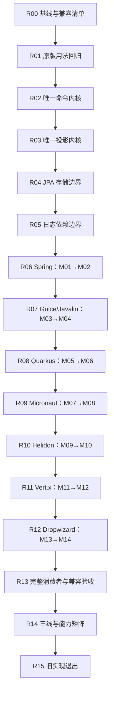
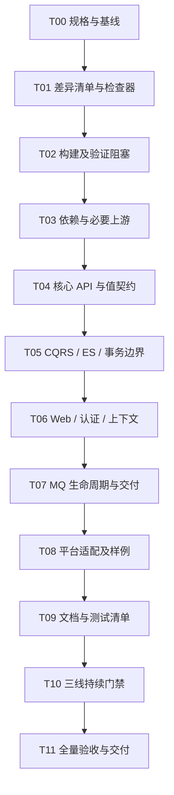

# ddd4j 三线产品收敛实施计划

> **For agentic workers:** REQUIRED SUB-SKILL: Use superpowers:executing-plans to implement this plan task-by-task. Steps use checkbox (`- [ ]`) syntax for tracking.
> 执行方式：当前会话按任务顺序实施；本计划不要求委派子 Agent。每项经过目标验证与审查后再推进依赖它的任务。

**Goal:** 将 ddd4j 1.0.x、2.0.x、3.0.x 收敛为同一个产品的三条兼容线：共同业务能力、对象/API、协议、测试场景和产品文档一致，差异仅来自经过说明和验证的版本适配。

**Architecture:** 以 2.0.x 承载共同契约整合，取三线有效实现和测试的兼容并集；分别向 JDK 8 和 JDK 21 适配。共同契约不以任何单分支的当前实现为最终正确性证明；框架和第三方差异收口到明确的适配边界。

**Tech Stack:** JDK 8/17/21、各分支 Maven Wrapper、JUnit、现有 Testcontainers、Python 标准库、JDK Compiler Tree API、javap、Git。CodeGraph 只作定位，过期索引不进入验收事实源。

**Spec:** 延续 `docs/superpowers/specs/2026-09-06-three-line-parity.md`。该规格当前存在于 1.0.x；T00 将其增量补充并同步到三线，保留历史验收记录。禁止 record 的既有规格继续生效。本文是该规格的后续执行计划，不初始化 OpenSpec/Spec Kit。

**2026-11-18 模块收敛进度**　[架构收敛设计](../../architecture/architecture.md#architecture-convergence-20261118)定义目标与验收契约，[R00—R15](#architecture-convergence-tasks-20261118)记录本轮实施证据。R00—R13 与 S00—S07 已完成分项审查，三线整体验收仍在 R14。原 Status、T 任务与历史验证记录保留各自的时点和范围。

**Status:** 执行中。十二个独立投影模块及其旧 Maven 坐标已在三线工作副本直接退出，应用按需使用现行 runtime、core 和存储模块。退役后的归档基线已通过 Java 8、17、21 默认根 reactor、独立样例 reactor、严格依赖检查和显式本地场景。后续改动及其定向证据按 R14 记录。跨线源码及 JVM API 差异、三条真实云 Broker 场景与远端 CI 仍待验收。三线各自保留 JDK、Maven 与第三方依赖适配。

<a id="architecture-convergence-tasks-20261118"></a>

## 2026-11-18 模块架构收敛任务 R00—R15、S00—S07（实施中）

### 目标、执行边界与原计划衔接

**Goal:** 保留原版简洁用法和全部已有能力，将 14 个 CQRS/投影平台模块的实现归入七个现有 runtime，明确按需启用、兼容和退出条件。

**Architecture:** 统一命令和投影执行规则，保留四种投影进度存储、五种 EventStore、全部现有 ORM/MQ/Web/Auth/扩展。平台投影通过 runtime 接入。剩余旧 CQRS 入口在退出前委派给同一实现。

**Tech Stack:** 继续使用各线 JDK 8/17/21、Maven Wrapper、JUnit、现有平台测试和数据库集成设施；按各线实际 JDK/Wrapper 运行目标验证；不安装或升级工具。

**Spec:** 本节只实现[2026-11-18 架构收敛设计及 AC01—AC12](../../architecture/architecture.md#architecture-convergence-20261118)。原三线规格继续约束共同 API、行为及平台差异；不重复创建 specification/plan/tasks。

**Status:** 十二个独立投影构件已完成 R15 的本地退出批次。R14 继续三线整体验收，R15 跟踪剩余旧 CQRS。分项审查、三线基线、冻结客户端和数据夹具见 R00—R13。用户确认当前业务迁移清单为空。提交、推送、发布、部署和数据迁移按实际授权执行。

### 全局约束

本轮用户已明确指定 `superpowers:subagent-driven-development`：每项实施后由独立任务审查确认规格与质量，再推进依赖项；最终执行整体验证与审查。该指定适用于本轮 R/S 任务，覆盖文首历史执行方式说明。沿用当前授权 checkout，不使用 worktree；不因技能默认流程自动提交或切分支。

- 共同能力取有效并集；不删除平台、业务能力、有效测试或既有调用方式来降低模块数。
- 7 个 runtime 按 Spring → Guice → Quarkus → Micronaut → Helidon → Vert.x → Dropwizard 验收。Guice 阶段验证配套的 Javalin Web 接入和四个示例。Spring 阶段验证共用 Spring runtime 的 WebMVC、WebFlux 两种接入。验收矩阵包含 7 个运行时实现和 8 种 Web 接入，`ddd4j-runtime-testkit` 提供公共测试支持。
- 三线 JDK 固定为 8/17/21，继续禁止 Java record；各线依赖及 `javax`/`jakarta` 适配分别维护，不为统一而升级 JDK。
- 不使用 worktree，不覆盖当前未提交修改，不自动创建或切换分支。现有隔离副本与跨线执行方式延续本计划 T00 的授权边界。
- 只在必要的既有模块内增量修改；Boot 自动装配仍在具体脚手架，core 不依赖 runtime、ORM 或外部脚手架。
- 投影旧构件按 R15 直接退出。七个旧 CQRS 坐标按 R15 第三批直接退出。每个全限定类名由一个实际构件提供。
- 新基础入口按需启用；旧入口保持已确认行为。既有鉴权、数据权限、投影、消息等配置不能被静默关闭。
- 不新增表/字段、不执行 DDL、不重置投影位置、不默认全量重放。出现数据迁移需求先明确差异和授权，不混入模块重排。
- 正确的历史行为先记录基线；新增/修复行为使用失败测试→最小修改→通过验证。环境失败与行为失败分开，不制造或虚构 RED。
- 步骤只有对应实现与验证完成才勾选；零测试、跳过、旧 target、历史 CI 和仅编译通过均不能代替所要求的行为证据。

data 初始 POM 有 31 项，七个旧平台投影退出后为 24 项，全部十二个独立投影模块退出后为 19 项。剩余旧 CQRS 模块按 R15 验收。样例按七框架、每框架四入口建设，共 28 个场景，现均已纳入构建。R14 汇总三线实际运行及独立样例结果。下表“POM 现状”记录各任务的初始基线。

### Review Focus

| 输入或失败路径 | 必须保持的行为 | 测试责任 |
|---|---|---|
| 旧坐标、新 runtime 和兼容构件同时在 classpath | 无重复类、Bean、实体或调度任务；旧二进制可链接 | R06—R13，旧/新/混合消费者 |
| 命令抛异常或返回既有失败结果 | 返回/异常与事务结果符合原契约；不因委派改变回滚策略 | R02、R06，各平台命令契约 |
| 过滤后事件位置有间隙，同事件被两个 View 订阅 | 采用源 next position，每个视图独立推进；失败不跳过 | R03，ProjectionRunner/Dispatcher/Registry 测试 |
| 新基础配置、旧自动装配、显式启用但缺事件源 | 基础模式无副作用；旧模式不改变；错误配置明确失败 | R06—R13，平台启动与配置兼容测试 |
| R2DBC/WebFlux/Vert.x 上同步数据库调用、取消或关闭 | 不在事件循环阻塞；上下文清理、取消和资源释放符合原契约 | R06、R11、R14，响应式与生命周期测试 |

### 前置关系与 14 个模块的顺序



| 顺序 | 任务 | 原模块 | 目标模块 | 本批特有验收 |
|---|---|---|---|---|
| M01 | R06 | `ddd4j-data-cqrs-spring` | `ddd4j-runtime-spring` | 唯一 CommandBus、重复 Bean 检测、事务契约 |
| M02 | R06 | `ddd4j-data-projection-spring` | `ddd4j-runtime-spring` | SmartLifecycle 单次启动/停止；MVC/WebFlux 分别验证 |
| M03 | R07 | `ddd4j-data-cqrs-javalin` | `ddd4j-runtime-guice` | Guice 执行器绑定与旧手动注册均兼容 |
| M04 | R07 | `ddd4j-data-projection-javalin` | `ddd4j-runtime-guice` | 基础 Injector 不默认安装投影；关闭释放所拥有资源 |
| M05 | R08 | `ddd4j-data-cqrs-quarkus` | `ddd4j-runtime-quarkus` | CDI 收集无重复 Bean，执行上下文正确 |
| M06 | R08 | `ddd4j-data-projection-quarkus` | `ddd4j-runtime-quarkus` | CDI 生命周期、Panache/位置存储、重启恢复 |
| M07 | R09 | `ddd4j-data-cqrs-micronaut` | `ddd4j-runtime-micronaut` | 容器发现与命令分发等价 |
| M08 | R09 | `ddd4j-data-projection-micronaut` | `ddd4j-runtime-micronaut` | Context 启停无重复任务、无静默 Noop 回退 |
| M09 | R10 | `ddd4j-data-cqrs-helidon` | `ddd4j-runtime-helidon` | CDI 绑定与命令契约等价 |
| M10 | R10 | `ddd4j-data-projection-helidon` | `ddd4j-runtime-helidon` | 启停、事务接入和调度语义保持 |
| M11 | R11 | `ddd4j-data-cqrs-vertx` | `ddd4j-runtime-vertx` | 异步命令/上下文行为保持，事件循环不阻塞 |
| M12 | R11 | `ddd4j-data-projection-vertx` | `ddd4j-runtime-vertx` | 调度/取消/关闭与响应式存储边界正确 |
| M13 | R12 | `ddd4j-data-cqrs-dropwizard` | `ddd4j-runtime-dropwizard` | Bundle 收集和执行器注册等价 |
| M14 | R12 | `ddd4j-data-projection-dropwizard` | `ddd4j-runtime-dropwizard` | Managed 生命周期、启动失败清理、单次调度 |

每个 M 项均须有原模块到目标模块的类/API/配置映射、旧入口委派、测试迁移和证据记录；不能用整批编译成功替代逐项验收。

### R00：固定业务基线和兼容迁移清单

**Files:** 增量维护根 `REFACTOR_MIGRATION.md`、本计划和 `docs/architecture/architecture.md`；读取 14 个旧模块、七个 runtime、对应 POM/配置/测试，不修改无关工作。

**Interfaces:** 消费当前公开 API、旧 GAV 和实际启动入口；产出 M01—M14 的兼容清单与 AC01—AC12 的证据索引，供全部后续任务使用。

- [x] 记录三线源码基线、JDK/Wrapper、现有支持组合及消费者；为每个 M 项列明旧类/构造器/方法、Bean 名/限定符、配置键、实体扫描、目标所有者和调用者。
- [x] 固定可运行的旧消费者构件和序列化/事件/投影位置样本；旧构件与候选构件使用隔离的本地解析目录，防止同版本 SNAPSHOT 覆盖基线。
- [x] 逐项记录“新基础入口默认不启用”“旧入口保持行为”“显式启用条件”的现有键和迁移映射，不假定开关已经存在；列明必须补充的显式依赖。
- [x] 将 AC01—AC12 对应到现有或拟新增测试，确认四种位置存储、五种 EventStore、原有认证/MQ/扩展场景均有保留去向；无消费者信息的旧坐标保持可用，不能推断无人使用。

**验收：** 14 行兼容清单完整，原版用法及有效能力没有被标记为删除；后续任务无须重新选择公开 API 或存储格式。仅完成清单不算迁移通过。

**2026-11-18 R00 验收。** 三线已固定旧构件、客户端、旧格式数据和独立解析目录，兼容清单与验收索引通过独立审查（C0/I0/M2）。JDK21 冻结自原提交 `970f8fe`。JDK8 原提交 `6bca665` 因缺少指定的 Easy4J BOM 停在 Maven 模型解析。可运行的 JDK8 基线来自候选适配前冻结的工作快照，其中 9 个旧模块的生产源码与原提交不同。JDK8 和 JDK21 各有 18 个旧构件、14 个可运行的旧客户端及 11 个旧格式夹具。客户端和夹具用于后续候选兼容及回退验证。报告位于本计划证据目录的 `task-R00-cross-line-review.md`。

### R01：固定并保持原版简洁用法

**Files:** `ddd4j-core/src/main/java/io/ddd4j/core/ddd/model/AggregateRoot.java`、`ddd4j-core/src/main/java/io/ddd4j/core/cqrs/query/Query.java`；测试沿用 `AggregateRootTest.java`、`QueryRichMethodsTest.java` 及 `ddd4j-data/ddd4j-data-mybatisplus/src/test/java/io/ddd4j/data/mybatis/repository/MybatisAggregateRepositoryCrudTest.java`。

**Interfaces:** 保持现有模型、Query、RepositoryRegistry 的公开签名；本轮以现有用法回归为主，不主动重构 AggregateRoot/Query。只有具体 data 集成问题确实要求时，才作保持公开契约的最小修改。

- [x] 补充并运行保存/更新、one/list/page/exist、对象转换/填充、租户及本地事件基线，明确这些用例不注册 CommandBus、EventStore 或 Projection。
- [x] 先按原用法回归记录结果；仅修复实际暴露、影响本轮 data 集成的问题，不展开独立 core 重构，保留现有公开方法、返回值和异常行为。
- [x] 运行 `./mvnw -pl ddd4j-core,ddd4j-data/ddd4j-data-mybatisplus -am verify`，记录实际执行的单测/数据库用例及跳过原因。

**验收：** AC01 通过；原版调用体验有真实持久化证据，不能仅以 mock 或源码未变判定。

**2026-11-18 本轮证据：** R01 已通过独立规格与质量审查；仅修复 MyBatis-Plus 仓储泛型解析的三个索引。定向真实 RED 63项/3错误 → GREEN 63项全通过；必需 `-am verify` 654项，0失败/错误/跳过，含 MySQL8.4 的8项真实用例。报告与审查：`.superpowers/sdd/2026-10-10-three-line-product-convergence/task-R01-{report,review}.md`。第三方 SQL 解析器的 JaCoCo 插桩异常已记录，功能测试通过不等于该第三方类覆盖率有效。R00旧构件、R13兼容及R14三线/平台证据继续开放。

### R02：统一命令分发内核

**Files:** `ddd4j-core/src/main/java/io/ddd4j/core/cqrs/command/DefaultCommandBus.java`、`CommandRegistry.java`；现有 `CommandRegistryTest.java`，拟新增同测试包下的 `DefaultCommandBusCompatibilityTest.java`。

**Interfaces:** 复用现行 `CommandBus`/`CommandExecutor` 签名；registry 负责收集校验，最终路由与执行规则由 `DefaultCommandBus` 承担。

- [x] 为重复注册、未匹配命令、成功结果、既有失败结果和执行异常补充契约测试；与旧平台入口比较可观察结果，新增目标先确认行为失败。
- [x] 消除重复路由规则，保留错误模型；事务由各平台接入，不擅自改变失败结果是否回滚的既有契约。
- [x] 运行 `./mvnw -pl ddd4j-core -am verify`，将事务断言交给 R06—R12 的真实平台用例，不能在此宣称全部事务已验证。

**验收：** 为 AC02 提供唯一执行规则；平台迁移只需要接入发现与事务，不再实现另一套分发。

**2026-11-18 本轮证据：** R02 共享内核契约回归已通过独立规格/质量审查，生产代码未改；定向23项、必需verify620项，均0失败/错误/跳过。既有正确行为首次即GREEN，不伪造RED。旧data-cqrs入口已继承共享总线；runtime重复路由及空值/动态补查/发现时序差异由R06—R12逐平台处理，本项不代表全平台唯一实现或事务已经验收。详见 `.superpowers/sdd/2026-10-10-three-line-product-convergence/task-R02-{report,review}.md`。

### R03：统一投影执行与恢复规则

**Files:** core 的 `cqrs/readmodel/ProjectionRunner.java`、`ProjectionView.java`、`ViewManager.java`、`ViewScheduler.java`；`ddd4j-core/src/main/java/io/ddd4j/core/cqrs/readmodel/handler/ProjectionDispatcher.java`、`ProjectionHandlerRegistry.java`；对应 `ProjectionRunnerTest.java`、`ProjectionRunnerFailureContractTest.java`、`ProjectionDispatcherTest.java`、`ProjectionHandlerRegistryTest.java`。

**Interfaces:** 沿用 `ProjectionView`、`EventChunkReader`、`ProjectionPositionRepository`、`ViewScheduler`；Handler 入口适配为 View，共用内核。保留 `schedule(viewName, cron, task)` 的任务取消句柄契约。

- [x] 增加有间隙位置用例：初始位置 10，过滤后只有两条事件、源返回 next position 20，成功后必须保存 20；失败不得直接推进到 20。
- [x] 增加同事件驱动两个独立 View、历史位置续跑、同库写入/位置保存失败、跨存储重投幂等、重复启动/停止以及 CRON/时区兼容用例。
- [x] 统一拉取、处理和位置推进规则，旧 Dispatcher 委派；公共视图状态/重入保护共享，平台保留调度与线程差异，不再复制 CRON 解析。
- [x] 公共投影契约已验收。现行复跑命令为 `./mvnw -pl ddd4j-core -am verify`。真实事务和存储断言由 R04、R06—R12 继续验证。

**验收：** AC03 的共同规则通过；AC04/AC09 的测试已分配到实际存储和平台，不能因统一了接口而宣称原子性或 exactly-once。

**2026-11-18 本轮证据：** R03 共享层及Fix1已通过独立审查。新增source-aware Handler→View→Runner、独立视图扇出、同实例stream重入保护、共享生命周期与数值六段CRON。初轮必需verify660项全通过；审查发现注册metadata漂移可跳事件，Fix1真实RED27项/3失败→影响范围GREEN32项全通过，复审I1已关闭。660项与旧M04/API探针是Fix1前快照，当前增量32项覆盖修改，未冒充最终全量重跑。legacy裸事件分支为保留旧positions/service顺序仍计数+1，不能声称源位置安全；七平台采用、原生方言/事务、实际存储与回退继续由R04/R06—R13验收。报告及Fix1审查见 `.superpowers/sdd/2026-10-10-three-line-product-convergence/task-R03-{report,fix1-review}.md`。

### R04：归并 JPA 投影存储并明确平台边界

**Files:** `ddd4j-data/ddd4j-data-event-store-jpa/` 中的 JPA 位置存储与 `ddd4j-runtime/ddd4j-runtime-spring/` 中的 Spring Data 适配。对应测试为 `EntityManagerProjectionPositionRepositoryTest.java`、`ProjectionJpaModuleIndependenceTest.java`、`JpaProjectionPositionRepositoryTest.java` 和 `ProjectionPositionJpaIT.java`。Quarkus 装配归 R08。

**Interfaces:** `ProjectionPositionRepository` 和既有实体/构造器兼容清单；公共持久化以 JPA API 为边界，Spring Data/Boot 装配放在具体 Spring 接入层。脚手架变更先定位实际拥有仓库和指令，不在本仓库虚构 starter。

- [x] 用旧位置样本和旧构造路径验证读取、更新、reset 的既有语义、查询快照可修改性及事务失败；补非 Spring JPA 和 Spring Data 兼容用例。
- [x] 将存储实现归入 data，统一实体映射，保留旧 API 委派或必要显式依赖；不得默认改变表名、列名、stream key 或重复扫描实体。
- [x] 持久化和事务契约已验收。现行复跑命令为 `./mvnw -pl ddd4j-data/ddd4j-data-event-store-jpa,ddd4j-runtime/ddd4j-runtime-spring -am verify`。非 Spring 类加载证据见 R08/R13。

**验收：** AC04/AC06/AC09 对 JPA 的断言有证据；移走类但仍强绑 Spring 容器不算通过。

**2026-11-18 本轮证据：** R04 已通过独立审查（Critical/Important 均为 0）。JPA 中立入口和公共持久化操作归 data，旧 SpringData 构造器、实体映射及序列化字段按兼容裁定保留；Quarkus 旧立面委派。规定 verify 734 项、Quarkus 受影响契约 4 项均无失败、错误或跳过；7 项隔离探针实际运行，包含无 Spring JVM、旧字节与旧库副本读取、事件/位置同事务失败回滚及提交后重开。该 verify 同时覆盖 R03 Fix1 后的 core 530 项与公共 projection 32 项。真实平台扫描/JTA、混合依赖、完整回退、JDK8/21 仍分别由 R06/R08/R13/R14 验收。报告与独立审查：`.superpowers/sdd/2026-10-10-three-line-product-convergence/task-R04-{report,review}.md`。

### R05：解除日志对 WebMVC 的反向依赖

**Files:** `ddd4j-data/ddd4j-data-logs/`、`ddd4j-web/ddd4j-web-webmvc/`、`ddd4j-runtime/ddd4j-runtime-guice/src/main/java/io/ddd4j/guice/Ddd4jLogsGuiceModule.java`；拟在 Guice 测试包新增 `GuiceOptionalCapabilitiesTest.java`。

**Interfaces:** 保留操作日志处理 API，HTTP/切面数据采集由 Web 接入负责；Guice 的日志/ORM 专用装配成为显式选择，旧安装入口继续兼容。

- [x] 添加隔离 classpath 的日志装配用例：没有 Spring WebMVC 也能使用日志处理；显式启用日志时日志字段及异常采集行为保持。基础 Injector 移除未选择 ORM 依赖的用例由 R07 完成，不作为本任务提前通过的条件。
- [x] 解除 `data-logs → web-webmvc` 的反向依赖，调整对应平台装配；仅声明 optional 而基础入口仍加载缺失类型视为失败。
- [x] 运行 `./mvnw -pl ddd4j-data/ddd4j-data-logs,ddd4j-web/ddd4j-web-webmvc,ddd4j-runtime/ddd4j-runtime-guice -am verify`，保存依赖解析与类加载证据。

**验收：** AC06 的 Guice/日志边界通过；日志能力保留，基础启动不再被迫携带 WebMVC。

**2026-11-18 本轮证据：** R05 已通过独立审查（Critical/Important 均为 0）。`data-logs → web-webmvc` 已解除，日志读取既有 ThreadContext，WebMVC 可选桥保留请求参数/头优先级、URI/IP、日志扩展点及异常/MDC 契约。定向 10 项和规定 verify 1,274 项均无失败、错误、跳过；真实隔离 JVM 分别验证无 Spring/WebMVC/Servlet 的日志调用、无日志依赖的 MVC 请求分派。4 个旧公开/受保护 API 描述符一致，同一合成旧客户端字节在旧/候选环境运行成功。Guice 基础 ORM 选择留 R07，三线和完整消费者兼容仍留 R13/R14；报告及审查见 `.superpowers/sdd/2026-10-10-three-line-product-convergence/task-R05-{report,review}.md`。

### R06—R12：逐平台执行同一迁移流程

**Files:** 每个任务只修改 M 表中本批的两个旧模块、目标 runtime 的生产/测试/资源/POM、受影响 Web/样例和兼容清单。两个旧模块的源码不能在目标模块留第二份同名类。所需内部公共代码归 R02/R03 的共同实现。

**Interfaces:** 消费 R02/R03 的命令/投影规则、R04/R05 的存储与依赖边界；产出可独立使用的目标 runtime 和委派到它的旧入口。每个平台必须完成下列步骤再进入下一批：

1. 先运行并补充旧/新入口、重复注册、事务/错误、基础/显式启用/缺配置、历史位置恢复与启停用例；新增目标确认失败原因。
2. 先迁移该批奇数 M 项的命令实现并通过命令契约，再迁移偶数 M 项的投影装配；存储实现不回流 runtime。
3. 在本批同步提供旧公开类/配置/坐标的兼容委派及必要依赖说明；Bean 名、限定符、扫描、资源文件和生命周期一起迁移。
4. 运行下表命令和对应真实平台启动用例，核对实际执行的测试数量及报告；基础模式无投影任务，显式启用处理真实事件，关闭释放资源。
5. 更新 M 清单的证据与回退结果，确认单一视图没有旧/新两套调度同时生效。保留旧构件和映射，尚不删除旧模块。

以上是每个平台都要执行的步骤，不是一次执行即可覆盖七个平台；下面复选项表示整批验收。

以下命令使用 R15 退役十二个旧投影模块后的现行坐标。原始报告保留当次执行命令。

| 任务 | 必须扩展的现有 runtime 测试文件（相对目标模块） | 现行复跑命令（仓库根目录） |
|---|---|---|
| R06 | `src/test/java/io/ddd4j/spring/command/SpringCommandBusTest.java`、`src/test/java/io/ddd4j/spring/cqrs/SpringCqrsRuntimeContractTest.java`、`SpringJpaViewManagerTest.java` | `./mvnw -pl ddd4j-data/ddd4j-data-cqrs-spring,ddd4j-runtime/ddd4j-runtime-spring,ddd4j-web/ddd4j-web-webmvc,ddd4j-web/ddd4j-web-webflux -am verify` |
| R07 | `src/test/java/io/ddd4j/guice/command/GuiceCommandBusTest.java`、`src/test/java/io/ddd4j/guice/cqrs/GuiceCqrsRuntimeContractTest.java`、`GuiceViewManagerTest.java` | `./mvnw -pl ddd4j-data/ddd4j-data-cqrs-javalin,ddd4j-runtime/ddd4j-runtime-guice,ddd4j-web/ddd4j-web-javalin -am verify` |
| R08 | `src/test/java/io/ddd4j/quarkus/command/QuarkusCommandBusTest.java`、`src/test/java/io/ddd4j/quarkus/cqrs/QuarkusCqrsRuntimeContractTest.java`、`QuarkusJpaProjectionServiceContractTest.java` | `./mvnw -pl ddd4j-data/ddd4j-data-cqrs-quarkus,ddd4j-runtime/ddd4j-runtime-quarkus,ddd4j-data/ddd4j-data-event-store-panache,ddd4j-web/ddd4j-web-quarkus -am verify` |
| R09 | `src/test/java/io/ddd4j/micronaut/cqrs/MicronautCqrsRuntimeContractTest.java` | `./mvnw -pl ddd4j-data/ddd4j-data-cqrs-micronaut,ddd4j-runtime/ddd4j-runtime-micronaut,ddd4j-web/ddd4j-web-micronaut -am verify` |
| R10 | `src/test/java/io/ddd4j/helidon/cqrs/HelidonCqrsRuntimeContractTest.java` | `./mvnw -pl ddd4j-data/ddd4j-data-cqrs-helidon,ddd4j-runtime/ddd4j-runtime-helidon,ddd4j-web/ddd4j-web-helidon -am verify` |
| R11 | `src/test/java/io/ddd4j/vertx/cqrs/VertxCqrsRuntimeContractTest.java` | `./mvnw -pl ddd4j-data/ddd4j-data-cqrs-vertx,ddd4j-runtime/ddd4j-runtime-vertx,ddd4j-data/ddd4j-data-event-store-r2dbc,ddd4j-web/ddd4j-web-vertx -am verify` |
| R12 | `src/test/java/io/ddd4j/dropwizard/cqrs/DropwizardCqrsRuntimeContractTest.java`、`src/test/java/io/ddd4j/dropwizard/Ddd4jBundleCollectionContractTest.java` | `./mvnw -pl ddd4j-data/ddd4j-data-cqrs-dropwizard,ddd4j-runtime/ddd4j-runtime-dropwizard,ddd4j-web/ddd4j-web-dropwizard -am verify` |

表内简写的测试文件位于同一行前述 `cqrs/` 测试包；新增测试名称由用例说明约束，不另建一套平台契约。共同场景优先扩展 `ddd4j-runtime/ddd4j-runtime-testkit/src/main/java/io/ddd4j/runtime/testkit/AbstractCqrsRuntimeContractTest.java`，不得通过修改共同测试来放宽失败平台的行为要求。

- [x] R06 / M01—M02：Spring 命令唯一性和真实事务用例通过；投影基础模式无 JPA/事件源要求，MVC 与 WebFlux 分别验证。
- [x] R07 / M03—M04：Guice/Javalin 的基础、旧安装和显式启用三条路径通过；新基础 Injector 无未选择的 ORM/WebMVC 依赖，显式持久化模式无静默 Noop/内存位置回退；旧安装的既有默认行为通过兼容委派保留并明确记录。
- [x] R08 / M05—M06：Quarkus 的 CDI 装配、Panache/历史位置、非 Spring JPA 和启动关闭通过；保留现有支持的构建形态。
- [x] R09 / M07—M08：Micronaut 的容器发现、配置选择、命令/投影与 Context 关闭通过。初轮审查与 Fix1 复审通过；旧投影 GAV 保留公开 SPI 传递依赖，独立消费者编译/运行通过。原生 Context 部分调度后失败、取消重试及原 SPI 恢复已在 R14 用具名用例三线验收；R09 运行时夹具使用 JPA ResourceLocal/H2。S04 持久样例后台运行使用真 PostgreSQL。
- [x] R10 / M09—M10：Helidon SE 兼容与 MP CDI 显式装配、共享引擎及启停通过独立审查。事务证据为应用 JDBC/H2 边界，未验证 JTA；借用调度器在 MP 关闭后仍可接受并实际执行新任务，R14 已在三线原生容器验证。持久数据回退见 R13。
- [x] R11 / M11—M12：Vert.x 上下文、排队取消/已执行业务边界、关闭、事件循环及借用资源检查通过；CRON 兼容修复经定向复审，C0/I0/M0。同步调用仍须进入 worker，S06 业务样例已另行通过审查。
- [x] R12 / M13—M14：Dropwizard 的 Bundle、Managed 生命周期、重复启动和启动失败清理通过独立审查；S07业务/Auth和R13完整持久回退继续开放。

**验收：** 每批满足本批 M 表特有条件及 AC02—AC09 的适用部分；缺少真实平台或外部服务证据时维持未完成，不以其他平台的结果替代。

**2026-11-18 R06 证据：** M01/M02 已独立审查并修复非 singleton 自定义 Bean 漏判。三个旧公开类由 runtime-spring 唯一提供，旧两坐标保留转接主 JAR；新增显式装配，保留原有效扫描、构造器、事务及 Spring cron。初轮规定 verify 1,226 项、15 种实际 JAR 激活组合、冻结 M01/M02 字节码运行均通过；这些为 Fix1 前构件证据。Fix1 当前四文件由 24 项定向测试验证（真实 RED 后全绿），复审关闭 P2；没有把初轮 JAR/全量结果冒充最终构件验证。MVC/WebFlux 为真实 Tomcat HTTP，WebFlux 限 Servlet 适配；S01 将基于当前源码重建消费，R13/R14 完整兼容和三线门禁仍开放。详见 `.superpowers/sdd/2026-10-10-three-line-product-convergence/task-R06-{report,fix1-review}.md`。

**2026-11-18 R07 证据：** M03/M04 已通过独立审查及 I1 复审。三个旧公开类由 runtime-guice 唯一提供，两个旧坐标保留；基础 `basic()` 与显式投影入口分开，保留旧内存/Noop 默认、动态命令补查和原生调度语义。初轮规定 verify 1,227 项、230套件全通过；冻结 M03/M04 旧客户端在实际候选 JAR 上运行成功，九个旧公开描述符保留。审查发现失败创建会遗留全局 Injector，Fix1 将显式能力启动前置于全局发布：六组真实 RED 后，定向50项及当前 runtime scoped verify 106项/18套件全通过，当前JAR旧客户端回放也通过。1,227项为Fix1前证据，不冒称修复后全套重跑。独立JVM剥离依赖、真实HTTP/执行器事务及冻结位置10→20接续已验证；S02四场景、三线和完整消费者回退仍开放。详见 `.superpowers/sdd/2026-10-10-three-line-product-convergence/task-R07-{report,fix1-review}.md`。

**2026-11-18 R08 证据：** M05/M06 已通过独立审查及 Fix1 复审。旧两个 GAV 保留薄 CDI facade，真实实现归 runtime；基础模式无 Quartz/ORM/source 要求，旧配置及请求上下文、Panache/JTA、失败启动清理均有原生 JVM 证据。初轮规定 verify 与恢复命令去重1,170项，是后续修复前的证据。Fix1 普通已执行回归74项通过，新增 mixed 专属用例在默认命令中跳过1项，附加 profile 实际执行1/1且零跳过；修复后20条实际 JAR 定点构建/运行结果符合预期，单视图单 numeric 任务、严格缺配置拒绝和历史位置10→20→第二进程20均有断言。原冻结 M05/M06 字节码4次运行保留原验证时点。运行时异常清理的已知 warning 仍列为 Minor；S03、R13/R14、GraalVM native-image、远端CI/生产未由本批代验。详见 `.superpowers/sdd/2026-10-10-three-line-product-convergence/task-R08-{report,fix1-review}.md`。

**R08 当前投影门禁**　三线默认验证由 Panache 的 `QuarkusDurableProjectionIT` 承担。场景矩阵要求本线实际执行 `historicalPositionFailureRollbackRetryAndSingleScheduler`，核对位点恢复、JTA 回滚、失败重试、单个 Quartz 任务和停机取消。

**2026-11-18 R10 证据：** Helidon 两旧坐标及 runtime 已通过独立审查（C0/I0/M1）。旧 SE 的 ServiceLoader/人工启停与公开传递依赖保留，真实最小消费者不要求 CDI；MP 默认无投影资源，显式启用使用唯一真实来源/位置，支持正常作用域与具体泛型 producer，原代理保留。部分启动失败确实达到第二次调度并取消首个句柄、恢复此前 SPI；自有线程执行及退出有实证。初次规定 verify 1,106 项、后续取消修复57项、最终 runtime/web 41项按时点分别记录，不能相加；最终11次原生运行全部退出0，覆盖旧SE、typed/raw、旧新混合、历史位置10→20及重开无重放。应用 JDBC/H2 提交与回滚不代表 JTA；借用调度器关闭后的现有探针仅 schedule/cancel，强化实际执行断言列为 R14 非阻塞验证项。新写入数据切回旧构件的完整链路仍属 R13，S05业务样例仍待验收。报告与审查：`.superpowers/sdd/2026-10-10-three-line-product-convergence/task-R10-{report,review}.md`。

**2026-11-18 R11 证据：** Vert.x 两旧坐标与 runtime 迁移通过独立审查及 Fix1 复审（C0/I0/M0）。旧同步接口/公开传递依赖保留，基础零投影，显式投影使用原生 timer→worker；上下文、排队取消、部分启动回滚、stop 重启和终止 close、借用资源均有证据。初次205 suites/1,114 tests与close修复后56项按时点记录；原15次native及6次冻结回放属于Fix1前core。复审发现旧超字段宽度正步长误拒绝，最小修复共享parser并防int溢出：真实RED后6项GREEN，当前旧/新/混合6次CRON/工厂运行及2次冻结M12回放exit0；未重复大矩阵，也不把历史证明冒称当前core全量重跑。R13完整持久回退、R14三线/record/OWASP及S06四样例仍开放。报告与复审：`.superpowers/sdd/2026-10-10-three-line-product-convergence/task-R11-{report,review}.md`。

**2026-11-18 R12 证据：** Dropwizard 两旧坐标与 runtime 已通过独立规格/质量审查（C0/I0/M1）。旧静态工厂及手动启停保留，默认Bundle零投影，显式依赖校验和真实Managed负责启停、部分失败回滚及前任所有者恢复；自有池有界关闭、借用池实际回调验证各自边界。规定22模块verify一次1,123项通过，最后线程退出断言仅定向6项重验；当前生产JAR未随断言修改。五个独立Maven消费者解析/公开API编译通过，旧/新/混合18种原生模式与6次冻结M13/M14回放成功；历史位置10→失败保持→重试20及独立JVM重开有证据。reactor与parentless实际依赖版本分别记录，既有logback-access/CDS告警为非阻塞Minor。S07四业务入口、R13候选写入后旧实现继续读写、R14三线/安全与整体门禁均不由本批代验。详见 `.superpowers/sdd/2026-10-10-three-line-product-convergence/task-R12-{report,review}.md`。

### S00—S07：七框架样例与公共验收

**依赖与事实源：** 延续本活动计划和 AC01—AC12，不另建规格。S00 固定共享 Order 业务与验收；S01—S07 随 R06—R12 按 Spring → Guice/Javalin → Quarkus → Micronaut → Helidon → Vert.x → Dropwizard 推进。每框架 default、cqrs、satoken、shiro 是四个独立入口，共28；共享 order-* 和 Spring MVC/WebFlux 两形态不额外凑数。R14、R15 必须消费全部28场景结果。

**Files:** `ddd4j-samples/pom.xml`、各样例模块、共享 order-domain/application/testkit 和必要的外部 Boot 接入；先核实外部仓库规范，不将 Boot 自动配置复制到 core。保留初始16入口及有效测试，补初始12项缺失入口；S01已补4项，S04、S05、S06及S07各补2项，当前28项全部纳管并通过各批独立审查。

**每个框架共用验收：** default 保存/更新/查询且无强制 bus/ES/projection/MQ/auth；cqrs 命令→持久化/事件→投影→查询及失败不越过位置、重试恢复；satoken/shiro 分别验证登录、认证通过、授权允许/拒绝、退出后令牌失效、异常与请求结束后上下文清理。必须通过真实框架启动与HTTP/业务调用，测试存在或构建通过不算运行验收。共享业务复用，平台特有生命周期保持。

| 任务 | 框架 / 承接 | POM 现状 | 本批交付 |
|---|---|---|---|
| S00 | 共享业务及验收 / R00—R03 | order-* 7项；不计28 | 固定4类场景契约、输入/断言/失败恢复/证据格式，复用order-testkit |
| S01 | Spring / R06 | 4项已新增并纳管 | 新增default/cqrs/satoken/shiro；复用外部Boot装配，MVC/WebFlux分别验证 |
| S02 | Guice/Javalin / R07 | 4项已存在 | 保留入口并验证基础/旧安装/显式启用及4类业务场景 |
| S03 | Quarkus / R08 | 4项已存在 | 保留CDI/构建形态，验证4类业务场景与重启恢复 |
| S04 | Micronaut / R09 | default/cqrs存在；auth2缺 | 补satoken/shiro并验证编译期发现、HTTP和Context关闭 |
| S05 | Helidon / R10 | default/cqrs存在；auth2缺 | 补satoken/shiro并验证当前Helidon形态、生命周期和HTTP |
| S06 | Vert.x / R11 | default/cqrs存在；auth2缺 | 补satoken/shiro，验证异步/取消/线程和上下文清理 |
| S07 | Dropwizard / R12 | default/cqrs存在；auth2缺 | 补satoken/shiro，验证Bundle/Managed启停和启动失败清理 |

- [x] S00：共享输入、断言、失败/恢复和证据格式形成可执行测试，保留现有业务能力。
- [x] S01：Spring四入口及MVC/WebFlux真实业务验收（默认例验证两种接入；两认证例当前证据为MVC，未声称认证WebFlux通过）。
- [x] S02：Guice/Javalin四入口真实业务验收（单活动原生应用/配对关闭；持久CQRS与兼容内存路由分别验证）。
- [x] S03：Quarkus四入口真实业务验收（同步原生REST；默认/auth为内存示例，CQRS真实持久查询和同库跨JVM重开）。
- [x] S04：Micronaut四入口真实业务验收。独立规格/质量审查通过；9项样例测试及46项实际 main HTTP 断言、PostgreSQL 容器与应用同库重开通过。全仓 record 检查和 OWASP 限制保留至 R14。
- [x] S05：Helidon四入口主线通过独立规格/质量审查；当前10项样例测试、5次真实main与46项HTTP、同库容器/应用重开通过。R14 已按请求标识逐一关联断连与 FINISHED 清理，Sa-Token 和 Shiro 在三线合计六次原生验证。
- [x] S06：Vert.x四入口通过独立审查及Fix1复审，C0/I0/M0；默认/持久CQRS/两原生认证主线成立，已进入请求和原生timer任务排空后关闭资源。数据库容器重启不在当前tmpfs证据内。
- [x] S07：Dropwizard四入口真实业务、持久失败恢复及原生认证/生命周期通过独立审查。

**验证方式：** 各线以本线 JDK/Wrapper 对本批四个真实 reactor 模块执行 `-pl ... -am verify`，再运行平台启动与HTTP/持久化场景；记录模块/GAV、源码指纹、命令、测试数、跳过、日志与关闭结果。尚未创建的模块路径是待交付项，不给出可运行承诺。R00只盘点，不生成样例代码或勾选S任务。

**2026-11-18 S00 证据：** 三个窄驱动接口及共享断言已经独立审查通过，新增 15 项检错测试，受影响 verify 共 675 项，均无失败、错误、跳过。CQRS 夹具用真实公共 Runner 与独立查询存储验证源游标 10→10→40 的失败重试；认证部分为受控 double 的断言验证。既有 OrderScenario、业务、POM 和旧测试未改；没有新增场景引擎或依赖。真实平台启动/HTTP/原生认证由 S01—S07 各自验收。报告及审查：`.superpowers/sdd/2026-10-10-three-line-product-convergence/task-S00-{report,review}.md`。

**2026-11-18 S01 证据：** 四个独立 Spring 入口复用共享 Order 与外部真实 Boot 源构件，已通过独立审查及 I1 复审。默认例有实际 MVC/WebFlux HTTP，CQRS 有 PostgreSQL 失败重试、应用/EMF 重开和独立查询证据。初次规定 verify 的 1,466 项测试全通过，但命令因五条字段 Javadoc 缺失退出1；仅补注释后正常 resume 三模块 verify 退出0，不能描述为一次完整命令成功。六次打包 JAR 启动属于初轮证据；随后两认证例修复 context path 授权绕过，真实 RED 4项/2失败→GREEN 4项全通过，并用两份新 JAR 验证 `/sample` 下只读创建/取消403、退出失效401。认证证据限MVC，外部完整Javadoc、漏洞扫描、远端CI、宿主机/数据库容器耐久和跨进程支付幂等仍未验证。详见 `.superpowers/sdd/2026-10-10-three-line-product-convergence/task-S01-{report,fix1-review}.md`，旧证据未冒充当前auth构件验证。

**2026-11-18 S02 证据：** 四个既有 Javalin 入口复用共享 Order，已通过独立审查及 I1 复审。default 提供无强制认证/CQRS的简单入口，保留旧 authenticated/JDBC API；CQRS 使用真实 PostgreSQL、源游标、独立查询、失败重试及应用/EMF 重开，旧 Order/Goods 内存路由另行保留兼容。初轮规定 verify 为40模块、1,976项全部通过，此为 DAO/权限后续修复前证据；当前受影响认证模块完整 verify 为 Sa-Token201、Shiro157，均0失败/错误/跳过。当前生产JAR使用各自POM runtime依赖启动，权限拒绝/允许、真实订单状态、关闭端口及自然退出通过。I1使用Javalin实际匹配路由消除尾斜杠取消越权；两次旧RBAC响应异常保留，诊断后完整绿灯不表示未知根因已解决。在线check、三线/完整消费者、任意多应用乱序关闭和生产部署仍未验收。详见 `.superpowers/sdd/2026-10-10-three-line-product-convergence/task-S02-{report,fix1-review}.md`。

**2026-11-18 S03 证据：** 四个既有 Quarkus 入口已通过独立审查（Critical/Important均0）。default保留原`/api/orders`，默认不强制Bearer；显式Bearer策略和原Web幂等检查保留。两认证例复用共享Order并验证真实原生身份/允许拒绝/错误密码/退出/异常与客户端断开清理；Shiro原匿名`GET /orders`列表仍为公开只读例外。CQRS保留旧内存路由/DTO，`/sample/orders`使用已有JDBC/Outbox、JTA事件源、Panache位置及独立六字段查询；真实查询提交后检查点失败仍4、重试24，以及事件3/pending3→重试事件3/pending0均有证据。四样例当前有效测试244项（45/85/58/56）无失败、错误、跳过；规定verify经历缓存环境、Javadoc和Shiro兼容失败后正常受影响续跑完成，不能称单次完整命令成功。实际fast-jar共5次运行（含CQRS同库重开），依赖无测试库，内部47个依赖实例与本轮reactor构件一致；同库重开events3/next4/queries1不变，均主动SIGTERM143并释放端口。单实例中继、同步REST、内存会话及跨资源幂等恢复边界保留；CI/native-image/三线/完整消费者与生产仍由后续门禁处理。报告与审查：`.superpowers/sdd/2026-10-10-three-line-product-convergence/task-S03-{report,review}.md`。

**2026-11-18 S04 证据：** Micronaut 四入口已通过独立审查（C0/I0/M1）。default 保留原 `/api/orders`，默认可选认证，显式 REQUIRED Bearer 与幂等契约保留；两认证例使用原生引擎、同源权限数据和 Micronaut 原生线程上下文传播，验证允许/拒绝、真实业务错误、注销及断连清理。CQRS 保留旧 `/orders` 内存 DTO，`/sample/orders` 使用既有六字段独立查询和 ResourceLocal/JDBC 持久链路，验证查询/确认/检查点失败恢复及源游标。最终有效248 suites/1,361 tests无失败/错误/跳过，其中样例仅9项；原 Javadoc 与 stale SNAPSHOT 失败、正常续跑及 import-only 跳测试打包均按时点记录。当前生产JAR完成46项HTTP断言，5次成功main以SIGTERM143结束并释放端口；另一次旧数据库动态端口启动失败exit1保留。宿主机挂载PG容器重启及应用重开后订单PAID/20、检查点4不变。单实例、独占事件库/Outbox、同步JSON与跨资源幂等边界保留；模块README已补充事件库独占表述，文档增量待最终审查。全仓record检查受既有删除路径影响、OWASP被继承配置跳过，均未声称通过。报告与审查：`.superpowers/sdd/2026-10-10-three-line-product-convergence/task-S04-{report,review}.md`。

**2026-11-18 S05 证据：** Helidon 四入口通过独立审查（C0/I0/M1），默认入口补齐生产 CDI 发现，原 Bearer/支付契约保留；两认证例使用真实引擎及权限，CQRS 使用既有持久源/独立读表并保留旧内存 DTO。规定38模块 verify 一次成功、249 suites/1,342 tests全通过；随后修复SaToken nullable权限数据源恢复，受影响两认证模块3项通过，当前四样例共10项，未把初轮全量当作修复后重跑。控制器核对52文件增量、75当前样例文件、34集成输入及576运行classpath实例，47个内部依赖与当前target一致；实际5个main/46次HTTP、同PG容器重启与应用重开后检查点4不变，进程均SIGTERM143且端口关闭。两认证各24次FINISHED是聚合证据，未与断连请求精确关联，R14补专属完成信号；产品同步cleanup未发现缺陷。旧S04同类nullable provider恢复问题单列最终定点修复，不扩大本批范围。单实例专用事件库/Outbox、独立事务、同步JAX-RS、全仓record及OWASP边界保留。报告与审查：`.superpowers/sdd/2026-10-10-three-line-product-convergence/task-S05-{report,review}.md`。


**2026-11-18 S06 证据：** 四入口沿用共享Order，新增两个认证模块；默认保留旧REQUIRED router并提供直接业务main，CQRS沿用旧/orders五字段与public内存API，通过既有JDBC/Outbox/JPA和R11 Runner实现独立持久查询。初轮verify在Javadoc失败后仅续跑四样例，245去重suites/1,329 tests全通过，四样例当时20项；六次实际main/38次HTTP、查询失败checkpoint0→重试4→独立JVM重开4及独立timer推进2有证据。独立审查发现关闭未等待worker，Fix1以两个确定性RED修复：runtime可选借用ViewScheduler六参入口保持原五参语义，应用封闭准入、等待请求与完整timer Runnable后释放资源；受影响runtime/default/CQRS正常verify32项通过。当前default callable-held探针、产品main和CQRS真实SQL锁下timer关闭均通过，两个新main均143、驱动0，完整日志可区分。旧1,329与auth结果未冒充新runtime全量重验。初轮Docker卷失败、busy409驱动失败和首次CQRS日志覆盖已披露；tmpfs只证明同运行库JVM重开，永久阻塞任务没有强制关闭超时。报告与两轮审查：`.superpowers/sdd/2026-10-10-three-line-product-convergence/task-S06-{report,review}.md`。


**2026-11-18 S07 证据：** Dropwizard四入口通过独立规格/质量审查（C0/I0/M3）。默认匿名业务/显式旧认证保留；CQRS旧静态内存接口和createdAt DTO保留，新增持久/sample/orders复用共享Order、Outbox、JPA事件/位置和R12 Runner，查询不回退写侧。两原生认证验证真实权限、退出失效、异常与逐请求断连清理；Jetty锁阻塞HTTP、自有timer及失败启动验证期限内关闭顺序。规定verify初轮因Javadoc格式失败后仅恢复三模块，去重253类/1,348项全部通过，当前四样例26项；5次实际main JVM、36次HTTP通过，持久失败位置0→重试4→同库新JVM保持PAID/4。SIGTERM退出143，tmpfs不证明DB重启；R12自有池5秒/Jetty30秒边界、OWASP跳过及版本告警明确保留。两个宽泛错误断言和两处平台注释列入R14定点收尾，已有main精确400证据。报告与审查见 `.superpowers/sdd/2026-10-10-three-line-product-convergence/task-S07-{report,review}.md`。

## 用户确认的当前业务消费者状态（2026-11-18）
R00/R13 历史基线包含 14 个旧平台坐标。当时使用冻结客户端、独立 Maven 消费者和持久化数据夹具验证行为。用户已确认框架暂无业务消费者。旧投影坐标及其兼容验收随后按 [R15 投影退出批次](#第二批五个通用投影模块退出)结束。剩余旧 CQRS 坐标继续采用 R15 对应任务。

### R13：完成旧坐标、公开 API 与外部消费者兼容验收

本节记录投影退役前的验收。现行投影交付以 R15 的两批退出条目为准。

**Files:** 14 个兼容模块的 POM/资源、目标 runtime 与受影响存储模块；`REFACTOR_MIGRATION.md`、BOM 和真实拥有装配的脚手架文档。独立消费者夹具位于 `ddd4j-runtime/ddd4j-runtime-testkit/src/test/resources/convergence-consumers/`。testkit 为测试支撑，不计入七个 runtime 实现。

**Interfaces:** 对每个 M 项消费固定的旧 GAV/API/配置和新实际构件，产出“旧入口/新入口/混合依赖”三组可复现报告；不以 Maven relocation 声明本身证明二进制兼容。

- [x] 为七个平台分别建立旧入口、新基础入口、旧新坐标共存的独立消费者；使用实际构件解析，检查重复类、Bean、实体、调度任务和所需依赖。
- [x] 用旧基线编译的客户端在候选构件集上运行，客户端不重新编译；另做新客户端源码编译、旧配置/Bean 标识与序列化样本测试，分别记录源兼容和二进制兼容。
- [x] 显式列出原传递依赖转直接依赖、旧配置到新配置、旧实体到新提供模块的变化；已有启用行为保持，缺配置和内存演示模式可区分。
- [x] 用历史位置启动、处理新事件、停机并回退到上一兼容构件/配置，确认无重复调度、位置清零或不可读数据；若产生不兼容写入，先阻止退出旧实现并处理兼容，不能将测试标为通过。
- [x] 将 `auth-datascope` 的旧接口委派和其他保留模块的依赖调整纳入受影响回归；不合并两种 License 格式或两种 validation 职责。四种位置存储、五种 EventStore 的场景逐项保留。

**验证方式：** 在隔离的本地 Maven 解析目录构建候选构件，再在 reactor 外执行各消费者的 `verify` 和旧客户端运行；具体 GAV、命令、classpath、退出码和报告位置写入 M 清单。原已支持消费者未验证时保持 OPEN，不撤回旧发布构件。

**验收：** AC08—AC10/AC12 的兼容证据完整；仅有新源码编译通过不算旧客户端兼容。

**2026-11-18 R13 验收：** 当前 JDK17 兼容批次通过独立规格与质量审查（C0/I0/M2）。35 个独立 Maven 消费闭包构建通过且无重复产品类；28 次冻结旧客户端运行、14 次独立源码编译、74 次当前原生进程验证通过，另复用完整 classpath 哈希相同的 12 次 Dropwizard 证据。七个平台完成候选写入→完整旧实现续写→候选续写，位置依次 10→21→22→23；auth 旧 SPI 桥接保留默认和自定义规则。控制器核验了 30 个产物、417 份 Java 源文件及 93 个冻结输入。58 项必需 JUnit 通过；依赖准备另有 60 项通过和 1 项 ESDB 容器启动错误，不能宣称全部后端通过。JDK8/21、完整存储矩阵、CI 和旧实现退出继续由 R14/R15 管理。早期夹具失败日志缺失与继承的 logback 告警已披露。证据及独立审查：`.superpowers/sdd/2026-10-10-three-line-product-convergence/task-R13-{report,review}.md`。

### R14：三线、存储和多平台完整验收

**Files:** 各线实际工作副本中的受影响实现/测试/POM、`config/parity/three-line-policy.json`、现有场景矩阵和 CI 配置；按 T00/T10 现有方式增量维护，不另建一套豁免机制。

**Interfaces:** 消费 R00 的支持矩阵、M 清单和 AC01—AC12；输出对应源码指纹的三线本地、容器、独立消费者与远端 CI 状态。

- [ ] 将有效公共实现/API/测试适配到 JDK 8/17/21，保留本线依赖和命名空间差异；不因某平台暂时无法运行而删除能力或放宽门禁。
- [x] 运行四种投影位置存储和五种 EventStore 的契约/真实后端用例，以及七个 runtime、八种 Web 接入和 S00—S07 的全部 28 个独立样例场景；复用公共测试，逐项证明已支持组合，不能宣称所有理论排列均已通过。
- [ ] 各线使用本线 Wrapper/JDK 执行 `clean verify` 和已有结构/API/依赖/场景门禁；执行 `python3 scripts/check_no_records.py` 及检查器自测。采集实际测试数、失败/跳过、环境问题和输入指纹。
- [ ] 按授权状态核验远端 CI；未获推送授权或未运行 CI 时保留“未验证”，本地通过不自动关闭 T10/T11。原版简洁用法与高级增强路径分别给出验收证据。

**验收：** AC01—AC11 适用证据齐全且无未解释差异；远端/真实服务缺口不隐藏。十二个旧投影模块按 R15 的两个退出批次独立验证。整体交付仍需完成 R14。

**2026-11-20 投影退役后的 121 模块根构建与 Spring 投影回归**　三条线在各自冻结源码中完成本线 JDK 和 Maven Wrapper 的默认 `clean verify`。Java 8、17、21 分别执行 3,392、3,453、3,440 项测试，各生成 107 份 Javadoc，Maven 退出码均为 0。Java 8 Javalin 夹具使用回环地址和系统分配的端口，此前挂起的幂等用例在根构建中通过。三次根构建的 Spring runtime 只执行了既有的 JPA 集成测试，随后修正三线的 Surefire 测试匹配。三线定向构建各通过 73 项 Spring runtime 测试，其中此前缺少报告的三个投影场景合计 18 项。定向验证和根构建属于不同源码快照，当前 R14 仍需整体验收。根构建证据位于 `R14-evidence/r14-current-121-module-reactors/` 下的 `jdk8-loopback`、`jdk17-isolated-port` 和 `jdk21-isolated-port`。Spring 复验见 `R14-evidence/r14-spring-runtime-test-discovery/`。

**同批本地场景与编译 API**　将冻结根构建和显式场景报告与三线 Spring 定向结果逐项核对，各线 268 个受支持的本地测试绑定均有报告。Java 8、17、21 分别执行 1,275、1,251、1,252 项绑定内的去重用例。每条线的真实云 Broker 验收仍待执行。正式编译 API 比对使用三个根构建的实际 class 文件，仍有 57 个唯一待对齐条目，源码清单仍有 325 条 OPEN。证据见 `R14-evidence/r14-current-121-module-reactors/supported-local-scenario-bindings.json` 和同目录的 `compiled-api/`。

**认证常量的原生定向验证**　按当批编译 API 基线逐项核对，原有 32 个认证常量差异已在当前三线 JAR 中消除。Java 8、17、21 分别通过 54、67、64 项定向测试，独立复审通过。Java 17 保留原有 JWT 签发和读取行为。剩余认证访问器、会话与数据身份继续按 R14 验收。定向证据见 `R14-evidence/r14-auth-key-contract/verification.json`。

**显式登录域与会话有效期**　Java 8 的 Sa-Token realm 通过 SubjectProvider 装配。同名账号的令牌、主体、续期和设备归属随所选 realm 隔离。Java 8 原生定向构建通过 821 项，后续追加的生命周期类通过 34 项。省略有效期时继承 SDK，显式 `-1` 表示永久。Java 17、21 的严格 Jackson 请求回放各通过 16 项，现有计算字段继续序列化，未扩大未知字段接受范围。Jackson 对字面 `null` 的处理按各线已有版本行为保留。两个场景共绑定 20 个已有执行记录的具名用例。证据见 `R14-evidence/r14-jdk8-session-realm/`。

**可选 Sa-Token 数据身份**　三线按各自令牌读取数据身份和当前主体。缺失主体、轮换校验失败、撤销或凭证前缀错误时拒绝当前主体及权限。后台显式账号查询和已验证身份的请求后审计保留。Java 8、17、21 模块原生测试分别通过 67、69、70 项，各含 14 个数据身份契约。三个公开类的 15 项 JVM 成员一致。三份归档 JAR 的对应功能类与原生测试执行的 class 文件逐字节一致。该次更新后三线场景清单各 209 项，原有清单保留。证据见 `R14-evidence/r14-token-data-identity-parity/credential-bound-status/`。

**认证 JVM 签名定向复查**　以本线已执行原生测试的当前 class 文件重新比对历史 57 个未对齐条目的八个类型。49 个条目已经对齐，余下八个均为 `StpKit` 的学籍、校区与身份访问器。角色和学籍字段实际取值的确认仍独立进行。证据见 `R14-evidence/r14-current-121-module-reactors/current-auth-member-recheck/verification.json`。

**Javalin Shiro 独立 Guice 装配**　无参模块为独立样例创建同一组仓储和 RBAC 服务，演示数据初始化一次。调用方传入仓储与服务时保持原所有权。Java 8、17、21 各复现两个无参构造失败，修复后各通过 81 项定向测试，其中包含按原生 HTTP 验证的订单、商品与鉴权路径。独立复审通过。证据见 `R14-evidence/r14-javalin-shiro-standalone-module/`。

**Java 17 Shiro 依赖收敛**　从 Easy4J 扩展排除重复传入的 Shiro core/web 2.2.1 Jakarta，原有直依赖版本保持 3.0.2。实际 Maven 依赖树和两份原生测试报告均只包含一份各自的 3.0.2。12 项主体测试及两项 Spring HTTP 测试通过。证据见 `R14-evidence/r14-jdk17-spring-shiro-classpath/verification.json`。

**Javalin Shiro 原生生命周期合并验证**　真实 Guice 关闭抛异常、Shiro 会话读取抛异常、Jetty 启动与回滚同时失败，均验证先前调用方的状态恢复和原始异常传播。Java 8 已有对应清理路径，Java 17/21 补齐。三线按完整当前输入各通过 16 项，涵盖原生 HTTP、关闭/请求上下文、Guice 装配和订单路由。该批增加三个场景、15 个具名用例绑定，场景矩阵更新至 212 项。独立复审通过。证据见 `R14-evidence/r14-javalin-shiro-native-close/combined-latest/`。

**Quarkus Sa-Token HTTP 认证方案**　三线以同一有效令牌原生复现 `Bearer` 可读单、`bearer` 返回 401。过滤器统一按大小写无关匹配认证方案，三种写法读取同一订单并返回相同数据，`BearerX` 仍返回 401。Java 8、17、21 各通过六项原生定向测试，覆盖原有匿名拒绝、退出与断连清理。现有 Quarkus Sa-Token 订单场景新增一条具名用例，Classic 和 Reactive 继续使用各自的请求完成机制。证据见 `R14-evidence/r14-quarkus-satok-bearer-scheme/`。

**Micronaut 原生鉴权与参数校验顺序**　支付请求缺少必填参数 `key` 时，Java 8 的 Sa-Token 与 Shiro 原先都先返回 400。现在 Micronaut 3 依据已匹配路由的注解先鉴权，再返回必填参数校验结果。原 AOP 仍在控制器线程复查权限并恢复原生会话。三线实测匿名 401、无写权限 403、有写权限 400，各通过 11 项 HTTP 和会话资源测试。Java 8 两个样例的独立进程还验证未知路径 404、错误方法 405、错误登录 401 和公开登录签发令牌。两条新场景绑定实际 HTTP 用例，矩阵现有 214 项。证据见 `R14-evidence/r14-micronaut-auth-before-binding/`。

**Micronaut 原生 Bearer 认证方案**　三线 Sa-Token 与 Shiro 示例原先均拒绝小写及混合大小写的方案名称。现按大小写无关方式识别 `Bearer `，原样传递令牌。三种写法使用同一会话读取相同订单，`BearerX` 与无凭据请求继续返回 401。Sa-Token 保持原生令牌头回退及 Cookie 策略。Java 8、17、21 各通过 13 项原生 HTTP 和会话资源测试，前一批鉴权顺序用例继续通过。新增两个可执行场景后，三线矩阵共 216 项。证据见 `R14-evidence/r14-micronaut-bearer-scheme/`。

**Helidon 原生 Bearer 认证方案**　三线以同一有效令牌验证小写和混合大小写的方案名称。修复前 Shiro 读单返回 401，Sa-Token 读单已成功但 `/auth/me` 返回 500。两个适配器现按方案名称大小写无关匹配，三种写法读回同一订单，Sa-Token 返回同一主体。匿名、`BearerX` 以及只使用 Sa-Token 原生令牌头的受保护读单仍返回 401。三线各通过 12 项原生 HTTP 和会话所有权测试，两个样例的公开 JVM 签名无变化。三线矩阵新增两条已执行场景，现有 218 项。证据见 `R14-evidence/r14-helidon-bearer-scheme/`。

**Vert.x 原生 Bearer 认证方案**　三线 Sa-Token 与 Shiro 原先都把小写和混合大小写方案的读单请求返回为 401。Sa-Token 同时收到混合大小写 Authorization 和有效原生令牌头时还会选中原生头的另一个账号。更新后，三种方案写法在实际工作线程均绑定同一个只读主体并读回同一订单。合法 Authorization 保持优先，无有效 Bearer 时继续按原规则读取原生令牌头。三线各通过 19 项原生 HTTP 和会话所有权测试，两个样例的公开 JVM 签名无变化。新增两条真实执行场景，三线矩阵共 220 项。证据见 `R14-evidence/r14-vertx-bearer-scheme/`。

**Dropwizard 原生 Bearer 认证方案与登出**　三线分别以独立 HTTP 连接验证相同真实令牌。修复前 Sa-Token 的小写和混合方案读单返回 403，双请求头可能使用另一个账号，混合方案登出后旧会话仍可读单。Shiro 的小写和混合方案读单与登出被拒绝。两个原生适配器只调整方案名称的大小写匹配。修复后，三种写法读回同一订单，Sa-Token 保持 Authorization 优先和原有拒绝行为，混合方案登出使原令牌失效。三线各通过 21 项 HTTP 和所有权测试，样例公开 JVM 签名无变化。加入两条已执行场景，三线矩阵现有 222 项。证据见 `R14-evidence/r14-dropwizard-bearer-scheme/`。

**2026-11-20 三线整仓和显式场景复验**　各线使用本线 Wrapper 与 JDK，在对应源码快照中完成 126 模块默认 `clean verify`。Java 8、17、21 分别通过 3,391、3,465、3,453 项测试，各生成 112 份 Javadoc。失败、错误、跳过及 Javadoc 抑制错误均为零。三线分别实跑 EventStore 容量和本地 Redis Streams，Java 8 另实跑 Quarkus `durable-order`。三线各匹配 246 个测试绑定，对应 220、211、211 份唯一测试报告，相应报告分别包含 1,193、1,169、1,170 项已执行测试。阶段结果和冻结输入见 `R14-evidence/r14-current-acceptance-reactors/jdk{8,17,21}/`。AWS、ONS 和 TDMQ 的真实云服务场景仍待运行。

**2026-11-20 三线独立样例复验**　各线先将 90 个非样例项目装入独立 Maven 缓存，再单独对样例 POM 运行 `clean verify`。35 个样例及共享模块、1 个聚合模块和 28 个框架模式均通过。Java 8、17、21 分别运行 1,005、1,010、1,010 项测试，零失败、错误或跳过。Java 8 在临时 Maven 配置中补齐 Quarkus 插件已有的仓库身份，Java 21 首次 Javalin PostgreSQL 测试遇到容器清理服务握手失败，重跑使用同一批依赖，并仅在测试进程中指定 `127.0.0.1` 后通过。结果见 `R14-evidence/r14-current-acceptance-reactors/jdk8/detached-samples-retry/` 和同目录下 Java 17、21 的 `detached-samples/`。

**2026-11-20 结构与已编译 API 复验**　用上述构建的实际 class 文件测得 234 条样例源码声明差异的编译签名等价。Dropwizard 三个 Java 17 专用访问日志文件已按实际配置和运行行为精确登记，登记仅影响源码分类。应用后 2,331 条盘点记录剩 375 条 OPEN，三线结构检查器自测分别通过 96、94、94 项。跨线 JVM API 门禁仍失败，剩余 81 个不同签名或常量条目分布于 Sa-Token（51）、core（21）、WebMVC（7）与 Auth Spring（2）。对三线现行构件分别加载原生 MockMvc advice 的诊断已复现认证异常响应差异。证据见 `R14-evidence/r14-current-acceptance-reactors/compiled-api/`、`R14-evidence/r14-dropwizard-source-binding-reviewed/live-inventory/reconciled-gate.json` 和 `R14-evidence/r14-current-auth-api-audit.md`。R14 与 T11 继续开放。

**2026-11-20 Spring WebMVC 显式消息源入口**　Java 8 和 21 补齐 `GlobalExceptionHandler(NestedMessageSource, ServerI18nProperties)`。两线先各复现一项缺少构造器的失败，随后通过 27 和 28 项定向测试，覆盖显式消息源的本地化响应和 Spring 无参工厂注入。本次构造器 JVM 描述符与 Java 17 现有构件一致。独立审查无阻塞或重要项。认证响应和三线整体编译 API 门禁继续开放。证据见 `R14-evidence/r14-spring-message-source-api/`。

**2026-11-20 Javalin CQRS 历史金额流与样例说明**　Java 8、17、21 分别通过 19、22、22 项金额及订单 DTO 契约测试。Java 8 实际读回旧发布的 434 字节样本，得到 3.50 CNY。三线策略绑定了 Java 8 专用测试和共有金额测试的精确源码哈希，两个错误哈希均被拒绝。历史二进制资源及高线补充测试仍留在原目录，待结构门禁分别处理。Helidon、Vert.x 的 CQRS、Sa-Token、Shiro 共六份样例说明三线一致，Java 17 恢复了四个旧文档跳转。本轮十二条 OPEN 差异退出编译前源码盘点，现剩 599 条。三线禁止 record 检查通过。证据见 `R14-evidence/r14-javalin-serialization-contracts/` 与 `R14-evidence/r14-sample-docs-convergence/final-delta.json`。

**2026-11-20 Quarkus 认证样例跨线回归**　补齐 Sa-Token 和 Shiro 的五条缺失测试路径，覆盖共享订单、真实断连清理和启停时的权限提供者归属。Java 8、17、21 分别通过 17、18、18 项定向测试，失败、错误、跳过均为零。Classic 的测试观察器在已有清理回调执行后读取上下文，Reactive 使用自身原生请求完成回调。两个认证入口及 Sa-Token 提供者归属共三个场景新增 24 个具名用例绑定。证据见 `R14-evidence/r14-quarkus-order-auth-contracts/`。

**2026-11-20 Dropwizard JSON 与认证样例说明**　两份 Dropwizard 契约测试三线统一，验证订单请求的三个 JSON 字段及令牌响应只输出 `token`。三线各通过 11 项定向测试，两个场景新增六个具名用例绑定。Javalin 与 Micronaut 的 Sa-Token 和 Shiro 四份说明三线一致。Javalin 的说明使用实际主类、端口与登录数据，构建命令完成语法检查，并核对了现行源码对应的 JAR 和原生测试报告。Micronaut 复用现有构件完成六次本机启动及 108 项 HTTP 检查，实测确认分页必须提供 `page`、`size`，Java 8 的离线类路径解析使用隔离缓存补齐父 POM。场景清单增至 185 项，原有 180 项逐项保留，三条真实云 Broker 仍待验收。编译前源码盘点从 599 条 OPEN 降至 592 条，无新增 OPEN。证据见 `R14-evidence/r14-dropwizard-wire-contracts/`、`r14-javalin-auth-sample-docs/` 和 `r14-micronaut-auth-docs/`。

**2026-11-20 Helidon CQRS 默认路由**　实际生产入口在 Java 17 修改前对持久订单路径的 OPTIONS 返回 200。按现有 `ddd4j.cqrs.projection.enabled` 开关统一装配后，默认模式两条持久路径均为 404，内存订单仍返回 201。显式启用后，真实 PostgreSQL 的失败重试、进度持久化和同库重开通过。三线各通过 5 项原生测试。复核通过，覆盖缺省与显式 true 两个配置，显式 false 沿用同一禁用判断。见 `R14-evidence/r14-helidon-cqrs-parity/verification.json`。

**2026-11-20 QLExpress、Web Core 与 MQ Core 契约**　Java 8 先复现 QLExpress 执行及校验结果的两项 JSON 读回失败，补齐两种结果对象的 Jackson 映射后，三线各通过 12 项。原 Java 8 构件与修订构件的公开 JVM 描述符和默认 JSON 字段及值相同。QLExpress 说明改用三线可运行的集合用法。Web Core 四份测试三线源码一致，每线 29 个测试类、151 个具名用例通过。MQ Core 统一投递配置字段、Outbox 诊断格式和缺省监听器策略，每线通过 35 项，同一四个公开类型的二进制签名核对一致。两条不再需要的精确语法登记已移除。见 `R14-evidence/r14-qlexpress-values/`、`r14-web-core-value-contracts/` 和 `r14-mq-core-behavior-parity/`。

**2026-11-20 场景与结构进度**　该批新增七个场景、42 个已执行具名用例绑定，三线 192 项清单一致，前 185 项逐一保留。编译前源码 OPEN 从 592 条降至 578 条，无新增。三线禁止 record 检查通过。三条真实云 Broker 仍待验收，完整编译 API 与 CI 状态沿用各自门禁。证据见 `R14-evidence/r14-helidon-cqrs-parity/combined-current/`。

**2026-11-20 Web 默认认证错误**　原生 RED 三线各复现两项失败。Java 8 和 21 的默认翻译把认证与授权类型当成 500，Java 17 空消息采用内部错误说明。默认翻译器现按 `ApiCode` 区分 401 和 403，保留非空消息，空白使用对应说明。实际 MockMvc 验证 HTTP 状态、业务码和消息，Java 8、17、21 分别通过 45、48、46 项，实际选中的 20 个模块、446 份生产及 POM 输入逐线与工作区一致。公开 JVM 描述符一致。证据覆盖默认翻译器与标准 WebMVC advice，自定义及旧 advice 仍独立验收。见 `R14-evidence/r14-web-auth-error-translation/verification.json`。

**2026-11-20 CQRS 三平台定向修复**　Micronaut 移除 Java 8 样例自建命令总线，默认模式发现容器执行器且无需数据源，持久路由按开关装配，每线 6 项。Vert.x 修复 Java 8 实际仓储生成的 ID 无法从 JSON 读回，历史 wire 字段、公开描述符及 UID 保持一致，每线 13 项。Dropwizard 同一应用从持久模式重启到内存模式时清除旧持久引用，每线 7 项，验证旧 JPA 工厂关闭、两条持久路由缺失、内存订单写入。三组均使用各线实际 Maven/JDK 和已更新的当前依赖，保留真实 PostgreSQL 失败重试和同库重开证明。Dropwizard 扩展测试后仅刷新既有投影适配证据的三个测试摘要。见 `R14-evidence/r14-{micronaut-cqrs-behavior,vertx-cqrs-behavior,dropwizard-cqrs-behavior}/`。

**2026-11-20 当前场景与源码盘点**　新增五个场景，21 个具名用例绑定已按现行报告核对。三线同一清单 197 项，原 192 项逐一保留。编译前源码 OPEN 为 577，比前次减少一项，无新增。禁止 record 检查与变更文件空白检查通过。三条真实云 Broker、完整跨线编译 API 和远端 CI 继续开放。见 `R14-evidence/r14-web-auth-error-translation/combined-current/`。

**2026-11-20 Spring WebMVC 标准与旧版认证处理**　Java 17 的真实 MockMvc 反例验证标准处理器绕过注入翻译器，将自定义 409 响应返回为 401。三线标准请求分派现统一使用注入翻译器，两个直接调用方法生成既有默认 401/403。两个旧 advice 从 Java 17 移植同一认证及授权协议，Java 8 和 21 各有四项原生 RED 显示旧通路返回 HTTP 200。合并定向验证分别通过 30、33、31 项，三线核对六个公开方法的 JVM 描述符。同一 Spring WebApplicationContext 同时显式装配标准及两个旧 advice 时，额外每线五项通过，自定义 HTTP 状态、码、消息与附带数据均保留。见 `R14-evidence/r14-webmvc-custom-auth-translation/` 与 `r14-legacy-webmvc-auth-advices/`。

**2026-11-20 Auth Spring 认证异常分派**　Java 8、17、21 各通过 7 项测试。Spring 实际解析并调用认证、授权及 Sa-Token SDK 异常处理器。SDK 的错误码与消息保持，其他异常继续由调用方处理。三线复验包含最终 Sa-Token 装配源码。证据见 `R14-evidence/r14-auth-spring-error-compat/verification-integrated.json`。

**2026-11-20 Sa-Token 可选运行时装配**　Java 8、17、21 分别通过 34、35、35 项定向测试，其中各有 18 项注册用例。关闭时只恢复自身持有的 SDK 组件。仍被其他装配借用时拒绝提前关闭，旧 DAO 恢复后初始化失败可重试，SDK 监听器接管的登录域和默认逻辑得到保留。三线的 13 个公开 JVM 描述符一致，复核通过。投影源码迁移后重新核对 201 项活动场景，四个认证场景的 93 个具名绑定与原始测试报告相符。真实云 Broker 三项仍待验收。证据见 `R14-evidence/r14-satok-runtime-registration/verification.json` 与同目录 `after-projection-consolidation/`。

**2026-11-20 JWT Simple 实例签名密钥**　Java 8 原生 SDK 1.44.0 用实例密钥验证同实例签发的令牌时复现两项断言失败。现与 Java 17、21 一致，在构造时保存实例密钥，签发、声明校验和 SDK 扩展声明读取均按该密钥处理。三线使用各自 Wrapper 与 SDK 各通过 24 项定向测试，包含两项 JWT、十八项可选装配和四项 Spring 异常分派。JWT 类公开 JVM 描述符一致，独立复核通过。三线清单增至 202 项，新增六个具名用例绑定。证据见 `R14-evidence/r14-jwt-signing-key-isolation/three-line-verification.json`。

**2026-11-20 投影合并后 Java 17 定向 verify**　已移除十二个旧投影坐标的现行源码以 Java 17 Wrapper 定向执行 `clean verify`。公共投影、四种检查点存储及 Spring、Quarkus 运行时合计通过 235 项测试，零失败、错误或跳过，七个相关模块分别生成 Javadoc。选定模块的源码和 POM 与构建输入一致。证据见 `R14-evidence/r14-post-consolidation-verify/targeted-verification.json`。全根复验和 CI 继续开放。

**2026-11-20 投影退场后的现行依赖和整仓复验**　Java 8、17、21 分别以本线 Wrapper 生成当前 effective POM。补齐并核验 13 个 Maven Central 发布 JAR 后，严格依赖检查通过 4,590 条记录，零错误、零未验证构件。Java 17 的 126 模块 `clean verify` 已执行 3,447 项测试，发现 Javalin Sa-Token 样例 9 项请求上下文错误，以及 WebMVC 和 Auth Spring 的 3 处 Javadoc 缺失。后两模块补齐注释后，24 模块定向 `clean verify` 通过。该整仓运行中跳过的本地 Redis 契约另用原输入和临时 Redis 运行，SESSION 与 JWT Simple 两项均通过。Java 8 整仓运行执行 2,411 项测试，Javadoc 无法解析共享订单 DTO 的 Lombok `onMethod_`，其下游样例随后跳过。Java 21 整仓运行使用下述 Javalin 修复后的源码。报告见 `R14-evidence/r14-dependency-models-after-projection-retirement/`、`R14-evidence/r14-reactors-after-projection-retirement-current/` 和 `R14-evidence/r14-jdk17-auth-javadoc/`。

**2026-11-20 Java 17 和 21 的 Javalin Sa-Token 1.46 接入**　样例以 SDK 的 Jakarta Servlet 适配器直接绑定应用持有的请求上下文，保留调用方已注册的 SDK 工厂。两线各通过 209 项测试，包括真实 HTTP 登录和身份查询，以及主体解析失败后恢复调用方上下文。Java 17 的实际打包应用验证了匿名拒绝、登录、创建订单与读回、退出和旧令牌失效。报告见 `R14-evidence/r14-javalin-satoken-146-context/` 和 `R14-evidence/r14-jdk21-javalin-satoken-146-context/`。

**2026-11-20 Java 8 共享订单 DTO 文档构建和 Java 17 Spring 样例补验**　五个 Java 8 DTO 以 22 个显式 Bean getter 保持 `@JsonProperty` 的原有作用位置。九模块定向 `clean verify` 通过 675 项测试且生成零告警 Javadoc JAR。实际 Java 8 类文件保留成员描述符、指令和 Jackson 注解，显式 getter 省去 `lombok.Generated` 类文件标记。Java 17 四个 Spring 模式补验通过 15 项，覆盖 HTTP、PostgreSQL、Sa-Token 和 Shiro。Sa-Token 样例补齐同版本发布构件后单独验证，其他三个样例的本次成功报告直接复用。报告见 `R14-evidence/r14-jdk8-order-dto-javadoc/` 和 `R14-evidence/r14-jdk17-spring-samples-after-javadoc/`。

**2026-11-20 Java 8 样例与 Java 21 整仓复验**　Java 8 补验全部 28 个框架样例入口，均有原生测试报告，含共享模块在内的默认检验实际通过 1,005 项。补验的测试筛选参数还选中了默认 reactor 已排除的 Quarkus 持久用例，该用例在默认模式跳过。启用 `durable-order` profile 后，该用例及两项边界测试均通过。Java 21 整仓执行 3,392 项测试，Spring Boot 4 样例的 Sa-Token Servlet 组件 1.45.0 与 1.46.0 混用，两个真实 HTTP 测试返回 500。Javalin 的一项上下文测试在原整仓中失败，同一源码的 16 模块定向 `clean verify` 通过 1,061 项，原始失败记录保留，原因尚未确定。报告见 `R14-evidence/r14-jdk8-samples-after-dto-javadoc/`、`R14-evidence/r14-reactors-after-projection-retirement-current/` 和 `R14-evidence/r14-jdk21-javalin-web-context/`。

**2026-11-20 整仓 Redis 验收接入**　总入口使用工作流已有的本地临时 Redis 为 Maven 传入认证测试端口。仅支持与认证测试一致的无认证 IPv4 loopback DB 0。Redis Streams 继续接收原始 URL。三线各通过 27 项门禁自测，跳过测试仍使整仓验收失败。Java 17 和 21 在临时 Redis 上各实测 SESSION 与 JWT Simple 两项均通过。完整三线复验另行记录。报告见 `R14-evidence/r14-redis-native-gate/` 和 `R14-evidence/r14-jdk21-auth-redis/`。

**2026-11-20 Java 21 Spring Boot 4 Sa-Token 依赖对齐**　样例排除外部鉴权模块传入的 Boot 3 starter，使用本线统一版本引入官方 Boot 4 starter。独立复现原有两项 HTTP 500，两项修复后原生测试均通过。可执行 JAR 的运行库包含八个 1.46.0 Sa-Token 构件，实际启动后的十项 `/sample` 请求均通过，验证了认证拒绝、授权拒绝、登录和退出后旧令牌失效。报告见 `R14-evidence/r14-jdk21-spring-satoken-146/`。

**2026-11-20 Quarkus 独立部署的 JPA 事件回读**　修复 Java 21 独立构建中读取 `OrderOutboxEvent` 时找不到宿主事件类的问题。三线 JPA 先用存储组件的类加载器，缺类时再用宿主线程的上下文类加载器。隔离类加载器用例在修复前逐线复现，修复后三线 JPA 打包各通过 52、52、53 项，包含 PostgreSQL 和 MySQL。Quarkus/JTA 托管事务回归各通过 4 项。Java 8 的 Quarkus reactor 打包、Java 17 和 21 的独立 Quarkus 构建各通过 3 项。三线 JVM 产物分别使用各自的 PostgreSQL 实例完成重启续读检查，读回已支付订单并保留重启前的投影位置。Java 8 另验证无关聚合的事件只推进位置。场景矩阵增加隔离类加载器回读用例。报告见 `R14-evidence/r14-quarkus-jpa-event-loader/`。

**2026-11-20 MQ 启动失败回滚**　三线分别复现同一实例被后续成功启动使用、应用回调重新注入同一实例、两次交叠启动先后失败三种缺陷。上下文写入按注册归属回滚，发布器回滚跳过已失败的启动，正常关闭仍只移除自身注册。三线定向测试通过 121、122、122 项，包含每线全部 16 项初始化用例。`MQClient` 原公开方法签名保持一致，`BaseContext` 增加可提交和回滚的注册入口。空序列化器在安装启动上下文前即被拒绝。场景矩阵增加三条具名回归，完整后端和远端 CI 继续按 R14 验收。报告见 `R14-evidence/r14-mq-overlap-ownership/`。

**当前 JDK17 根构建证据（2026-11-18）**　默认 reactor 的离线 `clean verify` 到达全部 133 个模块，129 个成功，4 个失败。共归档 3,307 项测试，0 项断言失败、4 项错误、1 项由属性控制的跳过。35 个样例子模块共 902 项测试通过，包含 28 个业务场景与共享模块。跳过的 Quarkus mixed-durable 场景已另用对应 profile 验证 1 项通过。四个错误来自 Kafka、RocketMQ、SQS、TDMQ 的测试容器启动，其中 SQS 的镜像解包日志明确记录 Docker 存储空间不足。构建期间 Dropwizard Bundle 的唯一输入差异为 Javadoc 换行，离线构建也跳过了需要联网的检查。证据汇总见计划工作目录的 `R14-evidence/controller-jdk17-current-root-clean-verify-audit.json`。R14 继续保留未勾选状态。后续用同一镜像重跑原生 Kafka、RocketMQ 和 TDMQ 测试，共 5 项通过。原根构建结果仍保留。

**JDK21 兼容构件证据（2026-11-18）**　干净安装暴露出两个旧 Javalin GAV 因继承空 JAR 跳过规则而无法安装。两个坐标现在显式生成无类文件的 JAR，原公开类型仍由 `ddd4j-runtime-guice` 提供。JDK21 干净安装核验 21 个产物。35 个独立消费者构建、28 次冻结旧客户端运行、14 次旧源码编译均通过，核验的 21 个公开类型保留 89 个旧签名。JDK17 已验证这两个坐标的干净安装。JDK8、完整根构建和其他 R14 门禁仍需各自的实际结果。

**补充原生证据（2026-11-18）**　JDK21 同镜像定向重验的 RocketMQ 和 TDMQ 各通过 2 项。Quarkus 混用例以原测试源码在 reactor 外运行，依赖当前旧 GAV、runtime 和 Panache，真实 H2/JTA 测试通过 1 项。原 Maven4 reactor profile 的生成模型仍遗漏测试所需依赖，保留独立失败记录。JDK8 根构建归档 2,430 项测试，1 项失败、4 项错误，另有未进入测试的下游模块。JDK8 已修复三个旧投影坐标的共享 SPI 依赖闭包。重新干净安装 21 个构件后，35 个独立消费者、28 次冻结旧客户端运行、14 次旧源码编译全部通过。核验的 21 个公开类型保留 87 个旧签名。

**三线旧数据回退**　JDK8 和 JDK21 各以当前构件只读打开同线冻结的 11 个旧数据夹具，原哈希保持一致。沿用 JDK17 的七平台三步验收，两线各 21 次进程重放全部通过，检查点依次从 10 推进到 21、22、23。已核对中间进程加载完整旧实现。JDK8 夹具来自 R00 已接受的迁移前工作快照。

**JDK8 样例与契约补验（2026-11-18）**　Guice/Javalin 的原 CQRS 商品接口在实际 HTTP 运行中通过 37 项。Quarkus 1 的默认、CQRS、Sa-Token 与 Web CDI 各通过 1 项。Shiro 样例将商品查询统一到原商品路由并在启动时注册内存仓储，原生商品查询及权限合计 48 项通过。Sa-Token 配置的权限列表不可修改契约通过 1 项。补回低线原有契约用例后，EL、MQ 消息头和 Web JSON 合计 5 项通过。低线文件校验结果接入已有 Jackson 属性映射，JSON 回读保留原有三个字段，字符串输出对齐字段名，原模块回归 7 项通过。该批测试均无跳过。

**JDK8 共享 JDBC 订单样例**　恢复共享 `JdbcOrderSampleRuntime`，复用同一 JDBC 事务端口、订单应用服务及可靠 Outbox Worker。既有 PostgreSQL/Redis/Kafka 联测已改走该入口，并通过 JDK 8 测试编译。原三线源码映射通过，事务、Outbox 读取、发布与调度的定向回归共 9 项通过。原生联测待 Docker 恢复。

**JDK21 Quarkus 混合持久化 reactor**　Maven 4 Wrapper 需要将启用的 profile 显式传给 Quarkus 内嵌解析器。修正该 profile 内三个 Hibernate 管理项，使其引用本线已有版本属性。按模块说明运行原三模块 reactor，真实 ArC、JTA、Panache、H2 和 Quartz 用例 1 项通过，无跳过。默认调度用例 6 项通过。此前省略 profile 转交的失败与 reactor 外运行均保留原记录。

**JDK8 TDMQ**　配置服务 URL 时接入已有 Pulsar 适配器，沿用 Pulsar 2.10.6，保留手动注入和无 URL 的本地路径。TDMQ 与 Pulsar 适配器的定向回归共 15 项通过。三线原生 TDMQ 测试的挂载与断言一致，原检查只允许镜像版本有差异。JDK8 两项真实 Broker 用例已编译，待 Docker 恢复后执行。

**Quarkus Sa-Token 商品查询**　JDK8 统一商品查询路由，三线均在启动时注册商品查询仓储。原生 HTTP 验证由修复前的 404（JDK8）和 500（JDK17/21）恢复到 200。商品查询、CDI 和 RBAC 三线各 49 项通过。

**三线静态证据（2026-11-18）**　原检查器通过 249 条历史证据索引、五项低线 CDI 声明、12 项低线专有测试对应关系，以及 JDBC 运行接线和 TDMQ 原生测试的精确内容映射。三线同步了公共架构、R/S 任务正文、历史说明及 Quarkus 鉴权样例的运行文档。产品文档差异从 13 处降到 4 处，均为主线已删除的旧根目录文档入口。完整结构的 180 条语法映射声明已通过存在性和格式检查，结构验收仍停在测试与实现的绑定检查。两条旧 Javalin 坐标已用三线实测更新到 Guice runtime 中的实现。Javalin JDBC 历史测试已恢复，当前实现与历史锁定输入仍有差异，整体验收保留待验证状态。

**JDK8 历史契约恢复**　从可定位的 Git 对象按原 SHA-256 恢复 48 个已有测试文件。16 个样例测试的 25 项契约均通过，包含受影响路径的 118 项定向回归。同期验证了 Javalin CQRS 旧 Money 序列化流可重新读取。32 个其他模块的恢复测试及两个已有 Javalin 集成测试共计 34 个测试类、65 个用例通过，分批运行以覆盖实际失败和未执行的用例。修复涉及运行时集合快照、QLExpress 函数表、文件校验空值、Helidon 路径、WebFlux WebJars 和 WebMVC 客户端地址。Javalin 两个旧坐标的命令与调度契约在三线各通过 7 项，保留原测试并覆盖启动失败复位。

**JDK8 Javalin 默认与可选入口**　默认 main 使用匿名内存订单例，保留原 `start(int)` 的 Bearer 调用。新增 `startJdbc` 复用共享 JDBC 运行时并接管其生命周期，原生 Javalin 定向 48 项通过，覆盖匿名创建与查询、旧鉴权、正常关闭和端口占用时关闭真实 Outbox 工作器。原 PostgreSQL 集成测试按历史哈希恢复，Java 8 编译通过，等待本机 Docker 恢复后实测。

**JDK8 Quarkus Shiro 共享订单**　真实 RESTEasy 首先按资源方法鉴权，再写共享订单应用服务，保留匿名列表与旧订单响应字段。采用本线 RESTEasy 完成回调释放请求所持 Subject，沿用现有原生 Shiro 认证。按 Quarkus 1 BOM 在样例内选用含 `javax.inject` 的 API，修复可运行产物中的 Arc 启动缺件。54 项样例测试通过，实际打包产物另通过 11 项 HTTP 验证，覆盖创建、加商品、支付、查询、401/403、退出失效与进程关闭。 后续 4 项定向测试全部通过，其中两项用真实 Shiro 令牌触发 TCP 断连，在原请求线程验证清除本次 Subject 和按身份恢复既有 Subject。

**JDK8 Quarkus 默认样例**　默认匿名调用共享 `/api/orders`，Bearer 通过显式配置启用，原 401 和令牌鉴权用例继续执行。保留现有幂等请求头和样例缓存。移除样例直接 Quartz 依赖，并在 Web 依赖边排除其传递引入。标准 JDK8 打包通过 44 项测试，实际 JVM 通过 6 项匿名订单 HTTP 验证并关闭端口，产物没有捆绑 Quartz。

**JDK8 Quarkus Sa-Token 共享订单**　实际鉴权发生在订单业务执行前。共享订单存储、原有 DTO、公共 Goods 路由与旧 RBAC 合同均验证通过，真实线程上下文在 RESTEasy Classic 请求完成时复位。同一线程上的本地 TCP 断连用例确认了上下文清理。标准 JDK8 打包通过 58 项测试，实际 JVM 通过 14 项 HTTP 验证，覆盖权限拒绝、创建、加商品、支付、查询与退出后旧令牌失效。

**JDK8 Quarkus CQRS 双模式构件**　默认保留 `/orders` 写入、`/query/orders` 查询和 `/api/orders/query` 缓存读侧。按 Quarkus 1 BOM 修复实际 fast-jar 的 Arc 注入依赖后，内存模式 80 项测试通过，实际 JVM 验证 8 项 HTTP 检查，覆盖写入、支付、查询、统计、关闭端口以及默认入口不启用持久命令。显式 `-Pdurable-order -Dquarkus.profile=durable` 构件打包成功，三个持久 CDI Bean 只由该 profile 生成，原生 PostgreSQL 用例以 Java 8 编译。PostgreSQL 运行时验收等本机 Docker 恢复。

**JDK8 Guice/Javalin 认证样例**　Sa-Token 和 Shiro 通过原生 Javalin 4/Jetty HTTP 接入共享订单，保留已有 DTO、RBAC 与 Goods 路径。两种样例分别完成 183 项和 140 项 JDK8 定向打包测试，覆盖真实登录、订单读写、权限检查、业务异常、退出失效、TCP 断连清理及启动失败恢复。Sa-Token 对取消路径的两种尾斜杠形式分别验证拒绝和授予权限后的成功行为。验收沿用 S02 的单活动应用与配对关闭范围。两份 Java 8 构件、测试 XML 和源码哈希记录在 R14 证据目录，已更新七平台 28 场景当前证据。

**JDK8 Vert.x 和 Dropwizard 默认样例**　Vert.x 以匿名方式启动共享订单，保留旧路由工厂的 Bearer 要求。5 项打包测试通过，真实 TCP 断连后关闭等待已接纳的订单操作提交。独立运行 Java 8 构件通过 6 项 HTTP 检查，进程正常关闭并释放端口。Dropwizard 的程序化默认和随包 YAML 均允许匿名下单，显式 `REQUIRED` 保留 Bearer 鉴权。7 项打包测试通过，含 5 项原生测试，覆盖创建、加商品、支付、读回、幂等缓存隔离及绑定失败清理。两条证据已纳入当前 28 场景索引。

**JDK8 Micronaut 和 Helidon 默认样例**　两个默认样例均通过匿名创建、添加明细、支付和查询，显式 `REQUIRED` 保留原 Bearer 入口。Micronaut 打包 2 项通过，独立启动默认和 `REQUIRED` JVM 共通过 15 项 HTTP 检查并释放端口，默认容器未装配事件存储或投影。Helidon 增补原生 JAX-RS 主入口及共享订单筛选，打包 4 项通过。独立 Java 8 构件通过 7 项 HTTP 检查并关闭 CDI 与端口，真实绑定冲突用例验证恢复原 SubjectProvider。两条证据已纳入当前 28 场景索引。

**三线依赖检查**　修复真实工作区扫描误读归档 POM 的异常。默认模块诊断继续按 groupId、artifactId、type 和 classifier 匹配，并排除明确声明其他版本的模块。发布目录仍按原严格规则检查。三线使用各自 Wrapper 重新生成有效 BOM，实际严格报告包含 2,210 个错误，其中 2,173 个构件待验证。诊断保留的三个候选坐标涉及十处声明，逐一取模块有效 POM 后确认实际版本均有本地构件，基础字节码符合 Java 8。三线依赖检查器测试分别通过 27、43、43 项，禁用 record 扫描与自测也均通过。

**BOM 坐标补验**　Java 8 恢复已取得并核过基础字节码的对应 Easy4J 构件，统一 Commons SSL 与 HBase shaded 的真实坐标。ShardingSphere 5.5.3 的六个 `sql-engine` 方言构件均已发布并通过 Java 8 字节码检查，Java 17 和 21 继续使用各自已选坐标。旧 Derby 条目的 Java 17 退休记录沿用当前主线策略。Java 8 的 C3P0 0.14.0 实际初始化报错，采用的 0.14.1 与 mchange 0.6.1 通过 H2 连接、查询及连接池关闭。当前严格报告的 17 条缺失坐标全部消除，仍有 2,180 个错误，其中 2,160 项构件待验证。三线检查器测试分别通过 29、45、45 项。

**Java 8 发布目录边界**　保留已发布并通过基础字节码检查的五个 Swagger 1.6.14 构件，修正旧发布候选的策略记录。默认 JVM 目录移除六条当前版本未发布的 JAR 声明，以及四条 Android Cronet 的 JAR 声明。Android 应用仍可从 Google Maven 取得对应 AAR。三线检查器测试分别通过 31、45、45 项，该轮严格错误数为 2,165，其中 2,160 项构件待验证。

**TongWeb 与 GraalVM 验收**　Java 8 候选 BOM 已撤除四条 TongWeb 默认管理声明，三线统一按 T03 由应用方在私有仓库中显式接入。Java 8 依赖检查器通过 32 项。使用本线 Wrapper 和 JDK 先编译，再解析实际默认运行时依赖树，133 个模块全部通过，覆盖此前未解析的 Spring 默认、Sa-Token 和 Shiro 示例。运行时依赖树无 `nativeimage` 或 `word`。有效 BOM 中的 `nativeimage:25.0.0` 仍含 Java 11 字节码，保持严格门禁报告。

**构件字节码补验**　从 Maven Central、SciJava、Clojars 和 Terracotta 取得 1,163 个缺少证据的精确构件。校验发布仓库摘要，执行三线严格检查，补齐 1,985 项管理记录。该轮严格错误数从 2,161 降到 176，报告位于 `R14-evidence/r14-artifact-verification`。

**剩余公开构件验收**　Java 17 的两条 Artemis 旧坐标按发布 POM 迁移至同版本的 `org.apache.artemis`，严格检查器继续核验目标 JAR 字节码。Java 8 的 PostgreSQL 适配由 `flyway-core:8.5.13` 加载，金仓使用厂商发布的 `cn.com.kingbase:kingbase8:8.6.0` 并通过 JDBC 驱动注册核验。Java 17 的 Shiro 3 按需通过 `shiro-jcache:3.0.2` 接入 Hazelcast，单节点实际通过写入、读取和删除。Atlassian 仓库提供的原版本 `sshd-pam` 已校验摘要及三线字节码。三线检查器测试通过 42、55、55 项。该轮严格检查有 168 个错误，包含 167 个 Easy4J 快照待核验和 1 项 GraalVM 的 Java 8 字节码不兼容，报告位于 `R14-evidence/r14-final-public-coordinates`。

**Easy4J 快照核验**　167 项全部通过字节码检查，其中 133 个从配置的 Maven 仓库取回并核对时间戳元数据与发布校验值，18 个为已有本地构件，16 个为上游精确 Git 提交的本地构建。Java 21 已发布的 Easy4J `shiro-extension-spring` 中 `getHost` 使用 `javax.servlet`。从已有 Jakarta 提交构建该提供方后，未修改的 Shiro OAuth 源码成功打包两个原坐标候选构件。构建跳过上游测试，34 个本地构件的远端发布仍待确认。该轮三线严格错误数从 168 降到 1，剩余项为 Google BOM 引入的 `nativeimage:25.0.0` 包含 Java 11 字节码。实际 Maven 3.9.16 验证表明在 BOM import 中声明该坐标的排除仍会产生有效管理条目。报告位于 `R14-evidence/r14-easy4j-snapshot-closure`。

**Java 8 GraalVM 依赖边界**　Java 8 BOM 的 4,619 条有效依赖管理记录与调整前一致。三线目录把继承的 `nativeimage:25.0.0` 在 Java 8 标记为 `unsupported-catalog-only`，记录 Java 11 基础字节码要求。Java 8 原 Maven Enforcer 在 `verify` 阶段拒绝直接和传递引入 `nativeimage`、`word`。三个负向夹具均触发该规则，Java 8 的 `graal-sdk:21.0.0` 和 Java 17 的直接 `nativeimage` 夹具均通过。Java 8 默认 reactor 全部 133 个模块通过编译和该条 Enforcer 检查。三线依赖检查器测试通过 43、55、55 项，使用精确候选缓存核验的三线严格依赖报告为 0 个错误、0 个未核验构件。报告位于 `R14-evidence/r14-jdk8-native-image-boundary`。

**三线文档与编译 API 复验**　产品文档检查按已提交的 Java 17 目录迁移校验旧跳转入口，正式正文和本地链接均为 0 项差异。三线各 133 个默认 reactor 模块通过 `clean compile`，值契约探针三线通过。API 扫描沿 Maven 3 的 `modules` 及 Maven 4 的 `subprojects` 只比较当前默认 reactor，每线 117 个模块产出类文件。现有 20 项平台 API 映射通过。编译 API 门禁仍有 96 条去重后的差异成员，其中 86 条在样例、2 条在 Sa-Token、3 条在 Dropwizard runtime、5 条在 WebMVC。`ddd4j-data` 在本次默认 reactor 的编译成员比较中无未解释差异。总报告位于 `R14-evidence/r14-structure-api-current`。

**样例平台类型与 Java 8 DTO 契约**　对 `JsonNode` 和 `EntityManagerFactory` 按精确类型补充三线编译签名映射。三条线各自的 HTTP JSON 与 H2 JPA 契约通过 24、26、27 项，七个 CQRS 样例的 Outbox 载荷在三条线均反序列化并得到一致的 JSON 结果。映射解释 54 条成员差异。Java 8 Javalin CQRS 的四个 DTO 恢复原有子类相等性和哈希契约，11 项 DTO 契约及 35 项原生 HTTP 回归通过。重新干净编译 Java 8 的 133 个模块后，三线编译 API 的未解释成员从 96 降至 38，其中 28 条在样例。报告位于 `R14-evidence/r14-sample-api-namespaces`。

**结构绑定复核**　原结构门禁仍在 Javalin PostgreSQL 集成测试与当前实现的绑定处拒绝通过。逐项复核 55 条平台测试语法绑定，49 条与当前源码指纹不符，该轮另有 14 条辅助、平台配置、工具或工作流声明需重验。独立诊断清单用于定位其余差异，原结构政策继续要求逐项验证后更新绑定。

**共享 HTTP 传输与 Javalin 测试辅助绑定**　Java 17 和 21 的两种订单 HTTP 驱动复用同一个 `SampleHttpTransport` 发送请求，兼容 Java 8 公开方法及响应形状。三线各通过 6 项真实回环 HTTP 契约，Java 17/21 本批各通过 24 项回归。测试覆盖额外请求头、字符集、空请求体与 JSON `null`、鉴权结果及高线中断处理。新编译产物消除测试工具模块剩余 3 条签名差异，三线编译 API 未解释成员降到 35。CQRS、Sa-Token 和 Shiro 三组 Javalin HTTP 契约在每条线分别通过 35、36、32 项，据实更新三个测试辅助绑定的源码与契约指纹。报告位于 `R14-evidence/r14-sample-http-transport`。

**Quarkus 商品查询入口与 Micronaut 认证适配**　Java 17/21 的 Quarkus Sa-Token 样例补回 `GoodsResource` 双参数构造器和 `page`、`list`、`count` 三个 Java 调用入口，复用既有商品查询资源，三个 HTTP GET 路径各保留一个绑定。Java 8/17/21 整模块分别通过 61、63、63 项，覆盖直接调用、CDI、HTTP 过滤、排序和分页。Micronaut Sa-Token 与 Shiro 的原生认证契约三线共通过 6 项，覆盖登录、订单权限、登出及请求结束后线程状态恢复。据此按完整 JVM 签名登记 Micronaut 4 两种样例的 4 个原生回调成员。三线各 133 个 reactor 模块通过 `clean compile`，编译 API 未解释差异从 35 条降至 27 条。源码结构门禁仍在 Javalin PostgreSQL 绑定处失败。证据位于 `R14-evidence/r14-quarkus-satoken-goods/verification.json`。

**Javalin 认证样例的订单装配**　Sa-Token 与 Shiro 样例三线补齐 4 个共享订单工厂及构造入口，沿用各自的原生路由鉴权。两种样例新增授权 HTTP 折扣测试，确认默认策略和调用方传入的策略均实际生效。Java 8 分批通过 327 项，Java 17/21 各通过 362 项。完成三条既有测试绑定及两条源码适配声明的复验，测试方法清单与原记录一致。三线各 133 个模块通过 `clean compile`，编译 API 未解释差异从 27 条降至 23 条，其中 Javalin 剩余 9 条来自低线的原生角色枚举及其生成成员。源码结构门禁仍卡在独立的 PostgreSQL 测试绑定。证据位于 `R14-evidence/r14-javalin-order-route-api/verification.json`。

**Javalin 原生角色枚举的三线校验**　Java 8 使用 Javalin 4 路由角色传递权限，高两线在 Javalin 匹配端点后选择权限。三线原生 HTTP 共通过 34 项，覆盖登录、取消权限、尾斜杠和会话清理。沿用平台 API 的精确登记规则，源码扫描器从实际枚举声明提取 5 个常量及 4 个编译器生成方法的依据，每项继续校验完整 JVM 签名和高线缺失。复用逐类指纹一致的三线编译产物，未解释差异从 23 条降至 14 条。Javalin 编译 API 的平台差异均已核实，结构门禁仍卡在独立的 Javalin PostgreSQL 测试绑定。证据位于 `R14-evidence/r14-javalin-native-role-api/verification.json`。

**WebMVC 可选操作日志桥三线补齐**　Java 8 补齐 Spring MVC 5 和 javax Servlet 的操作日志请求采集器，借助现有 ServiceLoader 和可选日志依赖保留请求 ID 优先级、URI/IP、上下文回退和日志扩展点。三线修正通用 logs 忽略规则对实际 Java 源码、测试和隔离探针的误匹配。三条线整模块打包回归通过 71、72、72 项，独立 JVM 用本轮打包产物验证启用日志的 SPI 和省略日志模块的 MVC 分派。Java 8 全默认 reactor 干净编译通过，高两线复用指纹一致的编译产物。编译 API 未解释差异从 14 条降至 9 条，WebMVC 的 5 条已消除。结构门禁仍在独立的 Javalin PostgreSQL 测试绑定处失败。证据位于 `R14-evidence/r14-webmvc-log-bridge/verification.json`。

**Dropwizard 访问日志的 Java 17 适配**　当前原生类路径复现 Dropwizard 5.0.2 与 Logback 1.6.7 默认工厂启动时缺少 `DEFAULT_CONVERTER_MAP`。同一类路径通过已实现适配器正常创建工厂，Java 8 和 21 各线原生工厂可直接构建。三线原生配置及 HTTP 契约共通过 26 项，三线实际产生订单访问日志。按完整 JVM 签名和精确源码归属登记 3 个 Java 17 原生成员，门禁逐项核对其他两线的声明和编译条目。编译 API 未解释差异从 9 条降至 6 条，原始字节码差异保留于报告。结构门禁仍卡在独立的 Javalin PostgreSQL 测试绑定。证据位于 `R14-evidence/r14-dropwizard-native-log-api/verification.json`。

**Vert.x 运行时与样例契约复验**　六个 Vert.x 目标模块在三线分别通过 12 套、51 项定向验证，包含命令路由、投影生命周期、Web 请求和默认、内存 CQRS、Sa-Token、Shiro 样例。复验运行时和 Web 源码绑定、继承式 CQRS 测试绑定。高两线恢复默认订单样例空认证模式的错误消息，三线共同令牌断言和路由回归各通过 3 项，默认样例 12 个编译 API 条目逐项一致，复验该样例既有源码绑定。Java 8 的 CQRS main 无 JDBC 时走旧内存演示，高两线要求显式 JDBC 配置，入口差异继续待处理。本批验证覆盖当前内存及本地 HTTP 路径，PostgreSQL 和原结构门禁的 Javalin JDBC 绑定仍待验收。证据位于 `R14-evidence/r14-vertx-contract-bindings/verification.json`。

**Spring 样例响应式配置 API 补齐**　Java 8 补齐公开配置类和 `localeContextResolver()`，命名备用 Bean 直接采用三条 Spring 线的原生 AcceptHeader 解析器。真实 Boot 上下文验证原 X-Language 解析器依然用于请求，备用 Bean 解析 Accept-Language，Servlet 模式隔离。三线样例分别通过 4、5、5 项，Java 17/21 覆盖完整 MVC/WebFlux HTTP 路径。原 Java 8 WebFlux HTTP 复验仍由 Easy4J `ReactiveRequestContextFilter` 调用 `Mono.subscriberContext` 触发链接错误。三线各 133 个模块干净编译，未解释 API 从 6 条降至 4 条。结构校验仍卡在 Javalin PostgreSQL 测试绑定。证据位于 `R14-evidence/r14-spring-reactive-sample-api/verification.json`。

**Sa-Token 数据桥与样例契约复验**　原生定向验证涵盖 auth、Javalin 和 Quarkus 三个目标模块，三条 JDK 线各 13 套、84 项全通过。基于当前源码及原生报告更新权限角色数据桥、两份商品查询和四份请求 DTO 的 7 条既有源码绑定。独立 JVM 确认 Java 8/21 的 `XXX` 会注册 `xx`，Java 17 的 `GUEST` 会注册 `guest`，各自初始化都会替换同名已注册对象。现有两条字段 API 差异继续 OPEN，避免未经明确契约改变默认会话类型注册行为。原结构校验仍卡在 Javalin PostgreSQL 测试绑定。证据位于 `R14-evidence/r14-satoken-contract-bindings/verification.json`。

**CQRS 运行时与事件存储契约复验**　Java 8/17/21 分别通过 111、114、115 项定向回归。按当前源码和继承的测试断言更新 Dropwizard、Micronaut、Helidon 的三条绑定。Java 8 的 Panache 三种读取结果在 H2 回归中复现可修改问题，修正后同一组四项 H2 契约在三线均通过，更新该存储的源码绑定。Panache 模块的 24 个编译 API 条目在三线一致，且修正前后一致。独立 H2 探针追加两条事件后，Java 8 保留调用方此前加载的实体，高两线将其分离。涉及该差异的 JPA 独立事务契约待判定，现有托管事务用例实际使用 JpaEventStore，其旧 Panache 绑定仍待修正。原结构门禁仍在 Javalin PostgreSQL 测试绑定处失败。证据位于 `R14-evidence/r14-cqrs-storage-bindings/verification.json`。

**Docker 恢复后的 PostgreSQL 验收**　当前 Docker 可以运行已有镜像。三线 Javalin 订单 HTTP 与 Outbox 各 1 项通过，覆盖同幂等键重复支付以及首次发送失败后重试。Java 17/21 修复端口冲突时清空调用线程上下文的问题，两线均先复现两项失败，再通过各 55 项非 Docker 测试和各 11 项最终定向验证。Javalin 入口及应用句柄的 12 个公开 JVM 成员三线一致。三线共享 JDBC 基础设施测试各 9 项、Panache PostgreSQL 各 1 项通过，真实共享测试同时使用 Redis 和 Kafka。复验 Javalin 源码和测试、共享 JDBC 测试、Panache PostgreSQL 测试共四条既有绑定。Java 8 Quarkus 修正持久化 profile 的测试模型缓存、显式数据库资源接线和 Quartz Bean 保留。默认 CDI 和资源范围测试 2 项通过，默认测试模型省略 Panache 投影和 PostgreSQL 驱动。切换持久化 profile 并执行标准 clean test 后，真实 PostgreSQL 场景 1 项通过。当前结构门禁已越过 Javalin，下一处拒绝为 Micronaut Web 上下文测试绑定。证据位于 `R14-evidence/r14-docker-recovery/verification.json`。

**Micronaut Web 和核心值契约复验**　Java 8 恢复 Micronaut 请求上下文的 Jackson 构造映射，修复前的真实 JSON 往返报缺少 Creator，修复后保留原 Micronaut 3 传播方式及公开 JVM 签名。三条 JDK 线的原生 Web 模块分别通过 41、42、42 项，包含各 9 项上下文和 3 项值契约。Java 8 按既有发行分支提交恢复 PropertyRef 与 LambdaCondition 的历史序列化 UID，并补回诊断顺序与就绪哈希断言。三线核心定向分别通过 24、25、25 项，三线均与从历史源码构建的 Java 8 类型进行 Java 序列化双向回读。API 响应测试补齐 Java 8 缺少的四项旧断言，三线各 19 项通过。更新四条既有源码及测试绑定，结构门禁继续在 ProjectionHandlerRegistryTest 处失败。证据见 `R14-evidence/r14-micronaut-context-binding/verification.json`、`R14-evidence/r14-core-value-compatibility/verification.json`。

**投影注册分发与独立 JPA 写入复验**　注册和分派的两份生产源码在三线逐字一致。注册先复制订阅声明再完整校验，保留不可变快照、注册顺序和同事件多订阅者。三线在非法订阅导致读取、处理或推进检查点前以同一消息拒绝。原生定向分别通过 63、62、62 项，另精确运行 Runner 外层五项测试，三线均验证源位置间隙、递归及并发防护和失败隔离。更新两条投影测试绑定，原结构门禁已推进至 Javalin 默认样例 GoodsControllerTest。Java 8 对照发行分支恢复独立写入两处上下文清理和聚合 ID 的字符串 JSON 表示，原 H2 两处失败均已复验。JPA 三线分别通过 49、50、51 项，涵盖真实 PostgreSQL、MySQL 及 Spring 事务，Java 8 Quarkus 托管事务另通过 4 项。独立 H2 探针确认调用方已加载的实体在第二次独立追加后被分离，两次写入均保留。Java 8 历史读取列表可变性和旧 Quarkus 测试绑定归属继续单独跟踪。证据见 `R14-evidence/r14-projection-runtime-parity/verification.json`、`R14-evidence/r14-jpa-independent-context/verification.json`。

**Javalin 控制器、就绪端点与事件契约复验**　Java 8 恢复普通与 CQRS 商品控制器及默认订单控制器的发行实现，三个生产类三线逐字一致。订单响应原生 JSON 回读先因缺少 Creator 失败，修复后 Java 8 七套共 88 项通过。上两线各通过 79 项商品 HTTP 和 DTO 定向测试，默认订单四项 HTTP 和三项 DTO 复用同源原生结果。商品用例证明既有契约，旧测试明确接受部分 by-code、page、list、count 路由被 ID 规则拦截，是否调整该行为待确认。三线保留各自 Jackson 默认未知字段行为，事件与实际 Javalin/OTel 定向分别通过 30、34、34 项。Java 8 补齐七项 Web 契约，另行验证就绪状态 200、503 及不返回诊断详情。更新八条既有源码及测试绑定，结构门禁继续在 QuarkusCommandBusIT 拒绝。证据见 `R14-evidence/r14-javalin-goods-bindings/verification.json`、`R14-evidence/r14-event-and-javalin-trace/verification.json`。

**Quarkus 命令总线与 EventStoreDB 契约复验**　Quarkus 命令总线在 Java 8、17、21 各通过 28 项定向测试。真实 ArC 容器验证旧门面是唯一生效的命令总线，并在调用时激活请求上下文、退出时恢复上下文。Java 8 EventStoreDB 恢复已发布的不可变读取、拒绝 JSON null 元数据和重建聚合 ID 的稳定字符串。Java 8 定向 14 项通过，包含两套真实容器夹具，高两线各 12 项通过，失败、错误及跳过均为零。更新两条既有 Quarkus 绑定与四条既有 ESDB 绑定。严格三线结构门禁首个失败项现为 JpaEventStoreIT。证据见 `R14-evidence/r14-quarkus-commandbus/verification.json`、`R14-evidence/r14-native-event-store-contracts/esdb-bindings-verification.json`。

**JPA、R2DBC 和 JDBI 复验**　Java 8 补回 JPA 并发追加用例，真实 PostgreSQL 验证已有事件行锁在前一事务提交前阻止下一次全局位置分配，三线 PostgreSQL 各通过 8 项。JPA 源码与 Java 8 已锁定发行版等价，返回列表的历史可变性未由 SPI 承诺，本次保留各线行为。三线 Quarkus/JTA 和 H2 各通过 4 项托管事务用例，验收绑定改为该用例实际调用的 JpaEventStore。R2DBC 同步实现三线逐字一致，三线各通过 4 项 PostgreSQL 和 2 项单元回归。Java 8 JDBI 恢复 UTC 显式 JDBC 绑定、初始化失败后可重试、缺失时间戳诊断以及重建聚合 ID 的 JSON 与历史序列化 UID。Java 8 H2 与重试验证 38 项通过，三线 PostgreSQL 和 MySQL 各通过 5 项定位测试。整秒跨时区用例通过，公共 JVM 签名与生产 SQL 按原样保留。按当前运行证据更新 10 条既有绑定。严格结构门禁首个失败项现为 MybatisAggregateRepositoryMySQLTest。证据见 `R14-evidence/r14-native-event-store-contracts/relational-bindings-verification.json`、`R14-evidence/r14-native-event-store-contracts/jdbi-bindings-verification.json`。

**MyBatis-Plus 原版用法复验**　Java 8、17、21 各通过 24 项仓储、查询翻译和泛型定向验证，以及 8 项真实 MySQL 8.4 测试。使用原版模型与 Query 直接验证保存更新、单条查询、列表分页、转换填充和租户隔离，无需装配 CQRS。依据当前结果更新两条既有绑定。严格结构门禁首个失败项现为 JdbcOrderAtomicityTest。证据见 `R14-evidence/r14-native-event-store-contracts/mybatis-bindings-verification.json`。

**订单事务与 Kafka 复验**　Java 8、17、21 各通过三项真实 PostgreSQL 事务用例。在真实写入订单、Outbox 或投影之后注入失败，三张表均回滚。Java 8 订单应用服务改为显式导入，三线执行逻辑经词法比较一致。Kafka 三线各通过 15 项，含真实 Kafka 3.9.1 消息往返、消费者组退出、因果头、确认与生命周期。Java 8 确认用例补回仅提交目标分区且 offset 为下一条消息位置的精确断言。更新三条既有绑定，证据见 `R14-evidence/r14-native-event-store-contracts/order-and-kafka-bindings-verification.json`。

**Dropwizard 旧入口与 Helidon 扩展复验**　Dropwizard 三线各通过 37 项真实框架及模块测试，旧命令总线和投影门面继续委派到原生运行时。两个旧模块各有四项测试，含部分启动失败后的异常与运行状态复位。Helidon 三线各通过 20 项，含真实 MP/CDI 启动、readiness Bean 注册与调度生命周期。显式启用投影缺少事件来源和持久位置时，三线均校验启动错误的准确诊断。更新六条既有绑定，严格结构门禁首个失败项现为 MissingQueryCodeContractTest。证据见 `R14-evidence/r14-native-event-store-contracts/dropwizard-legacy-bindings-verification.json`、`R14-evidence/r14-native-event-store-contracts/helidon-extension-bindings-verification.json`。

**Javalin 查询、Dropwizard Web 与 Helidon 订单复验**　Javalin 缺失查询用例改为启动并关闭真实生产应用。三线商品 ID、商品编码和订单缺失的 HTTP 状态依次为 404、200、200，响应 code 均为字符串 404。各线另通过 35 项订单控制器、37 项商品控制器及 2 项共享 CQRS 回归，持久化用例覆盖真实 PostgreSQL 投影失败重试与重开。Dropwizard 三线各 5 项 Web Bundle 注册用例通过，Java 17 复验 Logback 工厂并产生真实订单访问日志。Helidon Java 8/17/21 原生 HTTP 分别通过 4、2、2 项，显式 REQUIRED 均拒绝匿名写入并验证非空订单 ID，默认模式匿名下单及过滤查询通过。更新六条既有绑定。该批结束时严格结构门禁首个失败项为 MicronautOrderControllerTest。证据见 `R14-evidence/r14-native-event-store-contracts/sample-web-entry-bindings-verification.json`。

**Micronaut 订单、事件载荷与请求追踪复验**　Micronaut 三线各通过普通订单 2 项、旧内存 CQRS 3 项及真实 PostgreSQL 持久用例 1 项。测试覆盖默认匿名、显式鉴权、投影失败重试及重开。Java 8 恢复事件载荷已发布的 12 项测试，三线 12 项与共同载荷契约 2 项均通过，生产序列化器沿用各线现有实现。Java 8 Micronaut 前置认证失败原生复现 span 未结束，恢复已发布的异常记录与结束逻辑后，三线过滤器 4 项、OTel 3 项和 Web 契约 7 项均通过。恢复 Java 8 共享 Web 契约客户端的原 Javadoc，执行逻辑与旧绑定一致。该批更新七条既有绑定。严格结构门禁当前首个失败项为 Javalin Shiro OrderResourceTest。证据见 `R14-evidence/r14-native-event-store-contracts/micronaut-order-bindings-verification.json`、`R14-evidence/r14-native-event-store-contracts/event-serializer-bindings-verification.json`、`R14-evidence/r14-native-event-store-contracts/micronaut-filter-bindings-verification.json`。

**Shiro 值契约与三线 Web 绑定复验**　Java 8 恢复金额与折扣值对象已发布的 Jackson 往返，保留金额 Java 序列化 UID 及反序列化校验。Java 8 先复现两个 JSON 回读失败，恢复后 46 项通过。三线各通过 35 项原订单 HTTP 与 5 项值契约，另行通过真实共享订单、鉴权及折扣装配。恢复 Vert.x Java 8 上下文测试的原有初始化结构、Quarkus 架构测试对两种 Persistence 命名空间的禁止规则，以及低线 Quarkus RESTEasy 与 MVC 配置类的原 Javadoc。原生 Web 和相关规则按同一范围三线各通过 55 项，MVC 配置类另由 WebJars 直接测试验证，HTTP 仍为 standalone MockMvc 契约。两份正式政策均通过 55 条平台测试绑定及 3 条命名空间绑定的逐项检查。严格结构门禁已推进到 config/license-selections.tsv。证据见 `R14-evidence/r14-native-event-store-contracts/shiro-order-bindings-verification.json`、`R14-evidence/r14-native-event-store-contracts/restored-web-bindings-verification.json`。

**Helidon CDI 构件复验**　三线样例本地 package 通过。逐一打开 JAR 核对 META-INF/beans.xml，Java 8 的 Java EE CDI 2.0 描述符和 Java 17/21 的 Jakarta CDI 3.0 描述符均与源码逐字一致。结合此前同源的实际 Helidon 订单 HTTP 测试，刷新 Helidon 样例 CDI 构建资源的单条现有绑定。Java 8 三份发布相关 workflow 的 actionlint 通过，远端 CI 待验收。证据见 `R14-evidence/r14-native-event-store-contracts/helidon-archive-resource-verification.json`。

**Java 8 许可清单复验**　按上游固定版本 POM 修正 EPL 1.0 归一化，回归测试先复现误判，再通过全部 10 项。Maven 重新生成 981 项依赖清单及 822 项组件的聚合 SBOM。修正 4 项仍在用的 EPL 选择，移除 6 项两份报告均未出现的旧版本，恢复 32 项已有审核记录，为 3 项当前版本补充固定 POM 证据，恢复已证实未进入聚合 SBOM 的 MXParser 单坐标排除。现有许可校验通过。聚合 SBOM 中另有 5 项仍命中历史 provided 豁免，发布范围待独立复核。许可报告插件对两个 reactor 内测试依赖仍有警告。严格结构检查继续在 `config/dependencies/alignment-policy.json` 报映射陈旧。证据见 `R14-evidence/r14-jdk8-license-governance/verification.json`。

**三线依赖与 BOM 校验复验**　用各线原生 JDK 和 Wrapper 重建 effective POM。补回 Java 8 策略中缺失的精确坐标映射和明确的发布边界，恢复仍在用的 15 项低线构件基线，保留 Flyway 独立 PostgreSQL 插件从 Java 17 开始的范围。四项缺失 Log4j JAR 按 Maven Central 发布校验和补齐。三线现有严格构件检查均为 0 错误、0 未核验。BOM 校验跟随 Maven 3 和 Maven 4 实际声明，各覆盖 133 个 POM，阻塞问题均为 0。回归分别通过 6、12、6 项。Java 8 保留原有 ddd4j-ddd-rules 非阻塞警告。Java 8 的 133 份当前默认运行时依赖树均无 Derby，但其 6 个受管理坐标与历史退出记录冲突。相关策略与低线历史组件矩阵仍待独立复核，结构映射保持待验收。证据见 `R14-evidence/r14-dependency-policy-bindings/verification.json`。

**依赖治理工具与 API 版本复验**　修正 Java 17 周更策略测试，使 Shiro 同时断言 Java 8 的 1.13.0、Java 17 的 3.0.2 及 Java 21 策略无固定版本。原测试先复现 1 项失败，修复后 Java 17 依赖治理 74 项单测全部通过，刷新中线现有工具绑定。Java 8 Web 核心使用实际 Maven 类路径运行 5 套 API 版本测试，共 29 项通过。旧隔离脚本原字节归档，原生 Surefire 报告保留。低线周更实际入口的固定规则及测试覆盖与发行参考存在差异，其中 10 个参考版本与当前中央 POM 不同。低线 11 项自测通过，发布参考有 50 项，两份周更 workflow 静态校验通过。低线策略、控制器、扫描器复核仍开放，结构门禁仍报 alignment-policy 映射过期。证据见 `R14-evidence/r14-structural-governance-bindings/verification.json`。

**三线发布依赖许可复验**　三个版本线的实际 Maven 依赖清单及聚合 SBOM 均通过仓库许可校验。发布 SBOM 中仍列为构建豁免的坐标分别为 5、1、1 项，核对固定版本 POM 及源码包后全部移出豁免并登记许可选择。校验器现在对发布范围内的任何豁免立即报错，三线各 11 项回归通过。Java 17 清除两份报告均未出现的 40 项旧记录，为 29 个当前版本补齐上游 POM 证据。12 项 Jersey 选择其主代码适用的 EPL-2.0，并记录随附第三方代码的独立许可。MySQL 26.10.0 经 133 个模块运行时依赖树及 SBOM 验证仅保留测试范围记录。许可记录的逐线哈希已更新，严格结构门禁仍卡在依赖对齐策略的映射。证据见 `R14-evidence/r14-jdk8-license-governance/distribution-scope/verification.json`。

**Vert.x CQRS 真实主入口复验**　Java 8、17、21 的 CQRS 主入口均要求显式 JDBC URL，缺失或空白时在创建运行时资源前报错。三线保留七个原公开内存对象和 createRouter，恢复无需捕获受检异常的 main 调用契约。三线定向测试分别通过 7、9、9 项，使用实际打包 JAR 编译旧调用方并核对公开 JVM 签名。Java 8 补齐已有的 SLF4J runtime 实现，复用中央管理版本。三线分别以生产运行时类路径连接一次性 PostgreSQL。重复订单返回 409，投影前查询返回 404。实际锁冲突导致投影 409 与检查点 0。解除后重试推进到 2，查询保留五个字段，同库重开结果一致。起停均使用原生进程，六次关闭均记录完成。刷新现有源码绑定与两份精确测试证据。完整结构检查和其他 R14 验收仍开放。证据见 `R14-evidence/r14-vertx-cqrs-main/verification.json`。

**Java 8 Vert.x 命令与 Sa-Token 登录域复核**　恢复远端 1.0.x 已有的命令及读模型契约测试。新增的历史 JSON 回读断言实际复现 Jackson 缺少创建器，恢复同一发行实现的注解、值语义与序列化 UID 后，Java 8 的 9 项定向回归通过，公开 JVM 签名一致。命令生产类和事件类型测试三线逐字一致，命令测试仅 Java 21 的 ObjectMapper import 按 Jackson 3 精确适配。三条远端发行线的 StpKit 均注册 XXX/xx，当前 Java 17 本地 GUEST/guest 会覆盖应用预先注册的 guest。在真实 Java 17 Sa-Token 类路径下隔离编译远端源码，确认原 XXX 调用方可编译，初始化保留应用的 guest 并按历史行为重新登记 xx。登录域待确认，先保留当前认证生产代码。证据见 `R14-evidence/r14-login-realms-and-vertx-contract/`。

**三线完整编译 API 复验**　当前 Java 8、17、21 各自完成全部 133 个默认 Maven 模块的 clean compile，三线均通过 record 声明检查。按实际 reactor 核对每线 117 个产出 class 的模块，包含 7 个运行时以及 28 个默认、CQRS、Sa-Token 和 Shiro 样例。现有 36 项精确平台映射全部命中，无陈旧配置。未解决的编译 API 从 4 项降到 2 项，Vert.x CQRS main 的两条受检异常差异已消除，Java 8 与 Java 21 无未解释成员差异。剩余为 Sa-Token StpKit 的 XXX/GUEST，涉及实际登录域选择，编译 API 门禁保持失败。完整结构与容器联测仍由 R14 独立验收。证据见 `R14-evidence/r14-current-complete-jvm-api/verification.json`。

**Java 8 CI 与周更漏洞报告复验**　恢复 Verify 的三套 JDK 检查环境，产品 Maven 构建使用 Java 8。CI 负责运行 16 个目标模块的集成测试、独立 Redis Streams 原生测试，并用 Surefire XML 验证 11 套 Broker 测试和 JPA MySQL 三个用例确已执行。三线汇总工作流按分支取消更早的推送运行，手动运行按各次运行编号隔离。周更 Trivy 报告按 Maven group、artifact、version 核对覆盖范围，重复包无法冒充缺失版本。恢复低线 SQS 的两项 ElasticMQ 用例和测试范围依赖，真实 Java 8 离线 test-compile 通过 8 个相关模块。本地工作流自测 39 项、结构与类型自测 69 项、MQ/Web 3 项和覆盖报告 4 项均通过，JPA 报告检查通过 7 个合成场景。真实容器、Trivy 和远端 CI 验收仍开放。证据见 `R14-evidence/r14-jdk8-workflow-native-gates/`。

**Java 8 发布候选漏洞检查复验**　Verify 与受保护的 Release Candidate 恢复使用固定版本 Trivy，并按本线策略在 CVSS 7.0 及以上时报错。扫描输入包括默认 Maven reactor 解析的依赖和 BOM 直接管理的版本，报告按精确 GAV 校验覆盖。候选工作流先配置现有 Maven 私库凭据，完成测试后安装本次 reactor 构件。报告保存在 Maven 构建目录外，已用真实 Maven clean 证实六类报告均可保留。当前 Corretto 8 通过本地文件镜像生成全部 133 个项目的 CycloneDX 输出，汇总 121 个 JAR 模块的 957 个唯一 GAV，并枚举 BOM 直接管理的 1,051 个 GAV。工作流自测 41 项、依赖脚本自测 33 项及报告覆盖自测 4 项通过。由于本机缺少 Trivy，真实漏洞扫描及远端 CI 仍待验收。证据见 `R14-evidence/r14-jdk8-keyless-cve/verification.json`。

**三线汇总预检与值对象探针复验**　三线汇总工作流与锁定版本逐字一致。推送先执行严格盘点，检测到 OPEN 差异时保留原有报告并报错。Java 8 的默认盘点及原有 verify 判定已通过回归。三线值对象探针统一使用核对 SHA-256 的 Jackson annotations 2.22，从空缓存准备后也仅选用这个坐标。实际使用三个 JDK 编译并执行四个值对象探针，三线输出一致。低线结构和 API 元数据自测共 71 项，工作流自测 42 项，每线依赖准备自测 9 项均通过。真实完整预检仍开放。低线校验器拒绝已登记的 Dropwizard 配置导入规则，较新版校验器在依赖配置 `alignment-policy.json` 的当前内容与锁定摘要不符时失败。证据见 `R14-evidence/r14-three-line-cold-runner/verification.json`。

**三线共享检查器与 Java 8 场景补验**　Java 8 的结构/API 校验器、源码扫描器、汇总入口、历史索引与产品文档检查器已和两条高线对齐。结构 90 项、汇总及历史索引 25 项、产品文档 16 项自测通过，实际核对 249 条历史索引。恢复了投影、Jdbi 与 Javalin 鉴权样例中缺失的七个测试文件。Javalin 的 Sa-Token 和 Shiro 样例定向复现六个 JSON 反序列化错误，补回受影响订单命令、响应和嵌套订单行原有的 Jackson 构造入口后，8 项 JSON 与值契约测试通过，八个类型的公开 JVM 签名一致。同一汇总入口核验 Java 8 五个场景共 61 项真实测试均通过。全量矩阵文件仍有跨线差异，八个已指定的方法仍待恢复。真实汇总盘点的输入稳定，产品文档和历史索引通过，结构停在依赖配置的锁定摘要差异。证据见 `R14-evidence/r14-common-structure-driver/verification.json`。

**三线共用场景矩阵与 Java 8 契约复验**　三线现在使用逐字一致的 164 行场景清单，保留原 162 项及各线状态，并明确登记投影空类型注册、位点恢复及同流并发保护。实际三线验证这两组投影契约共通过 127 项。补齐 Java 8 缺失的八个指定方法，复验 Pulsar、SQS、TDMQ 确认语义，Web 幂等租期和取消释放，以及 Dropwizard 命令 JSON 往返。Java 8 的 Web 176 项、MQ 25 项、Dropwizard 3 项均通过，Dropwizard 公开 JVM 签名一致。汇总校验器从本次报告匹配 171 项所选三线场景测试。完整矩阵按原规则保持 BLOCKED，三线均保留 BROKER-ADAPTERS 待验收记录。实际 Broker 联测、云端场景及远端 CI 仍开放。证据见 `R14-evidence/r14-shared-matrix-methods/verification.json`。

**受影响模块 API 与 Java 8 依赖周更复验**　三线使用各自的 JDK、Wrapper 和本地缓存，对近期修订涉及的 Pulsar、SQS、TDMQ、Web Core、WebFlux、Dropwizard CQRS 和两份 Javalin 鉴权样例进行清理编译。使用同一编译 API 比对器核验八个模块，均无未解释 JVM API 差异或失效的平台映射。三线 record 检查通过，清理前保全 50 份可核对的 Surefire 报告。Java 8 周更工作流和检查器恢复锁定版本的无密钥 Trivy 流程，分别扫描当前与候选依赖。依赖脚本 38 项和工作流 43 项检查通过。当前低线周更策略仍缺部分锁定分支固定规则。真实漏洞库扫描、远端调度和完整三线验收待完成，Docker 复查仍无可用空间。证据见 `R14-evidence/r14-weekly-and-affected-api/verification.json`。

**周更规则与当前 Maven 声明复验**　对照锁定周更策略和三个当前工作区的 POM，补回 Java 8 分支策略文件中 52 个与现有声明相符的固定属性、3 个 Helidon 固定坐标和 10 条既有分支排除规则。另有 18 个历史固定值与当前声明存在差异，保留待核对项。三线检查器共享同一个 POM 选择逻辑，在 Git 工作区使用已跟踪和未忽略的现有文件，可纳入 reactor 外的有效声明。中线原先误读忽略归档中的畸形 POM，修复后实际三个工作区通过周更策略的声明和保护规则校验，共核对 469 份 POM。低、中、高线分别通过 41、76、73 项依赖脚本自测。完整依赖对齐门禁及真实周更调度仍待验收。证据见 `R14-evidence/r14-weekly-pins-and-policy/verification.json`。

**14 个旧 Maven 坐标与基础接入复验**　使用 Java 8、17、21 各自的 Maven Wrapper 从当前源码重建 14 个兼容构件和 7 个平台运行时。三线共通过 105 个独立 Maven 消费项目、84 次冻结旧二进制运行和 42 次冻结旧源码编译。每条线的 21 个旧公开类型均只有一个实际类文件来源。所有新基础入口均排除 14 个旧坐标。每条线有 6 个基础入口没有引入共享投影构件。Quarkus 基础入口仍传递引入共享 JPA 和投影类型，三线实际启动测试均确认投影 Runner 未注册且调度器无任务。证据见 `R14-evidence/r14-current-legacy-coordinate-closures/all-line-closure-and-quarkus-verification.json`。

**三线当前旧数据回退复验**　Java 8、17、21 使用当前产物和各线冻结旧产物，对七个运行时执行 21 组当前实现、完整旧实现、当前实现的 H2 重放，63 次独立 JVM 运行全部通过。每组沿用同一数据库副本，检查点从 10 依次推进到 21、22、23。21 次末态只读检查确认表结构及最初 20 条事件保持一致，最终 JSON 载荷与 Java 检查点可读取。各线另外通过冻结数据读取，33 份原始输入哈希保持一致。证据见 `R14-evidence/r14-current-legacy-data-rollback/summary.json`。

**Javalin 商品样例查询复验**　普通与 CQRS 样例的商品控制器均将 `by-code`、`page`、`list`、`count` GET 路由放在参数路由之前。三线修复前各有 22 项有效查询断言收到 400，修复后各通过 86 项测试，无失败或跳过。三线另外在真实 CQRS 应用内各通过 12 项 HTTP 检查，验证有效查询、坏输入 400 及原缓存查询的缺失响应。各线默认样例继续直接运行订单，README 指向实际订单入口，并说明商品控制器的独立装配。已更新两条商品源码测试绑定及两条对应的 Java 8 测试客户端绑定。证据见 `R14-evidence/r14-current-javalin-goods-query/`。

**T03 三线当前严格依赖复验**　使用三线各自 Wrapper/JDK 生成当前有效 BOM，复验 4566 条组件与版本线记录，0 错误、0 未验证构件。记录绑定 2374 个实际扫描 JAR 和 4 个坐标迁移 POM。Java 17/21 检查器补齐普通 Easy4J 坐标的产品线约束，继续优先使用现有显式版本和 Boot starter 策略。错线夹具三线均被拒绝，检查器分别通过 43、56、56 项，引导器通过 9 项。Java 8 Dropwizard 样例最终 POM 生效后复验两种实际检查器，源输入稳定、有效 BOM 和结果一致。结构锁和漏洞扫描仍各自验收。证据见 `R14-evidence/r14-current-strict-dependencies/post-dropwizard-runtime/verification.json`。

**七框架默认样例与运行说明**　三线均用本线 Wrapper 打包，实际启动 Spring MVC、Quarkus、Micronaut、Helidon、Vert.x、Dropwizard 的 18 个独立 JVM，逐项验证匿名创建、同一订单查询和关闭。Guice/Javalin 三线使用与 `main` 同装配的 `startBasic(0)` 执行同样的真实 HTTP 流程，固定 7000 端口由系统进程占用。Java 8 Dropwizard 默认样例补齐运行时 Logback 和 `javax.inject` 作用域，保持现有坐标和版本，实际主入口和 7 项样例测试通过。三线样例索引各链接 28 个实际 Maven 模块并共用默认启动说明。按实际 JAR 修正了 Java 8、21 的 Spring 样例版本说明。证据见 `R14-evidence/r14-default-launcher-matrix/`。

**七框架鉴权样例复验**　Java 8、17、21 各运行七个框架的 Sa-Token 和 Shiro 样例，实际运行构件共 42 组，419 项 HTTP 检查通过。各组验证匿名拒绝、真实登录、权限不足、授权业务操作与退出后旧凭证失效。Spring 沿用只读账号验证授权查询，其余框架验证下单及原订单读回。36 组使用主入口，6 组 Javalin 调用同装配的生产启动和关闭入口并使用隔离端口。Java 8 Dropwizard 两个样例把既有 Logback 依赖移到运行时，Javalin Sa-Token 样例在初始化自有 DAO 前安装既有配置，消除关闭后遗留的缓存线程。Java 8 相关回归 15 项通过。样例索引的 42 个鉴权入口均有对应说明，官方产品文档检查通过。按最终 POM 再跑两个 T03 检查入口，4566 条记录无错误和未验证构件。证据见 `R14-evidence/r14-auth-current-launchers/verification.json`。

**CQRS 样例当前打包复验**　三条发布线共检查 21 个原生打包入口。Micronaut、Helidon、Dropwizard 的 9 个内存异步投影流程均验证同一订单从创建 201、投影前查询 404 到投影后查询 200。Java 8 Quarkus 的普通内存查询返回正确订单数据，实际日志为 0 次详情缓存命中。三条线的 Javalin 包均验证读缓存刷新。8 个 PostgreSQL 入口已做启动预检，其中 Java 8 Spring、Vert.x 验证缺失 JDBC 配置时报错，高两线 Spring、Vert.x、Quarkus 在隔离本地地址验证数据库连接失败。当前 PostgreSQL 成功运行证据仍待补充，历史用例按当次构建输入归档。证据见 `R14-evidence/r14-cqrs-current-launchers/verification.json`。

**CQRS 样例修复与文档**　三线 Javalin 均复现支付后暖缓存仍返回 `DRAFT/0`。修复后，保存成功使详情、统计和买家计数失效，实际打包读回 `PAID/1`。三线各通过 78 项定向回归。Java 8 Dropwizard 将既有 Logback、`javax.inject`、`javax.annotation-api` 的四项依赖移到运行时，沿用原版本。无配置文件的 `server` 和隔离配置均通过内存投影流程，7 项原有测试通过。两种 T03 检查器对最终 POM 复验通过。三线 84 个样例模块现均有独立 README，说明内存和 PostgreSQL 运行路径，官方产品文档检查通过。

**当前三线编译与样例证据**　三个发布线分别用原生 JDK 和 Maven Wrapper 在隔离快照中重新编译默认 reactor，各通过 133 个模块。每线核对 117 个产出 class 的模块，三线均通过 record 声明检查。完整 JVM API 比对仍有两条未解决的公开字段记录。Java 8、21 的 Sa-Token 为 `StpKit.XXX` 和登录域 `xx`，Java 17 为 `StpKit.GUEST` 和 `guest`。36 项现有平台映射均命中，登录域决策仍待确认。三线 84 个样例的 POM 和生产源码均与对应打包运行证据匹配。默认和鉴权样例已核对实际行为，CQRS 按实际内存流程、读缓存行为和 PostgreSQL 启动预检分别记录。21 个当前持久化 CQRS 路径仍需成功运行证据。证据见 `R14-evidence/r14-current-full-api-after-cqrs/verification.json` 和 `R14-evidence/r14-current-sample-acceptance.json`。

**结构与发布工作流复核**　Java 8 Deploy 的三个 Action 恢复使用原先锁定的提交。Release Candidate 和 Verify 的 Java 8 摘要更新为已有验收证据绑定的工作流字节。三份 Java 8 工作流通过 actionlint，三线的九份工作流文件均通过现有摘要和产品线标记检查。完整结构门禁仍停在依赖策略摘要。依赖组件矩阵和 Java 8 统一依赖测试的锁定也仍待处理。用当前策略复跑锁定版本的 50 项依赖测试，13 项因历史版本规则差异失败。真实漏洞扫描和远端 CI 仍待验收。证据见 `R14-evidence/r14-current-structure-diagnosis/`。

**三线数据模块构建复验**　14 个兼容模块、共享投影和 5 个 EventStore 模块连同上游依赖，在每条发布线上选中相同的 40 个 reactor 模块。使用本线 JDK 和 Wrapper 执行离线 `clean verify`。Java 8 和 Java 17 的 40 个模块均通过，分别报告 1,333 和 1,365 项测试，各有 1 项显式混用 profile 测试由默认构建跳过。高两线首次并行构建的 Quarkus 测试争用 8081，改用独立测试端口后消除。Java 21 在重验中报告 1,362 项测试，1 项同类跳过，JDBI PostgreSQL 的 5 项用例在建立 SSL 连接时收到 EOF。同一份源码的上一轮这 5 项已通过，两次报告均归档，Java 21 集成构建保持待验收。证据见 `R14-evidence/r14-current-data-verify-summary.json`。

**Java 8 JPA 与 Quarkus 回归**　Java 8 的 JPA 检查点仓库 `findAll()` 沿用同模块的 JDK 集合写法，保留查询返回顺序、不可修改列表和独立快照。6 项架构检查、4 项实际 H2 仓储测试通过，公开 JVM 签名一致。Java 8 的旧 Quarkus 生命周期测试复用已有 `LegacyCronProfile`，显式验证启动与关闭。运行时 55 项通过，包括默认接入的空任务状态和启用后真实 Quartz 回调与取消。三线另外各用既有 `mixed-durable-test` profile 运行 1 项真实 Quarkus H2/JTA 用例，全部通过。Java 21 按现有文档转发 Maven 4 profile，测试类路径使用本次 reactor 构建的依赖。证据见 `R14-evidence/r14-current-projection-jpa-independence/verification.json`、`R14-evidence/r14-current-jdk8-quarkus-lifecycle/verification.json` 和 `R14-evidence/r14-current-data-verify-summary.json`。

**Java 17 组件矩阵结构绑定**　将中线已有的 32 条旧依赖退出记录对应摘要同步到规范结构策略。当前严格依赖证据绑定同一份组件矩阵。现有结构检查仍拒绝 Java 8 组件矩阵和三线依赖对齐策略的摘要差异。证据见 `R14-evidence/r14-current-structure-diagnosis/jdk17-component-matrix-lock-verification.json`。

**四种投影位点仓库复验**　Java 8、17、21 每线均有 47 项通过证据，涵盖 JPA 19 项、JDBI 8 项、R2DBC 8 项和 Panache 12 项。使用本线 Wrapper 和原生 JDK，覆盖真实 H2 位点读写、事务和依赖边界。Java 8 补回高线既有的两项断言。Spring Data JPA 返回保留查询顺序的不可修改快照，后来修改实体时快照保持独立。Panache 返回可修改的独立列表，清空列表后库中记录仍可读取。Java 8 的 Panache 12 项来自原五套件的 11 项和补齐后直接 H2 套件的 5 项，直接套件原有的 4 项按最新结果计一次。其他数据库后端仍按各自用例验收。证据见 `R14-evidence/r14-current-four-position-stores-summary.json`。

**JPA 和 Quarkus 投影结构复核**　恢复的 Spring Data JPA 测试三线逐字一致。按原校验器记录 JPA 命名空间、JDK 集合写法、Quarkus 1/3 启停观察者及测试装配的逐文件适配。三线真实 ArC 调度、H2/JTA 混用、真实仓储和依赖边界报告与现有源码逐线匹配。12 个原 OPEN 文件路径已由原规则识别，其中 11 个为平台适配，1 个达成逐字一致。独立诊断清单仍有 970 条 OPEN。官方完整结构门禁仍在依赖对齐策略摘要处退出，Java 8 组件矩阵和统一依赖测试也继续按原锁定规则验收。证据见 `R14-evidence/r14-current-storage-structure/`。

**共享投影失败隔离与调度清理**　Java 8 的熔断指标回调原会因运行时异常中止同批次。修复后与高两线一致，失败视图不推进检查点，后续视图继续处理。三条线的共享视图管理器在部分启动遇到 `LinkageError` 时清理已注册任务，停止时某个句柄失败仍会继续取消其他句柄。原异常对象继续传回，失败句柄保留供重试。Java 8 实际复现熔断异常和两种活跃句柄残留，随后分别通过回归。分发器统一使用单份私有不可修改索引，保留重复类型最后一次注册和原公开签名。各线保留已有事件块列表实现，保持 `null` 成员查询行为。证据见 `R14-evidence/r14-shared-projection-runner-structure/` 和 `R14-evidence/r14-view-manager-structure/`。

**七个 runtime 当前核心契约与结构**　三条发布线用本线 Wrapper 与原生 JDK 各通过 145 项测试，包括七个 runtime 的 96 项命令路由、位点和生命周期契约，以及 49 项共享核心回归。匹配本轮最终投影源码，0 失败、0 错误、0 跳过。按原规则处理 14 个旧 OPEN 路径，其中 8 个平台适配、5 个逐字相同、1 个源码标记一致。移出已无分线差异的分发器适配声明。单独诊断清单还有 956 条 OPEN。官方结构门禁仍停在依赖对齐策略摘要，完整根构建和实际容器验收另行保留。证据见 `R14-evidence/r14-current-seven-runtime-core-regressions/verification.json` 和 `R14-evidence/r14-current-shared-core-structure/classification-verification-final.json`。

**Spring、Guice/Javalin 与 Quarkus 调度故障清理**　Spring 停止时会取消启动前已登记的手工投影句柄，单个句柄失败时继续清理其余任务并保留重试。Java 8 恢复 JPA 位点返回顺序与不可修改契约。Guice 启动遇到 `LinkageError` 会清理自有调度，停止时代理句柄失败也会释放自有线程池，再次关闭会重试失败句柄。Quarkus 显式启用 Quartz 后，作业提交报错会解绑回调，删除报错后保留句柄供重试，同步重入不会重复删除。Java 8 实际复现了三组共七项断言失败，修复后通过。三条线在顺序启停和故障重试范围内各通过 84 项原生测试，包括 Spring 29、Guice/Javalin 46、Quarkus 9，覆盖默认接入、显式投影、实际 HTTP/H2 和真实 Quartz 回调与停止。并发启停和 Quartz 后端提交后再报错的任务行状态继续分别验收。

**原生装配结构复核**　保持原有结构分类规则，逐线绑定本次通过的源码与测试。18 个旧 OPEN 路径已识别，其中 15 个平台适配、3 个逐字相同。诊断清单还有 938 条 OPEN。官方完整结构门禁仍在依赖对齐策略摘要处退出。证据见 `R14-evidence/r14-current-native-wiring-structure/verification.json`。

**Micronaut、Helidon、Vert.x 与 Dropwizard 启动回滚**　Micronaut 在显式启用并发生第二次调度失败时，重试取消先前的句柄，保留原异常和已有命令 SPI。原生 `ApplicationContext` 用例使用可控调度器和测试数据端口。Helidon 启动抛出 `LinkageError` 时恢复 SPI 并释放 CDI 引用。关闭时继续释放其余引用，后续失败附加到原异常。Vert.x 启动失败时重试取消失败句柄，调用方的 Vert.x 与借用调度器保持可用。Dropwizard 启动失败时恢复原 SPI，终止自有投影线程池，并避免把原异常附加给自身。三条线用本线 Wrapper 和原生 JDK 各通过 80 项，Micronaut 21、Helidon 23、Vert.x 与 Dropwizard 合计 36，无失败、错误或跳过。Java 8 的 Dropwizard 默认就绪断言从既有高线路径补回，重复执行的测试按一次计。公开 JVM 签名均通过逐线核对。证据见 `R14-evidence/r14-current-later-native-wiring-structure/verification.json`。

**后四种 runtime 结构复验**　复用原有逐线源码和测试验收规则，处理 10 个原有 OPEN 文件路径。诊断清单还剩 928 条。官方完整结构门禁仍在依赖对齐策略摘要处退出。当前证据覆盖顺序启停、部分失败后的资源清理与重试。实际持久化与容器联测按各自用例验收。

**七个 runtime 的共享 SPI 与上下文恢复**　普通关闭和部分注册失败现在恢复原全局键值，包括与刚注册类型不同的前值。主体提供者的关闭按对象身份判断所有权，保留应用随后装入的等值但不同对象。嵌套顺序覆盖 LIFO，原有显式上下文清除继续保留。普通子线程与包装任务使用独立资源 Map，Map 内业务对象保持原引用。Java 8 原生重现后，三线以最终源码各通过 28 项 SPI 与上下文集成测试，七个 runtime 均执行原有服务注册与关闭契约。单独的 30 项线程上下文、Web 作用域和 Vert.x worker 用例在三线通过。

**就绪报告、国际化与结构复验**　匿名就绪检查器返回空或抛出运行时异常时，仍产生安全的未就绪条目，继续执行后续检查器。国际化回退只匹配模板占位符，参数中的花括号保留。Java 8 原生复现一项断言失败和一项就绪报告异常，修复后三线各通过 18 项就绪与国际化测试。公开 JVM 签名逐线一致。按原结构规则处理 5 个旧 OPEN 路径，诊断还剩 923 条。官方完整结构门禁仍在依赖对齐策略摘要处退出。证据见 `R14-evidence/r14-current-shared-context-structure/verification.json`。

**命令契约复验**　三线各通过 26 项核心命令测试。Java 8 补齐重复注册、执行器集合快照和空类型查找，三线验证注册冲突不留下部分路由，命令发现失败可重试，执行异常按原对象传播。三线还各通过 154 项 runtime 与旧 CQRS 坐标测试，执行的方法一致，覆盖七个 runtime、旧坐标命令入口，以及 Spring 事务。Java 8 的 Quarkus 未注册命令用例现在检查与高线相同的异常类型和诊断文本。证据见 `R14-evidence/r14-current-command-core-contracts/summary.json` 和 `R14-evidence/r14-current-command-runtime-contracts/verification.json`。

**内存事件存储批次失败与重试**　三线均复现批次后续事件构造失败时前序事件已写入。修复后先构造整批，任何一条构造失败时均保留已提交事件和下一全局位置，调用方可以用原期望版本重试。元数据回调追加到不同聚合时，两次提交各有独立全局位置。若回调提交到同一聚合，外层按已提交版本报告冲突。Java 8 补回四条原有存储契约，三线各通过 49 项内存事件存储及记录格式测试。`javap` 核对公开与受保护签名一致。证据见 `R14-evidence/r14-current-eventstore-core-contracts/verification.json`。

**命令与事件存储结构复验**　按原规则处理 14 个旧 OPEN 路径，其中 6 个平台适配、6 个逐字相同、2 个源码标记一致。隔离诊断清单剩 909 条 OPEN。官方完整结构门禁仍在 `config/dependencies/alignment-policy.json` 的摘要校验处退出。证据见 `R14-evidence/r14-current-command-runtime-contracts/structure-verification.json`。

**JPA 与 R2DBC 本地复验**　Java 8 补回 JPA 映射测试及供应用显式引用的 Hibernate JDBC 批量配置样例。三线构件均包含相同的样例字节及本线持久化命名空间。原生 Wrapper 打包分别通过 48、48、49 项，覆盖映射、H2 读写、事务参与以及 R2DBC 异步版本、时间和载荷恢复。Java 21 多一项重复读取后聚合标识相等的断言。按现有规则处理 5 个旧 OPEN 路径，隔离诊断剩 904 条。证据见 `R14-evidence/r14-current-jpa-r2dbc-contracts/`。

**依赖策略与历史测试复验**　Java 17、21 各用本线有效 BOM 和现行策略重跑严格构件检查，分别核对 4569、4566 条记录，错误与未核验构件均为 0。两个活动结构策略同步这两条线的摘要，保留 Java 8 原验收摘要。Java 8 原样恢复 28 项历史规则测试并保留现有 12 项，统一套件 40 项、依赖脚本 69 项均通过。原锁定的 50 项历史测试回放仍有 13 项版本规则失败。官方结构检查继续拒绝当前 Java 8 对齐策略摘要，低线组件矩阵与历史测试摘要也待验收。证据见 `R14-evidence/r14-alignment-lock-admission/` 和 `R14-evidence/r14-current-low-uniform-coverage/`。

**共享订单与 CQRS 样例复验**　Java 8 恢复共享订单 `Money` 的 Jackson 构造入口。原生测试复现了金额回读失败，修复后三线各通过 19 项，并核对原公开与受保护签名和序列化 UID。Java 8 补回 Micronaut、Helidon 和 Dropwizard 的事件类型快照测试，和 Vert.x 一同验证事件名称、固定长度及独立快照。四个框架的订单与投影用例每条线各通过 16 项。证据见 `R14-evidence/r14-current-shared-order-sample-contracts/` 和 `R14-evidence/r14-current-cqrs-sample-event-types/`。

**Javalin 鉴权样例复验**　Java 8 原生复现八项失败，覆盖金额 JSON 回读、订单空明细、响应行快照和用户请求字符串输出密码。修复保留 24 个类和嵌套类的公开与受保护 JVM 签名。三条线各覆盖 314 个实际通过的用例。Java 8 使用补跑的六项 Shiro HTTP 报告替换原四项报告，验证两个取消路径的权限与订单状态，以及应用关闭后的调用线程上下文。六条现有规则覆盖范围内的源码适配按当前实现和测试摘要核验。证据见 `R14-evidence/r14-current-javalin-auth-sample-contracts/`。

**当前三线全量编译与结构诊断**　JDK 8、17、21 的 133 个默认 reactor 模块分别在隔离副本全部干净编译，原工作区构件和报告完整保留。原有结构校验器使用三线当前 class 文件证明 255 条源码签名差异的 JVM API 等价，其中 245 条属于样例。隔离编译诊断剩 619 条 OPEN，已登记的 36 个平台 API 映射仍命中。编译 API 仍有 Sa-Token `StpKit.GUEST` 与 `StpKit.XXX` 两条未解释字段记录，正式结构检查仍在 Java 8 依赖策略摘要处退出。证据见 `R14-evidence/r14-current-sample-compiled-structure/verification.json`。

**当前 Javalin 鉴权构件回放**　三线按当前源码重新打包 Sa-Token 与 Shiro 样例，各构建 24 个模块。六个启动实例使用生产 `start` 和 `close` 入口以及回环动态端口，实际通过 57 项 HTTP 检查，覆盖登录、权限拒绝、授权订单操作和退出。六个进程均正常退出，端口关闭。每个实例使用本轮生成的九个 reactor JAR。证据见 `R14-evidence/r14-current-javalin-auth-packaged-replay/verification.json`。

**Dropwizard 与 Vert.x 凭证拒绝与清理**　Java 8 原生复现两个 Shiro 样例在缺用户名时返回 500。三线均改为沿用既有 401 响应。三线每线 18 项通过，包含缺用户名、缺密码、业务失败、断连清理和原生所有权恢复，公开与受保护 JVM 签名核对一致。按原规则核对 14 个源码适配及 8 个实际测试路径，隔离源码盘点从 874 项减至 852 项。证据见 `R14-evidence/r14-current-dropwizard-vertx-auth-boundary/`。

**Micronaut 取消权限与线程清理**　原生拦截器或过滤器从框架实际命中的处理方法识别取消操作。Sa-Token 和 Shiro 三线均验证两种入口使用同一权限，拒绝后读回订单仍为 `DRAFT`，获授权后为 `CANCELLED`。三线每线 4 项实际通过，公开与受保护签名核对一致，断连清理对应到具体请求。并行复验中 Java 8 Helidon Sa-Token 首个请求有一次返回 404。相同源码单独复跑两项通过，间歇结果的原因待确认。证据见 `R14-evidence/r14-current-helidon-micronaut-auth-boundary/`。

**七平台当前鉴权构件矩阵**　三条发布线各完成 14 组 Sa-Token 和 Shiro 的实际打包启动，共 42 组与 425 项 HTTP 检查。六平台每线使用原生 Wrapper 构建 53 个 reactor 模块，使用本轮产出的应用及运行依赖执行 368 项检查。Javalin 的 57 项报告重新核对源码和运行依赖摘要。三线 Dropwizard 与 Vert.x 的 Shiro 构件分别验证缺用户名返回 401。所有实例验证登录、权限拒绝、授权订单操作、退出后同一会话失效，并在关闭后释放回环监听端口。Spring 鉴权构件本轮覆盖 WebMVC。证据见 `R14-evidence/r14-current-auth-package-matrix/verification.json`。

**Helidon Java 8 首次请求复验**　Sa-Token 样例使用原失败报告对应的同一源码，三次原生 Wrapper 运行各通过 HTTP 鉴权与原生所有权两项，共 6 项，当前打包入口也通过。Helidon MP 1.4.19 的本地字节码确认显式 Jersey 应用在构建 WebServer 前注册到 `/` 根路径。原 404 留存，发生原因待确认。证据见 `R14-evidence/r14-current-helidon8-fixture-stability/verification.json`。

**七平台当前默认构件**　三条发布线各用原生 Wrapper 打包 50 个样例及上游模块，21 个默认实例首次运行均通过匿名创建和按 ID 读回同一 `DRAFT` 订单，共 42 项 HTTP 检查，退出后监听端口均关闭。18 个实例使用生产 `main`。Javalin 的 7000 端口已被占用，三线使用产品 `startBasic(0)` 与 `close()`，探针访问回环地址，Jetty 通配监听已记录。证据见 `R14-evidence/r14-current-default-packages/verification.json`。 默认装配的实际模块、启用条件与源码摘要见 `R14-evidence/r14-current-default-boundaries/verification.json`。

**当前 CQRS 构件与内存路径**　三线全部 21 个 CQRS 模块打包成功。13 个构件直接运行通过，涵盖 Micronaut、Helidon、Dropwizard 三线共九个异步投影流程，Javalin 三个缓存刷新流程，以及 Java 8 Quarkus 兼容查询。异步投影验证同一订单创建后查询先返回 404，再返回带正确订单内容的 200。Javalin 验证查询缓存预热后加明细、支付并读回 `PAID`。Javalin 的 Jetty 通配监听和回环请求地址均有记录。13 个实例退出后均释放监听端口。证据见 `R14-evidence/r14-current-cqrs-packages-loopback/verification.json`。

**当前 84 个样例构件复核**　对照三线 reactor、当前源码和实际 JAR，七平台四种场景共 84 个构件均已打包。其中 76 个当前构件完成实际启动与业务验证。Spring 和 Vert.x 三线以及 Quarkus 高两线的八个 PostgreSQL 启动入口待重验，各模块的实际持久化和 Broker 契约按 R14 单独验收。证据见 `R14-evidence/r14-current-sample-modes/verification.json`。

**R2DBC 与 JDBI 批次事务复验**　R2DBC 在本线实际 H2 数据库中以约束拒绝第二条 INSERT，验证整批回滚、已提交事件及全局位置保留，随后以原期望版本重试成功。三线各通过 13 项。JDBI 首条 INSERT 实际执行后让第二条失败，验证整批回滚与连续位置。另以两条 H2 连接交错提交触发真实 SQLState `23505`，按原期望版本退避一次后成功。三线分别通过 47、37、37 项。证据见 `R14-evidence/r14-current-r2dbc-batch-rollback/` 与 `R14-evidence/r14-current-jdbi-atomicity-contract/`。

**R2DBC 取消回滚复验**　三线先在原生 H2 复现两条 INSERT 已执行、尚未发出 COMMIT 时取消，连接归还后事务中仍留有额外事件。取消与异常现在共用显式回滚和连接释放流程。三线各通过 14 项，验证原期望版本与连续全局位置可重用，逐线核对公开与受保护 JVM 签名未变。本次断言覆盖 COMMIT 发出前的取消，当前 PostgreSQL 驱动待复验。证据见 `R14-evidence/r14-current-r2dbc-cancellation/verification.json`。

**Panache 事务所有权复验**　三线原生复现追加拒绝时把调用方已执行 `flush()` 的外层事务回滚。修复后，遇到已有事务时仍抛 `IllegalStateException`，调用方可以提交此前的修改。H2 也验证先写一条再失败的整个批次回滚及安全重试。三线各通过 24 项，包含每线四项现有 Quarkus/JPA 托管事务测试。公开 JVM 签名前后一致。当前 PostgreSQL 运行待复验。证据见 `R14-evidence/r14-current-panache-atomicity-contract/verification.json`。

**存储相关结构复验**　更新当前三线已验证的存储绑定，JDBI 重试工具按原规则确认平台语法适配，隔离源码盘点从 852 项减为 851 项。官方结构检查仍在 Java 8 对齐策略摘要处退出。本机只发现 PostgreSQL 客户端工具，八个样例的 PostgreSQL 启动验收保持待执行。证据见 `R14-evidence/r14-current-persistence-gates/verification.json`。

**Quarkus 投影装配三线复验**　三线各通过 35 项，覆盖默认启动不注册投影任务、旧 Quartz cron 只注册一个任务并可取消、投影位置读取，以及原生 ArC、JPA 与 H2 的持久投影回滚和重试。cron 属性表达式和空白处理沿用本线 Quarkus，此次结果覆盖实测输入。Java 8 补回投影位置实体的 JPA 命名空间、表及列名断言，原有用例仍执行。四个公开类型除本线 CDI/JPA 命名空间外的公开与受保护 JVM 签名一致。现有规则按源码和实测绑定四个生产路径及两个测试夹具，隔离诊断 OPEN 从 851 降至 845。正式结构检查仍在 Java 8 依赖策略摘要处退出。证据见 `R14-evidence/r14-current-quarkus-projection-bootstrap-parity/verification.json`。

**核心认证事件与查询值复验**　三条线的登录成功和失败事件统一使用既有 Lombok getter 实现，保留组件式访问器与 Jackson 构造入口。三线各通过同一组 45 项原生测试，覆盖认证事件 JSON 字段和值语义、内存 Subject 发布及查询构造。Java 8 补回两个已有查询用例。对四个公开类型逐线核对编译描述符。使用当前三线构件和冻结的历史数据完成 15 次 Java 序列化读取，覆盖三线互读及与历史实现双向读写。隔离结构盘点从 845 降至 834，正式门禁仍停在 Java 8 依赖策略摘要。证据见 `R14-evidence/r14-current-query-auth-core-parity/verification.json`。

**Java 8 WebFlux 可选追踪与 HTTP 599**　Java 8 原生复现无可选追踪时向 Spring 请求属性写入 null，以及枚举无法表示 599 导致错误响应中断。修复后，在省略 OTel API 和扩展的独立 JVM 中，三线均完成公开请求、读取 Reactor 请求上下文并原样传递业务异常。Spring 5 使用原生数字状态接口，三线核对实际 599 及响应体中的业务码和消息。最终各通过 34 项，含进程内 WebFlux HTTP 契约，公开与受保护 JVM 签名前后一致。Spring Boot 样例的 Easy4J 链接错误继续待验收。隔离盘点 834 降至 829，正式门禁仍停在 Java 8 依赖策略摘要。证据见 `R14-evidence/r14-current-webflux-optional-tracing/verification.json`。

**WebFlux 599 追踪复验**　Spring 原生异常处理链返回 599 时，Java 8 修复前捕获的 OpenTelemetry span 状态属性为 200。改用 Spring 5 的原始数字状态后，三线均验证 HTTP 状态 599、响应消息、span 状态属性 599 和 ERROR。三线状态契约各 8 项通过，受影响的 Java 8 模块回归共 34 项。实际 SDK 在进程内捕获结束 span，Boot 样例和远端 exporter 单列验收。过滤器公开与受保护 JVM 签名核对一致。证据见 `R14-evidence/r14-current-webflux-digital-trace-status/verification.json`。

**R2DBC 检查点写入失败与恢复**　共享 ProjectionRunner 先处理事件，真实 H2 约束再拒绝写入位置 17。从数据库重读仍为已提交位置 11。移除故障后，用新建运行器和仓储从 11 重试，下一次再新建实例读到 17。三次读取起点为 11、11、17，事件实际处理两次。三条线各通过 9 项，其中 6 项真实 H2 仓储用例和 3 项架构检查。其余后端和进程重启证据仍按对应验收记录。证据见 `R14-evidence/r14-current-r2dbc-checkpoint-retry/verification.json`。

**R2DBC 检查点跨进程恢复**　使用本线已编译的共享执行器、R2DBC 仓储和文件型 H2，Java 8、17、21 各运行三次独立进程，每条线三次进程共用其数据库文件。第一次处理事件后由 H2 拒绝保存 17，退出前确认持久位置 11。第二次启动时从磁盘读取 11，重试成功推进至 17。第三次从磁盘读取 17，未再次处理该批。九个进程均正常退出，本次验收覆盖正常退出后的恢复。证据见 `R14-evidence/r14-current-r2dbc-checkpoint-process-recovery/verification.json`。

**R2DBC 检查点强制终止恢复**　三条 JDK 线各在两处强制终止测试 JVM。事件处理器已收到事件、检查点尚未写入时终止，独立进程从磁盘读回 11，重放一次并推进至 17。检查点写入成功、执行器尚未返回时终止，独立进程从磁盘读回 17，处理器调用次数为 0。六个测试进程均由父进程实际发送 SIGKILL，六个恢复进程正常退出。覆盖文件型 H2 在两处明确边界的恢复，数据库写入中途终止及业务副作用与检查点的事务原子性仍属独立场景。证据见 `R14-evidence/r14-current-r2dbc-checkpoint-process-recovery/abrupt-termination/verification.json`。

**七个 runtime 与 14 个旧坐标三线复验**　三线各用本线 Wrapper 对 21 个目标模块运行 clean verify，所有已有 Test 与 IT 均有报告，每线产出 21 个主 JAR。同一平台的 runtime、旧 CQRS 和旧 projection 构件间没有重复类。默认流程分别通过 436、442、438 项，各有一项按设计延后到混合持久化 profile。三线按原说明另外运行该 Quarkus 用例，各通过 1 项。Java 8 补回已有 Spring 事件发布、国际化、空表单签名及 Micronaut 调度竞态四个套件，定向通过 6 项。分开计入默认、profile 和补齐测试后，三线实际通过 443、443、439 项。隔离结构盘点 829 降至 825，正式门禁仍停在 Java 8 依赖策略摘要。证据见 `R14-evidence/r14-current-twenty-one-migration-modules/verification.json`。

**三线当前构件的独立消费者复验**　从当前源码在三份独立本地 Maven 仓库安装候选构件，目标 21 个主 JAR 的类字节逐一匹配已验证构件。每个框架验证只依赖旧命令、只依赖旧投影、两个旧坐标组合、新 runtime 基础接入及混用五种配置。三线共通过 105 个独立 Maven 构建、84 次冻结旧二进制运行、42 次旧源码编译和 42 组 API 比较。各依赖树中的产品 JAR 和 POM 都能追溯到本轮安装，未发现重复产品类。每线 21 个旧公开类型均由一个构件提供，旧公开和受保护签名分别保留 87、87、89 个。新基础入口均未引入旧坐标，Quarkus 基础入口仍带共享位置与 JPA 类型。证据见 `R14-evidence/r14-current-external-maven-replay/verification.json`。

**三线默认 reactor 编译与 JVM API 盘点**　Java 8、17、21 各用本线 Wrapper 从独立源码副本执行 `clean compile`，默认 reactor 均为 133/133 个模块通过。以原结构检查器和临时诊断策略比较本轮字节码，已有三项 Java 8 依赖配置与脚本摘要问题暂从诊断输入排除，正式策略继续校验。相比此前仅源码盘点，248 项被编译 API 证实等价，诊断 OPEN 从 825 减至 577。编译 API 仍有 Sa-Token `StpKit.GUEST` 与 `StpKit.XXX` 两个待确认字段差异。证据见 `R14-evidence/r14-current-default-reactor-api-census/verification.json`。

**JPA 仓储空查询结果**　在上述三线编译盘点之后，Java 17 用 Hibernate/H2 复现两个 `findFirst` 入口的 `NoResultException`，包括空表和条件零命中。修复复用 Java 8 已有的限定一行后读取列表的方式，空结果返回 `Optional.empty()`。Hibernate/H2 验证两个空结果和两个命中后的聚合映射。三条线 JPA 定向套件各 12 项通过，Java 17 的公开和受保护 JVM 签名与修复前一致。证据见 `R14-evidence/r14-current-jpa-findfirst-contract/`。

**Java 8 独立消费者夹具补齐**　Java 8 仓库已恢复七平台五种依赖组合的 35 份独立 POM。POM 和现有客户端源码逐一匹配上轮通过的 35 份原生 Maven 输入，各 POM 直接引用本线构件。三线默认 reactor 仍各有 133 个模块，消费者夹具在独立目录运行。三线 README 提供同一套构建和运行步骤。在 Java 8 干净源码副本执行示例，先将 Spring runtime 与一对旧坐标安装到空的隔离仓库，再在独立目录构建 `spring/old`，两次 Maven 调用实际通过。35 项缺失 POM 在结构诊断中转为平台配置。证据见 `R14-evidence/r14-jdk8-consumer-fixtures-in-repo/verification.json`。

**EntityIdPath 的 Java 序列化回退**　原生 JVM 复现 Java 17 和 21 写入的旧对象流含 Java 8 缺失的 `java.util.CollSer`。高两线保留原序列化字段和版本号，写出 Java 8 可读取的列表快照。修复后，新对象流三线互读 9 组均通过，高线读取并重写既有流后可由 Java 8 读取，修复前的三线构件也可读取修复后的高线流。已有高线对象流须先由修复后的高线重写，再交给 Java 8。三线定向测试各 50 项，30 次 JVM 运行全部通过，公开和受保护 JVM 签名一致。证据见 `R14-evidence/r14-current-entity-id-path-serialization/verification.json`。

**示例总览与默认启动命令**　三线 README 的 28 个场景链接逐一对应本线模块声明与运行说明。使用 README 的 Maven 构建命令打包 Vert.x 默认示例，各线实际运行类路径包含当轮构建的 10 个上游产品 JAR。在独立 Java 8、17、21 进程启动主类，动态回环端口均实际返回匿名创建 201、读取同一 DRAFT 订单 200，进程退出时端口释放。README 同步区分平台验收、三线 R14 和 Java 8 Spring WebFlux 的上游依赖限制。证据见 `R14-evidence/r14-current-default-readme-entry/verification.json`。

**根目录接入与迁移指南**　三线根 README 同步列出七个运行时和 28 个样例，testkit 归共享测试。默认入口直接使用应用服务和仓储，事件溯源、投影及可靠消息按需装配。迁移指南逐项列出 14 个保留坐标、七个平台实际投影入口、位置仓储选择和停机回退。按三线 POM 及运行时源码核对当前入口，引用已验的独立消费者结果。Java 17 工作区保留原逐批迁移和审查记录。证据见 `R14-evidence/r14-migration-guide/verification.json`。

**正式结构检查汇总前置差异**　三线校验器在完整 inventory 和 verify 入口一次列出依赖策略、组件矩阵及历史测试的锁定差异。正式策略实测两种入口均退出 1，在生成清单或启动编译前报告 Java 8 的 `alignment-policy.json`、`component-matrix.csv` 和 `test_uniform_contract.py`。本次修改仅完善诊断，仍按原摘要锁定判定。证据见 `R14-evidence/r14-structure-config-preflight/official-preflight-verification.json`。

**基础 DDD 仓储和本地事件**　Java 8 补回五项已有用例。两项覆盖同一领域模型的持久映射缓存复用、隔离、清理重建及无效输入，三项覆盖聚合事件缓冲、空事件保护和带租户过滤的直接本地发布。三线使用本线 JDK 运行 core 和 MyBatis-Plus 查询及 CRUD 定向测试各 50 项，Java 8 聚合用例补齐后独立复跑。三类公共类型的 37 个公开及受保护 JVM 描述符逐线一致。现行结构策略使用实际源码及测试摘要登记已证实的差异，隔离检查确认涉及的四个文件。证据见 `R14-evidence/r14-current-domain-repository-contracts/verification.json`。

**完整领域事件的跨版本回放**　以带实体路径、事件 ID、关联 ID、因果 ID、聚合版本、时间点和业务金额的合成订单事件验证。三线各自产出 Java 对象流和 `EventPayloadSerializer` JSON，两个格式分别通过 9 组真实 JVM 互读。每次读取后调用 `AggregateRoot.loadFromHistory`，订单金额按处理器恢复，未重复排入待发送队列。修复前高线的 Java 对象流在 Java 8 直接读取时复现两次 CollSer 缺失，经修复后的对应高线读取并重写，两份完整事件均可在 Java 8 回放。证据用当前原生编译构件和修复前隔离构件，覆盖本地事件格式和聚合回放。证据见 `R14-evidence/r14-current-complete-domain-event-replay/verification.json`。

**实体 ID 路径转义与回放**　三线原生复现 ID 末尾的双反斜杠遮住真实分隔符，导致下一段并入当前值，尾部空段也可能误通过校验。解析改为逐段扫描转义序列，成对反斜杠后的斜杠可以分段，值内转义的斜杠保留。三线定向回归各 49 项通过，公开及受保护 JVM 签名一致。含末尾反斜杠和内部反斜杠/斜杠的完整事件通过 9 组 Java 与 9 组 JSON 互读及聚合回放。修复前按框架格式写出的 JSON 也验证了 Java 8 读取。证据见 `R14-evidence/r14-current-entity-path-escapes/verification.json`。

**JPA 持久事件关闭重开**　三线的实际 `JpaEventStore` 使用各自 Hibernate/H2。用修复前 core 写入末尾带反斜杠的完整事件后关闭 JVM。另起进程以旧解析器读取，三线均复现事件字段异常。修复版另起进程只读同一 H2 文件，核对持久 JSON、事件 ID、版本、位置、路径和业务状态，并成功回放聚合。三份数据库在两个读取进程前后的摘要一致。Java 8、17、21 的相关 JPA 定向用例分别通过 36、36、37 项。证据覆盖每线的文件型 H2 关闭重开，见 `R14-evidence/r14-current-jpa-escaped-path-restart/verification.json`。

**JDBI 和 R2DBC 文件事件重开**　分别使用两种本线原生 EventStore 和其实际 H2 驱动，在 Java 8、17、21 用修复前 core 写入带反斜杠边界的完整事件。每组让旧、修复版两个进程读取原文件的相同副本。旧版六组均复现路径字段错读，修复版六组均恢复类型化路径、事件 ID、版本和位置并成功回放。对两个进程后的副本分别做独立只读 JDBC 行审计，共 12 次，原始 payload 与行字段一致，保留的种子文件摘要一致。两存储的现行原生定向测试各线合计 35、33、33 项，证据见 `R14-evidence/r14-current-jdbi-r2dbc-escaped-path-restart/verification.json`。

**Panache 文件事件重开**　Java 8、17、21 各执行 24 项原生定向测试，含四项 Quarkus 托管事务参与测试。另用同一现行 PanacheEventStore 和 H2 驱动，在每条线上先由修复前 core 写入文件型 H2 并关闭。旧解析器在新进程只读重开时三次复现路径字段错读，修复版三次读回类型化路径及事件元数据，并经 `AggregateRoot.loadFromHistory` 恢复订单状态。两个读取进程均读取原文件，文件与原始 JSON 摘要一致。证据见 `R14-evidence/r14-current-panache-escaped-path-restart/verification.json`。

**现行迁移指南与示例入口门禁**　文档校验现在比较三线的现行迁移指南和示例总览，并验证总览指向七个平台的 28 个运行说明。此前 Java 8 的示例总览正文与两条高线有差异，现已对齐，原分批验收记录仍保留。新增回归证明任一指南正文漂移或样例入口失效会使门禁返回失败。实际三线文档检查通过，正文差异和断链均为 0。证据见 `R14-evidence/r14-current-product-entry-gate/verification.json`。

**查询属性与条件的三线兼容**　`PropertyRef` 与 `LambdaCondition` 统一为一份共同源码。Java 8、17、21 各通过 64 项查询值、JPA 与 MyBatis-Plus 定向用例。两个类型的 29 个公开及受保护 JVM 签名逐线保持一致。三条线分别用各自的 Jackson 和 JDK 写出普通条件与两种排序条件，每条线的改动前后 JSON 和 Java 对象流均字节一致。21 个独立读取进程验证三线当前构件互读改动前后的两种格式，以及每条线的旧实现可读本线新输出。证据见 `R14-evidence/r14-current-query-value-source/verification.json`。

**Java 8 周更依赖测试恢复**　从锁定 Git 版本补回缺失的 13 项断言，保留全部 50 项历史测试及 3 项新增测试，并核对共同方法的断言内容一致。按现有周更工作流执行完整本地依赖测试，82 项中 69 项通过，13 项精确版本约束失败。中高线结构策略仅更新原有 Java 8 测试脚本的摘要记录，变造摘要仍被拒绝。正式结构盘点依原规则退出 1，前置失败由三份缩为 Java 8 的 `alignment-policy.json` 与 `component-matrix.csv` 两份。依赖版本决策和周更失败继续待验收。证据见 `R14-evidence/r14-jdk8-uniform-contract-complete/verification.json`。

**Java 8 Quarkus 持久版打包**　使用本线 Corretto 8 和 Maven Wrapper 在干净源码副本启用 `durable-order` 与 `durable`，产出 `target/durable-order/quarkus-app/quarkus-run.jar`。实际运行依赖包含 PostgreSQL 驱动、Panache 位点适配器和 Quartz，生成了订单资源、存储、命令、事件与投影的五个 Java 8 Arc Bean。首次 `-DskipTests` 被上游 JPA 显式配置覆盖，已中止；随后使用显式测试跳过与选择参数完成纯打包。原工作区构件和报告的摘要保持一致。当前证明覆盖构建期装配，PostgreSQL 启动、事务与重开待实际验收。证据见 `R14-evidence/r14-current-jdk8-quarkus-durable-package/verification.json`。

**Java 8 Quarkus 样例启动说明**　README 的默认内存和可选持久两条打包命令现使用 `-Dmaven.test.skip=true clean package`。按两条命令用 Corretto 8 和本线 Wrapper 实际构建，均退出 0，未执行上游测试；默认包未生成持久投影 Bean，持久包生成对应 Bean。用本次默认包实际启动 JVM，创建订单与查询同一订单均返回 HTTP 200，进程正常退出并释放端口。PostgreSQL 的 `NativeSharedCqrsTest` 命令继续作为独立验收入口。证据见 `R14-evidence/r14-jdk8-quarkus-cqrs-start-guide/verification.json`。

**历史记录 · R08 混合持久化门禁（退役前）**　`verify-three-line-convergence.py` 在每条线的根构建通过、默认场景报告采集后执行 `mixed-durable-test`。Java 21 显式转交 Maven profile。每条线必须为 `oneNativeTaskUpdatesRealStoreAndCloses` 生成新的成功 XML，默认、缺失、陈旧或跳过的报告均不接受。根构建继续独立校验 Javadoc，附加阶段只复验混合持久化。使用三线原生 JDK 和 Maven Wrapper 实际执行此子门禁，每线 1 项通过、0 跳过。证据见 `R14-evidence/r14-quarkus-mixed-required-gate/verification.json`。

**实体路径序列化文档恢复严格构建**　定位 R08 首次 Java 17 打包失败的源警告为 `EntityIdPath.writeObject` 缺少序列化说明。Java 17、21 补齐该方法的 Javadoc，文档记录原 `entityIds` 字段以 Java 8 可读的列表快照写出。原实现逐字核对一致。三线用各自 JDK 和 Wrapper 通过 `ddd4j-core -am` 严格打包并生成 Javadoc JAR，无 Javadoc 失败或缺失报告。同步两份现行策略中的源码摘要，保留原测试摘要和构建告警规则。证据见 `R14-evidence/r14-entity-path-serialized-form-docs/verification.json`。

**默认 reactor 文档打包复核**　按 Sa-Token 恢复前的源码快照，Java 17、21 各通过默认根 `package`，117 个生产 Java 模块各生成本次 Javadoc JAR。Java 8 到 Javalin CQRS 样例时因 `BaseContext#inject` 引用失效退出，只生成 81 个附件。此轮显式跳过测试，证据见 `R14-evidence/r14-current-root-javadoc-package/summary.json`。

**恢复已发布的 Sa-Token 登录域**　经确认，三线使用 `StpKit.XXX` 注册 `xx`。Java 17 源码恢复到远端发布分支的相同字节，三线定向用例各通过 45 项。用归档的已发布源码编译并冻结旧调用方，修复前 Java 17 实际报 `NoSuchFieldError: XXX`，修复后三线均正常访问该字段。原生探针证实初始化按原发布语义接管同名 `xx` 注册，独立的 `guest` 注册仍由调用方持有。`StpKit` 三线公开与受保护 JVM 描述符一致。证据见 `R14-evidence/r14-satoken-published-xx-realm/verification.json`。

**本机 Docker 恢复后的实际补验**　容器根文件系统有约 13.6 GiB 可用且通过写入探针。Java 8 的 Quarkus 持久样例在 PostgreSQL 上通过 1 项原生用例。生产包使用同一数据库启动两个独立 JVM，重开读回同一笔已支付订单。两次快照均为事件 3 条、下一位置 4、读模型 1 条，手动触发未重播。Java 8 Pulsar、TDMQ 各通过 2 项本地 Broker 测试。三线 SQS 各通过 2 项 ElasticMQ 测试，缓存镜像摘要与发布记录相符。证据见 `R14-evidence/r14-recovered-local-postgresql/verification.json`。

**Quarkus 默认测试发现与附加 profile**　三线默认 Surefire 精确排除只在 `mixed-durable-test` 执行的用例，各有原来的 9 项测试通过且零跳过。随后显式 profile 每线各通过 1 项。Java 8 实际复现默认测试留下的 Quarkus 1.13 应用模型让混用模式缺少持久仓储。低线仅在该 profile 初始化时清除一个生成模型文件，同一副本重验通过，默认测试报告摘要保持一致。证据见 `R14-evidence/r14-quarkus-profile-default-discovery/verification.json`。

**Java 8 默认根文档包复验**　修复 Javalin CQRS 的失效 Javadoc 引用，使说明指向实际使用的 `SpiRegistrationScope`。用 Java 8 和本线 Wrapper 重跑默认根打包，117 个生产 Java 模块均生成新 Javadoc JAR。该命令跳过测试。两个既有源码绑定以原校验器核对通过。证据见 `R14-evidence/r14-quarkus-profile-default-discovery/jdk8-default-javadoc-verification.json`。

**当前 CQRS 构件 PostgreSQL 同库重开**　Spring 和 Vert.x 各三线、Quarkus Java 17 和 21 均用当轮构件通过，共 8 组、16 次应用启动、144 条 HTTP 请求记录，包括轮询。Spring/Quarkus 五组重开后读回同一订单，手动触发投影后事件数、下一位置、读模型数和 PostgreSQL 行版本保持一致。Vert.x 三组由数据库表锁触发语句超时，位点停在 0，解锁重试推进到 2，重开后读回相同数据与位点，关闭钩子完成。由独立审查复算构建与构件摘要。证据见 `R14-evidence/r14-current-cqrs-postgresql/verification.json`。

**三线编译 API 与结构缺口**　三线各 133 个默认模块以本线 JDK 和 Wrapper 干净编译成功。编译后公开和受保护 API 没有未解释差异，36 项平台映射已匹配。诊断副本仅移除两条尚未核定的 Java 8 依赖文件摘要约束，仍有 529 条其他结构差异待解释。正式结构策略继续保持原门槛。三线 Java 记录类型检查器各通过 7 项自测。编译证据见 `R14-evidence/r14-current-api-after-published-realm/verification.json`。

**Java 17 Javalin CQRS 测试端口**　根构建通过本轮镜像相关测试，在样例访问本地支付接口时停住。线程栈和套接字归属确认测试服务的通配监听与已有 IDE IPv4 监听重叠。Java 17 与其他两线一致，在测试中显式绑定并访问 `127.0.0.1`，三个测试文件其余内容经反向摘要验证相同。定向验证 73 项均通过，无失败、错误或跳过。75 次连接器启动均为回环监听。证据见 `R14-evidence/r14-current-native-root-verify/jdk17-javalin-loopback/verification.json`。

**Java 8 默认根构建复验**　原生 `clean verify` 到达第 115 个模块，共执行 3,180 项测试，生成 98 个新 Javadoc 附件。Spring 的 `SpringOrderHttpTest.webflux` 因 Easy4J `ReactiveRequestContextFilter` 引用缺失的 `Mono.subscriberContext` 返回 HTTP 500，Maven 退出 1。低线 Quarkus CQRS 默认测试另有 1 项只在持久 profile 启用的跳过，该用例的真实 PostgreSQL 证据单列于上文。根构建报告见 `R14-evidence/r14-current-native-root-verify/jdk8/verification.json`。

**Java 17 和 Java 21 根构建端口与验收结果**　Java 17 修复后的默认构建完整通过 Javalin CQRS。并行运行与 Java 21 错用同一个 Quarkus 测试端口 8081，导致 Java 17 的 Shiro 样例报两个启动错误，结束于 `2,964` 个已执行用例和 112 个文档附件。Java 21 按本线 Wrapper 原生完成全部 133 个默认模块，执行 3,378 项测试，零失败、错误或跳过，生成 117 个新 Javadoc 附件。Java 17 随后以同一个默认命令串行完成全部 133 个模块，3,381 项测试零失败、错误或跳过，117 个新 Javadoc 附件齐全。证据见 `R14-evidence/r14-current-native-root-verify/` 的各轮独立报告。

**正式结构与历史依赖矩阵复核**　Java 17 Javalin 的既有测试绑定只刷新两个高线策略中的 5 个 Java 17 摘要字段，四类原规则校验通过。正式结构运行仍在 Java 8 的两个依赖文件摘要处退出。对低线组件矩阵相对锁定 Git 基线变动的 28 个坐标，使用三线本线 Wrapper 重新生成的 effective BOM 对照出 27 处缺项、版本或状态差异。旧矩阵和两条正式摘要约束均保留。证据见 `R14-evidence/r14-current-native-root-verify/structure-after-javalin/verification.json` 和 `R14-evidence/r14-current-native-root-verify/matrix-jdk8/verification.json`。

**Java 8 默认根构建的后续模块**　对受 Spring WebFlux 中止影响而没有 Surefire XML 的 18 个模块，以本线 JDK 和 Wrapper 独立执行默认 `clean verify`。18 个目标模块共 131 项测试通过，零失败、错误或跳过。该补跑保留在独立报告中。证据见 `R14-evidence/r14-jdk8-remaining-default-modules-retry/verification.json`。

**Java 8 Quarkus CQRS 持久样例门禁**　三线总门禁增加必需的低线 `durable-order` 阶段，独立核验 `durableSourceProjectionFailureRetryAndSparsePosition` 的新 XML。缺失、陈旧、跳过及错误方法报告均失败。Java 8 在同一副本先运行默认 80 项，再以显式 profile 运行真实 PostgreSQL 1 项，均通过，8 份默认 XML 摘要一致。Quarkus 1.13 的 profile 初始化仅删除共用的 `test-app-model.dat`。同版本 Maven Clean 插件夹具复现并验证了独立 clean 行为，实际 PostgreSQL 原生测试再验证残留模型能重新生成。证据见 `R14-evidence/r14-jdk8-quarkus-durable-gate/`。

**三线显式 EventStore 容量与 Redis Streams 场景**　各线以本线 JDK 和 Wrapper 运行已有专用命令。EventStore 各生成 3 组、每组 2,000 次追加的容量报告。Redis 通过仅绑定回环的 Redis 7.2 容器执行原生测试，每线 5 项通过，再独立执行 10 项客户端用例。三线各 15 项测试均通过，原矩阵的三个 Redis 场景全部匹配新 XML。证据见 `R14-evidence/r14-current-explicit-scenarios/combined-verification.json`。

**Java 8 历史组件快照与依赖策略摘要**　历史 CSV 的本地改动涉及 12 个 Easy4J 坐标，已按三线当轮有效 POM 和实际 JAR 复核。此前 27 处差异均来自本线 HEAD 继承的历史行。按仓库说明保留历史数据并更新精确摘要，验证器仍拒绝摘要篡改。证据见 R14-evidence/r14-jdk8-historical-component-matrix/verification.json。

**Java 8 Derby 可选兼容裁定**　用户确认保留现行 BOM 的 6 个 Derby 10.14.2.0 管理坐标供应用显式引入。当前本线依赖策略对三线新生成的有效 BOM 严格检查 4,563 条记录，零错误和未核验构件。隔离恢复旧摘要的六条退出规则时，校验器产生同一组六个错误。实际规则继续要求这六个构件在 Java 8 基线受管理并核验字节码。按本次裁定更新两条高线策略中的 Java 8 精确摘要。证据见 R14-evidence/r14-jdk8-derby-policy-decision/reviewed-cache/verification.json。

**Spring 运行时工具类源码对齐**　三线的 I18nKit 两个消息入口统一使用既有 Easy4J 消息源查找，Java 8 SignKit 的空表单判断采用两条高线已有的相同语义。三线定向测试各 4 项全部通过，两个工具类公开 JVM 签名一致，诊断盘点识别源码词法等价。证据见 R14-evidence/r14-spring-utility-source-alignment/verification.json。

**三线正式结构与 JVM API 复核**　以完整现行策略运行原校验器，所有依赖文件的摘要检查通过。三条线各用本线 JDK 和 Wrapper 完成 133 个默认模块的干净编译。编译后 API 检查通过，未发现未解释的公开或受保护 JVM 签名差异。正式结构盘点仍有 525 条 OPEN，校验器继续以失败退出。证据见 R14-evidence/r14-current-official-structure-api/verification.json。

**Quarkus、Panache 与 Helidon 定向复核**　三线以本线 JDK 和 Wrapper 各通过 12 项，共 36 项，零失败、错误或跳过。Quarkus 对齐初始化和关闭注解的导入写法，Helidon 对齐迁移测试的输入集合，Panache 复核旧 JPA 位置访问及持久投影的历史位点、回滚重试、调度唯一性和命令事务。原生持久测试通过 CDI 使用 runtime-quarkus 的 `QuarkusJpaViewManager`，实际后端为 H2。证据见 `R14-evidence/r14-quarkus-panache-helidon-source-alignment/verification.json`。

**Panache 版本差异与正式源码盘点**　CDI 描述符的精确匹配覆盖一个指定文件，继续要求 Java 8 使用 Java EE 2.0，Java 17 和 21 使用 Jakarta EE 4.0。新增夹具在旧规则下实际失败，修正后各线 7 项通过。结构盘点检查器整套 89 项通过。两个高线策略仅新增一条持久测试映射，绑定三个实际源码摘要、对应生产入口和两个已执行测试。独立审查通过。正式源码盘点经逐项核对减少 9 条 OPEN，由 773 降至 764，未新增 OPEN。隔离移除 Java 8 测试的两条索引配置时，Quarkus 1.13 因 Jandex 缺少 `ProjectionPosition` 而启动失败，两条配置继续保留。证据见 `R14-evidence/r14-quarkus-panache-helidon-source-alignment/` 中的盘点差异和隔离报告。

**四个领域事件值类型源码收敛**　`AggregateVersion`、`EventId`、`EventType` 和 `StringEntityType` 三线使用同一份 Java 8 兼容源码。各线通过 32 项定向用例，共 96 项，零失败、错误或跳过。修改前后 JVM 签名、对象序列化版本和字段描述符一致，样本对象流字节一致。删除各线四条已失效的差异映射。证据见 `R14-evidence/r14-event-value-source-alignment/verification.json`。

**恢复 Java 8 Spring WebFlux 的真实端口验收**　低线基线执行了相关 13 项测试，缺少 WebFlux 基础和显式投影模式的 HTTP 用例。三线统一该用例和 Spring 的三个运行时测试文件。Java 8 仅新增测试依赖，按本线既有版本运行 Tomcat 9.0.121，Java 17 和 21 使用各自 Tomcat。三线各通过 14 项测试，覆盖真实回环 HTTP、命令执行、显式投影位点推进和独立 JVM 的无 JPA 启动，无失败、错误或跳过。独立审查没有严重或重要问题。正式源码盘点减少 8 条待解释差异，由 764 降至 756，未新增。Java 8 Spring Boot 样例的 Easy4J WebFlux 联动仍需单独完成。证据见 `R14-evidence/r14-spring-reactive-runtime-parity/`。

**Javalin 默认样例三线验收**　三线各通过 59 项，共 177 项。每条线实际使用 PostgreSQL 16 执行订单持久化、Outbox 发布重试与支付幂等用例，并用 HTTP 验证纯内存入口及显式 JDBC 启停。Java 8 的订单、Outbox 和读模型列表统一为不可修改的快照，补回共享流程契约时仅引入既有 testkit 的测试范围依赖。该模块的 6 条待解释差异已清除。证据见 `R14-evidence/r14-javalin-default-source-alignment/README.md`。

**Javalin CQRS 的只读快照、历史金额和持久投影**　三线分别通过 106、109、109 项，无失败、错误或跳过，包含实际 PostgreSQL 的投影失败、位点提交失败、重试及关闭后重开。Java 8 恢复历史 Money 和订单命令哈希，读不到投影时恢复三线共同的 HTTP 响应消息。内存仓储 `findAll()` 返回只读快照，调用方需要修改列表时先复制。三线分别读回本线的历史 Money 对象流，保留各线发布的序列化 UID。Java 8 的持久化对象 `OrderPO` 明细列表仍可修改，两条高线为只读。当前 CQRS 仍有 15 条待解释源码及测试差异，包括新增的 Java 8 专属历史流夹具。证据见 `R14-evidence/r14-javalin-cqrs-current-alignment/report.md` 和更新后的正式编译盘点。

**Javalin Sa-Token 会话存储归属**　Java 17 和 21 原生复现启动销毁调用方已注册 DAO。三线补齐的测试确认实际登录使用调用方存储且关闭后保留其状态。实际 SDK 监听器也在三线复现两条异常路径，修复后恢复组件失败仍释放本实例拥有的 DAO，启动和回滚抛出同一个异常时保留原异常。各线通过 40 项测试，共 120 项，独立复核通过。证据见 `R14-evidence/r14-javalin-satoken-dao-ownership/verification.json` 和 `FIX1.md`。

**当前三线正式编译与结构复验**　三条线各用本线 Wrapper 和 JDK 干净编译全部 133 个默认模块。完整 JVM API 门槛通过，无未解释公开或受保护成员差异。对照前一次正式编译阶段盘点，OPEN 由 525 降至 496，消除 30 条，新增 1 条为 Java 8 的 Money 历史流夹具。Money 已有平台源码规则仅按本次原生测试和历史回读更新精确指纹。证据见 `R14-evidence/r14-guice-javalin-official-structure-api/compiled-inventory-delta.json`。

**Quarkus 运行时、Web 与默认样例复验**　三线运行时和 Web 分别通过 31、29、29 项。三线共用的 CDI 启停契约保留 Java 8 历史 IT 入口并逐文件锁定。原生 Quartz 证明 Java 8 关闭其自有调度器，Java 17/21 只移除自己的任务并保留平台调度器。恢复 Java 8 的公开路径解析和分页转换契约。三线旧投影示例明确应用须显式依赖 `quarkus-quartz`。默认样例修正启动提示和真实路由的差异，各通过 45 项测试及 14 项独立 JVM HTTP 检查，模块 7 条待解释差异归零。证据见 `R14-evidence/r14-quarkus-runtime-web-contract/verification.json` 和 `R14-evidence/r14-quarkus-default-sample-contract/README.md`。

**Quarkus CQRS 兼容与当前持久投影**　初次样例回归分别通过 84、85、85 项，Java 8 补齐拒绝空订单行和只读响应快照，README 使用实际旧路由。后续三线均在真实 PostgreSQL 复现混合事件导致 HTTP 500。当前订单投影按聚合类型筛选已解码事件，依据扫描页尾推进全局检查点。错误类型的 `Order` 载荷仍失败且保持位点。Java 8 缺失写模型时返回三线共同的 HTTP 404 和 `No value present`，恢复后可重试。最终定向 PostgreSQL 用例各通过 1 项。当前构件独立启动及重开共 6 次、24 条 HTTP 请求，非订单事件位于 10 时位点从 4 推进到 11，订单读模型行版本保持。底层读页在筛选前解码，无法解码的历史载荷仍会报错。证据见 `R14-evidence/r14-quarkus-cqrs-sample-contract/followup-native-summary.json` 与 `packaged-durable-followup/summary.json`。

**Quarkus 原生鉴权资源归属**　Sa-Token 三线分别通过 67、66、66 项，Shiro 分别通过 59、57、57 项，无失败、错误或跳过。Sa-Token 借用已注册的存储，真实注册监听器失败时执行回滚。Java 8 的 RBAC 观察器恢复已有数据提供者并保留后续替换实例。Shiro 按进程级管理器识别资源归属，保留线程绑定和后续接管的管理器。六个当前应用构件通过 68 项 HTTP 验证并关闭。Shiro 旧版直接构造路径的列表可变性仍分线。证据见 `R14-evidence/r14-quarkus-auth-sample-contract/final-scope.json`。

**Quarkus 三线正式编译与结构盘点**　三线各干净编译 133 个默认模块，正式 JVM API 检查通过。以同口径的上次编译阶段盘点为基线，OPEN 从 496 降至 471，消除 26 条，新增 Java 8 专属 RBAC 资源归属测试 1 条。按实际测试更新既有精确规则，覆盖旧生命周期 IT、订单查询指纹和 Shiro 进程管理器适配。证据见 `R14-evidence/r14-quarkus-official-structure-api/compiled-inventory-delta.json`。

**Micronaut Web、运行时与默认样例**　三线各通过 43 项定向测试。Java 17 实测异常消息含换行时 HTTP 409 变成 500，Java 8 对普通单行消息未保留自定义状态说明。三线保留合法短状态说明，对含换行或过长的说明使用标准状态短语，完整业务消息仍保留在 JSON 中。真实 HTTP 用例以 5,020 字符验证 409 和完整消息。默认样例文档补齐 `/api/orders`、端口 `8083`、`Idempotency-Key` 与显式 REQUIRED 策略。证据见 `R14-evidence/r14-micronaut-web-default-contract/reason-limit-verification.json`。

**Micronaut CQRS 持久与恢复**　三线各通过 4 项定向测试，覆盖历史内存用例和真实 PostgreSQL。订单投影筛选已解码的非订单事件，按完整扫描页尾推进全局位点，错误类型的订单事件失败后仍可在同一位置重试。Java 8 对缺失写模型恢复 `No value present`。三线打包构件各两次独立启动并访问同一数据库，合计 27 个 HTTP 请求，订单 `PAID`、金额 `119.80`、3 条事件和位点 4 一致，再次触发后查询行版本未变。无法解码的事件仍由仓储报错。证据见 `R14-evidence/r14-micronaut-cqrs-contract/verification.json`。

**Micronaut Sa-Token 与 Shiro**　三线各通过 9 项定向测试，6 个鉴权样例打包进程共完成 64 项 HTTP 检查，覆盖登录、鉴权、退出和端口释放。Sa-Token 复用调用方已注册的 DAO，清理仅释放自身注册的实例，并在监听器异常后恢复调用方绑定。借用 DAO 时要求会话命名空间独占，同名应用需隔离数据空间。Shiro 按请求显式绑定样例自己的管理器，请求结束后恢复调用方线程绑定，关闭时仅销毁样例自己的实例。Java 8 使用 Micronaut AOP，高两线使用原生过滤器。打包 HTTP 验证使用当时的 Web 依赖，合入后又完成了三线定向 Web 验证和整体编译。证据见 `R14-evidence/r14-micronaut-auth-contract/verification.md`。

**Micronaut 三线正式编译与结构盘点**　三线各干净编译 133 个默认模块，正式 JVM API 检查通过，0 条未解释的编译 API 差异。按同口径比较，正式结构盘点 OPEN 从 471 降到 461，减少 10 条，无新增。其中 Java 8 的四条专属 AOP 适配以精确源码指纹登记，其余差异通过公共文档、夹具和已验证的平台映射收敛。证据见 `R14-evidence/r14-micronaut-official-structure-api/compiled-inventory-delta.json`。

**Helidon Web、运行时与默认样例**　三线各通过 48 项定向测试，覆盖原生 CDI 启停、真实端口冲突、匿名订单、显式 REQUIRED Bearer 和已有 Web 契约。真实端口冲突在各版本由不同框架异常包装，统一以底层绑定异常与调用方 SPI 恢复验证。六个打包进程分别在默认和 REQUIRED 模式共通过 48 个 HTTP 请求并释放端口。证据见 `R14-evidence/r14-helidon-web-default-contract/verification.json`。

**Helidon 默认样例的缓存归属**　三线先复现停服后调用方已注册的缓存被清除。首轮候选又实测会清除运行期间注册的同名加载缓存。补充的两个 CacheKit 方法按键安装新实例并返回所有权，释放时仅以实例身份移除普通缓存，调用方替换的普通缓存及独立加载缓存仍可使用。缓存模块三线各通过 27 项测试，包含 8 个并发创建者仅一个获得新实例。编译 API 仅新增这两项方法。独立复审无严重或重要问题。证据见 `R14-evidence/r14-helidon-idempotency-cache-ownership/verification.json`。

**Helidon CQRS 持久与恢复**　三线各通过 5 项原生测试。打包应用按发行线使用独立 PostgreSQL，分别启动和同库重开，共通过 33 个 HTTP 请求。第 10 位非订单事件使全局位点从 4 推进到 11，订单读模型行版本保持。缺失写模型返回 HTTP 404 和 `No value present`，修复数据后可在原位重试。同库重开后订单仍为 `PAID`，金额 `119.80`。类型错误的 `Order` 载荷仍失败，底层先解码整页。证据见 `R14-evidence/r14-helidon-cqrs-contract/verification.json`。

**Helidon Sa-Token 与 Shiro**　三线各通过 10 项原生测试，六个打包进程共通过 64 项 HTTP 检查。Sa-Token 复用调用方 DAO 并处理异常监听器清理，借用时会话命名空间须独占。Shiro 在同步请求中绑定自身管理器，结束后恢复调用方线程绑定。用同一请求标识确认客户端断连后的 FINISHED 事件已清理原生和 DDD 上下文。历史 Java 8 偶发首次 404 本轮未再出现，成因待查。CQRS 与鉴权独立构件验证发生在缓存接口增量之前。证据见 `R14-evidence/r14-helidon-auth-contract/verification.json`。

**Helidon 三线正式编译与结构盘点**　三线各干净编译 133 个默认模块，正式 JVM API 检查通过。按同口径比较，正式待处理结构差异从 461 条降到 456 条，移出待处理清单 6 条。新增 1 条 Shiro 测试差异，对应两代 Jersey 的 `ContainerRequest` 构造器签名。Web 映射和原生测试以当前三线精确指纹登记，其他版本差异仍须继续核验。证据见 `R14-evidence/r14-helidon-official-structure-api/compiled-inventory-delta.json`。

**Vert.x 运行时与默认样例**　三线各通过 27 项定向测试。Java 17/21 的无效端口监听原先同步抛异常，现由同一关闭路径释放 HTTP、运行时和 Vert.x，并以失败 Future 返回原异常。原生测试验证占用端口的应用仍能响应，以及客户端断开后等待已接纳订单完成。三线打包主入口共验证 18 个 HTTP 请求和关闭顺序。默认仍可匿名运行，原路由工厂继续要求 Bearer。证据见 `R14-evidence/r14-vertx-default-contract/verification.json`。

**Vert.x Web 幂等生命周期**　三线各通过 23 项原生测试。实际 HTTP 204 提前结束时，原实现抛出回调空指针且未释放随后获取的租约。修复后由工作线程释放，未标记业务完成，也未派发后续业务。保留普通请求成功后同键重试返回 409。旧回归使用服务端提前响应。后续在同一测试类补上真实 TCP 重置及同键重试，见下文三线补验证据。证据见 `R14-evidence/r14-vertx-web-contract/jdk{8,17,21}-green/result.json`。

**Vert.x CQRS 持久、恢复与启动回滚**　三线各有 12 项有效原生测试。三个独立 PostgreSQL 上的最终构件共通过 39 个 HTTP 请求，覆盖真实锁超时后位点保持、重试和同库重开。非订单事件使位点从 4 推进到 11，订单行版本不变。无法解码的历史事件仍会阻止页推进。占用端口和越界端口均在 JPA 清理后返回原异常，三次独立越界启动均以退出码 1 自行退出。旧内存 HTTP 用例改用一致的 IPv4 回环监听和访问后，三线各 3 项通过。首次 Java 8 连接重置与 Java 21 意外 200 的根因仍未证实。独立复审无严重或重要问题，清理异常分支未单独注入故障。证据见 `R14-evidence/r14-vertx-cqrs-contract/verification.json`。

**Vert.x Sa-Token 与 Shiro**　三线各通过 17 项原生测试。六个打包进程使用最终共享 Web 构件，共完成 61 个独立 HTTP 检查，退出后原令牌失效，全部回环端口释放。Sa-Token 复用调用方 DAO，在原生监听器抛异常时恢复全局提供器及配置，并在工作线程中恢复前一请求上下文。借用 DAO 要求会话命名空间独占。Shiro 使用工作线程绑定自身管理器和主体，结束时恢复旧绑定并保留调用方后续绑定。也验证了真实监听失败、客户端断连及排空关闭。证据见 `R14-evidence/r14-vertx-auth-contract/verification.json`。

**Vert.x 三线编译与结构盘点**　三线各干净编译 133 个默认模块，正式 JVM API 检查通过。正式结构待处理项由 456 条降为 454 条，移出 3 条。新增 1 条 Shiro HTTP 测试差异，对应 Java 8 使用共享测试客户端、高两线使用 JDK HTTP 客户端及相应语法。Web、CQRS 旧内存测试和鉴权样例的既有平台映射已更新为本轮精确指纹。结构盘点使用最终测试夹具，生产源码和原生编译类文件逐项核对一致。证据见 `R14-evidence/r14-vertx-official-structure-api/compiled-inventory-delta.json`。

**Dropwizard 默认样例**　Java 8/17/21 分别通过 9、10、10 项。显式关闭 Web 幂等后跳过缓存创建，停止时仅释放该实例创建且仍注册的普通缓存。三线原生测试复现并修复了应用误删调用方替换缓存和同名加载缓存。六个打包进程在匿名和 REQUIRED Bearer 两种配置下通过 36 个 HTTP 请求，应用及管理端口均释放。默认示例仍用匿名内存订单。证据见 `R14-evidence/r14-dropwizard-default-contract/verification.json`。

**Dropwizard Web 与运行时**　Java 8/17/21 分别通过 52、56、52 项，其中 Java 17 额外覆盖本线 Logback 访问日志适配。使用原生 Dropwizard/Jetty 验证启动、停止、重启及部分启动失败。向 JAX-RS 响应头写入注入故障后三线保留原异常，恢复外层线程上下文并释放幂等租约，同键可重试。该异常验证采用接口故障注入。证据见 `R14-evidence/r14-dropwizard-web-runtime-contract/summary.json`。

**Dropwizard CQRS**　三线分别通过 11、13、13 项原生测试。三个独立 PostgreSQL 的最终打包入口共通过 45 个 HTTP 请求。锁超时后保留位点，重试后通过。同库重开仍读到 `PAID`、金额 `119.80`，第 10 位非订单事件使位点从 4 推进至 11 而未重写订单行。订单载荷类型错误仍返回 500 并保留位点，整页解码失败同样会阻止推进。三次非法 cron 启动均关闭 JPA 工厂并以退出码 1 自行结束。证据见 `R14-evidence/r14-dropwizard-cqrs-contract/verification.json`。

**Dropwizard Sa-Token 与 Shiro**　三线共通过 57 项原生测试，六个最终打包入口共通过 61 个 HTTP 检查。Sa-Token 复用调用方 DAO，并处理 SDK 注册和清理监听器异常。Shiro 请求使用自身的管理器及主体，恢复调用方原线程绑定。借用 DAO 时要求会话命名空间独占。两个样例均验证禁用幂等仍可原生登录、退出时只释放自己拥有的缓存，以及客户端断连后等待已接纳操作结束。证据见 `R14-evidence/r14-dropwizard-auth-contract/final-summary.json`。

**Dropwizard 三线编译与结构盘点**　三线各干净编译 133 个默认模块，正式 JVM API 检查通过。正式结构待处理项由 454 条变为 445 条，移出 9 条，新增 0 条。对实际使用的原生包和适配测试记录精确指纹。证据见 `R14-evidence/r14-dropwizard-official-structure-api/compiled-inventory-delta.json`。

**最近一轮根构建**　Java 8 的对应隔离快照完成 133 个默认模块，执行 3,405 项测试并生成 117 份 Javadoc。Java 17 的对应隔离快照完成 133 个默认模块，执行 3,454 项测试并生成 117 份 Javadoc。Java 21 的对应隔离快照完成 133 个默认模块，执行 3,451 项测试并生成 117 份 Javadoc。 Java 8 的最新根构建通过上一轮失败的 Javalin Shiro 测试和 Pulsar/TDMQ 真实 Broker 测试。三线根构建分别对应当轮源码指纹，后续合入的第六批与 Pconline 修复见单独证据。根构建记录见 `R14-evidence/r14-native-after-javalin-loopback-and-parity-5/jdk8/verification.json`、`R14-evidence/r14-native-after-pulsar-and-owner-wave-4/jdk17/verification.json` 及 `R14-evidence/r14-native-reactors-after-wave-2/jdk21/verification.json`。

**样例归档与重放**　Java 8、17、21 各用本线 JDK 启动七平台的默认、CQRS、Sa-Token、Shiro 样例，84 个归档构件的运行场景全部通过。21 个默认样例完成 42 项 HTTP 检查，创建并读回同一笔草稿订单。42 个认证样例完成 425 项 HTTP 断言，覆盖登录、受保护接口、退出和原凭据失效。13 个内存或缓存 CQRS 场景完成 253 次本地 HTTP 请求。其余 8 个 CQRS 场景使用本地 PostgreSQL，覆盖三线 Spring 和 Vert.x、Java 17/21 Quarkus 的写入、重启和投影位置校验，共 16 次 JVM 启动、144 次 HTTP 请求，8 个测试容器已清理。Java 8 Quarkus 计入内存或缓存场景。Spring 和 Quarkus 分别运行归档可执行 JAR 和 fast-jar，其余五个平台使用本线 Maven 导出的生产类路径。运行证据逐项绑定各线归档源码指纹和构件哈希，覆盖本地 HTTP 和本地 PostgreSQL。证据见 `R14-evidence/r14-archived-full-sample-grid/verification.json`。

**四种投影位置存储与五种 EventStore 归档核验**　从三线原生根构建保留 27 个模块构件和 115 份原始 JUnit 报告，Java 8、17、21 分别通过 213、201、202 项测试。四种投影位置存储每线各有 29 项真实 H2 集成用例，Panache 由 Quarkus CDI/JTA 驱动。五种 EventStore 三线分别通过 42、40、40 项归档后端集成用例，覆盖相应模块的 H2、MySQL、PostgreSQL 和 EventStoreDB。模块 POM、源码和测试资源与当前工作副本逐一核对一致。运行对应各自根构建的依赖快照。证据见 `R14-evidence/r14-archived-storage-contract-grid/verification.json`。

**共享 Web 路径与错误转换**　统一免认证路径匹配、HTTP 异常转换及错误响应基类的三线源码。路径仍按原顺序去除空白、修剪并去重，精确和前缀匹配规则保持。Web Core 及八种 Web 接入的原生定向契约在修改前后逐线执行，Java 8、17、21 各通过 98、99、99 项，零失败、错误和跳过。三个类型的公开及受保护 JVM 签名经逐线核对一致，移除两条已无需的语法适配记录。证据见 `R14-evidence/r14-web-core-policy-and-errors/verification.json`。

**Javalin 认证初始化异常清理**　Java 17/21 两种认证样例原先会在解析主体抛异常时遗留本次请求的框架和原生上下文。将主体绑定纳入已有清理范围，保留原错误并停止派发。两高线原生 Surefire 的四个回归组合均复现，三线检测非空调用方上下文恢复、错误对象保持和完成回调。Java 8 沿用原应用源码。两种样例的生命周期、HTTP 和订单接线三线分别通过 18、18、18 项。补齐 Shiro 测试夹具的清理并通过同一 JVM 内的 HTTP 回归。证据见 `R14-evidence/r14-javalin-auth-source-parity/native-maven/verification.json` 和 `R14-evidence/r14-javalin-auth-source-parity/native-maven-jdk8/verification.json`。

**样例快速入门与验收映射**　样例总览同步 Java 8 Spring 默认入口已完成 MVC 和显式 WebFlux 的 HTTP 验收，保留直接调用旧 Easy4J 上下文访问器的依赖边界。Dropwizard CQRS 运行说明写明从仓库根目录使用的 YAML 相对路径和两组端口。以三线归档构件执行原生配置校验，高两线原文档路径确实失败，修订路径均通过。把两种 Javalin 认证的主体解析失败恢复用例逐个加入三线场景矩阵，并绑定原生测试方法。证据见 `R14-evidence/r14-sample-quickstart-reconciliation/verification.json` 和 `native-auth-scenario-matrix.json`。

**共享样例断言和 HTTP 客户端**　认证断言在访问客户端前拒绝未知或空引擎。高两线原先在空输入时抛出 NPE，本轮用原 Java 8 的契约统一。Java 21 的共享订单客户端在收到无效 JSON 时保留原始解析错误作为 IllegalStateException 的原因，与 Java 8/17 的错误约定一致。三线共用认证断言源码，分别通过 25、27、27 项 testkit 回归，Javalin 默认、Sa-Token、Shiro 和 Micronaut Sa-Token 的实际本地样例测试各线另通过 15 项。三个目标测试方法进入三线场景矩阵。证据见 `R14-evidence/r14-shared-sample-contract-parity/candidate-verification.json` 和同目录的原始报告。

**待验收**　最新工作副本用各线 Wrapper 和 JDK 干净编译，每线通过 133 个模块。正式 JVM API 比较通过，未解释签名与过期 API 映射均为 0。正式结构待处理项从 389 降到 382，关闭 9 项，新增 2 项是两种 Javalin 认证回归在旧、新 Servlet 和 SDK 下的测试源码差异。三线值对象探针与产品文档检查也通过。Java 17 的实际依赖家族检查覆盖 133 棵依赖树和 76 个上游 BOM，零错误。完整结构、场景及远端 CI 继续按 R14 门槛验收，R15 仍以 R14 验收为前置条件。证据见 `R14-evidence/r14-official-compiled-after-auth-and-shared-web/verification.json`、`compiled-delta.json` 和 `values/results.json`。

**三线本地基线及持久投影补验**　三线各完成 133 个模块的独立根构建，分别运行 3,411、3,460、3,457 项测试。每线 167 项适用本地场景及既有编译 API 门禁通过。随后发现 Spring、Javalin 持久订单样例会尝试处理共享事件源中的其他聚合。在原生 PostgreSQL 上三线各复现两个失败。修复后只将可正常读取的订单事件交给订单处理器，仍按原始事件页尾推进检查点；订单载荷处理失败时保留原位置和上一批读模型。修复后的两个样例测试类三线共通过 15 项测试，并在场景矩阵登记两个必跑场景。另登记六个已有持久适配的精确源码与测试指纹，Java 8 Quarkus 限 durable profile。前述根构建早于本次样例修复。远端 CI 和真实云 Broker 门禁仍待验收，R15 尚未进入。证据见 `R14-evidence/r14-native-full-verify-current/overall-local-evidence.json`、`R14-evidence/r14-cqrs-projection-body-proof/native-red-green/integration.json`。

**SQL 观测的 JSON 契约**　关闭 Jackson 的 Bean getter 自动发现时，Java 8 原先会丢失 MyBatis 和 MyBatis-Plus 的观测字段。Java 8 在原有 Bean getter 上显式声明 JSON 字段，并复验调用方通过 MixIn 隐藏或改名的行为。三线均通过默认序列化与 getter 关闭两种模式的往返测试。已补齐 Java 8 的字段加密处理器测试，并按实际三线监听器回归更新 JPA 监听器的源码指纹。此次 SQL 观测、上下文 sink 与字段加密定向回归共 35 项，新增 JSON 用例进入既有场景；JPA 监听器沿用当前源码的三线 9 项原始测试证据。证据见 `R14-evidence/r14-data-observation-parity/verification.json` 与 `R14-evidence/r14-jpa-listener-current-evidence/verification.json`。

**CQRS 旧构件契约**　三线对齐 Spring 命令处理器测试和 Helidon 测试夹具中可共用的类型与集合写法，保留现有事务及命令冲突断言。Dropwizard 的 Java 8 历史 EL 测试名保留，三线现有 EL 用例继续验证各自原生 provider。使用各线实际构建类路径和 JDK 重新编译并执行定向验证，共 25 项通过。证据见 `R14-evidence/r14-legacy-cqrs-test-proof/legacy-summary.json`。

**Jdbi 与 Panache 持久化回归**　三线共用 Jdbi 重试测试，保留 SQL cause 链、重试耗尽和线程中断断言。三线重试及共享分类器共通过 75 项。Java 8 MySQL 测试显式导入和 Java 17 容器夹具调整分别以真实 MySQL 8.0.36 通过 5 项。Panache EventStore 仅统一配置注释。Java 8 投影模块仍需对旧 JPA 实体层次做 Jandex 索引。隔离移除该配置复现原生 CDI 启动失败，保留时三线持久投影各通过 12 项。检查器按原有规则锁定该确切配置路径及三个文件指纹。证据见 `R14-evidence/r14-persistent-store-test-parity/README.md`。

**Spring 和 Javalin 的投影失败边界**　三线用有效事件指向缺失订单写模型，在真实 PostgreSQL 上验证 Spring 返回 HTTP 404 和错误码 404，保留检查点与已提交读模型。Java 8 的错误诊断对齐为 No value present；Java 8/17 继续输出 data:null，Java 21 保留既有省略方式。Javalin 三线的空事件类型过滤兼容 contains(null)，集合仍拒绝修改。原生 JDK 逐线通过 3 项 Spring 和 4 项 Javalin 用例，两个新增用例进入既有场景矩阵。证据见 `R14-evidence/r14-sample-projection-accessor-boundaries/report.md`。

**Spring 默认入口三线打包复验**　三线直接启动默认 JAR 均进入 MVC 及 demo-memory。显式 WebFlux 命令带 demo-memory 时，三线也能启动。六次启动共验证 36 项订单 HTTP 检查和端口释放。按现有启动选项记录两种入口，为真实 MVC/WebFlux 和 PostgreSQL 同库重开登记两个具名场景，三线原生报告共 9 项。三线样例 README 统一启动说明并保留各发行线的源码安装与依赖记录。证据见 `R14-evidence/r14-spring-default-parity/verification.json`。

**Spring CQRS 原生装配和查询契约**　三线继续使用现有命令总线、JPA 工厂和各线 Jackson 适配。定向验证覆盖工厂启停、带时间的 Outbox 载荷往返，以及订单记录和 Outbox 同一事务回滚。Java 8 的未投影或缺失订单查询对齐既有 404 诊断，保留各发行线原有响应形态。三线各通过 5 项，含每线 4 项真实 HTTP/PostgreSQL 测试和 1 项空命令结果探针。结构检查器本轮已完成全部自测，Java 8、17、21 分别通过 92、90、90 项。证据见 `R14-evidence/r14-spring-cqrs-wiring-parity/report.md` 与 `R14-evidence/r14-persistent-store-test-parity/integrated-checker-tests.json`。

**共享订单 DTO 的显式 JSON 属性**　五个应用层值类型在 Java 8 关闭 Jackson getter 自动发现时原先输出空字段。改为对现有 Bean getter 显式标注属性，保留调用方 MixIn 隐藏和改名。已有默认 JSON、真实时间、值语义及新字段契约三线共通过 43 项。五个类前后 JVM 方法描述符及指令对照一致，Lombok 生成方法顺序允许变化。高两线保留现有实现，OrderQuery 原有散列行为另行验收。证据见 `R14-evidence/r14-shared-order-json-getters/verification.json`。

**Javalin CQRS 的默认与后台调度装配**　三线用真实 Javalin 验证默认内存订单入口。开启 PostgreSQL 持久模式后，Guice 在没有手动触发时投影已支付订单并推进检查点。同库重开可读回订单和位置，旧路由继续使用独立存储。三线各通过 2 项，Java 8 使用本轮五个最新订单 DTO 编译产物复验。两个控制器对齐共同调用和错误语义，依赖 Hibernate/Jakarta 的资源装配保持逐线适配。证据见 `R14-evidence/r14-javalin-cqrs-wiring-parity/wiring-summary.json`。

**Javalin CQRS JDBC URL 的启动边界**　三线复用 StrKit.hasText 选择内存或 JDBC 模式。真实 JVM 共复验 12 次。省略或普通空白继续启动内存入口，非空无效 URL 和仅含 U+00A0 的配置由 JDBC 驱动拒绝启动。Java 8 基线的 NBSP 回退已通过独立子进程测试复现，永久回归三线通过。两个绑定主类的策略记录均已刷新，原缺失路由测试指纹保留。证据见 `R14-evidence/r14-javalin-cqrs-wiring-parity/jdbc-url-whitespace/strkit/verification.json`。

**Javalin 失败事件的原始 HTTP 方法**　三线接收 POST 方法覆写到 PUT 的真实请求时，仍走 PUT 路由；失败日志和失败事件记录收到的 POST。高两线原生基线误记为 PUT，修复后保留真实请求路径、同一异常和单次发布。三线共 6 项回环契约通过。未规范化的小写动词由各 Javalin 版本在路由前处理。证据见 `R14-evidence/r14-javalin-web-base-handler/report.md`。

**2026-11-20 样例复验**　Java 8 的 Spring 四个样例均完成定向 `clean verify`，实际通过 15 项，包含 HTTP、PostgreSQL、Sa-Token 与 Shiro。独立 `validate` 的 Boot 2.7 SNAPSHOT BOM 解析结果保留。Javalin Java 8 的两个旧订单源码与高线通过 token 等价审查，真实 Maven 定向 18 项均通过。固定旧 Java 8 对象流可回读，跨 JDK 8/高线的原有 AggregateRoot UID 差异单独记录。

**2026-11-20 Quarkus CQRS**　统一三线 PostgreSQL 夹具、只读命令集合的 null 查询和空结果诊断。四个实际构建模式共通过 11 项测试。Java 8 默认启动内存样例，Java 8 显式持久模式及 Java 17/21 默认构件均用真实 PostgreSQL 验证支付、稀疏投影和同库重开，下一位置均为 11。Java 21 Maven 4 根 reactor 与该 reactor 构建的实际应用通过，独立模块 Maven 的测试类加载限制见 `R14-evidence/r14-quarkus-durable-wiring/integrated/report.md`。共同策略登记了已验证的配置、源码和测试指纹。

**2026-11-20 本地 Broker 报告复核**　三线各核对 11 套件、34 项，包含 ElasticMQ 兼容协议和 Java 8 Pulsar 容器，归档报告和受影响源码一致。AWS SQS、阿里云 ONS、腾讯云 TDMQ 及其余故障和竞争场景仍待验收。证据见 `R14-evidence/r14-local-broker-deferred-gate-audit/verification.json`。

**2026-11-20 共享样例 HTTP 中断**　Java 8 保留 Apache HC5 的请求与响应语义，使用有界请求执行并取消正在使用的连接。三线各 12 项原生 Wrapper 测试通过，每线三个具名中断场景实际执行。实测 DNS 成功迟返回后未建立连接，线程名额释放后请求可恢复，原 HTTP 请求头顺序、压缩响应和 HTTPS 验证保持。Java 8 最多 8 个在执行请求，等待执行名额最长 20 秒，连接和读取继续使用既有 HC5 设定。testkit 的三线编译 API 一致。两个 Helidon 认证样例的 CDI 版本差异由精确路径和 XML 配置规则识别。证据见 `R14-evidence/r14-shared-http-interruption-contract/verified-socket-candidate/maven-8-17-21/verification.json`。

**2026-11-20 Dropwizard 与 WebMVC 复验**　三线 Dropwizard CQRS 统一使用同一份 YAML 和启动说明。Java 8 当前 Maven 构件通过 6 项 CQRS 与持久 HTTP 测试，原生 `check` 接受默认和显式配置。从仓库根目录使用共享配置启动，实际 HTTP 依次验证 404、建单 201、投影后 200，并释放应用和管理端口。手动启动使用当前样例 JAR 和摘要核对的归档依赖闭包。Java 17 WebMVC 恢复已发布的无参构造和 Spring 工厂 Bean 消息源注入。22 项当前 Maven 测试通过，既有客户端二进制在当前类文件上可运行，真实 MVC 401/403 和两种 Spring 注册方式均通过。Spring 工厂 Bean 使用容器配置，双参构造继续支持独立调用。证据见 `R14-evidence/r14-dropwizard-shared-quickstart/verification.json` 和 `R14-evidence/r14-webmvc-noarg-abi/verification.json`。

**Java 17 Sa-Token 扩展字段访问器**　补齐校区组织 ID、学校代码和身份标识的五个方法。Java 17 修复前两项用例复现方法缺失，修复后七模块定向 Maven 测试共通过 836 项，其中 Sa-Token 143 项，含本机真实 Redis 两项。三个 JDK 的 StpKit 编译产物定向比对确认五个方法的描述符已经一致，学籍读取仍有三个待对齐签名。三线场景矩阵加入一条现有实际通过的字段回归，从 223 项增至 224 项。整仓与独立样例结果仍对应归档基线。证据见 `R14-evidence/r14-post-platform-auth-reactors/stpkit-campus-school-identity/integration.json`。

**Java 8 Web 响应值契约**　对齐 WebContractResponse 的 Jackson 构造映射、值哈希与文本表示。Java 8 先复现哈希不一致和 Jackson 无法构造，再通过 54 项定向测试，包括响应快照 2 项和八种 Web 适配器 52 项。Java 17/21 的相同两项契约已有当前匹配的原生报告。11 个公开 JVM 签名、JSON 字段及响应头集合引用保持。文本格式现包含状态、响应头和响应体。三线场景矩阵已追加这一具名回归。证据见 `R14-evidence/r14-post-platform-auth-reactors/web-contract-response-value/integration.json`。

**Java 8 Sa-Token 登录域桥接**　权限和角色查询按 loginType 获取对应 Subject。Java 8 原生用例先复现管理域和未知域读取默认域数据，修复后三线分别通过 79、87、82 项。具名用例覆盖同一登录 ID 的不同域角色和权限、未知账号和域、空域的默认行为，以及两种原生主体提供者。公开 JVM 签名保持。现有精确语法映射已核对并更新指纹，Java 8 与高线的空列表写法分开维护。证据见 `R14-evidence/r14-post-platform-auth-reactors/satoken-realm-bridge/integration.json`。

**共享 OrderQuery 值契约**　Java 8 恢复三线共同的 OrderQuery 实现及显式 Jackson 属性声明。三线加入同一个缺省状态回归，查询状态仍为 null，哈希和文本一致。Java 8 修复前复现固定输入哈希偏差，修复后三线订单领域与应用层分别通过 26、25、25 项，12 个公开 JVM 成员保持。非空枚举的实例哈希由各 JVM 决定。证据见 `R14-evidence/r14-post-platform-auth-reactors/order-query-value-parity/integration.json`。

**Java 8 Sa-Token 原生登录参数**　设备 ID、即时 Token-Session 和跨设备替换范围交给原生 SDK。Java 8 原用例分别复现三个配置未生效，修复后原生 realm 默认值、账号绑定和 JWT 签名回归通过。Java 8、17、21 的 Sa-Token 测试分别通过 144、151、146 项，高两线各含 2 项本机真实 Redis。Sa-Token 1.44 的预设令牌路径可跳过生成阶段的唯一性检查，Java 8 保持原分配流程。高线传入未签发的 JWT 预设值的失败已单独复现，预设令牌与 1.44 缺少的替换退出模式继续单独验收。证据见 `R14-evidence/r14-post-platform-auth-reactors/satoken-native-login-options/integration.json`。

**Javalin 认证样例查无订单诊断**　以 Java 8 Sa-Token 已有的 order not found 为共同诊断。三线 Sa-Token 和 Shiro 登录后按订单 ID、订单号查询及预览缺失订单折扣，共 18 次真实 HTTP 请求返回 HTTP 500、业务码 500 和原有六字段 R 响应。三线定向测试分别 292、293、293 项通过，Shiro 原订单套件每线 35 项。公开 JVM 描述符保持，既有 Shiro 源码和对应测试的精确策略映射已复验。两种认证模式按具名回归分别登记。证据见 `R14-evidence/r14-post-platform-auth-reactors/javalin-auth-missing-order/integration.json`。

**Quarkus Sa-Token 的 Bearer 分隔空格**　真实订单读取验证正常分隔可读，同一令牌在两个分隔空格时原先三线均返回 401。现有过滤器清理提取值后，两个、四个分隔空格和混合大小写均读取同一订单。裸方案、错误方案及无效令牌仍返回 401，原生请求头和匹配 Bearer 的优先级已复验。Java 8、17、21 分别通过 115、120、115 项定向测试，公开 JVM 描述符一致。回归追加到现有 Quarkus Sa-Token 订单场景。证据见 `R14-evidence/r14-post-platform-auth-reactors/quarkus-satoken-bearer-spacing/integration.json`。

**Quarkus 持久样例后台投影**　Java 8 以当前源码显式打包 durable-order，Java 17/21 使用已核对运行依赖源码及构建输入摘要的原生默认持久构件。三线各在独立 PostgreSQL 16.16 通过真实 HTTP 完成创建、加明细、支付和查询，后台中继与投影自动生成 119.80 的 PAID 读模型。Java 8、17、21 从支付到首次读出 PAID 分别为 9.154、8.385、8.366 秒。每个进程实测一个中继任务和一个投影任务，三个事件位置为 1、2、3，三条 Outbox 均为 PUBLISHED，检查点为 4，额外调度周期内数据库快照稳定。首次探针修正了事件信封解析与包输入范围，最后三线运行证据已独立复核。证据见 `R14-evidence/r14-post-platform-auth-reactors/quarkus-durable-auto-projection/verification.json`。

**Micronaut 原生认证的 Bearer 分隔空格**　Sa-Token 和 Shiro 三线均在真实 HTTP 复现两个或四个分隔空格导致 401。现有提取位置修正后，变体读取同一订单和 JSON 数据，缺失及无效凭据返回 401。Java 8、17、21 最终定向测试通过 59、63、58 项。原具名方法和 JSON 结构比较已验证，共同清单保持这两个已有场景。一次复跑使用了上一轮的编译类，已归档为无效，清理隔离构建目录后通过类文件指纹复核最终 RED 与 GREEN。原生 Micronaut 3 拦截器与 Micronaut 4 上下文继续按各线规则验证。证据见 `R14-evidence/r14-post-platform-auth-reactors/micronaut-bearer-spacing/integration.json`。

**Micronaut 原生部分启动清理**　三线实际 ApplicationContext 启动时注入故障调度器，第二次调度失败后回退，第一个句柄首次取消失败后重试至失活，并保留原 CommandBus。当前 Micronaut、testkit、core 和其他相关源码及 POM 与原生归档输入匹配，实际报告每线通过 16 项，整个原套件在现有 R09 场景中按名称验收。证据见 `R14-evidence/r14-post-platform-auth-reactors/micronaut-native-partial-startup/verification.json`。

**Micronaut PostgreSQL 持久样例后台投影**　三线在独立 PostgreSQL 16.16 上运行原生样例包，通过 HTTP 创建订单、添加明细、支付并查询，默认调度使 PAID 读模型分别在 4.929、5.008、5.016 秒出现。三条 Outbox 均为 PUBLISHED，事件位置 1、2、3，持久检查点 4。两次额外完整调度后行数据和事务标识一致。每线直接观察一个持久调度句柄和四次完成执行，中继位于相同调用栈。旧内存订单视图在独立线程运行，诊断解析按实际视图归属计数。Java 8 以当前输入重新打包，Java 17、21 复用核对当前编译内容的原生包。应用与临时数据库已关闭。证据见 `R14-evidence/r14-post-platform-auth-reactors/micronaut-durable-auto-projection/verification.json`。

**Helidon MP 借用调度器的关闭边界**　Java 8、17、21 各启动真实 MP 容器，通过 CDI 借用调用方调度器。容器关闭时投影句柄变为非活动，随后同一调度器执行新回调，实测等待 974、969、953 毫秒。由调用方关闭后新句柄失活。每线核对 250 个生产输入、原生运行时构件与 CDI 服务注册，原始回调日志及类文件已复核。证据见 `R14-evidence/r14-post-platform-auth-reactors/helidon-borrowed-scheduler/verification.json`。

**Helidon 原生认证与逐请求断连验收**　同一有效令牌使用两个或四个 Bearer 分隔空格，三线 Sa-Token 原先在 /auth/me 返回 500，Shiro 的受保护订单读取原先返回 401。两处原生适配均在现有提取点清理空白，修复后读取同一订单或主体。Java 8、17、21 分别通过 73、77、72 项定向测试。两种认证在三线均以持有请求的标识关联 Jersey FINISHED，实测原生及 DDD 上下文清理。两个已有场景均增加断连方法绑定，既有认证回归方法继续使用。证据见 `R14-evidence/r14-post-platform-auth-reactors/helidon-bearer-spacing/integration.json`。

**Helidon PostgreSQL 持久样例后台投影**　三线运行原生 Helidon MP 持久样例与独立 PostgreSQL 16.16。真实 HTTP 支付完成后只发查询，Java 8、17、21 分别在 4.842、4.771、4.712 秒读到 `PAID`，金额 119.80。三条 Outbox 均为 `PUBLISHED`，事件位置为 1、2、3，检查点为 4。每线只注册一个持久调度任务，由同一 CDI 调度器执行并在容器退出时关闭。再完成两次调度后数据库行和行事务 ID 一致。Java 8 重建含当前订单查询实现的样例 JAR，Java 17 和 21 复用按当前编译结果和运行依赖核对的原生构件。独立复核通过，证据见 `R14-evidence/r14-post-platform-auth-reactors/helidon-durable-auto-projection/verification.json`。

**Vert.x 默认样例令牌 JSON 与 Web 断连补验**　Java 8 原令牌响应可以写出 JSON，但按 token 字段读回失败。复用高两线的不可变 DTO 及显式 Jackson 构造映射后，三线各 8 项默认订单和令牌契约通过，编译后的六个公开 JVM 成员保持一致。另在真实 TCP 重置时观察到服务端终止事件。工作线程释放原租约，业务未派发，同键重试返回 201，下一次重复提交返回 409。三线各 24 项 Web 回归通过，Java 8 首次运行的既有 HTTP 读挂起留存线程转储，加入有界客户端超时后重跑通过。证据见 `R14-evidence/r14-post-platform-auth-reactors/vertx-token-response-json/integration.json` 和 `R14-evidence/r14-post-platform-auth-reactors/vertx-web-tcp/README.md`。

**Vert.x PostgreSQL 持久订单后台投影**　三线以原生打包主程序和独立 PostgreSQL 16.16 运行。支付后只发查询，4.690、4.924、4.687 秒分别读到 PAID。默认五秒计时器由事件循环派发到工作线程，每线一个调度句柄完成四轮。每线 3 条对应的 PUBLISHED Outbox 和事件记录，检查点 vertx-orders 为 4，后续两轮数据库行及事务 ID 一致。Java 8 以当前 OrderQuery 重建订单领域 JAR，三线主程序构件经核对复用，HTTP 和调试端口释放，数据库容器均已清理。证据见 `R14-evidence/r14-post-platform-auth-reactors/vertx-durable-auto-projection/verification.json`。

**Vert.x 原生认证分隔空格与断连**　三线 Sa-Token、Shiro 原先把有效 Bearer 后的两个、四个分隔空格带入令牌，真实请求返回 401。清理提取值后，两种认证均读到相同订单并绑定同一只读主体。Sa-Token 同时收到另一有效原生令牌时仍选择合法 Bearer。修正双请求头测试夹具后重做原生 RED、GREEN，三线各 19 项通过，原工作线程清理和关闭排空用例均保留。两种认证在三线各用真实 TCP 断连验证应用关闭等待已接纳业务，并按请求标识记录上下文恢复。证据见 `R14-evidence/r14-post-platform-auth-reactors/vertx-bearer-spacing/report.md`。

**Dropwizard 默认令牌 JSON 与原生认证**　Java 8 默认样例的标准 Jackson 客户端曾无法读取服务原样输出的令牌对象。通过显式绑定 token 后，原生和标准解析器均读回相同字段，包括显式 null 和字段缺失。三线各 20 项通过，令牌 DTO 及两个 CQRS 对象的公开和受保护 JVM 签名一致。Java 8 标准解析器随之取消此前对裸字符串的隐式构造，实际 HTTP 继续使用对象载荷。Sa-Token 与 Shiro 原生鉴权补齐两个和四个 Bearer 分隔空格，三线各 21 项通过。两个 SDK 的带空格登出均使原读者的规范令牌返回 401，写者仍可读单。Sa-Token 双有效头按读者身份处理，六次已有真实断连用例继续通过。证据见 `R14-evidence/r14-post-platform-auth-reactors/dropwizard-wire-dto/verification.json` 和 `R14-evidence/r14-post-platform-auth-reactors/dropwizard-bearer-spacing/verification.json`。

**Dropwizard PostgreSQL 持久订单后台投影**　三线的真实打包主入口在独立 PostgreSQL 16.16 上运行。支付后只发查询，Java 8、17、21 分别在 4.550、4.656、4.818 秒读到 PAID，金额 119.80。每线一项 Managed 所有的默认调度完成四轮，三条 Outbox 与位置 1、2、3 的事件逐条匹配并已发布，检查点为 4，两次额外调度后行及事务 ID 一致。真实退出先停调度再关存储，应用、管理、调试端口和数据库容器均已清理。Java 8 以当前 OrderQuery 源码重建共享域 JAR，高两线复用与当前构建字节一致的原生 JAR。证据见 `R14-evidence/r14-post-platform-auth-reactors/dropwizard-durable-auto-projection/verification.json`。

**三线现行构件的依赖与编译门禁**　各线使用本线 Maven Wrapper 和 JDK 从当前源码对 121 个默认模块执行干净编译，三次构建均通过。正式 JVM API 比较仍有三项未对齐，均为 Java 17 的 `StpKit.getInfoIdAsInteger/Long/String`。编译后结构仍有 284 条 OPEN。当前三线实际有效依赖模型经严格检查共 4,590 项，错误和未核验构件均为零。Java 8 的 Derby 10.14.2.0 六个管理坐标通过字节码检查。编译、依赖与完整测试、远端 CI 分别记录。报告见 `R14-evidence/r14-post-platform-auth-reactors/current-compiled-api-after-dropwizard/verification.json` 和 `R14-evidence/r14-post-platform-auth-reactors/current-strict-dependencies-after-vertx/verification-supplemented.json`。

**现行四种位置存储、五种 EventStore**　对照当前模块源码和 POM 指纹复用已执行的三线报告。每线四种位置存储通过 29 项数据库集成用例，五种 EventStore 的真实后端用例分别为 42、40、40 项，零失败、错误或跳过。现行矩阵绑定其中 17 个存储场景，三线均通过报告核验。Spring runtime 的测试发现 POM 使用当前补验指纹，JPA 位置的 7 项用例仍全部通过。旧 Java 21 JDBI PostgreSQL SSL EOF 已被 5 项实际通过的当前报告覆盖。存储子项证据见 `R14-evidence/r14-post-platform-auth-reactors/current-storage-evidence/verification.json`。

**三条线的冻结基线和后续定向回归**　Java 8、17、21 用各自 Maven Wrapper 完成默认 `clean verify`，每线 121 个模块、107 份 Javadoc，分别执行 3,523、3,575、3,560 项测试。三条线同源快照各通过 298 个本地场景绑定，显式本地验证也全部通过，容量及 Redis Streams 另有原始报告，Java 8 还通过 Quarkus 持久样例 profile。随后三线应用 SQS 生命周期修复。候选在每线 Maven 下通过 16 项契约和生命周期测试，以及 2 项 ElasticMQ 发布、消费、失败重投和删除测试。工作副本中生产与测试源码的哈希和候选一致。WebFlux 请求上下文的三线具名用例原始报告均已核实，与四项 SQS 启动回滚用例一同纳入矩阵，现行场景从 232 增至 234 项，AWS SQS、阿里云 ONS 及腾讯云 TDMQ 场景仍待真实服务验收。完整根构建对应应用 SQS 修复前的冻结源码。详见 `R14-evidence/r14-post-platform-auth-reactors/current-full-verify/sequence-status.json` 和 `R14-evidence/r14-post-platform-auth-reactors/r14-verified-integration/verification.json`。

**ONS 启动回滚、重试与发送排空**　三条线恢复失败后新建自有生产者并使旧发布句柄失效。回滚停止接收新发送并等待已受理的 SDK 同步调用，借用生产者的所有权仍由调用方管理。SDK 发送与日志共用一次序列化的消息。三线各通过 22 项原生 Maven 测试，现行矩阵追加三个 ONS 本地场景并核对原始测试报告。ONS 的真实服务和同一个适配器上的并发整体启动继续单列。详见 `R14-evidence/r14-post-platform-auth-reactors/ons-final-maven/integration.json`。

**Javalin 两种认证样例的订单拒绝响应**　Java 8、17、21 的有效默认订单路由统一以 `R` JSON 返回未登录 401 和权限不足 403。三线生产入口的定向 Maven HTTP 测试分别通过 17、18、18 项。未匹配路径、未登记方法及两个认证入口的 28 个原生对照保持原响应。Java 8 沿用原生产响应实现，三线追加两个具名场景。非根上下文与忽略大小写属于各应用自定义路由配置，本次证据覆盖默认样例。详见 `R14-evidence/r14-post-platform-auth-reactors/javalin-auth-envelope-maven/integration.json`。

**三线编译复核与 Javalin 入口适配**　Java 8、17、21 在受检 SQS、ONS 和 Javalin 源码快照上各完成 121 个模块的原生 `clean compile`。编译 API 仍有三个 Java 17 `StpKit` 历史访问器差异。正式比较记录 282 个 OPEN，此后依据三线现行 HTTP 原始报告刷新了两项既有 Javalin 入口的精确适配指纹。完整比较和定向映射的证据分别见 `R14-evidence/r14-post-platform-auth-reactors/current-compiled-api-after-broker-javalin/verification.json` 与 `R14-evidence/r14-post-platform-auth-reactors/javalin-auth-envelope-maven/application-mapping-refresh.json`。

**Quarkus Shiro 样例的空权限查询**　登录后省略 permission 或传入空白时，响应统一为 HTTP 200 并回传原始输入与 `has=false`。非空权限仍由 Shiro 判定，登录校验在查询之前执行。三线实际 Quarkus 进程中共有 12 条目标请求由 500 变为 200，其余 159 条 Shiro 对照结果相同。三线各使用原生 Maven 执行配置和真实 HTTP 的 `RbacResourceTest`，分别通过 47、47、47 项。现行矩阵共 240 个场景，真实云 Broker 继续待验。详见 `R14-evidence/r14-post-platform-auth-reactors/quarkus-blank-permission-maven/integration.json`。

**Micronaut 路由状态及 Spring MVC Jackson 异常登记**　Java 17、21 的 Micronaut Sa-Token 与 Shiro 样例恢复由框架对未匹配请求返回 404、405，保留 `Allow: POST` 以及匹配路由上的登录与权限检查。Java 8 的样例仅补回归。三线定向 Maven HTTP 测试分别通过 8、8、8 项。Spring MVC 的 Java 8 样例线路去掉重复 Jackson 异常注解值，同一具名测试在三个 JDK 上纳入场景矩阵，Java 8 的目标测试类实际通过 18 项。矩阵现为 247 个场景，真实 Broker 仍待验。见 `R14-evidence/r14-post-platform-auth-reactors/micronaut-spring-next-integration/verification.json`。

**Helidon 405 响应头**　异常映射在返回原 JSON 错误结构时保留原生 Allow。Sa-Token 与 Shiro 样例的原生 Maven HTTP 测试在三线共通过 18 项。见 `R14-evidence/r14-post-platform-auth-reactors/micronaut-spring-next-integration/verification.json`。

**Dropwizard 405 响应头**　异常映射在返回原 JSON 错误结构时保留原生 Allow。Sa-Token 与 Shiro 样例的原生 Maven HTTP 测试在三线共通过 42 项。见 `R14-evidence/r14-post-platform-auth-reactors/micronaut-spring-next-integration/verification.json`。

**运行时回归合入与整仓基线**　四组定向回归已合入，现行场景为 247 项。Micronaut、Helidon、Vert.x、Dropwizard 的 JPA 检查点事务实现按各线现有依赖实现，四条精确源码和测试指纹已登记。归档的 240 场景源码快照中，Java 17 整仓 121 模块、3,589 项测试和 306 个本地场景绑定通过。同轮 Java 8 因磁盘空间耗尽退出，Java 21 在 Guice 定频测试出现等待超时。四个依赖该 runtime 的 Javalin 模块缺少本轮报告。两线整体重验仍开放。证据见 `R14-evidence/r14-post-platform-auth-reactors/current-full-verify-after-quarkus/sequence-status.json` 和 `R14-evidence/r14-post-platform-auth-reactors/persistent-position-jpa-lane-adaptation/integration.json`。

**Java 8 整仓和 Guice 定频回归**　Java 8 用 247 项场景的工作区快照通过 121 模块、3,559 项测试和 107 个 Javadoc 模块，随后通过 313 个本地场景绑定。该快照保留定频测试原有写法。后续合入的测试改为等待实际回调，三线各通过 19 项定向 Maven 回归，生产调度实现保持一致。以 Spring 原始报告及 Helidon 六项继承 HTTP 契约刷新三条路由验证指纹，同时更新 Guice 测试指纹。场景矩阵维持 247 项。见 `R14-evidence/r14-post-platform-auth-reactors/java8-full-verify-after-247/sequence-status.json` 与 `R14-evidence/r14-post-platform-auth-reactors/guice-and-linked-locks-integration.json`。

**Dropwizard 持久订单请求字段**　Java 21 的创建订单与增加明细在请求转换阶段拒绝未知字段，固定使用原异常翻译器识别的非法参数异常，合法 DTO 与路径订单 ID 的优先级按既有行为处理。候选先在三线实际资源方法中执行对照，Java 21 合入后通过 Maven 定向四项。真实 HTTP 响应、数据库与整仓验收继续单列。见 `R14-evidence/r14-post-platform-auth-reactors/dropwizard-durable-request-fields/native-maven-jdk21/verification.json`。

**Java 21 持久订单的事件时间戳**　Helidon、Micronaut、Vert.x 与 Dropwizard 的 Outbox 维持数字秒写入，通过样例专用的 JPA 序列化器精确保留九位小数。已有数字与 ISO 文本两类历史载荷继续可读，外层事件时间保持 ISO。Helidon HTTP 的 CDI mapper 沿用既有生产方法。四个本线 Maven 样例 JAR 均在本机 PostgreSQL 16.16 通过实际组件回放，检查点为 0、3、4、4，空轮次保持位置。四个样例的打包入口随后各自在本机 PostgreSQL 实跑 HTTP、Outbox 中继和后台投影。12 条事件的数字时间戳在 Outbox 与事件库中逐条一致。Helidon、Dropwizard 两组在隔离验证时各替换一份当前异常映射类。Dropwizard 另通过未知字段 400 且写库快照不变，以及 405 允许方法检查。见 `R14-evidence/r14-post-platform-auth-reactors/durable-event-timestamp-format/integration.json`。 完整入口报告见 `R14-evidence/r14-post-platform-auth-reactors/jdk21-durable-native-main/verification.json`。

**Java 8、17 持久订单的事件时间戳**　四个受影响平台各通过两条线的真实 PostgreSQL 适配器验证，再应用样例范围内的修复。原有数字时间字段和历史 ISO 读取能力保留，精确数字在 Outbox 读取、JPA 写入和回放阶段均验证。两线共改 16 个样例文件，四份三线样例源码指纹已同步。两条线均完成四个本线 Maven 样例打包，从各自原生产物在 PostgreSQL 16.16 复验八组通过。外层数字信封及内层业务事件分别通过固定九位小数的精确回放。Java 8 Micronaut 的部分历史运行依赖由同线归档和本机产物补齐，产物及依赖来源见 `durable-numeric-native-postgres-java8-java17/verification.json`。见 `R14-evidence/r14-post-platform-auth-reactors/durable-numeric-timestamp-java8-java17/integration.json`。

**Java 21 当前 121 模块与具名场景**　本线 Wrapper 的 `clean verify` 完成 3,584 项测试，零失败、错误或跳过。独立执行 EventStore 容量和本地 Redis Streams，313 个具名测试绑定通过，261 份报告共含 1,454 项已执行测试。验证期间源码输入与快照一致，完成后刷新了四份样例源码指纹。远端 CI、真实云 Broker 和同线正式发行基线仍需按对应门禁记录。见 `R14-evidence/r14-post-platform-auth-reactors/java21-full-verify-after-durable-fixes/sequence-status.json`。

**Java 8、17 当前 121 模块与具名场景**　本线 Wrapper 的 `clean verify` 分别完成 3,563 和 3,599 项测试，各生成 107 份 Javadoc，零失败、错误或跳过。两线各通过 314 个本地具名绑定，其中包含 Dropwizard 创建和明细未知字段校验。Java 8、17 分别有 271、262 份关联报告，含 1,480、1,461 项已执行测试。验证期间源码输入与快照一致。见 `R14-evidence/r14-post-platform-auth-reactors/java8-java17-full-verify-after-durable-fixes/sequence-status.json`。

**Java 17 的 28 种独立样例**　首轮通过的 22 种保留原始报告。Spring 四种模式、Helidon Shiro 和 Quarkus CQRS 的同源码定向复验分别通过 15、5 和 87 项测试。逐模块核对 28 种模式的 180 份 XML，合计 979 项测试，零失败、错误或跳过，包含默认、CQRS、Sa-Token、Shiro 四种入口。首轮失败与后续复验分别归档。见 `R14-evidence/r14-post-platform-auth-reactors/current-independent-samples/jdk17-framework-modes-verification.json`。

**三线独立样例复验及 Java 17 依赖变更后的复验**　七框架各四种入口在三条线共 84 组通过，Java 8、17、21 的框架样例分别核验 972、979、979 项测试，零失败、错误或跳过。Java 8 的 Boot 2.7 从已归档来源重建，四种 Spring 模式复验通过 15 项。Java 21 从独立样例 POM 完成当轮 36 项 Maven 构建。Java 17 的 Guice 和 MyBatis-Plus 后续有改动，重建同线 Easy4J 依赖后通过三个生产方定向用例，依赖该 runtime 的三个 Javalin 模式重新通过 494 项，另外 25 个模式沿用未受影响的报告。见 `R14-evidence/r14-post-platform-auth-reactors/current-gate-status.json` 的 `r14ThreeLineIndependentSampleAcceptance`。

**Helidon 与 Java 17 MyBatis 接口的定向收敛**　Helidon 将三处 `Map` 参数统一到显式导入，消除六条源码签名差异。三线编译后的类字节保持一致，Java 17 当前资源类的 HTTP 与 PostgreSQL 测试通过六项。Java 17 MyBatis 恢复 `Interceptor`、`intercept(Invocation)` 和 `plugin(Object)`，沿用现有聚合填充逻辑。冻结客户端的三个 H2 场景由失败转为通过，Guice 仍只注册一个 Enhance 外层插件。独立审查和实际 Maven 定向六项通过，主工作副本已应用精确补丁与回归测试。增强链特有接口与签名继续按平台 API 核对。见 `R14-evidence/r14-post-platform-auth-reactors/current-gate-status.json`。

**Java 17 两套 MyBatis 加密处理器声明**　原生 MyBatis 和 MyBatis-Plus 各恢复 `encrypt`、`decrypt`、`hmac` 三个历史抽象声明，保留各自上游接口及现有实现。隔离回归先复现反射拿不到声明，补丁后 10 项 Maven 测试通过，包括真实 H2 查询、加密缓存、篡改拒绝。独立复核确认三个工作文件采用定向验证的同一补丁。用三条线本次构建的 `Ddd4jMapper`、MyBatis 3.5.19 与同一 H2 夹具执行 24 组 XML SQL 调用。三线均支持 `list`，Java 8/21 另支持 `collection`，在开启实际参数名时还支持 `ids`。Java 17 由上游 `@Param("list")` 提供 `list` 和 `param1`。旧 XML 参数绑定差异继续开放。证据见 `R14-evidence/r14-post-platform-auth-reactors/r14-mybatis-handler-declarations/integration.json` 和 `R14-evidence/r14-post-platform-auth-reactors/r14-mybatis-batch-xml-contract/verification.json`。

**按 Maven 构件识别同名 JVM 类**　旧比较器按二进制类名定位归属，MyBatis 与 MyBatis-Plus 的同名类成员被同时跳过。新规则使用 `javap -v` 的 `Classfile` 路径定位构件，缺少归属时失败。补丁和两项回归已同步三线。使用与当前源码匹配的原生 class 验证 114 项默认候选。修正检查器后识别出 35 个未解释成员，其中 8 个此前被遗漏。替换经原生复验的两个 Java 17 加密处理器 class 后，六个历史声明差异消除，剩 29 个成员，失效平台 API 映射为零。该证据分别复用整仓和定向构建的 class，完整 121 项正式 API 门禁保持开放。证据见 `R14-evidence/r14-post-platform-auth-reactors/r14-compiled-api-duplicate-binary-owner/integration.json` 和 `R14-evidence/r14-post-platform-auth-reactors/r14-current-default-native-api-final-owner/verification.json`。

**租户、SQL 观测与信息条目 ID**　Java 17 两套 MyBatis 的租户上下文桥和 SQL 观测桥各登记两个上游类型的精确 JVM 成员。租户测试覆盖请求上下文与嵌套恢复，Java 8、17、21 分别通过 4、6、4 项。观测测试分别通过 10、14、8 项，Java 17 使用实际 ServiceLoader 发现 SPI 提供者并核对转发。`StpKit.getInfoIdAsString()` 与 `getInfoIdAsInteger()` 恢复已发布 SNAPSHOT 的 `info_id` 读取行为，Java 17 Sa-Token 模块实际通过 153 项，含签名 JWT 和本机 Redis。按当前源码绑定的原生 class 复核默认 114 项，未解释 JVM 成员从 29 减至 23，失效平台映射为零。`getInfoIdAsLong()` 的历史字段归属仍待确认。证据见 `R14-evidence/r14-post-platform-auth-reactors/r14-typed-mybatis-and-satoken-integration/integration.json` 和 `R14-evidence/r14-post-platform-auth-reactors/r14-default-native-api-after-typed-adapters-and-satoken/verification.json`。

**Java 17 数据范围条件严格解析**　使用实际 Mapper 和本机 H2 复现不完整的数据范围条件被当作可执行条件，查询未受预期范围限制。改用现有 JSqlParser 的完整表达式解析后，Java 17 在 JDBC 执行前拒绝该条件。合法范围下的普通查询、OR、UNION 和更新结果一致，定向 Maven 从一项预期失败转为九项通过，公开 JVM 签名一致。Java 8 与 21 的现行组合查询和更新过滤另有差异，本次独立记录三线行为。证据见 `R14-evidence/r14-post-platform-auth-reactors/r14-mybatiplus-strict-scope-parser/integration.json` 与 `R14-evidence/r14-post-platform-auth-reactors/r14-mybatiplus-permission-native-parity/verification.json`。

**Java 8、21 数据范围条件严格解析**　两线沿用本线 MyBatis-Plus 和 JSqlParser，在 JDBC 执行前拒绝不完整的配置范围条件。两线各有一项预期失败，修复后各通过四项原生 Maven 测试。H2 验证覆盖合法与空范围、组合查询和本线既有写入范围，公开 JVM 描述符一致。Java 8 的上游 Plus 增强构件另在隔离缓存原生构建，126 项测试通过，并用本线当前 MyBatis-Plus 与解析器验证单一外层拦截器和可选租户读取。该证据对应本地构件及明确的运行路径。见 `R14-evidence/r14-post-platform-auth-reactors/r14-mybatiplus-legacy-strict-scope/integration.json`、`r14-jdk8-plus-enhance-local-provenance/verification.json`。

**Java 8、21 原生 MyBatis 显式 SQL**　业务实现 `Ddd4jQueryMapper` 后，现有仓储入口委派显式 SQL 执行条件查询、分页、计数、首项和删除。普通 `Ddd4jMapper` 继续使用本线历史入口和仓储覆盖。两线真实 H2 定向分别通过九项和八项，接口四个 JVM 成员与 Java 17 的原生归档一致，各线仓储原有 42 个公开或受保护成员一致。另以冻结的 Java 8 Mapper 客户端验证五个旧 CRUD 调用三线均能链接，Java 17 的上游接口在源码重编译时要求实现两个密文查询方法。见 `R14-evidence/r14-post-platform-auth-reactors/r14-native-query-mapper-legacy-parity/integration.json` 与 `r14-mybatis-frozen-crud-mapper-client/verification.json`。

**JVM 成员泛型元数据**　比较器在类体闭合时结束末尾成员解析，避免类级签名覆盖方法的泛型。按实际原生 class 元数据修正两个 Java 8 Javalin 枚举方法和一个 Micronaut 桥方法的精确记录。44 项现有平台记录均匹配。使用复验的原生 class 覆盖默认 114 项，未解释成员由 23 降至 19，失效精确映射为零。见 `R14-evidence/r14-post-platform-auth-reactors/r14-javap-class-signature-boundary/integration.json` 和 `r14-default-native-api-with-class-signature-boundary/verification.json`。

**MyBatis-Plus 组合查询的数据范围**　Java 8、21 在 MyBatis 建立缓存键之前收窄普通 SELECT 和各 UNION 分支，原生 H2 验证同一 SqlSession 切换范围、带绑定参数查询和 UNION 分页 COUNT。配置为空、显式忽略及这两条线的既有写入行为保持一致。候选曾覆盖同名 Mapper 参数，独立审查复现后已修正，分页 COUNT 复制参数时也沿用改写标记。两线各通过八项定向 Maven 测试。Java 17 沿用现有官方拦截器，在既有范围处理器给 OR 表达式分组，六项定向测试通过，H2 中查询以及该线已启用的写入过滤均按业务条件与范围取交集。三个补丁均经独立审查，工作区文件与当轮候选哈希一致。见 `R14-evidence/r14-post-platform-auth-reactors/r14-mybatiplus-compound-read-scope/integration.json` 和同目录下的 `jdk17/integration.json`。应用后用三条线当前源码的原生 Maven `clean verify` 构建 MyBatis-Plus 及编译依赖，共通过 22 项数据范围测试。三线均生成主 JAR 及 Javadoc，包内范围拦截器的 class 与 H2 验证使用的 class 逐字节一致。见 `R14-evidence/r14-post-platform-auth-reactors/r14-current-scope-native-package/verification.json`。

**Java 21 MyBatis-Plus 增强构件来源**　固定同线 Easy4J 源码提交，通过本线 Maven Wrapper 在隔离仓库构建，上游核心和扩展共通过 126 项测试。用当前 MyBatis-Plus 3.5.17 和 JSQLParser 5.3 运行 DDD4J H2 探针，确认只注册一个增强外层拦截器，同一 SqlSession 进入及退出嵌套租户时返回对应数据，缺少租户时拒绝查询。结果覆盖手动装配的租户查询，发布与平台装配各自按原验收执行。见 `R14-evidence/r14-post-platform-auth-reactors/r14-jdk21-plus-enhance-local-provenance/verification.json`。

**三线 121 个项目的归档构件 API 复核**　将各线原生默认构建的 114 个项目和七个单独构建的旧 CQRS 主 JAR 一并检查。Spring 和 Javalin 的两个旧主 JAR 由对应 runtime 提供原公开类。Java 17 当前 MyBatis 和 MyBatis-Plus 构件分别复验九项和 43 项，Plus 模块另有八项 MySQL 集成测试在该次构建跳过。恢复 Docker 后，以当前 Java 17 源码连接实际 MySQL 8.4 容器定向构建，八项原仓储契约均通过。见 `R14-evidence/r14-post-platform-auth-reactors/r14-java17-current-plus-mysql/verification.json`。两份 JAR 与原整仓归档相比，普通 MyBatis 类逐字节一致，Plus 仅聚合填充拦截器的 class 变化。七个旧 CQRS 坐标未增加 JVM 差异。检查器保留 20 个待处理成员，19 个是前次记录，第 20 个是 Java 8、21 直接声明的 `beforeQuery`。Java 17 从官方拦截器继承同一 JVM 描述符。同一份由 Java 8 编译、直接调用该方法的客户端在当前三线主 JAR 中成功链接，并用 H2 得到同一范围结果。正式检查器继续保留声明归属差异。见 `R14-evidence/r14-post-platform-auth-reactors/r14-frozen-before-query-client/verification.json`。精确平台映射失效数为零。证据记录默认构建与定向构件的来源，以及独立生产方的共享输入差异。现行三线单次构建、远端 CI 和正式发行基线各自验收。见 `R14-evidence/r14-post-platform-auth-reactors/r14-composite-native-api-121/verification.json`。

**增强组件仓库发布链和正式基线**　已在配置的 Maven 仓库逐项复核。Java 8、21 的 Easy4J MyBatis-Plus core、extension 可下载，但其依赖的三个同线父 POM 或注解坐标未返回可用构件。空仓库依赖闭包是配置器及 Guice 显式装配采用的前置条件。另核对配置的私有 release 仓库，DDD4J BOM、依赖管理、core、两个 MyBatis 模块及 Guice 的六个元数据端点均返回 404，三线正式 API 比较继续等待可核实的同线非 SNAPSHOT 基线。证据见 `R14-evidence/r14-post-platform-auth-reactors/r14-plus-configurer-feasibility/report.md`。

**Clean 与 COLA 架构测试**　三线各有 14 项测试通过。Java 17 用该次当前源码重新执行两套规则的四个测试类。Java 8 和 21 使用原生归档 XML，并核对规则模块、编译依赖与 Maven 输入。见 `R14-evidence/r14-post-platform-auth-reactors/r14-architecture-current-inputs/verification.json`。

**Kafka 确认语义与源码清单分类**　三线保留原有确认实现，并在既有精确策略中刷新 Java 8 的源码指纹。原生归档的确认、生命周期、本地 Broker 和持久投递报告均与当前相关输入匹配。更新后，源码盘点 532 项 OPEN。复用现有检查器对已核对来源的三线归档 class 分类，其中 223 项源码 API 声明差异由编译结果解释，剩余 309 项源码差异继续开放。原始差异保留，严格 JVM 比较仍有 20 项待处理。见 `R14-evidence/r14-post-platform-auth-reactors/r14-kafka-ack-behavior-parity/integration.json` 和 `R14-evidence/r14-post-platform-auth-reactors/r14-composite-classified-source/classification.json`。

**Java 17 当前 ORM 消费边界**　本线使用当前源码构建 33 个相关项目，五套独立 Maven 类路径及 JVM 探测全部通过。默认 Guice、实际 Javalin CQRS 样例保持可独立运行，样例 HTTP 商品查询返回 200 和业务码 0，两个默认入口均未加载 MyBatis。Plain 与 Plus 各自使用一条 ORM 链，运行真实 H2 查询并验证仓储注册。此结果覆盖本地原生消费，样例镜像及远端验收单独记录。见 `R14-evidence/r14-post-platform-auth-reactors/r14-current-data-consumer-dependency-boundary/verification.json`。

**三线会话超时公共实现**　`AuthSessionConfig#getTimeout()` 统一读取一次配置值，沿用缺省 `-1`、显式 `-1`、零和正数的原有契约。三条线采用相同源码，各自的原生 JDK 回放通过 14、16、16 项请求配置测试。候选 class 与各线归档 class 的公开 API 元数据一致。应用后复验，源码清单原始 OPEN 为 531 项，复用归档 class 分类后剩 308 项，严格 JVM 门禁仍有 20 项待处理。见 `R14-evidence/r14-post-platform-auth-reactors/r14-core-common-auth-config-parity/session-single-read/integration.json` 与 `R14-evidence/r14-post-platform-auth-reactors/r14-after-common-auth-timeout/classification.json`。

**Java 8、21 MyBatis-Plus 配置器隔离候选**　以两条线各自的 Easy4J 归档构件调用真实配置器。两线各有六个公开 JVM 声明与 Java 17 一致，并各通过 23 项普通和增强链的数据范围结果对照。各线另通过 11 项增强行为检查，包含租户切换、单次聚合填充、密文落库、重复读取及签名拒绝。候选经独立审查，当前正式模块继续使用原依赖。采用仍需核验私服缺失坐标、旧 DDD4J 密码处理器桥接、Guice 显式入口及正式 Maven 消费边界。见 `R14-evidence/r14-post-platform-auth-reactors/r14-plus-configurer-isolated-candidate/report.md`。

**可选 Bearer 认证公开说明**　Java 17、21 已纠正 `authenticateOptional` 注释。未解析出令牌时返回空，已解析令牌在验证失败时会按既有契约拒绝。两条线的公开声明和方法体保持一致。三线各 44 项原生归档用例均与该次运行使用的源码和输入指纹匹配。见 `R14-evidence/r14-post-platform-auth-reactors/r14-common-bearer-subject-parity/authenticate-optional-javadoc-integration.json`。

**ActiveMQ 客户端 ID 设置**　Java 8 和 21 的连接工厂现在只读取一次调用方提供的客户端 ID 配置，与 Java 17 的设定过程对齐。三线共有一条构造回归。Java 8 和 21 原完整构造器复现两次读取，修复后均通过，三线各通过两项真实本地 Artemis TCP 测试。Java 8 和 21 的候选 class 与各自 Maven 归档八项公开 API 元数据一致。既有精确策略仅更新本项，并分别绑定原生测试和构造回归。整合最新归档 class 后，原始源码清单有 530 项 OPEN，编译分类后有 307 项，严格 JVM 门禁有 20 项待处理。见 `R14-evidence/r14-post-platform-auth-reactors/r14-activemq-current-platform-parity/client-id-regression/final-factory-selection/integration.json` 与 `R14-evidence/r14-post-platform-auth-reactors/r14-after-activemq-current-selection/classification.json`。

**Java 8 与 Java 21 的可选 MyBatis-Plus 和 Guice 组合候选**　两线分别使用原生 Maven 完成 13 个相关项目的 `clean install`，各通过 30 项测试，零失败、错误或跳过。独立 Maven 消费者验证基础 Guice、普通 MyBatis-Plus 和显式增强。默认路径未解析 Easy4J，显式路径只增加增强扩展、核心和注解。普通与显式路径通过相同的 23 项 H2 数据范围检查。显式 Guice/H2 验证租户隔离、提交、回滚、连接关闭和线程隔离，真实 SELECT、INSERT 和约束失败均进入 SQL 观测。已安装的 Java 8 与 Java 21 主 JAR 中，两类的 14 项公开 JVM 成员一致，其中七项对应现行待对齐条目。候选使用经校验的同线本机归档，正式源码和三线待对齐数量仍按现行门禁记录。私服冷缓存、远端 CI 和正式采用继续验收。证据见 `R14-evidence/r14-post-platform-auth-reactors/r14-jdk8-plus-guice-native-composition/verification.json`、同目录的 `strict-maven-api-verification.json` 及 `r14-jdk21-plus-guice-native-composition/verification.json`。

**MyBatis-Plus 数据范围的查询与写入边界**　使用 Java 8 编译一次的同一客户端字节码，在各线实际 Maven 主 JAR 上直接调用 `beforeQuery` 和 `beforePrepare`，两条 JVM 调用在三线均成功。Java 17 的方法由本线 MyBatis-Plus 父类提供。正常 SELECT 的两阶段调用均从 H2 得到同一行。仅调用 `beforePrepare` 时，Java 8 和 21 会处理 SELECT，Java 17 由查询阶段处理。配置同一数据范围后，Java 17 的 UPDATE、DELETE 各影响一行，Java 8 和 21 各影响两行。三线的历史写入行为继续按现行入口记录，业务 Mapper 应显式表达跨线一致的写入授权。此次回放覆盖普通 MyBatis-Plus 路径，严格声明门禁和值域差异继续验收。见 `R14-evidence/r14-post-platform-auth-reactors/r14-frozen-prepare-hook/verification.json`。

**Java 8、21 原生 MyBatis 可选增强候选**　同线 Easy4J 原生 Maven 各通过 59 项。DDD4J 隔离构建各通过 9、8 项，实际候选主 JAR 与 Java 17 的五个装配器 JVM 声明一致。默认独立消费者无需 Easy4J，显式消费者的 H2 查询、写入和 JDBC 约束失败进入原 DDD4J 观测上下文。导入本轮 BOM 的消费也通过，Java 8 显式增强仍解析 SLF4J 2.0.18，默认解析 1.7.36。原始候选在保持租户归属和普通字段映射两项 H2 场景失败；隔离上游修复后，两条线各通过 59 项原生测试，同一 DDD4J 候选各通过原八项 H2 场景和带引号列名的回放。已记录当前涉及的租户写入和映射行为，REUSE/BATCH、观测前置拒绝与 INFO 行为、无版本 BOM 消费和私服冷缓存继续验收。正式生产源码、API 门禁及发布未采用候选。见 `R14-evidence/r14-post-platform-auth-reactors/r14-plain-mybatis-native-candidates/report.md`。

**Java 8、21 原生 MyBatis 的 SQL 观测**　用同一 H2 探针和真实 SLF4J 实现，在两线各复现三个失败。显式接收器仍触发默认 INFO，查询和更新的前置回调异常未送达。隔离修复保持无参日志回退，显式接收器按原顺序加入 SPI 接收器，未注册接收器时才启用默认日志。两种前置拒绝各产生一次事件，原始异常保留且未执行 JDBC 语句；两线各通过九项观测检查、59 项上游测试和原八项业务 H2 回放。实际 DDD4J 主 JAR 的请求上下文从漏记缺租户拒绝变为获得该事件，成功读写和约束失败继续可见，默认 SQL INFO 从每线三条降为零。两种变更类的公开 JVM 签名一致。动态 SQL 生成、游标和批量执行器另需按入口验证。仍需完成同线构件采用和私服解析。见 `R14-evidence/r14-post-platform-auth-reactors/r14-plain-mybatis-native-candidates/observation/report.md`。

**Java 8、21 原生 MyBatis 的无版本 BOM 消费**　现有公共 BOM 能管理普通原生 MyBatis，显式声明增强扩展但省略版本时，两线模型均因缺版本失败。隔离候选新增同线扩展管理，Java 8 只在该依赖边排除传递 SLF4J API。两线普通、显式及交换声明顺序的无版本模型均解析并运行 H2。Java 8 三种模式都加载实际 SLF4J 1.7.36 日志实现，Java 21 保持 2.0.18。默认运行依赖的构件和版本集合一致，每线两个显式模式均通过八项既有回归。Java 8 已验证应用自行指定日志 API 仍能覆盖，单独使用 Easy4J 扩展的应用需自行提供日志 API。该版本管理尚未用于正式 BOM，私服冷缓存、远端发布及 R14 其余运行门禁继续验收。见 `R14-evidence/r14-post-platform-auth-reactors/r14-plain-mybatis-native-candidates/versionless-bom/report.md`。

**当前默认 reactor 的三线编译复验**　以当前三线工作区冻结输入执行本线 Wrapper 的 `clean compile`。补齐可校验的公开缓存后，Java 8 根构建成功编译 95 个项目，七个 runtime 均产出 class；下游仍受本机 Easy4J 快照和公开依赖缺项影响。Java 17 单次根构建成功编译 117 个项目，四个 Spring 样例随后定向构建均通过。以同一输入汇总覆盖 121 项中的 120 项，Quarkus CQRS 样例仍需核验 Panache 部署依赖。Java 21 为部分编译，35 个项目产出 class，当前缓存未闭合 Spring 与 Shiro 的同线快照及若干公开依赖。当前未执行基于完整三线产物的源码和 JVM 门禁，未用这次编译代替 R14 的测试或远端验收。见 `R14-evidence/r14-post-platform-auth-reactors/r14-current-live-native-compile/report.md`。

**Java 17 当前默认 reactor 单次编译通过**　隔离缓存按 3.40.1.2 确认 Panache、Quartz 及其他 Quarkus 扩展的 runtime/deployment 构件，同时补齐样例所需 Testcontainers、Flyway 和 Quarkus 测试依赖。Quarkus CQRS 定向原生构建 31 项通过。随后同一冻结源码的本线 Wrapper 单次 `clean compile` 全部 121 项通过，归档 107 个模块生成的 1,883 份 class。样例定向通过 3 项测试，含一项真实 PostgreSQL CQRS 测试与两项持久装配边界。Java 8 和 21、三线完整 API 比对与远端验收仍按 R14 执行。见 `R14-evidence/r14-post-platform-auth-reactors/r14-current-live-native-compile/jdk17-final/quarkus-cqrs/report.md`。

**Java 21 的 Easy4J 上游恢复及当前根编译**　使用固定提交原生构建 Hitool 父 POM、Spring Extension 与 Shiro Extension Parent/Core。Spring、Shiro Core 分别通过 235 项和 43 项测试，离线独立 Maven 项目编译并实际加载同一构件。补齐原失败列出的 32 项公开构件后，Java 21 根构建到达 99/121 项，70 个模块产出 class，含五个 runtime。原缺失的 Spring Extension JAR 和 Shiro Extension 父 POM 已解析。框架及样例的后续公开依赖与代码生成分别按当轮日志记录。R14 仍未取得 Java 21 完整根构建和三线编译 API 证据。见 `R14-evidence/r14-post-platform-auth-reactors/r14-current-live-native-compile/jdk21-final/report.md`。

**三线当前默认根构建编译完成（2026-11-24）**　Java 8 的四个原版本 Easy4J 快照及 Java 21 的五个原版本 Boot 快照均由固定提交原生构建，独立离线消费者确认 JAR 哈希。三条线使用各自 JDK 和 Wrapper 的单次默认 `clean compile` 均完成 121 项。各线均有 107 个项目产出 class，分别归档 2,012、1,883、1,867 份。Java 17 的租户上下文源码及测试出现工作区变更后重新冻结并完成整仓编译。Java 21 的 Quarkus CQRS 单独通过三项测试，其中一项实际运行 PostgreSQL 16，覆盖失败重试和检查点续跑。严格 JVM API 对照基于三次完整根编译，仍有 20 项未通过。整仓测试、私服冷缓存、真实云 Broker 和远端 CI 继续按 R14 验收。见 `R14-evidence/r14-post-platform-auth-reactors/r14-current-live-native-compile/public-recovery-8-21/report.md`。

**Java 17 Sa-Token 历史访问器恢复**　以实际发布的时间戳快照和 Java 8、21 的同线编译产物确认，`StpKit.getInfoIdAsLong()` 读取 `org_id`。Java 17 恢复原签名，字段缺失时返回空，非法值保持原转换错误。隔离原生 Maven 先复现三项签名 JWT 用例因方法缺失而失败，随后 Sa-Token 的 156 项测试全部通过，包含本机 Redis。已独立审查并按已验证文件哈希应用。将该次原生 class 代入三条线各 121 项的归档后，严格 JVM API 差异由 20 项降至 19 项。本次归档对照覆盖这一个投入变更。见 `R14-evidence/r14-post-platform-auth-reactors/r14-satoken-current-api-close/integration.json` 及同目录下的 `archive-overlay/verification.json`。

**原生 MyBatis 声明与 SQL 映射核验**　Java 17 的 H2 实测覆盖六种接口形态、96 组批量参数组合和 84 组映射调用。直接补五个 CRUD 声明会让原来由 `EnhanceMapper` 命名空间提供的五个 XML 映射失效。去掉 `@Param` 虽恢复部分 `collection`、`ids` 用法，也会丢失当前 `param1` 用法。五项声明及调用契约继续按原门禁处理。见 `R14-evidence/r14-post-platform-auth-reactors/r14-spring-current-mybatis-contract-audit/report.md`。

**当前 Spring runtime 与四种样例实测**　Java 8、17、21 在各自 JDK 与 Wrapper 上各通过 88 项，共 264 项。包括真端口 MVC、WebFlux、本机 PostgreSQL 及两种鉴权样例。Java 17 首轮 WebFlux 返回 500，原因是 Maven 载入旧 Easy4J 快照调用已移除的 Reactor 方法。用固定上游提交原生恢复同版本构件，隔离旧缓存后复验通过，Surefire 实际载入的 JAR 与恢复构件哈希一致。发布源及远端 CI 继续按原任务验收。见 `R14-evidence/r14-post-platform-auth-reactors/r14-current-spring-runtime-and-sample-tests/report.md`。

**当前 Guice/Javalin 运行时与四种样例**　Java 17 原生 Maven 通过七个目标模块 691 项，其中四种样例 553 项，CQRS 实际运行 PostgreSQL 16。Java 8 补验两种鉴权样例、Guice runtime 及 Plus 数据范围，共 496 项。Java 21 针对 Guice 装配与 Plus 数据范围通过 30 项。Java 8 的默认和 CQRS 样例及 Java 21 的四种样例通过源码、POM 闭包核对后沿用已有独立报告。见 `R14-evidence/r14-post-platform-auth-reactors/r14-current-guice-javalin-native/report.md`。

**Guice 可选增强的私服冷缓存复验**　Java 8 和 21 的原生 Maven 从空缓存实际解析，均因同线 `mybatis-plus-enhance` 父 POM 缺失而失败。仅在隔离缓存补入经核验的同线原父 POM 后，两线均从私服解析其余四个坐标，通过真实 Guice 装配、数据范围和 SQL 观测三个 H2 探针。远端父 POM 发布与同一组构件的完整冷缓存验收仍开放，候选暂未接入正式依赖。见 `R14-evidence/r14-post-platform-auth-reactors/r14-current-guice-plus-closure-audit/jdk8/verification.json` 和同目录下的 `jdk21/verification.json`。

**Quarkus 当前原生运行与架构规则**　Java 17 同一源码快照的两次 Maven 运行覆盖运行时、Web、Panache、旧 CQRS 生产方和四种样例，八个目标模块合计通过 388 项。首轮 Panache 缺少 H2 扩展部署构件，补齐同版本公开构件后 Panache 和 CQRS 补验通过。Java 21 清理 Panache POM 中五条历史 Surefire 类路径排除，恢复三个既有 ArchUnit 规则，Maven 4 的正常 `clean test` 通过 37 项，包含原有 34 项及真实 PostgreSQL/JTA。已独立复审并按候选哈希应用。Java 8 显式持久包在同一 PostgreSQL 16.16 上两次运行，重开读回原订单，新订单使后台投影检查点由 4 推进到 7。同一冻结输入的显式 `durable-order` 还通过三项具名测试，覆盖检查点回滚、重试和稀疏游标。见 `R14-evidence/r14-post-platform-auth-reactors/r14-current-quarkus-native/report.md`。

**当前 Java 17 根测试与打包补验**　单次默认 `clean verify` 执行 3,640 项测试，零失败、错误或跳过，生成 739 份测试 XML 和 107 份 Javadoc。116 项 Maven 项目成功，五个样例因公开打包插件依赖缺项退出。补齐 12 个公开构件后，同一冻结输入的 43 项定向构建成功，五个目标均生成主 JAR。四个 Spring 包均核对了内嵌扩展哈希。随后补齐公开缓存后的单次全根复验见下条。原始失败及定向补验保留于 `R14-evidence/r14-post-platform-auth-reactors/r14-current-native-full-verify/report.md`。

**Micronaut 当前原生调度、Web 与持久 CQRS**　Java 21 的 runtime、Web、旧 CQRS 生产方及 CQRS 样例共通过 81 项，包含 Context 部分启动后的取消重试、重排竞态、Reactor 租户上下文和真实 PostgreSQL。Java 8 的 23 项目标构建通过，实际 PostgreSQL 16.16 具名测试验证 Outbox 去重重试、检查点失败续跑及同库重开。三线运行时和四种样例的已有 XML、构建输入及持久启动回执按模块核对。见 `R14-evidence/r14-post-platform-auth-reactors/r14-current-micronaut-native/report.md`。

**当前 Java 17 单次默认根 `clean verify` 通过**　补齐打包插件的公开依赖后，Java 17 使用本线 Wrapper 在同一冻结源码输入下一次完成 121 项，Maven 退出 0。共执行 3,640 项测试，零失败、错误或跳过，归档 739 份测试 XML、107 份 Javadoc 及实际编译 class。完整 R14 的其他两线当前根验证、远端 CI 和各自外部服务门禁继续记录。见 `R14-evidence/r14-post-platform-auth-reactors/r14-current-native-full-verify/jdk17-full-retry/verification.json`。

**当前 Helidon 接入与样例复验**　Java 21 七个目标模块按原生 XML 核对 76 项。定向首轮缺 Helidon 测试依赖父 POM，并因临时监听地址覆盖改变端口占用测试条件。校验补齐六份公开父 POM，按项目默认绑定补验通过。Java 17 和 21 以当前 Maven 构件启动真实 MP 容器，验证容器退出后借用调度器仍执行回调。Java 8 认证原生测试通过 14 项，两个独立进程首个匿名请求均返回预期 401，历史 404 成因尚未确定。11 项平台场景的三线共 33 个绑定已与源文件及 XML 核对。见 `R14-evidence/r14-post-platform-auth-reactors/r14-current-helidon-native/report.md`。

**当前 Java 21 默认根验证尝试**　实际执行 3,363 项测试，Micronaut Web 有一项首次 HTTP 请求在响应头前收到 EOF。三个完全匹配当前输入的定向重放均成功，连接关闭原因仍待定位。其余失败涉及公开依赖缓存，已校验补齐 20 个公开坐标和六份 Helidon 父 POM。单次根验证保持开放。见 `R14-evidence/r14-post-platform-auth-reactors/r14-current-native-full-verify/jdk21-attempt.md`。

**2026-11-24 Vert.x 当前输入复验**　Java 8、17、21 的 Vert.x runtime、Web、CQRS、R2DBC 与四个框架示例各通过 118 项测试。Java 8 以核验过的 Reactor Netty POM 补齐测试依赖后，R2DBC 的 27 项重验通过。Java 21 在恢复导入的两个上游构件后，现行默认整仓中的 R2DBC 27 项通过。三线重新构建并启动持久 CQRS 入口，分别在 PostgreSQL 支付后 4.154、4.885、4.740 秒自动查到 PAID。三线各发布并持久化 3 条事件，`vertx-orders` 检查点达到 4，后两轮行版本稳定，手动投影调用为零。应用退出和验证资源回收均已核实。范围与摘要见 `R14-evidence/r14-post-platform-auth-reactors/r14-current-vertx-native/platform-revalidation.json`。

**2026-11-24 Dropwizard 当前输入复验**　Java 8、17、21 的七个 Dropwizard 目标模块分别通过 118、121、117 项测试，零失败、错误或跳过。Java 8 补齐 HK2 和 Jackson YAML 发布依赖后，原 Bundle 两项错误及默认样例 YAML HTTP 错误均复验通过。Java 21 默认整仓第二次运行的 3,486 项测试无失败，补齐 Jersey、HttpComponents 缓存后另行通过 Dropwizard 的定向 `clean verify`。三线当前 Maven 打包样例在独立 PostgreSQL 自动投影，支付后分别在 5.003、4.834、4.784 秒读到 PAID，每线三个事件、检查点 4、四轮原生任务，且手动投影调用为零。定向结果与整仓验收独立记录。证据 `R14-evidence/r14-post-platform-auth-reactors/r14-current-dropwizard-durable/platform-revalidation.json`。

**2026-11-24 三线当前本地构建复验**　Java 17、21 的默认根 `clean verify` 各一次完整通过 121 个模块，测试分别 3,640、3,603 项，零失败、错误或跳过。Java 8 的现行默认根复跑完成 119 个模块和 3,488 项测试，另外两个模块遇到离线依赖缺项。按原版本补齐后，Micronaut CQRS 的 6 项和 Quarkus CQRS 示例的 86 项全部通过并生成 Maven JAR。Java 8 的本地证据覆盖 121 个模块、合计 3,580 项，来自默认根报告与两次定向补验。Java 8 单次整仓、三线严格发布验收及远端与云环境结果分别跟踪。复算来源见 `R14-evidence/r14-post-platform-auth-reactors/r14-current-native-full-verify/three-line-current-local-coverage.json`。

### R15：退出旧实现模块并保持可回退交付

#### 第一批（历史记录）｜七个旧平台投影模块退出

2026-11-19 用户确认当前无业务消费者，批准按现有 runtime 入口直接收敛七个旧投影坐标。旧坐标解析、旧投影二进制和旧新混用从本批交付门禁退出。下面原任务保留供剩余旧 CQRS 批次和整体交付查阅。R14 的完整三线、真实后端及 CI 验收继续记录独立结果。

第一批结束时，data 中尚有五个独立投影模块，承担两种职责。`ddd4j-data-projection` 提供公共处理器注册和事件分发。Jdbi、JPA、Panache 与 R2DBC 提供按存储技术选择的投影位置持久化实现。投影运行与位置接口在 core，七个 runtime 承担平台接入。默认示例可直接运行，CQRS 示例按需选择投影与存储。

- [x] 按 Spring、Guice/Javalin、Quarkus、Micronaut、Helidon、Vert.x、Dropwizard 顺序核对新入口。M02、M04、M06、M08、M10、M12、M14 已退出三线源码模块及 reactor/BOM，data 子模块由 31 个减为 24 个。
- [x] 清理只用于旧投影坐标的夹具和门禁。现行场景使用 runtime 测试，Quarkus 原生 CDI、Quartz、Panache/JTA 覆盖单任务、回滚、重试与停机。Micronaut 原有调度竞态回归随实现归入 runtime。
- [x] 三线 Maven 定向验证七个 runtime、公共 Handler 分发和四种位置存储，每线实际通过 196 项，共 588 项，均无失败、错误或跳过。验证 Spring、Helidon、Quarkus、Micronaut 四个指定场景的当轮报告。每线 28 个示例入口均仍纳入构建，示例 POM 均无已退出的旧投影坐标。

本批定向结果见 `R15-evidence/projection-retirement/verification.json`。首次 Java 8 根验证在 Spring 样例所需的外部 Boot 2.7 SNAPSHOT BOM 离线解析处中断。后续三线均通过 126 模块默认构建和全部 28 种框架模式的独立样例构建，见 R14 当轮结果。远端 CI 按 R14 验收。

#### 第二批｜五个通用投影模块退出

框架暂无业务消费者，全部十二个独立投影坐标直接退出。旧坐标解析、坐标转接、兼容 JAR、冻结旧客户端及新旧投影混用测试退出本批验收。先将公共 Handler、Registry、Dispatcher 与测试迁入 core，再移动 JPA、Jdbi、R2DBC、Panache 的位置存储与真实数据库测试。Spring Data 事务适配与测试归 Spring runtime。随后切换七个 CQRS 样例、构建清单、BOM 和验证入口。验收聚焦现行接口的按需装配、读模型更新、失败重试和按已有检查点续跑，沿用位置表与列名。

- [x] 三条线的源码目录、reactor、BOM、runtime 与样例依赖均已移除十二个旧投影构件，data 子模块由 24 个减为 19 个。三线现行 Maven POM 中旧投影坐标引用为零。七个 runtime 继续提供可选投影，七种框架各有默认、CQRS、Sa-Token 和 Shiro 入口。
- [x] 公共注册和分发、四种位置存储、Spring Data 集成通过各自 JDK 原生回归。
- [x] 样例使用现行依赖。验证 Quarkus 持久样例的实体选择，以及默认入口无需启用持久投影。

Java 8、17、21 分别通过 262、241、238 项定向测试，零失败、错误或跳过。三线各完成七个 CQRS 样例构建，Quarkus 的默认订单 HTTP 与本地 PostgreSQL 持久测试均通过。Panache 仓储仅在构建时选择 `position-store=panache` 后参与 CDI 注入。证据见 `R15-evidence/projection-consolidation/verification.json`。R14 的远端 CI 和完整三线验收仍按原流程记录。

**退役后复跑命令核验**　R03、R04 和 R06—R12 的九条复跑命令已切到现行 core、runtime 及 EventStore 路径。以三线真实 Maven Wrapper 分别执行有效模型检查，共用的 27 个当前模块均可选中。Java 17 对原 Spring 投影选择器进行了反证，Maven 拒绝已退役模块。本次证据范围是 Maven 模型和选择路径。见 `R14-evidence/r14-post-platform-auth-reactors/r14-retired-projection-plan-commands/model-retry-verification.json`。

#### 第三批｜七个独立 CQRS 模块退出

2026-11-24 用户确认 runtime 已承接 CQRS，七个 `ddd4j-data-cqrs-*` 独立 JAR 直接退出。框架当前无业务消费者，目标为现行 runtime 提供所需能力，旧坐标与可选独立发布入口一并退出。下节的冻结消费者和拆分发布方案是历史验证记录。保存历史发布和回退证据，正式发布及远端执行另按授权。

- [x] 按 Spring → Guice/Javalin → Quarkus → Micronaut → Helidon → Vert.x → Dropwizard 逐一核对三线的独占源码、装配、配置和测试。现行 runtime 承接命令路由、重复注册、失败/异常、请求上下文及资源释放。已有存在唯一行为的场景由实际 runtime 提供，单一容器仅有一个有效命令入口。
- [x] 移除七个 Maven 子项目及 BOM、发布、验证入口的现行引用。三线默认 reactor 目标为 114 个模块，data 目标为 12 个模块。七种 runtime 及每种四个示例继续纳入 reactor，持久化模块与位置数据保持原接入契约。
- [x] 将 Spring、Helidon 和 Quarkus 原场景 ID 绑定到实际 runtime XML。所有移除路径相关策略、脚本、自测和检查器按证据重绑。使用当前依赖构件对现行 runtime 独立验证，各线检查不存在重复类、重复 Bean 或独立旧 CQRS 构件。
- [x] 每线使用本线 JDK 和 Maven Wrapper 从头验证目标拓扑，复验七个平台的命令、生命周期和四种样例模式。现行资料统一使用 runtime 入口，归档旧路径、兼容及回退报告可继续追溯。

**2026-11-24 第三批本地交付**　三条工作副本各由 121 个默认项目收敛到 114 个，data 直属 19 项收敛到 12 项。七个旧 CQRS POM、独立兼容坐标和单旧坐标夹具已退出。各线七个 runtime 的独立 Maven 消费均通过，共 21 项；同时核对实际 runtime JAR 的命令入口类字节和依赖树。Java 8、21 的默认根 `clean verify` 分别通过 3,561 和 3,585 项。Java 17 整仓首次运行在 Spring 的既有测试调度竞争处失败，调整测试定时与手动触发的顺序后三线定向通过。Java 17 重跑 Spring 及其六个未构建的下游，合并本地证据覆盖 114 项、合计 3,622 个测试。三条线的 Spring、Helidon、Quarkus 迁移场景各核对 23 项原生 XML。Java 17 单次整仓和 R14 的跨线、远端、云验收仍各自开放。证据 `R15-evidence/runtime-only-cqrs/three-line-runtime-only-verification.json`、`R15-evidence/runtime-only-cqrs/runtime-consumer-cache-recovery-jetty/overall-verification.json`。

**2026-11-24 第三批当前源码复验**　三线用本线 JDK 和 Wrapper 单次 `clean verify`，Java 8、17、21 分别为 114、113、114 项和 3,560、3,623、3,584 项测试。每线七个 runtime 与 28 个样例的实际测试报告均已逐模块核对，各有 319 条本地测试绑定通过。Java 17 的 113 项含数据权限加入 validation 后的当前拓扑。见 `R15-evidence/runtime-only-cqrs/final-local-retirement-matrix/verification.json` 和 `post-validation-consolidation-scenarios/`。


**现行入口文档核对**　三条线逐个检查工作副本，七个旧模块目录和 Maven POM 引用均已清零，七个 CQRS 样例引用实际提供能力的 runtime。三线中英文 README 及现行架构图已同步到该拓扑。

#### 旧 CQRS 独立发布候选（历史记录）

**Java 8 的 114 模块默认入口复验**　首轮只缺四种 Spring 模式所需的 Boot 2.7 构件。恢复构件后的整仓有 113 项 Maven 项目成功，Micronaut CQRS 在 Flyway 连接 PostgreSQL 时收到连接重置。同源码定向复验通过该模块的六项测试并打出 Javadoc JAR。两份原始证据覆盖 114 项和 3,510 项测试。随后用 `127.0.0.1` 固定本机容器回环，单次原生 Maven `clean verify` 的 114 项全部成功，完成 3,510 项测试并生成 102 份 Javadoc。见 `R15-evidence/legacy-cqrs-detached-default-jdk8-loopback/status.json`。Java 17 历史整仓成功后变化的 Guice 和 MyBatis-Plus 已定向验证。见 `R15-evidence/legacy-cqrs-detached-default-jdk8-boot-restored/reconciled-root-and-focus-verification.json`。

**合并候选与独立复核**　隔离三线实际应用候选补丁，核对默认 114 项和独立七个生产方，原策略指纹拒绝新工作流，随补丁更新的策略通过。独立生产方检查当轮 XML 内的具名用例。发布预演在任何暂存写入前核对两个 Maven 入口的成员，API 检查要求当轮产物。三线共通过 33 组原生发布夹具，验证缺项、重复项、额外 profile 和旧 JAR 的拒绝路径。Spring 对齐另用三条线的 Maven Wrapper 验证集成与分离两种入口。正式入口切换仍按下列 R15 任务、R14 当轮验收与发布要求判定。见 `R15-evidence/legacy-cqrs-topology-adoption/combined-candidate/verification.json`。

**Java 17 的 114 模块默认入口候选**　本线 Wrapper 的 `clean verify` 通过 3,547 项测试，生成 102 份 Javadoc，保留全部样例项目。隔离 Maven 缓存仅追加七份经校验的公开 Quarkus 文件。正式默认入口、发布门禁和远端运行仍待验。见 `R15-evidence/legacy-cqrs-detached-default-jdk17/status.json`。

**Java 17 合并候选复验（2026-11-24）**　当前候选的单次原生 114 项默认构建有 99 项成功、4 项失败、11 项因上游失败而跳过。失败涉及原生 MyBatis 的 Javadoc、Guice 仓储夹具、订单样例 Kafka 建主题及 Quarkus 样例 HTTP 超时。保留原始日志和汇总。用现行源码及测试定向复验 Guice、原生订单基础设施和 Quarkus HTTP，五组共 35 项通过，零失败、错误或跳过。此结果覆盖本次复验的三个测试入口，114 项默认构建验收保持开放。证据见 `R15-evidence/legacy-cqrs-detached-default-jdk17-final-composition/status.json`、`R14-evidence/r14-post-platform-auth-reactors/r14-guice-repository-native-fixture/verification.json`。

**MyBatis 构建及 API 复验**　补齐 Java 17 原生 MyBatis 和 MyBatis-Plus 的公开成员 Javadoc 后，两模块均生成 Javadoc。Guice 的加密测试按本线增强组件构造器使用显式测试密钥提供者，修正后 Java 17 原生 Maven 定向通过 26 项，含两项三线共用 H2 聚合填充测试。当前 Java 17 的目标 class 与精确 API 策略验收使用的 class 哈希相同。三条线接入共用用例，并登记 Java 17 的两个显式增强成员。正式结构、整仓和发布验收保持开放。证据见 `R14-evidence/r14-post-platform-auth-reactors/r14-java17-mybatis-docs-and-abi-refresh/verification.json` 和 `R14-evidence/r14-post-platform-auth-reactors/r14-mybatis-enhance-platform-abi/integration.json`。

**Java 17 后续整仓及 Broker 定向复验**　整仓 114 项中 112 项成功，Pulsar 的两项原生用例因 Broker 断开而失败，TDMQ 随上游失败跳过。Pulsar 定向复验通过 10 项，TDMQ 首轮在容器启动时超时，单独复验通过 13 项，均生成各自的 Javadoc。三次构建的 395 份 Broker 相关源码与 Maven 输入哈希一致。按模块汇总覆盖 114 项、3,563 项测试和 102 份 Javadoc，整仓单次通过依然待验。证据见 `R15-evidence/legacy-cqrs-detached-default-jdk17-current-focused-recovery/reconciled-root-and-brokers.json`。

**Java 17 冻结快照的单次整仓复验**　114 项默认构建候选在一次原生 `clean verify` 中成功，完成 3,572 项测试并生成 102 份 Javadoc。构建期间，工作区另有 `ApiIdempotent` 文档和 JaCoCo 代理对第三方词法分析器的配置变更。当前两处输入的定向 Maven 另通过 31 项，注解 class 与整仓归档逐字节一致，重新生成对应 Javadoc，本项目 Guice 覆盖率记录仍生成。整仓构建和变化后的定向证据按各自快照归档。见 `R15-evidence/legacy-cqrs-detached-default-jdk17-after-r14-scope-and-adapters/status.json` 和 `R14-evidence/r14-post-platform-auth-reactors/r14-java17-after-native-root-input-drift/joined-root-and-targeted.json`。

**三线旧 CQRS 独立生产方测试**　每条线分别运行 Spring 7 项、Helidon 3 项、Quarkus 5 项，合计 45 项，零失败、错误或跳过。Java 21 Quarkus 的两项原生代码生成目标在显式离线解析下通过，随后在回环临时端口启动和停止。读到本次新生成的具名 Surefire XML 后才通过验收。正式 reactor 和发布拓扑仍待采用及复验。见 `R15-evidence/legacy-cqrs-detached-scenarios-java8/` 和 `R15-evidence/legacy-cqrs-detached-scenarios-java17-java21/verification.json`。

**Java 17 当前源码的七个独立 CQRS 生产方**　重新构建二十个当前同线支持项目，七个旧 CQRS 模块与独立聚合器在一次原生 Maven `clean verify` 中通过，七个生产方执行 52 项测试，其中 Quarkus 九项，零失败、错误或跳过。七个主 JAR 和当轮报告均已归档。Java 17 的归档构件 API 复核改用这批 JAR。七个独立消费者使用当轮产物通过断网 Maven 验证，七个冻结客户端均执行成功，七份原客户端源码均重编译成功。远端发布预演和正式拓扑采用各自按门禁记录。见 `R15-evidence/legacy-cqrs-current-java17-producers/verification.json` 与同目录下的 `consumer-verification.json`。

**R15 候选与当前策略的叠加复验**　以更新后的三线策略重新组合七个独立 CQRS 构件的候选补丁。三条线的默认 reactor 均为 114 项，独立入口均保有七个构件，发布清单的成员哈希一致。刷新后的 Kafka 指纹在合并候选中保持有效。BOM 检查、工作流和脚本 lint 及 44 项验证器测试通过。正式拓扑、发布和远端验收仍按原门禁执行。见 `R15-evidence/legacy-cqrs-topology-adoption/combined-candidate-after-kafka-policy-refresh/verification.json`。

**三线完整独立构建与本地暂存**　Java 8、17、21 的七个兼容 CQRS 构件分别通过 53、52、52 项独立 Maven 测试，无失败、错误或跳过。每线七个主 JAR、六个源码 JAR、五个 Javadoc JAR。以本次打包产物实际写入断网文件 Maven 仓库，三线共 21 个独立消费者从预装同线支持依赖、初始无旧 CQRS 叶构件的隔离仓库解析并编译通过。Java 21 的默认 114 项候选通过 `clean verify`，执行 3,532 项测试并生成 102 份 Javadoc，使用本机 Redis 8.4.0。三线 GitHub 预演参数已接入标准 Maven Deploy 跳过属性，本地文件验证确认开启预演时不生成暂存构件。三线正式构建拓扑和发布验收仍开放。见 `R15-evidence/legacy-cqrs-detached-full-three-line.json`、`R15-evidence/legacy-cqrs-local-staging-three-lines.json`、`R15-evidence/legacy-cqrs-detached-default-jdk21/status.json`。

**Java 8/17 的 Maven 3 构建模型及 Java 17 构件**　隔离默认入口各验证 114 个项目，独立描述符各选中 7 个旧模块与一个本地聚合器。Java 17 在断网的新可写仓库中通过七个旧构件的打包、本地安装、独立消费者及冻结旧客户端。Quarkus 代码生成与生产方测试需各自验收。此批尚未改变本线正式构建拓扑。见 `R15-evidence/legacy-cqrs-detached-maven3-model/verification.json` 与 `R15-evidence/legacy-cqrs-detached-packages-java17/network-denied/verification.json`。

**Java 21 七个旧 CQRS 构件的断网验收**　系统断网后使用空的可写仓库和 49 份核验过的上游种子，七个旧模块独立打包和安装，七个无父 POM 的 Maven 消费项目独立验证通过。已安装产物的消费者 POM 仍解析各自的父 POM。全部七个冻结旧客户端通过，四个需要将原有 Mockito JAR 作为启动 agent。七条消费类路径的 DDD4J 类无重复。该轮略过 Quarkus 代码生成与生产方测试，暂未采用构建拓扑或执行发布。见 `R15-evidence/legacy-cqrs-detached-aggregate-packages/network-denied/combined-verification.json`。

**Java 21 独立 CQRS 构建入口**　Maven 4 的独立聚合在离线模型验证中选中七个旧模块，默认入口验证 114 项并保留 35 个样例相关项目。两次验证均未复现原 profile 的消费者 POM 转换告警。Spring 旧构件已独立安装，父 POM 独立消费者及冻结 M01 客户端通过。首次七模块联跑的 Quarkus 代码生成子进程触发远程解析，结果不计入离线验收。各线正式构建拓扑仍按待验收状态处理。见 `R15-evidence/legacy-cqrs-detached-aggregate-packages/summary.md`。

**七个旧 CQRS 模块的显式构建模型实验**　三线原生 Wrapper 离线验证各通过 121 个基线项目、114 个候选默认项目和 121 个显式启用项目，每线保持 35 个样例及共享项目。Java 21 原生 profile 使用 subprojects 时出现消费者 POM 版本转换警告。试用 modules 后，显式启用仍遗漏七个旧构件，已排除该写法。Spring、Helidon、Quarkus 的现有场景可以读取独立 Maven 构建的报告。用匹配源码的归档 XML 回放确认收集器会拒绝缺失或过期报告。候选实际编译、独立消费与发布未完成。见 `R15-evidence/legacy-cqrs-profile-model/verification.json` 和 `R15-evidence/legacy-cqrs-scenario-report-replay/verification.json`。

**Java 8 Javalin 退出候选的模型复核**　同一隔离缓存中，候选和原始根直接执行 `validate` 均遇到三个 Spring 样例的父描述符错误。先执行项目现有的 flatten 目标后，候选 120 个模块均通过 `validate`。整仓 `clean verify` 及实际退出仍单独验收。见 `R15-evidence/cqrs-javalin-root-model-followup/verification.json`。


**Javalin 旧 CQRS 产物的独立构建实验**　隔离副本仅从 data 默认聚合移出 Javalin 旧 CQRS 模块。Java 8、17、21 均用原 POM 独立安装原 GAV，各通过 6 项测试，独立 Maven 消费者和冻结 M03 客户端均成功。Java 17、21 各有 120 个默认项目通过 `validate`。Java 8 候选模型包含 120 个项目；根验证遇到 Spring 样例离线 BOM 解析失败，用原始 121 项模型复现同一问题。该实验未改变三条线的实际默认聚合，完整 `clean verify` 和发布路径仍单独验收。见 `R15-evidence/cqrs-javalin-detached-candidate/three-line-compatibility-summary.json`。

三线实际完成 21 个独立旧 CQRS 坐标消费者验证，每个框架与 Java 版本组合各一项。全部使用独立 Maven 消费闭包并运行旧命令二进制，未引入已退役的投影坐标或重复 DDD4J 类。六个非 Quarkus 框架的旧客户端源码也在三条线重编译通过。完整应用启停和持久数据回退继续使用各平台的独立证据。报告位于 `R15-evidence/quarkus-sole-cqrs-current/verification.json` 和 `R15-evidence/six-sole-cqrs-current/verification.json`。

本地静态盘点覆盖三线各 135 份 POM。七个旧 CQRS 坐标仍有聚合模块定义，现行 runtime、样例和其他生产 POM 未直接依赖它们。每个坐标仍有一份旧坐标消费者测试夹具。Java 8 的 BOM 管理其中五个，Helidon 和 Quarkus 旧坐标没有同线 BOM 条目。Java 17 和 21 的 BOM 管理全部七个。旧模块的类、资源和测试归属见 `R15-evidence/cqrs-coordinate-readiness/static-inventory.json`。这份盘点记录本地源码和 Maven 声明，旧消费者运行与回退继续按下列任务验收。

**Files:** `ddd4j-data/pom.xml`、根 reactor/BOM/文档中相关引用、剩余旧 CQRS 模块的发布归属。

**Interfaces:** 消费 R13/R14 报告和实际消费者迁移记录；产出旧实现退出清单。兼容构件仍需要时继续维护，不能把“退出独立实现”自动解释为“删除旧坐标”。

- [ ] 逐项确认剩余旧 CQRS 模块的消费者迁移、API/配置/数据兼容、回退、当前三线证据和 S00—S07 全部 28 场景验收；任一项缺失则保留对应旧实现/兼容路径，记录具体未完成项。
- [ ] 在已授权实施范围内移出完成迁移的重复实现和默认 reactor 项；测试随职责迁移，旧公开入口由兼容构件/委派继续承担。未确认的废弃期限不自行设定。
- [ ] 验证 reactor 不再引用已移除路径、BOM/兼容构件能解析、旧新消费者仍可运行；已发布构件不删除，发布/部署另按授权执行。
- [ ] 对照 AC12 和原 T11 完成定义记录结果；仅在全部必需证据到位后勾选完成，不因文档和模块数量达到目标而提前结束。

### 证据记录、原任务映射与本次交付状态

每个 M 项至少记录：三线源码/GAV 基线、迁移类与配置、旧/新实际提供模块、依赖变化、测试命令与报告、平台/数据库证据、消费者及回退结果、剩余缺口。记录放在既有迁移文档和证据索引，构建产物放既有证据目录或 target；本轮不创建空报告充数。

| 新任务 | 衔接原任务 | 说明 |
|---|---|---|
| R00—R01 | T00/T01/T04 | 延续规格和原版/API 基线，不重建三线体系 |
| R02—R04 | T04/T05 | 公共命令、投影、事务和存储契约 |
| R05—R12 | T03/T06/T08 | 依赖边界、平台接入和样例；复用已有测试 |
| R13 | T04/T08/T09 | 兼容构件、外部消费者和迁移文档 |
| R14—R15 | T10/T11 | 三线门禁和旧实现退出；不降低既有完成定义 |

2026-11-18 已进入授权实施；R00 静态清单见 `REFACTOR_MIGRATION.md`，证据与未完成项见 `.superpowers/sdd/2026-10-10-three-line-product-convergence/task-R00-report.md`。所有未满足实现和验证的 R/S 任务保持未勾选。旧 T 任务及以下历史执行记录不变；本节与旧自研计划的建模块方式冲突时，按本节引用的收敛设计实施，保留历史证据而不覆盖旧报告。

## 一、范围、基线与完成定义

### 1. 基线

仓库：`/Users/redacted-legacy-family/workspaces/workspace-ddd4j/workspace-ddd4j-boot/ddd4j`。

| 分支 | 2026-10-10 核实的 HEAD | JDK | ddd4j / Easy4J 目标版本 |
|---|---|---|---|
| feature/1.0.x | 6bca6659fe0530427aff6673ec2c7b0b5caba778 | 8 | 1.0.x.20260630-SNAPSHOT |
| feature/2.0.x | 6d9f00dcb44d6a1503df41f83f4f26e830bc2ae4 | 17 | 2.0.x.20260630-SNAPSHOT |
| feature/3.0.x | 6867f9742eae083673c163babe8307d158a510f7 | 21 | 3.0.x.20260630-SNAPSHOT |

编写时当前 checkout 为 3.0.x，只有一个工作副本，既往计划提到的 `ddd4j-v2.0.x`、`ddd4j-v3.0.x` 目录不存在。上述 SHA 只用于起始对照；实施前若已变化，重算受影响差异，不覆盖新改动。

### 2. 本计划的默认范围

- 默认 A：共同能力必须一致；确受 JDK 限制的平台适配逐项列明。18 个缺失 POM 不是自动豁免清单，不要求用空模块或不能运行的代码凑齐数量。
- 默认 B：允许计划覆盖阻塞 ddd4j 的必要 Easy4J 上游修复，范围限于实际依赖坐标及其对应版本，不扩展为整个 Easy4J 生态重构。
- 上述两项是此前未收到选择答复时采用的推荐假设，不表示用户已单独批准新的平台非目标或任意上游重构。T00 明列实际平台支持边界；新增无法保持的核心能力须提出具体影响，不静默降级。
- 本轮交付的是计划。实施后的默认交付是三线本地源码、差异清单和验证证据；提交、推送、远端发布及生产部署按后续明确授权执行。
- 不把历史 backup、集成、修复分支纳入业务收敛目标；已有全分支禁止 record 的约束仍须遵守，不借本计划回退该规则。

### 3. Global Constraints

- 共同业务功能取有效并集；禁止删除已有能力、公开调用方式或测试以降低差异数。
- 自有包名、类型名、方法名、参数名/类型/顺序、返回值、泛型、可见性和异常契约一致。确由第三方类型引起的差异采用精确映射，不做全局字符串替换。
- 保留普通类的组件名访问器与已有 bean getter、构造校验、值相等、hashCode、toString、JSON 字段和序列化约定；三线均禁止 Java record。
- JDK 固定为 8/17/21；三线第三方依赖坐标、版本及框架 API 按各自生态独立维护，不以 POM 或字节码逐字相同为收敛目标。只有 ddd4j 自有业务逻辑、公开行为与产品契约应对齐；`javax`/`jakarta` 等 API 差异须逐项说明、精确映射并验证，不得掩盖业务变化。既有 Maven 3/4、Spring、Jackson 适配基线分别维护，不为统一方便整体升级。
- 禁止初始化/重建 CodeGraph，禁止安装新 CLI 或插件，禁止读取/输出与任务无关的凭据。
- 执行前先寻找可复用独立 checkout；确无时采用三个独立本地 clone，使用对应既有分支和不带凭据的本地路径作为源，禁用硬链接。不使用 Git worktree，不在用户当前目录切换分支，不建立新的业务分支。
- 隔离副本路径在 T00 写入执行清单并持续保留，不能交付后删除未提交成果；原仓库分支引用不自动移动。后续授权提交时，从各副本对应既有分支交付，并核对原仓库是否有并行更新。
- 旧规格中的 checkout 路径与执行限制保留为历史记录；新执行目录以 T00 实测清单为准。准备隔离副本只在授权实施后进行，本轮不执行。
- 行为修改执行 RED → 最小实现 → GREEN → 受影响回归；环境故障单列，不冒充行为红灯。
- 不把静态扫描、API 相同、单元测试、容器集成、云服务和生产验证相互替代。

### 4. 完成定义

产品收敛完成须同时满足：T00—T11 完成；共同能力不存在未解释的结构/API/行为/测试/文档差异；声明支持的各线模块可用对应 JDK 构建及验证；Easy4J 对应版本构件解析与受影响契约通过；流水线能识别单线遗漏。

客观平台不支持必须有精确坐标、版本、原因、证据和明确支持边界。该状态只作用于平台实现，不豁免共同领域能力。缺少构件、测试未运行、CI 未运行均保持未验证，不能转换成平台不支持。

交付报告分别给出“共同契约收敛”“各线本地验证”“CI 配置验证”“远端 CI 执行”“云端/生产验证”状态。计划不以发布成功或所有文件数相等为完成定义。

## 二、实施顺序与审查重点



T03 某个上游坐标阻塞时，继续处理不依赖它的 T04—T09 子项；依赖它的验证保持未完成。每个任务以一组可独立审查的三线改动交付，不作整分支覆盖合并。

**Review Focus：**

1. 老版本调用者的构造器、Lombok 生成 API 与 null 重载选择：T04 验证，不只比较源码方法数。
2. 状态已修改但事件追加/Outbox 写入失败：T05/T08 验证原子性、重试和事件保留。
3. 请求结束、线程复用和异步取消后的租户/Subject 泄漏：T06 验证恢复、清理及异常路径。
4. 消费者初始化中途失败、关闭竞争、投递成功但确认丢失：T07 验证资源归属、至少一次语义和幂等。
5. 缺失源文件、旧 target、旧报告或被扩大排除规则产生假绿：T01/T10 验证失败关闭与指纹绑定。

## 三、任务清单

### T00：续接规格并固定执行基线

**输入：** 本文三线 SHA、既有一致性规格/计划、当前人工修改和模块差异文档。
**产出：** 三线相同的有效规格正文，以及不可混淆的起始快照和执行目录清单。

- [ ] 读取三线指令、分支状态及适用规格，记录变化；将当前工作树修改与本任务范围分开保护。
- [ ] 准备三线独立工作副本，验证其 HEAD、JDK、Wrapper、分支名，记录原仓库与副本映射；不提交推送。
- [ ] 从 1.0.x 读取并增量更新 `docs/superpowers/specs/2026-09-06-three-line-parity.md`：纳入本轮共同能力、精确适配原则及完成定义；保留既往批次与证据的历史属性，同步有效正文到三线。
- [ ] 建立 `config/parity/three-line-policy.json` 和 `target/three-line-parity/baseline.json`：政策文件包含共同模块、平台支持项、精确类型映射、文档分类；快照包含仓库 SHA、工作树输入指纹、JDK/Wrapper 和实际目录。
- [ ] 对 18 个缺失 POM 逐项归因：可恢复的兼容实现、第三方硬限制、样例遗漏分别记录。Micronaut 样例不能因为与 Quarkus 同批删除就自动豁免。

**验收：** 规格与计划无冲突；每一分支可追溯到精确输入；没有把未知项记为不支持。此时只建立清单，不把任何业务差异标成已修复。

### T01：恢复并扩展差异检查器，先取得真实 RED

**Files：** 复用 1.0.x 的 `scripts/verify-three-line-structure-api-parity.py`，补齐三线；新增其自测与 `verification/three-line-parity/` 下的源码扫描辅助工具；保留现有值契约脚本。
**接口：** 保留 `--roots ROOT8 ROOT17 ROOT21 --output DIR`；增加 `--policy FILE --phase inventory|verify`。inventory 输出差异；verify 在未解释差异、缺失输入或证据失效时非零退出。

- [ ] 增加检查器自测：漏一个生产类型、漏一个测试、方法返回类型变化、只有 Lombok 生成 getter、文档改业务描述、批准的精确命名空间适配、漏构件、旧指纹。前五项未解释差异必须失败；批准映射只豁免被匹配的项。
- [ ] 文件扫描覆盖三线并集及当前新增文件，排除 Git/索引/IDE/build 输出，识别重命名；生产、测试、样例、文档、构建配置分别计数。
- [ ] 当前源码用 JDK Compiler Tree API 提取声明；不依赖旧 CodeGraph 节点，不以正则统计替代 API 判定。编译后使用各线 `javap -protected -s -v` 覆盖公开/受保护成员、泛型、异常与参数元数据。
- [ ] 同线前后做真实 API 兼容比较；跨线仅对政策中列明的第三方类型做规范化。忽略内部实现类型不能掩盖公开签名引用它的变化。
- [ ] 输出 `inventory.json`、`differences.csv`、`summary.md`。差异项包含稳定 ID、路径/符号、所属能力、各线状态、原因、修复任务和证据引用；原始差异不可丢弃。
- [ ] 用冻结基线运行并保存 RED，确认至少识别独有 CQRS/Web 功能、Easy4J 配置差距、3.0.x 缺探针及独有测试；运行检查器自测后再进入修复。

**验收：** 差异能复现、能定位、不会因新增忽略目录或旧索引产生假绿。源码声明统计明确不等同于二进制 API。

### T02：修复构建与验证工具的直接阻塞

**输入：** T01 清单、重复接口声明证据、既有迁移规格中的构建限制。
**产出：** 三线能够进入共同模块测试和后续完整构建流程。

- [ ] 在 JDK 8 当前源码下复现 `EventSourcingRepository.read(ID)` 重复声明；删除重复声明，保留读取当前状态与读取指定历史版本两个合法重载及准确文档。
- [ ] 将现有 `ValueContractProbe.java` 补齐到 3.0.x；验证缺探针时显式失败，四对象探针在对应 JDK 下使用当前源码编译执行。
- [ ] 复现 ActiveMQ JMS 类型缺失、`FileValidationServiceTest` AssertJ import 等历史阻塞；若当前已修复则记录并跳过，不重复修改。仍存在则按各线 JMS 契约和实际依赖修复，不加入不兼容 API 只求编译。
- [ ] 核对根 reactor、样例 reactor、Surefire/Failsafe/profile 的真实执行方式，记录三个分支各模块测试类型与命令；后续 IT 必须有执行数量证据，不能只看 `verify` 返回 0。

**验收：** 受影响模块 test-compile 和目标测试通过；未涉及的全仓结果不提前宣称通过。

### T03：统一依赖规则并处理必要 Easy4J 上游

**Files：** 各线根/BOM/dependencies/模块 POM，既有 `config/dependencies/` 与 `scripts/verify_dependency_alignment.py`；上游只涉及已登记坐标对应仓库。
**接口：** 保留现有依赖验证 CLI；Easy4J 普通组件按 1.0/2.0/3.0 线断言。Boot starter 不建立组件式三分支：Boot 2.3.x/2.7.x 依赖组件 1.0.x，Boot 3.0.x—3.5.x 依赖组件 2.0.x，Boot 4.0.x/4.1.x 依赖组件 3.0.x；快照后缀为 `.20260630-SNAPSHOT`，待发布版本后缀为 `.20260630`，相应 starter 发布 tag 按 Boot 版本建立。三线第三方依赖的坐标、版本、配置与 Java API 各自维护，只要求 ddd4j 自有逻辑和可观察契约一致；跨线不同不作为依赖门禁错误。

- [ ] 先增加失败测试：Easy4J 错线版本、显式重复坐标、属性未解析、缺失构件、仅藏入 profile、JAR 字节码超限和改名无映射均被识别。
- [ ] 以共同业务能力取并集，对每线独立维护显式坐标，核实 Easy4J 本地仓库的实际 artifactId、分支版本和 API；旧坐标拆分/合并建立逐项映射，不把 BOM 间接导出的所有第三方历史组件复制进来，也不强求三线第三方清单相同。
- [ ] 将普通 `io.github.easy4j` 组件版本集中绑定本线 `revision`，可使用 `easy4j.version` 属性承接；Boot starter 保留独立 Boot 版本属性。现有组件属性继续保留可读名称。`easyexcel:5.0.1` 与 1.0.x 的旧版本声明按真实上游产物修正。
- [ ] 必要上游修复逐仓库读取规范、保护修改，并按其既有规格执行最小适配及测试。成功后本地 Maven install 用于验证，不擅自发布远端构件；不能把本地 install 记为远端可解析。
- [ ] 各线生成新的 effective POM，运行现有 `--strict-artifacts` 检查及受影响模块回归；基础字节码目标分别为 52/61/65，multi-release JAR 按现有规则区分基础与版本目录。
- [ ] 保持未取得的构件为未验证，区分仓库不可达、版本未发布、坐标错误及 API 不兼容；继续可独立推进的任务。

**验收：** ddd4j 显式 Easy4J 普通组件坐标使用本线版本，Boot starter 使用对应 Boot 线版本并依赖对应组件线；映射、effective POM、构件来源与本地测试可追溯；本地构件验证和远端发布状态分开记录。

### T04：统一核心 API、值对象与序列化契约

**范围：** core/annotation/kit，关联公共异常、响应、缓存/加密公共契约及三个分支 API 差异项。
**接口决定：** 自有公共 API 取兼容并集；异常同时保留已有 `ApiCode` 与 `CustomApiCode` 重载，通过委托实现统一逻辑，验证 null 实参重载选择；禁止为了统一删除旧构造器。

- [ ] 同步并补充契约测试，覆盖构造校验、null/空集合、集合防御性复制、组件访问器/getter、equals/hashCode/toString、错误码类型与 JSON round-trip。
- [ ] 对同一路径的 API 差异逐项核实 Lombok 和编译器生成成员，避免把未显式手写 getter 误判为缺失。
- [ ] 收敛真实差距。共同代码采用可读的等价实现；仅必要处保留 JDK/API 适配，Java 规范与禁止 record 规则同时满足。
- [ ] 执行同线前后 API 对比和跨线 API 对比；同一固定输入在各 JDK 产生同一业务 JSON/错误结果，Jackson 包名差异仅作精确映射。

**验收：** 已登记核心 API 差异为零；所有旧调用样例可编译；不能仅凭方法数相同通过。

### T05：收敛 CQRS、ES、投影及事务边界

**来源：** 1.0.x QueryBus/Saga/UnitOfWork/DefaultEventSourcingRepository 作为候选共同实现；另外两线补全的有效测试纳入并集。
**接口：** 保留 `DefaultQueryBus(Collection<? extends QueryHandler<?, ?>>)`、`<R> R ask(Object)`、`QueryHandler.queryType()/handle()`、`Saga.step()/execute()/state()/failure()`、`UnitOfWork.begin()/execute()/commit()/rollback()/close()` 及 ES 仓储既有读写重载；不另造同名替代体系。

- [ ] 将现有 MustTest 同步到缺失分支取得缺类型/行为 RED，再补充查询重复路由/未知类型、Saga 逆序补偿及补偿失败、UoW 终态重复操作/回调失败/嵌套边界测试。框架不能自动证明任意 QueryHandler 没有外部副作用，不宣称静态实现了这一保证。
- [ ] 以有效规格定义嵌套 UoW 归属与原始异常传播，验证真实实现，禁止把回调协调器描述成自动开启数据库事务。
- [ ] ES 验证新聚合 expectedVersion=0、历史区间读取、当前版本读取、并发冲突、追加失败不丢未提交事件、回放不产生新事件。
- [ ] 三线统一事件路径首段断言；修改前加入合法 AggregateRootId 与非法 EntityId 两种用例，核实样例事件 ID，修复合法模型的接线，不能通过放松断言迁就错误数据。
- [ ] 统一未知事件处理：沿用当前共同实现的失败策略，回放未知处理器抛异常；`ignoreOnReplay` 只影响标注处理器。同步修正过时 ADR 描述，不改变其他已确认事件契约。
- [ ] 投影覆盖处理失败不推进位置、空批次、过滤事件后的位点推进、重放、不同视图隔离和失败指标；重置操作验证真实数据库状态，注释声称执行不能替代 UPDATE 证据。

**验收：** 三线核心行为测试一致；支持的 EventStore 后端完成所需容器集成。不得通过在快照仓储中调用 ES 接口伪造整合。

### T06：统一 Web、认证和上下文

**来源：** 1.0.x 的 API 版本模型/解析/注册/分派及 WebMVC/WebFlux 接线；三线既有 Web testkit 和认证 Provider 测试。
**接口：** 保留既有八参 `WebRequestContext` 构造器，增加已有九参 API 版本重载及访问器；版本解析优先级、缺省值、严格/兼容模式取冻结 1.0.x 有效契约与测试，跨线不得另作设计。

- [ ] 先固定 header/path/default 版本解析、版本冲突、未知版本、缺注册处理器与禁用版本功能的现有行为，再移植生产接线及测试。
- [ ] 同步 TraceContextBridge 与上下文协议；测试请求成功、认证失败、异常、线程复用和异步取消时的租户/Subject/trace 传播及清理。
- [ ] 保留 Bearer 缺失/无效/过期、匿名可选认证、401/403、错误码、RawResponse、重复幂等请求等共同 Web 契约。
- [ ] 继续保留历史三线规格中缺请求头错误码、Feign 系统 ID 默认值和拦截器路径规则，增加回归防止新同步覆盖这些修复。

**验收：** 每个声明支持的 Web 适配器运行共同场景；同步 ThreadLocal 测试不能替代 WebFlux 的异步上下文验证。

### T07：统一 MQ 因果链、生命周期与可靠投递

**范围：** mq-core、所有声明支持的 Broker 适配器、Spring 桥接、订单 Outbox 接线。
**接口决定：** 三线保留并统一 `MQEvent.headerMap()`、correlationId/causationId 及冻结 header 名；现有载荷兼容策略保留。公共可靠投递采用租约领取、事务外发送、条件确认的 `MQOutboxDispatcher` 契约。

- [ ] 因果链测试覆盖无字段、单字段、两字段、原生 Broker header round-trip 和线程上下文恢复；不能只对 JSON payload 自测。
- [ ] 用同一组用例比较 Kafka 两种实现：必需/可选监听器失败、初始化中途异常、关闭与 poll 竞争、重复 close、关闭后重建资源、失败回退 offset、成功确认、调用方注入 producer 的资源归属。统一为满足全部用例的实现，不按提交时间选择胜者。
- [ ] 把生命周期及确认契约推广到其他 Broker，保留各原生协议差异；原生不支持的能力必须显式表达，不能把 mock 成功当原生能力。
- [ ] Outbox 验证并发领取不重复持有有效租约、过期接管、发送失败退避、次数耗尽、发送成功但确认丢失，以及消费者幂等。
- [ ] 订单样例默认可靠投递路径接到公共 Dispatcher；保留旧 `TransactionalOutboxPublisher` 公共入口并标明长事务行为及兼容状态，不删除或静默改变其事务语义。

**验收：** 三线相同失败场景得到相同业务状态；容器 Broker 验证与 ONS/TDMQ 等外部云端验证分项记录。

### T08：逐模块补齐平台适配与样例主链路

**输入：** T00 平台支持矩阵、T03 上游可用构件、T04—T07 共同契约。
**产出：** 支持范围明确的真实适配和端到端样例；不新增框架或拆新仓库。

- [ ] 逐项处理 18 个缺失 POM；共同业务样例和可兼容的 Micronaut 等旧版适配优先补齐。平台确不支持 JDK8 的项，保留同一能力说明与显式状态，不在默认 reactor 放不可运行模块。
- [ ] 三线同步 `MicrometerProjectionMetrics` 等缺失能力，实际 MeterRegistry/ProjectionMetrics 断言不能只检查 Bean 存在。
- [ ] 所有适配器构造时注册与关闭时撤销遵循共同 SPI/仓储契约，测试多容器实例、重复初始化和失败恢复。
- [ ] 共享订单场景固定为创建→加商品→支付→事件/Outbox→读模型→查询；补充重复支付、写库失败、Outbox 失败、事务回滚、发送重试、查询回退与资源关闭。
- [ ] 对需要事务原子性的 JDBC 场景显式注入真实事务端口，验证同一连接/事务内写入；默认 noop 构造路径仅作非事务样例并明确文档，不以其通过替代事务验收。

**验收：** 所有支持矩阵中的可用项有相应构建与测试证据；模块排除均有精确原因，不能排除整个 samples 目录以通过。

### T09：同步产品文档与测试场景清单

**范围：** README、架构/技术路线/产品规划/领域模型文档、ADR、使用说明、样例说明、三线规格和测试清单。

- [x] 将五份架构文档统一放入 `docs/`，修复 README 和其他引用；旧路径保留跳转说明并验证链接。
- [ ] 同步 1.0.x 独有的有效共同能力文档；产品正文三线一致，命令/坐标采用同一三线表，不给三个版本各写一套互相漂移的正文。
- [ ] 对 `.superpowers` 历史记录及既往报告按原来源、SHA、时间保存并建立统一索引；不修改历史 PASS/FAIL，不把历史产物充作本轮验证证据。
- [ ] 为每个共同场景赋稳定 ID，并映射各线测试、支持平台和最后证据；17 个 3.0.x 独有测试逐个纳入适用分支，只有确属平台 API 的部分允许适配。
- [ ] 文档门禁只允许明确的版本参数/历史证据差异；新增业务正文差异必须失败。检查失效文件链接和引用不存在的脚本。

**验收：** 共同文档路径和正文一致、测试场景无遗漏；历史资料数量不强制相同，但每份保留资料都能从统一索引定位。

### T10：把三线收敛变成持续交付门禁

**范围：** T01 检查器、现有 verify/release-candidate 工作流、各线测试 profile 和证据输出。
**接口：** 新增 `scripts/verify-three-line-convergence.py` 作为总入口，参数固定 `--roots ROOT8 ROOT17 ROOT21 --jdks JDK8 JDK17 JDK21 --policy FILE --output DIR --phase inventory|verify`；复用现有检查器，不在总入口隐式修改代码、同步索引或下载另一条未固定分支。

- [ ] 总入口报告包含 runId、三线 Git SHA/工作树输入指纹、JDK/Wrapper、policy hash、模块/场景全集、各项 PASS/FAIL/BLOCKED/NOT_RUN/PLATFORM_UNSUPPORTED、日志与构件指纹。
- [ ] 有 FAIL/BLOCKED/NOT_RUN 的必需门禁返回非零；三线输入在运行中变化即失效。报告不能因少发现一个模块或没有测试报告而视为通过。
- [ ] 修复候选发布工作流固定 Java17/2.0.x 基线的问题：每线使用自身 JDK 和同线历史基线；三线 API 对比另行运行，不用 2.0.x 发布 JAR 代替其他两线前后兼容检查。
- [ ] CI 固定三个明确 SHA：当前被测提交加两条对应引用的解析结果。每条分支的变更触发比较；同一轮收敛修复未全部到位时允许检查保持红灯，禁止暂时关闭检查。
- [ ] 共同必需构建/测试移除大范围 samples/Quarkus 排除及 `continue-on-error`。需要外部云凭据的验证置于显式受保护作业，未执行则报告未验证，不能静默通过。
- [ ] 为门禁加入故障注入回归：删除生产文件、删除测试映射、改变一个错误码、跨线 Easy4J 版本、缺报告、旧构件、变更指纹、扩大豁免范围，均必须被检测。

**2026-11-20 本地验证**　现有故障注入测试已接到三线工作流的推送预检前，本地运行共通过 329 项，补充的 CDI 检查和 JDK 路径夹具分别通过。所有发布线的候选作业将报告写到 Maven `target` 之外，并沿用已有 Maven 仓库配置方式。三条 Wrapper 对隔离夹具实际执行 `clean`，均清理了 `target` 并保留 SBOM、许可证、CVE、API 四类报告。三线 `actionlint` 通过；远端 CI 为 NOT_RUN。证据见 `R14-evidence/r14-convergence-workflow-gates/verification.json`。

**2026-11-20 场景基线门禁**　候选场景矩阵与已提交基线逐线核对，拒绝同步删除场景、状态降级和替换已登记的具名用例。允许保留原用例的文件迁移和已核对的 MQTT 重命名。CI 推送读取变更前提交，手动可指定既有 SHA，迁移前无矩阵的旧提交使用固定的 162 场景历史基线。三线各 26 项自测、7 种 Git 对象选择与拒绝检查通过，真实 `verify` 对缺失已登记场景提前失败并保留基线和输入指纹。当前 178 个场景对比基线无回退。整仓 `inventory` 的结构、正文、249 项历史索引通过，三条云 Broker 场景保持待验收。两条有已提交更新的历史文档索引按来源提交刷新。证据见 `R14-evidence/r14-convergence-scenario-baseline`。

**2026-11-24 退役后门禁复验**　三线收敛检查器核对 Surefire/Failsafe XML 的用例归属、具名用例和实际计数，并识别重复归档。云 MQ 回执校验要求单份 JSON、唯一字段、纯主机名及不含凭据的证据 URI。三线各通过 29 项门禁单测及 9 项回执夹具，另用 2,446 份原生 XML 验证报告规则。见 `R15-evidence/runtime-only-cqrs/r14-gate-local-application/`。真实云 MQ 和远端 CI 尚未执行。

**验收：** 本地总入口和 workflow 静态检查通过，故障注入全部失败如预期；远端 CI 如未触发，单列 NOT_RUN，不宣称已通过。

**2026-11-24 同线 API 门禁修复**　三线以发布 reactor 为准核对主 JAR 及每个构件当轮生成的 JApiCmp XML。当前三线分别选择 72、70、72 个构件，各含五个发布的样例辅助库。Java 8 补齐实际 Maven 比较 profile，以 JApiCmp 0.24.2 保留 Maven 3.6.3 最低要求。Maven 版本结果从帮助插件输出文件读取。三线本线 Wrapper 使用合成基线运行真实比较，新增公开方法通过，删除公开方法触发二进制失败，未发布样例正常打包。工作流与基线守卫共 46 项测试通过。证据见 `R15-evidence/runtime-only-cqrs/same-line-api-release-scope/verification.json`。真实已发布同线基线仍待核实，远端 CI 保持待验。

**2026-11-24 总体清单恢复**　历史索引按 Git HEAD 枚举和校验已提交归档，三线 249 条记录通过。三组校验接口的映射按发行线核对实际测试。Java 17 的验证扩展通过 13 项测试，Java 8 和 21 的校验模块输入与既有原生报告均一致。四条已失效的平台适配登记退出，实际缺失的文件在清单中保持 OPEN。结构、产品文档和历史索引均完成清单阶段，仍有 698 项 OPEN 源码与结构差异。见 `R15-evidence/runtime-only-cqrs/current-inventory-recovery/verification.json`。

**2026-11-24 历史索引与类型映射 CI 回归接线**　三条线的收敛作业执行两套回归。门禁测试覆盖同名步骤出现在其他作业、折叠注释吞掉参数及换行隔开参数的情况。三线实际工作流命令共通过 455 项本地测试，并通过 actionlint。远端 CI 仍为待验。见 `R15-evidence/runtime-only-cqrs/current-jvm-remaining/ci-gate-regressions/verification.json`。

### T11：执行最终验收并形成三线交付包

- [x] 固定最终输入，在三个 JDK 下分别执行适用 reactor 的 `clean verify` 和独立样例 reactor；如本地依赖安装是必要前置，先执行并记录构件来源，再运行最终 clean 构建。
- [ ] 根据 T02 核实的绑定执行全部必需 IT/profile，核对每个场景存在真实测试报告、执行数量和退出码，不允许缺失测试以成功命令代替。
- [ ] 运行禁止 record、自测、BOM、依赖严格检查、架构规则、同线 API 兼容、跨线 API/行为/文档检查及 T10 总入口。
- [ ] 审查三线变更，重点覆盖 Review Focus；复查没有混入无关格式化、用户修改或非必要依赖升级。
- [ ] 保存 `summary.md`、差异清单、场景矩阵、支持矩阵及原始报告；将路径、输入指纹、失败/未运行项写入最终交付说明。
- [ ] 只有满足完成定义才勾选本任务。未满足的门禁保持开放；后续提交授权到来时分别提交三线及必要上游，报告 SHA、远端核验、工作区与实际 CI，不能把本地报告标为远端 CI。

**验收：** 可由另一工程师按相同输入重现结论；共同能力差异清零，保留差异全部可解释；无外部验证时不作生产就绪承诺。

**2026-11-24 退役后本地场景复验**　三线各覆盖 114 个默认 Maven 项目及 250 个本地场景。Java 21 单次 `clean verify` 通过。Java 8、17 的整仓与 MyBatis-Plus、Guice、Javalin 定向补跑按成功模块合成，补跑使用核过哈希的同线 MyBatis 增强构件。三线覆盖 3,560、3,619、3,584 项构建测试，未见失败、错误或跳过。真实 Redis 及 EventStore 容量用例另行显式执行。三线值契约一致。严格公开 API 仍有 43 项集中在 MyBatis 与 MyBatis-Plus，严格依赖门禁仍有 4 个 Java 21 管理坐标差异及 2,442 项当前本机未核实的构件记录。同线发布兼容、远端 CI 和真实云服务验收继续开放。证据见 `R15-evidence/runtime-only-cqrs/current-native-scenarios/composed-validation.json`、`post-retirement-api/current-composite/summary.json` 与 `post-retirement-effective-catalog/local-rebind-verification.json`。

**Java 17 固定生产构件后的整仓复验**　MyBatis-Plus 和 Guice 均通过。整仓 112 项成功，Dropwizard 订单重开后的 HTTP 状态断言及 Javalin Sa-Token 商品查询连接各失败一项。使用同一冻结源码与缓存，两个 HTTP 测试类的 33 项定向复验均通过，单次整仓状态保持开放。运行期间工作区另有 Tika 与 validation 扩展变更，以上证据绑定冻结输入。Java 8 的 Quarkus 单独用 `durable-order` 与本地 PostgreSQL 16.16 通过三项测试。三线各自的 Pulsar 容器和 SQS 本地 Broker 用例各通过两项。见 `R15-evidence/runtime-only-cqrs/jdk17-full-current-pinned-mybatis/`、`jdk17-current-frozen-http-replay/` 和 `current-quarkus-java8-durable/`。

**2026-11-24 Java 8 与 17 单次整仓复验**　按各自 JDK 和 Wrapper 执行 `clean verify`。Java 8 的 114 项通过 3,560 项测试。Java 17 当前工作副本已将数据权限实现归入 validation，113 项通过 3,623 项测试，包含 validation 和 auth-datascope 的 23 项。两线测试均为零失败、错误和跳过。Java 17 当前 POM 已配置 Tika Microsoft 文件检测模块，原生 XML 核对了真实 DOCX／XLSX、改名拒绝及文件内容 SPI。见 `R15-evidence/runtime-only-cqrs/jdk8-full-current-pinned-mybatis/verification.json`、`jdk17-full-live-validation-consolidation/verification.json`。

**2026-11-24 严格依赖与结构清单**　Java 21 的 `ddd4j-dependencies` 补齐 Plain MyBatis 增强的四个本线管理坐标。独立 Maven 消费者显式导入该目录 BOM 后解析到核验过的真实构件，14 个受影响默认依赖树对照一致。三线原生有效 POM 复跑严格检查，4,602 条记录中剩余 27 个 Easy4J SNAPSHOT 缺少当前可核验 JAR，模型与已核验 JAR 无额外错误。Tika 组件快照按 Java 17 的有效模型标注聚合 POM 类型并更新精确摘要，库存入口恢复通过。R14 的 JVM API、快照、远端 CI 和真实云 MQ 继续开放。见 `R15-evidence/runtime-only-cqrs/dependency-catalog-public-recovery/current-strict-verification.json` 与 `post-tika-evidence-inventory/`。


**2026-11-24 当前场景与 JVM 声明复验**　Java 8、17 各 319 条已支持验证绑定的原生 XML 均可追溯，Redis 与 EventStore 显式执行通过。三线 JVM 声明仍有 73 个未对齐项。原有 MyBatis 系列 43 项，Java 17 数据权限类型跨构件迁移产生 23 项，`ValidatableFile` 接入 Easy4J 增加 7 项。Java 21 JVM 产物来自目录 BOM 补齐前的本线整仓，新增坐标已另行完成 Maven 模型与消费者核验。见 `R15-evidence/runtime-only-cqrs/post-validation-consolidation-scenarios/` 与 `post-retirement-api/validation-consolidation-diagnostic/summary.json`。


**2026-11-24 Easy4J 依赖闭环与门禁状态**　此前待核实的 27 个 SNAPSHOT 中，22 个通过各线现有 Maven 仓库直接解析。另五个真实子 JAR 在隔离缓存中补入固定上游提交的 `jwt-issuer` 与 `pf4j-extension` 父 POM 后解析通过，原始冷缓存失败证据已保留。三线有效 BOM 的 strict-artifacts 共 4,602 条记录，零错误、零未核验，各线工作流静态检查和本线基准守卫均通过。当前 native class 的三线严格 API 仍有 73 项差异。真实 Bean Validation 对三线的正常授权、拒绝、空值、分组和消息得到一致结果。发布基线、依赖库冷缓存的父 POM、远端 CI 和真实云 MQ 继续单列。见 `R15-evidence/runtime-only-cqrs/current-strict-with-private-snapshots/current-strict-verification.json`、`datascope-equivalence-replay/` 和 `post-retirement-api/current-three-line-jvm/summary.json`。


**2026-11-24 三线当前独立样例验收**　分别安装来自本轮冻结源码的 78、77、78 个非样例项目到各自临时 Maven 仓库。清除临时副本的项目构建输出后，从 `ddd4j-samples/pom.xml` 单独执行 `clean verify`。三线各通过 36 个样例 reactor 项目，覆盖 28 个框架场景，分别通过 1,056、1,062、1,062 项测试。零失败、错误或跳过。逐份实际测试报告确认使用临时仓库中的当前框架 JAR。见 `R15-evidence/runtime-only-cqrs/current-independent-samples/summary.json`。

**2026-11-24 Easy4J 父 POM 本地发布演练**　对固定上游提交的 `jwt-issuer` Java 17 与 `pf4j-extension` Java 21 根 POM 分别运行非递归 Maven deploy，目标与解析镜像均限定本机文件。Maven 3 生成父 POM，Maven 4 生成消费者父 POM 和 build 分类 POM。两条上游当前 CI 都只执行 verify，现有证据无法还原历史发布调用。隔离缓存补入已核验父 POM 后，五个子构件的传递依赖解析通过。私服的冷缓存解析仍待验收。见 `R15-evidence/runtime-only-cqrs/local-parent-deploy-replay/verification.json` 和 `easy4j-configured-snapshot-replay/transitive-seeded-verification.json`。


**2026-11-24 R14 本地存储与平台验收**　复核三条线当前构建归档中的原生测试 XML，四种投影位置存储和五种 EventStore 的具名用例全部通过。八种 Web 接入在 Java 8、17、21 分别通过 260、263、261 项。各线七个 runtime 均完成独立消费验证，各有 28 个独立样例场景通过。见 `R15-evidence/runtime-only-cqrs/current-storage-platform-evidence/verification.json`。R14 的发布基线、跨线 JVM 差异、远端和真实云验收仍开放。

**2026-11-24 Java 17 新拓扑整仓与当前 JVM API**　Java 17 在 Web 校验迁移后的 112 个项目上执行本线 Maven Wrapper `clean verify`，3,616 项测试全绿，包含七个 runtime 与 28 个框架样例入口。Java 8、21 在本线当前源码各完成 114 项原生编译。严格 JVM 比较绑定该三线产物，核对生产输入无变化。Java 8 与 21 对齐，七个 runtime 也均对齐。共有 168 项未解释的 JVM 声明差异，125 项在校验与数据权限构件，43 项在 MyBatis 相关构件。真实发布基线、远端 CI 和云服务仍待验。见 `R15-evidence/runtime-only-cqrs/current-inventory-recovery/verification.json`。

**2026-11-24 Java 17 冷仓构件和独立样例复验**　配置仓库从隔离 Maven 缓存解析的新 validation SNAPSHOT JAR、POM 与当前整仓测试实际加载的构件一致，传递解析通过。严格依赖清单使用该实际 JAR 复验 4,602 条记录，零错误、零未核实。Java 17 以当前 76 个框架项目在隔离仓库装配样例。首次独立 reactor 的 Spring CQRS 测试卡在 PostgreSQL 认证读，其余 27 个框架场景通过。相同构件下隔离复跑 Spring CQRS 的五项测试通过。合计覆盖 28 个场景和 1,062 项测试，一次整仓完成仍待验证。严格 API 的 168 项差异仍保持开放。两份专项规格对旧 API 退出的授权当前限于 Java 17。见 `R15-evidence/runtime-only-cqrs/current-jvm-remaining/verification.json`。

## 四、命令约定与证据保管

以下变量在 T00 的执行清单中写入实测绝对路径，不使用旧计划中的假定目录：`ROOT8/ROOT17/ROOT21`、`JDK8/JDK17/JDK21`、`REPORT_DIR`。不同 JDK 构建使用各自 Wrapper 与 JAVA_HOME，不复用另一线的 target。

现有门禁调用示例（在相应 checkout 执行）：

```sh
python3 scripts/check_no_records.py
python3 -m unittest discover -s scripts -p test_check_no_records.py
python3 -m unittest discover -s scripts -p test_dependency_alignment.py
./scripts/check-bom-alignment.sh
./scripts/verify-architecture.sh
```

值契约和依赖验证沿用当前 CLI，执行时参数为已核实路径：

```sh
python3 scripts/verify-three-line-value-parity.py \
  --roots "$ROOT8" "$ROOT17" "$ROOT21" \
  --jdks "$JDK8" "$JDK17" "$JDK21" --output "$REPORT_DIR/values"

python3 scripts/verify_dependency_alignment.py \
  --roots "$ROOT8" "$ROOT17" "$ROOT21" \
  --effective "$REPORT_DIR/effective-8.xml" "$REPORT_DIR/effective-17.xml" "$REPORT_DIR/effective-21.xml" \
  --policy config/dependencies/alignment-policy.json --strict-artifacts \
  --output "$REPORT_DIR/dependencies"
```

effective POM 必须分别用对应线的 JDK/Wrapper 从该线 `ddd4j-dependencies/pom.xml` 新生成；不能使用其他分支或旧报告。T01/T10 新接口在实现前仅是计划接口，不宣称当前已经可运行。

报告默认写入执行副本的 `target/three-line-parity/<run-id>/`；最终验收证据另存到执行清单登记的持久目录，清理 target 前保留，仓库只提交规格、政策、脚本和简明证据索引。证据不得包含 Maven 凭据、数据库密码或 Broker 密钥。

## 五、执行跟踪

| 任务 | 当前状态 | 结束证据 |
|---|---|---|
| T00 规格与基线 | 进行中：18 个原缺失平台项中 Micronaut 两项、Helidon 六项及 Quarkus CQRS/投影数据适配两项、Quarkus 运行时、Panache 投影位置/事件存储及 Web 适配四项、Quarkus 普通/CQRS/Sa-Token/Shiro 样例四项共十八项已恢复并通过三线测试；此结论仅覆盖原缺失平台项的目标测试，完整结构/API 与 reactor 验收仍待完成 | 三线快照、有效规格、支持矩阵 |
| T01 差异检查器 | 进行中：当前源码清单 1496 项差异、869 项 OPEN（另有 170 项编译 API 等价、11 项精确平台 API 适配）；三线检查器已将全部当前差异按路径/类别初步路由到 T00—T10，0 项 UNASSIGNED，当前 21 项结构清单自测通过；路由不代表差异已解释或通过；第三方类型归一化已改为逐项政策映射（含 Jackson 2/3 的 ObjectMapper、JavaType、TypeReference，以及 Validation 的 Payload、ConstraintValidator、ConstraintValidatorContext）；扫描器已排除私有嵌套类 API 误报；漏生产类、漏测试、文档差异和陈旧 target 自测在三线通过；编译 API 解析已覆盖泛型、异常、字段常量及参数名，三线各 28 项检查器自测（含各 8 项精确类型映射自测）通过；编译 API 已独立执行，JDK 17/21 逐项一致，JDK 8 与后两线仍有待分类差异 | 检查器自测、基线 RED |
| T02 构建阻塞 | 进行中：重复声明、缺探针及错误 BOM 坐标已修复；目标 core/MQ/Web 测试通过；三线全 reactor clean compile 已成功，完整 reactor 测试尚未验收 | 复现日志、修复后目标回归 |
| T03 依赖与上游 | 进行中：EasyExcel 三线完整测试通过；MyBatis Plus Enhance 三线各 125 项主模块测试与 64 项独立对齐测试通过，聚合坐标已按 POM 管理，九个实际模块 JAR 通过对应 JDK 字节码检查；Undertow Metrics Prometheus 三线各 55 项测试通过，本地三个 JAR 的 JDK 8/17/21 字节码检查通过。starter 按 Boot 2.7/3.4/4.0 版本线管理，九个本地 starter 构件的版本和基础字节码已通过检查。此前总门禁输入指纹稳定，当时结构有 1478 项 OPEN；此前严格依赖检查有 2638 项错误、2571 个未核验构件（4305 个组件/线别条目），reactor 与场景矩阵仍被前置门禁阻断。spring-extension 3.0.x 已迁移至 Spring 7.0.8/Jakarta Servlet 6.1、替换 Commons FileUpload 旧 API 与主题解析适配，并恢复路径尾斜杠/后缀匹配；当前 235 项本地测试通过、基础字节码为 JDK 21，已本地 install；JaCoCo 行覆盖率实测 21.16%，POM 的 90% 目标尚未达成。spring-security-extension 3.0.x 已对齐 Spring Framework 7.0.6，补回 accessDeniedUrl 配置契约并修复空远端 IP 处理；本地 771 项测试通过并 install。security starter 4.1.x 已补回 MySessionRegistryImpl，迁移旧测试到组件包和 Jackson 3，并修复会话配置绑定及无认证提供者时 ProviderManager 导致的启动错误；本地 clean test 共 385 项通过，其中两项 Boot 4.1 WebApplicationContextRunner 场景验证自动配置。Redis 多节点会话语义与完整 Boot 应用启动尚未验收；4.1.x 生产能力主要依赖拆出的组件，仍需继续核实能力归属。spring-extension 2.0.x 已迁移至 Spring 6.2.6/Jakarta Servlet 6.0，JDK 17 clean install/verify 的 235 项测试通过，JAR 的 164 个类均为 major 61；JaCoCo 行覆盖率实测 20.63%，POM 的 90% 目标尚未达成。Boot 3.4 security starter 的 2 项 WebApplicationContextRunner 测试及 Redis starter 的 1 项 ApplicationContextRunner 测试通过。Redis starter 同时修复了自动配置排序环与缺少 MeterRegistry 时的启动错误；真实 Redis 收发、完整 Boot 应用启动及 Boot 4 的完整自动配置仍未验收 | effective POM、严格报告、上游映射 |
| T04 核心契约 | 进行中：业务异常构造器、EntityIdPath 与认证事件 JSON/Bean 契约三线已验证；JDK 8 认证事件 Jackson 构造器标注已补齐，core 回归分别 377/414/420 项通过（JDK 17/21 新增聚合根路由与因果重放测试，并对齐合法事件标识）；ReadinessResult/ReadinessReport 与 PropertyRef 的值、JSON、空值和序列化契约三线目标测试各 6 项通过；七类异常的 ApiCode/CustomApiCode 构造器双签名三线已验证且对应 14 项源码 API 差异清零，先前 core 编译 API 报告中的 3 个日志 Marker 常量值差异已按统一 io.ddd4j 契约修复并经目标测试验证，完整编译 API 已重跑但跨 JDK 8 仍 FAIL；kit 三线 46 类/414 个公开成员经精确类型映射后一致且 JSON 类型契约各 3 项通过，完整 API/JSON 差异仍未验收 | 源码/编译 API 与值/JSON 契约 |
| T05 CQRS/ES | 进行中：QueryBus/Saga/UoW 与内存 ES 三线用例通过；UoW 原始异常被回滚回调 Error 覆盖的缺陷经三线 RED→GREEN 修复，并验证后续回滚回调继续执行、嵌套边界独立；重放因果与聚合根路径首段 fail-fast 三线定向用例通过；事件追加容量基线三线各生成 3 项、每项 2000 样本的本地报告，JDBI/H2 重试与冲突隔离三线各 2 项通过；投影 SPI 注册、分发及模块独立性三线各 21 项通过，其他数据库及投影适配未验收 | 三线行为及数据库集成报告 |
| T06 Web/认证 | 进行中：API 版本核心、WebMVC/WebFlux 三线 Maven 用例及 TraceContextBridge 四例通过；WebFlux 取消后的租户、Subject 与幂等租约清理和缺失 Bearer 失败路径三线定向用例通过；Helidon Web 契约与 OTel 各线 6/5 项通过，Quarkus Web 各线 13 项测试通过；JDK 17 自定义约束错用 javax 导致 Jakarta Provider 忽略四项约束，已按本线命名空间修复并以三线各 1 项实际 Provider 测试验证；其余适配待验收 | HTTP、版本、上下文与认证报告 |
| T07 MQ | 进行中：mq-core、Kafka Header 与生命周期三线 Maven 用例通过；PostgreSQL 租约接管、发送失败重试及 Kafka 确认丢失重投三线容器用例通过；12 个 MQ 适配模块的本地契约每线 41 项通过；Redis Streams 原生因果字段、失败重试及显式启用的 PEL 接管已通过；Order 默认入口已接公共 Dispatcher，三线各 6 项本地测试及 5 项 PostgreSQL/Redis/Kafka 原生容器闭环通过；RabbitMQ 原生连接、AMQP header、关闭后失败、监听异常重投、ACK/NACK 及必需/可选监听初始化失败、单一关闭竞争时序三线容器用例通过；其他交错时序、NATS 与云 Broker 仍未验收 | 生命周期、因果链、可靠交付报告 |
| T08 平台/样例 | 进行中：三线 Helidon 运行时各 23 项测试（含真实 Server/CDI 启动）、Helidon Web 各 11 项测试、Helidon CQRS/投影数据适配各 7/7 项测试、Helidon 普通/CQRS 样例各 1/3 项 HTTP 集成测试、Quarkus CQRS/投影数据适配各 6/8 项测试及 Quarkus 运行时各 34 项测试（均含真实 ArC 启动与关闭事件）、Panache 投影位置适配各 7 项测试（含真实 H2 数据库）、Panache 事件存储各 22 项测试（含 PostgreSQL 容器与 JTA 回滚）、Quarkus 普通/CQRS/Sa-Token/Shiro 样例各 37/73/46/45 项 HTTP 与业务测试、三线 Javalin CQRS 样例各 86 项及 Micronaut 普通/CQRS 样例各 1/3 项测试通过；Goods、Order 与 OrderQuery 响应 DTO、OrderApplication 命令及 Money 的 Bean/组件访问器、JSON 及分别 28/49/17/24/13 个公开描述符三线一致；真实 PostgreSQL 事务回滚及 PostgreSQL/Kafka 可靠投递目标场景三线通过，Javalin Shiro 的 CreateUserRequest/UpdateUserRequest 已补齐三线无参/全参构造、Bean/组件访问器、数组值语义及可继承性，目标契约与用户授权 HTTP 回归各线 39 项通过；Javalin Sa-Token 八个授权 DTO 已补齐 Bean/组件访问器、构造和值契约，顺序运行的三线目标契约及 HTTP 用例各 69 项通过；普通 Javalin 的商品/订单五个 DTO 已对齐构造、Bean/组件访问与值语义，三线各 43 项目标契约及 HTTP 用例通过；Javalin Sa-Token/Shiro 的 OrderResponse 与嵌套行响应补齐只读 Bean/组件访问和值契约，目标响应/订单 HTTP 用例分别每线 25/36 项通过；订单应用层五个值对象的 Bean/组件访问与值语义已三线对齐，目标测试和应用/Outbox 回归每线 11 项通过；订单领域层 Money/OrderQuery 的值语义和公开访问器已三线对齐，各线目标与订单应用回归 10 项通过；Javalin Sa-Token/Shiro 登录与权限检查五个请求对象已恢复三线一致的可变 Bean/JSON 契约并阻止密码进入 toString，目标契约与 HTTP 回归每线 107 项通过；Javalin Sa-Token/Shiro 订单样例的命令、Money 和 DiscountView 共八个值对象已三线对齐，目标契约与 HTTP 回归每线 65 项通过；Javalin Shiro 角色/权限三个请求及用户/角色/权限三个视图对象已三线对齐，目标契约与授权 HTTP 回归每线 40 项通过；其余 Broker 端到端仍未验证 | 逐平台结果与订单闭环 |
| T09 文档/测试 | 进行中：五份正文三线逐字一致，文档/README 链接门禁通过；79 个场景 ID 已建立部分映射（新增 BROKER-ADAPTER-CONTRACTS），3 个线别场景明确 pending，历史索引与完整场景并集仍需补齐 | 文档一致性、链接及场景覆盖报告 |
| T10 持续门禁 | 进行中：总入口已落地且输入指纹稳定，文档和值探针通过；结构和严格依赖未通过，reactor 被阻断，部分场景矩阵返回 BLOCKED；SHA 固定与远端 CI 未完成 | 故障注入、workflow 检查、CI 状态 |
| T11 最终验收 | 进行中：三线 121 模块主 reactor 已在对应 JDK 严格 clean verify PASS；独立 IT/profile、总门禁及 CI 未验收 | 绑定最终输入的完整交付包 |

**2026-10-11 编译 API 增量证据：** 三线全 reactor 在各自 JDK/Wrapper 下 `clean compile` 成功；结构校验不再因 OPEN 提前跳过编译 API。逐项映射后公开成员数为 10782/10476/10476，JDK 17↔21 为 0/0，JDK 8↔17 为 533/227（双向独有成员）；文件/源码清单 1612 项差异，其中 1479 项仍 OPEN。JDK 17 DataScope 的 javax→Jakarta Validation 已经真实 Hibernate Validator Provider 测试验证；Jackson 异常仅对两个精确类型建立命名空间映射。ActiveMQ Jakarta JMS 漏 import 和 Javalin 样例 DTO 漏 import 已修复，目标测试通过。`clean compile` 不代替全量测试、实际 Broker、严格依赖或场景验收。原始报告与三线编译日志位于 `/Users/redacted-legacy-family/workspaces/workspace-ddd4j/workspace-ddd4j-boot/three-line-convergence-evidence/2026-10-11-compiled-api/`。

**2026-10-12 样例对象第一批：** Sa-Token 与 Shiro 两个 Javalin 样例的 `CreateGoodsRequest`、`AddOrderLineRequest` 共四个对象，均按兼容并集补齐三线 Bean getter/setter、无参/全参构造、组件名访问器、值相等/hashCode/toString；不使用 record。四个对象各线经编译描述符逐项比较均为 18 个成员，三组差异均为 0/0。三线各运行 Sa-Token 的契约/商品 HTTP/订单 HTTP 共 1+29+1+24 项、Shiro 共 1+32+1+35 项，合计 372 项，零失败；原始 Surefire XML 与哈希清单保存在 `/Users/redacted-legacy-family/workspaces/workspace-ddd4j/workspace-ddd4j-boot/three-line-convergence-evidence/2026-10-12-javalin-dto-tests.json`。本结论仅覆盖这四个对象与目标 HTTP 路径，其他 DTO、整体样例和全量 API 门禁仍开放。

**2026-10-12 全量复核：** 四个 Javalin DTO 变化后，三线全 reactor 再次 `clean compile` 成功；当前编译 API 成员数 10782/10516/10516，JDK 17↔21 差异 0/0，JDK 8↔17 从上轮 533/227 降至 489/223。源码清单为 1648 项差异、1515 项 OPEN；增加的 36 项源自显式 getter/setter 与 JDK 8 Lombok 生成成员在源码扫描中的表示差异，四个目标对象均经当前 class 描述符证明公开 API 一致，此结论未自动豁免其他 OPEN。报告位于 `/Users/redacted-legacy-family/workspaces/workspace-ddd4j/workspace-ddd4j-boot/three-line-convergence-evidence/2026-10-12-compiled-api/`。

**2026-10-12 编译证据归类：** 三线再次全 reactor `clean compile` 成功。检查器仅在当前 class 存在于三线且该类没有公开 JVM API 差异时，将源码声明差异标为 `COMPILED_API_EQUIVALENT`；类有实际编译漂移、构建失败或只运行 inventory 时仍保持 OPEN。三线各 25 项检查器测试通过。当前 1648 项结构/源码差异中，1451 项 OPEN、133 项 HISTORICAL、64 项经编译 API 证明等价；这 64 项包括四个 Javalin DTO 的 52 项 Lombok/显式成员差异。全量编译 API 仍为 FAIL：JDK 8↔17 为 489/223，JDK 17↔21 为 0/0。报告位于 `/Users/redacted-legacy-family/workspaces/workspace-ddd4j/workspace-ddd4j-boot/three-line-convergence-evidence/2026-10-12-compiled-api-classified/`。

**2026-10-12 T03 依赖门禁复核：** 三线重新生成 effective POM，并运行 `--strict-artifacts`；4305 个组件/线别条目中有 2598 项错误，其中 2531 项为本地缺少对应 JAR 的未核验状态，另 67 项为缺失覆盖或明确的平台不支持，严格门禁仍 FAIL。逐模块 POM 核对后，实际直接声明的 Easy4J 依赖为 7 种坐标、13 个线别/坐标组合、16 处声明；这些对应线别的本地 JAR 均为 `bytecode-pass`，不代表所有 dependencyManagement 目录构件已验证，更不代表远端可解析。原始 effective POM、严格报告及逐模块引用清单位于 `/Users/redacted-legacy-family/workspaces/workspace-ddd4j/workspace-ddd4j-boot/three-line-convergence-evidence/2026-10-12-dependencies/`。

**2026-10-12 样例对象第二批及全量复核：** Sa-Token 与 Shiro 样例的 `UpdateGoodsRequest` 共两个对象按兼容并集补齐三线 Bean/组件访问器、无参/全参构造、可继承类修饰符和 Lombok 子类相等/hashCode/toString 语义；子类契约在 JDK 17 先失败再修复。两个对象三线各 12 个公开/受保护成员描述符一致，类修饰符一致；三线契约测试与商品 HTTP 回归共 189 项零失败，原始 Surefire XML 与哈希清单位于 `/Users/redacted-legacy-family/workspaces/workspace-ddd4j/workspace-ddd4j-boot/three-line-convergence-evidence/2026-10-12-update-goods-tests.json`。其后按三线 JDK/Wrapper 执行全 reactor `clean compile` 均成功；当前结构/源码 1658 项差异中，1443 项 OPEN、133 项 HISTORICAL、82 项 COMPILED_API_EQUIVALENT。编译 API 成员数 10782/10528/10528，JDK 8↔17 双向差异降至 475/221，JDK 17↔21 为 0/0，全量门禁仍 FAIL；报告位于 `/Users/redacted-legacy-family/workspaces/workspace-ddd4j/workspace-ddd4j-boot/three-line-convergence-evidence/2026-10-12-compiled-api-update-goods-final/`。

**2026-10-12 样例对象第三批及全量复核：** Sa-Token 与 Shiro 样例的 `CreateOrderRequest` 共两个对象按三线兼容并集补齐 Bean/组件访问器、无参/全参构造、可继承类修饰符及 Lombok 子类相等/hashCode/toString 语义。两个对象三线各 15 个公开/受保护成员描述符一致、类修饰符一致；契约测试与订单 HTTP 回归共 183 项零失败，原始 Surefire XML 与哈希清单位于 `/Users/redacted-legacy-family/workspaces/workspace-ddd4j/workspace-ddd4j-boot/three-line-convergence-evidence/2026-10-12-create-order-tests.json`。随后三线全 reactor `clean compile` 均成功；当前结构/源码 1672 项差异中，1435 项 OPEN、133 项 HISTORICAL、104 项 COMPILED_API_EQUIVALENT。编译 API 成员数 10782/10544/10544，JDK 8↔17 双向差异降至 457/219，JDK 17↔21 为 0/0，全量门禁仍 FAIL；报告位于 `/Users/redacted-legacy-family/workspaces/workspace-ddd4j/workspace-ddd4j-boot/three-line-convergence-evidence/2026-10-12-compiled-api-create-order-final/`。

**2026-10-12 T01/T06 校验入口与 Servlet 适配：** 旧 `--compile` 入口此前在三线 clean compile 后尝试读取缺失的旧 CodeGraph 数据库而崩溃；已复用当前源码清单与编译 API 门禁。新增测试先复现无报告失败，再验证真实三线命令现在生成 `inventory.json`/`compiled-api.json`，并因真实差异正常非零退出。对 `HttpServletRequest`、`HttpServletResponse`、`Cookie` 建立逐类型精确 `javax`→`jakarta` 映射，未映射 `HttpSession`；三线 `WebKit` Cookie 读写/删除契约测试各 1 项通过。映射暴露出 JDK 17/21 PF4J 模块仍公开 `javax.servlet`，已将五个源码文件及该模块 POM 迁至 Jakarta；三线 PF4J 插件接口与 Bearer 提取测试各 1 项通过，模块 14 类、各 42 个编译 API 成员经映射后双向差异均为 0。检查器新增逐文件精确 import 适配规则，只有整份文件在批准替换后完全一致才标记 `PLATFORM_ADAPTED`，额外方法改动的自测仍保持 OPEN；三线各 28 项检查器测试通过。当前全量结构/源码 1679 项差异：1435 OPEN、133 HISTORICAL、104 COMPILED_API_EQUIVALENT、7 PLATFORM_ADAPTED；三线全 reactor `clean compile` 成功，编译 API 成员数 10782/10544/10544，JDK 8↔17 双向差异 412/174、JDK 17↔21 为 0/0，门禁仍 FAIL。原始报告位于 `/Users/redacted-legacy-family/workspaces/workspace-ddd4j/workspace-ddd4j-boot/three-line-convergence-evidence/2026-10-12-exact-platform-import-final/`；测试 XML/哈希分别位于同级 `2026-10-12-servlet-mapping-tests/`、`2026-10-12-pf4j-jakarta-tests/`。该轮 PF4J 子 POM 的直接依赖声明差异当时仍待判定，后续已处理，见下一段。

每轮只汇报已发生的状态变化：任务、三线实际结果、剩余差异、阻塞及不依赖阻塞的下一项。不得将中间批次通过描述为整项计划完成。

**2026-10-12 三方依赖边界复核：** 按用户明确约束，三线第三方依赖及框架 API 按各自 JDK/Boot 版本线保持独立，只要求业务逻辑和可观察契约一致。PF4J 子模块在 JDK 17/21 移除多余的直接 Servlet 依赖声明，改由各线 `ddd4j-extensions` 父 POM 提供对应 API：JDK 8 的 effective POM 为 `javax.servlet-api:4.0.1`（compile），JDK 17/21 为 `jakarta.servlet-api:6.1.0`（compile）；子 POM 文本相同不代表三方依赖相同。JDK 17/21 目标契约测试在该调整后重新通过。最新三线全 reactor `clean compile` 均成功；结构/源码 1678 项差异中，1434 OPEN、133 HISTORICAL、104 COMPILED_API_EQUIVALENT、7 PLATFORM_ADAPTED；编译 API JDK 8↔17 为 412/174，JDK 17↔21 为 0/0，整体门禁仍 FAIL。原始报告位于 `/Users/redacted-legacy-family/workspaces/workspace-ddd4j/workspace-ddd4j-boot/three-line-convergence-evidence/2026-10-12-pf4j-pom-converged-final/`；effective POM 及目标测试 XML/哈希分别位于同级 `2026-10-12-pf4j-effective-after-{17,21}.xml` 和 `2026-10-12-pf4j-jakarta-tests/`。

**2026-10-12 T03 Java EE/Jakarta 坐标适配：** JDK 21 线不再管理 `javax.annotation-api`、`javax.inject`、`javax.persistence-api`，但当前 effective POM 分别管理 `jakarta.annotation-api:3.0.0`、`jakarta.inject-api:2.0.1`、`jakarta.persistence-api:3.2.0`；JPA 等模块的当前源码使用对应 Jakarta 命名空间。三项逐坐标替代政策先经缺失测试复现，再通过三线各 14 项依赖检查器测试。用对应 JDK 和 Maven Wrapper 重新生成三份 effective POM 后，严格门禁从 2598 项错误降至 2595 项，未核验构件仍有 2531 项，4305 个组件/线别条目未缩减；剩余错误和上游构件继续开放。原始模型、门禁报告与日志位于 `/Users/redacted-legacy-family/workspaces/workspace-ddd4j/workspace-ddd4j-boot/three-line-convergence-evidence/2026-10-12-dependencies-jakarta-replacements/`。

**2026-10-12 Javalin Shiro 用户 DTO：** `AuthorizationController.CreateUserRequest` 与 `UpdateUserRequest` 在 JDK 8 原有无参构造、Bean getter/setter 和 Lombok 数组值语义，而 JDK 17/21 仅有不可变构造与引用数组比较。新增三线同一契约测试，JDK 8 通过，JDK 17/21 先因无参构造与 Bean 方法缺失编译失败；随后仅在后两线补齐兼容并集，并以三线各 2 项契约和 37 项真实用户授权 HTTP 用例验证。两个对象合计各线 39 个编译公开/受保护 API 成员，8↔17 与 17↔21 差异均 0/0；三线全 reactor `clean compile` 成功。当前结构/源码 1672 项差异：1426 OPEN、133 HISTORICAL、106 COMPILED_API_EQUIVALENT、7 PLATFORM_ADAPTED；全量编译 API 8↔17 降为 388/172、17↔21 为 0/0，整体门禁仍 FAIL。原始测试 XML/哈希和两对象 API 清单位于 `/Users/redacted-legacy-family/workspaces/workspace-ddd4j/workspace-ddd4j-boot/three-line-convergence-evidence/2026-10-12-javalin-shiro-user-dto/`，全量清单位于其 `full-verify/`。

**2026-10-12 Javalin Sa-Token 授权 DTO：** `AuthorizationController` 中用户、角色、权限创建/更新及分配共八个请求对象，三线字段和顺序相同，但 JDK 8 有可变 Bean/值语义，JDK 17/21 原仅保留不可变构造。新增四组跨线契约测试，JDK 8 先通过，JDK 17/21 因无参构造和 Bean 方法缺失先编译失败；后两线补齐兼容并集，保留各线 Jackson 适配。三线每线 117 个目标编译公开/受保护成员一致，8↔17 与 17↔21 均 0/0。顺序执行时，各线四项契约、29 项授权资源 HTTP、36 项认证/RBAC HTTP 测试均通过。首次并发启动三线 Maven 回归时 JDK 8/17 各一次 HTTP 请求失败；不改代码、顺序重跑通过，并发不稳定性仍需排查，不能据此宣称并发门禁通过。三线全 reactor `clean compile` 成功；当前结构/源码 1648 项差异：1394 OPEN、133 HISTORICAL、114 COMPILED_API_EQUIVALENT、7 PLATFORM_ADAPTED；全量编译 API JDK 8↔17 为 318/164，JDK 17↔21 为 0/0，整体门禁仍 FAIL。原始测试 XML/哈希、失败和成功日志、目标 API 清单与全量报告位于 `/Users/redacted-legacy-family/workspaces/workspace-ddd4j/workspace-ddd4j-boot/three-line-convergence-evidence/2026-10-12-javalin-satoken-rbac-dto/`。

**2026-10-12 普通 Javalin 商品与订单 DTO：** `GoodsController.CreateGoodsRequest/UpdateGoodsRequest` 与 `OrderController.CreateOrderRequest/AddOrderLineRequest/OrderResponse` 五个对象按三线公开契约兼容并集调整：JDK 8 保留原 Bean 访问并补齐组件名访问器，JDK 17/21 保留本线 Jackson 注解并补齐 Bean/值语义；订单响应继续保留只读字段和全参构造。共同测试先在 JDK 8 因组件名访问器缺失、在 JDK 17/21 因 Bean/无参构造缺失编译失败，修复后三线各 3 项 DTO 契约、36 项商品 HTTP、4 项订单 HTTP 测试通过。五个对象合计各线 84 个编译公开/受保护 API 成员，8↔17 与 17↔21 均 0/0。三线全 reactor `clean compile` 成功；当前结构/源码 1612 项差异：1353 OPEN、133 HISTORICAL、119 COMPILED_API_EQUIVALENT、7 PLATFORM_ADAPTED；全量编译 API JDK 8↔17 为 270/138，JDK 17↔21 为 0/0，整体门禁仍 FAIL。原始测试 XML/哈希、目标 API 清单及全量报告位于 `/Users/redacted-legacy-family/workspaces/workspace-ddd4j/workspace-ddd4j-boot/three-line-convergence-evidence/2026-10-12-plain-javalin-dto/`。

**2026-10-12 Javalin Sa-Token/Shiro 订单响应：** 两个样例各自的 `OrderResponse` 与 `OrderLineResponse` 在 JDK 8 使用 Lombok `@Value`，JDK 17/21 原手写版本缺少 Bean getter，且手写 `toString` 与 JDK 8 不同。保留后两线当前 Jackson 构造注解及组件名访问器，恢复 `@Value` 生成的只读 Bean、值相等/hashCode/toString 契约；未修改三线第三方依赖。共同契约测试先在 JDK 8 通过，JDK 17/21 因 getter 缺失编译失败，修复后每线 Sa-Token 响应 1 项与订单 HTTP 24 项、Shiro 响应 1 项与订单 HTTP 35 项通过。四个对象合计每线 76 个编译公开/受保护 API 成员，8↔17 与 17↔21 均 0/0。三线全 reactor `clean compile` 成功；当前结构/源码 1600 项差异：1337 OPEN、133 HISTORICAL、123 COMPILED_API_EQUIVALENT、7 PLATFORM_ADAPTED；全量编译 API JDK 8↔17 为 238/134，JDK 17↔21 为 0/0，整体门禁仍 FAIL。原始测试 XML/哈希、目标 API 清单与全量报告位于 `/Users/redacted-legacy-family/workspaces/workspace-ddd4j/workspace-ddd4j-boot/three-line-convergence-evidence/2026-10-12-javalin-order-response/`。

**2026-10-12 订单应用层值对象：** `CreateOrderCommand`、`AddOrderLineCommand`、`OrderReadModel`、`OutboxDispatchResult`、`OutboxMessage` 的 JDK 8 版本已有 Lombok `@Value` 生成的 Bean getter 和值语义，JDK 17/21 原手写版本缺 getter，`hashCode`/`toString` 也不同。新增三线共同契约测试：JDK 8 先通过，JDK 17/21 因缺 getter 编译失败；仅在后两线恢复相同的公开访问和值语义，保留现有 Jackson 构造器、组件名访问器及原有 `OrderReadModel` getter，三线第三方依赖配置各自保留。每线 3 项值契约、3 项幂等端口、5 项订单应用/Outbox 回归通过；五个对象每线 64 个编译公开/受保护成员，8↔17 与 17↔21 均 0/0。全 reactor 三线 `clean compile` 成功；当前结构/源码 1585 项差异：1311 OPEN、133 HISTORICAL、134 COMPILED_API_EQUIVALENT、7 PLATFORM_ADAPTED；全量编译 API JDK 8↔17 为 217/129，JDK 17↔21 为 0/0，整体门禁仍 FAIL。原始 RED/GREEN 日志、Surefire XML/哈希和全量报告位于 `/Users/redacted-legacy-family/workspaces/workspace-ddd4j/workspace-ddd4j-boot/three-line-convergence-evidence/2026-10-12-order-application-values/`。

**2026-10-12 订单领域层值对象：** `Money` 与 `OrderQuery` 在 JDK 8 原有 Lombok 值语义与 Bean/组件访问器，JDK 17/21 原手写版本缺少 Bean getter 且 `hashCode`/`toString` 行为不同。共同契约测试先在 JDK 8 通过，JDK 17/21 因缺 getter 编译失败；仅调整后两线自有值对象，保留 `Money` 的校验、金额归一化和反序列化防护，以及本线 Jackson 注解，未改三线第三方依赖。修复后每线领域 2 项、订单应用值契约 3 项及订单应用/Outbox 回归 5 项通过；两对象每线 24 个编译公开/受保护成员，8↔17 与 17↔21 均 0/0。三线全 reactor `clean compile` 成功；当前结构/源码 1579 项差异：1305 OPEN、133 HISTORICAL、134 COMPILED_API_EQUIVALENT、7 PLATFORM_ADAPTED；全量编译 API JDK 8↔17 为 209/127，JDK 17↔21 为 0/0，整体门禁仍 FAIL。RED/GREEN 日志、Surefire XML/哈希与全量报告位于 `/Users/redacted-legacy-family/workspaces/workspace-ddd4j/workspace-ddd4j-boot/three-line-convergence-evidence/2026-10-12-order-domain-values/`。

**2026-10-12 JPA/CDI 精确平台类型映射：** 编译 API 报告中 JPA EventStore 的 `EntityManager` 与 Quarkus 命令总线的 CDI `Instance` 参数仅因 JDK 8 Java EE 对 JDK 17/21 Jakarta EE 的公开类型适配而不同。政策只增加 `javax.persistence.EntityManager`→`jakarta.persistence.EntityManager` 和 `javax.enterprise.inject.Instance`→`jakarta.enterprise.inject.Instance` 两项精确映射；`EntityManagerFactory`、`InstanceHandle` 负例仍显示差异，不扩大到包前缀。映射自测先在三线失败，修复后三线各 9 项通过；JPA EventStore/受管事务测试每线 29 项，Quarkus 命令总线真实 ArC 测试每线 3 项通过。三线全 reactor `clean compile` 成功，结构/源码仍为 1579 项差异、1305 OPEN；跨线编译 API JDK 8↔17 由 209/127 降至 198/116，JDK 17↔21 为 0/0，整体门禁仍 FAIL。原始日志、Surefire XML/哈希及全量报告位于 `/Users/redacted-legacy-family/workspaces/workspace-ddd4j/workspace-ddd4j-boot/three-line-convergence-evidence/2026-10-12-jpa-cdi-mappings/`。

**2026-10-12 Javalin 认证请求 DTO：** Sa-Token 的 `LoginRequest`、`KickoutRequest`、`RoleCheckRequest`、`PermissionCheckRequest` 及 Shiro 的 `LoginRequest` 在 JDK 8 有无参/全参构造、Bean getter/setter 和组件名访问器，JDK 17/21 原手写版本缺少可变 Bean 契约。共同测试先在 JDK 17/21 因缺无参构造与 Bean 方法编译失败；JDK 8 的测试同时暴露登录请求 `toString` 泄漏密码。修复后高版本线保留本线 Jackson 构造注解并恢复可变值契约，三线统一排除密码字符串输出；equals/hashCode 仍覆盖密码。每线 3 项 DTO 契约、Sa-Token 67 项认证 HTTP、Shiro 37 项认证 HTTP（总计 107 项）通过；五对象各线编译公开/受保护 API 51 项，8↔17 与 17↔21 双向均 0/0。全 reactor 三线 `clean compile` 成功；当前结构/源码 1564 项差异：1285 OPEN、133 HISTORICAL、139 COMPILED_API_EQUIVALENT、7 PLATFORM_ADAPTED；全量编译 API JDK 8↔17 为 169/111，JDK 17↔21 为 0/0，整体门禁仍 FAIL。RED/GREEN 与 HTTP 回归日志、Surefire XML/哈希和全量报告位于 `/Users/redacted-legacy-family/workspaces/workspace-ddd4j/workspace-ddd4j-boot/three-line-convergence-evidence/2026-10-12-javalin-authentication-requests/`。

**2026-10-12 Javalin 订单样例自有值对象：** Sa-Token/Shiro 两个订单样例各自的 `CreateOrderCommand`、`AddOrderLineCommand`、`Money` 与 `OrderResource.DiscountView` 在 JDK 8 已有 Lombok `@Value` 的 Bean/组件访问和值语义，JDK 17/21 原手写版本缺 getter 且 hash/toString 不同。共同契约测试先在 JDK 17/21 因 getter 缺失编译失败；嵌套 `DiscountView` 的初版测试错误假定简单类名前缀，按 JDK 8 实际字段表示修正后 JDK 8 通过。只在后两线恢复相同值契约，保留本线 Jackson 注解、`Money` 构造校验及反序列化防护，三线第三方依赖均未变更。每线 6 项值契约、Sa-Token 24 项订单 HTTP、Shiro 35 项订单 HTTP（共 65 项）通过；八对象每线 90 个编译公开/受保护成员，8↔17 与 17↔21 均 0/0。三线全 reactor `clean compile` 成功；当前结构/源码 1540 项差异：1255 OPEN、133 HISTORICAL、145 COMPILED_API_EQUIVALENT、7 PLATFORM_ADAPTED；全量编译 API JDK 8↔17 为 137/103，JDK 17↔21 为 0/0，整体门禁仍 FAIL。原始 RED/GREEN 与回归日志、Surefire XML/哈希、全量报告位于 `/Users/redacted-legacy-family/workspaces/workspace-ddd4j/workspace-ddd4j-boot/three-line-convergence-evidence/2026-10-12-javalin-order-values/`。

**2026-10-12 Javalin Shiro 角色/权限请求与视图：** `AuthorizationController` 的 `CreateRoleRequest`、`UpdateRoleRequest`、`CreatePermissionRequest` 在 JDK 8 使用可变 Bean/数组值语义，`UserView`、`RoleView`、`PermissionView` 使用只读值语义；JDK 17/21 原手写版本缺无参/Bean 方法，数组以引用比较且 hash/toString 不同。新增共同契约测试先在 JDK 8 通过，JDK 17/21 因缺方法编译失败；仅在后两线补齐这六类，保留先前用户请求修改、现有 Jackson 构造注解和各线依赖。修复后三线每线 3 项值契约与 37 项 Shiro 角色/权限/用户 HTTP 回归通过；六对象各线 69 个编译公开/受保护成员，8↔17 与 17↔21 均 0/0。三线全 reactor `clean compile` 成功；当前结构/源码 1522 项差异：1231 OPEN、133 HISTORICAL、151 COMPILED_API_EQUIVALENT、7 PLATFORM_ADAPTED；全量编译 API JDK 8↔17 为 102/97，JDK 17↔21 为 0/0，整体门禁仍 FAIL。RED/GREEN 与回归日志、Surefire XML/哈希及全量报告位于 `/Users/redacted-legacy-family/workspaces/workspace-ddd4j/workspace-ddd4j-boot/three-line-convergence-evidence/2026-10-12-shiro-role-permission/`。

**2026-10-12 JMS 平台类型精确映射：** 依照三线第三方依赖独立维护原则，只将 ActiveMQ 公开签名涉及的 `javax.jms` / `jakarta.jms` `Session`、`Message`、`Destination`、`JMSException` 逐类型映射；`Connection` 负例仍保留差异，未更换任一线依赖或业务源码。映射测试先失败后通过，三线各 10 项检查器测试及各 3 项 ActiveMQ 适配器行为测试通过，模块编译 API 8↔17 与 17↔21 均 0/0。全量三线 `clean compile` 成功，结构/源码仍有 1522 项差异、1231 OPEN；JDK 8↔17 编译 API 降至 95/90，JDK 17↔21 为 0/0，整体门禁仍 FAIL。`equals` 生成参数名、Dropwizard/JAX-RS/Micronaut 等其他平台接口差异和自有契约差异均继续逐项审核。Surefire XML/哈希及全量报告位于 `/Users/redacted-legacy-family/workspaces/workspace-ddd4j/workspace-ddd4j-boot/three-line-convergence-evidence/2026-10-12-jms-exact-mappings/`。

**2026-10-12 JAX-RS 容器上下文精确映射：** 为 `ContainerRequestContext`、`ContainerResponseContext` 增加逐类型 `javax`/`jakarta` 映射，未映射 `ResourceInfo` 的负例仍显示差异。映射自测先失败后通过，三线各 11 项检查器测试；每线 Quarkus Web/OTel、Dropwizard OTel 和 Helidon Web 共 15 项实际测试通过。三线全 reactor `clean compile` 成功，结构/源码仍有 1522 项差异、1231 OPEN；JDK 8↔17 编译 API 降至 84/79，JDK 17↔21 仍为 0/0，整体门禁 FAIL。Quarkus 1.x 的 JAX-RS Filter 与 3.x 的 Reactive Filter 存在真实入口/类结构差异，仍按各版本路径分别验证行为，不强行统一类或依赖。Surefire XML/哈希与全量报告位于 `/Users/redacted-legacy-family/workspaces/workspace-ddd4j/workspace-ddd4j-boot/three-line-convergence-evidence/2026-10-12-jaxrs-context-mappings/`。

**2026-10-12 Dropwizard CQRS 订单自有对象：** `CreateOrderCommand` 和 `OrderResource.CreateOrderRequest` 在 JDK 8 分别有 Lombok 只读值、可变 Bean 契约；JDK 17/21 手写对象缺 Bean getter、无参构造和 setter，而 JDK 8 请求缺高版本已有的组件名访问器。共同测试先在三线因对应方法缺失而编译失败；修复后 JDK 8 只增加请求组件访问器，后两线恢复值/Bean 语义并保留原有 Jackson 构造注解和各线 Dropwizard 依赖。每线 2 项值契约及 3 项真实 HTTP 订单回归通过，两个对象的编译公开 API 在 8↔17、17↔21 均为 0/0。三线全 reactor `clean compile` 成功；结构/源码 1513 项差异中仍有 1220 OPEN、153 COMPILED_API_EQUIVALENT、133 HISTORICAL、7 PLATFORM_ADAPTED；全量编译 API JDK 8↔17 为 71/74、JDK 17↔21 为 0/0，整体门禁仍 FAIL。Surefire XML/哈希及全量报告位于 `/Users/redacted-legacy-family/workspaces/workspace-ddd4j/workspace-ddd4j-boot/three-line-convergence-evidence/2026-10-12-dropwizard-order-values/`。

**2026-10-12 Dropwizard 令牌响应 DTO：** `DropwizardOrderResource.TokenResponse` 在 JDK 8 有可变 Bean 契约，JDK 17/21 手写对象只有只读组件访问；共同测试先分别因组件访问器和 getter/setter 缺失编译失败。JDK 8 只补 `token()`，后两线恢复可变 Bean/值语义，保留已有 Jackson 构造注解及各线依赖。每线 1 项 DTO 契约和 1 项资源测试通过，目标类编译公开 API 在 8↔17、17↔21 均 0/0。三线全 reactor `clean compile` 成功；结构/源码 1509 项差异中仍有 1215 OPEN、154 COMPILED_API_EQUIVALENT、133 HISTORICAL、7 PLATFORM_ADAPTED；全量编译 API JDK 8↔17 为 67/72、JDK 17↔21 为 0/0，整体门禁仍 FAIL。Surefire XML/哈希及全量报告位于 `/Users/redacted-legacy-family/workspaces/workspace-ddd4j/workspace-ddd4j-boot/three-line-convergence-evidence/2026-10-12-dropwizard-token-response/`。

**2026-10-12 Vert.x 订单值对象：** `ddd4j-sample-vertx-cqrs.CreateOrderCommand` 在 JDK 8 的 Lombok 只读值契约有 Bean getter，JDK 17/21 手写版缺失；`ddd4j-sample-vertx.TokenResponse` 在 JDK 8 缺组件名访问器，JDK 17/21 缺 Bean getter。共同测试先在对应线因目标方法缺失编译失败；修复后仅补齐自有对象的访问器/值语义，保留高版本 Jackson 构造注解和三线各自的 Vert.x 依赖。三线每线 2 项值契约及 4 项既有路由/CQRS 回归通过；目标两类公开 API 的 8↔17、17↔21 均为 0/0。三线全 reactor `clean compile` 成功；结构/源码 1502 项差异中仍有 1206 OPEN、156 COMPILED_API_EQUIVALENT、133 HISTORICAL、7 PLATFORM_ADAPTED；全量编译 API JDK 8↔17 为 61/69，JDK 17↔21 为 0/0，整体门禁仍 FAIL。Surefire XML/哈希及全量报告位于 `/Users/redacted-legacy-family/workspaces/workspace-ddd4j/workspace-ddd4j-boot/three-line-convergence-evidence/2026-10-12-vertx-order-values/`。

**2026-10-12 Dropwizard/JAX-RS 平台类型精确映射：** 仅对 Dropwizard 的 `Application`、`Configuration`、`ConfiguredBundle`、`Bootstrap`、`Environment` 五个跨版本包路径以及 JAX-RS `ExceptionMapper` 增加逐类型映射；`io.dropwizard.setup.Command`、JAX-RS `MessageBodyReader` 负例继续显示差异，未改变三线依赖或业务源码。映射测试先失败后通过，三线各 13 项检查器测试；每线 26 项 Dropwizard 命令总线、投影、Bundle、Web、样例行为测试通过。六个 Dropwizard 模块及 Helidon Web 编译 API 经映射后双向均 0/0；Quarkus Web 仍有 3 项旧线过滤器入口差异。三线全 reactor `clean compile` 成功；结构/源码仍有 1502 项差异、1206 OPEN，JDK 8↔17 编译 API 降至 41/49，JDK 17↔21 为 0/0，整体门禁仍 FAIL。Surefire XML/哈希及全量报告位于 `/Users/redacted-legacy-family/workspaces/workspace-ddd4j/workspace-ddd4j-boot/three-line-convergence-evidence/2026-10-12-dropwizard-exact-mappings/`。

**2026-10-12 WebMVC Validation 与 JDK 8 消息源装配：** 对 `ValidationException`、`ConstraintViolationException`、`ConstraintDeclarationException`、`ConstraintDefinitionException`、`GroupDefinitionException`、`UnexpectedTypeException` 六个已审核的 `javax`/`jakarta` 异常类型逐项映射；`ConstraintViolation` 负例仍显示差异。共同响应测试每线新增 2 项、既有异常处理 14 项通过，测试源码除六个 import 外完全一致，已精确标记为 `PLATFORM_ADAPTED`。进一步核对发现 JDK 8 WebMVC 配置创建 `org.springframework.extension.context.NestedMessageSource`，异常处理器却注入旧 `org.springframework.biz` 类型并使用旧上传异常；新增三线容器装配/上传响应测试先在 JDK 8 因异常参数类型不匹配编译失败，高线通过。JDK 8 只替换两处 import，保留本线 `spring-extension:1.0.x` 依赖；修复后每线 2 项装配/上传测试、2 项 Validation 响应测试和 14 项既有异常测试通过，WebMVC 模块编译公开 API 8↔17、17↔21 均为 0/0。三线全 reactor `clean compile` 成功；当前结构/源码 1503 项差异中 1206 OPEN、156 COMPILED_API_EQUIVALENT、133 HISTORICAL、8 PLATFORM_ADAPTED；全量编译 API JDK 8↔17 为 33/41，JDK 17↔21 为 0/0，整体门禁仍 FAIL。`ddd4j-runtime-spring` 尚沿用旧 `spring-biz` 消息源，跨模块装配需另行验证。测试 XML/哈希及全量报告位于 `/Users/redacted-legacy-family/workspaces/workspace-ddd4j/workspace-ddd4j-boot/three-line-convergence-evidence/2026-10-12-webmvc-spring-extension/`。

**2026-10-12 Spring 运行时消息源跨模块装配：** 三线 WebMVC 都创建各自版本 `spring-extension` 的嵌套消息源，而 `SpringI18nProvider` 仅注入旧 `spring-biz` 类型；JDK 21 容器测试先因找不到旧 Bean 失败。三线 `runtime-spring` 各增加由本线 BOM 管理的 `spring-extension` 依赖（依次为 1.0.x、2.0.x、3.0.x），保留旧公开构造器，容器优先接入扩展消息源并兼容旧 Bean。旧 Bean 的容器测试也先暴露只标注新构造器会失败，修复后新旧来源用例及 WebMVC 异常、Validation 回归每线共 6 项通过；`git diff --check` 与 record 检查均通过。三线全 reactor `clean compile` 成功；结构/源码仍有 1503 项差异、1206 OPEN，编译公开 API JDK 8↔17 为 33/41、JDK 17↔21 为 0/0，整体门禁仍 FAIL。`I18nKit` 静态消息查询仍依赖旧 `spring-biz` 上下文，尚未完成单独行为验证。测试 XML/哈希与全量报告位于 `/Users/redacted-legacy-family/workspaces/workspace-ddd4j/workspace-ddd4j-boot/three-line-convergence-evidence/2026-10-12-runtime-spring-i18n/`。

**2026-10-12 JDK 8 JPA EntityManager 精确别名：** 当前 JDK 8 源码同时存在 EventStore 的 `javax.persistence.EntityManager` 与通用 JPA Repository 的 `jakarta.persistence.EntityManager`，原映射只覆盖前者，把后者的构造器和受保护字段误计为 API 差异。检查器新增每线逐类型别名和独立证据路径，政策仅为 JDK 8 的这个 Jakarta 类型添加别名，不放行整个 JPA 包；测试先因别名缺失失败，修复后三线各 15 项映射检查通过，且 `EntityManagerFactory` 负例保持不等价。三线 Repository 各 7 项测试通过，目标对象各 29 项编译公开 API 在 8↔17、17↔21 均为 0/0。全量三线 reactor `clean compile` 成功；整体结构/源码仍有 1503 项差异、1206 OPEN，JDK 8↔17 编译 API 差异由 33/41 降为 31/39，JDK 17↔21 为 0/0，整体门禁仍 FAIL。无三方依赖或业务源码变更。测试 XML/哈希与全量报告位于 `/Users/redacted-legacy-family/workspaces/workspace-ddd4j/workspace-ddd4j-boot/three-line-convergence-evidence/2026-10-12-jpa-entitymanager-alias/`。

**2026-10-12 Object.equals 参数名噪声：** 编译 API 清单中的 19 对差异仅为 `equals(Object)` 形参名 `o`/`obj`，不影响 Java 覆写签名；检查器仅对精确的 `equals(Ljava/lang/Object;)Z` 忽略参数名，其他方法继续检查参数名，测试先失败再通过。三线各 22 项编译元数据/类型映射测试通过。全量三线 reactor `clean compile` 成功；编译 API JDK 8↔17 由 31/39 降为 12/20，JDK 17↔21 为 0/0；1503 项结构/源码差异中 1187 OPEN、175 COMPILED_API_EQUIVALENT、133 HISTORICAL、8 PLATFORM_ADAPTED，整体门禁仍 FAIL。此调整只修正报告噪声，未把任何对象的值语义或行为测试视为自动通过。全量报告位于 `/Users/redacted-legacy-family/workspaces/workspace-ddd4j/workspace-ddd4j-boot/three-line-convergence-evidence/2026-10-12-equals-metadata/full-verify/`。

**2026-10-12 Helidon CDI BeanManager 精确适配：** `HelidonDomainEventPublisher` 构造器在 JDK 8 使用 `javax.enterprise.inject.spi.BeanManager`，JDK 17/21 使用 `jakarta` 对应类型。逐类型政策映射测试先失败再通过；未映射的 `Bean` 类型仍不等价。三线各 23 项检查器测试、各 4 项事件发布器与 4 项运行时扩展测试通过；目标类每线 3 项编译公开 API，在 8↔17、17↔21 均为 0/0。全量三线 reactor `clean compile` 成功，JDK 8↔17 编译 API 由 12/20 降为 11/19，17↔21 为 0/0；其余差异继续开放。没有统一 Helidon/CDI 三方依赖或更改业务源码。测试 XML/哈希与全量报告位于 `/Users/redacted-legacy-family/workspaces/workspace-ddd4j/workspace-ddd4j-boot/three-line-convergence-evidence/2026-10-12-cdi-bean-manager-mapping/`。

**2026-10-12 普通 Javalin 应用句柄：** 三线共同测试先复现 JDK 8 同值句柄不相等、高线 `toString()` 泄露 token。JDK 8 补齐与高线相同的 `equals`、`hashCode` 值规则；三线 `toString()` 均遮蔽 token，保留各线 Javalin 启动/路由适配与 token 访问方法。修复后三线各 2 项句柄契约、3 项既有 DTO 契约和 4 项订单 HTTP 测试通过；目标类每线 8 项编译公开 API，8↔17 与 17↔21 均为 0/0。全量三线 reactor `clean compile` 成功，编译 API JDK 8↔17 为 11/16、17↔21 为 0/0；1500 项结构/源码差异中 1184 OPEN、175 COMPILED_API_EQUIVALENT、133 HISTORICAL、8 PLATFORM_ADAPTED，整体门禁仍 FAIL。测试 XML/哈希与全量报告位于 `/Users/redacted-legacy-family/workspaces/workspace-ddd4j/workspace-ddd4j-boot/three-line-convergence-evidence/2026-10-12-javalin-application-contract/`。

**2026-10-12 Micronaut 请求状态值契约：** 三线共同测试先在 JDK 8 复现同值对象不相等、在 JDK 17/21 复现 Bean getter 缺失。JDK 8 补齐高线现有的 `equals`、`hashCode`、`toString`；高线各补 `getRequestContext`、`getSubject`，不改三线各自的 Micronaut 请求传播机制。修复后三线各 2 项共同值契约、7 项 HTTP 契约、1 项 OTel 作用域测试通过，高线各 7 项现有传播测试也通过；目标类编译 API 中共同的读取和值方法对齐，剩余 JDK 8 `set/clear/openContext` 与高线 `update/restoreThreadContext` 为平台传播入口差异。全量三线 reactor `clean compile` 成功，JDK 8↔17 编译 API 为 9/13、JDK 17↔21 为 0/0；1495 项结构/源码差异中 1179 OPEN、175 COMPILED_API_EQUIVALENT、133 HISTORICAL、8 PLATFORM_ADAPTED，整体门禁仍 FAIL。测试 XML/哈希与全量报告位于 `/Users/redacted-legacy-family/workspaces/workspace-ddd4j/workspace-ddd4j-boot/three-line-convergence-evidence/2026-10-12-micronaut-context-value/`。

**2026-10-12 天气 HTTP 业务契约：** 三线 `WeatherTemplate` 保留本线传输实现：JDK 8 使用 Hutool HTTP，JDK 17/21 使用 `java.net.http.HttpClient`，不统一第三方依赖或公共平台构造器。新增逐字一致的本地 HTTP 契约测试，以包内 URL 模板入口验证 200 JSON 响应被解析和缓存、503 响应返回 null 且不会缓存；测试先因缺少该入口编译失败，修复后三线各 2 项通过，原始 Surefire XML 和 SHA-256 清单位于 `/Users/redacted-legacy-family/workspaces/workspace-ddd4j/workspace-ddd4j-boot/three-line-convergence-evidence/2026-10-12-weather-http-contract/`。三线 `git diff --check` 与无 record 检查通过，全 reactor `clean compile` 各成功；结构/源码仍为 1495 项差异、1179 OPEN，编译 API 的 JDK 8↔17 仍为 9/13、JDK 17↔21 为 0/0，整体门禁仍 FAIL。这只证明该 HTTP/JSON/缓存路径的本地行为一致，不代表其余外部适配器、严格依赖和全量场景已验收。

**2026-10-12 地区解析 Unicode 空白契约：** `NestedRegionTemplate` 原先 JDK 8 使用 `String.trim()`，JDK 17/21 使用 `String.strip()`，导致 U+2003 包围的 IP 在 JDK 8 原样传给解析器。共同测试通过公开 `getLocationByIp` 与注入的 `IpRegionTemplate` 先在 JDK 8 产生目标失败，后两线通过；三线随后统一调用已有纯 Java `StrKit.trimWhitespace`，不改动任何第三方依赖或平台构造器。修复后三线各 1 项地区测试和 2 项天气 HTTP 回归通过，地区源码与测试均逐字一致；Surefire XML/哈希见 `/Users/redacted-legacy-family/workspaces/workspace-ddd4j/workspace-ddd4j-boot/three-line-convergence-evidence/2026-10-12-region-unicode-whitespace/`。三线 `git diff --check` 与无 record 检查通过，全部 reactor `clean compile` 成功；结构/源码差异从 1495 降至 1494，其中 1178 OPEN，编译 API JDK 8↔17 仍为 9/13、JDK 17↔21 为 0/0，整体门禁仍 FAIL。此证据仅覆盖该地区解析输入路径，不证明其他地区服务或第三方依赖收敛。

**2026-10-12 Easy4J `jackson-extension` 本地构件核验：** 从已有 `feature/1.0.x`、`feature/2.0.x`、`feature/3.0.x` 分支建立/复用独立 checkout，不切换原仓库分支，分别在 JDK 8/17/21 完成本地 `clean install`；1.0.x/2.0.x 克隆缺少未受 Git 跟踪的 Maven Wrapper JAR，改用与 POM 一致的本机 Maven 3.9.16，3.0.x 使用自身 Wrapper。三个版本分别运行 3/3/89 项测试，零失败；发布 JAR 基础 class major 分别为 52/61/65，SHA-256、原始 Surefire XML、checkout 和构件路径记录于 `/Users/redacted-legacy-family/workspaces/workspace-ddd4j/workspace-ddd4j-boot/three-line-convergence-evidence/2026-10-12-jackson-extension-upstream/`。三线新生成 effective POM 后重新运行原有 `--strict-artifacts`：共 4305 个组件/线别条目、2586 个错误及 2522 个未验证构件，整体仍 FAIL；相较上一报告，9 个未验证条目转为可核验，其中本次目标构件仅 JDK 17/21 两项，另 7 项为本地 Maven 缓存新增的其他构件。JDK 8 的 ddd4j effective POM 并未管理 `jackson-extension`，因此仅证明上游 1.0.x 构件存在，不把它冒充 ddd4j 依赖验收。上游三线测试数量差异 3/3/89 仍需独立判断覆盖范围，本地 install 不代表远端发布。

**2026-10-12 R2DBC H2 三线目标场景与依赖门禁复核：** 严格报告中的 JDK 8 `io.r2dbc:r2dbc-h2:1.0.0.RELEASE` 为投影和事件存储模块实际测试依赖，原本地仓库只有 POM、无 JAR；在 JDK 8 下取得原版本 JAR 后核验其 81 个基础 class 均为 major 52。`ProjectionPositionR2dbcIT`、`R2dbcEventStoreTest`、`R2dbcAsyncEventStoreTest` 三线分别在本线 JDK、Maven 与依赖版本下各运行 5+2+10 项，均零失败；原始 Surefire XML/哈希及构件哈希位于 `/Users/redacted-legacy-family/workspaces/workspace-ddd4j/workspace-ddd4j-boot/three-line-convergence-evidence/2026-10-12-jackson-extension-upstream/`。基于同批 fresh effective POM 重跑原 `--strict-artifacts` 后，未验证构件从 2522 降至 2521、总错误从 2586 降至 2585，整体仍 FAIL。按 `groupId:artifactId` 初步核对各模块顶层直接依赖，剩余未验证条目中 JDK 8/17/21 分别仅有 4/1/1 项直接坐标匹配；这份限定范围清单位于 `strict-direct-usage-audit.json`，不含继承、profile 或传递依赖，也不核对 classifier，不能据此豁免其余 2515 项。后续需明确区分 BOM 目录完整性与实际模块运行/测试依赖，再调整验收口径或取得构件；当前严格门禁未放宽。

**2026-10-12 严格依赖排障精度与 JDK 8 直接构件：** 三线依赖检查器新增精确 type/classifier 的未验证构件消息，避免把 `org.apache.kafka:kafka-clients:jar:test:4.3.1` 误写为普通主 JAR；另输出 `module-usage.json`，将 BOM 未验证项与默认模块 POM 直接声明的精确变体关联，但不改变原有 `--strict-artifacts` 失败规则。新增测试首次运行因缺少 `module_dependencies` 导入而无法加载测试模块；实现后包含精确 classifier 断言在内的三线各 16 项检查器测试通过。当前 fresh effective POM 下，四个 JDK 8 默认直接声明且原缺失的构件 `rest-assured:5.3.0`、Testcontainers `junit-jupiter:1.17.3`、`postgresql:1.17.3`、`testcontainers-rabbitmq:2.0.5` 已取得，本地 JAR 的基础 class 均不超过 major 52；RabbitMQ 适配契约 5 项、Quarkus 商品 HTTP 31 项通过。PostgreSQL 容器集成测试在 `postgres:16-alpine` 启动时容器以 code 1 退出、1 项测试 ERROR，未进入业务断言，不计通过。重跑严格门禁仍 FAIL：4305 个组件/线别条目、2581 个错误、2517 个未验证构件；精确默认直接依赖清单中未验证项为 0，但该清单不覆盖继承、profile 和传递依赖，不能据此豁免余项。JAR/测试 XML 哈希、失败 XML 与两次严格报告位于 `/Users/redacted-legacy-family/workspaces/workspace-ddd4j/workspace-ddd4j-boot/three-line-convergence-evidence/2026-10-12-strict-dependency-usage/`。

**2026-10-12 已解析依赖树与 JDK 8 测试栈适配：** 三线在各自 JDK 下均成功生成 121 个模块的 test-scope Maven 依赖树，原始归档与哈希位于 `/Users/redacted-legacy-family/workspaces/workspace-ddd4j/workspace-ddd4j-boot/three-line-convergence-evidence/2026-10-12-resolved-dependency-trees/`。与上一轮严格 BOM 报告按 group/artifact/type/classifier/version 精确交叉时，JDK 8 仅有 4 个已解析但原缺失的构件；取得原版本 JAR 后，ESDB 5 项及 RocketMQ 消息头/确认契约各 2 项测试通过。严格 BOM 门禁仍 FAIL：2577 个错误、2513 个未验证构件；当前已解析模块树与剩余未验证坐标的精确交集为 0，不代表整个 BOM 目录或生产运行通过。逐 JAR 字节码检查发现 JDK 8 的两个 Spring 适配模块误用 Boot 3.4.4 测试包（Boot 测试类 major 61）。仅 JDK 8 的 `ddd4j-data-cqrs-spring` 和 `ddd4j-data-projection-spring` 已改用 BOM 现有 `spring-boot2-it.version=2.7.18`，JDK 17/21 的各自依赖保持原样；目标模块及其 reactor 上游在 JDK 8 下 `-DskipTests test-compile` 通过，新树不再含 Boot 3.4.4，目标模块当前无 `src/test`，故尚无真实 Spring 容器验收。新树中 Boot 测试包为 2.7.18，既有依赖管理还将部分 Boot 运行包选为 2.7.7，后续需做同线版本一致性及真实容器验证。ArchUnit JAR 内少量高版本 Java 模块导入类属于按运行时选择的实现，已有 JDK 8 架构测试可运行，不能仅凭 JAR 最高 class major 判定它整体不兼容；Netty io_uring 亦需按实际加载路径单独核实。三线只对齐逻辑和可观察契约，第三方依赖必须分别按 JDK/框架线验证，不以同版本或同 POM 作为收敛目标。

**2026-10-12 Spring/JPA 三线测试栈与共同场景补齐：** 对三线实际 test-scope Maven 依赖树逐模块核验，JDK 8 的 CQRS/Projection Spring 原先误用 Boot 3.4.4 测试栈，JDK 17 的三个 Spring/JPA 模块混用 Boot 3.4.4/3.5.10，JDK 21 的 CQRS/Projection Spring 在 Spring Framework 7 下仍用 Boot 3.4.4。现分别按本线适配：JDK 8 两模块采用 Boot 2.7.18，并仅在模块内对齐 Boot 传递包，保留 Framework 5.3.39；为真实容器测试使用已有 `snakeyaml-boot2.version=1.33`，不改全局 SnakeYAML 2.6。JDK 17 的 Boot 3 测试属性统一为 3.5.10，保留 Framework 6.2。JDK 21 两模块改用 Boot 4.0.8，CQRS 测试显式引入 Boot 4 拆出的 `spring-boot-transaction`；Framework 7 与其他 JDK 21 依赖保持本线版本。JDK 8 从另外两线补齐这两个模块原缺失的 11 个测试/夹具文件，仅将 `Set.of` 适配为 Java 8 集合写法；初次真实容器执行因 Boot 2.7 对 SnakeYAML 2.6 的 `Representer()` ABI 冲突 RED，局部修复后通过。JDK 21 切换 Boot 4 后先由事务代理断言得到 RED，引入 Boot 4 事务模块后通过。最终每线同一组 6 个测试类共 23 项、零失败/错误/跳过；三个模块的已解析 Boot 节点分别全部为 2.7.18、3.5.10、4.0.8。`DATA-CQRS-SPRING`、`DATA-PROJECTION-SPRING`、`DATA-PROJECTION-JPA` 已加入三线相同场景矩阵，共 49 个场景，矩阵检查仍 BLOCKED（另有 3 个既有 pending 项）。原始 Surefire XML、三线模块依赖树、POM/日志哈希与限定范围报告位于 `/Users/redacted-legacy-family/workspaces/workspace-ddd4j/workspace-ddd4j-boot/three-line-convergence-evidence/2026-10-12-spring-test-lines/report.json`。这是三个 Spring/JPA 模块的定向验收，不能代替全 reactor、严格依赖目录、其他适配器或最终 T10/T11 门禁；T03/T05/T08/T09/T10/T11 仍开放。

**2026-10-12 当前输入严格依赖门禁复核：** 三线对应 JDK/Wrapper 重新生成 effective POM，并以原 `--strict-artifacts` 规则复核，结果仍为 4305 个组件/线别条目、2577 个错误、2513 个未验证构件，非零退出。原始报告位于 `/Users/redacted-legacy-family/workspaces/workspace-ddd4j/workspace-ddd4j-boot/three-line-convergence-evidence/2026-10-12-spring-test-lines/strict-after-spring/`。本轮三个 Spring/JPA 模块的 test-scope 依赖树已分别验证 Boot 主线一致，这不改变全量 BOM 目录严格检查的失败状态。

**2026-10-12 MQ 适配器本地契约与原生 Broker 边界：** 12 个适配模块在各自 JDK 和依赖栈下运行相同测试选择器，三线各 18 个测试类、41 项测试，零失败、错误和跳过。JDK 8 补齐 Disruptor 的 namespace/topic 路由与配置回退逻辑，使其满足后两线已有的 3 个额外用例；Mica MQTT 测试用 JDK 8 所在 Mockito 4 的 inline mock-maker 适配 final 客户端，不调整三线第三方版本。RabbitMQ 容器测试已在三线设置有效 Erlang cookie；JDK 21 的真实容器试跑先因 cookie 为空失败，修正后又因 Docker overlay 文件系统 100% 满、RabbitMQ 无法写 PID/feature flags 而在启动阶段 ERROR，未执行 AMQP 断言。NATS 容器和外部 ONS/TDMQ 未运行。只将本地契约 `BROKER-ADAPTER-CONTRACTS` 标为 supported，原 `BROKER-ADAPTERS` 三线均保持 pending；本地证据、原始 Surefire XML、RabbitMQ 失败 XML、Maven 日志与哈希见 `/Users/redacted-legacy-family/workspaces/workspace-ddd4j/workspace-ddd4j-boot/three-line-convergence-evidence/2026-10-12-broker-adapter-contracts/report.json`。T07 的原生协议、生命周期和云端验收仍开放。

**2026-10-12 Spring MQ 桥接目标用例：** 三线在各自 JDK/依赖下运行 `MQListenerLifecycleContractTest` 与 `SpringMqBridgeContractTest`，每线 2 个测试类、3 项用例，零失败、错误和跳过。覆盖监听器发现、必需客户端初始化失败传播、逆序释放与重复关闭；该组测试使用 stub client，没有原生 Broker 协议交互。矩阵新增 `MQ-SPRING-BRIDGE` supported，原生 `BROKER-ADAPTERS` 保持 pending。源码/原始 Surefire XML 的 SHA-256 和范围说明见 `/Users/redacted-legacy-family/workspaces/workspace-ddd4j/workspace-ddd4j-boot/three-line-convergence-evidence/2026-10-12-mq-spring-bridge/report.json`。

**2026-10-12 核心查询值对象三线契约：** `LambdaConditionValueContractTest` 先在 JDK 8 得到 2 项断言失败和 1 项 JSON 构造错误，在 JDK 17 得到 `PropertyRef.domain` 多余 JSON 字段的回读错误；JDK 21 初始 3 项通过。随后仅在 JDK 8 的 `LambdaCondition` 补齐 Jackson 构造/组件字段、Java 反序列化校验及值描述；三线均以 `@JsonIgnore` 明确排除 `isOrderBy`、`isDomain`、`isPersistence` 这些计算属性，保持 JSON 只有三个构造字段。各线在自己的 Jackson/JDK 组合上执行 `ddd4j-core -am test`，JDK 8/17/21 分别 380/417/423 项，零失败、错误和跳过；结果覆盖整个 core reactor 目标，但不代表其余模块或全量门禁通过。新增 `CORE-LAMBDA-CONDITION-VALUE` 场景，原始 Surefire XML、源码哈希和测试计数见 `/Users/redacted-legacy-family/workspaces/workspace-ddd4j/workspace-ddd4j-boot/three-line-convergence-evidence/2026-10-12-lambda-condition-value/report.json`。

**2026-10-12 核心查询值对象变更后全量静态门禁：** 使用当前三线源码及对应 JDK/Wrapper 重新执行 `--phase verify`，三线全 reactor `clean compile` 均为 exit 0；编译公开 API 数为 10816/10820/10820，JDK 17↔21 差异为 0/0，JDK 8↔17 仍为 9/13。源码文件差异共 1493 项，其中 1177 项 OPEN，故总检查按预期 FAIL。原始 `inventory.json`、`differences.csv`、`compiled-api.json` 及三线编译日志位于 `/Users/redacted-legacy-family/workspaces/workspace-ddd4j/workspace-ddd4j-boot/three-line-convergence-evidence/2026-10-12-lambda-condition-value/full-verify/`；此前 core 测试通过不豁免这些差异，也不证明全 reactor 测试通过。

**2026-10-12 投影状态值契约：** `ProjectionStatusValueContractTest` 首次在 JDK 8 暴露 JSON 无构造器（ERROR）与 `running=true` 哈希不一致（FAIL），JDK 17/21 同一初始用例通过。JDK 8 仅补齐 Jackson 六字段构造/访问器声明、布尔哈希和值描述；三线分别使用本线 Jackson/JDK，新增非空 `Instant` JSON 回读也通过。完整 `ddd4j-core -am test` 在 JDK 8/17/21 分别运行 383/420/426 项，零失败、错误和跳过；原始 Surefire XML、Maven 日志及源码哈希见 `/Users/redacted-legacy-family/workspaces/workspace-ddd4j/workspace-ddd4j-boot/three-line-convergence-evidence/2026-10-12-projection-status/report.json`。矩阵新增 `CORE-PROJECTION-STATUS-VALUE`，T05 其他事件存储/投影适配与全量门禁仍开放。

**2026-10-12 事件块与投影运行信息契约：** 新增共同场景后，JDK 8 `EventChunk` 对含 null 事件的列表未抛错（目标 FAIL），`ProjectionRunInfo` 缺 JSON Creator 导致带时间戳的三字段回读 ERROR；JDK 17/21 在各自版本的测试 import 下通过。JDK 8 的事件块现在逐项拒绝 null，保留防御性拷贝和不可变列表；运行信息补齐 Jackson 构造/组件声明，不调整第三方版本。三线目标测试各 16 项通过；JDK 8 完整 `ddd4j-core -am test` 385 项通过、零失败/错误/跳过。新增 `CORE-EVENT-CHUNK-NULL-EVENT` 与 `CORE-PROJECTION-RUN-INFO-JSON` 两个稳定场景；原始 Surefire XML、JDK 8 完整日志与源码哈希见 `/Users/redacted-legacy-family/workspaces/workspace-ddd4j/workspace-ddd4j-boot/three-line-convergence-evidence/2026-10-12-projection-core-batch/report.json`。JDK 17/21 的完整 core 回归沿用上一批未改生产代码时的结果，本批仅重跑目标测试；全 reactor 与 T05 其余适配尚未重新验收。

**2026-10-12 投影位置读取失败指标：** 三线共同 `ProjectionRunnerFailureContractTest` 先在位置读取异常路径得到 RED：原实现于 `try/catch` 之前调用 `readProjectionPosition`，不会调用 `onRunFailed`；处理器失败不推进位置的对照用例通过。三线仅将位置读取移入原有失败处理块，保留各自 JDK 语法和依赖。目标测试两项及完整 `ddd4j-core -am test` 均通过：JDK 8/17/21 分别 387/424/430 项，零失败/错误/跳过。新增 `CORE-PROJECTION-FAILURE-METRICS` 场景；原始 Surefire XML、Maven 日志、源码哈希见 `/Users/redacted-legacy-family/workspaces/workspace-ddd4j/workspace-ddd4j-boot/three-line-convergence-evidence/2026-10-12-projection-runner-failure/report.json`。本证据使用本地模拟位置服务，不替代真实数据库事务、重置或 Broker 集成验收。


**2026-10-12 Redis Streams 原生因果字段：** 三线共同的 `RedisStreamMQClientTest` 首次在原生字段断言得到 RED（correlation ID 缺失）；三线生产者改为将 `MQEvent.headerMap()` 写入 Redis Stream fields，保留原有 payload/tag 路由，各线 POM 与第三方依赖不变。三线在本线 JDK/Surefire fork 下运行 `ddd4j-mq-redis-stream -am test` 均 exit 0；目标客户端用例每线 10 项通过。三线真实 Redis 消费用例随后得到 RED（监听方法收到的 correlation ID 为 null）；消费端现从原生字段恢复两个因果 ID 后再调用监听方法。隔离本地 Redis 8.4.0（127.0.0.1:16379、无持久化）上，各线 `RedisStreamNativeCausalityIT` 各 2 项通过：直接读取原生 Stream 字段验证无字段、仅关联 ID、两个 ID 三种发布情况，并验证真实消费者收到两个因果值；服务已停止。矩阵仅新增 `MQ-REDIS-STREAM-NATIVE-CAUSALITY` supported，`BROKER-ADAPTERS` 仍 pending：尚未覆盖 Redis 确认/重试、其他原生 Broker 与云端验收。原始 Surefire XML、源码哈希与执行边界见 `/Users/redacted-legacy-family/workspaces/workspace-ddd4j/workspace-ddd4j-boot/three-line-convergence-evidence/2026-10-12-redis-stream-native-causality/report.json`。三线的第三方依赖及版本继续各自维护，逻辑和可观察契约对齐。

**2026-10-12 Redis Streams 确认关联与失败重投：** 原生消费新增确认对象关联 ID 断言后首次 RED：`Acknowledgment.correlationId()` 返回业务消息 UUID，原因是构造确认对象时重复传入 msgId；三线现传入恢复后的 `mqEvent.getCorrelationId()`。真实 Redis 用例还验证首次监听处理异常时消息留在同一 consumer 的 PEL、下一次投递成功后 `XPENDING=0`、客户端重复关闭安全。三线使用各自 JDK/Surefire fork 和原有第三方依赖，完整 `ddd4j-mq-redis-stream -am test` 均 exit 0；客户端目标用例各 10 项，隔离 Redis 8.4.0 原生用例各 3 项，零失败/错误/跳过；服务已停止。矩阵将 `MQ-REDIS-STREAM-NATIVE-CAUSALITY` 指向当前源码的新证据，并新增 `MQ-REDIS-STREAM-ACK-RETRY` supported；`BROKER-ADAPTERS` 仍 pending，跨 consumer PEL 接管、确认丢失、其他原生 Broker 与云端能力尚未验收。原始 XML、日志及源码哈希见 `/Users/redacted-legacy-family/workspaces/workspace-ddd4j/workspace-ddd4j-boot/three-line-convergence-evidence/2026-10-12-redis-stream-ack-retry/report.json`。

**2026-10-12 Redis Streams XACK 失败状态：** 三线新增同一 `RedisStreamBrokerAdapterTest.failedXackMustRemainRetryableOnSameAcknowledgment` 用例；JDK 21 首次 RED 显示 XACK 抛错后本地 `isAcknowledged()` 错误地变为 true。三线 `RedisStreamAcknowledgment` 现串行执行确认，仅在原生 XACK 成功后置已确认；XACK 抛错时原确认对象保持可重试。完整 `ddd4j-mq-redis-stream -am test` 三线 exit 0，目标 SPI 各 5 项、客户端各 10 项，真实 Redis 原生因果/失败重投各 3 项均通过；各线 JDK 与依赖配置未变。矩阵新增 `MQ-REDIS-STREAM-XACK-FAILURE` supported，前两项 Redis 场景指向当前源码证据；此 XACK 抛错用例使用模拟客户端，未证明网络确认丢失后的跨 consumer 接管。原始 XML、日志及源码指纹见 `/Users/redacted-legacy-family/workspaces/workspace-ddd4j/workspace-ddd4j-boot/three-line-convergence-evidence/2026-10-12-redis-stream-ack-failure/report.json`。

**2026-10-12 Redis Streams 空闲 PEL 跨消费者接管：** 新增真实 Redis 场景，先复现配置的 `consumerName` 未出现在原生消费者组，再复现 `worker-a` 留下 PEL 后 `worker-b` 无法接管。三线客户端现使用显式配置的消费者名前缀与监听方法名；默认 `ddd4j` 保留原方法名身份以减少既有部署变化。新增 `autoClaimEnabled=false`、`claimMinIdleMillis=30000`；只有显式启用时才用 [Redis XAUTOCLAIM](https://redis.io/docs/latest/commands/xautoclaim/) 接管空闲消息，因此启用该能力要求 Redis 6.2+，默认 Redis 5 协议路径不变。隔离 Redis 8.4.0 的原生用例在 JDK 8/17/21 每线各 5 项通过，受影响模块完整测试三线 exit 0；POM 与各线第三方依赖未改。矩阵新增 `MQ-REDIS-STREAM-PEL-TAKEOVER` supported 并将既有 Redis 场景指向当前源码证据；全量 `BROKER-ADAPTERS` 仍 pending，Redis 5 负向运行、跨主机崩溃边界及其他原生 Broker 未验收。原始 XML、日志与源码指纹见 `/Users/redacted-legacy-family/workspaces/workspace-ddd4j/workspace-ddd4j-boot/three-line-convergence-evidence/2026-10-12-redis-stream-pel-takeover/report.json`。

**2026-10-12 Order 默认可靠投递接线：** 三线 `ReliableOrderOutboxPublisher` 使用 `JdbcMQOutboxStore` 与公共 `MQOutboxDispatcher`，按 ID 从 `JdbcOutboxPort` 重建完整 `OutboxMessage` 后调用原 `IntegrationEventPublisher`；旧 `TransactionalOutboxPublisher` 保留原事务语义并注明 broker 等待期间占用行锁。订单完整容器测试已改接新入口。三线各 6 项本地测试通过（入口、失败重试、事务内调用拒绝、JDBC 封装还原和事务回滚）；三线各 5 项 PostgreSQL 16、Redis 7.2、Kafka 3.9.1 原生容器闭环已通过；PostgreSQL 测试数据目录使用 512 MiB 临时内存盘以绕开 Docker overlay 空间不足，先前失败报告保留为历史环境证据。其他 Broker 与运行时调度接线仍开放，证据见 `/Users/redacted-legacy-family/workspaces/workspace-ddd4j/workspace-ddd4j-boot/three-line-convergence-evidence/2026-10-12-order-reliable-dispatch/report.json`。

**2026-10-12 T08 POM 与投影指标复核：** 当前三线各有 121 个同路径 `pom.xml`，默认 reactor 均可到达；以三线 Git 引用重建的历史 18 个 JDK 8 缺失 POM 现已全部存在并纳入默认 reactor。此项只证明结构恢复，不代替逐模块构建、运行或平台支持验收。Guice、Spring、Quarkus 的 `MicrometerProjectionMetricsTest` 在各线各执行 21 项（含 Surefire 单独记录的 `@Nested` 用例），全部通过，断言读取真实 `SimpleMeterRegistry` 的计数器和计时器。T08 其他缺失能力、平台生命周期和订单端到端仍开放。报告及全部 XML 见 `/Users/redacted-legacy-family/workspaces/workspace-ddd4j/workspace-ddd4j-boot/three-line-convergence-evidence/2026-10-12-t08-pom-micrometer/report.json`。

**2026-10-12 RabbitMQ 原生容器恢复：** 在 Docker overlay 只剩约 6 MiB 时，测试容器将 `/var/lib/rabbitmq` 挂载到 512 MiB 临时内存盘；RabbitMQ 4.1.8 的真实 AMQP 连接、消息与 header 往返、连接关闭后生产失败，RabbitMQClient 监听异常经 broker NACK 重投，RabbitAcknowledgment 原生 NACK 重入队后 ACK 移除，必需监听失败回滚、可选监听降级后原生产者继续发布，以及处理中的未确认消息在客户端关闭后由 broker 重新入队，三线各 8 项通过。先前因容器写层不足的失败保留为历史环境证据。本次范围仍不包括消费者成功 ACK 的全部竞争场景、其他关闭交错、重复初始化、NATS 或外部云 Broker。原始 Surefire XML 与源码哈希见 `/Users/redacted-legacy-family/workspaces/workspace-ddd4j/workspace-ddd4j-boot/three-line-convergence-evidence/2026-10-12-rabbitmq-native-tmpfs/report.json`。

**2026-10-12 三线独立依赖与当前 API 门禁复核：** 使用三线各自 Maven/JDK 对全部默认 reactor 执行 `clean compile`，三线均 BUILD SUCCESS；重新执行 T01 比较器得到文件差异 1498 条，其中 OPEN 1182、编译后等价 175，compiled API 总门禁仍 FAIL。编译后公开成员计数为 10823/10827/10827；JDK 17 与 JDK 21 双向差异为零，JDK 8 相对 JDK 17 的双向差异为 9/13，集中在 JDK 8 HTTP 客户端及 Javalin/Micronaut/Quarkus 适配签名，尚需逐项认定，不将它们自动归为业务缺失或自动豁免。另以三线各自 Maven Wrapper 和 JDK 重跑 `ProjectionPositionJpaIT`，真实 Spring/H2 集成场景各 5 项通过（reset 数据库读回、缺行插入、流隔离、持久化往返）；测试类路径实际使用 Spring Boot 2.7.18/3.5.10/4.0.8、Hibernate 5.6.15.Final/6.6.40.Final/7.2.6.Final。这一结果验证了“依赖独立、同一逻辑契约”的局部切片，不代表 PostgreSQL、所有 EventStore 后端或全量 T01/T05 验收。编译门禁见 `/Users/redacted-legacy-family/workspaces/workspace-ddd4j/workspace-ddd4j-boot/three-line-convergence-evidence/2026-10-12-current-compiled-api/`，原始 Surefire XML、源码及日志哈希与依赖版本见 `/Users/redacted-legacy-family/workspaces/workspace-ddd4j/workspace-ddd4j-boot/three-line-convergence-evidence/2026-10-12-projection-jpa-three-line/report.json`。

**2026-10-12 T01 词法等价审计：** 三线检查器增加保守的 Java token 比较，仅将注释和空白差异归为 `LEXICALLY_EQUIVALENT`；字符串/字符字面量、运算符、import、方法实现、文本块与 Unicode escape 均不被粗略归一化，后两者保持待审。先观察格式差异测试 RED，修复后每线 17 项检查器自测通过（包含改字符串、方法名、包名、返回语句仍 OPEN 的反例）。当前三线全 reactor `clean compile` 再次通过；1498 条文件/源码差异中，183 条词法等价、175 条编译 API 等价、8 条精确平台适配、133 条历史文档，OPEN 从 1182 降至 999；这 999 条仍须按能力审查，其中生产源码 501 条、测试 245 条、POM 120 条。编译后 API 仍 FAIL：成员数 10823/10827/10827、JDK 8 与后两线双向 9/13、JDK 17 与 JDK 21 双向 0/0。POM 未被词法规则自动豁免；三线第三方坐标和版本继续独立，后续以各自构建/依赖验收而非 POM 文本相同证明适配。新报告与三线编译日志见 `/Users/redacted-legacy-family/workspaces/workspace-ddd4j/workspace-ddd4j-boot/three-line-convergence-evidence/2026-10-12-lexical-compiled-api/`。T01 与后续业务任务仍开放。

**2026-10-12 订单应用值对象 JSON 契约：** 在三线增加同一组命令、读模型、Outbox 结果/消息 JSON 往返场景。首次运行 JDK 8 的读模型回读为 null（RED），JDK 17/21 通过；补充其余对象后 JDK 8 又有四项回读失败，JDK 17 的 Outbox 消息因 Jackson 2 默认 mapper 不支持 `Instant` 而失败，JDK 21 通过。仅 JDK 8 的五个值对象补齐显式 `@JsonCreator`/`@JsonProperty` 构造器；JDK 8/17 各在现有 Jackson 2 `SimpleModule` 中注册 UTC ISO `Instant` 编解码，JDK 21 的 Jackson 3 实现不改，三线 POM 与第三方版本不改。最终每线订单应用值契约 8 项通过；`ddd4j-kit`、`ddd4j-core`、订单领域和订单应用四模块完整 `test` 分别为 JDK 8/17/21 的 460/497/503 项，零失败/错误/跳过。实际测试类路径中 Jackson databind 为 2.22.2/2.21.2/3.2.1，依赖仍按本线独立。新增矩阵场景 `ORDER-APPLICATION-VALUE-JSON` 为三线 supported；矩阵整体仍因三线 `BROKER-ADAPTERS` pending 而 BLOCKED。RED/最终日志、原始 Surefire XML、源码和日志哈希、矩阵检查见 `/Users/redacted-legacy-family/workspaces/workspace-ddd4j/workspace-ddd4j-boot/three-line-convergence-evidence/2026-10-12-order-readmodel-json/report.json`。这是订单应用值对象局部验收；变更后 T01 当前源码 inventory 为 1493 条差异、1169 条 OPEN（未重跑全量 compiled API，先前 9/13 差异仅属变更前报告），见 `/Users/redacted-legacy-family/workspaces/workspace-ddd4j/workspace-ddd4j-boot/three-line-convergence-evidence/2026-10-12-order-json-structure/`。T08 全适配器/完整订单主链路及 T10/T11 仍开放。

**2026-10-12 Outbox 发送后确认异常：** 三线同一 `MQOutboxDispatcherTest` 先得到行为 RED：Broker `send` 成功后 `markPublished` 抛异常，旧实现将消息立即 `reschedule`，结果为 `rescheduled=1, confirmationLost=0`。现只区分发送阶段与确认阶段；确认阶段异常记为 `confirmationLost=1`、发出失败观测，不主动重排，保留原租约等待到期接管；发送失败原重试/耗尽路径保持不变。三线目标 MQ Core 测试各 8 项通过；`ddd4j-mq-core -am test` 中 Kit/Core/MQ Core 的测试总数分别为 508/545/551，零失败/错误/跳过。真实 PostgreSQL 16＋Kafka 3.9.1＋Redis 7.2 的 `OrderInfrastructureRoundTripTest` 三线各 6 项通过，包含确认返回 false 与确认抛异常后跨 owner 接管、Kafka 重投的两种至少一次闭环。矩阵新增 `OUTBOX-CONFIRMATION-EXCEPTION` 为三线 supported，整体矩阵仍因 `BROKER-ADAPTERS` pending 而 BLOCKED。RED/绿灯日志、原始 Surefire XML、源码哈希与矩阵检查见 `/Users/redacted-legacy-family/workspaces/workspace-ddd4j/workspace-ddd4j-boot/three-line-convergence-evidence/2026-10-12-outbox-confirmation-exception/report.json`。确认异常由包装器在持久化边界注入，并非真实数据库断网；其他 Broker、竞争时序、外部云服务与 T07/T10/T11 整项验收仍开放。

**2026-10-12 支付提交后幂等完成失败：** 三线同一 `OrderApplicationContractTest` 先复现 RED：订单事务提交后 `idempotency.complete` 抛错，旧实现错误释放支付键。应用服务现只在持久化成功前失败时释放键；持久化已返回成功而完成幂等状态失败时保留键，避免同键重试再次发起支付。三线订单 testkit reactor 回归分别为 467/504/510 项，零失败/错误/跳过。真实 PostgreSQL 16＋Redis 7.2＋Kafka 3.9.1 的 `OrderInfrastructureRoundTripTest` 三线各 7 项通过；新增场景证实支付状态和三条 Outbox 记录已入库、键未释放、同键立即重试不新增事件。矩阵新增 `ORDER-PAYMENT-COMPLETION-FAILURE` 为三线 supported；测试代码使用各线自己的 Jackson 2＋JavaTimeModule 或 Jackson 3 配置，未统一 POM 或三方依赖。RED/回归/容器日志、Surefire XML 与源码哈希见 `/Users/redacted-legacy-family/workspaces/workspace-ddd4j/workspace-ddd4j-boot/three-line-convergence-evidence/2026-10-12-order-payment-completion/report.json`。Redis 完成失败由真实 Redis 端口外层包装器注入，未模拟网络断连；键 TTL 过期与并发支付未验收，T08 整项及 T10/T11 仍开放。

**2026-10-12 RabbitMQ 与 NATS 原生 Broker 验证：** 复用本地已缓存的 RabbitMQ 4.1.8 镜像，在三线各自 JDK/Wrapper/依赖下运行完整 `RabbitMQContainerIntegrationTest`，每线 8 项、零失败/错误/跳过，覆盖真实 AMQP Header、失败重投、关闭后发布及生命周期。NATS 2.14.6 镜像首次运行时已连接但 JetStream 建流因容器存储资源不足报 10047；测试夹具改用 512 MiB tmpfs 的 `/data` 文件存储后，三线各 3 项原生测试通过。新增经过 `NatsMQClient` 的发布、稳定消息 ID Header、消费与 Broker 确认、调用方注入连接关闭归属测试；三线生产 POM 与第三方版本未改。矩阵新增 `BROKER-RABBITMQ-NATIVE`、`BROKER-NATS-NATIVE` 为 supported，原总项 `BROKER-ADAPTERS` 仍在三线 pending（其余原生 Broker 和云端 ONS/TDMQ 未验收），矩阵共 65 个场景、仍 BLOCKED。三线 RabbitMQ＋NATS 模块与上游 reactor 完整 `test` 共 527/564/570 项，零失败/错误/跳过。NATS 文件存储位于测试容器 tmpfs，不证明进程重启后的持久性。日志、原始 Surefire XML、源码和日志哈希及矩阵结果见 `/Users/redacted-legacy-family/workspaces/workspace-ddd4j/workspace-ddd4j-boot/three-line-convergence-evidence/2026-10-12-broker-native-rabbit-nats/report.json`。T07/T10/T11 整项仍开放。

**2026-10-12 Paho MQTT v3 原生 Broker 往返：** 三线按各自 JDK/Wrapper/依赖在真实 Mosquitto 2.0.22 容器上运行 `MqttContainerIntegrationTest`，各 2 项通过、零跳过。测试经 `MqttMQClient` 发布与消费，断言业务消息 ID 随 payload 往返；独立原生 Paho 订阅者从 Broker 观察到 QoS 1 与相同 payload；适配器关闭后调用方注入的 Paho 连接仍打开。另以持久会话让处理器首次失败且不确认，显式断线重连后真实 Broker 重投，第二次处理成功。三线 MQTT 模块及上游 reactor 完整 `test` 分别为 512/549/555 项，零失败/错误/跳过。仅各线 POM 增加受本线依赖管理控制的 test-scope Testcontainers，不统一生产依赖或语法。矩阵新增 `BROKER-MQTT-PAHO-NATIVE` supported，总项 `BROKER-ADAPTERS` 仍 pending：MQTT v3 无原生 user properties，业务 ID 不被声明为 Broker Header；不中断连接期间的重投、mica MQTT 与其余 Broker/云端尚未验收。66 场景矩阵仍 BLOCKED；原始 Surefire XML、日志、源码哈希及矩阵结果见 `/Users/redacted-legacy-family/workspaces/workspace-ddd4j/workspace-ddd4j-boot/three-line-convergence-evidence/2026-10-12-mqtt-paho-native/report.json`。T07/T10/T11 整项继续开放。

**2026-10-12 mica MQTT 原生 Broker 往返：** 三线各自 JDK/Wrapper/依赖下，新增 `MicaMqttContainerIntegrationTest` 在真实 Mosquitto 2.0.22 运行，每线 1 项通过、零跳过；经 `MicaMqttMQClient` 发布与消费，消息 ID 随 payload 往返，适配器关闭不关闭调用方注入的原生 mica 客户端。三个 mica MQTT 模块与上游 reactor 完整 `test` 分别为 512/549/555 项，零失败/错误/跳过。各线 POM 仅加 test-scope Testcontainers，生产三方依赖保持独立。矩阵新增 `BROKER-MQTT-MICA-NATIVE` supported，共 67 个场景；总 `BROKER-ADAPTERS` 三线仍 pending、矩阵 BLOCKED。mica 库的协议 PUBACK 由内部处理，本场景没有证明业务失败时原生 nack 重投，也没有声称出站 user property Header 往返；其余 Broker 与云端仍开放。日志、原始 Surefire XML、源码哈希和矩阵检查见 `/Users/redacted-legacy-family/workspaces/workspace-ddd4j/workspace-ddd4j-boot/three-line-convergence-evidence/2026-10-12-mica-mqtt-native/report.json`。T07/T10/T11 整项仍开放。

**2026-10-12 原生 Broker 测试纳入三线 CI：** 现有 `infrastructure-integration` 作业此前只显式选择 Kafka，未选择三线已验证的 RabbitMQ、NATS、Paho MQTT、mica MQTT 模块；工作流中的“RabbitMQ 仅 mock”注释也与当前测试事实不符。先在各线 `test_workflow_line_baseline.py` 增加必需模块断言，三线均因缺少四项而 RED；随后仅增量扩充各线原有 `-pl` 列表和作业说明，保留 JDK 8/17/21 与其余线别配置。三线各 4 项工作流测试及 `actionlint` 均通过；在隔离夹具中删去 mica 模块，三线测试均按预期失败。配置哈希、日志和故障注入见 `/Users/redacted-legacy-family/workspaces/workspace-ddd4j/workspace-ddd4j-boot/three-line-convergence-evidence/2026-10-12-native-broker-ci/report.json`。这是 T10 的本地静态门禁验证；变更尚未提交/推送，远端 GitHub Actions 为 NOT_RUN，T10 整项与三线总验收仍开放。

**2026-10-12 Artemis JMS 原生 Broker 与三线依赖边界：** 三线 `ddd4j-mq-activemq` 实际接入 Artemis JMS；1.0.x 使用 Artemis JMS 客户端 2.19.0＋`javax.jms`，2.0.x/3.0.x 使用 Artemis Jakarta 客户端 2.44.0＋`jakarta.jms`。真实 Broker 采用官方 `apache/activemq-artemis:2.44.0-alpine`，客户端依赖与编译 API 保持各线独立。共同场景验证适配器发布时 JMS 原生观察者可读取业务消息 ID 属性、业务处理首次失败后由 Broker 重投并第二次成功、关闭后发布失败。首次 1.0.x 测试发现 `javax.json.JsonValue` 缺失：该线 Artemis 2.19 仍引用 `javax.json`，而解析出的 `jakarta.json-api:2.0.1` 已变更包名；仅在 1.0.x 模块补充 `javax.json-api:1.1.4`。Docker 可写层空间不足，测试容器改用允许执行的 512 MiB tmpfs。三线原生测试各 1 项通过，ActiveMQ 模块及上游 reactor 分别 538/575/581 项，零失败/错误/跳过。CI infrastructure job 三线都加入该模块；工作流基线测试先 RED，修复后各 4 项及 `actionlint` 通过，远端 CI 未运行。矩阵新增 `BROKER-ARTEMIS-NATIVE` supported，共 68 场景；总 `BROKER-ADAPTERS` 仍 pending，整体 BLOCKED。原始日志、Surefire XML、源码哈希与矩阵检查见 `/Users/redacted-legacy-family/workspaces/workspace-ddd4j/workspace-ddd4j-boot/three-line-convergence-evidence/2026-10-12-artemis-native/report.json`。Broker 重启持久性、其余适配器与云端、T07/T10/T11 整项继续开放。

**2026-10-12 Kafka poll 异常退出资源清理：** 按 T07 同一逻辑契约给三线 `KafkaMQClientLifecycleContractTest` 增加“poll 抛未预期异常后，无需等待 client.close 就释放原生 Consumer”场景。JDK 8/17 各 9 项生命周期测试先通过；JDK 21 目标测试 RED（Consumer 2 秒内未关闭），定位到该线匿名消费任务退出后未执行清理。仅调整 3.0.x 自有 `KafkaMQClient` 为消费者工作单元：异常退出时关闭 Consumer 和执行器，显式关闭仍由生命周期接线处理；三线 Kafka 三方依赖未统一或升级。由于本机 Docker 可写层已满，首次真实 Kafka 容器在 `/tmp/kafka-logs` 写入失败，第二次又在 `/opt/kafka/logs` 写 GC 日志失败；三线测试容器只把这两个临时目录挂为 tmpfs，随后真实 Kafka 发布/消费往返均通过。三线 Kafka 模块及上游 reactor 完整 `test` 分别 550/587/593 项，零失败/错误/跳过；生命周期各 9 项、原生往返各 1 项。矩阵新增 `MQ-KAFKA-POLL-FAILURE-CLEANUP` supported，共 69 场景；总 `BROKER-ADAPTERS` 仍 pending，整体 BLOCKED。RED/回归日志、Surefire XML、源码哈希及矩阵结果见 `/Users/redacted-legacy-family/workspaces/workspace-ddd4j/workspace-ddd4j-boot/three-line-convergence-evidence/2026-10-12-kafka-poll-failure-cleanup/report.json`。poll 异常由 MockConsumer 注入，真实 Broker 故障下的 poll 竞争及 T07/T10/T11 整项仍开放。

**2026-10-12 Kafka 执行器创建失败清理与当前源码复验：** 复查 T07 消费者初始化中途异常路径，三线同一 `KafkaMQClientLifecycleContractTest` 新增“原生 Consumer 已创建、执行器创建失败”场景，三线均先 RED：异常正确抛出，但 Consumer 关闭次数为 0。三线 `KafkaMQClient` 现均在构造消费者工作单元失败时关闭已创建的 Consumer，不改各线 Kafka 三方依赖。目标生命周期测试各 10 项通过；带真实 Apache Kafka 3.9.1 Broker 往返的模块及上游 reactor 完整 `test` 分别 551/588/594 项，零失败/错误/跳过。矩阵新增 `MQ-KAFKA-EXECUTOR-INIT-CLEANUP` supported，共 70 场景；总 `BROKER-ADAPTERS` 三线仍 pending，整体 BLOCKED。当前源码、两项 RED、GREEN、原始 Surefire XML 和哈希统一绑定在 `/Users/redacted-legacy-family/workspaces/workspace-ddd4j/workspace-ddd4j-boot/three-line-convergence-evidence/2026-10-12-kafka-lifecycle-convergence/report.json`；前一份 poll 清理报告保留为当时阶段证据，不用于证明此次修改后的源码。真实 Broker 故障下的 poll 竞争、其余适配器及 T07/T10/T11 整项仍开放。

**2026-10-12 Outbox 消息头值语义对齐：** 三线保持各自 JDK、Maven Wrapper 与第三方依赖；仅统一自有 `MQOutboxRecord` 的消息头行为。共同测试先在 JDK 8 复现空值被接受（RED），而高线 `Map.copyOf` 拒绝空值且不保证输入顺序。三线现对合并稳定消息 ID 后的头执行空键/空值校验，再保存不可变 `LinkedHashMap` 快照，保证插入顺序与调用方后续修改隔离。每线目标测试 4 项、`ddd4j-mq-core -am test` 合计 508/545/551 项通过，零失败/错误/跳过；矩阵新增 `MQ-OUTBOX-HEADER-VALUE-PARITY` supported，共 71 场景。变更前按三线独立依赖完成全 reactor `clean compile`，三线均成功；其编译后 API 为 JDK 17↔21 0/0、JDK 8↔17 9/13，源码差异 1495 项、1000 项 OPEN；该全量 API 报告早于本次消息头方法体修改，不作为修改后全量通过证据。RED、当前源码与目标测试哈希、Surefire XML、日志见 `/Users/redacted-legacy-family/workspaces/workspace-ddd4j/workspace-ddd4j-boot/three-line-convergence-evidence/2026-10-12-post-kafka-full-verify/outbox-header-parity-report.json`。总 `BROKER-ADAPTERS` 仍 pending，T07/T10/T11 整项及全量门禁开放。

**2026-10-12 Pulsar 原生属性因果映射契约：** 三线 `PulsarMQClient` 原先只写稳定业务消息 ID，未把 `X-Correlation-Id`、`X-Causation-Id` 写入 Pulsar property，消费时也未恢复。共同发布测试三线先 RED（缺少因果 property），仅改为遍历 `MQEvent.headerMap()` 写入标准原生属性；随后共同消费测试三线先 RED（关联 ID 为 null），现从 property 恢复事件因果值，并将关联 ID 传给 `PulsarAcknowledgment`。三线使用本线 Pulsar Client 2.10.6/4.2.2/4.2.2、JDK 与 Maven Wrapper，未统一 POM/第三方依赖；相同测试覆盖无因果、单关联、两字段、稳定消息 ID、消费确认关联 ID。`ddd4j-mq-pulsar -am test` 各线 513/550/556 项通过，目标类各 4 项，零失败/错误/跳过。矩阵新增 `MQ-PULSAR-PROPERTY-CONTRACT` 为三线 supported，共 72 场景；本项只是 mock Pulsar SDK 属性映射，不证明真实 Broker 往返、重投、持久性或并发关闭。原始 RED/GREEN、Surefire XML、当前源码/测试哈希见 `/Users/redacted-legacy-family/workspaces/workspace-ddd4j/workspace-ddd4j-boot/three-line-convergence-evidence/2026-10-12-pulsar-causality/report.json`。`BROKER-ADAPTERS` 及 T07/T10/T11 整项仍开放。

**2026-10-12 Pulsar 修改后全量结构/API 复验：** 使用三线当前源码、各自 JDK/Wrapper 执行 `verify-three-line-structure-api-parity.py --phase verify`；三线全 reactor `clean compile` 均 exit 0。编译后公开 API 成员数 10823/10827/10827，JDK 17↔21 双向差异 0/0，JDK 8↔17 仍为 9/13；与 Pulsar 修改前相同，未出现新的公开 API 漂移。文件/源码清单 1495 项差异中仍有 1000 项 OPEN，故全量门禁按预期 FAIL，不能将局部 Pulsar 测试解释为 T01 或 T07 完成。报告、差异 CSV 与三线编译日志见 `/Users/redacted-legacy-family/workspaces/workspace-ddd4j/workspace-ddd4j-boot/three-line-convergence-evidence/2026-10-12-pulsar-causality/current-full-api/`。

**2026-10-12 T01 三线 POM 版本配置归类：** 用户明确三线第三方依赖与 Maven 配置独立，只有自有逻辑/契约收敛。检查器原将 120 个均存在于三线的 POM 内容差异列为 OPEN，即使模块身份与聚合拓扑相同；现按 XML 解析 `groupId/artifactId`、`packaging`、子模块集合，并将 Maven 3 `<modules>` 与 Maven 4 `<subprojects>` 精确归一。只有三线身份和拓扑相等才标为 `PLATFORM_CONFIG`；漏 POM、坐标/打包/子模块变化、无效结构仍 OPEN。新增测试先 RED（期望 `PLATFORM_CONFIG` 实际为 OPEN），修复后 18 项结构清单自测通过；三线检查器和测试文件 SHA 相同。当前三线全 reactor 各自 `clean compile` 均成功，完整比较器仍 FAIL：1495 项清单差异中 OPEN 从 1000 降为 880，120 项为 `PLATFORM_CONFIG`；编译后 API 计数仍 10823/10827/10827，JDK 8↔17 为 9/13、JDK 17↔21 为 0/0。该归类仅证明模块结构，**不证明依赖和插件配置正确**；T03 `--strict-artifacts` 仍以原失败状态独立阻塞，未修改任何 POM 或第三方版本。路径清单、当前编译日志、源码哈希和差异报告见 `/Users/redacted-legacy-family/workspaces/workspace-ddd4j/workspace-ddd4j-boot/three-line-convergence-evidence/2026-10-12-pom-topology-report.json`。T01/T03/T10/T11 整项仍开放。

**2026-10-12 RocketMQ 原生属性因果映射：** 三线共同测试先因缺少 `restoreCausality` 未能编译；补齐消费映射后，确认对象测试再次 RED，暴露 `RocketAcknowledgment#correlationId()` 仅返回 RocketMQ keys。现三线均遍历 `MQEvent.headerMap()` 写入原生 user properties，在消费回调中以非空原生关联/因果头覆盖 payload 镜像；无原生头时保留 payload 值。确认对象优先返回标准关联头，旧消息回退 keys。三线保持各自 JDK、Maven Wrapper 和 RocketMQ 第三方客户端；`ddd4j-mq-rocketmq -am test` 各线 exit 0，目标模块各 8 项，其中消息头测试 6 项，零失败/错误/跳过。矩阵新增 `MQ-ROCKETMQ-PROPERTY-CONTRACT`，共 73 场景；该项只验证 SDK 属性和本地确认对象，未运行真实 RocketMQ Broker，`BROKER-ADAPTERS`、T07/T10/T11 及 T03 严格依赖门禁继续开放。RED/GREEN 日志、原始 Surefire XML、当前源码哈希与范围声明位于 `/Users/redacted-legacy-family/workspaces/workspace-ddd4j/workspace-ddd4j-boot/three-line-convergence-evidence/2026-10-12-rocketmq-causality/report.json`。本轮 T03 只读审计核对剩余 2577 个严格错误：2513 个 BOM 构件未在本地核验、44 个缺失、20 个明确不支持；默认模块直接声明和高线默认父 POM 依赖均未命中剩余未核验清单，这不覆盖 profile、传递依赖或 BOM 目录完整性，不能豁免严格门禁。

**2026-10-12 地理编码跨 JDK HTTP 契约：** T01 编译 API 余项中，`GeoBaiduTemplate(HttpClient,String)` 只存在于 JDK 17/21；JDK 8 无 `java.net.http.HttpClient`，不能为追求同名 API 把高线构造器复制到低线。三线新增逐字一致的本地 HTTP 契约测试，最初因缺少包内 URL 模板入口编译 RED；现各线保留原有公开构造器和传输实现（JDK 8 Hutool，JDK 17/21 JDK HttpClient），只增包内 URL 注入入口。四项场景验证中文地址编码、坐标 JSON、IP 查询与空值、HTTP 503、上游业务错误的可观察行为；`ddd4j-data-external -am test` 三线均 exit 0，目标模块各 7 项测试零失败/错误/跳过。矩阵新增 `DATA-GEO-HTTP-CONTRACT`，共 74 场景，整体仍因 `BROKER-ADAPTERS` pending 而 BLOCKED。RED/GREEN 日志、Surefire XML 与当前源码 SHA 位于 `/Users/redacted-legacy-family/workspaces/workspace-ddd4j/workspace-ddd4j-boot/three-line-convergence-evidence/2026-10-12-geo-http-contract/report.json`。这是本地传输逻辑等价证据，尚未把平台专属公开构造器从 T01 差异中豁免；其他六个 HttpClient 构造器、远端百度服务、T03 与全量门禁继续开放。

**2026-10-12 T01 平台专属公开 API 精确归类：** 为避免把 JDK 8 缺少 `java.net.http.HttpClient` 误判成地理编码业务功能缺失，三线政策仅登记 `GeoBaiduTemplate(HttpClient,String)` 的完整 JVM 描述符、源码声明与共同 `GeoBaiduHttpContractTest`；规格同步限定这一项。检查器新增严格校验：构件证据文件须三线存在，成员只允许 2.0.x/3.0.x 均存在且 1.0.x 缺失，源码声明高线必须一致；映射失效、参数名或签名漂移继续 FAIL。新增检查器用例先 RED（政策存在仍报未解释 API），实现后基于当前脚本的三线完整自测各 42 项通过；收紧高线声明后目标反例三线各 1 项通过。最终三线全 reactor `clean compile` 均 exit 0，原始公开 API 差异仍原样保留：JDK 8↔17 为 9/13、JDK 17↔21 为 0/0；其中只将这 1 项列为 `PLATFORM_API_ADAPTED`，未解决 API 仍为 9/12，文件/源码 1495 项差异中 OPEN 为 879，T01 总门禁仍 FAIL。报告和三线编译日志位于 `/Users/redacted-legacy-family/workspaces/workspace-ddd4j/workspace-ddd4j-boot/three-line-convergence-evidence/2026-10-12-platform-api-geo-final-verify/`；本轮规格/计划说明在该编译报告生成后增量更新，不用于声称新的运行时验收。其余 6 个 HttpClient 构造器、Web 框架适配 API、T03 严格依赖与整体收敛继续开放。

**2026-10-12 外部 HTTP 平台构造器与区域查询契约：** 延续 T01 精确公开 API 规则，三线保持各自第三方依赖、JDK 与 Maven 配置。新增相同的 `PconlineRegionHttpContractTest`（3 项）和 `BaiduRegionHttpContractTest`（3 项），先因包内 URL 注入入口缺失在三线 test-compile RED；现只给两类增加包内测试入口，原公开构造器与 JDK 8 Hutool/JDK 17、21 JDK HTTP 传输不变。共同场景覆盖有效 IP 与缓存、30 分钟/次日 TTL、空或上游错误结果不缓存、HTTP 503、非法 IP 提前拒绝；先前 Geo（4 项）和 Weather（2 项）、NestedRegion（1 项）连同新增测试，使 `ddd4j-data-external` 每线 13 项目标测试零失败/错误/跳过。JDK 17/21 的 `-am test` 完整 reactor exit 0；JDK 8 的完整 reactor 在上游 `ddd4j-cache:LettuceCacheRedisTest` 因 Testcontainers Ryuk 无法连接而 1 项 ERROR、提前中止，不能计为完整回归通过；随后 JDK 8 `-am` 仅选择外部数据 5 个测试类运行 exit 0。原始日志、XML、当前源码哈希分别位于 `/Users/redacted-legacy-family/workspaces/workspace-ddd4j/workspace-ddd4j-boot/three-line-convergence-evidence/2026-10-12-pconline-http-contract/report.json` 与 `/Users/redacted-legacy-family/workspaces/workspace-ddd4j/workspace-ddd4j-boot/three-line-convergence-evidence/2026-10-12-baidu-region-http-contract/report.json`。矩阵新增 `DATA-PCONLINE-HTTP-CONTRACT`、`DATA-BAIDU-REGION-HTTP-CONTRACT`，共 76 场景，`BROKER-ADAPTERS` 三线仍 pending。

**2026-10-12 外部 HTTP 精确 API 复验：** T01 政策当前只登记 Geo 1、BaiduRegion 2、PconlineRegion 2、Weather 1 共六个有三线本地行为测试的 JDK HTTP 平台构造器；规格正文已同步这六项，未将其他同类差异顺手豁免。三线当前源码全 reactor `clean compile` 均 exit 0，原始公开 API 差异仍为 JDK 8↔17 的 9/13、JDK 17↔21 的 0/0；六项完整签名与高线声明均命中、无陈旧政策项，扣除精确适配后未解决 API 为 JDK 8↔17 的 9/7。文件/源码差异仍 1495 项，其中 874 OPEN、6 `PLATFORM_API_ADAPTED`，T01 全量门禁仍 FAIL。报告、原始差异和三线编译日志见 `/Users/redacted-legacy-family/workspaces/workspace-ddd4j/workspace-ddd4j-boot/three-line-convergence-evidence/2026-10-12-region-http-platform-api-verify/`；当前场景矩阵 76 项仍 BLOCKED。加密服务的最后一个 HttpClient 构造器、Web 框架 API、其余源码/文档差异及 T03 严格依赖门禁均未完成。

**2026-10-12 加密服务三线逻辑修复与平台边界：** `FlksecCryptoStrategy.decrypt` 原先三线均把输入密文 `value` 当 JSON 解析，忽略远端成功响应的 `data`；共同本地 HTTP 测试先 RED，三线最小修复后分别通过 3 项加解密、HMAC 与远端业务错误契约。1.0.x 继续使用 Hutool HTTP/Jackson 2，2.0.x 使用 JDK HTTP/Jackson 2，3.0.x 使用 JDK HTTP/Jackson 3；各线公开构造器和原默认 HTTPS 地址保留。仅供本地测试的包内 HTTP scheme 入口不改变公开 API。JDK 8 加密模块增补该线依赖管理下的 test-scope JUnit，不替换生产第三方依赖。RED/GREEN 日志、三线 Surefire XML 与源码/POM SHA 见 `/Users/redacted-legacy-family/workspaces/workspace-ddd4j/workspace-ddd4j-boot/three-line-convergence-evidence/2026-10-12-flksec-crypto-http-contract/report.json`；本地契约不代表真实远端加密服务验收。

**2026-10-12 加密 HTTP 构造器精确适配与 T01 复验：** 政策新增且仅新增 `FlksecCryptoStrategy(ObjectMapper,HttpClient,String,String)` 一个 JDK 8 不存在的公开构造器，绑定完整 JVM 描述符、源码声明及三线本地测试；原始差异不删除。加密契约测试中 Jackson 2→3 的 `ObjectMapper` import 只在 3.0.x 精确替换，三线其余测试正文逐字一致；检查器反例证明改变断言后恢复 OPEN。检查器当前 20 项自测通过。当前政策 SHA 为 `d4f1e581c7ba17b16d8e9df038524cfbf35e0f722e19dfae53181737768f7b3b`；全量 T01 用三线各自 JDK/Wrapper `clean compile` 均 exit 0，公开 API 数为 10823/10827/10827；原始 JDK 8↔17 差异 9/13、17↔21 为 0/0。七项平台 API 映射命中且无陈旧项，扣除后仍有 9/6 个未解决 API；文件/源码差异 1496 项，其中 873 OPEN、7 PLATFORM_API_ADAPTED、9 PLATFORM_ADAPTED，T01 仍 FAIL。当前 77 场景矩阵仍因 BROKER-ADAPTERS 三线 pending 而 BLOCKED；T03 严格依赖、T07 原生 Broker、T10/T11 仍开放。全量报告与各线编译日志见 `/Users/redacted-legacy-family/workspaces/workspace-ddd4j/workspace-ddd4j-boot/three-line-convergence-evidence/2026-10-12-flksec-final-verify/`。

**2026-10-12 当前 POM 的 T03 严格依赖复验：** 加密模块新增 test-scope JUnit 后，已分别用 1.0.x/JDK 8、2.0.x/JDK 17、3.0.x/JDK 21 的 Maven Wrapper 重新生成 `ddd4j-dependencies` effective POM，并基于当前模块 POM 重跑 `--strict-artifacts`。4305 个组件/线别条目中仍有 2577 项错误：2513 个本地未核验构件、44 个缺失、20 个明确不支持；默认模块直接声明的依赖未命中未核验条目。T03 仍 FAIL，不把未核验构件推断成可用。当前 crypto POM SHA、effective POM、严格报告与直接依赖使用清单见 `/Users/redacted-legacy-family/workspaces/workspace-ddd4j/workspace-ddd4j-boot/three-line-convergence-evidence/2026-10-12-flksec-dependencies/`。

**2026-10-12 Javalin 版本入口与 T01/T06 复验：** JDK 8 线 `Ddd4jJavalinWeb.configure(Javalin)` 和 JDK 17/21 线 `configure(JavalinConfig)` 保留各线框架 API 与依赖；三线共同 `Ddd4jJavalinWebContractTest` 各 6 项本地 HTTP 契约零失败/错误/跳过，`-am` 目标构建 exit 0。检查器新增仅 JDK 8 存在的精确公开成员规则，低线完整 JVM 签名和源码声明均需命中；先 RED，再通过目标反例及当前 21 项检查器自测。政策仅为上述 Javalin 两个签名新增登记，原始 API 差异照常输出。三线各自 JDK/Wrapper 全 reactor `clean compile` 均 exit 0，公开 API 数为 10823/10827/10827；原始 JDK 8↔17 差异仍为 9/13、17↔21 为 0/0。九项精确平台映射命中且无陈旧项，未解决 API 为 8/5；文件/源码差异 1496 项中 871 OPEN、9 PLATFORM_API_ADAPTED、9 PLATFORM_ADAPTED，T01 仍 FAIL。78 项场景矩阵因 BROKER-ADAPTERS 三线 pending 而 BLOCKED；其他 Web 适配、T03 严格依赖、T07/T10/T11 均未验收。Javalin 测试日志/XML、检查器 RED/GREEN/自测和矩阵副本位于 `/Users/redacted-legacy-family/workspaces/workspace-ddd4j/workspace-ddd4j-boot/three-line-convergence-evidence/2026-10-12-javalin-platform-config/`；当前政策 SHA `792d8b5f60a2ddbe7152326f8bb380711b1685518ff3e325f36f7cc9336db4fa` 的全量结构/API 报告与编译日志位于 `/Users/redacted-legacy-family/workspaces/workspace-ddd4j/workspace-ddd4j-boot/three-line-convergence-evidence/2026-10-12-javalin-platform-final-verify/`。本地契约不代表生产部署。

**2026-10-12 Quarkus 过滤器平台入口与 T01/T06 复验：** 1.0.x 的 RESTEasy `Ddd4jQuarkusWebFilter.filter(ContainerRequestContext)` 与独立 `Ddd4jQuarkusWebResponseFilter.filter(ContainerRequestContext,ContainerResponseContext)`，分别对应高两线 `@ServerRequestFilter`／`@ServerResponseFilter` 注册入口；三线保留各自 Quarkus/JAX-RS 依赖和命名空间。共同 Quarkus Web 契约各 6 项、本地 OTel scope 清理契约各 2 项均零失败/错误/跳过，目标构建各线 exit 0。政策仅登记低线两个显式 `filter` 方法的完整 JVM 签名、源码声明和三线测试证据；低线独立响应过滤器的隐式公开构造器仍未解释，不能因同类推断豁免。当前政策 SHA 为 `eeebd5bb23097c9d941193f6f4fad57c70d327bbf96a2e4a174a660f6ae64bf2`；三线全 reactor `clean compile` 均 exit 0，公开 API 数为 10823/10827/10827，原始 JDK 8↔17 差异仍为 9/13，17↔21 为 0/0；十一项精确平台 API 适配命中、无陈旧项，未解决 API 为 6/5。文件/源码差异 1496 项中 869 OPEN、11 PLATFORM_API_ADAPTED，T01 继续 FAIL；79 项场景矩阵仍因 BROKER-ADAPTERS 三线 pending 而 BLOCKED，T06 其他适配未验收。测试日志、XML 和当前源码 SHA 见 `/Users/redacted-legacy-family/workspaces/workspace-ddd4j/workspace-ddd4j-boot/three-line-convergence-evidence/2026-10-12-quarkus-platform-filter/report.json`；全量 API 报告见 `/Users/redacted-legacy-family/workspaces/workspace-ddd4j/workspace-ddd4j-boot/three-line-convergence-evidence/2026-10-12-quarkus-platform-final-verify/`。
**2026-10-12 Javalin 样例 Map 平台语法与共同逻辑复验：** 1.0.x 的两个 `Java8Maps` 原先允许 null/重复键且返回可变 Map，与 2.0.x/3.0.x 的 `Map.of` 行为不同；低线测试先对目标行为 RED，修复后低线两个样例各 4 项目标测试通过，高两线保持标准库 `Map.of` 并各运行同样的 4 项可观察契约。1.0.x 的奇数参数由 helper 运行时拒绝，高线固定参数的 `Map.of` 在编译期拒绝；三线第三方依赖和 Maven 配置没有归并。选定控制器回归在 1.0.x、3.0.x 各 133 项通过；2.0.x 组合运行在 96 项中有 1 项 `AuthControllerTest.updateUser_shouldReturn200` 返回 400，尽管该类隔离运行 36/36、单用例 1/1 通过，因此该组合回归仍开放。原始 RED/GREEN 日志、Surefire XML 与当前源码哈希见 `/Users/redacted-legacy-family/workspaces/workspace-ddd4j/workspace-ddd4j-boot/three-line-convergence-evidence/2026-10-12-java8maps-parity/report.json`。检查器 21 项自测通过；新增仅 1.0.x 存在的 `Java8Maps.of(Object[])` 精确公开签名政策后，三线各自 JDK/Wrapper 的全 reactor `clean compile` 均 exit 0，公开 API 数 10823/10827/10827；原始 8↔17 差异 9/13、17↔21 0/0，12 项精确平台 API 映射命中且无陈旧项，未解决 API 5/5。1498 项文件/源码差异中 870 OPEN，T01 继续 FAIL；新增场景矩阵为 80 项，BROKER-ADAPTERS 仍 pending。全量清单和编译日志见 `/Users/redacted-legacy-family/workspaces/workspace-ddd4j/workspace-ddd4j-boot/three-line-convergence-evidence/2026-10-12-java8maps-final-verify/`。
**2026-10-12 Micronaut 同步失败清理与依赖边界：** 根据用户最新确认，三线第三方依赖集合/版本、Maven 配置和框架 API 各自独立，统一目标限定为 ddd4j 自有逻辑与可观察行为；三线有效规格已明确这一边界。Micronaut 4 的 JDK 17/21 过滤器在下游 `continuation.proceed()` 同步抛错时未结束 OTel Span，而 Micronaut 3 低线已有异常清理；高线共同失败测试先以 `SpanProcessor.onEnd` 未调用产生目标 RED，随后高两线新增 RuntimeException 清理并原样重抛。三线各自框架 API 下的同步失败/OTel 契约各 2 项及 HTTP、上下文值契约合计各 11 项零失败，保留各线 Micronaut 依赖与注册接口。原始测试日志、Surefire XML、当前源码哈希见 `/Users/redacted-legacy-family/workspaces/workspace-ddd4j/workspace-ddd4j-boot/three-line-convergence-evidence/2026-10-12-micronaut-sync-failure/report.json`。当前三线全 reactor `clean compile` 均 exit 0，公开 API 数 10823/10827/10827；原始 JDK 8↔17 差异仍 9/13、17↔21 为 0/0，12 项精确平台映射命中且无陈旧项，未解决 API 仍 5/5。1498 项结构/源码差异中 870 OPEN，T01 FAIL；场景矩阵 81 项，BROKER-ADAPTERS 三线 pending。全量清单与编译日志见 `/Users/redacted-legacy-family/workspaces/workspace-ddd4j/workspace-ddd4j-boot/three-line-convergence-evidence/2026-10-12-micronaut-sync-final-verify/`。同步失败通过不代表 Micronaut 其余传播/取消逻辑、T03 严格依赖或整计划验收。
**2026-10-12 Micronaut 远端地址边界收敛：** 三线新增完全相同的 `Ddd4jMicronautRemoteAddressContractTest`，调用当前过滤器的地址采集路径。1.0.x 对缺失/未解析的 `InetSocketAddress` 两项测试直接通过；2.0.x/3.0.x 修复前分别出现 null 地址空指针和把未解析主机名写入 `clientIp` 的目标失败。高两线仅将这一路径对齐低线的 `unknown` 回退，不修改 Micronaut 3/4 各自的过滤器入口、第三方依赖或 Maven 配置。修复后三线各 2 项地址测试及 HTTP、OTel 清理、上下文值回归合计各 13 项零失败；原始 RED/GREEN 日志、Surefire XML、当前源码哈希见 `/Users/redacted-legacy-family/workspaces/workspace-ddd4j/workspace-ddd4j-boot/three-line-convergence-evidence/2026-10-12-micronaut-remote-address/report.json`。三线全 reactor `clean compile` 均 exit 0，公开 API 数 10823/10827/10827；原始 JDK 8↔17 API 差异 9/13、17↔21 0/0，12 项精确平台映射命中且无陈旧项，未解决仍为 5/5。1498 项结构/源码差异中 870 OPEN，T01 仍 FAIL；场景矩阵 82 项，BROKER-ADAPTERS 三线 pending。全量报告与编译日志见 `/Users/redacted-legacy-family/workspaces/workspace-ddd4j/workspace-ddd4j-boot/three-line-convergence-evidence/2026-10-12-micronaut-address-final-verify/`。此前 JDK 17 Javalin 控制器组合回归失败及 T03/T07/T10/T11 仍开放。
**2026-10-12 JDK 17 Javalin 控制器组合回归复跑：** 针对前次 Sa-Token 组合运行中 `AuthControllerTest.updateUser_shouldReturn200` 返回 400 的一次失败，当前源码/JDK 17 下重跑 Sa-Token 的三个控制器类及 Shiro 控制器类，共 133 项全部通过，Maven reactor exit 0；原始日志、四份 Surefire XML 与当前测试源码 SHA 见 `/Users/redacted-legacy-family/workspaces/workspace-ddd4j/workspace-ddd4j-boot/three-line-convergence-evidence/2026-10-12-javalin17-controller-rerun/report.json`。本次未修改测试或实现；先前失败原因尚未定位，单次重跑通过不证明顺序相关或偶发失败已根治，若再次发生需捕获响应体和请求上下文。此前失败日志继续保留在 Java8Maps 契约证据中。
**2026-10-12 Micronaut/Quarkus 精确平台 API 与编译桥接门禁：** 先为 1.0.x Micronaut 3 手动上下文入口补 6 项生命周期测试，与 2.0.x/3.0.x Micronaut 4 各 7 项现有 PropagatedContext 测试对照；三线既有 HTTP/OTel/异常契约继续作为过滤器行为证据。检查器原先把 JVM 泛型签名中的合法 `*` 当成宽泛通配，新增反例测试 RED 后改为只允许完整泛型段内的字符，路径/描述符通配仍拒绝。政策按七个显式 Micronaut 方法的完整签名登记，未经精确源声明和编译 API 命中不得消除原始差异。1.0.x Quarkus 独立响应 Provider 的编译器隐式公开构造器改为源码显式公开无参构造器，二进制签名不变；本线 6 项 HTTP 与 2 项 OTel 清理测试通过后精确登记。高线两个 Micronaut 泛型 bridge 方法经 `javap` 的 `ACC_BRIDGE, ACC_SYNTHETIC` 标记和关联显式方法、完整签名绑定，普通同名重载伪装的测试被拒绝。结构检查器 23 项、编译元数据检查器 8 项自测通过。三线当前 JDK/Wrapper 全 reactor `clean compile` 均 exit 0，公开 API 数 10823/10827/10827；原始 8↔17 差异仍 9/13、17↔21 为 0/0，20 个显式平台 API 与 2 个编译桥接签名命中，无陈旧映射，未解决编译 API 为 0/0，**编译 API 子门禁 PASS**。但 1499 项结构/源码差异中 863 OPEN，故 T01 整体仍 FAIL；83 项场景矩阵仍因 BROKER-ADAPTERS 三线 pending 而 BLOCKED，T03/T07/T10/T11 也未完成。原始清单、编译日志、自测日志与哈希报告见 `/Users/redacted-legacy-family/workspaces/workspace-ddd4j/workspace-ddd4j-boot/three-line-convergence-evidence/2026-10-12-generated-api-final-verify/report.json`，上下文测试和 Quarkus 构造器测试分别见 `2026-10-12-micronaut-explicit-apis/report.json` 与 `2026-10-12-quarkus-response-constructor/report.json`。三线第三方依赖与平台 API 保持各自版本，不以跨线同依赖作为验收目标。

**2026-10-12 EntityIdPath 空路径段异常契约：** JDK 8 的构造器对非空列表中的 null 元素显式抛出 `IllegalArgumentException`；JDK 17/21 的 `List.copyOf` 先抛 `NullPointerException`，遮蔽同一显式校验。三线共同测试先在 1.0.x 通过、2.0.x/3.0.x 目标失败，再仅在高两线把空元素校验移到复制之前，保留本线集合实现、JDK 与全部第三方依赖。三线路径相关目标测试各 27 项通过；完整 `ddd4j-core -am test` 分别 388/425/431 项通过，均零失败、错误、跳过。原始 RED/GREEN/完整回归日志、目标 Surefire XML 与当前源码 SHA 见 `/Users/redacted-legacy-family/workspaces/workspace-ddd4j/workspace-ddd4j-boot/three-line-convergence-evidence/2026-10-12-entity-id-path-null-element/report.json`。矩阵新增 `CORE-ENTITY-ID-PATH-NULL-ELEMENT`，共 84 项；此为 T04 一个行为子项，T01 仍有大量 OPEN，T03/T07/T10/T11 未完成。

**2026-10-12 EntityIdPath 修复后的全量静态门禁：** 当前三线源码各用本线 JDK/Wrapper 完成全 reactor `clean compile`，编译公开 API 子门禁 `PASS`，公开 API 数 10823/10827/10827，未解决公开 API 为 0/0；原始结构/源码差异 1499 项，其中 863 项 OPEN，因此 T01 整体按预期 FAIL。清单、编译 API、三线编译日志和差异 CSV 位于 `/Users/redacted-legacy-family/workspaces/workspace-ddd4j/workspace-ddd4j-boot/three-line-convergence-evidence/2026-10-12-entity-id-path-null-element/full-verify/`。修复仅统一 ddd4j 的输入异常行为，三线第三方依赖及其版本仍分别维护。

**2026-10-12 聚合根未处理事件诊断契约：** `AggregateRoot.apply` 的未知事件处理器分支中，JDK 8 异常消息包含事件类型、`rooted at Order:order-1` 与聚合类型，JDK 17/21 原先省略路径首段。三线相同测试先在 1.0.x 通过、2.0.x/3.0.x 目标失败；高两线只补回已校验的根路径文本，不修改第三方依赖、反射派发或公开 API。三线完整 `ddd4j-core -am test` 分别 388/425/431 项通过，均零失败/错误/跳过；原始 RED/完整回归日志、目标 Surefire XML、源码 SHA 见 `/Users/redacted-legacy-family/workspaces/workspace-ddd4j/workspace-ddd4j-boot/three-line-convergence-evidence/2026-10-12-aggregate-unhandled-root-message/report.json`。矩阵新增 `CORE-AGGREGATE-UNHANDLED-ROOT-MESSAGE`，共 85 场景。此为 T05 一个错误结果子项，T01/T03/T07/T10/T11 仍开放。

**2026-10-12 聚合根诊断变更后的全量静态复验：** 三线当前源码分别使用本线 JDK/Wrapper 执行全 reactor `clean compile`，编译公开 API 子门禁 PASS；公开 API 数为 10823/10827/10827，跨线未解决公开 API 为 0/0。结构/源码差异 1499 项，其中 863 项 OPEN，T01 全量门禁仍按预期 FAIL。原始 `inventory.json`、`differences.csv`、`compiled-api.json` 与三线编译日志位于 `/Users/redacted-legacy-family/workspaces/workspace-ddd4j/workspace-ddd4j-boot/three-line-convergence-evidence/2026-10-12-aggregate-unhandled-root-message/full-verify/`；该结果不替代 T03 严格依赖及 T11 全量测试验收。

**2026-10-12 README 与旧架构文档入口收敛：** 三线 `README.md`/`README.en.md` 已逐字一致；英文版原差异仅为排版，中文版除排版外将 boot/quarkus/javalin 三个生态仓库链接统一为各自本地仓库 GitHub remote 指向的 `ddd-4-java` 组织。3.0.x 补回 1.0.x/2.0.x 已存在的五个旧架构文档路径迁移提示；三线七份文件 SHA 逐项一致，十五个旧路径链接目标逐项存在。没有复制低线的旧 `docs/architecture/architecture.md` 等版本/路径陈旧正文，也没有把 `fuin-api-patterns` 历史任务勾选直接推广到高线。当前源码 inventory 由 1499 项差异降到 1492 项，产品文档 OPEN 由 45 降到 38；本次只运行 inventory，编译 API 标为 NOT_RUN，上一轮 API PASS 不充作本次新运行。证据见 `/Users/redacted-legacy-family/workspaces/workspace-ddd4j/workspace-ddd4j-boot/three-line-convergence-evidence/2026-10-12-shared-readme-legacy-links/report.json` 与 `/Users/redacted-legacy-family/workspaces/workspace-ddd4j/workspace-ddd4j-boot/three-line-convergence-evidence/2026-10-12-shared-readme-legacy-links/inventory`。T09 其余文档及链接验收仍开放。

**2026-10-12 T10 子检查产物与矩阵漂移门禁：** 总入口新增必需检查项清单，退出码为 0 但预期报告缺失、空文件或 JSON 无法解析时改为 FAIL，并记录各报告 SHA；库存阶段仅可标 `INVENTORY`，必需检查缺项为 BLOCKED。三线外部 `--policy` 文件加入运行前后 SHA 对比，避免仓库树未变却更换政策后仍判输入稳定。场景矩阵由只读 3.0.x 改为先要求三线文件都存在且 SHA 相同，再验证每线测试映射；低线漂移故障注入从误报 BLOCKED 转为目标 FAIL。三线同一脚本/测试哈希，各 11 项自测通过，`py_compile` 与 `git diff --check` 通过。当前源码 inventory 实跑状态 `INVENTORY`、输入稳定；矩阵直接检查为 85 场景、`BROKER-ADAPTERS` 三线 pending。矩阵校验改动前一版总入口 verify 实跑按预期 FAIL：structure、严格依赖 FAIL，reactor/矩阵 BLOCKED；产物哈希齐全。该 verify 报告不能冒充矩阵改动后的完整复跑，也不证明远端 CI。证据及各报告 SHA 见 `/Users/redacted-legacy-family/workspaces/workspace-ddd4j/workspace-ddd4j-boot/three-line-convergence-evidence/2026-10-12-t10-artifact-gate/summary.json`。T10 的 reactor 测试报告覆盖、workflow 三线固定 SHA 和最终故障注入仍开放。

**2026-10-12 T10 reactor 测试报告失败关闭：** 总入口在每线 `clean test` 命令启动前记时，完成后从当前默认 POM 的 `modules/subprojects` 拓扑核对带 Surefire 命名测试源码的模块；要求每模块产生本轮新生成且可解析的 `TEST-*.xml`，累计执行数大于 0，失败/错误/跳过为 0，并将 XML SHA、模块计数与汇总报告写入证据。缺报告、旧报告和零测试的故障注入先 RED 后 GREEN，三线同一脚本与测试各 12 项自测通过。对当前仅完成 `clean compile`、没有本轮 reactor `clean test` 的工作区做负向扫描，三线均正确 FAIL（默认 reactor 各 121 POM）；这只是失败关闭反例，**不是**完整 reactor 测试已运行。当前脚本的 inventory 实跑为 `INVENTORY` 且输入稳定；完整 verify 仍受 T01/T03 前置门禁阻塞，真实 reactor 报告检查路径尚待前置修复后执行。报告见 `/Users/redacted-legacy-family/workspaces/workspace-ddd4j/workspace-ddd4j-boot/three-line-convergence-evidence/2026-10-12-t10-reactor-report-gate/summary.json`。T10/T11 保持开放。

**2026-10-12 T03 第三方依赖平台范围校正：** 用户再次明确三线第三方依赖集合、版本与 Maven 生态独立，只有 ddd4j 自有逻辑和可观察行为需要收敛。既有检查器把 JDK 8 普通第三方 BOM 目录条目强制要求在 JDK 17/21 出现，造成 42 项跨线缺失误报；现只在本线检查普通第三方显式声明与历史基线，Easy4J 及逐项登记的迁移继续核对跨线覆盖。另为 JDK 8 已使用的 `io.github.easy4j:shiro-j2cache`、`spring-javassist` 补齐旧 `com.github.redacted-legacy-family` 坐标的本线映射，消除余下两项旧坐标缺失。测试先 RED 后 GREEN，三线各 18 项检查器自测通过；当前三线各自 JDK/Wrapper 生成 effective POM 后，`--strict-artifacts` 仍以 2533 项错误 FAIL：2513 项本地 JAR 未核验、20 项策略登记的平台不支持；默认模块 POM 精确直接依赖命中的未核验项为 0，但不覆盖继承、profile、传递依赖或远端解析。4305 个目录条目、三线 POM/脚本/策略哈希和原始报告见 `/Users/redacted-legacy-family/workspaces/workspace-ddd4j/workspace-ddd4j-boot/three-line-convergence-evidence/2026-10-12-dependency-platform-scope/report.json`。本次未改三线 POM 和第三方版本；T03/T10/T11 仍开放。

**2026-10-12 T03 当前已解析依赖与基础字节码复核：** 三线使用各自 JDK/Wrapper 重新生成完整默认 reactor 的 test-scope Maven 依赖树，每线 121 个模块均成功；外部构件精确变体分别为 937/926/929。与当前严格 BOM 报告中的未核验条目按 group/artifact/type/classifier/version 交叉，三线命中均为 0；这只说明本轮已解析树与 BOM 未核验项没有精确重合，不豁免 2513 个目录构件。JDK 17 的两个 Micronaut 模块初始缺少 `junit-jupiter:5.14.0` 聚合 JAR，使用本线 Maven 取得后，三线树中所有外部 JAR 均在本地可读。扫描各线实际已解析 JAR 的基础 class：JDK 17/21 没有超过本线 JDK 的条目；JDK 8 有 ArchUnit 1.4.2 的 8 个 Java 11 模块导入类及 Netty io_uring 4.2.15.Final 的 78 个 Java 9 类，不能仅凭这两个 JAR 中的高版本类宣布全线兼容。当前 JDK 8 的两类 ArchUnit 架构测试及 RocketMQ 消息头/确认测试共 16 项通过，JDK 17 的两类 Micronaut 架构测试和两类容器 IT 共 12 项通过，均零失败/错误/跳过；它们仅覆盖所运行的加载路径。原始 363 份依赖树、Maven 日志、Surefire XML、JAR 扫描和输入哈希见 `/Users/redacted-legacy-family/workspaces/workspace-ddd4j/workspace-ddd4j-boot/three-line-convergence-evidence/2026-10-12-current-resolved-trees/report-final.json`。T03 的全 BOM `--strict-artifacts` 仍为 FAIL，完整 reactor 测试、远端解析及所有平台路径仍未验收。


**2026-10-12 三线默认 reactor 本地 `clean test` 首轮核验：** 三线分别在 JDK 8/17/21 与各自 Maven Wrapper 下运行默认 121 模块 reactor，保存日志、Surefire XML 和本轮新鲜报告门禁。JDK 8 为 100 个有测试模块、2515 项执行；JDK 17 为 101 个、2571 项；JDK 21 为 100 个、2575 项；三线最终轮均 0 失败、0 错误、0 跳过，报告门禁 PASS。初始轮曾分别遇到 Mica MQTT 订阅尚未就绪、JDK 17 Javalin-SaToken 创建订单空响应、JDK 21 Panache PostgreSQL SSL 握手超时：Mica 测试改为通过探针确认订阅后发送断言事件；Panache 本地容器测试 JDBC URL 显式 `sslmode=disable`，相关目标测试三线通过；Javalin 空响应在 JDK 8 的另一用例也复现，后来定向 5 次及全量轮通过，三线补充创建响应状态诊断，**根因仍未确认，不能称为已修复**。`StrPool.BYTES_NEW_LINE` 在非 UTF-8 默认编码下 JDK 17/21 先 RED，改用显式 UTF-8 后三线 GREEN；这仅统一自有常量行为，不统一第三方依赖。JDK 17/21 全量运行后另有 import 形式及订单诊断辅助方法的低风险源码改动，随后各线目标类 24 项测试和 kit 编译通过；因此全量结果与当前最终源码并非完全同一指纹，T11 必须按最终输入重跑 `clean verify`。原始失败和最终日志、XML、输入哈希分别位于 `/Users/redacted-legacy-family/workspaces/workspace-ddd4j/workspace-ddd4j-boot/three-line-convergence-evidence/2026-10-12-reactor-clean-test/` 和 `/Users/redacted-legacy-family/workspaces/workspace-ddd4j/workspace-ddd4j-boot/three-line-convergence-evidence/2026-10-12-strpool-charset-parity/`。这轮不包含全部 IT/profile、严格 BOM、T10 总入口、远端 CI 或生产验收；T01/T03/T07/T10/T11 及其余未清差异仍开放。

**2026-10-12 当前输入清单复跑：** 三线本地 `clean test` 后，总入口 `--phase inventory` 以当前三线输入和同一 policy 运行，状态 `INVENTORY`、输入指纹稳定；结构与产品文档子检查 PASS，values、dependencies、reactor、scenario-matrix 在此阶段明确 NOT_RUN。文件数分别为 2242/2060/2071；1492 项差异中 1046 OPEN、184 LEXICALLY_EQUIVALENT、133 HISTORICAL、120 PLATFORM_CONFIG、9 PLATFORM_ADAPTED。该清单不是 verify 通过，也没有把三线不同的第三方依赖按同版要求比较。原始报告：`/Users/redacted-legacy-family/workspaces/workspace-ddd4j/workspace-ddd4j-boot/three-line-convergence-evidence/2026-10-12-current-clean-test-checkpoint/b7165ec9a11f44ca9745d098529c82f8/report.json`。

**2026-10-12 当前输入总入口 verify：** 当前三线输入稳定，总状态按预期 `FAIL`；product-docs、values、三线 effective POM 子检查 PASS，compiled API 检查 PASS，但 structure 子检查仍有 856 项 OPEN（1492 项原始差异中另有 170 COMPILED_API_EQUIVALENT、184 LEXICALLY_EQUIVALENT、133 HISTORICAL、120 PLATFORM_CONFIG、20 PLATFORM_API_ADAPTED、9 PLATFORM_ADAPTED），故 structure FAIL。严格依赖检查仍为 2533 项错误：2513 个 BOM 目录 JAR 未核验、20 项登记的平台不支持；dependencies FAIL。总入口的 reactor-8/17/21 和场景矩阵因前置门禁 BLOCKED，不能拿上述独立的本地 `clean test` PASS 代替它们。当前默认 test-scope 依赖树与 2513 个未核验精确变体交集为 0，说明主要是 BOM 目录全量核验范围，不能据此删除全 BOM 要求或称远端可解析。原始报告：`/Users/redacted-legacy-family/workspaces/workspace-ddd4j/workspace-ddd4j-boot/three-line-convergence-evidence/2026-10-12-current-clean-test-checkpoint/edb222047e98481aa7112d5253764c19/report.json`。

**2026-10-12 Javalin-SaToken 间歇性失败复核：** 保留最初 JDK 8 与 JDK 17 的创建订单空响应失败样本；新增状态诊断后，JDK 8 单独订单目标类连续 25 轮、同模块所有测试类连续 5 轮均通过，三线当前目标类各 24 项也通过，但未再次捕获失败时的 HTTP 状态。只能判定本轮未复现，不能判定根因已消除；不加重试或跳过。日志与哈希见 `/Users/redacted-legacy-family/workspaces/workspace-ddd4j/workspace-ddd4j-boot/three-line-convergence-evidence/2026-10-12-reactor-clean-test/javalin-repetition-summary.json`。T08/T11 对此保留风险项。

**2026-10-12 平台不支持条目与当前解析树交叉：** 将 `config/dependencies/alignment-policy.json` 中按 JDK 登记的 20 个 unsupported 行逐坐标与三线各 121 份新生成的默认 test-scope 依赖树交叉，三线命中均为 0；这些条目目前是 BOM 目录支持边界，而非默认测试 reactor 实际加载的构件。原始结果：`/Users/redacted-legacy-family/workspaces/workspace-ddd4j/workspace-ddd4j-boot/three-line-convergence-evidence/2026-10-12-current-resolved-trees/unsupported-resolved-intersection.json`。此证据不覆盖其他 profile、下游使用者、远端解析，也不将严格依赖门禁改为 PASS。

**2026-10-12 T05 JDBI/MySQL 容器场景补齐：** JDK 8 已有的 4 项 MySQL 容器测试（事件载荷往返、乐观锁拒绝、跨聚合全局 position 顺序、payload 列的 MySQL `TEXT` 类型）在 JDK 17/21 缺失。两条高版本线新增同场景测试和容器夹具，模块 POM 仅加入本线托管的 `testcontainers-mysql` 与 `mysql-connector-j` 测试依赖；生产 JDBI 实现未改。实际解析：JDK 8 Testcontainers MySQL 2.0.5，JDK 17/21 为 2.0.3；三线 JDBC 驱动当前均为 9.7.0。高版本夹具按 Testcontainers 2.x 的非泛型 `org.testcontainers.mysql.MySQLContainer` 适配，JDK 8 保留其现有泛型兼容 API。三线目标测试各 4 项真实执行，失败/错误/跳过均为 0；JDK 17/21 受影响模块完整回归各 30 项通过，含原有 PostgreSQL 容器 1 项。库存中两份测试文件的 `missing` 差异已消失，但因导入与容器 API 差异仍列 `content/OPEN`，需按 T01 精确解释；其他 ESDB/JPA/R2DBC 缺失 IT 未因此关闭。原始 XML、日志、实际依赖树、源码/POM 哈希见 `/Users/redacted-legacy-family/workspaces/workspace-ddd4j/workspace-ddd4j-boot/three-line-convergence-evidence/2026-10-12-jdbi-mysql-parity/report.json`。T05/T11 整项仍开放。

**2026-10-12 T05 JPA/MySQL 容器场景补齐：** JDK 8 已有的 3 项 JPA/MySQL 容器测试（载荷往返、乐观锁拒绝、payload 列 `TEXT`）补至 JDK 17/21。两条高线仅增加测试、容器夹具与本线测试依赖，并作 `javax.persistence`→`jakarta.persistence`、Hibernate `MySQL8Dialect`→`MySQLDialect` 的精确适配；JPA EventStore 生产实现未改。JDK 21 还在自己的依赖管理中补齐旧 Testcontainers `mysql:1.20.6` 条目，与本模块已有 PostgreSQL/JUnit 1.20.6 保持一致，不影响 JDBI 模块所用新命名模块。实际解析：JDK 8 `testcontainers-mysql:2.0.5`，JDK 17/21 `mysql:1.20.6`，三线 JDBC 驱动当前均为 9.7.0。三线 MySQL 目标测试各 3 项真实执行，失败/错误/跳过均为 0；JDK 17/21 JPA 模块完整回归各 46 项通过，含原有 PostgreSQL 和事务测试。原始 XML、日志、依赖树及源码/POM 哈希见 `/Users/redacted-legacy-family/workspaces/workspace-ddd4j/workspace-ddd4j-boot/three-line-convergence-evidence/2026-10-12-jpa-mysql-parity/report.json`。其他 ESDB/R2DBC 缺失 IT、最终全 reactor/CI 与 T05/T11 整项仍开放。

**2026-10-12 T05 ESDB 冲突与因果场景补齐：** JDK 8 独立 ESDB 容器测试额外验证 stale version 拒绝后仅保留已写事件、派生事件 correlationId/causationId 回指 root eventId；JDK 17/21 原有容器测试仅覆盖读写/范围读取。两条高线在原 `EsdbEventStoreIT` 各增加这两项断言并复用原容器与各线客户端依赖，不增第二容器、POM 或生产实现。JDK 8 原测试 2 项、JDK 17/21 扩展后各 3 项实际执行，均 0 失败/错误/跳过；高线受影响 ESDB 模块各 8 项回归通过。高线不复制 JDK 8 的单独夹具文件，源文件数差异是测试组织方式而非缺失业务场景，T01 应据实登记，不能以文件名缺失直接判定该场景未覆盖。XML、日志及源码哈希见 `/Users/redacted-legacy-family/workspaces/workspace-ddd4j/workspace-ddd4j-boot/three-line-convergence-evidence/2026-10-12-esdb-causality-parity/report.json`。T05/T11 仍开放。

**2026-10-12 容器场景后清单复跑：** 在本轮 JDBI/JPA/ESDB 测试改动后，总入口 `--phase inventory` 状态 `INVENTORY`、输入稳定；三线原始差异 1491，OPEN 1045。测试类的 `missing` 项由此前 20 降为 16，其中 JDBI/MySQL 与 JPA/MySQL 两组文件已经三线存在；ESDB 高线仍无 JDK 8 的单独夹具/测试文件，但同两个业务场景已在原有 ESDB 容器类中实测，不能把文件名差异等同于场景缺失。其余 16 项仍需逐项核对是否为 JDK 测试工具适配或真实验收缺口。报告见 `/Users/redacted-legacy-family/workspaces/workspace-ddd4j/workspace-ddd4j-boot/three-line-convergence-evidence/2026-10-12-eventstore-container-scenarios/52195ea5294243f28364acf3bde0f70d/report.json`；此为 inventory，不是 verify PASS。

**2026-10-12 T05 R2DBC/PostgreSQL 容器场景补齐：** 1.0.x 原有真实 PostgreSQL IT 覆盖载荷/元数据往返、版本区间与聚合类型隔离、跨聚合全局 position 顺序、stale version 冲突后无额外写入；2.0.x/3.0.x 原来各只覆盖首项。两条高线在现有容器类补充后三项，不改生产实现或三方依赖，各自沿用本线 R2DBC/PostgreSQL 与 Testcontainers API。又发现普通模块 `test` 在 1.0.x/3.0.x 不选中 `*IT`，仅在这两个模块的 Surefire 配置追加 `*Test.java` 与 `*IT.java`，保持 2.0.x 既有规则；随后三线各自 JDK 的 `./mvnw -pl ddd4j-data/ddd4j-data-event-store-r2dbc -am test` 均真实执行 16 项，其中 PostgreSQL 容器 4 项，全部零失败/错误/跳过。原始模块日志、Surefire XML 摘要与当前文件哈希见 `/Users/redacted-legacy-family/workspaces/workspace-ddd4j/workspace-ddd4j-boot/three-line-convergence-evidence/2026-10-12-r2dbc-postgres-parity/report.json`。3.0.x 修正门禁前的普通模块 `test` 只执行 12 项，不能算容器验收；此处按修正后 16 项报告。修改后的总入口 inventory 输入稳定，仍有 1491 项差异、1045 项 OPEN、16 个 `missing` 测试文件；其中部分为测试组织方式差异，不能据此宣称场景缺失或差异已消除。三个 121 模块的最终 `clean verify`、总入口 verify、远端 CI 尚未在本次修改后重跑，T05/T10/T11 仍开放。

**2026-10-12 T04 文件类型值契约对齐：** 三线 `DetectedFileType` 的构造/Bean/组件访问、值相等、固定哈希、`toString` 与 Jackson JSON 往返用同一契约测试验证。1.0.x 先 RED：`toString` 使用花括号而高线使用方括号，且无 Jackson Creator 导致反序列化失败；仅 1.0.x 自有类型补齐 `@JsonCreator`/属性映射并对齐哈希和字符串结果。三线测试中分别使用本线 Jackson 2 或 Jackson 3 的 ObjectMapper，未统一或升级第三方依赖。修复后三线目标各 2 项、受影响模块完整测试各 5 项通过，零失败/错误/跳过。RED 日志、当前源码/测试哈希及 Surefire XML 摘要见 `/Users/redacted-legacy-family/workspaces/workspace-ddd4j/workspace-ddd4j-boot/three-line-convergence-evidence/2026-10-12-detected-file-type-contract/report.json`。这是该值对象的行为证据，尚未覆盖全仓 T04/T11 验收。

**2026-10-12 T07 可靠投递策略值契约对齐：** 三线共同 `MQDeliveryPolicyValueContractTest` 验证五项租约/退避设置的值语义、固定字符串形式及 JSON 往返。1.0.x 先 RED：字符串使用花括号，且缺少 Jackson Creator 无法反序列化；2.0.x/3.0.x 同组测试通过。仅 1.0.x 自有 `MQDeliveryPolicy` 补齐构造参数与访问器的 JSON 属性映射并改为三线共同字符串形式，保留已有退避公式、租约与异常规则；三线 Maven/第三方依赖未统一或升级。修复后在各自 JDK 下执行 MQ Core 及其上游 reactor `test` 均成功，MQ Core 各 64 项、零失败/错误/跳过。T01 政策只对该测试的 Jackson 2→3 `JsonMapper` import 作精确映射，新增检查器反例确认断言变化会重新判为 OPEN。RED/回归原始日志、当前源码/测试及 Surefire XML 摘要位于 `/Users/redacted-legacy-family/workspaces/workspace-ddd4j/workspace-ddd4j-boot/three-line-convergence-evidence/2026-10-12-mq-delivery-policy-contract/report.json`。三线最终 `clean verify`、严格依赖门禁、总入口 verify、远端 CI 仍开放。

**2026-10-12 T11 三线主 reactor 验证：** 在各自 JDK/Wrapper 和不同的三方依赖下，2.0.x/3.0.x 的严格 `./mvnw clean verify` 分别 121/121 项成功；Surefire XML 为 461/460 份、测试 2593/2598 项，零失败/错误/跳过。3.0.x 首次完整运行在 Javalin Sa-Token 样例遇到 HTTP 响应头前 EOF；将该测试类调整为每例启动并关闭独立 `HttpClient`/Javalin 后，目标 29 项、模块 167 项及再次完整 `clean verify` 均通过。1.0.x 的严格 `clean verify` 先后暴露 core、Panache、Kafka/Spring/Quarkus/Micronaut 模块的 Javadoc 语法或缺标签问题；修复前段文档后，最后一次严格 `-fae clean verify` 仍在 4 个 Quarkus 样例模块因大量既有 Javadoc 缺项返回 FAIL。为先验证业务主链路，1.0.x 另执行显式 `./mvnw clean verify -Dmaven.javadoc.skip=true`，121/121 项成功，448 份 Surefire XML、2529 项测试零失败/错误/跳过；此条件化通过不等于严格发布门禁通过。三线均无 Failsafe XML，独立 IT/profile、T01 OPEN 差异、T03 严格 BOM、T10 总入口和远端 CI 仍待验收。三线原始日志、XML 归档与命令/结果摘要见 `/Users/redacted-legacy-family/workspaces/workspace-ddd4j/workspace-ddd4j-boot/three-line-convergence-evidence/2026-10-12-full-reactor-clean-verify/`。本轮未统一任何三方依赖、POM 版本或 JDK API；T11 整项保持开放。

**2026-10-12 T01/T10 主 reactor 后清单：** 在上述三线验证后的当前源码/计划输入上重跑总入口 `--phase inventory`，输入稳定，状态为 `INVENTORY`，记录 1499 项差异，其中 1045 项仍为 `OPEN`、16 项为测试文件 `missing`。3.0.x Javalin Sa-Token `AuthorizationControllerTest` 的 JDK 21 专用 `HttpClient.close()` 生命周期调整当前仍是 `content/OPEN`，须在 T01 按平台 API 差异与共同测试行为核对后精确登记；1.0.x 本轮 Javadoc 文档修复也不代表生产语义差异关闭。清单见 `/Users/redacted-legacy-family/workspaces/workspace-ddd4j/workspace-ddd4j-boot/three-line-convergence-evidence/2026-10-12-full-reactor-clean-verify/inventory/33b3826f3abf4bad8e5bb59ee9df8a19/report.json`。inventory 不执行依赖/场景/总 verify 门禁，不是产品收敛 PASS。

**2026-10-12 T10 当前输入总门禁复核：** `--phase verify` 返回 `FAIL` 且三线输入稳定。结构与编译 API 检查中编译 API 为 `PASS`，经精确平台映射后 1.0.x↔2.0.x 仍有原始公开成员 9/13 双向差异、2.0.x↔3.0.x 为 0/0，但未解释源码/文件差异仍有 855 项 OPEN，结构整体 `FAIL`。值探针、产品文档、三线 effective POM 生成均 `PASS`。严格依赖检查有 2526 项错误，其中 2506 项为本地缺少目录构件 JAR；默认模块直接声明的未核验构件为 0，另外 20 项明确不支持或覆盖差距仍须逐项处理。总入口的三线 reactor 与场景矩阵被前置门禁 `BLOCKED`，并不能替代本轮独立执行的 Maven 主 reactor 结果。完整报告见 `/Users/redacted-legacy-family/workspaces/workspace-ddd4j/workspace-ddd4j-boot/three-line-convergence-evidence/2026-10-12-full-reactor-clean-verify/total-verify/30fa4eee1e0d491988c8b7119cafacd7/report.json`。严守三线第三方依赖独立、只收敛共同逻辑；未以放宽 strict-artifacts 或压低差异数冒充整项通过。

**2026-10-12 T11 JDK 8 严格主 reactor 补验：** 1.0.x 的 4 个 Quarkus 样例此前因 Javadoc 失效链接、未转义 HTML 和缺少方法参数/返回标签阻断。只修本线样例 Javadoc，不改变业务方法、第三方依赖或 POM；四模块及其上游的 `-DskipTests package` 先通过，然后在 JDK 8/本线 Wrapper 执行不跳过 Javadoc 的 `./mvnw clean verify`，121/121 项成功。当前 448 份 Surefire XML、2529 项测试，零失败/错误/跳过；无 Failsafe XML。原始日志、XML 归档与修改清单见 `/Users/redacted-legacy-family/workspaces/workspace-ddd4j/workspace-ddd4j-boot/three-line-convergence-evidence/2026-10-12-full-reactor-clean-verify/jdk8-strict-success-summary.json`。至此三线默认主 reactor 均严格 PASS，但 T01 差异、T03 严格依赖、独立 IT/profile、T10 总门禁和远端 CI 尚未验收，T11 整项保持开放。

**2026-10-12 T01 Quarkus 响应入口平台适配：** JDK 8 的 Quarkus 1.x 使用独立 `ContainerResponseFilter` Provider，JDK 17/21 的 Quarkus REST 使用共同过滤器中的 `@ServerResponseFilter`。三线仍以共同 HTTP 行为契约判断逻辑一致，不复制彼此的第三方 API 或依赖。JDK 8 严格主 reactor 中 HTTP 契约 6 项和 OTel 清理 2 项通过；检查器新增仅适用于此文件的精确 SHA-256、三线 counterpart 与测试证据校验，源码变化或证据缺失会使清单失败。检查器 25 项自测通过，当前 inventory 的 1505 项原始差异中 1044 项仍 OPEN；本轮只将该文件从 OPEN 归类为 `PLATFORM_ADAPTED`，未宣称 T01/T10 通过。证据清单见 `/Users/redacted-legacy-family/workspaces/workspace-ddd4j/workspace-ddd4j-boot/three-line-convergence-evidence/2026-10-12-quarkus-platform-entry/`。

**2026-10-12 T05/T11 EventStoreDB 容器 IT 纳入 JDK 8 默认构建：** 2.0.x/3.0.x 先前严格 reactor 的 Surefire XML 各证明 3 项 EventStoreDB IT 已执行且零跳过；1.0.x 原模块 POM 只匹配 `*Test`，其 1+2 项 `*IT` 虽存在却未进入此前的 2529 项主 reactor 结果。JDK 8 单独指定两组 IT 后，真实 EventStoreDB 容器中的读取、过期版本拒绝及因果元数据回读 3 项通过；仅在 1.0.x 此模块的 Surefire includes 增加 `**/*IT.java`，不改变生产代码或任一线的第三方依赖。默认模块及上游 `test` 通过，模块自身 8 项测试全通过；随后 JDK 8 不跳过 Javadoc 的全量 `clean verify` 再次 121/121 成功，450 份 Surefire XML 共 2532 项测试，零失败/错误/跳过。原始日志、XML、源码/POM 哈希及三线用例对照见 `/Users/redacted-legacy-family/workspaces/workspace-ddd4j/workspace-ddd4j-boot/three-line-convergence-evidence/2026-10-12-esdb-independent-it/report.json`。当前输入 inventory 稳定，1505 项差异中 1044 OPEN；此独立场景通过不代表全部 IT/profile、T01、T03 或 T10 通过。

**2026-10-12 T05/T07/T11 其余显式 IT 与默认构建核对：** 逐个将三线各 35 个 `*IT.java` 与对应严格构建 Surefire XML 归档对照，原先 1.0.x 另有 JDBI PostgreSQL/MySQL 两组容器 IT 未进入默认构建；只在本线 JDBI 模块的 Surefire includes 加入 `**/*IT.java`，真实 PostgreSQL 3 项、MySQL 4 项目标测试全通过且零跳过。此后 JDK 8 全量严格 `clean verify` 最终 121/121 成功、452 份 XML 共 2539 项测试，零失败/错误/跳过；中间一次全量运行在 Javalin Shiro `GoodsResourceTest` 遇到 HTTP EOF，目标 32 项和最终全量重跑通过，保留失败日志，不把该次失败抹除。当前三线默认 reactor 均执行 35 个 IT 类中的 33 个；剩余的 Redis Stream 原生测试按隔离 Redis URL 独立运行，三线各 5 项真实 Redis 7.2 用例通过，零跳过，容器已停止；EventStore 追加容量基线按显式分支参数独立运行，三线各 1 项通过并产出本地非 JMH 基线 JSON。IT 执行清单、原始日志/XML、最终 JDK 8 归档与容量报告分别见 `/Users/redacted-legacy-family/workspaces/workspace-ddd4j/workspace-ddd4j-boot/three-line-convergence-evidence/2026-10-12-esdb-independent-it/`、`2026-10-12-redis-native-independent-it/`、`2026-10-12-capacity-baseline-it/`。这覆盖当前 35 个 IT 类的执行证据，不自动覆盖其他命名的集成测试、profile、T01/T03/T10 或远端 CI。

**2026-10-12 T03 Easy4J 上游构件续查：** 对严格目录中缺少本地 JAR 的 165 个 Easy4J 快照坐标，按 POM `groupId:artifactId` 在指定的 Easy4J 与 starter 源码工作区查到 153 个对应源码 POM；其余 12 个版本坐标涉及 `disruptor-biz`、`pf4j3-extension`、`security-guard-sdk`、`shiro-biz-sdk`、`soaputils`、`spring-security-extension2` 六种 artifactId。找到源码 POM 仅表示仓库可定位，不证明该版本分支、构件或 API 可用。`zxing-extension` 从已有三线分支分别在 JDK 8/17/21 完成 `clean verify`，各 188 项测试零失败/错误/跳过，基础 class major 为 52/61/65，并本地 install。`javassist-extension` 原 POM 跳过全部测试；按线启用后，JDK 8 用项目自有带参数名调试信息的 fixture 代替依赖本机 `String.substring` 调试信息的测试，JDK 17 增加仅用于编译测试的 `javax.jws-api`，JDK 17/21 的 Surefire 显式打开 `java.base/java.lang`；三线各 351 项测试零失败/错误/跳过，28 个基础类分别为 major 52/61/65，均已本地 install。JDK 17/21 未加 `--add-opens` 的生产动态生成路径尚未验收。使用原三线 effective POM、未放宽的 `--strict-artifacts` 再检查，4308 个目录条目中仍有 2520 项错误、2500 项本地未核验构件，整体 FAIL；ddd4j 当前只管理 Javassist 的 2.0.x/3.0.x 坐标，两项从未核验转为 `bytecode-pass`，不能把上游 1.0.x install 记作 ddd4j 依赖门禁通过。源码定位、原始测试/安装日志、构件哈希和严格报告位于 `/Users/redacted-legacy-family/workspaces/workspace-ddd4j/workspace-ddd4j-boot/three-line-convergence-evidence/2026-10-12-easy4j-upstream-source-inventory/`。继续保持三线第三方依赖、POM 和 JDK API 各自适配，只对齐逻辑与可观察契约；T03/T10 仍开放。

**2026-10-12 T04 就绪状态共同契约与诊断顺序修复：** 三线 `ReadinessReportTest` 使用完全相同的源码，验证诊断 Map、结果 List 的不可修改输入快照，null Contributor 跳过、空结果/异常关闭就绪，以及诊断 Map 输入迭代顺序在 `ReadinessResult.toString()` 中保持稳定。四个碰撞键的顺序测试先在 JDK 17/21 复现失败，JDK 8 通过；高线原 `Map.copyOf` 的迭代顺序还在独立 JVM 中观察到变化。三线现共用同一份 Java 源码：`ReadinessResult` 使用 `LinkedHashMap` 加不可修改快照，`ReadinessReport` 使用共同聚合实现；未改变第三方依赖、POM 或公开 API。修复后三线目标各 6 项测试零失败/错误/跳过，core、MQ core、Web core 及上游模块的 `test` 均 `BUILD SUCCESS`；当前 class 的公开方法与 JVM 描述符逐项一致，core 回归包含既有 JSON 往返测试。当前 `--phase inventory` 输入稳定，1500 项原始差异中 1039 项 OPEN，已无这两个生产文件、共同测试文件及其源码 API 差异行；清单状态仍只是 `INVENTORY`。规格、RED/GREEN 日志、受影响模块日志、Surefire XML、源码/公开 API 哈希与清单见 `/Users/redacted-legacy-family/workspaces/workspace-ddd4j/workspace-ddd4j-boot/three-line-convergence-evidence/2026-10-12-readiness-contract/report.json`。本轮未重跑最终三线 121 模块 `clean verify`、严格依赖、总验收或远端 CI；T01/T04/T10/T11 继续开放。

**2026-10-12 T04/T06 认证事件源码与内存 Subject 发布链路：** `AuthFailedEvent`、`AuthSucceededEvent` 的三线字段、构造器、值/JSON 语义和编译公开方法核对后，2.0.x/3.0.x 采用与 1.0.x 相同的自有源码；未更改各线 Jackson、Lombok、其他三方依赖或 Maven 配置。三线 `AuthEventValueContractTest` 各 5 项通过。新增完全相同的 `InMemorySubjectAuthEventContractTest`，实际登录成功/非法登录各 1 项，分别核对成功事件的请求、令牌、主体和时间，以及失败事件的请求、原因、原异常和匿名状态；三线各 2 项通过。三线 `ddd4j-cache -am test` 均成功，cache 模块各 46 项零失败/错误/跳过。当前源码、公开 JVM 描述符、测试哈希及原始日志见 `/Users/redacted-legacy-family/workspaces/workspace-ddd4j/workspace-ddd4j-boot/three-line-convergence-evidence/2026-10-12-auth-event-common-source/report.json`；该测试仅覆盖内存 Subject，不代替 Sa-Token、Shiro、Spring Security 的登录路径。严格依赖、完整 121 模块最终 `clean verify`、总门禁和远端 CI 仍开放。

**2026-10-12 T06 Bearer 认证结果值与 JSON 契约：** 三线新增完全相同的 `BearerAuthenticationValueContractTest`，验证构造器、组件访问器、JavaBean getter、值相等/hashCode/toString，以及 token 非空、principal/subject 为 null 的 `JsonKit` JSON 往返。原始 RED 在 1.0.x 复现 Jackson 无法构造 `Authentication`，2.0.x/3.0.x 各 2 项通过；1.0.x 补齐 `@JsonCreator`/`@JsonProperty` 后目标转绿，三线自有 `BearerSubjectAuthenticator` 采用同一份源码，公开 JVM 方法描述符逐项一致。三线 `ddd4j-web-core -am test` 均成功，Web Core 模块各 133 项零失败/错误/跳过。原始 RED/GREEN/回归日志、当前源码和测试哈希、公开 API 与清单见 `/Users/redacted-legacy-family/workspaces/workspace-ddd4j/workspace-ddd4j-boot/three-line-convergence-evidence/2026-10-12-bearer-authentication-contract/report.json`。三线 Jackson 等第三方依赖、POM 与 JDK 仍保持各线适配；该用例未覆盖非空主体 JSON 或全部 Bearer 认证失败/过期路径。T01/T03/T06/T10/T11 仍开放。

**2026-10-12 T06 请求上下文 API 版本 JSON 往返：** 三线完全相同的 `WebRequestContextApiVersionTest` 新增非空 `apiVersion` JSON 往返断言，原始 RED 各 1 项：1.0.x 缺少 `WebRequestContext` Jackson Creator；2.0.x 的 `ApiVersion` 被写为 `{}` 且无 Creator；3.0.x 忽略九参版本而恢复为 null。三线现使用同一份自有 `WebRequestContext` 与 `ApiVersion` 源码：九参构造器承担 JSON 反序列化并保留八参兼容入口，`ApiVersion` 以 `major.minor.patch` 字符串序列化并委托既有 `parse` 恢复；数值比较与构造归一化未改。各线原有 Jackson 等第三方依赖、POM 与 JDK 配置保持独立。修复后三线定向各 7 项、完整 Web Core 各 134 项均零失败/错误/跳过，`-am test` 均 `BUILD SUCCESS`。RED/GREEN、当前源码/测试哈希与清单见 `/Users/redacted-legacy-family/workspaces/workspace-ddd4j/workspace-ddd4j-boot/three-line-convergence-evidence/2026-10-12-web-request-context-json/report.json`。此证据不代替完整 Web 适配器、严格依赖、121 模块 `clean verify` 或远端 CI；T01/T03/T06/T10/T11 继续开放。

**2026-10-12 T06 Web 值对象 JSON 共同契约：** 新增三线完全相同的 `WebPayloadJsonContractTest`，覆盖 `WebRequestData` 请求元数据、`WebRequestFailure` 方法/路径/空原因、`WebError` 状态/字符串编码/消息/数据、`ReadinessResponse` 布尔状态的 `JsonKit` 往返。RED：1.0.x 四项均因缺少 Jackson Creator/属性映射失败，2.0.x/3.0.x 各四项通过。JDK 8 只补齐四个 ddd4j 自有类型的 `@JsonCreator`/`@JsonProperty`，然后三线共用保留 JDK 8 文档注释的源码；各线 Jackson、其他第三方依赖、POM 与 JDK 配置未修改。GREEN 后三线各四项目标测试和完整 Web Core 各 138 项均零失败/错误/跳过，`-am test` 均成功；四类的公开 JVM 方法描述符逐项一致。RED/GREEN/完整回归日志、源码/测试哈希及清单见 `/Users/redacted-legacy-family/workspaces/workspace-ddd4j/workspace-ddd4j-boot/three-line-convergence-evidence/2026-10-12-web-payload-json/report.json`。本组仅涵盖指定值形态，未证明异常 cause、多态 data 或全部 Web 适配器运行；T01/T03/T06/T10/T11 继续开放。

**2026-10-12 T06 幂等租约与 Duration JSON 契约：** 三线新增同一份 `IdempotencyLeaseJsonContractTest`，核对 key、ownerToken、30 秒 TTL 的 JSON 往返，并断言 TTL 为 ISO-8601 字符串 `PT30S`。原始 RED：1.0.x/2.0.x 默认 Jackson 2 mapper 缺少 Duration 处理，3.0.x Jackson 3 已通过且输出 `PT30S`。JDK 8/17 仅在各线自有 `JsonKit` 的现有 `SimpleModule` 注册 Duration ISO 字符串编解码器，JDK 21 保留 Jackson 3 自动处理；三线 `IdempotencyLease` 统一为带 Creator/属性映射、保留原有文档注释与公开 API 的同一份源码。未统一或升级三线 Jackson 依赖/POM。修复后三线目标各 1 项、kit 各 60 项、Web Core 各 139 项均零失败/错误/跳过，`-am test` 均成功；租约公开 JVM 方法描述符一致。RED/GREEN/完整回归日志、当前哈希和清单见 `/Users/redacted-legacy-family/workspaces/workspace-ddd4j/workspace-ddd4j-boot/three-line-convergence-evidence/2026-10-12-idempotency-lease-json/report.json`。此证据只覆盖默认 JsonKit 的该租约值形态；Redis mapper、所有存储后端并发和全部 Web 适配器仍另行验收，T01/T03/T06/T10/T11 继续开放。

**2026-10-12 T06 WebMVC 版本/上下文拦截器顺序：** 三线新增同一份 `WebMvcInterceptorRegistrationOrderTest`，用各自 Spring WebMVC 的实际 `InterceptorRegistry` 在“先注册上下文、后注册版本解析”的逆序情况下核对执行排序，并验证关闭版本解析时上下文仍先于语言拦截器。RED：1.0.x 两项通过；2.0.x/3.0.x 因上下文与版本解析均使用 `Integer.MIN_VALUE` 而让先注册的上下文抢先运行，各一项失败。高两线仅将上下文/语言顺序调整为 `Integer.MIN_VALUE + 1`/`+ 2`，与 1.0.x 已有优先级契约一致，保留各线 Spring/Servlet/Jackson 适配。GREEN 后三线目标各 2 项、WebMVC 完整模块各 58 项零失败/错误/跳过，`-am test` 均成功。RED/GREEN/模块回归日志、源码哈希及清单见 `/Users/redacted-legacy-family/workspaces/workspace-ddd4j/workspace-ddd4j-boot/three-line-convergence-evidence/2026-10-12-webmvc-interceptor-order/report.json`；这证明注册排序，不代替所有真实 Boot 部署路径或其它 Web 适配器验收，T01/T03/T06/T10/T11 继续开放。

**2026-10-12 T01 当前三线编译公开 API 复核：** 使用当前政策 SHA `739bdb1f40b609586ddf4a056591de8231a34fb76b9c007874fde85986f9c223` 对三线完整 reactor 执行 `clean compile`，均 exit 0；编译公开 API 成员数为 10823/10827/10827。精确登记的 20 项平台适配全部命中、无陈旧登记，1↔2、2↔3、1↔3 均无未解释的公开 JVM 成员差异，编译 API 门禁 `PASS`。同轮结构/源码复核仍有 1477 项原始差异、842 项 OPEN（489 生产源码、246 测试、38 产品文档、23 配置、46 其他），故总体校验 exit 1，T01 未完成。完整三线编译日志、`compiled-api.json`、`differences.csv` 和输入摘要见 `/Users/redacted-legacy-family/workspaces/workspace-ddd4j/workspace-ddd4j-boot/three-line-convergence-evidence/2026-10-12-current-compiled-api-audit/`。此结果证明当前公开编译 API，经类型映射与精确平台入口登记后一致；不证明源码行为、严格依赖目录、完整 `clean verify`、场景矩阵、远端 CI 或发布验收。

**2026-10-12 Spring 静态 I18nKit 消息源接线：** 三线 `SpringI18nProvider` 已优先使用各自 Easy4J `spring-extension` 消息源，但 `I18nKit.getMessage` 仍硬查旧 `spring-biz` Bean。共同 3 项测试先在三线复现：仅有新 Bean 时抛 `NoSuchBeanDefinitionException`，新旧并存时错误地返回旧消息；旧 Bean 单独使用通过。三线静态入口改为按各线当前 `spring-extension` 类型优先获取、缺失时回退旧 `spring-biz` 类型，两个 `getMessage` 重载共用选择逻辑；生产和测试源码三线字节一致，第三方依赖及 Maven 配置均未改。JDK 8/17/21 各 3 项本地目标测试通过，Surefire XML、源码哈希和验证边界见 `/Users/redacted-legacy-family/workspaces/workspace-ddd4j/workspace-ddd4j-boot/three-line-convergence-evidence/2026-10-12-spring-i18n-kit-source/`。本项仅补齐静态入口行为，不代表 T06 或全线总门禁完成。

**2026-10-12 T11 当前源码三线默认 reactor 严格复核：** 在三线 `I18nKit` 接线及共同测试改动后，分别使用 JDK 8/17/21 与各自 Maven Wrapper 执行未跳过测试/Javadoc 的默认根 reactor `./mvnw clean verify`；三线均 `BUILD SUCCESS`、121/121 模块成功。清理后新生成的 Surefire XML 分别为 458/467/466 份，实际执行 2558/2612/2617 项，三线均零失败、零错误、零跳过。原始 Maven 日志、逐文件 XML 哈希与归档、构建相关源码/配置输入指纹及精确统计见 `/Users/redacted-legacy-family/workspaces/workspace-ddd4j/workspace-ddd4j-boot/three-line-convergence-evidence/2026-10-12-current-reactor-verify/report.json`。本轮不改变各线第三方依赖或 Maven 配置；结果只证明当前默认 121 模块 reactor 的本地严格构建，不能代替 T01 尚有 OPEN 的跨线结构/源码门禁、T03 仍 FAIL 的全 BOM 严格构件门禁、独立 IT/profile、T10 总入口、远端 CI 或生产验证。T11 继续开放。

**2026-10-12 T09 共同使用指南与依赖边界：** 核对当前 Sa-Token、WebMVC、WebFlux、CQRS/ES 源码后，纠正 1.0.x 四份旧指南中的 `ddd4j-cmpt`、`io.ddd4j.boot`、`ApiRestResponse` 等过时入口，并将四份共同业务指南同步到三线。共同正文仅定义认证、请求处理、异常映射和 CQRS/ES 行为；JDK、Spring、Jackson、Sa-Token、Reactor 等第三方依赖、Maven 配置与适配继续由三线各自维护，未同步或修改 POM。文档门禁增加四份指南；新增正文漂移测试先 RED（旧门禁误通过），修正后三线各 4 项测试通过，三线实仓文档检查 `PASS`、0 正文差异、0 失效链接。当前 inventory 中产品文档 OPEN 从 38 降至 34；该 inventory 未运行编译 API，不能与此前 842 项总 OPEN 直接比较。证据见 `/Users/redacted-legacy-family/workspaces/workspace-ddd4j/workspace-ddd4j-boot/three-line-convergence-evidence/2026-10-12-shared-usage-docs/`。其余历史资料、样例、场景映射与 T09 整体验收仍开放。

**2026-10-12 T04 StrKit 字面量替换契约：** 三线 `StrKit.replaceAll(src, tar, str)` 原以字节遍历、平台默认字符集和错误的尾段长度计算实现；1.0.x 输入使用 UTF-8，而 2.0.x/3.0.x 使用默认字符集，既有非 ASCII/重复替换会抛 `StringIndexOutOfBoundsException`。共同测试先在 JDK 8/17/21 各自 RED（11 项中各 1 错误），然后只将三线该自有方法改为 JDK 8 即可用的 `String.replace` 字面量替换，保留各线其他 Java 语法、第三方依赖和 POM。GREEN 后三线 Kit 各 61 项零失败/错误/跳过；包含直接调用方的 MyBatis、MyBatis-Plus `-am test` reactor 在三线各自成功。RED XML、GREEN XML、回归日志、当前源码/测试/POM SHA 见 `/Users/redacted-legacy-family/workspaces/workspace-ddd4j/workspace-ddd4j-boot/three-line-convergence-evidence/2026-10-12-strkit-literal-replace/report.json`。这证明该方法及受影响 reactor 的本地回归，不代替 T01 全部源码差异、T03 严格构件目录、完整 121 模块 `clean verify` 或总门禁；T04/T11 整项仍开放。

**2026-10-12 T11 StrKit 修复后的默认 reactor 增量测试：** 在三线 `replaceAll` 修复和共同测试之后，各自使用 JDK 8/17/21 与本线 Maven Wrapper 执行根 `./mvnw test`，三线均 121/121 模块 `BUILD SUCCESS`。本轮日志逐类执行数与 Surefire XML 对齐：JDK 8 为 458 类、2559 项，JDK 17 为 467 类、2613 项，JDK 21 为 466 类、2618 项，三线均零失败、零错误、零跳过。原始日志、XML 归档及逐文件 SHA 已补入 `/Users/redacted-legacy-family/workspaces/workspace-ddd4j/workspace-ddd4j-boot/three-line-convergence-evidence/2026-10-12-strkit-literal-replace/report.json`。此次为增量 `test`，不覆盖 Javadoc/package/安装阶段，不代替修改后完整 `clean verify`；T01/T03/T10/T11 总验收及远端 CI 仍开放。

**2026-10-12 T04 BeanKit 忽略字段三线行为：** 当前 `BeanKit.toMap(..., ignoreFields)` 在 JDK 8 使用 `LinkedHashSet(Arrays.asList(...))`，允许重复和 null 忽略项；JDK 17/21 使用 `Set.of(...)`，对同一输入分别抛 `IllegalArgumentException`/`NullPointerException`。新增完全相同的共同 2 项测试，原始 JDK 8 PASS、高两线各 2 错误；只在高两线改用可去重且容忍 null 的集合构造，保持原字段过滤语义与各线三方依赖/POM 不变。修复后三线 Kit 各 63 项测试零失败/错误/跳过，包含 `ddd4j-data-mybatisplus` 的各线 8 模块 `-am test` reactor 均成功。RED/GREEN XML、日志、源码/测试/POM SHA 见 `/Users/redacted-legacy-family/workspaces/workspace-ddd4j/workspace-ddd4j-boot/three-line-convergence-evidence/2026-10-12-beankit-ignore-contract/report.json`。前一轮完整根 `test` 早于本项高线改动，不能证明当前最终源码；T01/T03/T04/T10/T11 整项仍开放。

**2026-10-12 T03 严格依赖门禁的缺席不支持项判定：** 原检查器在某构件已被本线平台政策声明不支持、且当前 effective POM 完全未包含它时仍直接报错，使三线清单出现 20 项不支持错误。新测试先 RED；三线检查器现把确实缺席的 18 个逐线坐标记录为 `unsupported-absent`，但若本线直接声明却未进入 effective POM 仍报缺失，实际出现在 effective POM 的不兼容构件仍报不支持。三线检查器各 20 项自测通过。使用当前三线各自 JDK/Wrapper 新生成的 effective POM 运行 `--strict-artifacts`，结果仍 `FAIL`：4308 条构件/版本行、2469 项错误，其中 2467 项本地目录构件未取得、2 项为 JDK 8 effective POM 实际包含的 `oracle-r2dbc` 与 `log4j-jpl` 不支持版本；默认模块直接声明的未验证构件为 0。未修改任何三方版本、POM 或严格构件核验范围。详细输入哈希、日志、清单见 `/Users/redacted-legacy-family/workspaces/workspace-ddd4j/workspace-ddd4j-boot/three-line-convergence-evidence/2026-10-12-unsupported-absence/report.json`。T03 仍开放，不能把误报减少算作严格门禁通过。

**2026-10-12 Kafka 原生消费组生命周期补齐：** 1.0.x 的 Kafka 容器测试原先只核对消息往返，现以 Java 8 兼容写法补齐与 2.0.x/3.0.x 同一可观察契约：消费组 `billing-onPaid` 有成员、重复关闭安全、关闭后成员清空；未统一或更改三线第三方依赖、POM 版本与 JDK API。三线各自 JDK/Wrapper 运行 `KafkaMQClientRoundTripTest`，均启动 `apache/kafka:3.9.1` 原生容器，Surefire XML 各 1 项、零失败/错误/跳过。矩阵新增 `BROKER-KAFKA-NATIVE-LIFECYCLE` supported；广义 `BROKER-ADAPTERS` 仍 pending，其他 Broker 与失败路径尚未验收。原始 Maven 日志、Surefire XML 和当前源码/POM 哈希见 `/Users/redacted-legacy-family/workspaces/workspace-ddd4j/workspace-ddd4j-boot/three-line-convergence-evidence/2026-10-12-kafka-native-lifecycle/report.json`。

**2026-10-12 Kafka 场景补齐后当前源码三线严格全量验证：** 各线保留自己的 JDK、三方依赖及 POM，分别执行 `./mvnw -B clean verify`，最终 1.0.x/2.0.x/3.0.x 均为 121/121 模块成功；Surefire XML 分别为 459/468/467 份、2561/2615/2620 项测试，失败/错误/跳过均为 0。JDK 8 首次运行因本机缺少 Testcontainers Ryuk 0.14.0 镜像在 EventStore 容器启动阶段失败；补齐镜像后原生 ESDB 目标测试及严格全量复跑通过。JDK 21 首次运行的 `Ddd4jMicronautWebContractTest.shouldPropagateTenantAcrossReactorScheduler` 曾出现 HTTP 400（期望 200）；单类、完整模块、额外五次单类及严格全量复跑均通过，**间歇性根因仍未定位，不记为已修复**。原始失败与复跑日志、三线 Surefire XML 归档、源码/POM/矩阵哈希见 `/Users/redacted-legacy-family/workspaces/workspace-ddd4j/workspace-ddd4j-boot/three-line-convergence-evidence/2026-10-12-post-kafka-native-clean-verify/report.json`。此结果仅覆盖本地默认 reactor；T01 结构差异、T03 严格依赖、T07 广义 `BROKER-ADAPTERS`、T10 总入口、远端 CI/发布仍开放，T11 整项不勾选。

**2026-10-12 StrKit 字符切分行为收敛：** 三线 `StrKit.split(String, char)` 原先都丢失最后一段，且低线与高线的字节编码路径不同；共同契约测试先在三线对 `甲|乙|丙` 得到目标 RED（仅返回前两段）。现用 Java 字符索引切分，保留 Unicode、相邻/末尾空片段及 null 输入约定，消除默认编码影响；三线自身源码与测试逻辑一致，第三方依赖、POM、JDK 语法适配均未统一或修改。三线 Kit 模块各 64 项测试通过、零失败/错误/跳过；矩阵新增 `KIT-STR-SPLIT-CHAR` supported。公开方法的旧缺陷行为会改变，依赖旧的丢末段结果的外部调用方需关注；仓库内未找到该 char 重载的生产调用。原始 RED/GREEN 日志、目标 Surefire XML 与源码哈希见 `/Users/redacted-legacy-family/workspaces/workspace-ddd4j/workspace-ddd4j-boot/three-line-convergence-evidence/2026-10-12-strkit-character-split/report.json`。此前三线全 reactor `clean verify` 结果早于本次源码改动，不能用于证明当前最终输入；T11 仍开放。

**2026-10-12 T10 三线固定 SHA 工作流与总入口：** 三线相同的 `.github/workflows/three-line-convergence.yml` 在三个 `feature` 分支的 push 上触发，固定当前被测提交与另外两条引用的完整 SHA，分别检出后以 JDK 8/17/21 和各线自身 Maven/第三方依赖执行总入口；总入口增加 `--expected-shas`，校验每个 HEAD 及本线 POM revision，保留本地命名分支入口。结构检查器优先接收总入口核验过的 JDK 路径，避免 Linux CI 依赖 macOS `java_home`；编译日志使用报告内可解析的相对路径。三线 `actionlint`、`git diff --check` 和各 39 项 Python 门禁自测均通过，固定 SHA 库存实跑为 `INVENTORY` 且输入稳定。当前源码固定 SHA 总 `verify` 实跑为 `FAIL` 且输入稳定：三线 `clean compile` 和编译 API 为 PASS，产品文档、值探针、三线 effective POM 为 PASS；仍有 838 项未解释结构/源码差异，严格依赖有 2467 个未核验构件和 2 个 JDK 8 不支持项；reactor 与广义 Broker 场景受前置门禁阻断。归档的三线编译日志均存在，报告在 `/Users/redacted-legacy-family/workspaces/workspace-ddd4j/workspace-ddd4j-boot/three-line-convergence-evidence/2026-10-12-t10-fixed-sha/final-verify/ad99d1101568471da26675ba0a28b8f0/report.json`。工作流尚未提交/推送，远端 CI 为 NOT_RUN；T01/T03/T07/T10/T11 整项继续开放。本项只统一框架检查逻辑，不统一第三方依赖、Maven 配置或 JDK 语法。

**2026-10-12 T05 JPA 投影位置快照契约：** 三线共同的真实 H2 集成测试验证 `JpaProjectionPositionRepository.findAll()` 返回不可修改的值对象快照。修复前 1.0.x 测试因可修改列表 RED，高两线各 6 项通过；低线仅用 JDK 8 可用的 `Collections.unmodifiableList` 包裹当前收集结果，保留其 JPA/Spring 依赖和 POM，高两线继续使用本线 `Stream.toList()`。修复后 1.0.x 的 `-pl ddd4j-data/ddd4j-data-projection-jpa -am test` 成功，目标 JPA IT 6 项、目标模块 11 项均零失败/错误/跳过；三线矩阵新增 `PROJECTION-JPA-IMMUTABLE-SNAPSHOT`，现为 88 个场景，`BROKER-ADAPTERS` 仍 pending。RED/GREEN/高线基线日志、三线目标 Surefire XML、源码/测试/POM 哈希见 `/Users/redacted-legacy-family/workspaces/workspace-ddd4j/workspace-ddd4j-boot/three-line-convergence-evidence/2026-10-12-projection-jpa-snapshot/report.json`。另外对 `LambdaCondition.hashCode()` 两种写法增加共同值契约，各线 4 项测试均通过，证明该处只是写法不同，不记录为缺陷或擅改实现；日志位于 `/Users/redacted-legacy-family/workspaces/workspace-ddd4j/workspace-ddd4j-boot/three-line-convergence-evidence/2026-10-12-lambda-condition-hash/`。本轮目标测试不能代替修改后完整三线 `clean verify`；T01/T03/T05/T07/T10/T11 整项仍开放。

**2026-10-12 T05 JPA 投影位置读回竞争：** `incrementBy` 在数据库原子 UPDATE 返回成功、紧接着读回行消失时，低线原来抛无流 ID 的 `IllegalStateException("mandatory")`，高两线抛 `NoSuchElementException`。三线同一 Mockito 测试先各 1 项目标 RED，现统一抛含流 ID 的 `IllegalStateException`；不改变成功路径、第三方依赖或各线 POM。随后三线各自 JDK/Wrapper 运行 `ddd4j-data-projection-jpa -am test` 全受影响模块均 `BUILD SUCCESS`；目标模块各 12 项（含 6 项真实 H2 IT、1 项竞争测试），零失败/错误/跳过。当前生产源码、两份测试、POM、RED/GREEN 日志与三线 Surefire XML 已绑定于 `/Users/redacted-legacy-family/workspaces/workspace-ddd4j/workspace-ddd4j-boot/three-line-convergence-evidence/2026-10-12-projection-jpa-convergence/report.json`，矩阵现 89 场景，新添 `PROJECTION-JPA-INCREMENT-RELOAD-RACE` 并更新快照场景到此最终输入；`BROKER-ADAPTERS` 继续 pending。本地单元故障注入模拟竞争，并未证明实际数据库并发调度时一定发生该竞态；T05/T11 全项仍开放。

**2026-10-12 T11 当前源码三线严格根构建与 Sa-Token 测试夹具：** 三线各自 JDK 8/17/21、Maven Wrapper、POM 与第三方依赖执行默认根 reactor `clean verify`，最终均 `BUILD SUCCESS`；Surefire XML 分别 460/469/468 份，测试 2565/2619/2624 项，三线失败、错误、跳过均为 0。前一轮 JDK 17 根构建曾在 Sa-Token HTTP 测试夹具的启动探针中失败：`/api/goods/count` 已注册且返回 403 `Not authorized`，夹具只接受 200，误判为服务未就绪。三线测试夹具现使用 `127.0.0.1`，对该已注册路由接受 200 或 403 作为启动完成信号；JDK 17 目标 reactor 与修改后三线严格根构建均通过。此前出现过的偶发 404 和无状态行响应，其根因及彻底消除尚未证明，不能据单轮成功关闭稳定性问题。当前输入哈希、最终 Maven 日志、Surefire 统计及 JDK 17 的 403 RED 证据见 `/Users/redacted-legacy-family/workspaces/workspace-ddd4j/workspace-ddd4j-boot/three-line-convergence-evidence/2026-10-12-satoken-ipv4/report.json`。修改后 T10 总入口 `inventory` 为 `INVENTORY` 且 `inputStable=true`，报告位于 `/Users/redacted-legacy-family/workspaces/workspace-ddd4j/workspace-ddd4j-boot/three-line-convergence-evidence/2026-10-12-satoken-ipv4/final-inventory/02742742e87a49339f83362f502e0c93/report.json`，只证明当前输入库存稳定。这些默认根构建不覆盖独立 IT/profile、T01 结构/源码差异、T03 Easy4J 严格依赖、T07 广义 Broker、T10 总门禁及远端 CI；T11 整项继续开放。

**2026-10-12 T07 Pulsar 带 tag 原生路由与因果头：** 三线 `PulsarMQClient` 原来在生产端把 tag 拼进物理 topic，但消费端只订阅无 tag 的逻辑 topic，随后通过原生属性做 tag 过滤。共同 Mockito 契约在三线各 1 项目标 RED（额外创建 `orders:priority` 生产者）；现在仅把生产端 topic 改为同一逻辑 topic，保留 tag 原生属性、消费者过滤、公共 `PulsarProperties#physicalTopic` 方法和各线第三方版本。各线新增真实 `PulsarContainerIntegrationTest`：JDK 8/Pulsar Client 2.10.6 使用 Broker 2.10.6，JDK 17/21 的 Pulsar Client 4.2.2 使用 Broker 4.2.4；带 tag 的事件经 Broker 到达适配器消费者，稳定消息 ID、tag、correlationId、causationId 及确认对象关联 ID 均一致；消费者首次抛异常后，原生 negative acknowledgment 触发第二次投递并完成确认。三线 `ddd4j-mq-pulsar -am test` 各执行 553/590/596 项，零失败/错误/跳过；目标模块各 4 项 SDK 契约加 2 项真实 Broker 测试。当前源码/POM/测试哈希、RED/GREEN 日志、原始 Surefire XML 与镜像 ID 见 `/Users/redacted-legacy-family/workspaces/workspace-ddd4j/workspace-ddd4j-boot/three-line-convergence-evidence/2026-10-12-post-final/pulsar-native-tag/report.json`。矩阵新增 `BROKER-PULSAR-NATIVE-TAG-CAUSALITY` 与 `BROKER-PULSAR-NATIVE-NEGACK-RETRY`，现 91 场景；`BROKER-ADAPTERS` 仍 pending，矩阵 BLOCKED。此测试未证明 Pulsar 分区顺序、Broker 故障和关闭竞争；本轮修改后的三线完整根 `clean verify` 尚未重跑，T07/T10/T11 整项开放。

**2026-10-12 ESDB 行为映射与当前源码全量验证：** 三线独立使用 JDK 8/17/21 完成各自 121 模块默认 reactor 的 `clean verify`，Surefire 分别执行 2567/2621/2626 项，失败、错误、跳过均为零。JDK 17/21 首轮曾在 Javalin + Sa-Token 样例的 20 次短时就绪探针遇到连接提前断开；三线仅将测试探针改为有 5 秒上限的真实 HTTP 等待，受影响样例各 167 项通过，随后三线完整 `clean verify` 通过，首轮失败日志继续保留。真实 EventStoreDB 容器下，三线均验证追加与范围/全局读取、过期版本拒绝且不部分写入、correlationId/causationId 回读；1.0.x 使用 `EsdbEventStoreIT` + `EsdbEventStoreContainerIT`，2.0.x/3.0.x 将三项放在 `EsdbEventStoreIT`。这是测试组织差异，不要求测试文件数量相同，也不合并三线各自三方依赖。源码/POM/测试指纹、全量日志、目标 XML 与首次失败日志见 `/Users/redacted-legacy-family/workspaces/workspace-ddd4j/workspace-ddd4j-boot/three-line-convergence-evidence/2026-10-12-post-pulsar-clean-verify/report.json`（SHA-256 `53fc2d03d7112f03c958c5d68bf1ce6bd34973d729fde40b9708e3c97f95765f`）。三线场景矩阵增至 94 项，ESDB 新增 3 个原生行为 ID；矩阵检查为 BLOCKED（仍有 3 个已声明 pending 的线别场景），清单阶段输入稳定且结构/产品文档检查通过。默认 reactor 通过不能替代仍开放的严格结构、依赖目录、外部云服务和 CI 验收；T05/T09/T10/T11 整项继续开放。

**2026-10-12 Pulsar 版本适配的精确分类与严格门禁：** 上述新增原生 Pulsar 测试在 1.0.x 使用 2.10.6 镜像，在 2.0.x/3.0.x 使用 4.2.4 镜像；测试正文除此版本字符串外完全一致。三线共同策略新增这一文件的单字符串映射，检查器仅接受此固定路径与版本对，其余正文变化仍返回 OPEN；先由新增单元测试验证旧检查器拒绝，再改动检查器并验证业务内容变更仍会被发现。检查器 44 项单元测试通过。更新策略后严格总入口报告为 `/Users/redacted-legacy-family/workspaces/workspace-ddd4j/workspace-ddd4j-boot/three-line-convergence-evidence/2026-10-12-post-pulsar-clean-verify/strict-final-policy/b8603d30fd834e32a77d61c69deceb30/report.json`：输入稳定，产品文档、共同值契约、三线 effective POM 与编译 API 比较通过；结构差异 1474 项中 838 项仍 OPEN，依赖检查 2467 个构件未验证、2 个 JDK 8 构件不支持，场景矩阵 94 项中 3 个线别场景 pending，故总体 FAIL、总入口 reactor 因前置项未通过保持 BLOCKED。独立运行的三线全量 `clean verify` 已通过，但不替代这些门禁；T01/T03/T09/T10/T11 仍开放。

**2026-10-12 T06 数据权限与 T07 Disruptor 进程内场景：** 三线统一使用 `RequiresDataPermissionsValidationTest` 验证 Bean Validation 提供者发现数据权限注解；测试类、方法与断言正文一致，1.0.x 仅适配 `javax.validation` 的两个 import，2.0.x/3.0.x 使用 `jakarta.validation`。策略只允许这两个 import 精确映射，其余测试变化继续 OPEN；三线各自 JDK 下的受影响模块 `clean test` 各 1 项通过，输入、日志、XML 与结构清单见 `/Users/redacted-legacy-family/workspaces/workspace-ddd4j/workspace-ddd4j-boot/three-line-convergence-evidence/2026-10-12-datascope-validation-aligned/report.json`（SHA-256 `8d00312f3ccb4792e0a77847c924ac40513e1ad3d76663a1668a5b50b9d69494`）。本轮较早的 1.0.x/3.0.x 完整 `clean verify` 曾分别通过 2568/2627 项；3.0.x 首轮有 Helidon Web 6 个连接重置，目标和完整复跑随后通过，但不能断言偶发问题已根治。最终测试类改名发生在这些完整构建之后，故当前源码的完整 reactor 仍需重跑。另核实三线 Disruptor 相同的 5 项真实进程内 RingBuffer 契约，覆盖路由、稳定 ID、配置命名空间回退、nack 本地重入队和重复关闭；证据见 `/Users/redacted-legacy-family/workspaces/workspace-ddd4j/workspace-ddd4j-boot/three-line-convergence-evidence/2026-10-12-disruptor-contract/report.json`（SHA-256 `1507fddd225e45020a160923c81b59d68e34b279fad97e0a4eb80262bb0712eb`），不代表外部 Broker 持久化。矩阵现为 96 个场景，BROKER-ADAPTERS 仍有 3 个线别状态 pending；T06/T07/T09/T11 整项继续开放。

**2026-10-12 当前严格门禁复核：** 中性名称的 `RequiresDataPermissionsValidationTest` 在三线通过各自受影响模块 `clean test`，精确 `javax`/ `jakarta` import 适配后已被结构检查记为 PLATFORM_ADAPTED。当前严格总入口报告 `/Users/redacted-legacy-family/workspaces/workspace-ddd4j/workspace-ddd4j-boot/three-line-convergence-evidence/2026-10-12-datascope-validation-aligned/strict-current/2365327b30434196ae4fe26095d2a733/report.json` 输入稳定；产品文档、共同值契约、三线 effective POM 与编译 API 比较 PASS；结构差异 1474 项中 837 项 OPEN，依赖目录 2467 个构件未验证、2 个 JDK 8 BOM 管理构件不支持，场景矩阵 96 项中 BROKER-ADAPTERS 三线 pending，总状态 FAIL，入口 reactor 依前置失败保持 BLOCKED。两个不支持坐标位于导入 BOM 的管理目录，不可把默认 reactor 构建成功说成该目录已经 JDK 8 兼容，也不能简单统一三线第三方版本来消除告警。T01/T03/T07/T09/T10/T11 仍开放。

**2026-10-12 T07 RocketMQ 命名空间路由修复：** 三线 RocketMQ 客户端原先计算了物理 topic，却在原生 `Message` 与 `subscribe` 调用中继续使用未带 namespace 的业务 topic；本地 SDK 参数契约的两项新增用例在 1.0.x 得到预期 RED（实际 `orders`、预期 `tenant.orders`）。现三线仅将 namespace 与业务 topic 拼接为物理 topic，tag 仍交给 RocketMQ 原生 Message tag 与订阅表达式；不把 tag 再拼入物理 topic。三线各自 JDK、RocketMQ 依赖和 POM 均保留，目标模块 `-am test` 成功，`RocketMessageHeaderTest` 各 8 项通过。当前源码、目标 Surefire XML 与哈希见 `/Users/redacted-legacy-family/workspaces/workspace-ddd4j/workspace-ddd4j-boot/three-line-convergence-evidence/2026-10-12-rocketmq-namespaced-route/report.json`（SHA-256 `f2aaf0a914972677898c5deda585ec0bcc3c2bdec847f02612ba1c8300bf012f`）。矩阵增至 97 个场景；这一证据使用 mock 原生 producer/consumer，未运行 NameServer/Broker，故 `BROKER-ADAPTERS` 三线仍 pending，T07/T10/T11 整项未完成；本轮修改后的三线完整根 `clean verify` 仍须重跑。

**2026-10-13 当前源码完整 reactor 首轮与 Javalin 定向复跑：** RocketMQ 命名空间路由修复及统一数据权限测试名之后，三线各自 JDK/Wrapper 执行默认根 `clean verify`，均在 `ddd4j-sample-javalin-satoken` 的启动就绪探针处以 1 个错误退出：1.0.x 的一次响应是 426，2.0.x/3.0.x 各一次是 404；三线该轮 Surefire 已执行 2343/2501/2507 项，失败 0、错误各 1。完整日志、退出码、测试数和哈希保存在 `/Users/redacted-legacy-family/workspaces/workspace-ddd4j/workspace-ddd4j-boot/three-line-convergence-evidence/2026-10-12-rocketmq-namespaced-route/full-clean-verify/report.json`。同一源码下，随后对失败样例分别运行 `-pl ddd4j-samples/ddd4j-sample-javalin-satoken -am test`，三线目标模块各 167 项全部通过，证据在同目录的 `javalin-targeted/report.json`。定向通过不能覆盖完整 reactor 失败；426/404 的根因与稳定性仍需查明，不能直接扩充探针的成功状态码。T11 仍开放；上一轮严格结构与依赖门禁仍 FAIL。

**2026-10-13 T07 NATS JetStream 原生因果链：** 复用三线已有的相同 `NatsJetStreamIntegrationTest`，先在真实 NATS JetStream 容器上验证原有 3 项发布/消费/确认用例每线均执行且无跳过。新增原生因果 Header 与 Header 优先于 payload 镜像用例在 1.0.x 得到 2 项行为 RED；确认对象优先读取原生 correlation Header 的本地用例得到 1 项 RED。三线现统一遍历 `MQEvent.headerMap()` 写入 NATS 原生 Headers，消费端恢复原生 correlationId/causationId，确认对象优先读取原生关联 ID、无 Header 时保留旧 replyTo 回退。三线各自 JDK、POM 和第三方依赖保持不变；`ddd4j-mq-nats -am test` 三线各 8 项通过，其中 4 项为真实 JetStream 容器用例，零失败、错误、跳过。镜像 ID、RED/GREEN 日志、当前源码/POM 哈希与原始 Surefire XML 见 `/Users/redacted-legacy-family/workspaces/workspace-ddd4j/workspace-ddd4j-boot/three-line-convergence-evidence/2026-10-13-nats-jetstream-native/causality-report.json`（SHA-256 `81b2a6f7149f2c8c824be1e06e0f72ee19afa55d23cf15ef967394f0ea83a805`）。矩阵现 98 场景；NATS 故障重投、Broker 崩溃恢复、RocketMQ 及外部云端等仍未完成，`BROKER-ADAPTERS` 保持三线 pending。前述全量 `clean verify` 的 Javalin 启动错误尚未根治，T07/T11 均不标记完成。

**2026-10-13 T07 NATS JetStream 真实 NAK 重投：** 三线在既有 NATS 原生测试上新增监听器首次抛错的容器用例。首轮 1.0.x 已观察到两次投递，稳定消息 ID 与关联 ID 一致；测试误将 JetStream 的确认消费者投递序号预期为 1，实际重投后的正确序号为 2，此处是测试断言错误而非产品 RED，已修正。三线各自 JDK、POM 和第三方依赖不变，`ddd4j-mq-nats -am test` 各 9 项通过，其中各 5 项为真实 JetStream 容器用例，无失败、错误、跳过；新增场景验证首次处理异常经 NAK 重投、第二次成功处理并确认。当前源码、容器镜像 ID、初次测试错误日志、三线测试日志与原始 Surefire XML 见 `/Users/redacted-legacy-family/workspaces/workspace-ddd4j/workspace-ddd4j-boot/three-line-convergence-evidence/2026-10-13-nats-jetstream-native/retry/report.json`（SHA-256 `d24b1ebd9f17d2424eec441ea39f5be0442affb5a17013cd92586de5fb1e3f07`）。矩阵增至 99 场景；该结果不能代替 Broker 崩溃恢复、RocketMQ/云端验收或当前源码的全量 `clean verify`。Javalin 夹具偶发 404/426 根因仍开放，T07/T11 均不标记完成。

**2026-10-13 T11 Javalin IPv4 端口冲突与当前根构建：** 前一轮根构建的 Javalin-SaToken 就绪响应 426/404、随后 JDK 8 Javalin-Shiro 登录响应 `Cannot POST /auth/login`，与 `lsof` 中 Electron/webcodex 对相同数字端口的 `127.0.0.1` IPv4 监听精确吻合；原夹具 `app.start(0)` 使用的监听地址族与 HTTP 客户端访问地址不一致，导致请求误入其他本机服务。三线四个 Javalin 样例测试夹具均改为 `app.start("127.0.0.1", 0)`，测试 URL 同步显式使用 `127.0.0.1`；只改测试绑定与诊断，不改业务逻辑、POM、各线第三方依赖或 JDK。三线四模块及上游目标测试各 420 项通过，之后各线独立 Wrapper/JDK 的默认根 `./mvnw -q clean verify` 均成功，Surefire 分别 462/470/470 份、2573/2626/2632 项，失败/错误/跳过均为零。当前源码、POM、日志哈希、Surefire XML 归档和端口证据见 `/Users/redacted-legacy-family/workspaces/workspace-ddd4j/workspace-ddd4j-boot/three-line-convergence-evidence/2026-10-13-javalin-ipv4-binding/full-clean-verify/report.json`（SHA-256 `ca6799c843d4fc97d537740f809398846671cb6d7957a8718bbf56870c5d0824`）及同目录 `occupied-ports.txt`。三线 `git diff --check` 与 `scripts/check_no_records.py` 通过。当前严格总入口输入稳定但状态 FAIL：1474 处结构差异中 837 OPEN，编译 API/产品文档/值契约/各线 effective POM PASS；依赖目录 2467 个构件未验证，另有 2 个 JDK 8 BOM 管理构件不支持；99 个场景中 BROKER-ADAPTERS 三线仍 pending，严格入口的 reactor 因前置门禁失败标记 BLOCKED（这不否定上面的独立根构建成功）。严格报告见 `/Users/redacted-legacy-family/workspaces/workspace-ddd4j/workspace-ddd4j-boot/three-line-convergence-evidence/2026-10-13-javalin-ipv4-binding/strict/96fd390a3a63445c9fe9084b78094128/report.json`。T01/T03/T07/T10/T11 继续开放；三线只能对齐 ddd4j 自有逻辑和可观察行为，第三方版本、POM 与 Java 平台语法分别适配。

**2026-10-13 T07 RocketMQ 原生 topic 命名约束修正：** 先前仅用 mock 断言的 `tenant.orders` 物理 topic 与真实 RocketMQ 5.3.2 不兼容：官方 `mqadmin updateTopic` 对带点号的 topic 报 `The specified topic contains illegal characters`，`tenant_orders` 创建成功；新增真实 NameServer/Broker 的 `RocketMQNativeIntegrationTest` 在 3.0.x 首次行为 RED，生产者抛出同一非法 topic 异常。修正契约为 RocketMQ 专属 `namespace_topic` 物理 topic，tag 继续保留原生 Message tag 与 subscribe 表达式，逻辑 namespace/topic/tag 不变；其他 Broker 的拼接符不变。三线分别使用各自 JDK、POM 和客户端依赖实现同一可观察契约，先让原生测试转绿，再做三线目标模块及受影响回归。此前 `namespace.topic` 只属 mock 证据，不能认作 Broker 已验收。

**2026-10-13 T07 RocketMQ 三线原生路由与失败重投：** 原生测试的 3.0.x RED 明确显示 `tenant.orders` 被 RocketMQ 客户端以非法 topic 字符拒绝；仅 RocketMQ 适配器的默认物理拼接符改为 `_`，三线均在各自源码保留独立 JDK、POM 与客户端依赖，业务 namespace/topic/tag 和原生 tag 订阅表达式不变。新 `RocketMQNativeIntegrationTest` 由官方 `apache/rocketmq:5.3.2` NameServer/Broker 容器实际执行，测试夹具等待 Broker 注册、预建合法 topic，验证 `tenant_orders` 的发布/订阅、tag、稳定消息 ID、原生 correlationId/causationId 回读，以及监听首次抛错后的 Broker 重投与第二次成功确认。三线 `ddd4j-mq-rocketmq -am test` 均 exit 0，目标模块各 12 项，其中原生 2 项，失败/错误/跳过为零；源码/POM 哈希、镜像 digest、日志和 Surefire XML 见 `/Users/redacted-legacy-family/workspaces/workspace-ddd4j/workspace-ddd4j-boot/three-line-convergence-evidence/2026-10-13-rocketmq-native/rocket-module-report.json`（SHA-256 `d13bbd980a06967c75665d25d32dd784ce5b290668b4cae59a258a5e9e8374cb`）。场景矩阵增至 100，原生 RocketMQ 路由/因果/重投场景 supported；ONS/TDMQ 云端与其他故障/竞争路径未验收，`BROKER-ADAPTERS` 三线保持 pending，T07/T10/T11 不据此完成。随后三线各自 JDK/Wrapper 的默认根 `./mvnw -q clean verify` 均 exit 0，Surefire 分别 463/471/471 份、2575/2628/2634 项，失败/错误/跳过均为零，且新增两项原生测试三线均实际执行、零跳过；根日志、当前源码/POM/矩阵哈希与 XML 归档见 `/Users/redacted-legacy-family/workspaces/workspace-ddd4j/workspace-ddd4j-boot/three-line-convergence-evidence/2026-10-13-rocketmq-native/full-clean-verify/report.json`（SHA-256 `839137d76f5162281ae0b87e1c829fb1e3f073bd708b22667638de265e7385d9`）。

**2026-10-13 RocketMQ 修正后严格门禁：** 当前输入稳定，编译 API 成员数 10824/10828/10828，编译 API、产品文档、值契约及三线各自 effective POM PASS；结构差异 1474 项中仍有 837 项 OPEN。依赖目录 2467 个构件未验证，另有 2 个 JDK 8 BOM 管理构件不支持；场景矩阵 100 项中 `BROKER-ADAPTERS` 三线 pending，严格总状态 FAIL，严格入口 reactor 因前置门禁失败而 BLOCKED（与上段独立根构建 PASS 分开记录）。报告：`/Users/redacted-legacy-family/workspaces/workspace-ddd4j/workspace-ddd4j-boot/three-line-convergence-evidence/2026-10-13-rocketmq-native/strict/b93407dd8d03480083f760852f72cc05/report.json`。T01/T03/T07/T10/T11 继续开放。

**2026-10-13 T03 未验证构件作用域复核：** 本轮严格报告的 `dependencies/module-usage.json` 显示默认项目直接依赖中 `declared_unverified_count=0`，2467 项全部归入 `catalog_unverified_count`；其中 160 项为 `io.github.easy4j` 的 BOM/管理目录构件，并非默认项目直接依赖已解析失败。另 2 个 JDK 8 不支持坐标也属于管理目录。此分类不豁免目录验证，更不能把三线依赖统一成一套：T03 后续应按各线真实可取得的构件、JDK 基础字节码和上游仓库版本逐项取证，并继续区分默认 reactor PASS 与完整 BOM/发布范围未验收。数据源：`/Users/redacted-legacy-family/workspaces/workspace-ddd4j/workspace-ddd4j-boot/three-line-convergence-evidence/2026-10-13-rocketmq-native/strict/b93407dd8d03480083f760852f72cc05/dependencies/module-usage.json` 及同目录 `components.csv`。

**2026-10-13 T05 JDBI 事件时间跨时区契约：** 三线新增完全相同的 H2 契约：写入进程默认时区为 `Asia/Shanghai`、读回切为 `UTC`，同一事件的数据库 `TIMESTAMP` 本地值应为 UTC `03:04:05`，读回应代表原事件的同一 `Instant`。JDK 8 当前生产实现绑定 `Timestamp.from(Instant)`，测试行为 RED：数据库实际保存 `11:04:05`；JDK 17/21 的 UTC `LocalDateTime` 实现各 1 项通过。修复仅应对齐 JDK 8 的数据库编码/读回语义，保留三线 JDK、JDBI/JDBC/JSON 依赖与 POM 的独立适配，并在目标模块及根构建回归中验证。原始基线日志见 `/Users/redacted-legacy-family/workspaces/workspace-ddd4j/workspace-ddd4j-boot/three-line-convergence-evidence/2026-10-13-jdbi-timezone/`；这是 H2 证据，不能替代 PostgreSQL/MySQL 跨时区验收。

**2026-10-13 T05 JDBI UTC 编码修复与模块回归：** JDK 8 在新时区契约中先 RED（UTC `03:04:05` 实际持久化为上海本地 `11:04:05`）；仅本线把写入绑定改为 `LocalDateTime.ofInstant(..., UTC)`，读回改为 `ResultSet#getObject(..., LocalDateTime.class)` 并按 UTC 建立时间，保持 JDK 8 可用 Java API。JDK 17/21 原实现、POM 与第三方依赖未改。三线同一 H2 时区用例各 1 项通过，JDBI 模块完整测试分别 27/31/31 项，均零失败/错误/跳过；包含各线真实 PostgreSQL/MySQL 容器既有用例，但这些用例尚未验证跨时区。RED/GREEN 原始日志、XML、当前源码/POM 哈希见 `/Users/redacted-legacy-family/workspaces/workspace-ddd4j/workspace-ddd4j-boot/three-line-convergence-evidence/2026-10-13-jdbi-timezone/jdbi-module-report.json`（SHA-256 `fafe694d8384227afa51ce2611a5ef4173321ea079bf829bcea56842d8bcbd07`）。矩阵新增 `EVENTSTORE-JDBI-UTC-TIMESTAMP`，共 101 场景；T05/T10/T11 仍开放。


**2026-10-13 T11 JDBI 修复后三线根构建：** 当前源码在各线自身 JDK、Maven Wrapper 和第三方依赖下运行 `./mvnw -q clean verify`：JDK 8 为 464 份 Surefire XML、2576 项测试；JDK 17 为 472 份、2629 项；JDK 21 为 472 份、2635 项，最终三线均退出码 0、零失败/错误/跳过。JDK 21 首次在 R2DBC PostgreSQL 容器初始化时无法连接 Testcontainers Ryuk（尚未执行该测试断言），同环境下目标模块重跑及全根重跑均通过；首次失败与成功重跑日志均保留。完整日志、逐 XML 哈希与归档、输入文件哈希见 `/Users/redacted-legacy-family/workspaces/workspace-ddd4j/workspace-ddd4j-boot/three-line-convergence-evidence/2026-10-13-jdbi-timezone/full-clean-verify/final-report.json`（SHA-256 `7ade9aeb2a390d5a10811badfd79fe1b56f761e2616d2c153a1232782bd33b16`）。此结果是三线本地默认根构建证据，不代替严格收敛门禁、远端 CI 或既有数据迁移验收。

**2026-10-13 T01/T03/T10 严格门禁复核与历史数据风险：** 同一源码输入的三线严格入口总状态仍为 FAIL：编译 API、产品文档、值契约及各线 effective POM 均 PASS；结构差异 1474 项中 837 项 OPEN；依赖目录 2467 个构件未验证，另有 JDK 8 BOM 中 2 个明确不支持构件，当前模块直接声明未验证数为 0；101 个场景中 `BROKER-ADAPTERS` 三线 pending，严格 reactor 因前置门禁失败而 BLOCKED。报告见 `/Users/redacted-legacy-family/workspaces/workspace-ddd4j/workspace-ddd4j-boot/three-line-convergence-evidence/2026-10-13-jdbi-timezone/strict/f231303b467a4de29b16d43df19da0da/report.json`（SHA-256 `1cd395ec4a9cf64be1460624a1fafe20d132550d4b6dbc35ca8089d4829f916e`）。三线各自的 POM/第三方依赖是平台适配边界，不以相同版本作为收敛条件。JDK 8 旧版曾按写入机器默认时区把 `Instant` 写为 SQL `TIMESTAMP`；新 UTC 读法会使该时期已存数据产生时间偏移。发布前须盘点旧记录、写入时区和可回填范围，制定并验证一次性迁移或兼容读取方案；不能仅凭本轮新写入测试声称历史数据安全。T01/T03/T05/T10/T11 继续开放。


**2026-10-13 T05 JDBI 原生数据库跨时区验收：** 将同一写入 `Asia/Shanghai`、读取 `UTC` 的事件时间断言复用到三线 PostgreSQL/MySQL 容器 IT，直接检查 SQL `TIMESTAMP` 的 UTC 本地值和读回的 `Instant`；H2 契约继续保留。三线分别在本线 JDK/驱动/数据库依赖下运行 `ddd4j-data-event-store-jdbi -am test`，目标模块 29/33/33 项均零失败、错误、跳过；新增 PostgreSQL 与 MySQL 用例六线组合均在 Surefire XML 中实际执行。日志、XML 哈希和归档、源码/POM 输入哈希见 `/Users/redacted-legacy-family/workspaces/workspace-ddd4j/workspace-ddd4j-boot/three-line-convergence-evidence/2026-10-13-jdbi-native-timezone/native-report.json`（SHA-256 `c8713b7d2d6f66f3daa06f2d82f96c0f11be2c2bd15ce0485ec266ab169717dd`）。场景矩阵 `EVENTSTORE-JDBI-UTC-TIMESTAMP` 现映射三种数据库。此证据覆盖新写入/读取，不证明 JDK 8 历史 `TIMESTAMP` 数据自动兼容；旧数据迁移评估仍开放。由于本次增加测试与矩阵映射，上轮根 `clean verify` 和严格报告不能直接作为本轮最终输入的完整验收，T05/T10/T11 继续开放。


**2026-10-13 JDBI 原生时区用例后的严格门禁：** 当前输入指纹稳定；三线编译 API、产品文档、值契约和各自 effective POM 均 PASS。结构差异仍为 1474 项、其中 837 OPEN；依赖目录 2467 个构件未验证与 JDK 8 的 2 个不支持 BOM 构件仍使依赖门禁 FAIL（模块直接声明未验证数 0）；101 个场景中 `BROKER-ADAPTERS` 三线 pending，严格 reactor BLOCKED。总报告 `/Users/redacted-legacy-family/workspaces/workspace-ddd4j/workspace-ddd4j-boot/three-line-convergence-evidence/2026-10-13-jdbi-native-timezone/strict/96c99de09ac04721900ea1030e0341f0/report.json`（SHA-256 `b2fc0a9bf37e0c312ec3858369826488f5bda902e26b7032fffc56ab0ba55eef`）。本轮只扩展共同 JDBI 契约测试，未统一或升级三线第三方依赖；T01/T03/T07/T10/T11 继续开放。


**2026-10-13 T01 Java 导入顺序的安全等价分类：** 三线结构检查器现在仅在 Java `import` 语句可完整解析时对导入声明排序；注释、空白与导入顺序之外的每个 token 仍逐项比较，导入目标变化和通配导入替换继续 OPEN。先加入失败用例，再修复检查器；同一脚本和测试同步至三线，28 项自测通过。当前严格运行中 1474 项结构差异的 OPEN 从 837 降到 822，新增 15 项 `LEXICALLY_EQUIVALENT`（10 个生产、5 个测试文件）；其他状态未因本分类放宽。产品文档、值契约、编译 API、各线 effective POM 仍 PASS；依赖目录 2467 构件未验证和 JDK 8 的 2 个不支持构件仍 FAIL，`BROKER-ADAPTERS` 三线 pending，严格总状态 FAIL。自测日志与当前输入报告分别见 `/Users/redacted-legacy-family/workspaces/workspace-ddd4j/workspace-ddd4j-boot/three-line-convergence-evidence/2026-10-13-import-order-inventory/unittest.log`（SHA-256 `547c64efa41743709357fce18207686c3ee782dc0bf7ebc091b6e9b5fef3291a`）及 `/Users/redacted-legacy-family/workspaces/workspace-ddd4j/workspace-ddd4j-boot/three-line-convergence-evidence/2026-10-13-import-order-inventory/strict/5ba4bd451b774ed780ff42fef46694b1/report.json`（SHA-256 `e9af50057277cac818467c7c992f6137ded276e4f215f6aae773c63d8e7ccf3f`）。T01/T03/T07/T10/T11 仍开放。


**2026-10-13 T11 当前输入三线根 `clean verify`：** 在三线新增 JDBI PostgreSQL/MySQL 跨时区测试及 T01 检查器导入顺序分类后，各自使用 JDK 8/17/21 和本线 Maven Wrapper 顺序执行默认根 `./mvnw -q clean verify`。JDK 8 首次在 R2DBC PostgreSQL 容器初始化阶段无法连接 Testcontainers Ryuk（尚未执行该用例断言），完整重跑退出码 0；JDK 17/21 首次退出码 0。最终 Surefire XML 分别为 464/472/472 份，执行 2578/2631/2637 项，三线均零失败、错误、跳过；新增 JDBI PostgreSQL 与 MySQL 时区用例各线实际执行。首次故障与重跑日志、逐文件 XML 哈希与归档、当前构建相关源码/POM/矩阵/检查器哈希见 `/Users/redacted-legacy-family/workspaces/workspace-ddd4j/workspace-ddd4j-boot/three-line-convergence-evidence/2026-10-13-current-native-clean-verify/final-report.json`（SHA-256 `de8b12297629c8ad715e35f3d41beac88eb743fc796578486257a14abb66edb9`）。该本地根构建通过不替代仍失败的 T01/T03/T10 严格门禁、独立平台验收、远端 CI 或 JDK 8 历史时间戳迁移验证；T11 保持开放。

**2026-10-13 T05 ESDB 损坏元数据共同契约：** 三线新增同一行为测试，要求读取含无效 JSON 的 ESDB 用户元数据时在载荷反序列化前明确抛出 `IllegalStateException("Invalid ESDB event metadata")`。修复前 1.0.x 抛旧 `RuntimeException`，2.0.x/3.0.x 的 `JsonKit.toMap` 吞掉解析错误并继续到无关的空值异常；RED 日志保留。三线分别用本线 Jackson 2/3 解析 API 修复，不统一三方依赖或 POM。修复后三线 ESDB 单测各 6 项通过；各自 JDK/Wrapper 默认根 `./mvnw -q clean verify` 均退出 0，Surefire 为 2579/2632/2638 项，失败、错误、跳过均为 0。共同场景矩阵增加 `EVENTSTORE-ESDB-MALFORMED-METADATA`，现为 102 项。RED/GREEN/根构建日志、Surefire XML 归档及源码/POM/矩阵哈希见 `/Users/redacted-legacy-family/workspaces/workspace-ddd4j/workspace-ddd4j-boot/three-line-convergence-evidence/2026-10-13-esdb-malformed-metadata/report.json`（SHA-256 `abf9082a55f8e094ed8b27b6ad282c55a90354b104ecbe9547f0ca1f070261aa`）。使用正确三线 parity policy 的严格入口当前输入稳定但状态仍为 FAIL：编译 API、产品文档、值契约与三线 effective POM PASS；1474 项结构差异中 822 OPEN（含 ESDB 生产/测试文件，尚需 T01 精确适配分类），依赖目录 2467 个构件未验证，JDK 8 BOM 另有 2 个不支持构件；`BROKER-ADAPTERS` 三线 pending，严格 reactor BLOCKED。严格报告见 `/Users/redacted-legacy-family/workspaces/workspace-ddd4j/workspace-ddd4j-boot/three-line-convergence-evidence/2026-10-13-esdb-malformed-metadata/strict/0497280fc6ae43729464def344d88d6b/report.json`（SHA-256 `b5e16d168549875948eb1e24587723241045a359285c3048604a03fafbbb3f14`）。本地根构建与该 ESDB 契约通过不代表 T01/T03/T05/T10/T11 整项完成。

**2026-10-13 T05 Spring JPA 投影位置真实重置：** 三线 `SpringJpaProjectionPositionRepository.resetToZero` 原先均为空方法；3.0.x 还误称具体类方法上的 Spring Data `@Query` 会执行 SQL。共同单测先 RED（已有位置、缺失位置均未调用保存），随后在适配器事务中读取并保存零位置，并新增供 Spring Data 实际生成代理的 JPA 仓储接口。各线仅用自己的 Boot 2/3/4、Hibernate/JPA/H2 测试栈验证，不统一第三方依赖。三线 Spring 容器均实际扫描到仓储接口；H2 测试直接从数据库表读出重置后的零值和缺失流的新零行，各线目标单测 2 项、数据库测试 2 项全部通过。受影响 Spring runtime 模块及各自默认根 `./mvnw -q clean verify` 均退出 0；最终 Surefire 分别为 2583/2636/2642 项，零失败、错误、跳过。共同矩阵新增 `PROJECTION-SPRING-JPA-RESET-DATABASE`；RED/GREEN、数据库与全量日志、XML 归档、源码/POM/矩阵哈希见 `/Users/redacted-legacy-family/workspaces/workspace-ddd4j/workspace-ddd4j-boot/three-line-convergence-evidence/2026-10-13-spring-jpa-reset/report.json`（SHA-256 `fdde84000b66cab0cc8c2b5bdb49f7a590f62d83fd2722e84ca1921448757fb2`）。这只关闭该 Spring runtime 投影重置缺陷；T01/T03/T05/T10/T11 整项仍待其余门禁和场景。

**2026-10-13 T07 PostgreSQL Outbox 并发租约共同契约：** 三线保持各自 JDK、Maven 与全部第三方依赖配置，仅在同一业务行为上补充真实 PostgreSQL 测试：两个独立 `JdbcOrderTransactionPort` 同时领取一条待发记录，只允许一个租约持有者成功，另一持有者不能确认；获胜者可确认。测试时间固定为隔离的历史时间，避免同类用例遗留消息干扰。三线目标测试类各 8 项零失败、错误、跳过；在最终源码上各自执行默认根 `./mvnw -q clean verify`，分别为 2584/2637/2643 项，均零失败、错误、跳过。JDK 17 首次并行根构建的 Vert.x 合约出现一次 404、根构建失败；该类单独重跑通过，随后串行根构建退出 0，首次失败仍保留在证据中。矩阵新增 `OUTBOX-JDBC-CONCURRENT-LEASE`，共 104 场景。日志、Surefire XML 归档和当前源码/POM/矩阵哈希见 `/Users/redacted-legacy-family/workspaces/workspace-ddd4j/workspace-ddd4j-boot/three-line-convergence-evidence/2026-10-13-outbox-concurrent-lease/report.json`（SHA-256 `4754b147d387f908113d59dad0f3f12a7eece8500454118ed34c313715632227`）。这只验证 PostgreSQL 租约竞争，`BROKER-ADAPTERS` 的 ONS/TDMQ 外部服务与故障路径仍 pending；T01/T03/T07/T10/T11 整项继续开放。

**2026-10-13 T03 不兼容 BOM 目录项与实际依赖区分：** 三线第三方依赖仍独立维护，本次未修改任何 POM、JDK 版本或生产依赖。依赖检查器原先把 1.0.x 由外部 BOM 带入 effective POM 的 `oracle-r2dbc` 与 `log4j-jpl` 管理版本误报为 JDK 8 实际使用不兼容 JAR；三线共同修正为仅在本项目显式管理或模块默认依赖真正声明该坐标时失败，纯导入目录项保留 `unsupported-catalog-only` 可审计状态。新增行为测试先 RED（目录项误报，模块使用保护测试已通过），修复后三线依赖检查器各 22 项通过。以现有三线 effective POM 重跑严格构件检查后，原 2 项不兼容误报变为 2 项目录记录；实际不兼容错误为 0，但导入目录仍有 2467 个未取得构件，`--strict-artifacts` 继续失败，未把未知构件伪装成已验证。日志、CSV、检查器测试及输入哈希见 `/Users/redacted-legacy-family/workspaces/workspace-ddd4j/workspace-ddd4j-boot/three-line-convergence-evidence/2026-10-13-dependency-catalog-classification/report.json`（SHA-256 `f9576ea6221904e3ab5eab532c61e66b0ffedb51b4a961ee095cfff2ff9fbf1b`）。T03/T10/T11 整项继续开放。

**2026-10-13 T01 JDK `@Serial` 字段注解精确分类：** 三线 Java 源码与第三方依赖均未改动。结构检查器此前把 JDK 17/21 在未变的 `serialVersionUID` 字段上增加 `java.io.Serial` 导入及 `@Serial` 注解的差异判为 OPEN；现在只在两个较新分支移除且仅移除这一导入和该字段注解后，所有 Java token 与 JDK 8 完全一致时归类 `PLATFORM_ADAPTED`。测试先 RED；正例及字段值、方法返回值、错误注解位置反例在三线各 29 项结构检查器完整测试套件中通过。当前清单中 18 个原 OPEN 生产文件转为该适配分类；清单阶段未运行编译 API 分类，不能把其 OPEN 总数当作严格门禁最终数字。日志、清单和脚本哈希见 `/Users/redacted-legacy-family/workspaces/workspace-ddd4j/workspace-ddd4j-boot/three-line-convergence-evidence/2026-10-13-serial-field-platform/report.json`（SHA-256 `7fe2fb92e86c8b7efb27c51aca0946987fe444ca8143eb774f86ed4faa489e0c`）。其他源码差异仍 OPEN；T01/T10/T11 整项继续开放。

**2026-10-13 T05 投影读取器事件类型参数不可变契约：** 三线使用同一行为测试，验证 `ProjectionDispatcher` 交给 `EventChunkReader` 的事件类型名集合是不可变快照，读取器无法修改过滤参数。修复前 1.0.x 的 `Collectors.toList()` 返回可修改列表，目标测试因未抛 `UnsupportedOperationException` 而 RED；2.0.x/3.0.x 的 `Stream.toList()` 已通过。1.0.x 在本线 JDK 8 语法下对收集结果加不可变视图，三线 SPI Javadoc 明确读取器应视参数为只读且该分发器提供不可变快照；没有改动第三方依赖或其他分支的生产逻辑。三线投影模块及上游 `test` 均退出 0，目标类各 8 项通过；在当前源码上默认根 `./mvnw -q clean verify` 分别执行 2585/2638/2644 项 Surefire 测试，均零失败、错误、跳过。矩阵新增 `DATA-PROJECTION-IMMUTABLE-READER-EVENT-TYPES`，共 105 场景。RED/GREEN、模块与根日志、XML 归档、源码/POM/矩阵哈希见 `/Users/redacted-legacy-family/workspaces/workspace-ddd4j/workspace-ddd4j-boot/three-line-convergence-evidence/2026-10-13-projection-reader-immutable-types/report.json`（SHA-256 `40ef565f7e3dc4c944c154abcf7c030f3dfa463ff8b9e4bd5bcc0da387a3eecd`）。本项只关闭投影读取参数的差异，T01/T03/T05/T07/T10/T11 整项及外部 Broker 验收继续开放。

**2026-10-13 T07 Kafka offset 提交失败重投契约：** 三线保持各自 JDK、Kafka 依赖及 Maven 配置，新增共同的两层测试：`commitSync` 抛普通异常时确认状态仍为未完成并可再次提交，消费处理必须 `seek` 到当前 offset 且中断当前批次。修复前三线各 2 项因状态误置与未回退而 RED；修复后只在原生提交成功后设置已确认，并用同步保护重复调用。三线目标 7 项、Kafka 模块 19 项均通过；按各自 JDK 顺序运行默认根 `./mvnw -q clean verify`，分别 2587/2640/2646 项，零失败、错误、跳过。JDK 17 一次并行模块试跑在测试工作线程出现堆内存耗尽并中断，单独完整重跑与后续根构建均通过；日志及 XML 见 `/Users/redacted-legacy-family/workspaces/workspace-ddd4j/workspace-ddd4j-boot/three-line-convergence-evidence/2026-10-13-kafka-commit-failure/report.json`。本次注入失败使用本地 Consumer mock，不能替代真实 Broker 故障验证；`BROKER-ADAPTERS` 三线仍 pending，T07 未整体完成。

**2026-10-13 Kafka offset 提交失败修复后的严格门禁：** 三线当前输入稳定；产品文档、数值契约和三份 effective POM 为 PASS，编译 API 等价。总状态仍 FAIL：结构清单 805 项 OPEN，依赖目录有 2467 项未验证构件，三个 reactor 严格阶段 BLOCKED，106 场景矩阵因 `BROKER-ADAPTERS` 三线 pending 而 BLOCKED；证据见 `/Users/redacted-legacy-family/workspaces/workspace-ddd4j/workspace-ddd4j-boot/three-line-convergence-evidence/2026-10-13-kafka-commit-failure/strict-summary.json`。三线各自的默认根 `clean verify` 已单独通过，不能代替这些严格门禁。

**2026-10-13 T03 公开构件本地字节码核验：** 三线各自第三方依赖、Maven 配置与源码均未改动；对本次 effective POM 的 2467 条原缺失记录，以现有 Maven 配置取得 29 个公开 JAR，并从 Maven Central 精确地址取得和保存其余 1021 个 JAR，记录每个文件哈希。使用检查器现有 `--extra-cache --strict-artifacts` 对固定缓存重新扫描后，3537 条 JAR/线记录为 `bytecode-pass`，无字节码超限错误；仍有 336 条未验证（232 个唯一版本：Easy4J 快照 160、Central 精确地址 404 的 70、当前 Maven 端点失败的 2）。Easy4J 缺失 artifactId 共 74 个，指定的两个上游工作区找到 68 个源码，6 个仍未定位；64 个匹配仓库/工作树中 61 个已有三线 feature 分支。详见 `/Users/redacted-legacy-family/workspaces/workspace-ddd4j/workspace-ddd4j-boot/three-line-convergence-evidence/2026-10-13-dependency-public-sample/report.json`。本地 JAR 与字节码通过不能证明 Maven 远端解析、传递依赖和业务兼容；总 T03/严格门禁仍 FAIL，不将缺失项豁免。

**2026-10-13 T03 已检出 Easy4J 3.0.x 上游安装：** 不切换分支或统一第三方依赖，读取现有上游 feature 分支 POM 后确认 160 条缺失快照中 132 条源码声明与目标版本一致、14 条版本不符、14 条缺对应源码或分支。在已检出且工作区原本干净的 3.0.x 仓库中，13 个组件完成本地 `clean install`；其中 `canal-client-plus-sdk`、`faceplusplus-java-sdk`、`fetion4j-sdk` 原先测试源码因缺 JUnit 5/Mockito 依赖编译失败，最小增补仅测试作用域依赖后通过。13 个组件合计 2708 项测试，零失败/错误、10 项跳过；`calibre-invoker` 无 Surefire 用例，只证明构建和本地安装。独立 `--extra-cache --strict-artifacts` 复核后未验证记录 336→323，字节码超限错误仍为 0；13 个 JAR/POM、测试日志及哈希见 `/Users/redacted-legacy-family/workspaces/workspace-ddd4j/workspace-ddd4j-boot/three-line-convergence-evidence/2026-10-13-dependency-public-sample/upstream-report.json`。这些构件仅本地可用，远端发布与三线全部上游版本未完成，T03 仍 FAIL。

**2026-10-13 T03 上游第二批本地安装与精确复核：** 保持 JDK 8/17/21 三线各自第三方依赖、Maven 配置及 Java 语法，不切换或新建分支；仅修复当前已检出 Easy4J 工作树中的构建/测试依赖、错误的 Wrapper URL、无效 Javadoc 引用和 3.0.x 内部快照引用。31 个上游工作树本地 `clean install` 产出 36 个 JAR/POM（含 JDK 8 `hermes-java-sdk`，其余为已检出 3.0.x）；当前 Surefire XML 共 5193 项、零失败/错误、4 项跳过，部分仓库无用例，只证明构建。三线固定 effective POM 加外部 JAR 缓存的独立 `--strict-artifacts` 复核使未验证记录 323→287（Easy4J 111、公开构件 176），字节码超限错误为 0；原始日志、每个 JAR 哈希和校验结果见 `/Users/redacted-legacy-family/workspaces/workspace-ddd4j/workspace-ddd4j-boot/three-line-convergence-evidence/2026-10-13-dependency-public-sample/next-upstream-summary.json`（SHA-256 `bfa644e439784984cd26d8613e42046c53aca2862bfe74bdaf546f0b0126c8ba`）。`metrics-biz` 外部 InfluxDB 测试、`pac4j-otp-extension` 依赖收集、`soapui-template` 测试类路径、`spring-data-redis-extension` 五项断言及 `rocketmq-extension` 仅有聚合 POM 尚未取得目标 JAR。此处是固定输入的本地构件字节码证据，不证明远端解析、传递依赖、全三线产物发布或根严格门禁；T03 仍 FAIL。


**2026-10-13 T03 三线独立上游构建与 ShardingSphere 精确坐标：** 未创建或切换分支；对已有 Easy4J 1.0.x/2.0.x/3.0.x Git ref 使用只读 `git archive` 获取快照，再用对应 JDK/Wrapper 构建。1.0.x 七条目标构件记录全部安装；2.0.x 48 个仓库尝试中 36 个成功、12 个构建或测试失败；3.0.x 四个尝试中两个成功、一个测试失败、一个生成 artifactId 与 ddd4j 所需坐标不同。失败项不计通过；独立原始报告和 ref SHA 见证据目录 `upstream-{1x,2x,3x}-archive-report.json`。另按 Apache ShardingSphere 5.5.3 BOM 将三线各自 POM 的六个过时 `shardingsphere-parser-sql-{dialect}` 坐标改为官方 `shardingsphere-parser-sql-engine-{dialect}`；同步更新 3.0.x 严格检查器的共同基线坐标，不统一三线第三方依赖版本、POM 配置或 Java 语法。六个官方 JAR 均完成哈希与字节码核验，最高 classfile major 52；三线各自 JDK 的 effective POM 重新生成、`ddd4j-dependencies validate` 通过，检查器 22 项单测通过，三线 POM `git diff --check` 通过。对当前输入和外部构件缓存的独立 `--strict-artifacts` 复核从 233 条未验证降为 215 条（Easy4J 57、公开构件 158），无其他错误，仍为 FAIL；此检查使用额外缓存，不等于根严格入口通过，也不证明远端发布或传递依赖可解析。上述 POM 变更后的三线根 `clean verify` 尚未重跑。可复核的输入哈希、有效 POM、构件清单、报告和限制见 `/Users/redacted-legacy-family/workspaces/workspace-ddd4j/workspace-ddd4j-boot/three-line-convergence-evidence/2026-10-13-dependency-public-sample/shardingsphere-refresh/report.json`（SHA-256 `e39082e12e4003d4d99de40ae26896d746ad488e2ed193b1630cb1ae9c8fec35`）。T03 和总计划继续 OPEN。


**2026-10-13 ShardingSphere 坐标修改后的三线根验证：** 在前项记录所述 POM 改动后，按 JDK 8、17、21 顺序分别运行三线默认根 `./mvnw -q clean verify`，三条命令退出码均为 0。对应 Surefire 分别 466/474/474 份、2587/2640/2646 项测试，失败、错误、跳过均为 0；本次日志和 POM 的 SHA-256、逐线统计见 `/Users/redacted-legacy-family/workspaces/workspace-ddd4j/workspace-ddd4j-boot/three-line-convergence-evidence/2026-10-13-dependency-public-sample/shardingsphere-refresh/root-clean-verify-report.json`（SHA-256 `a4c0bb47c24dd3cf741c59fd12696c4f73262da063d92bc38bce4051a3734d99`）。这更新了上一项“尚未重跑”的时间点状态。默认根构建通过不等于严格依赖目录通过：带外部缓存的独立严格检查仍有 215 个未验证构件，总计划及 T03 仍 OPEN。


**2026-10-13 T03 RocketMQ 聚合坐标与上游测试修复：** `rocketmq-extension` 的三个上游版本分支实际均声明 `<packaging>pom</packaging>`；ddd4j JDK 8 目录无该项，JDK 17/21 目录原先误登记为默认 JAR。本次只将后两线各自 POM 中的该项改为 `type=pom`，并同步更新共同依赖基线；JDK 17 所需的 2.0.x 聚合 POM 从现有 Git ref 只读归档后在 JDK 17 本地安装。三线依旧按自身第三方版本、Maven 配置与 Java 语法分别适配。3.0.x `spring-data-redis-extension` 的五个失败用例原先 mock 错误重载/调用路径；修正测试桩后完整 `clean install` 520 项通过，业务源码未改。3.0.x `metrics-biz` 测试原来访问固定外部 InfluxDB 地址，改为本地 HTTP 请求夹具后 `clean install` 169 项通过；只证明客户端请求流程，未验证真实 InfluxDB 服务。2.0.x `metrics-biz` 和 `spring-data-redis-extension`、3.0.x `soapui-template` 仅取得可编译 JAR 与字节码证据，测试仍失败；2.0.x `soapui-template` 因上游 SoapUI 描述符无法解析，未取得 JAR。这些失败不计测试通过。三线当前 effective POM 与外部缓存的独立 `--strict-artifacts` 检查从上一轮 215 条降至 208 条（Easy4J 50、公开构件 158），仍为 FAIL；本次改动后的根 `clean verify` 尚未重跑。输入哈希、源码 ref、构件哈希、测试/编译日志及严格检查结果见 `/Users/redacted-legacy-family/workspaces/workspace-ddd4j/workspace-ddd4j-boot/three-line-convergence-evidence/2026-10-13-dependency-public-sample/rocketmq-type-refresh/report.json`（SHA-256 `b1d61b2858cde82933b5abd0f0e2e0fb794cc671b272be8e914d70e6a9e1b828`）。T03 与总计划继续 OPEN。


**2026-10-13 T03 JDK 8 两个 SDK 快照版本对齐：** `claudecode-java-sdk`、`codex-java-sdk` 当前已检出的 1.0.x 工作树均原本声明 `1.0.x.20260730-SNAPSHOT`，与 ddd4j 已确定的 `1.0.x.20260630-SNAPSHOT` 不符；只改这两个上游 POM 的版本，未切换分支，也未改 2.0.x/3.0.x 依赖。两仓库分别以 JDK 8 完成 `clean install`，Surefire 201/200 项均通过、零失败/错误/跳过，JAR 的最高 classfile major 均为 52。`codex-java-sdk` 的旧 Wrapper 脚本因缺少 `maven-wrapper.jar` 不能启动；补入同版本 Maven Wrapper 3.3.4 JAR，并修正 `.gitignore` 中失效的例外规则后，仓库 `./mvnw clean install` 已通过；Windows Wrapper 未运行。当前 effective POM 加本地构件缓存的独立 `--strict-artifacts` 复核从 208 降至 206 条未验证（Easy4J 48、公开构件 158），仍为 FAIL；2.0.x/3.0.x 对应 SDK 和另两个 1.0.x 日期不符的 SDK 仍待处理。本地 install、字节码检查不证明远端可解析或严格总入口通过。构件/Wrapper 哈希、测试结果、输入与检查报告见 `/Users/redacted-legacy-family/workspaces/workspace-ddd4j/workspace-ddd4j-boot/three-line-convergence-evidence/2026-10-13-dependency-public-sample/rocketmq-type-refresh/jdk8-sdk-report.json`（SHA-256 `d44d6651d550e96cef92bb0b95be6092da26404f9d4b5c5d7a0709de66374501`）。T03 继续 OPEN。


**2026-10-13 T03 ImageJ 官方仓库与版本修正：** 三线依赖目录原均将 `net.imagej:imagej-ui-swing` 版本误写为 `imagej-ui-swing-1.0.1`，官方 SciJava Maven 仓库的实际版本是 `1.0.1`；仅分别修正三线该声明，并分别在各线根 POM 增加 `scijava-releases` 发布仓库。`imagej:2.16.0` 和 `imagej-ui-swing:1.0.1` 的官方 POM/JAR 已按精确地址留存、计算 SHA-256，两 JAR 最高 classfile major 52；三线各自 JDK 的 `ddd4j-dependencies validate` 和新 effective POM 通过。当前用户级 Maven wildcard mirror 会将 SciJava 仓库重定向至阿里云，默认配置下 `dependency:get` 失败；仅为验证临时生成的 settings 排除该镜像后，两构件从项目声明的 SciJava 仓库解析成功，全局 settings 未修改。因此本机默认 Maven 远端解析仍有环境限制。使用本地官方 JAR 缓存的独立 `--strict-artifacts` 检查从 206 降至 200 条未验证（Easy4J 48、公开构件 152），仍为 FAIL；此次 POM 改动后的三线根 `clean verify` 尚未重跑。官方 POM/JAR 哈希、各线输入、新 effective POM、原始日志和限制见 `/Users/redacted-legacy-family/workspaces/workspace-ddd4j/workspace-ddd4j-boot/three-line-convergence-evidence/2026-10-13-dependency-public-sample/imagej-refresh/report.json`（SHA-256 `53bb793b224e367f581aa283fdaa4a99356302fce0d1c7cdcc5f6537c868edca`）。T03 与总计划继续 OPEN。

**2026-10-13 T07 SQS SDK 原生属性契约：** 三线保留各自 JDK 8/17/21、AWS SDK 版本、Maven 配置和 Java 语法，只对齐 SQS 消息行为。新增测试在 3.0.x 修复前确认发布缺少 `X-Correlation-Id`/`X-Causation-Id`，且消费时 payload 旧值错误压过原生属性；确认对象还把 SQS 运输 ID 当作业务稳定 ID。三线生产者现写入 `MQEvent.headerMap()` 的冻结属性，消费者以属性值覆盖 payload 镜像，确认对象优先返回稳定业务 ID 并暴露关联 ID，缺少稳定属性时保留运输 ID 回退。各线 `./mvnw -q -pl ddd4j-mq/ddd4j-mq-sqs -am test` 在本线 JDK 下退出 0；目标类每线 4 项测试，零失败、错误、跳过。新增矩阵 `MQ-SQS-SDK-HEADER-CONTRACT` 仅代表 mocked `SqsClient` 的 SDK 请求/消息契约，未运行 SQS 模拟服务或 AWS 云端，`BROKER-ADAPTERS` 三线继续 pending；T07 总体未完成。RED 日志、最终 Surefire XML、各线源码/POM 哈希和范围边界见 `/Users/redacted-legacy-family/workspaces/workspace-ddd4j/workspace-ddd4j-boot/three-line-convergence-evidence/2026-10-13-sqs-header-contract/report.json`（SHA-256 `92b70182393ca15db1819f9943dc6b94f5af8c253861009a1f45aecbfc4056ed`）。

**2026-10-13 T07 SQS 修复后的三线根回归：** 在上述 SQS 代码与此前 ImageJ、RocketMQ/ShardingSphere POM 调整均存在的当前源码上，分别以 JDK 8/17/21 串行执行默认根 `./mvnw -q clean verify`，三线全部退出 0；本轮 Surefire XML 统计分别为 2589/2642/2648 项，失败、错误、跳过均为 0。原始根日志 SHA-256、报告数量和汇总见 `/Users/redacted-legacy-family/workspaces/workspace-ddd4j/workspace-ddd4j-boot/three-line-convergence-evidence/2026-10-13-sqs-header-contract/root-validation.json`（SHA-256 `acd9e94745b606cdb3fef314ba71602bc1ea67bc5e0db668d5099ec92f3577a2`）。根本地构建通过只确认当前源码的本地 reactor；T01 结构差异、T03 严格构件目录及传递依赖、T07 原生 SQS/ONS/TDMQ 与其余故障路径、总严格验收继续 OPEN。

**2026-10-13 T03 Claude/Codex SDK 两条上游线快照对齐：** 对 `claudecode-java-sdk`、`codex-java-sdk` 现有 feature/2.0.x 与 feature/3.0.x 分支分别建立无硬链接的独立本地克隆，未切换或覆盖原 Easy4J 用户工作树。四个 POM 原均声明 20260730 快照，版本断言先 RED；仅将各线 `project.version` 改为 ddd4j 指定的 `(2.0.x/3.0.x).20260630-SNAPSHOT` 后 GREEN，各自保留 JDK 17/21 的第三方依赖、Maven 3/4 配置及 Java 语法。Codex 2.0.x 克隆原缺 Maven Wrapper 脚本/JAR，恢复同版本 Wrapper 并修正 `.gitignore` 例外顺序。四个克隆在本线 JDK 下 `./mvnw -q clean install` 均退出 0：Claude 两线各 201 项测试通过；Codex 两线各 258 项、零失败/错误、各 2 项跳过。JAR 基础类最高 classfile major 分别为 61/65，本地安装 JAR 哈希与构建产物一致。固定三线 effective POM 加独立构件缓存的 `--strict-artifacts` 目录复核从 200 降至 196 条未验证，仍为 FAIL；该复核不证明远端可解析或传递依赖完整。原始日志、版本 RED/GREEN、源码 ref、JAR/POM SHA 和限制见 `/Users/redacted-legacy-family/workspaces/workspace-ddd4j/workspace-ddd4j-boot/three-line-convergence-evidence/2026-10-13-sdk-upstream/report.json`（SHA-256 `e94ee424312b1f2611738678f214adceeb69b4c5e0b62894df0c7846b43e9b9a`）。T03 继续 OPEN。

**2026-10-13 当前总门禁复核：** 使用三线当前源码、各自 JDK、共同 parity policy 执行 `verify-three-line-convergence.py --phase verify`，输入指纹稳定但总状态 FAIL；结构 1476 项差异中 806 项 OPEN，产品文档/值契约/三线 effective POM PASS，本机默认 Maven 仓库的严格依赖目录仍有 2198 个未验证线别构件，前置失败使根 reactor 与场景矩阵在该总入口标记 BLOCKED。此总入口没有运行 reactor；本轮单独取得的三线根 `clean verify` 通过证据见上文，不拿它覆盖严格入口失败。报告见 `/Users/redacted-legacy-family/workspaces/workspace-ddd4j/workspace-ddd4j-boot/three-line-convergence-evidence/2026-10-13-current-gate/15f30a82306145dabbd6a3b95df3a8ad/report.json`。T01/T03/T07/T10/T11 继续开放。

**2026-10-13 T03 Kimi/Dreamina SDK 六条上游快照：** `kimi-java-sdk` 的 1.0.x/2.0.x/3.0.x 源码均仍声明 20260730，`dreamina-java-sdk` 三线均声明 20260830；在各自既有分支的六个无硬链接独立克隆中，版本断言先 RED，改为本线 20260630 快照后 GREEN，原上游工作树未切换或覆盖。Kimi 1.0.x 原 Wrapper 指向需要 JDK 17 的 Maven 4，修为本线 Maven 3.9.16；Dreamina 1.0.x/2.0.x 旧脚本依赖缺失的 Wrapper JAR，换成同版本 only-script 入口，继续使用 Maven 3.9.16；3.0.x 的 Maven 4/Java 21 配置保留。六线各自 `./mvnw -q clean install` 均退出 0：Kimi 101/101/97 项、零失败/错误/跳过；Dreamina 592/591/591 项、零失败/错误、各 17 项跳过。基础字节码最高分别为 52/61/65，JAR 本地安装哈希与构建产物一致；未改各线第三方依赖或业务源码。独立缓存的 `--strict-artifacts` 未验证数从 196 降到 190，仍 FAIL，远端发布与传递依赖未验证。Kimi 3.0.x ACP 测试布局与前两线不同，不能由测试数量认定逻辑已收敛；该差异仍需场景级审查。源码 ref、Wrapper 故障、RED/GREEN、日志及构件哈希见 `/Users/redacted-legacy-family/workspaces/workspace-ddd4j/workspace-ddd4j-boot/three-line-convergence-evidence/2026-10-13-ai-sdk-upstream/report.json`（SHA-256 `5c622efcacb6bfa990defbe624088b2413f7f66a70b3d63f21155eb19bcf1e4c`）。T03/T01 继续 OPEN。

**2026-10-13 T03 Dubbo/LZ4 真实构件坐标与分线字节码：** 三线 `ddd4j-dependencies` 原将 Dubbo 3.3.6 声明为 `com.alibaba:dubbo`、LZ4 1.8.1 声明为仅迁移 POM 的 `org.lz4:lz4-java`。先以三线坐标门禁复现 RED，再将 Dubbo 改为 `org.apache.dubbo:dubbo`：JDK 8/17 线取基础类全为 major 52 的 3.2.19，JDK 21 线取含 major 65 类的 3.3.6；LZ4 三线改为实际 JAR 坐标 `at.yawk.lz4:lz4-java:1.8.1`，基础类最高 major 51。同步精准调整三线依赖基线键，不统一第三方版本或 Java 源码。门禁 GREEN；三线各自 `ddd4j-dependencies validate`、effective POM 生成及原有 22 项依赖门禁测试通过。额外构件缓存的严格检查中目标 6 个构件/线项均为 `bytecode-pass`，未验证目录项由 190 降至 184，整体仍 FAIL、传递依赖和远端发布未证明。三线默认根 `clean verify` 分别 2589/2642/2648 项、零失败/错误/跳过；并行 JDK 21 曾因 Quarkus 样例 8081 端口冲突退出 1，独占端口串行重跑退出 0。官方 POM/JAR、RED/GREEN、effective POM、严格检查、原始构建日志、哈希和边界见 `/Users/redacted-legacy-family/workspaces/workspace-ddd4j/workspace-ddd4j-boot/three-line-convergence-evidence/2026-10-13-public-relocation/report.json`（SHA-256 `a79e2504a7f10d6697e1cd4e40efc0dd4793011326879aa33e9dbcb71eaa03fa`）。T03/T10/T11 整项保持 OPEN。

**2026-10-13 T07 ONS SDK 原生头契约：** 三线分别保留 ONS SDK 1.8.8.Final / 2.0.11.Final / 2.0.11.Final、JDK 与 Maven 配置，统一 ddd4j 消息行为。三线同一目标测试先 RED：生产者缺少冻结的 `X-Correlation-Id`、`X-Causation-Id` 原生属性，确认对象返回 ONS 运输 ID 而非稳定业务 ID，各线 4 项中 2 项失败；修复后生产者遍历 `MQEvent.headerMap()` 写入原生属性，消费端以原生消息 ID、租户、因果头覆盖 payload 镜像，确认对象优先返回稳定 ID 与原生关联 ID，并保留旧 ID/Key 回退。三线目标测试和 `ddd4j-mq-ons -am test` 均 exit 0，各线 ONS 模块 8 项、零失败/错误/跳过。新增矩阵 `MQ-ONS-SDK-HEADER-CONTRACT` 为三线 supported，矩阵 108 场景，仍因 `BROKER-ADAPTERS` 三线 pending 而 BLOCKED。测试只覆盖真实 ONS SDK `Message` 与 mocked `Producer`，未运行阿里云 ONS 服务；本次改动后的完整根 `clean verify` 未重跑。RED/GREEN、回归、源码哈希与范围见 `/Users/redacted-legacy-family/workspaces/workspace-ddd4j/workspace-ddd4j-boot/three-line-convergence-evidence/2026-10-13-ons-header-contract/report.json`（SHA-256 `e512160efb2d84ab235784a8b0bb0d53ae13d6fb18c7405ca8f6746af31ed709`）。T07/T10/T11 仍 OPEN。

**2026-10-13 T07 TDMQ 元数据 SPI 本地契约：** 三线均不在 `ddd4j-mq-tdmq` 中直接依赖腾讯云 SDK；保留原 `BrokerPublisher.publish(topic, tag, tenantId, key, payload)` 与 `BrokerSubscriber.subscribe(..., MessageHandler)` 两个单抽象方法，增量提供带 `Map<String,String>` 原生头的默认重载与处理器。先由三线同一内存链路测试复现 RED：payload 旧消息 ID 错误保留、旧发布器对因果头静默丢弃（每线 2/2 失败）。修复后内存发布/订阅传递不可变冻结头，消费端优先应用原生稳定 ID/关联/因果字段，确认对象采用稳定 ID；业务侧实现可覆写元数据重载映射真实 SDK。旧发布器仍可发布无因果字段消息，遇单个关联或因果字段时明确失败，避免伪称已写入原生头。三线 `ddd4j-mq-tdmq -am test` 退出 0，各线 TDMQ 模块 6 项零失败/错误/跳过；本线编译后的三个 SPI 类型方法描述符一致，JDK 8 与高线的 Jackson 注解/Java 语法差异保留。矩阵新增 `MQ-TDMQ-SPI-HEADER-CONTRACT` 为三线 supported，共 109 场景，但 `BROKER-ADAPTERS` 仍三线 pending；未运行腾讯云服务或厂商 SDK，完整根构建亦未在本次改动后重跑。RED、回归、公开描述符、源码/POM 哈希与边界见 `/Users/redacted-legacy-family/workspaces/workspace-ddd4j/workspace-ddd4j-boot/three-line-convergence-evidence/2026-10-13-tdmq-header-spi/report.json`（SHA-256 `eda5b796d91ee29df5050375a3e7670cc13fc873ca2dac7f51a1b48be4e0717a`）。T07/T10/T11 保持 OPEN。

**2026-10-13 T07/T11 ONS/TDMQ 改动后根工程回归：** 使用各线对应 JDK 8/17/21 与各自 Maven Wrapper，串行执行三线根 `./mvnw -q clean verify`，退出码均为 0；Surefire XML 分别为 2595/2648/2654 项，失败、错误、跳过均为 0。验证仅说明当前默认 reactor 在各自版本适配下通过，不要求三线三方依赖、Maven 配置、Java 语法或测试数量相同；业务语义、公开契约与可观察行为继续逐项对齐。原始日志哈希、XML 汇总和执行边界见 `/Users/redacted-legacy-family/workspaces/workspace-ddd4j/workspace-ddd4j-boot/three-line-convergence-evidence/2026-10-13-ons-tdmq-root-regression/report.json`（SHA-256 `d2f4a300c4216f1e159b9a0498db36162a7bc29fd493218244b88a26c14d1a15`）。独立 IT/profile、严格结构/依赖门禁、云 Broker 和远端 CI 尚未由本次回归验证；T07/T10/T11 保持 OPEN。

**2026-10-13 T01/T03/T10 当前总门禁复核：** 使用当前三线根源码、对应 JDK 和正确的结构政策 `config/parity/three-line-policy.json` 执行 `--phase verify`，输入指纹稳定；产品文档、值契约、三线 effective POM 均 PASS。结构检查仍有 806 项 OPEN（生产源码 461、测试 241、其他 46、产品文档 34、配置 24），编译 API 检查 PASS；严格依赖目录 4308 个线别/构件条目中 2189 个本地构件未核验，故总门禁 FAIL，内部门禁 reactor 与场景矩阵按设计 BLOCKED。三线默认根 reactor 已另行串行 `clean verify` 通过，不能把总门禁的 BLOCKED 说成根构建失败。OPEN 需逐项区分真实业务差异与合法版本适配；未核验构件不能推断为跨线版本应相同或不兼容。原始总门禁、结构清单与依赖报告见 `/Users/redacted-legacy-family/workspaces/workspace-ddd4j/workspace-ddd4j-boot/three-line-convergence-evidence/2026-10-13-ons-tdmq-root-regression/gate-correct/gate-summary.json`（SHA-256 `58514d9e242daa6293633652f8688844464eee9955e46faf0a310092e7cf15f5`）。T01/T03/T10/T11 继续 OPEN。

**2026-10-13 T01/T07 BrokerType 版本语法分类与行为契约：** `BrokerType.from/toConfigValue` 的 JDK 8 传统 switch 与 JDK 17/21 switch 表达式保留原线语法；新增三线逐字一致的 `BrokerTypeContractTest`，覆盖别名/大小写/下划线、空白与未知配置、所有枚举配置值往返，各线 3/3 项通过。结构检查器新增逐文件三线源码 SHA-256 与共同契约测试 SHA-256 锁定的 `platformSyntaxMappings`；检查器 30 项自测通过，故意变更任一线源码或测试的 fixture 会回到 OPEN。当前完整结构/API 复核编译 API PASS，OPEN 从 806 降至 805；其余差异与严格依赖目录仍未通过，不能由本条目推断所有版本语法差异已验证。原始测试/结构报告、源码/测试/日志哈希见 `/Users/redacted-legacy-family/workspaces/workspace-ddd4j/workspace-ddd4j-boot/three-line-convergence-evidence/2026-10-13-ons-tdmq-root-regression/broker-type-syntax-report.json`（SHA-256 `7615720e524eb06adae7b0d1c6029ad1b944bdaf210cd6cd560719aba045629d`）。新测试加入后的三线根 `clean verify` 尚未重跑；T01/T07/T10/T11 继续 OPEN。

**2026-10-13 T07 NATS 原生 tag 路由与过滤确认：** 真实 NATS JetStream RED 用例复现：旧生产者把 tag 拼入物理 subject，通配/排除式监听器订阅基础 subject，带 tag 消息 10 秒内不可达。三线现保留各自 JDK/客户端依赖，统一让 ddd4j 生产者/消费者使用逻辑 subject，将 tag 写入 `ddd4j.destination.tag` 原生头；消费者优先用原生头覆盖 payload tag，按 `TagMatcher` 过滤，并确认被过滤的 JetStream 消息。新增场景验证 blocked/allowed/无 tag 与 payload/header 冲突四条消息：仅 allowed 与无 tag 进入业务，四条均被 Broker 确认；三线 NATS 模块各 10 项零失败/错误/跳过。三线规格、场景矩阵（110 项）与新测试正文一致，产品文档/链接门禁 PASS。带 tag 的物理 subject 从 `namespace.topic.tag` 变为 `namespace.topic`，外部订阅者与 Stream 配置在部署前须评估迁移；本地容器测试不代表生产兼容已验收。RED、三线 XML、源码/日志哈希与限制见 `/Users/redacted-legacy-family/workspaces/workspace-ddd4j/workspace-ddd4j-boot/three-line-convergence-evidence/2026-10-13-ons-tdmq-root-regression/nats-native-tag-report.json`（SHA-256 `e414a6da800942636049561f20dd457e1e4a380b29bb7bc39fd7903bb7ff4643`）。三线根 `clean verify` 尚未在本次 NATS 改动后重跑；其他 Broker 故障/竞争与云服务仍 OPEN，T07/T10/T11 未完成。

**2026-10-13 BrokerType/NATS 改动后的三线默认根回归：** 在三线各自 JDK、Maven 与第三方依赖配置下，`./mvnw -q clean verify` 均以 exit 0 完成；JDK 8/17/21 分别产出 468/476/476 个 Surefire XML、2599/2652/2658 项测试，三线失败、错误、跳过均为 0。原始日志、全部 XML 压缩包、退出码、源码输入与报告 SHA-256 见 `/Users/redacted-legacy-family/workspaces/workspace-ddd4j/workspace-ddd4j-boot/three-line-convergence-evidence/2026-10-13-broker-nats-root-regression/report.json`（SHA-256 `bd3a441f18a2c6a0538273404326a289cea140d7472ed2ccafc3987798547fe1`）。此结果补足前两条记录中“尚未重跑”的默认根验证；独立 IT/profile、严格结构与依赖目录、云服务、远端 CI 和生产迁移仍各自待验证。三线依赖差别属于预期适配，不据此要求版本统一；NATS 物理 subject 变化需外部订阅者/Stream 配置迁移评审。T01/T03/T07/T10/T11 继续 OPEN。

**2026-10-13 当前总门禁复核：** `verify-three-line-convergence.py --phase verify` 输入稳定、报告完整，但总体 FAIL：编译公开 API、产品文档、值契约与三线 effective POM 子门禁 PASS；结构差异 1476 项中 805 OPEN（production 460、test 241、other 46、product-document 34、configuration 24），依赖清单 4308 行中 2189 个构件仍缺严格来源核验，故根 reactor 子门禁按前置条件 BLOCKED，场景矩阵 `BROKER-ADAPTERS` 三线 pending。三线默认根 `clean verify` 的独立运行及 XML 证据见上条，不将总门禁中的 BLOCKED 误写为根构建失败。805 项须逐条区分自有行为差异、第三方/JDK 合法适配和历史内容；不能要求三线统一第三方版本。原始总门禁报告见 `/Users/redacted-legacy-family/workspaces/workspace-ddd4j/workspace-ddd4j-boot/three-line-convergence-evidence/2026-10-13-broker-nats-root-regression/gate-current/8c4b18da37f14dbcab80f38a2dfc567e/report.json`（SHA-256 `22133ffda332fea0f80a5bee6e7a5c38e55a8d4618e1b3cf0af8ab7a8c1f8207`）。T01/T03/T07/T10/T11 继续 OPEN。

**2026-10-13 T04 JsonKit 日期时间契约：** 围绕 Jackson 2/3 不同 API 实现新增三线完全相同的 `JsonKitDateTimeContractTest`，验证 `LocalDate`、`LocalDateTime`、`Instant`、`Duration` 的公开 JSON 字符串格式与往返值；三线各 4 项全部通过。三线规格增量明确这一行为边界，场景矩阵增至 111 项并绑定原始 XML、日志和源码哈希；产品文档门禁 PASS、链接 0 断链，矩阵仍因 `BROKER-ADAPTERS` 三线 pending 而 BLOCKED。此项是日期时间局部契约证据，不能覆盖 `JsonKit` 其他方法或将其整个结构差异标为已收敛。证据见 `/Users/redacted-legacy-family/workspaces/workspace-ddd4j/workspace-ddd4j-boot/three-line-convergence-evidence/2026-10-13-jsonkit-date-contract/report.json`（SHA-256 `1ffc2105fa848d44840b910878e56a3a0d22c396c5b1e0353a581a3287d97494`）。T04/T09/T10/T11 继续 OPEN。

**2026-10-13 T05 EventPayloadSerializer 未知字段前向兼容：** CodeGraph 定位事件存储四种实现的载荷读写入口；现有 1.0.x 忽略未知字段，2.0.x/3.0.x 在传入严格 mapper 时分别由 Jackson 2/3 的 `UnrecognizedPropertyException` 复现目标 RED。两条高线仅在各自复制/重建的内部 mapper 上关闭 `FAIL_ON_UNKNOWN_PROPERTIES`，传入 source mapper 保持严格，继续由调用方显式传入事件类型且不启用 `@class` 多态。GREEN 后三线各自 `EventPayloadSerializerTest` 为 5/9/9 项零失败；完整 `ddd4j-core` 加 JPA/JDBI/R2DBC/ESDB 四个事件存储模块的本地测试分别 491/535/541 项、失败/错误/跳过均 0。三线规格明确载荷前向兼容，场景矩阵增至 112 项；产品文档门禁 PASS，矩阵仍因 Broker 场景 pending 而 BLOCKED。原始 RED/GREEN 日志、五模块 XML 压缩包、当前源码哈希和验证限制见 `/Users/redacted-legacy-family/workspaces/workspace-ddd4j/workspace-ddd4j-boot/three-line-convergence-evidence/2026-10-13-event-payload-unknown/report.json`（SHA-256 `90401bc3f4a732bb1315e5ba7bd148525551ac4422243e778573e084a811ec91`）。本次生产源码修改后尚未重跑三线完整根 `clean verify`、独立 IT 与总门禁；T05/T10/T11 继续 OPEN。

**2026-10-13 T05 未知 `@class` 安全回归与当前根验证：** 在三线 `EventPayloadSerializerTest` 中注入 `@class=java.lang.ProcessBuilder`，验证未知标记不能改选调用方显式传入的事件类型；三线目标测试 6/10/10 项零失败。最新源码的默认根 `./mvnw -q clean verify` 在 JDK 8/17/21 分别完成 2605/2658/2664 项 Surefire 测试，失败/错误/跳过均为 0，全部 XML 已归档。首次三线并行时 JDK 8 Quarkus 样例遇 `Address already in use`，原始 exit 1/日志保留；待 JDK 17/21 结束后 JDK 8 单独完整重跑 exit 0。JDK 17/21 根日志各有 41 处既有 Maven Javadoc 报告生成错误，尽管根命令 exit 0，不能宣称 Javadoc 门禁通过。三线规格和场景矩阵已补充入站 `@class` 安全契约（113 项）；独立 IT/profile、严格结构/依赖目录、云端与远端 CI 仍未通过。原始日志、退出码、全部 XML 压缩包、源码与规格哈希见 `/Users/redacted-legacy-family/workspaces/workspace-ddd4j/workspace-ddd4j-boot/three-line-convergence-evidence/2026-10-13-event-payload-class-marker/report.json`（SHA-256 `685c871db6f91584c3883b37ee2e69296fe39219471a1ca66ad7dfa57e42d983`）。T05/T10/T11 继续 OPEN。

**2026-10-13 最新总门禁：** 固定当前三线输入运行 `verify-three-line-convergence.py --phase verify`，输入指纹稳定；编译公开 API、产品文档、值契约和三个 effective POM 子门禁 PASS，总体仍 FAIL。结构差异 1476 项中 805 OPEN；依赖清单 4308 行中 2189 个构件仍缺严格来源核验；三线默认根 reactor 子门禁因前置结构/依赖失败而 BLOCKED，场景矩阵 113 项中 `BROKER-ADAPTERS` 三线 pending。默认根 `clean verify` 的独立 exit 0 与完整 XML 见上条，不能把总门禁中的 BLOCKED 写成根构建失败；同样不能用根构建通过代替结构、依赖、IT 或云端验收。三线第三方依赖差异继续按平台适配处理，不要求同坐标或同版本。原始总门禁报告见 `/Users/redacted-legacy-family/workspaces/workspace-ddd4j/workspace-ddd4j-boot/three-line-convergence-evidence/2026-10-13-event-payload-class-marker/gate-current/668275e31dea4cd18c2389ed07d70ba7/report.json`（SHA-256 `792c6c8a4b3d1e5f8059ca2624e666b05409471bddfdde8f00444c3fa7ceecef`）。T01/T03/T05/T07/T10/T11 继续 OPEN。

**2026-10-13 T07 Kafka 初始化/关闭竞态：** 以三线相同的 `closeWaitsForInFlightConsumerInitialization` 用例阻塞消费者创建并并发调用 `close()`：1.0.x/2.0.x 原实现直接 GREEN；3.0.x 目标 RED 显示 `close()` 在资源登记前返回。3.0.x 现与低两线一样在客户端锁内提交关闭状态、锁外释放拥有的资源，保留自身 AtomicBoolean 与 Kafka SDK 适配。修复后三线完整 Kafka 模块各 20 项测试均无失败、错误或跳过，原始 RED、XML、日志及源码哈希见 `/Users/redacted-legacy-family/workspaces/workspace-ddd4j/workspace-ddd4j-boot/three-line-convergence-evidence/2026-10-13-kafka-close-init-race/report.json`（SHA-256 `b983866e9f758f3f74d2f911210bc400db4c56e423967f5dd42338f7c5a357b1`）。三线规格和场景矩阵新增精确竞争契约（114 项）；这仅是 MockConsumer 局部证据，其他原生 Broker 故障/竞争、云端 ONS/TDMQ、独立 IT 仍开放。此生产源码修改后根 `clean verify` 与总门禁尚未重跑，T07/T10/T11 继续 OPEN。

**2026-10-13 T07 Artemis 连接启动失败资源归属：** 三线相同的 `shouldCloseConnectionWhenStartFails` 用例先在各自 JMS API 下得到 RED：`Connection.start()` 抛错后已创建的连接没有关闭。修复后三线均在启动失败时立即关闭连接、保留原始 `JMSException` 为初始化异常的原因；客户端后续 `close()` 不重复释放。JDK 8 保留 `javax.jms`，JDK 17/21 保留 `jakarta.jms`，未调整第三方依赖或 POM。目标测试转绿；各线 `ddd4j-mq-activemq -am test` 退出 0，适配器模块各 2 个测试类、5 项测试，失败/错误/跳过为 0，其中包含既有 Artemis 容器用例。三线规格与场景矩阵新增 `BROKER-ARTEMIS-START-FAILURE`，矩阵共 115 项；`BROKER-ADAPTERS` 和云端 ONS/TDMQ 验收继续开放。RED 输出仅在本次执行中观察、未单独归档；GREEN 原始 Surefire XML、源码指纹及验证限制见 `/Users/redacted-legacy-family/workspaces/workspace-ddd4j/workspace-ddd4j-boot/three-line-convergence-evidence/2026-10-13-artemis-start-failure/report.json`（SHA-256 `97c3ed95fd20db89d681542d960a2bc021d94e9e160194557ac563e83e59b6b8`）。此改动后未重跑三线根 `clean verify` 与总门禁，T07/T10/T11 仍 OPEN。

**2026-10-13 T03 当前严格构件来源复核：** 三线分别在对应 JDK 下重新生成 `ddd4j-dependencies` effective POM（均成功），再运行当前 `--strict-artifacts` 校验。4308 个组件/线别条目中，2189 项仍为未验证构件且严格检查退出 1；本轮没有其他类型错误。按默认模块直接依赖的精确坐标核对，未验证项为 0，说明当前失败集中在 BOM 目录构件来源，但不豁免 profile、继承、传递依赖或最终严格验收。41 个 Easy4J 未验证行涉及 29 个 artifactId：指定两个源码工作区中 23 个能找到同名项目 POM，6 个未找到同名项目 POM（`disruptor-biz`、`pf4j3-extension`、`security-guard-sdk`、`shiro-biz-sdk`、`soaputils`、`spring-security-extension2`），不能据此直接断言旧坐标无效或替代 API 等价。对当前干净的 `pac4j-otp-extension` 3.0.x 做本线 JDK 21 测试时，Maven 4 在依赖收集阶段报 `Invalid Collect Request`，未进入测试也未安装构件。有效 POM、严格清单、源码定位和失败日志见 `/Users/redacted-legacy-family/workspaces/workspace-ddd4j/workspace-ddd4j-boot/three-line-convergence-evidence/2026-10-13-dependency-current/report.json`（SHA-256 `070cafa4df2c8eeb1b618ed002bf96088503fa0edcced2dbad4fffb7d9ef3d9e`）。下一步逐坐标核实历史发布与替代 API、修复可构建的上游源码并本地安装；各线第三方依赖继续独立维护。T03/T10/T11 仍 OPEN。

**2026-10-13 T03 Easy4J `pac4j-otp-extension` 3.0.x 本地构件：** 当前 3.0.x 上游仓库的 POM 原先引用未定义的 `commons-not-yet-ssl.version`，JDK 21/Maven 4 在依赖收集阶段 RED。仅补充已有 `dependencyManagement` 条目的 `0.3.9` 版本属性后，3 项测试全部通过，`test install` 成功并在本地安装 `io.github.easy4j:pac4j-otp-extension:3.0.x.20260630-SNAPSHOT`；未发布远端。相同 ddd4j effective POM 输入下严格清单未验证项由 2189 降为 2188，该构件 JDK 21 基础字节码为 21 且状态 `bytecode-pass`；2.0.x 仍未验证，总严格门禁仍失败。上游 POM 差异、RED/GREEN 日志、Surefire XML、本地 JAR 与清单前后哈希见 `/Users/redacted-legacy-family/workspaces/workspace-ddd4j/workspace-ddd4j-boot/three-line-convergence-evidence/2026-10-13-dependency-current/pac4j-otp-3-report.json`（SHA-256 `a5936bbc58a395e5cb5e67a5e1b5e9bb9eaaa5a51f6fe72794ded64deadeb8c1`）。T03/T10/T11 继续 OPEN。

**2026-10-13 T03 Easy4J `pac4j-otp-extension` 2.0.x 本地构件：** 从已有 `feature/2.0.x` 提交建立 detached worktree，不切换原 3.0.x 工作区、不创建分支。2.0.x POM 同样缺失 `commons-not-yet-ssl.version`；本线 Maven 3.9.16 在修改前仍可执行测试，故不声称测试 RED，但发布 POM 的占位版本未解析。补充同一已有 dependencyManagement 条目的 `0.3.9` 属性后，JDK 17 的 3 项测试通过且本地 `test install` 成功；原 `mvnw` 脚本为 CRLF，使用与 wrapper 配置相同版本的已安装 Maven 3.9.16。严格 ddd4j 目录同输入下由 2188 降到 2187 个未验证项，2.0.x/3.0.x 该构件分别为基础字节码 17/21 的 `bytecode-pass`，1.0.x 原本不在此缺失列表。未发布远端，其他 2187 项仍使总门禁失败。POM/JAR/测试 XML、日志与前后清单哈希见 `/Users/redacted-legacy-family/workspaces/workspace-ddd4j/workspace-ddd4j-boot/three-line-convergence-evidence/2026-10-13-dependency-current/pac4j-otp-2-report.json`（SHA-256 `020fb1e5950b402af956112203a7177e7144ebed2310f7b8d2725d2a8df7f999`）。T03/T10/T11 继续 OPEN。

**2026-10-13 T03 Easy4J `schemacrawler-impala` 2.0.x 构件边界：** 从已有 `feature/2.0.x` 提交建立 detached worktree，不切换原工作区或新建分支。初次 JDK 17 构建在测试编译阶段因两个 `public class` 与文件名不一致而 RED；仅重命名文件并保持内容后，默认 `mvn test install` 成功，但默认 Surefire 未执行任何测试。显式执行 `TestBundledDistributionsIntg` 的 1 项测试因缺少 `com.cloudera.impala.jdbc41.Driver` 而 ERROR；故只确认源码编译、本地安装与构件基础字节码 17，不把它写成上游功能验收通过。ddd4j 同输入严格清单从 2187 降至 2186 个未验证项，总门禁仍失败；无远端发布。RED/GREEN/失败集成测试日志、XML、本地 JAR 与哈希见 `/Users/redacted-legacy-family/workspaces/workspace-ddd4j/workspace-ddd4j-boot/three-line-convergence-evidence/2026-10-13-dependency-current/schemacrawler-impala-2-report.json`（SHA-256 `44b1d2268ec03399f764c8c6dd53c4a81df05a87b9cf87f3ddc2f6229be79d71`）。缺驱动的真实 Impala 场景继续 OPEN，T03/T10/T11 继续 OPEN。

**2026-10-13 T03 `soapui-template` 3.0.x 上游测试阻塞：** 保留上游工作区已有 wrapper URL 修改，按 JDK 21 执行 `bash ./mvnw -q test`；314 项测试中 24 项 ERROR、0 项断言失败，涉及缺失代理库类、外部 WSDL/REST 资源与 JDK 21 反射字段。没有源码修改、安装或远端发布，不能把该构件标记为已验证。日志与测试统计见 `/Users/redacted-legacy-family/workspaces/workspace-ddd4j/workspace-ddd4j-boot/three-line-convergence-evidence/2026-10-13-dependency-current/soapui-template-3-report.json`（SHA-256 `92c74df8457f3c888a56cfc1474ccce1f4b1663b543881b1ff1c50bde6c29297`）。T03 继续 OPEN。

**2026-10-13 T10/T11 当前根构建及总门禁复验：** Artemis/Kafka 改动后的三线当前源码分别以 JDK 8/17/21 和本线 Maven Wrapper 顺序执行默认根 `clean verify`，退出码均为 0；本轮归档的 Surefire XML 分别为 469/477/477 份，实际测试 2607/2660/2666 项，失败、错误、跳过均为 0，未产生独立 Failsafe XML。JDK 17/21 的根日志各有 41 次 `MavenReportException: Error while generating Javadoc`（各 442 行 Javadoc error），故不能宣称 Javadoc 验收通过；独立 IT/profile、云端 Broker 和远端 CI 亦未覆盖。日志、全部 XML 归档、当前源码指纹与计数见 `/Users/redacted-legacy-family/workspaces/workspace-ddd4j/workspace-ddd4j-boot/three-line-convergence-evidence/2026-10-13-root-after-mq/report.json`（SHA-256 `cbd549b9cff964d5d2e0a78ae4fd67d70df78619ed560ace1c3ee5463b201644`）。随后当前三线输入稳定的 `verify-three-line-convergence.py --phase verify` 总状态仍为 `FAIL`：公开 API、产品文档、值契约和三线 effective POM 子门禁 PASS；1476 项结构差异中 805 项 OPEN，严格依赖目录 2186 个构件缺来源核验，故总门禁自身的三线 reactor 子检查因前置条件 BLOCKED；115 项场景矩阵中 `BROKER-ADAPTERS` 三线 pending。总门禁原始报告见 `/Users/redacted-legacy-family/workspaces/workspace-ddd4j/workspace-ddd4j-boot/three-line-convergence-evidence/2026-10-13-root-after-mq/gate-current/02d842aec85545bab51e4c638e19403e/report.json`（SHA-256 `44c4bd9cfc85aa13a7c0b95e9d1642f782e85ffb9cd33f2da2122950faeaa21e`）。三线分别保持自身第三方依赖集合与版本、Maven 配置及 JDK API；仅对齐 ddd4j 自有逻辑和可观察契约，不以依赖/POM 文本相同作为收敛条件。T01/T03/T07/T10/T11 继续 OPEN。

**2026-10-13 T01 四个事件标识值对象的平台语法精确映射：** `AggregateVersion`、`EventType`、`StringEntityType`、`EventId` 三线生产差异逐文件核实为 JDK 8 的显式 `instanceof`/强转与 JDK 17/21 的模式匹配及 `@Serial`；未改生产源码、Maven 配置或第三方依赖。三线新增逐字相同的 `EventIdentifierValueContractTest`，各 4 项测试验证值、非法输入、equals/hashCode、文本及 Java 序列化，失败/错误/跳过均为 0。检查器现以三线源码 SHA 和共同测试 SHA 精确锁定四个 `PLATFORM_ADAPTED` 项；原始 1476 项差异保持不变，当前完整结构/API 复核的 OPEN 从 805 降至 801，编译 API PASS；检查器 30 项自测通过。场景矩阵新增 `CORE-EVENT-IDENTIFIER-VALUE` 至 116 项，矩阵直接校验仍因 `BROKER-ADAPTERS` 三线 pending 而 BLOCKED。日志、独立归档的三线 Surefire XML、源码/政策/测试哈希与结构清单见 `/Users/redacted-legacy-family/workspaces/workspace-ddd4j/workspace-ddd4j-boot/three-line-convergence-evidence/2026-10-13-event-identifier-syntax/report.json`（SHA-256 `be078863196582278cef5238da952eb691353386560bd526fda296b8efedb626`）。本次测试/政策变更后未重跑默认根 `clean verify`、严格依赖总门禁、独立 IT 或远端 CI；T01/T03/T10/T11 继续 OPEN。

**2026-10-13 T10 Javadoc 报告错误失败关闭：** 总入口的 reactor 子门禁从 `clean test` 升级为各线对应 JDK/Wrapper 的 `clean verify`，保留本轮新鲜 Surefire XML/执行数检查，并新增 Javadoc 检查：含生产 Java 的默认 reactor 模块必须产生本轮新鲜 `*-javadoc.jar`，即使 Maven 退出 0，只要日志出现 `MavenReportException: Error while generating Javadoc` 仍判 FAIL。故障注入先因缺少新检查函数 RED，实施后检测被抑制异常、缺附件、旧附件及成功样本转 GREEN；三线总门禁自测各 14 项通过。真实模块复核中，JDK 8 `ddd4j-core -am -DskipTests package` 退出 0 且无 Javadoc 报告异常；JDK 17/21 相同范围命令均退出 0、各有 1 次 Javadoc 报告异常，而且 Javadoc JAR 仍存在，证明仅看退出码或附件存在会假绿。原始日志、附件和脚本哈希见 `/Users/redacted-legacy-family/workspaces/workspace-ddd4j/workspace-ddd4j-boot/three-line-convergence-evidence/2026-10-13-javadoc-gate/report.json`（SHA-256 `2ae8d5a57c242edfefa72bd0156959fbd69992a89004e1de1d0c0163603ac60c`）。总门禁当前仍因 T01 结构和 T03 严格依赖前置失败而未进入 reactor；JDK 17/21 文档错误本身尚未修复，不能宣称 T10/T11 PASS，也不能用模块 `-DskipTests package` 代替根 `clean verify`。三线第三方依赖及 Maven 配置继续独立。

**2026-10-13 T11 core Javadoc 报告错误修复：** 在上条失败关闭门禁后，先以 JDK 17/21 当前 `ddd4j-core -am -DskipTests package` 日志为 RED，核实 core 模块 42 个源码文件中的 36 个重复标题层级错误及 15 个其余唯一错误（失效链接、缺表格标题、方法注释标题和非法引用）；只改精确命中的 Javadoc 注释，不改方法体、POM 或三方依赖。JDK 8 对应注释中同样适用的标题和表格纠错也已同步，保留各线 Java 语法差异。重新执行三线同范围 `package` 均退出 0，Javadoc 源码错误和 `MavenReportException` 均为 0；JDK 17/21 先从每线 102 条日志错误降为 30 条，再降为 0。当前源码 inventory 为 1475 项差异、975 OPEN，未执行 compiled API；它不可与先前 verify 阶段的 801 OPEN 直接比较。原始前后日志、42 条目标路径、三线当前源码/Javadoc JAR 哈希及清单见 `/Users/redacted-legacy-family/workspaces/workspace-ddd4j/workspace-ddd4j-boot/three-line-convergence-evidence/2026-10-13-javadoc-gate/core-doclint-report.json`（SHA-256 `f8d380d8a4712da2dd8616f2457151c187cb8fda4fd1f4d204a861a8aec7d501`）。此为 core 局部文档验收，命令显式跳过测试；高两线其他模块既有 Javadoc 报告错误、三线根 `clean verify`、严格结构/依赖、独立 IT 与远端 CI 继续 OPEN。

**2026-10-13 T11 高线其余模块 Javadoc 标题修复与当前失败清单：** core 转绿后，以 JDK 17 全 reactor `-DskipTests package` 提取 164 个唯一 Javadoc 源码错误（99 文件、40 次 `MavenReportException`），其中 72 个均为精确定位的 `<h3>` 相对隐含 `<h1>` 跳级。只在命中源码注释处将标题改为 `<h2>`：JDK 17/21 各 72 处，JDK 8 的相同正文 71 处（另一处原本已不同）；没有更改业务方法、POM 或各线三方依赖。随后 JDK 17 和 JDK 21 分别完成同范围跳过测试的根 `package`，退出码均为 0，标题跳级错误全部消失；两线仍各有 92 个唯一 Javadoc 源码错误、46 个文件、25 次被 Maven 退出码掩盖的报告异常，主要是 58 个失效引用。原始前后日志、精确文件 SHA、剩余错误逐项清单见 `/Users/redacted-legacy-family/workspaces/workspace-ddd4j/workspace-ddd4j-boot/three-line-convergence-evidence/2026-10-13-javadoc-gate/root-heading-report.json`（SHA-256 `d3f00b5dd85118a800f5d35bd910bbd8651675f25147ee88e7a6a82027d2362f`）。这不是根 `clean verify` 或测试通过；T10/T11 的高线 Javadoc 与全量门禁保持 OPEN。

**2026-10-13 T11 JDK 8 文档同步后的根构建诊断：** 同步标题注释后，JDK 8 首次根 `./mvnw -q -DskipTests package` 在 `ddd4j-data-event-store-esdb` 仍执行容器测试，9 项中 2 项因 `ConnectionShutdownException` 报 ERROR，命令退出 1；日志中无 Javadoc 源码错误或报告异常，故不能把该失败归为文档回归，也不能把它写成完整测试通过。保留原始失败后，改用显式 `-Dmaven.test.skip=true package` 做文档专用复核，根命令退出 0，Javadoc 源码错误与报告异常均为 0；此命令跳过测试编译和执行，不替代 `clean verify`。两次原始日志哈希与边界见 `/Users/redacted-legacy-family/workspaces/workspace-ddd4j/workspace-ddd4j-boot/three-line-convergence-evidence/2026-10-13-javadoc-gate/jdk8-root-docs-report.json`（SHA-256 `36b16765b9c1352521e615c077c8aec48e05faa78f2a82bf4d681a2b8b472dd2`）。ESDB 容器间歇性连接关闭需独立复现/修复，T11 继续 OPEN。

**2026-10-13 T11 MQ core Javadoc 失效引用修复：** 继 core 与全根标题修复后，只修改三线 MQ core 的 Javadoc 注释。2.0.x/3.0.x 的 `MQClient`、`DomainEventCarrier`、`MQEvent`、`Acknowledgment` 中，失效链接指向 Lombok 生成的访问器或不存在的异常类型；经源码核对后改为可解析的字段引用或准确的代码文本。三线 `MQListener` 方法注释中的标题改为段落加粗，修复剩余的标题层级错误。每条线仍使用自己的 JDK、三方依赖和 Maven 配置，生产逻辑及 POM 未改。三线分别执行 `./mvnw -q -pl ddd4j-mq/ddd4j-mq-core -am -Dmaven.test.skip=true package`，命令均 exit 0，MQ core 日志无 Javadoc 源码错误与 `MavenReportException`，均产生对应版本 Javadoc JAR。原始日志、JAR、源码和 POM 哈希见 `/Users/redacted-legacy-family/workspaces/workspace-ddd4j/workspace-ddd4j-boot/three-line-convergence-evidence/2026-10-13-javadoc-gate/mq-core-doclint-report.json`（SHA-256 `a978a6bf0783414d7ab96f0b39cc449f06f5e1d578fe6a7ff4a504ec933556a4`）。本次显式跳过测试，仅关闭 MQ core 的文档错误；高两线其他模块的 Javadoc 错误、根 `clean verify`、严格门禁与远端 CI 仍 OPEN。

**2026-10-13 T11 JPA 模块 Javadoc 注释修复：** JDK 17 根错误清单显示 `ddd4j-data-jpa` 的注解示例被 Javadoc 当作块标签解析，且 `IdGenerationStrategy` 两个链接无法解析；JDK 21 同样适用。对照 1.0.x 已有的文档表达，仅在 2.0.x/3.0.x 注释中转义示例 `@`，将未在当前文档类路径中解析的 Hibernate 类型和不存在的 `IdGeneratorProducer` 改为代码文本；没有修改运行逻辑、POM、各线第三方依赖或 JDK 8 源码。两条高线分别执行本线 JDK/Wrapper 的 `ddd4j-data-jpa -am -Dmaven.test.skip=true package`，exit 0，Javadoc 源码错误与报告异常均为 0，Javadoc JAR 已生成。初次局部构建仍显示 Hibernate 链接错误，修正后重跑成功；前后原始日志、当前源码/POM/JAR 哈希见 `/Users/redacted-legacy-family/workspaces/workspace-ddd4j/workspace-ddd4j-boot/three-line-convergence-evidence/2026-10-13-javadoc-gate/jpa-doclint-report.json`（SHA-256 `d1a0aed7c058e85791cd5a25fdff2c63a0324893ab3c93b230c19635b8a71910`）。这只证明 JPA 局部文档构建；测试显式跳过，其他模块和 T10/T11 总门禁仍 OPEN。

**2026-10-13 T11 MQ/JPA 注释修复后的高线全根 Javadoc 清单：** 在上述局部修复后，JDK 17 和 JDK 21 分别用本线 Wrapper 执行根 `./mvnw -q -Dmaven.test.skip=true package`，两条命令均 exit 0，但各仍有 23 次 `MavenReportException: Error while generating Javadoc`；按源码路径、行号和错误文本去重，各有 69 个源码错误、38 个文件。相较前一份标题修复后的清单，每线由 92 个唯一错误/25 次报告异常降至 69/23；其中失效引用尚有 45 个。原始日志哈希与逐项清单见 `/Users/redacted-legacy-family/workspaces/workspace-ddd4j/workspace-ddd4j-boot/three-line-convergence-evidence/2026-10-13-javadoc-gate/root-after-mq-jpa-inventory.json`（SHA-256 `52e341dfebd8faea0647cabcf0e6f2b462875e5da6131dc973b1f6f9e9ecb213`）。Maven 退出 0 不能覆盖 Javadoc 失败；此命令跳过测试，T10/T11 的根门禁继续 OPEN。

**2026-10-13 T11 三线 Javadoc 错误清零与当前根构建复核：** 保持 1.0.x/2.0.x/3.0.x 各自完全独立的第三方依赖版本、JDK、Maven 配置和语法，仅修正 ddd4j 源码中的 Javadoc 注释与两处仅供文档解析的 Java import。JDK 17/21 全根 Javadoc 从每线 69 个唯一源码错误、23 次被 Maven 退出码掩盖的报告异常，先降至 45 个失效引用、19 次报告异常，最终降为 0/0。精确修复包括 HTML/注解示例转义、实际参数和构造器签名、Lombok 生成访问器引用、缺失类型 import；同时纠正事件存储文档的过时说法：未知事件类型实际抛 `IllegalStateException`，不会回退为 `Map`。两条高线各自根 `-Dmaven.test.skip=true package` 日志无 Javadoc 错误。随后三线分别以本线 JDK 和 Wrapper 顺序执行默认根 `./mvnw -q clean verify`，退出码均为 0；本轮新鲜 Surefire XML 在 JDK 8/17/21 分别执行 2605/2658/2664 项，失败、错误、跳过均为 0；默认 121 模块中各有 101 个测试模块、109 个生产 Java 模块，三线 Javadoc JAR 均为本轮新生成且报告异常为 0。原始日志、逐项 Surefire XML 哈希与归档、Javadoc JAR 哈希、POM 和修复源码哈希见 `/Users/redacted-legacy-family/workspaces/workspace-ddd4j/workspace-ddd4j-boot/three-line-convergence-evidence/2026-10-13-javadoc-gate/three-line-doclint-and-reactor-report.json`（SHA-256 `ee63cb2a1cd9079b59ef69c45e48facdb84ad2c6ff06986176fe75214229da86`）。产品文档检查仍 PASS，差异 0、失效链接 0。

**2026-10-13 Javadoc 修复后的严格总门禁：** 使用当前三线源码、共同 parity policy 与本线 JDK 执行 `verify-three-line-convergence.py --phase verify`，输入稳定但总状态仍 FAIL。编译 API、产品文档、值契约及三线 effective POM PASS；结构清单 1470 项差异中 802 项 OPEN，严格依赖目录 2186 个线别构件缺来源核验。严格入口因此把其内部 reactor 标为 BLOCKED；116 场景矩阵的 `BROKER-ADAPTERS` 三线仍 pending。原始报告见 `/Users/redacted-legacy-family/workspaces/workspace-ddd4j/workspace-ddd4j-boot/three-line-convergence-evidence/2026-10-13-javadoc-gate/gate-after-doclint/4ba6cde15a784828bc68ffd744abd7c8/report.json`（SHA-256 `65a51b1a9fe4ad266a6cf9b1dcaacd949b5e5bd86ebd5a241b77a9245edc6ca3`）。三线本地默认根构建和 Javadoc 通过不替代 T01/T03 严格门禁、独立 IT/profile、外部 Broker、远端 CI 或生产验收；T01/T03/T07/T10/T11 继续 OPEN。

**2026-10-13 T01/T08 Javalin 请求 DTO 继承与值契约收敛：** `ddd4j-sample-javalin-satoken` 与 `ddd4j-sample-javalin-shiro` 的 `CreateGoodsRequest`、`AddOrderLineRequest` 在 JDK 8 是 Lombok `@Data` 的可继承类，在 JDK 17/21 曾被手写为 `final` 且 equals/hashCode 直接读取字段。先由三线共同测试固定子类可用、`canEqual` 对称相等、覆写 getter 后的 equals/hashCode 及本线 `JsonKit` 往返：JDK 17 初始编译因 final RED；移除 final 后覆写 getter 用例仍 RED，证明字段直读偏离 JDK 8 的公开行为。仅在 JDK 17/21 各两个样例模块修复为可继承、使用 `canEqual` 与 getter；JDK 8 生产源码不改。保留每线自身 Jackson 注解、第三方版本、POM 和 JDK 语法，三线定向模块及上游 `-am test` 均通过；每线两个目标模块 301 项测试，失败/错误/跳过为 0。结构检查器在三线各 30 项自测通过；四个 DTO 源码差异以本线源码和共同测试 SHA-256 精确锁为 `PLATFORM_ADAPTED`。当前完整结构/API 复核编译 API PASS，1470 项差异仍有 798 项 OPEN，结构门禁整体仍未通过；产品文档 PASS（0 内容差异、0 失效链接），矩阵 117 场景中 `BROKER-ADAPTERS` 三线仍 pending。定向 RED/GREEN、XML 及源码/测试/POM 哈希见 `/Users/redacted-legacy-family/workspaces/workspace-ddd4j/workspace-ddd4j-boot/three-line-convergence-evidence/2026-10-13-javalin-dto-subclass-report.json`（SHA-256 `9a16bf2e1e508269ea3f1f623d4ea06ff0e3e2e0ec1d7bf28147e38e0302c1ed`）；最新结构清单见 `/Users/redacted-legacy-family/workspaces/workspace-ddd4j/workspace-ddd4j-boot/three-line-convergence-evidence/2026-10-13-javalin-dto-subclass-structure-verify/inventory.json`（SHA-256 `338451f1089bcf77066ddfce60113457845a10eb8baf5c1278fd6d3b0c2cc964`）。本次生产源码修改后未重跑三线默认根 `clean verify`、严格依赖门禁、独立 IT/profile 或远端 CI；T01/T03/T08/T10/T11 继续 OPEN。

**2026-10-13 T01/T08 Javalin 订单与商品请求 getter 值契约：** 沿用上一批 DTO 的共同契约，三线 Sa-Token/Shiro 的 `CreateOrderRequest` 与 `UpdateGoodsRequest` 新增相同测试，验证可继承、基类/子类双向 `canEqual` 相等、稳定的现有哈希与文本，以及子类覆写 JavaBean getter 后的 `equals/hashCode`。RED：JDK 8 的 Lombok 实现通过；JDK 17/21 手写实现各因直接读取字段而在 Sa-Token 模块两个新断言失败。只修改 JDK 17/21 两个样例模块中的八个请求类方法，以 getter 值比较和计算哈希；没有改变 JDK 8 生产源码、各线 Jackson 注解、POM 或第三方依赖。三线各用本线 JDK/Wrapper 执行受影响双模块及上游 `-am test` 均退出 0，目标模块每线 Sa-Token 175 项、Shiro 130 项，共 305 项零失败/错误/跳过。四个源码差异以三线源码和共同测试 SHA-256 精确锁定为 `PLATFORM_ADAPTED`；当前完整结构/API 复核编译 API PASS，1470 项差异中 794 项仍 OPEN，故结构总门禁仍失败。产品文档 PASS（0 内容差异、0 失效链接）；场景矩阵增至 118 项，`BROKER-ADAPTERS` 三线仍 pending。RED/GREEN 日志、逐项 XML 归档、源码/测试/POM 哈希见 `/Users/redacted-legacy-family/workspaces/workspace-ddd4j/workspace-ddd4j-boot/three-line-convergence-evidence/2026-10-13-javalin-dto-getter-report.json`（SHA-256 `1c430d1022917d9327ccab769da829d6cbb0f3a43f82403338da7d33fa85a1e5`）；当前结构清单见 `/Users/redacted-legacy-family/workspaces/workspace-ddd4j/workspace-ddd4j-boot/three-line-convergence-evidence/2026-10-13-javalin-dto-getter-structure-verify/inventory.json`（SHA-256 `60de355a0ae9a9e76137f3b5a8b2a34b9f607686b27d2248727c32775755a53d`）。本次源码修改后未重跑三线默认根 `clean verify`、严格依赖总门禁、独立 IT/profile 或远端 CI；T01/T03/T08/T10/T11 继续 OPEN。

**2026-10-13 T03 上游 `httpclient-extension` 2.0.x 可构建修复与当前严格依赖复核：** 严格依赖报告中三线默认模块直接声明的未核验坐标为 0，但完整管理目录仍有大量缺本地 JAR 项。对 `io.github.easy4j:httpclient-extension:2.0.x.20260630-SNAPSHOT`，从已有上游 `feature/2.0.x` 提交 `e9aac4ed0c826115f579627a9775f623452e4353` 建立独立检出，原上游 3.0.x 工作区保持不变。RED：原 POM 缺少测试源码已使用的 JUnit Jupiter 依赖，`clean install` 在 test-compile 失败；只在隔离 2.0.x 检出中增加本线已有 `${junit-jupiter.version}` 测试依赖和 Surefire 3.5.2，JDK 17/Maven 3.9.16 的 `clean install` 退出 0，12 份 Surefire XML 共 143 项测试、零失败/错误/跳过。安装 JAR 与构建 JAR SHA 相同，17 个基础 class 均为 major 61（JDK 17）；未发布远端。可复核的独立检出、补丁、RED/GREEN 日志、XML 归档和 JAR 哈希见 `/Users/redacted-legacy-family/workspaces/workspace-ddd4j/workspace-ddd4j-boot/three-line-convergence-evidence/upstream-builds/httpclient-extension-2.0.x-report.json`（SHA-256 `3b942a35d1c78d990a471f9bcb4dde8296b77e0b31df342f22400c941600c0ec`）。`hitool` 2.0.x 已有分支的隔离构建另暴露 crypto RSA 测试依赖前序测试状态、RSA 字符串往返失败，及 mail 测试无效 CC、缺 Spring 类与外部 SMTP 依赖；未跳过测试安装，诊断见 `/Users/redacted-legacy-family/workspaces/workspace-ddd4j/workspace-ddd4j-boot/three-line-convergence-evidence/upstream-builds/hitool-2.0.x-diagnostic.json`（SHA-256 `980d18d09eee929a2b887386a4b88c5d46c572cea5d5a911595824adae5f65e3`）。

**2026-10-13 T01/T03/T10 严格总入口复核：** 上述本地安装后以当前三线源码、各自 JDK/Wrapper 执行 `verify-three-line-convergence.py --phase verify`，输入稳定、总状态仍 FAIL。结构 1470 项差异中 794 OPEN，编译 API PASS；产品文档和值契约 PASS；三线 effective POM PASS。依赖管理目录未核验 2179 项（上次 2186；本轮本地缓存新增构件包括上述 `httpclient-extension`），其中 Easy4J 未核验快照从 38 降到 37，默认模块直接声明未核验仍为 0；三线第三方版本按各自生态独立维护，不因跨线不同而失败。场景矩阵 118 项的 `BROKER-ADAPTERS` 三线仍 pending；总入口 reactor 因结构/依赖前置项失败标记 BLOCKED，不等于最新源码根 `clean verify` 已运行或失败。原始报告见 `/Users/redacted-legacy-family/workspaces/workspace-ddd4j/workspace-ddd4j-boot/three-line-convergence-evidence/2026-10-13-httpclient-upstream-strict/7a1509c0e0384422be0cd3b01a70f8e8/report.json`（SHA-256 `8c40d8ace894540f81dfd20edc3f2c4c7035dd543edde3b4385b8376894ec6e1`）。T01/T03/T07/T08/T10/T11 继续 OPEN。

**2026-10-13 T10/T11 两批 Javalin DTO 行为修复后的三线默认根回归：** 在 `CreateGoodsRequest`/`AddOrderLineRequest` 与 `CreateOrderRequest`/`UpdateGoodsRequest` 的三线共同测试和高两线 getter/相等性修复后，分别以本线 JDK 8/17/21 与 Maven Wrapper 串行运行默认根 `./mvnw -q clean verify`，三条命令均退出 0。新鲜 Surefire XML 分别 470/478/478 份，执行 2627/2680/2686 项测试，失败、错误、跳过均为 0；每线 109 个生产模块 Javadoc JAR 已重新生成，日志无 `MavenReportException`，本轮无独立 Failsafe XML。每线日志、全部 XML 归档和哈希、Javadoc JAR 哈希、两批受影响源码及测试哈希、根与依赖 POM 哈希见 `/Users/redacted-legacy-family/workspaces/workspace-ddd4j/workspace-ddd4j-boot/three-line-convergence-evidence/2026-10-13-dto-root-regression/report.json`（SHA-256 `a962044460f8e01a87463493805b08ad60832e9b99c98e955e58f7d23ccbbc3a`）。此证据证明三线各自独立的本地默认 reactor 与 Javadoc 通过，不要求三方依赖、Maven 配置或 Java 语法相同；上次严格总入口仍因结构 794 OPEN、依赖目录 2179 未核验、`BROKER-ADAPTERS` 三线 pending 而 FAIL，其内部门禁 reactor 因前置失败标记 BLOCKED。独立 IT/profile、远端 CI、云服务和生产验收未由本次根构建覆盖；T01/T03/T07/T08/T10/T11 继续 OPEN。
**2026-10-13 T03 `ishumei-java-sdk` 2.0.x 上游 JDK 17 适配：** 从已有 `feature/2.0.x` 建立独立无硬链接检出，保留原上游 3.0.x 工作区的既有 POM 修改。RED：原 `clean install` 因缺 JUnit Jupiter 测试依赖在 test-compile 失败；补依赖及 Surefire 后，又暴露一处测试调用 JDK 21 才有的 `List.getFirst()`。仅在隔离检出补齐本线测试配置，并把该测试索引访问改为 JDK 17 可用的 `get(0)`，生产源码和第三方版本不动。JDK 17/Maven 3.9.16 `clean install` 退出 0，22 份 Surefire XML 共 226 项测试、零失败/错误/跳过；20 个基础 class 均为 major 61，安装 JAR 与构建 JAR SHA-256 一致。补丁、RED/GREEN 日志、XML 归档及产物哈希见 `/Users/redacted-legacy-family/workspaces/workspace-ddd4j/workspace-ddd4j-boot/three-line-convergence-evidence/upstream-builds/ishumei-java-sdk-2.0.x-report.json`（SHA-256 `2fb30d184cf36563fc5c30d32eac6eaf75c8fbcd2c9770a71cd7486cc1baff94`）。只做本地 install，未提交、推送或远端发布。

**2026-10-13 T01/T03/T10 严格总门禁复核：** 以上本地构件安装后，对当前三线源码及各自 JDK/Wrapper 执行 `verify-three-line-convergence.py --phase verify`，输入稳定、总状态仍 FAIL。结构差异 1470 项中 794 OPEN，编译 API PASS；产品文档和值契约 PASS；各线 effective POM PASS。依赖管理目录未核验 2178 项（比前次少 1），其中 Easy4J 快照未核验从 37 降至 36，默认模块直接声明未核验仍为 0；两项 JDK 8 BOM 管理构件不支持的既有边界仍需处理。118 个场景中 `BROKER-ADAPTERS` 三线 pending；总入口内部 reactor 由前置门禁标记 BLOCKED，这与已单独通过的三线默认根 `clean verify` 是不同证据层。原始报告见 `/Users/redacted-legacy-family/workspaces/workspace-ddd4j/workspace-ddd4j-boot/three-line-convergence-evidence/2026-10-13-ishumei-upstream-strict/c89e2b802e0546528414f3340329be01/report.json`（SHA-256 `608650e8451d48de72dad02a2ba25a099f7f6bdbdb4c8107eb12c7b5be868e65`）。T01/T03/T07/T08/T10/T11 继续 OPEN；第三方依赖保持三线独立适配，仅收敛 ddd4j 自有逻辑与可观察行为。
**2026-10-13 T03 `fetion4j-sdk` 2.0.x 与 `hermes-java-sdk` 3.0.x 上游验证：** 对两个已有线别分支分别建立隔离、无硬链接检出，原上游带修改工作区不动。`fetion4j-sdk` 原 POM 缺 JUnit Jupiter 测试依赖，JDK 17 的 RED 停在 test-compile；仅在隔离检出加入测试依赖及 Surefire 3.5.2 后，Maven 3.9.16 `clean install` 退出 0，47 份 XML 共 372 项测试、零失败/错误/跳过，69 个基础 class 均为 major 61，安装 JAR 与构建 JAR 哈希相同。`hermes-java-sdk` 3.0.x 使用 Maven 4 的 `modelVersion 4.1.0`：Maven 3 无法读取 POM 是工具版本错误；以仓库原有 Maven 4 Wrapper 和 JDK 21 `clean install` 退出 0，16 份 XML 共 90 项测试、零失败/错误/跳过，68 个基础 class 均为 major 65，安装产物哈希相同，无源码或 POM 修改。各自 RED/工具诊断、GREEN 日志、XML 归档、JAR 哈希及隔离路径见 `/Users/redacted-legacy-family/workspaces/workspace-ddd4j/workspace-ddd4j-boot/three-line-convergence-evidence/upstream-builds/fetion4j-sdk-2.0.x-report.json`（SHA-256 `1f76f1e3e88911b4277c8b84859dd59bb28c34d8482064f4ede031cba73b3696`）及 `/Users/redacted-legacy-family/workspaces/workspace-ddd4j/workspace-ddd4j-boot/three-line-convergence-evidence/upstream-builds/hermes-java-sdk-3.0.x-report.json`（SHA-256 `98d19ab60377f798b5245546752cb6fc357ad2746dad0eb8e10c3c6baf9d500e`）。均只在本地 install，未提交、推送或发布。

**2026-10-13 T01/T03/T10 两项新构件后的严格门禁：** 当前三线输入稳定，`verify-three-line-convergence.py --phase verify` 总状态仍 FAIL。结构 1470 项差异中 794 OPEN、编译 API PASS；产品文档和值契约 PASS；三线各自 effective POM PASS。依赖管理目录未核验 2176 项，其中 Easy4J 快照 34 项，默认模块直接声明未核验 0；118 个场景中 `BROKER-ADAPTERS` 三线仍 pending，严格入口 reactor 因前置门禁失败标为 BLOCKED。原始报告见 `/Users/redacted-legacy-family/workspaces/workspace-ddd4j/workspace-ddd4j-boot/three-line-convergence-evidence/2026-10-13-fetion-hermes-upstream-strict/3c1e33cf1e214a879916cd1aaac7405d/report.json`（SHA-256 `6db49b28ce434a1aad93cf982a3cf37bcbb9c4f2d2cf748de35e542bee4c6323`）。T01/T03/T07/T08/T10/T11 继续 OPEN；三线第三方依赖、Maven 和 JDK 分别适配，不把它们统一为一套。
**2026-10-13 T03 `metrics-biz` 2.0.x 诊断：** 在隔离 `feature/2.0.x` 检出以 JDK 17/Maven 3.9.16 首次执行未修改的 `clean install`，31 份 Surefire XML 共 169 项测试，0 断言失败、4 个错误：三个占位健康检查的 `check()` 返回 `null`，框架 `execute()` 解引用结果；`InfluxdbTest` 硬编码外部 InfluxDB URL，首次测试在 `createDatabase` 请求处 EOF。该测试确实尝试了外部请求，远端状态未核实；停止再次运行这条外部写入路径。未跳过测试、未安装 JAR，也未把此坐标改记为已验证。日志、输入 SHA 与隔离路径见 `/Users/redacted-legacy-family/workspaces/workspace-ddd4j/workspace-ddd4j-boot/three-line-convergence-evidence/upstream-builds/metrics-biz-2.0.x-diagnostic.json`（SHA-256 `e98b8951ab8f2179a3569874a87e6452ec434df22a97f36fb26ea4fc2a544732`）。该坐标保持 OPEN，后续需让本地测试不触达硬编码远端，并为占位健康检查确立真实返回契约。
**2026-10-13 T03 `metrics-biz` 2.0.x 线别修复与验证：** 在已有隔离 `feature/2.0.x` 检出中，先把三个占位健康检查的共同目标固定为“未配置探针时返回非空的不健康 `Result`”；目标测试 RED 为 `HealthCheck.execute()` 对三个 `null` 结果抛 NPE，最小生产修复后定向测试 GREEN。原 `InfluxdbTest` 使用硬编码外部地址，改为本机随机端口的进程内 HTTP 夹具，仍执行创建数据库、写入、查询、删除的客户端调用并断言请求数；真实 InfluxDB 集成仍未验证。JDK 17/Maven 3.9.16 `clean install` 退出 0，31 份 Surefire XML、169 项测试零失败/错误/跳过，35 个基础 class 均为 major 61，安装 JAR 与构建 JAR SHA-256 一致。隔离检出补丁、RED/GREEN 日志、XML 归档、源码与产物哈希见 `/Users/redacted-legacy-family/workspaces/workspace-ddd4j/workspace-ddd4j-boot/three-line-convergence-evidence/upstream-builds/metrics-biz-2.0.x-report.json`（SHA-256 `636bd707e979a552250fa7f1cf1ef6bdc08729bd61b029adf44e66227f4b49bc`）。仅本地 install，未提交、推送或远端发布。

**2026-10-13 T01/T03/T10 `metrics-biz` 后严格复核的证据边界：** 输入指纹稳定；产品文档、值契约及三线各自 effective POM PASS。依赖子报告独立给出管理目录未核验 2175 项（Easy4J 快照 33 项），默认模块直接声明未核验 0，`metrics-biz:2.0.x.20260630-SNAPSHOT` JDK 17 状态为 `bytecode-pass`。结构子检查在 `javap` 读取 JDK 8 class 文件时发现构建输出目录缺失，未生成本轮 `inventory.json`/`compiled-api.json`；JDK 8 `ddd4j-kit` 单独 `clean compile` 后 class 可正常生成并被 `javap` 读取，但尚未确定本轮输出消失的原因。故本次不能声称编译 API 或结构清单 PASS，也不能把上一次的 794 OPEN 当成本轮测得数字；总门禁继续 FAIL，严格入口 reactor 为 BLOCKED。原始报告见 `/Users/redacted-legacy-family/workspaces/workspace-ddd4j/workspace-ddd4j-boot/three-line-convergence-evidence/2026-10-13-metrics-upstream-strict/6f108eb70af749febe21ce6bda686f29/report.json`（SHA-256 `818b2eadca7c733d79b3c8cc1cc6e5b24acd78445cd1800feb3eb44c770cb004`）。T01/T03/T07/T08/T10/T11 仍 OPEN。
**2026-10-13 T01 结构子检查持久化复核：** 为定位上次总入口在 `javap` 读取 JDK 8 class 时缺文件的问题，单独运行相同的 `verify-three-line-structure-api-parity.py --phase verify`，把三线 `clean compile` 日志及结构产物保存到持久目录。三线编译均成功；本次 JDK 8 class 在后续两线编译期间保持存在，`javap` 完成，编译 API PASS，结构差异 1470 项中 794 项 OPEN。清单 `/Users/redacted-legacy-family/workspaces/workspace-ddd4j/workspace-ddd4j-boot/three-line-convergence-evidence/2026-10-13-metrics-structure-retry/inventory.json`（SHA-256 `60de355a0ae9a9e76137f3b5a8b2a34b9f607686b27d2248727c32775755a53d`），编译 API `/Users/redacted-legacy-family/workspaces/workspace-ddd4j/workspace-ddd4j-boot/three-line-convergence-evidence/2026-10-13-metrics-structure-retry/compiled-api.json`（SHA-256 `11e65b4b00475de76d8b58f956e08c2976d81ac110d1a2d70c76a1dca0308fe3`）。这补齐当前源码的独立结构/API 证据，但不把上次失败的严格总入口改写为 PASS；输出目录消失的触发条件仍未复现或解释，T01/T10 继续 OPEN。
**2026-10-13 T03 `spring-data-redis-extension` 2.0.x 上游验证：** 从已有 `feature/2.0.x` 建立隔离无硬链接检出，原上游 3.0.x 工作区及其测试修改不动。先审查测试连接路径，确认目标套件使用 Mockito 而非真实 Redis；原 `clean install` 在 test-compile 因缺 JUnit Jupiter/Mockito 依赖 RED。在本线 POM 中只补测试作用域依赖后，520 项测试实际执行，五个异常包装断言因测试桩没有命中 `long` 重载或 `RedisTemplate.execute(RedisCallback)` 真实调用而失败；精确修复五处测试桩，生产源码与生产依赖版本均不变。目标类 313 项与 JDK 17/Maven 3.9.16 全套 `clean install` 均退出 0；最终 12 份 Surefire XML 共 520 项、零失败/错误/跳过，12 个基础 class 为 major 61，安装 JAR 与构建 JAR SHA-256 相同。补丁、基线 RED、目标/全套 GREEN 日志、XML 归档及产物哈希见 `/Users/redacted-legacy-family/workspaces/workspace-ddd4j/workspace-ddd4j-boot/three-line-convergence-evidence/upstream-builds/spring-data-redis-extension-2.0.x-report.json`（SHA-256 `2428d22ae4142f0b2e3ec64e75459258a87c09738f0e83ed4695317251c1f6bd`）；五项中间失败的原日志未归档，不能以报告补写为独立 RED 证据。真实 Redis 集成、提交、推送与远端发布均未验证或执行。

**2026-10-13 T03 新生成 effective POM 后的严格依赖子检查：** 三线各自 Wrapper/JDK 重新生成 `ddd4j-dependencies` effective POM，随后运行现有 `verify_dependency_alignment.py --strict-artifacts`。`spring-data-redis-extension:2.0.x.20260630-SNAPSHOT` JDK 17 状态为 `bytecode-pass`；目录未核验 2174 项，其中 Easy4J 快照 32 项，默认模块直接声明未核验 0。原始组件目录 `/Users/redacted-legacy-family/workspaces/workspace-ddd4j/workspace-ddd4j-boot/three-line-convergence-evidence/2026-10-13-redis-dependency-recheck/dependencies/components.csv`（SHA-256 `c761da014ae1b6566e9f5e77901305123abc02e4ad47ff78983b0f1ad4af346d`），依赖结果 `result.json`（SHA-256 `5d182f6dd02da98c7dfc84ae2d740f4e1ebaad7a9471f9481917a9a73815d01e`）。依赖门禁仍 FAIL，完整总门禁未因这一构件变成 PASS；T03/T10/T11 继续 OPEN。

**2026-10-13 T05 JDK 8 JPA H2 强类型用例补齐：** `feature/1.0.x` 新增与高两线同路径的 `JpaEventStoreIT`，采用本线 Java 8/`javax.persistence`/Hibernate 5 写法，验证聚合根和事件 payload 往返、陈旧版本追加的强类型冲突及回滚、版本区间闭区间读取；未改三线第三方依赖或 Maven 配置。JDK 8 对应模块定向用例 3/3 通过，完整模块回归 6 份 Surefire XML、46 项测试通过（0 失败、0 错误、0 跳过），包含 PostgreSQL/MySQL 容器用例；禁用 record 检查通过。新结构 inventory 仍有 1470 项差异，JPA 测试由缺失改为内容差异并继续归属 T05 OPEN；inventory-only 的 968 OPEN 不能与此前 verify 阶段的 794 OPEN 直接比较，且本轮没有重新运行编译 API 或严格总门禁。证据报告 `/Users/redacted-legacy-family/workspaces/workspace-ddd4j/workspace-ddd4j-boot/three-line-convergence-evidence/2026-10-13-jpa-h2-parity-structure/jpa-h2-parity-report.json`（SHA-256 `d61967e9de7eb2cdbbd6e4037e86415fc2f3ba98576f0fb4734f3722b3c903f9`）。T05/T01/T10/T11 继续 OPEN。

**2026-10-13 T03 `hitool-crypto` 3.0.x RSA 修复与本线构件验证：** 上游 `feature/3.0.x` 的 Maven 4 Wrapper/JDK 21 首轮 `clean install` 揭出三个 RSA 测试跨 `@Test` 共享字段的错误；使各用例独立后，进一步暴露 RSA 字符串密文 UTF-8 损坏及默认 RSA Cipher 转换与显式解密转换不一致。修复为显式 RSA/ECB/PKCS1Padding、Base64 文本密文、Hex 适配器从解码后的原始字节解密，并让 Base64 用例调用自己的实现。定向 12 项测试及本模块 `clean install` 的 13 项 Surefire 测试均通过（0 失败/错误/跳过）；JAR 已本地安装，基础字节码 major 65。三线各自新生成 effective POM 后，严格依赖子检查仍 FAIL：管理目录 2173 个未核验构件，其中 Easy4J 快照 31 项，默认模块直接声明未核验 0；`hitool-crypto:3.0.x.20260630-SNAPSHOT` 为 JDK 21 `bytecode-pass`，2.0.x 同坐标仍未核验。字符串密文格式是上游公开行为变更，必须继续核查 1.0.x/2.0.x 的逻辑与兼容契约；本轮未切换这两条上游分支，也未改 ddd4j 三线的独立依赖配置。证据 `/Users/redacted-legacy-family/workspaces/workspace-ddd4j/workspace-ddd4j-boot/three-line-convergence-evidence/2026-10-13-hitool-crypto-dependency-recheck/hitool-crypto-report.json`（SHA-256 `9687a92ebd3b9555b5bb3c45ffa506eb448bc53316b78670ba143c7af7419160`）。T03/T10/T11 继续 OPEN。

**2026-10-13 T01/T04 三项 Java 语法精确适配：** 三线保留各自 Java 语法及依赖：JDK 8 的 `SpiRegistrationScope` 使用 `Optional.get()`，高两线使用无参 `orElseThrow()`；JDK 8 的 `CaffeineCache`、`GuavaCache` 匿名 `GetsResponse<V>` 显式类型参数，高两线使用菱形语法。三项源码均经直接 diff 确认仅存在所述表达式差异，现用 `platformSyntaxMappings` 锁定三线源码及共同测试 SHA-256；对齐原 `SpiRegistrationScopeTest` 的测试辅助对象，并新增三线相同的 `LocalCacheCasParityTest` 验证两种本地缓存回调式 CAS 的当前值读取与更新。三线对应 JDK/Wrapper 的目标测试各 4 项、失败/错误/跳过均为 0；检查器 30 项自测通过。当前 `verify-three-line-structure-api-parity.py --phase verify` 的编译 API 为 PASS，结构 1469 项差异中 790 项 OPEN；相较此前可比 verify 的 1470/794，关闭 3 项平台语法差异及 1 项测试内容差异。该阶段因剩余 OPEN 返回非零，未运行严格总入口、远端 CI 或全根回归；T01/T04/T10/T11 仍 OPEN。原始清单、编译 API、目标 Surefire XML、日志与输入 SHA 见 `/Users/redacted-legacy-family/workspaces/workspace-ddd4j/workspace-ddd4j-boot/three-line-convergence-evidence/2026-10-13-syntax-mappings-verify/syntax-adaptation-report.json`（SHA-256 `619d46da6f09c9a8836e7a3cf992d08c38d9c1a8960d06dc507c288a49a7baaf`）。

**2026-10-13 T01/T04 默认国际化提供者语法适配与契约验证：** 三线保留各自 JDK、第三方依赖与 Maven 配置；`I18nProvider` 默认实现的差异限于 JDK 8 匿名实现/嵌套辅助类与 JDK 17/21 lambda/接口私有静态方法，资源命中时的 `MessageFormat` 和未命中时的 SLF4J 占位符逻辑一致。新增三线字节相同的 5 项契约测试和资源 fixture，锁定空 key、资源格式化、未知 key 顺序替换、null 参数与无参行为；`platformSyntaxMappings` 锁定三线源码和共同测试 SHA-256。三线本线 JDK/Wrapper 的完整 `ddd4j-core -am test` 均 exit 0，core Surefire 分别 404/441/447 项，失败/错误/跳过均为 0。当前 `--phase verify` 编译 API PASS，结构差异 1469 项中 789 项 OPEN；相较上次可比的 790 项 OPEN，关闭 `I18nProvider` 一项。产品文档仍 0 差异、0 失效链接；剩余 OPEN 使结构检查按预期返回非零，本轮未运行严格总入口、远端 CI、外部集成或生产验证，T01/T04/T10/T11 仍 OPEN。原始 Surefire XML、编译日志、清单、源码/测试/fixture/策略哈希见 `/Users/redacted-legacy-family/workspaces/workspace-ddd4j/workspace-ddd4j-boot/three-line-convergence-evidence/2026-10-13-i18n-contract/i18n-contract-report.json`（SHA-256 `723266186518c8553e281d369b0290920f9664953e1940c10f9d78a16f809f02`）。

**2026-10-13 T01/T04 `ThreadContext` Java 语法适配：** 三线当前源码的线程资源复制、线程池隔离、嵌套 Scope 恢复、Map 防御性复制与清理逻辑一致；差异为 JDK 8 匿名 `TransmittableThreadLocal` 显式泛型、高两线菱形语法，以及 `Scope` 声明位置和注释。保持各线独立 JDK、TTL 依赖及 Maven 配置，用 `platformSyntaxMappings` 锁定三线源码与共同 `ThreadContextTest` SHA-256；同一轮已归档的三线 core 回归中此测试各 6/6 通过。首次全根 `--phase verify` 的 JDK 17 样例订单模块缺失已编译类型、JDK 21 Quarkus 报上游 `target/classes` 缺失，编译 API 为 BLOCKED；两模块随后各自 `-am clean compile` 通过。重跑完整 `--phase verify` 后三线编译 API PASS，结构 1469 项差异中 788 项 OPEN，比前一份可比 verify 的 789 项再降 1。首次构建失败原因未定位，保留原始日志；结构仍按预期 FAIL，未运行严格总入口、远端 CI、外部集成或生产验证，T01/T04/T10/T11 继续 OPEN。证据 `/Users/redacted-legacy-family/workspaces/workspace-ddd4j/workspace-ddd4j-boot/three-line-convergence-evidence/2026-10-13-thread-context-syntax/thread-context-report.json`（SHA-256 `ff0119e77efcb8566a844b5b32b9c23b60838f91f406fbd669c2ac8b36d65ae5`）。

**2026-10-13 T01/T04 `ProjectionStatus` 共同源码收敛：** 三线原有值契约测试分别通过，确认构造校验、六组件 JSON 往返、equals/hashCode/toString 的可观察结果一致；高两线生产源码与 JDK 8 的差异主要是代码排版、方法顺序和无作用的私有序列化常量。保留各线各自 Jackson 2/3 测试适配、JDK、依赖与 Maven 配置，仅将高两线 `ProjectionStatus.java` 收敛为 JDK 8 的共同可读实现，三线生产源码 SHA-256 同为 `f68b26ba6d5fa4e38c4cf8f36566a63302113939704e031996839d01df7953c7`。修改后 JDK 17/21 本线 core 全部 441/447 项通过，失败/错误/跳过均为 0；JDK 8 源码未改，其修改前目标值契约 3/3 通过。当前完整 `--phase verify` 三线编译 API PASS，结构差异 1468 项、787 项 OPEN；比前一份可比 verify 的 1469/788 各降 1。因剩余 OPEN，结构门禁仍 FAIL，未运行严格总入口、远端 CI、外部集成或生产验证，T01/T04/T10/T11 继续 OPEN。证据 `/Users/redacted-legacy-family/workspaces/workspace-ddd4j/workspace-ddd4j-boot/three-line-convergence-evidence/2026-10-13-projection-status-source/projection-status-report.json`（SHA-256 `ac276b252ad96925ac1bc12afe081a0fe4a822c14abc7b2d3eedf11ea88b5328`）。

**2026-10-13 T03 `hitool-mail` 3.0.x 本地构件与 `soapui-template` 阻塞核验：** 按当前三线独立依赖目录核对 31 个未验证 Easy4J 快照，19 个在两个指定工作区找到同 artifactId 源码，只有 3 个当前工作树的 POM 与缺失版本精确一致；不据此臆造分支或更改组件坐标。`soapui-template:3.0.x` 的 JDK 21 `clean test` 实际执行 314 项、24 个错误，主要由 vendored SoapUI 缺 `com.btr` 代理类、缺测试资源及外部 WSDL/JDK 21 反射用例造成；旧代理构件从当前 Maven 仓库不可解析，试探 POM 修改已撤回，原有 Wrapper 修改保留，未安装该构件。`hitool-mail:3.0.x` 的 3 个既有 JUnit 用例含真实发信；根 POM 硬编码 `skipTests=false` 导致第一次带 `-DskipTests` 的安装命令意外执行它们：1 项通过、2 项报错，日志显示 SMTP 连接失败，不能算邮件行为验收。随后仅以 `compile jar:jar install:install` 直接 goal 完成本地安装，不再进入测试阶段；JAR 16 个基础类均为 major 65。三线重新生成 effective POM 后严格目录仍 FAIL，未核验 2172 项（Easy4J 30 项，默认模块直接声明未核验 0），其中 `hitool-mail` 3.0.x 为 `bytecode-pass`，2.0.x 仍未核验。本地安装不等于远端发布或全部测试通过；T03/T10/T11 继续 OPEN。原始命令日志、JAR/目录/effective POM 哈希见 `/Users/redacted-legacy-family/workspaces/workspace-ddd4j/workspace-ddd4j-boot/three-line-convergence-evidence/2026-10-13-hitool-mail/t03-mail-soapui-report.json`（SHA-256 `c1b519e7d6dd71a3a9b4a468b6832042e288173116516a86914445e29e445b7f`）。

**2026-10-13 T01/T04 Readiness 注册表 Java 语法适配：** `RuntimeReadinessRegistry` 三线注册、过滤空检查器、汇总与不可变快照逻辑保持一致；JDK 8 使用 `Collections.emptyList` 和 `Collections.unmodifiableList(new ArrayList<>(...))`，JDK 17/21 使用 `List.of` 和 `List.copyOf`，保留各线语法适配。JDK 8 改为显式 `java.util` import；高两线测试输入改为相同的 Java 8 兼容写法，使三线 `RuntimeReadinessRegistryTest` 字节一致，并以三线源码 SHA 与共同测试 SHA 登记 `platformSyntaxMappings`。三线本线 JDK/Wrapper 的 core 完整回归分别 404/441/447 项，目标用例各 5 项，全部无失败/错误/跳过。当前 `--phase verify` 编译 API PASS，结构 1467 项差异中 785 项 OPEN；相较上一份可比 verify 的 1468/787，关闭一项生产语法差异与一项测试内容差异。总结构门禁仍 FAIL，未运行严格总入口、远端 CI、外部集成或生产验证，T01/T04/T10/T11 继续 OPEN。原始日志、Surefire XML、输入和输出哈希见 `/Users/redacted-legacy-family/workspaces/workspace-ddd4j/workspace-ddd4j-boot/three-line-convergence-evidence/2026-10-13-readiness-syntax/readiness-syntax-report.json`（SHA-256 `91817bc222d317f923d6f9b314446307cbbdfbf1bc362407980c15ec8cb108aa`）。

**2026-10-13 T01/T04 `IdKit` 共同源码收敛：** 三线保留各自 JDK、Hutool/Jackson 等第三方依赖及 Maven 配置；经当前源码比对，公开 ID API 一致，差异仅在私有 Snowflake 缓存键的等价写法、未被序列化使用的私有 Jackson 标注，以及测试中的 `var`。将 2.0.x/3.0.x 的 `IdKit.java` 和 `IdKitTest.java` 收敛为同一份 Java 8 可读源码，未改变缓存键五字段相等/hash 语义或公开方法。修改前后三线目标测试各 11/11 通过；修改后三线 `ddd4j-kit -am test` 各 68 项通过，失败/错误/跳过均为 0。当前完整 `--phase verify` 编译 API PASS，结构差异 1465 项、783 项 OPEN，较此前可比结果 1467/785 各降 2；产品文档 0 差异、0 失效链接。剩余 OPEN 使结构门禁按预期 FAIL；本轮未运行严格总入口、远端 CI、外部集成或生产验证，T01/T04/T10/T11 继续 OPEN。测试 XML、编译日志、清单、源码与策略哈希见 `/Users/redacted-legacy-family/workspaces/workspace-ddd4j/workspace-ddd4j-boot/three-line-convergence-evidence/2026-10-13-idkit-common-source/idkit-common-source-report.json`（SHA-256 `b0bb29db79297cb7ccf7d10a60f57b4b974d0cfcdefd227aada8996474ab890a`）。

**2026-10-13 T01/T04/T05 投影快照与 EventChunk 契约：** 三线第三方依赖、Maven 配置及 JDK API 继续各自维护。共同 `EventChunkTest` 新增 null 事件明确异常消息断言：JDK 8 原行为通过，JDK 17/21 先 RED（原 `List.copyOf` 抛无消息 NPE）；高两线在 `List.copyOf` 前按 JDK 8 一样先复制输入快照并校验 null，随后三线 15 项目标测试与完整 core 回归分别 404/441/447 项通过。`ProjectionRunInfo` 收敛为三线相同自有源码；`InMemoryProjectionPositionRepositoryTest` 收敛为同一份测试，并补充 `findAll` 与 `snapshot` 防御性复制、不可修改断言；对应目标测试各 11 项通过。两个生产文件的 JDK 8 Collections 与 JDK 17/21 `List.copyOf`/`Map.copyOf` 差异以当前源码 SHA 与共同测试 SHA 登记为精确语法适配，未统一依赖版本。下游 `ddd4j-data-projection -am test` 三线各 22 项通过，检查器 30 项自测通过，产品文档 0 差异、0 失效链接。当前完整 `--phase verify` 编译 API PASS，结构差异 1462 项、778 项 OPEN；与先前 1465/783 比较，关闭三项源码/测试差异并将两项平台适配登记为有证据差异。剩余 OPEN 使结构门禁按预期 FAIL；T01/T04/T05/T10/T11、严格总入口、远端 CI、外部集成及生产验收仍开放。RED/GREEN 日志、测试 XML、编译报告与输入 SHA 见 `/Users/redacted-legacy-family/workspaces/workspace-ddd4j/workspace-ddd4j-boot/three-line-convergence-evidence/2026-10-13-projection-snapshot/projection-snapshot-report.json`（SHA-256 `0bfbef0f424b2af2055b55bd32b110006b2e7d6ec4065cea40e3d2565bf391a2`）。

**2026-10-13 T03 Spring 6 扩展精确版本与当前严格目录复核：** 三线当前 `ddd4j-dependencies` POM 已不同于旧证据输入，分别以本线 JDK/Wrapper 重新生成 effective POM。Maven Central 对 `com.alibaba.fastjson2:fastjson2-extension-spring6:2.0.62` 的 POM/JAR 均返回 404，官方元数据列出的 2.0.61 JAR 基础字节码为 Java 17；[Spring 6 官方文档](https://docs.spring.io/spring-framework/docs/6.0.3/reference/html/overview.html)要求 Java 17+。因此只移除 JDK 8 BOM 中的 Spring 6 扩展，保留 Spring 5 扩展；JDK 17/21 为 Spring 6 扩展单设 2.0.61 属性，Fastjson2 主版本仍各线现有 2.0.62，未统一其他第三方依赖、Maven 配置或 Java 语法。政策将该扩展基线设为 JDK 17 并标记 JDK 8 不支持。三线 `ddd4j-dependencies validate`、新 effective POM、依赖检查器 22 项及属性布局 11 项自测通过；三线默认根 `clean verify` 分别有 467/480/480 份 Surefire XML、2607/2687/2693 项测试，失败/错误/跳过均为 0。额外构件缓存的严格复核：修正前 188 项未核验，坐标修正后 185 项，再用 Maven Central 的 8 个精确 JAR（逐项哈希/基础字节码校验）补证后 172 项，仍 FAIL；无额外缓存的默认严格复核为 2171 项未核验，亦 FAIL。98 个剩余唯一构件版本的 Central HEAD 检查中 8 项可下载、90 项返回 404；404 不证明私有或其他公开仓库缺失。默认模块直接声明的未核验数为 0，但不豁免目录、profile、继承、传递依赖。T03/T10/T11 继续 OPEN，未进行远端发布、远端 CI 或生产验收。原始 POM/JAR、有效 POM、构件缓存、三线构建/XML 与严格报告见 `/Users/redacted-legacy-family/workspaces/workspace-ddd4j/workspace-ddd4j-boot/three-line-convergence-evidence/2026-10-13-dependency-current-refresh/t03-fastjson-current-report.json`（SHA-256 `9529c38197eb5d604b2ea153b30af1cd8fa20bba84f53b866e07f9a3ebe4fad1`）。

**2026-10-13 T03 Swagger 旧适配器逐线校正：** `io.swagger` 旧家族 8 个构件原混用 1.6.x 与 2.0.0-rc2，其中 5 个适配器的 2.0.0-rc2 在 Maven Central 不存在。三线分别以 `swagger1.version` 维护完整旧家族：JDK 8 为 1.6.14，JDK 17/21 为 1.6.16；保留 `swagger.version` 属性名作本线 1.6.x 别名，`io.swagger.core.v3` 独立配置不变。16 个精确 JAR 的基础 class major 均为 51；各自 JDK/Wrapper 生成 effective POM 成功，依赖检查器 22 项、属性布局 11 项测试通过。严格目录中的 24 个旧 Swagger 构件/线别条目均为 `bytecode-pass`，额外构件缓存的未核验项从 172 降至 157，整体仍 FAIL。此前依赖 BOM 的 `io.swagger:2.0.0-rc2` 预发布版的下游需要兼容性验证；目录字节码不证明旧适配器或 Jakarta Swagger v3 运行时集成。T03/T10/T11 保持 OPEN。当前 POM/effective POM/JAR/严格清单指纹见 `/Users/redacted-legacy-family/workspaces/workspace-ddd4j/workspace-ddd4j-boot/three-line-convergence-evidence/2026-10-13-dependency-current-refresh/t03-swagger-line-specific-report.json`（SHA-256 `98ca8ab19d73428716e0f24cc8fc518e704a8291a87b5ccda2d596300c940a46`）。

**2026-10-13 T01/T06 Web Core Java 语法适配锁定：** 三线将 4 份共同契约测试统一为同一源码，保留 JDK 8 与 JDK 17/21 在 5 个生产文件中的 `Stream.toList`、switch 表达式、instanceof 模式匹配、`Duration.toSeconds` 与 `Optional.isEmpty` 等语法差异。逐文件的三线源码 SHA-256 与相同测试 SHA-256 已录入 `config/parity/three-line-policy.json`；检查器先复现这 5 项 OPEN，再转为 `PLATFORM_ADAPTED`，30 项检查器自测通过。三线 Web Core 完整模块测试各 25 份 XML/139 项，失败、错误、跳过均 0；完整结构 verify 的 compiled API PASS，OPEN 从前次同阶段 778 降到 769（5 个生产适配与 4 个测试正文收敛），仍因其余差异 FAIL。三线第三方依赖、Maven 配置和 Java 语法继续分别维护。本轮未验证所有 Web 适配器、远端 CI 或生产；T01/T06/T10/T11 继续 OPEN。当前源码/测试/清单/编译输出与 Surefire XML 指纹见 `/Users/redacted-legacy-family/workspaces/workspace-ddd4j/workspace-ddd4j-boot/three-line-convergence-evidence/2026-10-13-web-core-syntax/web-core-syntax-report.json`（SHA-256 `3ab273e7d9a617eea994fcfcc4811b03ac679d0bcb6ba7775bf39230408f43bc`）。

**2026-10-13 T01/T06 BaseErrorConfiguration 文档与顺序收敛：** 三线该自有生产文件的方法体原已一致，差异仅是 `httpStatusError` 位置与 Javadoc；将 JDK 17/21 与 JDK 8 对齐后，生产文件和既有共同测试均三线字节相同。高两线各 10 项目标测试通过；新一轮完整结构 verify 的编译 API PASS、OPEN 从 769 降为 768，整项结构门禁仍 FAIL。未改三方依赖、Maven 配置或各线 Java 语法，亦未验证全部 Web 适配器与远端 CI。当前源码/测试 SHA、目标 Surefire XML 与完整编译清单见 `/Users/redacted-legacy-family/workspaces/workspace-ddd4j/workspace-ddd4j-boot/three-line-convergence-evidence/2026-10-13-web-core-syntax/base-error-report.json`（SHA-256 `a93b533c49316292560686fde4d7523fb0a7faf7cd1505e8cc3d41ec17aaac48`）。T01/T06/T10/T11 继续 OPEN。

**2026-10-13 T06 WebMVC/WebFlux 公开路径空元素一致性：** 两个适配器的 `publicPaths` 配置数组含 null 时，JDK 8 的 `Arrays.asList` 允许后续 `PathWebAccessPolicy` 过滤，而 JDK 17/21 的 `List.of` 在进入策略前抛 NPE。先为三线两个适配器加入相同 `PublicPathPolicyContractTest`：JDK 8 两项通过，JDK 17/21 两项均按目标问题 RED；高两线只将两个调用点改为本线可用的 `Arrays.asList` 后，三线目标测试 GREEN。受影响 WebMVC/WebFlux 完整模块回归每线分别 59/28 项，失败/错误/跳过均 0；完整结构 verify 的 compiled API PASS，两个配置文件均转为 `LEXICALLY_EQUIVALENT`，OPEN 从 768 降至 766，整项仍 FAIL。场景 `WEB-PUBLIC-PATH-NULL-FILTER` 已纳入三线场景矩阵。未改各线第三方版本、Maven 配置或其他平台语法；Mock Environment 的本地契约测试不替代所有实际配置绑定形态、远端 CI 和生产验收。RED/GREEN 日志、Surefire XML、当前源码/测试与清单指纹见 `/Users/redacted-legacy-family/workspaces/workspace-ddd4j/workspace-ddd4j-boot/three-line-convergence-evidence/2026-10-13-web-core-syntax/public-path-report.json`（SHA-256 `ea40416a49238203d46a97ad395bd8b8a14a5defdfe874ecedfba119d6c691f8`）。T01/T06/T09/T10/T11 保持 OPEN。

**2026-10-13 T07 Kafka 生命周期三线实现收敛：** JDK 8/17 的 `consumerWorkers` 列表仅被增删清空，实际资源由 `MQClientLifecycle` 持有；采用单一所有权和原 JDK 21 的 `AtomicBoolean` 关闭状态收敛三线。先补回 JDK 21 生命周期测试中缺失的 `STOPPED` 断言，三线现有生命周期/持久投递测试基线通过；随后保持 JDK 8 switch 语句与高两线 switch 表达式这一精确语法适配，同步其余客户端逻辑。三线 Kafka 模块完整测试各 5 份 XML/20 项，失败、错误、跳过均 0，其中 Testcontainers Kafka round-trip 实际执行。检查器 30 项自测通过；完整结构 verify 编译 API PASS，Kafka 测试文件变为相同，客户端源码精确适配，OPEN 从 766 降至 764，整体仍 FAIL。场景矩阵中的 Kafka 条目引用本轮证据；`BROKER-ADAPTERS` 三线仍 pending，其他 Broker、云端 ONS/TDMQ、远端 CI 与生产未因此通过。各线第三方依赖/Maven 配置未改。源码/测试/策略 SHA、XML、日志与清单见 `/Users/redacted-legacy-family/workspaces/workspace-ddd4j/workspace-ddd4j-boot/three-line-convergence-evidence/2026-10-13-kafka-lifecycle/kafka-lifecycle-convergence-report.json`（SHA-256 `f3f46a2d8ce1452d24507e127b5022d90a4e6dbe7028bde52367f2f00aa06a2b`）。T01/T07/T09/T10/T11 保持 OPEN。

**2026-10-14 T07 RabbitMQ 原生因果 Header 往返：** `RabbitMQClient` 原先发布时只写消息 ID、租户 Header，消费时只恢复消息 ID，`RabbitAcknowledgment.correlationId()` 固定为 null。JDK 21 的新增真实容器用例先在非空关联 ID 的 AMQP Header 断言上 RED；三线随后以相同自有逻辑将 `MQEvent.headerMap()` 写入原生 Header，并在消费端以原生 Header 恢复关联 ID、因果 ID，确认对象使用恢复后的关联 ID。新增用例分别覆盖无因果字段、仅关联 ID、两者齐备，以及原生 Header 覆盖 payload 消息 ID 和确认关联 ID。三线各自 JDK/Wrapper 下的 RabbitMQ 模块及上游 `-am test` 均退出 0；RabbitMQ 模块每线 2 份 Surefire XML、14 项测试，失败/错误/跳过均为 0，其中真实 RabbitMQ 4.1.8 容器用例 9 项。三线第三方依赖、POM、Java 语法未统一或修改；场景矩阵仅更新 `BROKER-RABBITMQ-NATIVE` 的范围与证据，`BROKER-ADAPTERS` 仍为 pending。RED 观察、当前源码哈希、模块日志和原始 XML 归档见 `/Users/redacted-legacy-family/workspaces/workspace-ddd4j/workspace-ddd4j-boot/three-line-convergence-evidence/2026-10-14-rabbit-native-causality/report.json`（SHA-256 `25f58ee3a4104df808fc0b44b1cfa10d0375a088f852994d8375cb9475a8cb9e`）。T07/T10/T11 整项仍 OPEN。

**2026-10-14 T07 Artemis/JMS 原生因果属性往返：** `ActiveMQClient` 原先只写稳定消息 ID，未写关联/因果 ID；消费端也未从原生 JMS 属性恢复它们。JDK 21 真实 Artemis 容器用例先在关联 ID 属性断言 RED。三线随后各自保留 javax/jakarta JMS 依赖与 API，将冻结因果 Header 名经现有 `jmsProperty` 转换为合法 JMS 属性名后写入；同时写标准 `JMSCorrelationID` 供旧消费方使用。消费端以自定义关联属性为权威值，缺失时回退原有标准 `JMSCorrelationID`，确认对象使用恢复后的关联 ID。新增用例覆盖无因果字段、仅关联 ID、双字段，以及自定义属性与标准关联 ID 不同时的优先级和确认对象结果。三线各自 JDK/Wrapper 下的 ActiveMQ 模块与上游 `-am test` 均退出 0；模块每线 2 份 Surefire XML、6 项测试，失败/错误/跳过均为 0，其中真实 Artemis 2.44.0 容器用例 2 项。仅更新 `BROKER-ARTEMIS-NATIVE` 场景范围与证据，`BROKER-ADAPTERS` 三线仍 pending；未改三线第三方依赖、POM 或 Java 语法。RED 观察、当前源码哈希、日志及 XML 见 `/Users/redacted-legacy-family/workspaces/workspace-ddd4j/workspace-ddd4j-boot/three-line-convergence-evidence/2026-10-14-artemis-native-causality/report.json`（SHA-256 `372a24f7eef7d1b622cf6b25f68639c5267d55d3bc37233217c70cf56cddb1cd`）。检查器 31 项自测通过，最新 inventory 的 1457 项差异中 915 OPEN；ActiveMQ 源码与容器测试通过仅限 javax/jakarta 精确导入映射转为 PLATFORM_ADAPTED。该 inventory 不是完整 verify。T07/T10/T11 整项继续 OPEN。

**2026-10-14 T07 mica MQTT 5 原生因果属性往返：** `MicaMqttMQClient` 原先只在载荷保存消息 ID，发布时不写原生因果属性；消费侧使用的 mica 2.6.6 便捷 User Properties 读取方法又遗漏聚合属性。JDK 21 的真实 Mosquitto 用例先在关联 ID 回读断言 RED。三线随后以相同 ddd4j 自有逻辑把 `MQEvent.headerMap()` 写入 MQTT 5 User Properties，利用 JSON 正文合法的 UTF-8 payload format indicator 避开 mica 2.6.6 单独 User Property 的编码限制，并直接从底层属性集合恢复消息 ID、关联 ID、因果 ID；确认对象使用恢复后的关联 ID。真实容器用例覆盖无因果字段、仅关联 ID、双字段及注入连接归属。各线本线 JDK/Wrapper 下 `-pl ddd4j-mq/ddd4j-mq-mqtt-mica -am test` 均退出 0；mica 模块每线 3 份 Surefire XML、4 项测试，失败/错误/跳过均为 0。源码及测试三线字节一致，POM 仍三线不同且未改；inventory 仍为 1457 项差异、915 OPEN，仅验证了本模块局部收敛。`BROKER-MQTT-MICA-NATIVE` 已更新，`BROKER-ADAPTERS` 三线仍 pending。源码/POM哈希、日志、XML 与 inventory 见 `/Users/redacted-legacy-family/workspaces/workspace-ddd4j/workspace-ddd4j-boot/three-line-convergence-evidence/2026-10-14-mica-mqtt-native-causality/report.json`（SHA-256 `fe30a3cfe7a714cc7caba87fc44141031e0193979851ede16520dd589d8f9a45`）。T07/T10/T11 整项继续 OPEN。

**2026-10-14 T03 `hitool-crypto` RSA 字符串契约三线收敛：** 已获授权的 `feature/1.0.x`、`feature/2.0.x` 独立工作树分别位于 `/Users/redacted-legacy-family/workspaces/workspace-github-easy-4-java/hitool-convergence-1.0.x`、`/Users/redacted-legacy-family/workspaces/workspace-github-easy-4-java/hitool-convergence-2.0.x`，原 `feature/3.0.x` 工作区未覆盖。三线 RSA 核心都显式使用 RSA/ECB/PKCS1Padding，字符串密文使用 Base64，Hex 适配器从解码字节解密，文本与字节转换使用 UTF-8；专门的 RSA 字符串契约测试覆盖三线。后续在 JDK 8、17、21 下各自运行本线 `hitool-crypto -am test`，分别执行 15/16/16 项、零失败/错误/跳过；本地 `install -DskipTests` 退出 0，JAR 与本地仓库副本哈希一致，基础字节码分别为 52/61/65。另在默认字符集 ISO-8859-1 的独立探针中复现旧实现失败，并验证三线当前实现通过。各线 POM/第三方依赖保留独立，未做全仓库 verify、远端 CI 或发布；T03 的其余 Easy4J 依赖与 T10/T11 仍 OPEN。当前源码/POM 指纹与既有报告一致，测试 XML、日志、JAR 哈希及限制见 `/Users/redacted-legacy-family/workspaces/workspace-ddd4j/workspace-ddd4j-boot/three-line-convergence-evidence/2026-10-14-hitool-rsa-utf8-followup/report.json`（SHA-256 `20ff5bffa87a51979d876b4548c3bd434ec7cc79bcf387b79ee7b5e4a43187b6`）。

**2026-10-14 T07 MQ 投递策略非数值抖动边界：** 三线 `MQDeliveryPolicy` 的公开契约将抖动系数和随机输入限制在 `[0,1]`，但 Java 范围比较会放过 `Double.NaN`。先在三线加入同一契约用例，JDK 21 定向测试按目标缺陷 RED（构造函数未抛异常）；随后三线分别在构造与重试调度入口显式拒绝 NaN。各线本线 JDK/Wrapper 下 `-pl ddd4j-mq/ddd4j-mq-core -am test` 均退出 0；MQ Core 模块每线 17 份 Surefire XML、70 项测试，失败/错误/跳过均为 0。没有修改各线第三方依赖或 POM；场景矩阵新增 `MQ-DELIVERY-POLICY-NONFINITE-JITTER`，`BROKER-ADAPTERS` 和 T07 整项仍 pending。RED 日志、当前源码/POM哈希、模块日志及 XML 见 `/Users/redacted-legacy-family/workspaces/workspace-ddd4j/workspace-ddd4j-boot/three-line-convergence-evidence/2026-10-14-mq-policy-nan/report.json`（SHA-256 `b5197fdd40a613b6aef0be86b726bfd7e91100622d8ff17ca9e1e93ad9a0aed1`）。T07/T10/T11 继续 OPEN。

**2026-10-14 T03 PF4J 旧坐标到实际模块的迁移：** 上游 `pf4j-extension` 的文档确认旧 `io.github.easy4j:pf4j3-extension` 已并入 `pf4j-extension`，按 `core`、`spring`、`update` 三个模块选择能力。3.0.x 原工作区保持不变，JDK 21 `clean install` 通过三个模块 53 项测试；2.0.x 从现有 `feature/2.0.x` 建立不使用硬链接的独立本地 clone，Maven 3.9.16 首先因三个子 POM 的父版本 `${revision}` 无法解析而 RED，命令行传版本仍 RED。仅在这三个子 POM 将父版本固定为本线 `2.0.x.20260630-SNAPSHOT` 后，JDK 17 `clean install` 通过同样 53 项测试；两线均为零失败/错误/跳过，本地安装的 `core/spring/update` JAR 分别为基础字节码 17/21。ddd4j 的 JDK 17/21 BOM 保留 `pf4j-extension` 聚合 POM，移除未被模块直接引用的旧 `pf4j3-extension` 管理项，改为三个实际 JAR 的本线版本；JDK 8 BOM 不新增 PF4J 组件。三线策略文件记录精确的旧坐标拆分映射，组件目录与依赖说明同步。三线各自生成当前 effective POM，严格检查中这组 PF4J 坐标均无未核验项；但全目录仍有 2144 个未核验构件（其中 Easy4J 8 个），所以 T03 总门禁继续 FAIL。依赖检查器 24 项自测通过；属性布局检查仍因其他现存排序差异失败，未把局部变更称为整项完成。上游源码/POM/JAR、RED/GREEN 日志、40 份 Surefire XML、三线 effective POM、策略与严格清单指纹见 `/Users/redacted-legacy-family/workspaces/workspace-ddd4j/workspace-ddd4j-boot/three-line-convergence-evidence/2026-10-14-pf4j-coordinate/report.json`（SHA-256 `11d73288d81ea250655e4b2400cfd4f1ae7fdaf749829c3c6d6fdc49b1f1db53`）。仅本地安装，未进行远端发布、CI 或 ddd4j 插件运行时验收；T03/T10/T11 仍 OPEN。

**2026-10-14 T03 Spring Security 旧坐标归并：** 上游 `spring-security-extension` 的历史提交已将 `spring-security-extension2` 类合并进实际构件；当前 JDK 17/21 JAR 各包含合并包的 22 个类。三线策略记录旧坐标到实际坐标的逐线替代，JDK 17/21 BOM 改为管理各自 `2.0.x.20260630-SNAPSHOT`/`3.0.x.20260630-SNAPSHOT` 的 `spring-security-extension`，JDK 8 BOM 不新增组件；原历史组件矩阵保持快照语义。上游两线分别在本线 JDK 下通过 769/770 项测试，零失败/错误/跳过；本地重新 install 的 JAR 与目标副本哈希一致，基础字节码为 Java 17/21。三线 effective POM 和严格检查确认旧坐标均为 `replacement`、实际坐标两线均为 `bytecode-pass`，依赖检查器 24 项自测通过。全目录仍有 2142 个未核验构件，其中 Easy4J 余 6 个（`disruptor-biz`、`security-guard-sdk`、`shiro-biz-sdk` 各在 17/21 线），故 T03/T10/T11 仍 OPEN。源码/POM/策略指纹、归档的 266 份 Surefire XML、JAR 哈希及严格清单见 `/Users/redacted-legacy-family/workspaces/workspace-ddd4j/workspace-ddd4j-boot/three-line-convergence-evidence/2026-10-14-security-extension-coordinate/report.json`（SHA-256 `0f8bd89f8eb96fdb295a11a6a714f3022f6dbd7c34b3fe22dc3b9905e099d032`）。仅本地验证和安装，未做远端发布、CI 或完整应用运行时验收。

**2026-10-14 T03 Shiro Biz 源码拆分映射：** 已确认 `shiro-biz-sdk` 的源码归属为 `shiro-extension`。17/21 线在拆分提交之前各有 130 个生产 Java 源文件；当前 `shiro-extension-core` 与 `shiro-extension-spring` 合计仍有对应的 130 个路径，没有缺失。两线在各自 JDK/Maven 下 `clean install` 成功，分别执行 44/45 项测试，零失败/错误/跳过；两模块 JAR 与本地仓库副本哈希一致，基础字节码分别为 Java 17/21。JDK 17/21 BOM 原已管理这两个本线构件，本轮移除无法解析的 `shiro-biz-sdk` 管理项，并在三线策略登记旧坐标向两个实际构件的映射；JDK 8 BOM 不新增组件，旧 `com.github.redacted-legacy-family:shiro-biz` 保持独立。三线新 effective POM 与严格检查中，旧坐标在 17/21 为 `replacement`，两个实际模块均为 `bytecode-pass`；未核验构件由 2142 降为 2140，其中 Easy4J 余 4 个（`disruptor-biz` 与 `security-guard-sdk` 的 17/21 线）。路径保留及本地测试不等于完整二进制兼容或应用运行时验收；T03/T10/T11 继续 OPEN。源码/POM/策略指纹、clean install 日志、13 份 Surefire XML、JAR 哈希、严格清单见 `/Users/redacted-legacy-family/workspaces/workspace-ddd4j/workspace-ddd4j-boot/three-line-convergence-evidence/2026-10-14-shiro-extension-current/report.json`（SHA-256 `8e2e2b65ad59cdaf4fc22720aff73519be37b71830e6e2f173496f09ad56d372`）。未提交、推送或发布。

**2026-10-14 T07 Redis Streams 当前原生回归：** 使用独立、无持久化的 `redis:7-alpine` 容器（仅绑定 127.0.0.1 临时端口），在三线各自 JDK/Maven 下运行当前 `RedisStreamNativeCausalityIT`，每线 5 项测试均零失败/错误/跳过。实际覆盖原生因果字段、消费恢复、首次失败后的 PEL 重试、消费者名称及 XAUTOCLAIM 接管；三线统一场景矩阵中对应三个场景的最后证据更新至本轮源码指纹和 Surefire XML。隔离容器已移除。证据见 `/Users/redacted-legacy-family/workspaces/workspace-ddd4j/workspace-ddd4j-boot/three-line-convergence-evidence/2026-10-14-redis-stream-current-native/report.json`（SHA-256 `87c70381b5c98f32d14cf984e9adc1a1fc1481cfd1f1374c48e5b1efaf5bbc11`）。矩阵检查器 19 项自测通过；`BROKER-ADAPTERS` 仍 pending，ONS/TDMQ 与其余 Broker 故障/竞争路径未由本次 Redis 验证替代。T07/T10/T11 保持 OPEN。

**2026-10-14 T03 Security Guard 空骨架归档：** 用户确认 `security-guard-sdk` 当前没有已抽离的逻辑或可收敛代码。上游 `spring-security-guard` 的 1.0.x/2.0.x/3.0.x 分支均无生产 Java 源码；17/21 线 ddd4j 也没有模块直接引用该坐标。因此 17/21 BOM 不再宣称管理可用的空 SDK，三线依赖策略保留历史坐标与逐线排除原因；JDK 8 不新增。三线新 effective POM 和严格检查确认该坐标在 17/21 为 `excluded`，不把空 JAR 当通过。全目录仍有 2138 个未核验构件，其中 Easy4J 余 `disruptor-biz` 的 17/21 两项，T03/T10/T11 仍 OPEN。上游分支 SHA、POM、生产源文件数量、ddd4j 输入指纹与严格结果见 `/Users/redacted-legacy-family/workspaces/workspace-ddd4j/workspace-ddd4j-boot/three-line-convergence-evidence/2026-10-14-security-guard-readiness/report.json`（SHA-256 `0ae9063f2b97a4c3dbbf231772f682fe00e3077b08003d376dea72c51da61e45`）。另外已逐分支确认 `disruptor-extension` 确有生产代码，但各线产物名称均为 `disruptor-extension`，没有独立 `disruptor-biz` 模块；旧坐标的业务 API/归并方向待确认，没有擅自将两个 BOM 坐标等同。

**2026-10-14 T01/T07/T09 当前清单与订单样例边界复核：** 使用当前三线工作树重新运行结构/API `inventory`，得到 1457 项差异，其中 915 项 OPEN（生产源码 414、测试 231、API 174、其他 46、产品文档 26、配置 24）；这是静态待核对清单，不能把条目数当作行为缺陷数。`ProjectionDispatcher` 的本轮直接源码比较显示三线主要差在 JDK 8 与高线的语法/集合实现，已有投影读取器不可变参数的三线回归，未据此修改业务逻辑。订单 JDBC 样例的 `ReliableOrderOutboxPublisher` 有显式发布入口和测试，但运行时样例源码没有自动调用 `publishPending` 的调度接线；三线样例 README 已如实说明需接入应用定期调用，产品文档门禁 `product-docs=PASS differences=0 broken-links=0`。这不关闭 T07 默认调度接线、T08 样例运行时或 T11 验收。当前清单和文档检查输出位于 `/Users/redacted-legacy-family/workspaces/workspace-ddd4j/workspace-ddd4j-boot/three-line-convergence-evidence/2026-10-14-current-inventory/`。上游 `disruptor-extension` 在 feature/1.0.x、2.0.x、3.0.x 均有生产代码；全分支历史未找到 `disruptor-biz` 路径或构件声明，旧坐标仍需按业务 API 核对，不能只凭仓库有代码就视为同一构件。

**2026-10-14 T07/T08 订单 Outbox 定时工作器：** 三线 `ddd4j-sample-order-jdbc` 新增相同的 `ReliableOrderOutboxWorker`：显式启动、固定延迟逐批调用公共可靠发布入口、异常后下一轮继续、关闭后不可重启。目标测试先因类缺失 RED；JDK 8 首轮还暴露该线 Mockito 不能 mock final 发布器，测试随后统一改为真实发布器与 mock `MQOutboxStore`，没有变更依赖。三线各自 JDK/Maven 下目标单元测试均 3 项通过。真实 PostgreSQL/Redis/Kafka 订单闭环改由工作器触发投递，三线目标 IT 各 1 项通过，零失败/错误/跳过，Testcontainers 容器均已自动清理。三线场景矩阵新增 `ORDER-JDBC-SCHEDULED-OUTBOX`，138 场景结构校验仍因 `BROKER-ADAPTERS` 三线 pending 为 BLOCKED；产品文档门禁 PASS、差异 0、失效链接 0，总入口 inventory 成功且输入稳定。三线 README 明确工作器需要应用显式启动/关闭，现有 HTTP 样例仍未自动装配 JDBC 工作器；因此不关闭 T07 运行时默认接线、T08 全部样例或 T11。源码/POM/README 哈希、三线 Surefire XML、日志和限制见 `/Users/redacted-legacy-family/workspaces/workspace-ddd4j/workspace-ddd4j-boot/three-line-convergence-evidence/2026-10-14-order-outbox-worker/report.json`（SHA-256 `4aba8fa83543f8b64e9a3dd99cbcafca0ecc1cde41625bf4505afab3032d1f1d`）。未运行三线完整根验收、远端 CI 或外部云 Broker 验证。

**2026-10-14 T03 Disruptor 旧坐标归并：** 用户确认 `io.github.easy4j:disruptor-biz` 应归并到 `io.github.easy4j:disruptor-extension`。JDK 17/21 BOM 删除未发布的旧管理项和孤立版本属性，只保留各自 2.0.x/3.0.x 的实际构件；JDK 8 BOM 原本没有两个 Easy4J 坐标，不新增依赖。三线策略和依赖说明同步旧坐标的逐线替代，历史组件矩阵继续作为旧快照。三线当前 effective POM 均生成成功；严格检查中旧坐标在 JDK 17/21 为 `replacement`，实际 JAR 为 `bytecode-pass`，基础字节码分别为 61/65，JDK 8 两者均 `absent`。依赖检查器 24 项自测通过，产品文档门禁 PASS。全目录严格检查仍 FAIL：4320 项中 2151 个未核验；与上次 2138 个相比，本地另有 15 个无关 JAR 从 `bytecode-pass` 变为未核验，扣除本次两项旧坐标后净增 13，不将环境证据退化误算为本次迁移缺陷。属性布局检查仍因既有 swagger/fastjson 排序差异失败。当前源码/构件哈希、effective POM、严格清单与限制见 `/Users/redacted-legacy-family/workspaces/workspace-ddd4j/workspace-ddd4j-boot/three-line-convergence-evidence/2026-10-14-disruptor-coordinate/report.json`（SHA-256 `12c48c59c428cadc53cd72a7eede53f4c7f62d246208d8d56d131e604fb4abfd`）。这关闭本项坐标归属疑问，但 T03/T10/T11 整体验收继续 OPEN；未做远端发布或 CI。

**2026-10-14 T03/T10 OFDRW 与每周依赖审计：** 上游 OFDRW 2.4.0 的父 POM 声明 Java 8；JDK 8 实际解析 `org.ofdrw:ofdrw-full:2.4.0` 的 44 个运行时 JAR，所有基础 class 字节码不超过 major 52，其中 12 个 OFDRW 模块均为 major 52。三线各自在 BOM 新增 `ofdrw.version=2.4.0` 与 `ofdrw-core` 管理项；`ofdrw-full` 的转换器声明 PDFBox 2.0.27，与三线 BOM 管理的 PDFBox 3.0.7 存在 API 兼容疑问，完整转换能力待集成测试，三线对应 JDK/Maven 的 BOM `validate` 均通过；未将三线其他依赖强行统一。三线加入每周一 UTC 02:17 的依赖审计工作流、逐线固定/排除策略、最新稳定版检查器及其 7 项自测；本地 actionlint 与三线自测均通过。固定的 Disruptor 版本按线分别校验，Spring/Jackson 等显式排除；其余管理坐标查询 Maven Central 最新稳定版（仅有预览版时取最新预览版）并对落后/查询失败报错。Trivy 无密钥扫描 Maven POM 与逐线生成的管理版本 CycloneDX 清单，并以 HIGH/CRITICAL 漏洞为失败阈值；空 Maven 包报告或管理版本覆盖不足另行失败。三线初次完整版本查询实际运行，分别发现 1.0.x 的落后/查询失败为 626/62、2.0.x 为 734/58、3.0.x 为 733/63；随后针对 TLS 瞬时错误加重试、对仅有预览版的构件加回退规则并做自测，修订后的三线完整网络扫描未重跑。Trivy 远端漏洞扫描、GitHub CI 和自动调度均未运行；GitHub `schedule` 需工作流进入默认分支后才会激活。OFDRW 行为及应用集成尚未验证，T03/T10/T11 整项继续 OPEN。当前输入指纹、JDK 8 解析/字节码、三线 BOM 日志及边界见 `/Users/redacted-legacy-family/workspaces/workspace-ddd4j/workspace-ddd4j-boot/three-line-convergence-evidence/2026-10-14-ofdrw-weekly/report.json`（SHA-256 `767a8d7cb5c6d2699dd515725de828070e021997390d22c731316b91f5599c23`）。未提交、推送或发布。

**2026-10-14 T03/T10 远端交付与第二轮 CI（接续上条本地检查点）：** 经用户授权，本次范围的九个文件分别从干净的远端检出提交并推送至 `feature/1.0.x`、`feature/2.0.x`、`feature/3.0.x`；远端 SHA 依次为 `0b39d3a7a7094f950781300298f13d29f6c0fbf8`、`2ad1728deaf4e74c22419b4bbd356d4ea069d9ac`、`e56a4c86e4d1d165831779f1e93f66f7d7fe6410`，三个交付检出均干净，原三线会聚工作区的其他未提交改动未混入。GitHub 默认分支为 `feature/2.0.x`，每周工作流已在该分支激活；手动运行 [38504294432](https://github.com/ddd-4-java/ddd4j/actions/runs/38504294432) 完成且结论 FAIL，原因是实际发现的落后版本和 HIGH/CRITICAL 漏洞，非缺少 NVD 密钥。第二轮版本报告中，OFDRW 2.4.0 三线均为 current；其他落后坐标分别为 647/768/763，元数据查询失败各 19。直接管理版本的 SBOM 分别含 1060/1325/1331 个组件，Trivy 包记录与之逐线相等；HIGH/CRITICAL 分别为 50/15、33/16、45/21（扫描器报告，三线/扫描路径之间不可简单求和）。POM 文件扫描另有结果，3.0.x 因 Maven 4 根 POM 未被该扫描覆盖，只记录 500 个包且零告警，故以管理版本 SBOM 扫描防止假绿；该路径仍不等于应用传递依赖或实际可利用性验收。JDK 17/21 的干净远端 BOM `validate` 通过；JDK 8 干净远端基线受既有 `io.github.easy4j:docx4j-template-bom:1.0.1.RELEASE` 导入 POM 解析失败阻塞。版本检查器各线 7 项、漏洞报告/清单各线 4 项、no-record 检查器各线 5 项及 actionlint 均通过。证据见 `/Users/redacted-legacy-family/workspaces/workspace-ddd4j/workspace-ddd4j-boot/three-line-convergence-evidence/2026-10-14-weekly-delivery/delivery-report.json`（SHA-256 `f4887188993367ad172f8073098ca9c47d2b591daf2ba3ebf618886d29a179a2`）、对应 `ci-artifacts/v2-*` 和 `critical-and-high-triage.csv`。下一步应按三线 JDK、框架约束逐项研判和升级，不自动跨线统一第三方版本；T03/T10/T11 整体验收仍 OPEN，未做生产验证。

**2026-10-14 T03 旧文档 BOM 坐标纠正：** 用户指出 `com.github.redacted-legacy-family` 已停用，原先在 1.0.x 改回该坐标的方向已撤销，未提交。核对 `/Users/redacted-legacy-family/workspaces/workspace-github-easy-4-java/easydoc` 后确认新 BOM 为 `io.github.easy4j:easydoc-bom`，三线 20260630 正式版均已发布，而用户指定的三线 20260630 SNAPSHOT 在 Maven Central 不存在，1.0.x 在当前配置的 Maven 仓库亦不能解析。为先清除确定错误的旧依赖，1.0.x/2.0.x 删除旧 `docx4j-template-bom` import 和属性，3.0.x 删除未使用的旧属性；2.0.x/3.0.x 既有 `easydoc` 聚合管理保持不变，三线第三方版本不统一。远端提交分别为 `ab063215eee1af7e9abd220a2182972c211d6315`、`355eb61cecdd7c5bbc96258da564c32cb124bd0a`、`ab64029c10700bf7dd414fd80a6ee0b9a4b16500`，三个干净交付检出无未提交文件。对应 JDK 8/17/21 的独立 BOM validate 均通过；JDK 8 原远端缺失 BOM 导入阻塞解除，JDK 17 远端根 reactor 仍被既有 PF4J `javax.servlet-api` 缺版本阻断。三线 no-record 与 5 项自测、依赖工作流 24 项自测通过；原会聚工作区其他修改未提交。新 `easydoc-bom` 的正式版或 SNAPSHOT 选择仍待用户答复，故未添加导入，不能宣布 Easy4J 收敛完成。证据 `/Users/redacted-legacy-family/workspaces/workspace-ddd4j/workspace-ddd4j-boot/three-line-convergence-evidence/2026-10-14-weekly-delivery/easydoc-coordinate-correction.json`（SHA-256 `82a383fa115b8a0ac1449dbf1f71d57c463be785c7e58daa63057466f3c0cc44`）。

**2026-10-14 T02/T08 PF4J 远端 2.0.x 构建阻塞回移准备：** 会聚副本中 PF4J 三线目标契约在各自 JDK 下各 1 项通过；JDK 8 使用 `javax.servlet`，JDK 17/21 使用 `jakarta.servlet`。远端 2.0.x 干净检出仍有 `javax.servlet-api` 无受管版本，模块 Maven 模型在测试前失败。已在独立交付检出按现有会聚实现将五个公开扩展点的 Servlet import 改为 Jakarta、移除旧 API 依赖并加入相同契约测试；JDK 17 模块目标测试 1/1、根 BOM validate、no-record 及 5 项自测均通过。代码未提交/推送，正等待本次公共接口适配单独授权；这不代表远端 2.0.x 全 reactor 或 T08 完成。证据 `/Users/redacted-legacy-family/workspaces/workspace-ddd4j/workspace-ddd4j-boot/three-line-convergence-evidence/2026-10-14-weekly-delivery/pf4j-jakarta-backport.json`（SHA-256 `8c445b5703ba4291685c1928ca78610af75717a2ece65b98396f7545744b451b`）。

**2026-10-14 T01/T07 `TagMatcher` 共同源码收敛：** 三线匹配规则核对后，仅存在 JDK 8 的 `Collections.emptyList`/`Collectors.toList` 与 JDK 17/21 的 `List.of`/`Stream.toList` 内部写法差异；后两线改为同一份 Java 8 可读实现，三线测试统一为直接检验有序包含项的同一份源码，未改公开方法、第三方依赖或 Maven 配置。三线目标 `TagMatcherTest` 各 6 项、完整 `ddd4j-mq-core` 单元测试各 70 项通过，失败/错误/跳过均为 0；当前编译 class 的两个公开方法描述符一致。当前 inventory 差异 1464→1462、OPEN 922→920，消失的正好是生产与测试两个目标文件，无新增差异；未运行完整编译 API、严格总门禁、远端 CI 或原生 Broker。源码/测试/Surefire 指纹及限制见 `/Users/redacted-legacy-family/workspaces/workspace-ddd4j/workspace-ddd4j-boot/three-line-convergence-evidence/2026-10-14-tagmatcher-common/report.json`（SHA-256 `b676cf6cf206c8019fa35fa04b805e631c8a7d4d450bf48894a06a4c1ff1ea51`）。T01/T07/T10/T11 仍 OPEN。

**2026-10-15 T03 Easy4J 上游来源与远端快照复核：** 用户确认 `httpconn`、`httputils`、`metrics-druid` 的源码仓库分别为 `easy-4-java/httpconn`、`easy-4-java/httputils`、`easy-4-java/metrics-druid`；TongWeb 是不在 ddd4j 默认支持范围内的外部私有包。三个组件各自的 1.0.x/2.0.x/3.0.x 源码和产物版本已核对，按 JDK 8/17/21 分别验证；`metrics-druid` 三线修复了健康检查向 Druid 传入 null 的空指针，三线各 3 项测试和 7/7 行覆盖率通过，3.0.x 的 GitHub CI run 38739104041 成功。九个 `io.github.easy4j` 快照坐标已从现有快照仓库由全新隔离 Maven 本地仓库解析，JAR/POM 哈希与已验证候选一致，并通过传递依赖解析；证据 `/Users/wandl/workspaces/workspace-ddd4j/workspace-ddd4j-boot/three-line-convergence-evidence/2026-10-15-upstream-remote-resolution/report.json`（SHA-256 `1e4e896fb3eb319232cf9d4bb4c2d2aab4c7a33130393101a44459c71e49b7e6`）。三线当前 strict-artifacts 本地检查 4284 条、0 错误、0 未核验，仍不能代替全部组件的远端来源、原生行为和 T03/T11 完整门禁。

**2026-10-16 T07 MQ publisher 注册所有权与失败回滚：** 三线共同用例先复现两个行为缺口：必需监听器初始化失败会丢失同 broker 已注册的旧 publisher，正常关闭后本客户端 publisher 仍留在 `BaseContext`，目标测试每线 2/6 失败。首版修复又被两个回归场景检出：客户端复用同一个无状态 `Consumer` 时旧客户端误删新注册（MQ Core 每线 1/78 失败），旧客户端在新客户端初始化期间关闭后仍被失败回滚恢复（目标测试每线 1/8 失败）。现每次注册使用三线共同的包内 `MQPublisherRegistration` 标识所有权与活动状态，现有 `MQClientLifecycle` 在关闭/回滚时条件撤销，失败回滚仅恢复仍活动的旧 publisher。共同初始化测试每线 8/8 通过；各自 JDK/Maven 下 15 个 MQ 子模块 `test` 均退出 0，Surefire 分别为 195/197/196 项、零失败/错误；每线 25 项原生 Broker 用例因本机 Docker 不可用跳过，故 `BROKER-ADAPTERS` 与 T07 整项仍 pending。全仓 Java 风格脚本在三线均因其他既有文件违规失败，本次 MQ 文件未出现在违规输出中，不能据此宣称全仓风格门禁通过。源码、测试、RED/回归结果及限制见 `/Users/wandl/workspaces/workspace-ddd4j/workspace-ddd4j-boot/three-line-convergence-evidence/2026-10-16-mq-publisher-ownership/report.json`（SHA-256 `a080c7453a849ab0aac1bce877b5490ae6b211b703762f2f12ad88a127139d42`）。远端当前补丁的 CI 尚未运行，不计入本地验收。

**2026-10-16 T01/T03 精确依赖配置差异：** 三线依赖治理文件各自维护，不要求内容相同。结构检查器新增逐线 SHA-256 锁定的依赖配置映射；一线内容、存在状态或映射路径改变即失败关闭。三线检查器自测各 34 项通过，当前源码 inventory 中 alignment-policy.json、component-matrix.csv 和仅 JDK 21 使用的 bom-conflict-allowlist.tsv 三项由 OPEN 改为 PLATFORM_CONFIG，OPEN 1336→1333。此分类不代替各线 strict-artifacts 依赖门禁。

**2026-10-16 T07/T10 原生 Broker 三线 CI：** 在各自 JDK 的 GitHub Verify 中，八类原生报告 RabbitMQ、NATS、MQTT、Mica MQTT、Artemis、Pulsar、RocketMQ、Redis Stream 每线实际执行 29 项，三线运行 38788292931、38788292392、38788293898 均成功，报告校验要求正执行数且零跳过、错误、失败。证据见 /Users/wandl/workspaces/workspace-ddd4j/workspace-ddd4j-boot/three-line-convergence-evidence/2026-10-16-native-broker-ci/report.json（SHA-256 b30c823195bbe06d8dcfe88986b851fbb7611d96ecb7b084463616d435ad238a）；场景矩阵新增 BROKER-NATIVE-CONTAINERS，并继续将 BROKER-ADAPTERS 保持 pending：ONS/TDMQ/SQS 云端路径及其余故障、竞争路径尚未通过原生验收。

**2026-10-16 T09 共同 ADR 正文：** 三线统一 core 零外部依赖 ADR 中 EntityIdPath 的拒绝项与四处证据计数，2.0.x/3.0.x 同步参考文档已完成的 ADR 状态；三线产品文档门禁 PASS、差异 0、失效链接 0，本地结构 inventory 差异 2313→2311、OPEN 1333→1331。该文档对齐不代表 T09 其他产品文档与 T11 全量验收完成。

**2026-10-16 T01 源码 API 隐式构造器复核：** 三线源 API 扫描器现在识别 Java 对可见普通类生成的无参构造器，并区分 Lombok `@Value`、`@Data`、`@AllArgsConstructor`、`@RequiredArgsConstructor`、`@Builder` 与显式 `@NoArgsConstructor`，避免把 `StoredEventEntity` 和请求 DTO 的已有 public 构造器误报为缺失。新增及受影响自测按 RED→GREEN 验证，三线完整结构检查器自测各 36/36 通过；同一输入的 inventory 差异 2311→2296、OPEN 1331→1316，消失的 15 项均为无参构造器误报，未新增差异。编译 API 仍需独立验证，T01/T11 继续 OPEN。

**2026-10-16 T07/T10 Mica MQTT CI 探针等待：** GitHub Verify 1.0.x run 38791977598 的 Java 8 单测作业在 `MicaMqttContainerIntegrationTest` 的订阅探针处恰好达到 10 秒截止，Broker 回传尚未到达；同一基线先前原生报告曾通过。三线共同测试只把真实探针回传的等待上限从 10 秒扩为 30 秒，未弱化回传断言或改变生产代码。本机 Docker 不可用，必须由新提交的远端原生作业复验；本次不能据此宣称故障已消除。

**2026-10-16 T01 `Object.equals` 参数名误报：** 源码扫描器与既有编译 API 门禁统一，只对返回 `boolean`、单一 `Object` 参数的标准 `equals(Object)` 忽略形参名；其他公开方法仍逐项比较参数名。共同自测先因 `o`/`obj` 误报 RED，修正后 GREEN，并验证普通 `verify(Object)` 改名保持 OPEN；三线完整结构检查器自测各 37/37 通过。同一源码 inventory 差异 2296→2273、OPEN 1316→1293，消失的 23 项全是 `equals(Object)` 形参名差异，无新增差异。编译 API 与严格总入口仍需独立验收，T01/T11 保持 OPEN。

**2026-10-16 T01/T10 当前编译 API 门禁：** 在三线最新源码与各自 JDK 8/17/21 上运行结构检查器 --phase verify；三线根 clean compile 均退出 0，编译 API 子门禁 PASS。源码清单 2273 项差异中，385 项由实际 class API 证明 COMPILED_API_EQUIVALENT，另 20 项已有精确 PLATFORM_API_ADAPTED 映射；API 类别没有剩余 OPEN。其余 888 项 OPEN 分别是生产源码 499、测试 295、其他 49、产品文档 24、配置 21；总结构门禁按设计退出 1。原始报告在 /Users/wandl/workspaces/workspace-ddd4j/workspace-ddd4j-boot/three-line-convergence-evidence/2026-10-16-compiled-api-current/，不能将编译 API PASS 扩大为业务行为或 T01/T11 整体验收通过。

**2026-10-16 T03 当前三线严格依赖门禁：** 在提交 `9115009d2`、`d9bea4006`、`e05f7c90c` 上，分别使用 JDK 8/17/21 与各线 Maven Wrapper 重新生成 effective POM，`verify_dependency_alignment.py --strict-artifacts` 检查 4287 个组件/线别条目，结果 0 错误、0 未验证构件。`httpconn`、`httputils`、`metrics-druid` 三线源码分支与远端九个快照均已核对；`httpconn` 三线各 2 项、`httputils` 三线各 1 项，`metrics-druid` 的 JDK 8/17 当前远端源码各 3 项本地测试通过，JDK 21 当前源码 CI 成功，九个远端 JAR 的 class 内容与对应源码构建或本地已验证构件一致。TongWeb 是支持范围外的私有包，当前三线 BOM 不管理。严格依赖报告 `/Users/wandl/workspaces/workspace-ddd4j/workspace-ddd4j-boot/three-line-convergence-evidence/2026-10-16-current-strict-dependencies/summary.json`（SHA-256 `0f23e683867191c532717089f06270ac71a6259580a50acbf629748c3aed657a`），上游证据 `/Users/wandl/workspaces/workspace-ddd4j/workspace-ddd4j-boot/three-line-convergence-evidence/2026-10-16-easy4j-upstream-source/report.json`（SHA-256 `0c95e2acfe1256c3605dc5c868d3f4fa479d989e2d3ed00043be7bf4206a30d4`）。这证明当前本地严格构件门禁通过，不证明全部条件 profile、上游组件运行兼容或 T11 总验收。

**2026-10-16 T01/T04 核心平台语法映射续验：** 三线 `RuntimeReadinessRegistry` 与 `SpiRegistrationScope` 的共享测试、注释和逐线源码哈希已按当前实现重新锁定，保留 JDK 8 与高两线的必要语法差异。JDK 8/17/21 的目标测试分别各 5/5 与 2/2 通过；共同场景矩阵增至 149 项，当前源码 inventory 为 2269 项差异、1286 项 OPEN。证据分别位于 `2026-10-16-runtime-readiness-syntax-parity/report.json` 与 `2026-10-16-spi-scope-syntax-parity/report.json`；其余 OPEN 仍须逐项收敛，不能将哈希映射视为业务等价的通用豁免。

**2026-10-16 T04 四个事件值对象的语法映射：** `AggregateVersion`、`EventId`、`EventType`、`StringEntityType` 的三线源码仅保留 JDK 8 显式 `instanceof` 强转与 JDK 17/21 模式匹配、`@Serial` 的必要差异；补齐 JDK 8/21 字段说明并移除 JDK 21 的错误自动生成方法注释，生产逻辑未改。三线同一 `EventIdentifierValueContractTest` 各 4/4 通过，结构检查器 37/37 自测通过，inventory 差异 2269 不变、OPEN 1286→1282；精确源码哈希已更新，原测试哈希继续一致。原始证据 `/Users/wandl/workspaces/workspace-ddd4j/workspace-ddd4j-boot/three-line-convergence-evidence/2026-10-16-core-event-id-syntax-inventory/report.json`（SHA-256 `b6123882664e55e09b3c36b7aceeeff3346e2466d5e2e2eed43447937689d6c1`）。其余核心值对象与 T04 总验收仍开放。

**2026-10-16 T07/T10 当前三线原生 Verify 复验：** 在提交 `d57b2bc811d8a34e28187dcde5c8a9ba146a7acc`、`7a9a41e70dbe40a096adc75af2fa86570a838299`、`dbc3fdbe1817a4079472efe0d350d8456b01f17b` 上，GitHub Verify runs 38813713107、38813535470、38813723150 全部成功。各线原生 Broker 校验确实执行 8 类、29 项测试，Mica 容器测试各 1 项、零跳过；客户端日志显示订阅 ACK、探针回传和业务消息消费。证据 `/Users/wandl/workspaces/workspace-ddd4j/workspace-ddd4j-boot/three-line-convergence-evidence/2026-10-16-current-verify-ci/report.json`（SHA-256 `490d263356ecc470233022b153eea8df3767f007be0c76c6d1460c5bb6babf08`）。旧运行的 Mica 间歇失败根因尚未复现，不能据此宣称已根治；云端 Broker 与全部竞争/故障路径仍属 T07/T11 未完成项。

**2026-10-16 T04 `EntityIdPath` 三线测试与源码收敛：** 1.0.x 补齐与 2.0.x/3.0.x 逐字相同的 19 项路径契约测试；高两线使用 JDK 8 源码较完整的解析、转义和导航文档，并保留自身 `List.copyOf`、`@Serial`、模式匹配语法，JDK 8 保留防御性不可变复制和显式强转。三线目标测试各 19/19、Core `package`/Javadoc 均通过，结构检查器 37/37 自测通过；源码精确哈希映射更新，inventory 差异 2269→2268、OPEN 1282→1280。证据 `/Users/wandl/workspaces/workspace-ddd4j/workspace-ddd4j-boot/three-line-convergence-evidence/2026-10-16-entity-id-path-parity-final/report.json`（SHA-256 `3271578887ab5fe871c4b2cfe00fa2081f496fcd02092162847716e118500392`）。此为本地目标验收，三线新提交的全量 Verify 和总收敛门禁尚待远端复验，T04/T11 继续 OPEN。

**2026-10-16 T07 Disruptor 路由与命名空间契约收敛：** 将 2.0.x 已有的真实消费者路由、配置 namespace 回退及 nack 只重投一次的 5 项测试同步到 1.0.x/3.0.x。1.0.x 初始 5 项中 3 项失败：路由重复拼出 `production.production.orders.paid.paid`、缺省事件 namespace 未回退配置、空 listener/event namespace 未继承配置。随后在 1.0.x 适配器中保留原始 topic/tag、注册监听器时缓存按配置解析的有效路由，并将事件 namespace 回退到配置；三线生产源码与测试现逐字一致，三线目标测试各 5/5 通过，1.0.x 受影响模块回归及 1.0.x/3.0.x `package`/Javadoc 通过。结构 inventory 差异 2268→2266、OPEN 1280→1278。证据 `/Users/wandl/workspaces/workspace-ddd4j/workspace-ddd4j-boot/three-line-convergence-evidence/2026-10-16-disruptor-route-parity/report.json`（SHA-256 `a3b2ec1bc9cbbceb4294f73e3b59214dad08493678e04f301b283737367deb60`）。本地验证不能代替新提交的远端全量 Verify；其他 Broker 场景和 T07/T11 总验收继续 OPEN。


**2026-10-16 T04 ReadinessReport 契约测试收敛：** 三线 ReadinessReport/ReadinessResult 生产源码已逐字一致；将 3.0.x 的不可变快照、空贡献者/空结果失败关闭、诊断顺序与空键值拒绝测试补齐到 1.0.x/2.0.x，并统一测试文档。三线测试文件逐字一致，JDK 8/17/21 目标测试各 6/6、零失败/跳过；结构 inventory 差异 2266→2265、OPEN 1278→1277。证据位于 /Users/wandl/workspaces/workspace-ddd4j/workspace-ddd4j-boot/three-line-convergence-evidence/2026-10-16-readiness-report-test-parity/，对应三线本地 Surefire XML。此为局部契约验证，T04/T11 总验收继续 OPEN。

**2026-10-16 T04 RepositoryRegistry 测试覆盖收敛：** 三线生产实现仅有 Javadoc 标题级差异，但仓储注册、查询映射、线程/全局上下文优先级、撤销及清理的测试分别为 6/9/11 项。将完整 11 项测试对齐三线，保留旧聚合注册场景；JDK 8/17/21 目标测试各 11/11、零失败/错误/跳过，测试源码哈希一致。结构 inventory 差异 2265→2264、OPEN 1277→1276。证据 /Users/wandl/workspaces/workspace-ddd4j/workspace-ddd4j-boot/three-line-convergence-evidence/2026-10-16-repository-registry-test-parity/report.json（SHA-256 62e281b68305c3944960d32b61396caf841f56e45dc29156a1fac9fb1a8d6618）。这是局部契约覆盖，不代表 T04/T11 总门禁完成。

**2026-10-16 T04 核心 JDK 语法映射复核：** 先核对 ThreadContext、DomainEvent、AggregateRoot、I18nProvider、LambdaKit 的三线逻辑与现有精确映射。ThreadContext 和 DomainEvent 的共同 Javadoc 已对齐，AggregateRoot 的事件缓存、路由与异常传播正文已收敛，并移除 apply 方法上声称缺处理器会“静默忽略”的过时重复 Javadoc；保留 JDK 8 的显式泛型、强转、防御性不可变复制与接口辅助类，高两线保留各自可用语法。AggregateRootEventsTest 将 3.0.x 已有的事件顺序和不可变快照场景补齐到 1.0.x/2.0.x。五条精确语法映射更新为当前源码及共同测试 SHA，不扩大路径豁免。三线 7 个目标测试类各 41/41、零失败/错误/跳过，Core/Kit package 与 Javadoc、禁止 record、产品文档门禁通过；结构 inventory 差异 2264→2262、OPEN 1276→1270。证据 /Users/wandl/workspaces/workspace-ddd4j/workspace-ddd4j-boot/three-line-convergence-evidence/2026-10-16-core-syntax-map-refresh/report.json（SHA-256 c89ef4e9c760d8175a5d7904a10b81abe6cb3f524b9f2f9ed9693202ef63a17c）。编译 API 总门禁本次未运行，T04/T11 继续 OPEN。

**2026-10-16 T04 DomainModelHelper 缓存键收敛：** 三线补同一组缓存复用、持久化类型隔离、按领域模型删除所有上下文缓存及非法输入测试。原高两线的私有缓存键含 Jackson 注解、访问器和未使用的序列号；在 public API 不变且入口确保键类型非空的前提下，三线统一为不依赖 Jackson 的纯 Java 私有键。各线目标测试 4/4、Core package/Javadoc 均通过；测试与生产源码逐字一致，结构 inventory 差异 2262→2260、OPEN 1270→1269。证据 /Users/wandl/workspaces/workspace-ddd4j/workspace-ddd4j-boot/three-line-convergence-evidence/2026-10-16-domain-model-helper-parity/report.json（SHA-256 5791e9e096fb38bc614d6ed6c31c960cf0476fd3c613d055ceb3cd2235055945）。本批变更后的编译 API 与远端全量 Verify 尚待复验，T04/T11 保持 OPEN。

**2026-10-16 T05 TypedEventDispatcher 索引收敛：** 三线原有处理器非空、类型匹配与事件派发逻辑相同；低线以可修改 Map 的不可变包装、高两线以 Map.copyOf 建索引。统一为基于 LinkedHashMap 的不可变防御性复制，保留注册顺序且使用三线共同可用的 Java 语法，未修改 JDK、Maven 或第三方依赖。三线现有分发与 parity 测试各 7/7、Core package/Javadoc 均通过，生产文件逐字一致；结构 inventory 差异 2260→2259、OPEN 1269→1268。证据 /Users/wandl/workspaces/workspace-ddd4j/workspace-ddd4j-boot/three-line-convergence-evidence/2026-10-16-typed-event-dispatcher-parity/report.json（SHA-256 e25fe00d75b7ec7d598659a08c0dcecf152e4c2277432235034e8675e39ca081）。编译 API 总门禁与新提交远端 Verify 尚待复验，T05/T11 继续 OPEN。

**2026-10-16 T10 三线收敛 CI 并发修复：** 原 three-line-convergence workflow 将所有 push 归入同一 `three-line-convergence-push` 并发组，连续推送 feature/1.0.x、feature/2.0.x、feature/3.0.x 时前两线的收敛运行被跨分支取消，无法满足“每条分支变更触发比较”。并发组现按 `github.ref` 区分 push，workflow_dispatch 仍使用独立 run ID；同分支新提交继续取消旧输入，跨分支运行不再互相取消。三线 actionlint 与差异检查通过；远端三线实际运行结果以新提交触发的 CI 为准，T10/T11 仍待验收。

**2026-10-16 T06 ApiVersion JSON 契约收敛：** JDK 8 线原 `ApiVersion` 缺 Jackson 标注，新增三线共同 JSON 字符串往返测试后先在 JDK 8 复现 `No serializer found`。低线补与高两线一致的 `@JsonCreator(DELEGATING)`/`@JsonValue`；JDK 21 测试使用本线 Jackson 3 的 `tools.jackson.databind.ObjectMapper` 及 test-scope 依赖，JDK 8/17 保留本线 Jackson 2，不统一第三方依赖。三线 Web Core 全量测试分别 147/148/149 项通过，失败/错误均为 0；结构 inventory 差异 2259 项中 OPEN 1268→1267，新增测试仅按精确 Jackson import 映射为平台适配。结构检查器单测 37/37、产品文档检查差异 0 且无断链、三线禁止 record 检查均通过；远端全量 CI 仍待复验，T06/T11 保持 OPEN。

**2026-10-16 T06 WebRequestContext JSON 契约收敛：** 三线共同往返测试先在 JDK 8 复现 `Cannot construct instance`，证实低线缺少 JSON 构造映射；保留既有八参兼容构造器，在九参构造器补 Jackson `@JsonCreator` 与各字段 `@JsonProperty`，并显式标注 API 版本访问器。测试在 JDK 8/17 使用本线 Jackson 2、JDK 21 使用本线 Jackson 3；三线相同请求字段与 API 版本还原结果通过，Web Core 全量测试分别 148/149/150 项、失败/错误/跳过均为 0。结构 inventory 的当前 OPEN 仍为 1267：测试仅有精确 Jackson import 平台映射，生产文件还含格式与文档差异，不能据行为测试宣称整个文件完全一致。结构检查器单测 37/37 通过；远端全量 CI 与 T06/T11 总验收仍待复验。

**2026-10-16 T09/T10 活动计划与历史证据分界：** 历史索引的内容门禁在当前三线提交上复现 stale：旧索引把持续更新的本执行计划当作不可变历史记录，首次不一致即为 1.0.x 计划的 SHA-256。先加入失败测试，再在三线索引生成器精确排除本活动计划；所有原历史文件仍保留，JSON 索引由 243 项变为 240 项，三线原计划仍可从文档索引直达。重新生成同一 JSON 并运行 `--check-content`，240 项历史记录的三线内容校验通过。此修复仅消除错误的历史门禁阻塞，收敛 CI 的其余门禁仍按实际报告验收。


**2026-10-16 T07 SQS 发布与关闭竞争修复：** 三线共同的 `SqsClientLifecycleTest` 在修复前稳定暴露“发送未完成而 `close()` 已返回”的失败。生产者发布期间持有共享生命周期读锁，关闭时持有写锁并等待正在执行的同步发送结束，关闭后旧 producer handle 继续拒绝发布；锁不改变各线 AWS SDK、JDK 或 Maven 依赖。JDK 8/17/21 的 SQS 模块测试各 8/8 通过，三线受影响 reactor `verify` 均通过；这是本地 mock/模块验证，不代替远端全量 Verify 或真实云 SQS 故障时序，T07/T11 继续 OPEN。


**2026-10-16 T08/T10 Micronaut 投影调度器竞态：** 2.0.x 远端 Verify run 38826113448 在 `MicronautProjectionSchedulerIT` 的新建句柄 `isActive()` 断言失败，本地单次目标测试通过。新增三线共同的确定性测试，让第一次已提交任务在 `schedule()` 返回前完成并重调度，修复前复现旧 Future 覆盖新 Future、句柄误报 inactive；修复后以同步调度代际防止覆盖，取消操作绑定当前 Future。三线各自 Micronaut 模块测试 7/7、受影响 reactor `verify` 通过。远端全量 Verify 对应本次修复的结果仍待运行，T08/T10/T11 保持 OPEN。

**2026-10-16 T05 JDBI 未知事件类型契约：** 三线增加同一 H2 场景：先持久化合法领域事件，再将 `event_type` 改成不存在的类名，读取必须抛出带原类型名的 `IllegalStateException`，不得降级为无类型的 `Map`。现有实现已满足此行为；原 2.0.x/3.0.x Javadoc 中“回退为 Map”的陈述已按真实实现纠正，三线仍使用各自 JDK、Jackson 与 JDBI 依赖。JDK 8/17/21 目标测试类分别为 13/8/12 项，零失败、错误、跳过；受影响模块 `-am test` 命令均退出 0，模块 Surefire XML 观察到 26/30/36 项，其中分别有 3/1/3 项跳过，不把跳过记为通过。2.0.x/3.0.x 目标模块严格 Javadoc 通过；共同场景矩阵新增 `EVENTSTORE-JDBI-UNKNOWN-EVENT-TYPE`，现有 152 个场景。测试 XML 归档与源码哈希见 `/Users/wandl/workspaces/workspace-ddd4j/workspace-ddd4j-boot/three-line-convergence-evidence/2026-10-16-jdbi-unknown-event-type/report.json`（SHA-256 `b4c3162daa6daca38a2e55caed4f3143f61701af09940edf269312f1b434f392`）。这只固定 H2 未知类型读取，不代替 PostgreSQL/MySQL、历史数据迁移或 T05/T10/T11 总验收。

**2026-10-17 T10 推送时定向结构预检：** 三线工作流在完整 Maven 验证前执行当前源码盘点；发现 OPEN 时立即失败并上传差异清单，手动触发仍可运行完整诊断。JDK 定位已适配 Linux runner；对应三线远端运行 39015549363、39015556048、39015563363 均在预检处以 `open=1056` 失败且成功上传证据。这是有效的阻塞状态，不代表三线验收通过，T00—T11 保持原完成标准。

**2026-10-17 T07 SQS 无效轮询间隔资源门禁：** 三线新增相同的消费端契约：`pollIntervalMs <= 0` 必须在创建原生客户端和调度线程前拒绝。2.0.x 修复前目标测试 RED（预期创建 0 个客户端，实际创建 1 个）；修复后三线按各自 JDK/依赖运行 SQS 模块，均为 9 项测试、0 失败/错误/跳过。源码与测试哈希、本地结果见 `/Users/wandl/workspaces/workspace-ddd4j/workspace-ddd4j-boot/three-line-convergence-evidence/2026-10-17-sqs-invalid-poll-interval/verification.json`（SHA-256 `947f3c21fa549f96051b012e455b915b7c35ee80540eb3b550ee864b1269a225`）。尚未使用真实 AWS SQS 服务验证，`BROKER-ADAPTERS`、T07/T10/T11 仍 OPEN。

**2026-10-17 T07 SQS 发送后重复序列化：** 三线统一让原生发送与日志复用同一份序列化载荷，避免消息已发送成功后第二次序列化异常被误报为发布失败并诱发重试。2.0.x 新增定向测试在修复前 RED（`Publish SQS event failed`，原因是发送后再次序列化），修复后三线按各自 JDK/依赖运行 SQS 模块各 10 项测试，失败/错误/跳过均为 0。日志、源码与测试哈希见 `/Users/wandl/workspaces/workspace-ddd4j/workspace-ddd4j-boot/three-line-convergence-evidence/2026-10-17-sqs-single-serialization/verification.json`（SHA-256 `5749c8fc263923c4f115c4fa6255d026f7f764a5834e42fcd4e2aaecffb3fc67`）。本次使用 mock 原生客户端，不代替真实 AWS SQS 故障时序；`BROKER-ADAPTERS`、T07/T10/T11 继续 OPEN。

**2026-10-17 T07 SQS 原生接收与关闭竞争：** 三线增加同一确定性用例：原生 `receiveMessage` 仍在执行时，`close()` 不能先释放自有客户端。2.0.x 修复前 RED（关闭提前返回）；修复后生命周期按 LIFO 先停轮询任务，再通过接收读写锁等待正在执行的原生接收，最后关闭客户端。三线各自 JDK/依赖下 SQS 模块各 11 项测试，0 失败/错误/跳过；最终同步测试启动栅栏后三线定向用例再次通过。日志与源码哈希见 `/Users/wandl/workspaces/workspace-ddd4j/workspace-ddd4j-boot/three-line-convergence-evidence/2026-10-17-sqs-receive-close/verification.json`（SHA-256 `58ce5ac21332ba129846912c20c467b69cc9b0de3619fd500edfbe3b1fc03a78`）。mock 长轮询不代替真实 AWS 服务或回调处理中并发关闭，`BROKER-ADAPTERS`、T07/T10/T11 仍 OPEN。

**2026-10-17 T01/T10 单模块编译 API 校验：** 结构检查器新增 `--phase verify --module <reactor-module>`，仅以三线各自 JDK 对指定模块及其 reactor 依赖执行 `clean compile`，然后只比较该模块编译后的公开 JVM API；报告显式标为 `module-compiled-api-only`，不能替代全根结构、行为、依赖和 CI 门禁。当前三线提交 `7f34039`、`d036e82`、`011f2bb` 上，`ddd4j-samples/ddd4j-sample-javalin-satoken` 定向编译均通过，公开 API 各 597 项，三组两两差异均为 0；对应源码 API 清单仍有 99 项差异，不能仅凭此将总计 1056 项 OPEN 改为完成。编译 API 原始报告见 `/Users/wandl/workspaces/workspace-ddd4j/workspace-ddd4j-boot/three-line-convergence-evidence/2026-10-17-javalin-satoken-compiled-api/scoped-gate/compiled-api.json`（SHA-256 `71b416efd72537742e1d5128f23c5c9845e5c535e9b3f491ee0de05f948d6d2a`）。T01/T10/T11 继续 OPEN。

**2026-10-17 T01 Javalin SaToken 样例的 CDI 残留：** 2.0.x/3.0.x 的四个服务/内存仓储仍标注 Quarkus 的 `@ApplicationScoped`，而该样例实际由 Javalin 入口和 Guice 装配；1.0.x 无此标注。高两线已移除无效 CDI scope，并把误称 Quarkus 管理的 Javadoc 改为实际装配方式，没有统一或变更各线第三方依赖。两线本线 JDK 的定向 Maven 日志均显示 `BUILD SUCCESS`，相关四个测试类各执行 113 项，失败/错误/跳过均为 0；外层 shell 在 Maven 返回后因变量名冲突退出 1，故以 Maven 日志及 Surefire XML 为准。日志、测试 XML 摘要与源码哈希见 `/Users/wandl/workspaces/workspace-ddd4j/workspace-ddd4j-boot/three-line-convergence-evidence/2026-10-17-javalin-satoken-cdi-cleanup/verification.json`（SHA-256 `8a23aceb14d4e7a3cf2075a56f1812b5c82c0616daee24a5fa4bafe733a97b39`）。尚未验证真实启动与 HTTP 行为；样例仍有其他源码/测试差异，T01/T10/T11 继续 OPEN。

**2026-10-17 T01 Javalin SaToken 四个请求 DTO 源码收敛：** 原 1.0.x 通过 Lombok 生成方法，2.0.x/3.0.x 手写同一方法，且 3.0.x 缺少 2.0.x 已有 Javadoc，导致 `CreateGoodsRequest`、`UpdateGoodsRequest`、`AddOrderLineRequest`、`CreateOrderRequest` 共 42 条源码 API OPEN。将 2.0.x 已有的 Java 8 兼容实现和 Javadoc 同步到 1.0.x/3.0.x，保留三线各自依赖；四个文件现三线字节相同。四类编译后公开 API 各 63 项，三组两两差异均为 0；JDK 8/21 对商品、订单请求各执行 53 项定向测试，失败/错误/跳过均为 0，2.0.x 源码未改。日志、测试 XML、文件哈希见 `/Users/wandl/workspaces/workspace-ddd4j/workspace-ddd4j-boot/three-line-convergence-evidence/2026-10-17-javalin-satoken-dto-convergence/verification.json`（SHA-256 `af9f785374a8e328a2bcb8a4a702b9abab9d1f2eb57da28d21744897adf8a9c8`）。远端三线预检确认 OPEN 从 1056 降至 1010，仍存在其余样例差异；T01/T10/T11 继续 OPEN。

**2026-10-17 T01 Javalin SaToken 订单值对象与响应哈希契约：** 三线编译公开 API 相同，但 2.0.x 的 `Money`、`CreateOrderCommand`、`AddOrderLineCommand`、`OrderResponse` 及其 `OrderLineResponse` 手写 `hashCode()` 使用 31 系数/空值 0，与 1.0.x/3.0.x Lombok 生成的 59 系数/空值 43 不同；带基本类型 `quantity` 的对象还需按 Lombok 实际字节码先计算数量。三线字节相同的值契约测试验证金额、命令、响应及空字段：2.0.x 的金额/命令用例修复前 2/2 失败，新增响应用例修复前失败；1.0.x/3.0.x 最终各 3/3 通过。2.0.x 修正五处手写哈希方法后，目标测试 3/3 与订单接口回归 24/24 通过。各线第三方依赖、JDK 和 Maven 配置未统一；此项修复不消除其余源码清单差异。原始日志、Surefire XML 摘要及源码/测试哈希见 `/Users/wandl/workspaces/workspace-ddd4j/workspace-ddd4j-boot/three-line-convergence-evidence/2026-10-17-javalin-satoken-value-hash/verification.json`（SHA-256 `dc1f4e196e47e1c34919e3ad0f9460b56c66811d308a707c99876dd806fa969e`）；T01/T10/T11 继续 OPEN。

**2026-10-17 T01 Javalin SaToken 订单命令源码收敛：** 在值语义已通过三线共同契约测试后，将 2.0.x 的 Java 8 兼容 `CreateOrderCommand`、`AddOrderLineCommand` 手写实现同步到 1.0.x/3.0.x；不改三线各自 JDK、依赖或 Maven 配置。两个文件现三线字节相同，编译后公开 API 每线 24 项、三组两两差异均为 0；JDK 8/21 各自执行值契约 3 项与订单接口 24 项，失败/错误/跳过均为 0。原始日志、Surefire XML 与文件哈希见 `/Users/wandl/workspaces/workspace-ddd4j/workspace-ddd4j-boot/three-line-convergence-evidence/2026-10-17-javalin-order-command-source/verification.json`（SHA-256 `902f2f3eee6788d4948709e7b1698c3f06c6275b52b1a5db037a4bb4c41292fc`）。远端结构清单仍需按最终三线提交核对；T01/T10/T11 继续 OPEN。

**2026-10-17 T01 Javalin SaToken 订单响应源码及只读列表契约：** 原 JDK 8 的 `Collectors.toList()` 返回可修改响应行列表，而 JDK 17/21 的 `Stream.toList()` 不可修改；新增用例在 JDK 8 修复前失败，高两线基线通过。保留原有响应值语义测试并增量加入只读列表用例，将已验证的 2.0.x 手写 `OrderResponse`（含订单行响应）同步到 1.0.x/3.0.x；低线仅以 `Collections.unmodifiableList(...collect(Collectors.toList()))` 适配 JDK 8，其余源码与高两线相同，并在 `platformSyntaxMappings` 逐线锁定源码及共同测试哈希。三线两类编译后公开 API 各 38 项，三组两两差异均为 0；最终三线响应契约各 2/2 通过，修改后的 JDK 8/21 另有值契约 3/3、订单接口 24/24 通过，失败/错误/跳过均为 0。原始日志、Surefire XML 与哈希见 `/Users/wandl/workspaces/workspace-ddd4j/workspace-ddd4j-boot/three-line-convergence-evidence/2026-10-17-javalin-order-response-source/verification.json`（SHA-256 `0c714346986d82e1c6e4c27050dc93aba57d4f72d6913a818758730236ea4950`）。远端结构 OPEN 总数待最终三线提交确认；T01/T10/T11 继续 OPEN。

**2026-10-17 T01 Javalin Shiro 请求 DTO 与订单命令收敛：** 针对远端结构预检中 Javalin Shiro 的高频 OPEN 项，四个请求 DTO 改用已存在的 Java 8 兼容手写实现，两个订单命令在 2.0.x 先用值哈希测试复现 31/null-0 与 1.0.x/3.0.x Lombok 59/null-43 的差异，再按实际字节码顺序修正并将同一源码同步至三线。保留各线自己的 JDK、依赖、Maven 配置。六个类型的源码三线哈希一致，编译后公开 API 各 95 项且三组两两一致；JDK 8/21 对 DTO、命令、商品与订单接口分别完成 79 项与 71 项目标回归，JDK 17 命令及订单接口 39 项通过。原始日志、Surefire XML、源码哈希和定向 API 校验见 `/Users/wandl/workspaces/workspace-ddd4j/workspace-ddd4j-boot/three-line-convergence-evidence/2026-10-17-javalin-shiro-dto-source/verification.json`（SHA-256 `4dbd2c6cd8a8b443fd75820dd2f1e1e2bc5a09e6ffeb5a24e0d617404d49fc45`）。全根结构预检和完整 CI 尚须在最终三线提交后核对；T01/T10/T11 仍 OPEN。

**2026-10-17 T01 Javalin Shiro 金额值对象哈希契约及远端预检：** `Money` 的 2.0.x 手写哈希仍为 31 系数，与 1.0.x/3.0.x 的 Lombok 59 系数不同；新增三线共同测试，JDK 17 修复前 1 项失败，修复后各线金额/值对象目标测试 6/6 通过。仅修正 2.0.x 哈希语义，保留各线现有序列化实现和独立依赖。证据见 `/Users/wandl/workspaces/workspace-ddd4j/workspace-ddd4j-boot/three-line-convergence-evidence/2026-10-17-javalin-shiro-dto-source/money-verification.json`（SHA-256 `d6bb5ab817e52fe9c5e8bd5cf17d96e318d12c110ab7105654a4cf20254fd787`）。前一批 DTO/命令提交的远端结构预检 `39019821094` 显示 OPEN 从 973 降至 911，但编译 API 阶段未运行，完整 Verify 当时仍在运行；这不关闭 T01/T10/T11。

**2026-10-17 T01 Javalin CQRS 订单服务与 HTTP DTO 收敛：** 从当前 911 项 OPEN 的高频模块入手，将已验证的 Java 8 兼容订单应用服务及命令、订单控制器及嵌套请求/响应实现同步至三线；查询控制器的响应对象和文档同步，JDK 8 保留原有 `HashMap` 构造以适配 `Map.of` 不可用。三线各自 JDK/依赖/Maven 配置不变。三个文件的编译后公开 API 分别为 32、21、54 项，三组两两差异均为 0；各线定向执行订单命令、控制器、查询响应等 6 个测试类共 46 项，失败/错误/跳过为 0。源码哈希、Surefire XML 与原始日志见 `/Users/wandl/workspaces/workspace-ddd4j/workspace-ddd4j-boot/three-line-convergence-evidence/2026-10-17-javalin-cqrs-order-service/verification.json`（SHA-256 `9186af6db781b8ac1592c8a82ab87f450aa99d3dd2060949eed36f698e25168b`）。这仅关闭上述目标源码/API 差异；远端整条结构、行为、依赖与场景验收仍待对应最终提交 CI 核对，T01/T10/T11 保持 OPEN。

**2026-10-17 T01 Javalin 样例商品/订单控制器收敛：** 在前一批 CQRS 远端预检 OPEN 从 911 降至 855 后，针对 `ddd4j-sample-javalin` 中的高频差异，将已有的手写请求/响应值对象和相关 Javadoc 同步到三线；JDK 8 的商品排序仍使用原 switch 语句，JDK 17/21 保留 switch 表达式，不混同语法及第三方依赖。两个控制器及嵌套类型编译后公开 API 各 88 项、三组两两差异 0；三线各自本线 JDK 运行订单、商品控制器和 DTO 契约 45 项，失败/错误/跳过均为 0。定向源码/测试/API 证据见 `/Users/wandl/workspaces/workspace-ddd4j/workspace-ddd4j-boot/three-line-convergence-evidence/2026-10-17-javalin-controller-convergence/verification.json`（SHA-256 `b953fc60521e321d71ab25a140db8b272c252d8ed1ca1b76493b83e033a6dbba`）。完整远端结构清单与 Verify 仍需按最终提交复验，T01/T10/T11 保持 OPEN。

**2026-10-17 T01 Javalin Shiro 授权控制器与视图值语义：** 2.0.x 的三个授权视图手写 `hashCode` 使用 31 系数/空值 0，与 1.0.x/3.0.x 的 Lombok 59 系数/空值 43 不同。新增共同值契约测试，JDK 17 修复前失败，修复后将控制器业务逻辑、嵌套请求/视图和 Javadoc 同步；JDK 8 仅保留自身 `Collectors.toList()`/`Java8Maps.of()` 语法适配，三线依赖和 Maven 配置不混用。三线各自运行授权接口与请求/视图 5 个测试类、46/46 通过，编译后公开 API 各 121 项且三组两两差异为 0。证据见 `/Users/wandl/workspaces/workspace-ddd4j/workspace-ddd4j-boot/three-line-convergence-evidence/2026-10-17-javalin-shiro-authorization/verification.json`（SHA-256 `02b09a2dda7af2d540ac6aade5871ef763257ebae4e61f52f56fd05b6740e42e`）。上一批 Javalin 控制器提交的远端结构预检 `39020380096` 显示 OPEN 从 855 降至 800；本批最终远端结果尚待核对，T01/T10/T11 仍 OPEN。

**2026-10-17 T01 订单应用五个值对象源码/哈希契约：** `OrderReadModel`、`CreateOrderCommand`、`AddOrderLineCommand`、`OutboxMessage`、`OutboxDispatchResult` 的 2.0.x 手写哈希沿用 31 系数，与 1.0.x/3.0.x 的 Lombok 59 系数不同。新增共同值契约先在 JDK 17 复现失败，修复后把 Java 8 兼容的相同源码同步到三线；不改各线第三方依赖、Maven 配置或 JDK。三线各自本线 JDK 的该模块 3 个测试类共 14/14 通过，五类编译后公开 API 各 64 项，三组两两差异 0。证据见 `/Users/wandl/workspaces/workspace-ddd4j/workspace-ddd4j-boot/three-line-convergence-evidence/2026-10-17-order-application-values/verification.json`（SHA-256 `a14eeb714ff8cdf1f1bd00a91c5d12b7150f43a2c4d010d831f0732253020011`）。前一批 Shiro 授权提交的远端预检 `39020607517` 显示 OPEN 从 800 降至 774；本批远端结构与 Verify 仍待最终提交核对，T01/T10/T11 保持 OPEN。

**2026-10-17 T01 SaToken 折扣视图契约收敛：** 最新远端结构预检 `39020790087` 显示 OPEN 774→732，编译 API 阶段仍未运行。针对样例 `OrderResource.DiscountView`，2.0.x 手写哈希的 31 系数与 1.0.x/3.0.x Lombok 的 59 系数和 null=43 不一致；共同测试在 JDK 17 先复现失败，再同步 Java 8 可兼容的构造、JSON 映射、访问器、相等/哈希和文档源码，1.0.x 保留 `Collectors.toList()` 语法适配，各线三方依赖及 Maven 配置不变。三线各自本线 JDK 的目标 2 类测试各 27/27 通过，`DiscountView` 编译后公开 API 逐字一致。证据 `/Users/wandl/workspaces/workspace-ddd4j/workspace-ddd4j-boot/three-line-convergence-evidence/2026-10-17-satoken-discount-view/verification.json`（SHA-256 `85fa98188ca61c3d05e5d9867a06a4c51f5dc8270af69f0d01dc9b9cf0cda1e1`）。三线 Verify `39020785344`/`39020790084`/`39020795372` 当时仍在运行，新提交的远端结构结果待复验，T01/T10/T11 继续 OPEN。

**2026-10-17 T01 SaToken 金额 JSON 与值对象收敛：** 折扣视图批次的远端结构预检 `39021044857` 确认 OPEN 732→726，编译 API 阶段尚未执行。随后 `Money` 的共同 JSON 往返测试在 JDK 8 复现 `no Creators`，低线缺构造映射；现把已具备校验、规范化、JSON 构造与读取、序列化恢复及值语义的 Java 8 兼容源码同步三线，各线 JDK、Maven 和第三方依赖不变。三线各自 Money JSON、值哈希和订单值契约 7/7 通过，Money 编译后公开 API 逐字一致。证据 `/Users/wandl/workspaces/workspace-ddd4j/workspace-ddd4j-boot/three-line-convergence-evidence/2026-10-17-satoken-money/verification.json`（SHA-256 `b8e2792338d72cd4cbb4451a479bb2a3b3e950292e022af5add4eee67d41f96d`）。此批远端预检及三线最终 Verify 仍待新提交后核对，T01/T10/T11 保持 OPEN。

**2026-10-17 T01 SaToken 授权管理控制器收敛：** 以最新远端结构预检 `39021389552` 的 OPEN=720 为基线，将 Javalin SaToken 授权管理路由、八个请求 DTO 的显式 JSON 构造/读取及 Javadoc 对齐三线。1.0.x 的 13 处 `Java8Maps.of` 与高两线 `Map.of` 是唯一源码差别，保留 JDK 8 语法与各线三方依赖；`config/parity/three-line-policy.json` 用三线源码哈希与共同测试哈希精确锁定这一平台适配。三线各自本线 JDK 的授权请求/路由测试 34/34 通过，外层控制器和八个请求 DTO 的编译公开 API 逐字一致；结构检查器单测 46/46 通过。证据 `/Users/wandl/workspaces/workspace-ddd4j/workspace-ddd4j-boot/three-line-convergence-evidence/2026-10-17-satoken-authorization/verification.json`（SHA-256 `3106d8f9e1c8346f87eb06f717549558a0a2bd1db4666726b90986793af922a0`）。远端本批结构结果与最终 Verify 尚待提交后确认，T01/T10/T11 保持 OPEN。

**2026-10-17 T01 SaToken 登录鉴权控制器收敛：** 前一批授权管理控制器的远端预检 `39021881191` 确认 OPEN 720→711，JDK 8 语法映射被识别为 PLATFORM_ADAPTED。现将登录鉴权路由、四个请求 DTO 的显式 JSON 构造/读取及 Javadoc 对齐三线；低线十处 `Java8Maps.of` 与高线 `Map.of` 是唯一源码差别，以三线源码哈希和共同测试哈希在平台策略中精确锁定。三线外层控制器及 DTO 的编译公开 API 一致；JDK 8/21 的请求和路由三类测试各 70/70 通过。JDK 17 首轮并行组合运行中 `/auth/status` 一次返回 404（70 项中失败 1 项），单例复测通过、关闭 JUnit 并行后相同三类 70/70 通过；不把首轮失败隐去。结构语法映射定向单测 1/1 通过。证据 `/Users/wandl/workspaces/workspace-ddd4j/workspace-ddd4j-boot/three-line-convergence-evidence/2026-10-17-satoken-authentication/verification.json`（SHA-256 `c9cf55097948c736d40cbae9af0403196915c5207a8f4837c5d955692d943ac8`）。远端本批结构与 Verify 待提交后核对，T01/T10/T11 保持 OPEN。
**2026-10-17 T01 Core 查询条件与投影视图契约收敛：** 远端预检 `39022110285` 的 OPEN=706 为本批基线。将 `LambdaCondition`、`PropertyRef`、`ProjectionRunInfo`、`ProjectionStatus` 的逻辑、Javadoc 与公开 API 对齐三线，保留 JDK 8 原有 Java 序列化 UID（分别为 -4292780888118581043、-3906849612189306727）以及 JDK 17/21 的显式 UID 0；仅这两处历史流兼容差别使用精确源码哈希和三线共同序列化测试哈希锁定。各线目标查询/投影测试 10/10、PlainValue 契约 9/9 均通过，四类组合公开 API 哈希一致，策略校验及其定向单测通过。证据 `/Users/wandl/workspaces/workspace-ddd4j/workspace-ddd4j-boot/three-line-convergence-evidence/2026-10-17-core-query-readmodel-parity/verification.json`（SHA-256 `7549b9dee43d9bfff82ab60af85af3fc27156c526859fb105b6796a1eaad8e9d`）。本批仍须远端结构预检和 Verify 复验；T01/T10/T11 继续 OPEN。
**2026-10-17 T05 EventChunk 与 ProjectionRunner 平台差异复核：** 前一批 Core 提交的远端预检 `39022979766` 确认 OPEN 706→702。剩余两个 Core 差异中的 `EventChunk` 已有防御性复制、null 拒绝及不可变列表契约；低线使用 `Collections.unmodifiableList`/`emptyList`，高线使用 `List.copyOf`/`List.of`。`ProjectionRunner` 的空指标回退低线使用三元表达式，高线使用 `Objects.requireNonNullElse`。三线统一 Javadoc 与现有 `EventChunkTest` 内容，保留各自 JDK 语法和依赖；更新既有精确源码/共同测试哈希映射，目标测试各 41/41、失败/错误/跳过为 0，映射校验通过。证据 `/Users/wandl/workspaces/workspace-ddd4j/workspace-ddd4j-boot/three-line-convergence-evidence/2026-10-17-core-eventchunk-runner-parity/verification.json`（SHA-256 `a906da26e58e59592688922254b1f4e833a7620bc808c93b0f8a22e1f1c488b0`）。本批仍须新提交的远端结构及 Verify 复验，T05/T10/T11 继续 OPEN。
**2026-10-17 T06 Web Core Bearer 结果与路径策略收敛：** 远端预检 `39023230418` 确认上一批 Core OPEN 702→699。本批将三线 `BearerSubjectAuthenticator` 源码、公开访问器、值语义和 Javadoc 对齐；2.0.x 原手写哈希与 1.0.x/3.0.x 的实现等价，共同值契约锁定相等、哈希和两组访问器。`PathWebAccessPolicy` 统一构造与请求认证模式文档、现有测试内容，保留 JDK 8 `Collectors.toList()` 与高两线 `Stream.toList()`；原精确源码/共同测试哈希映射刷新。三线各自认证器 3 项、认证结果值契约 1 项、路径策略 5 项目标测试全部通过，失败/错误/跳过为 0，路径策略映射校验通过；`Authentication` 与路径策略组合公开 API 哈希三线一致；各线依赖与 Maven 配置不变。证据 `/Users/wandl/workspaces/workspace-ddd4j/workspace-ddd4j-boot/three-line-convergence-evidence/2026-10-17-web-core-auth-policy-parity/verification.json`（SHA-256 `6fb4811d04acf86fcdc92ea2301f4a3b86ab1aa56ecc9a24f42d1c4f2ee9a331`）。远端结构、编译 API 与完整 Verify 仍须在提交后复验，T06/T10/T11 继续 OPEN。
**2026-10-17 T06 Web Core 请求/错误载荷源码收敛：** `WebRequestData`、`WebRequestFailure`、`WebError` 三个值对象原有同名构造、Bean/组件访问器、相等/哈希与 JSON 字段契约，本批将已具备完整 Javadoc 与显式 JSON 标注的 Java 8 兼容源码同步三线，不改 Jackson 2/3、JDK 或 Maven 依赖。三线原有共同 `WebPayloadJsonContractTest`（同一源码 SHA）及错误/失败目标测试各 10/10 通过，失败/错误/跳过为 0；三类组合编译公开 API SHA-256 均为 `77dfe31bdd96113e06d52ebfa80c42e7df00616eb199ce2084b8135de925a6f2`。证据 `/Users/wandl/workspaces/workspace-ddd4j/workspace-ddd4j-boot/three-line-convergence-evidence/2026-10-17-web-core-payload-parity/verification.json`（SHA-256 `be6cf0bbe2f004c920414946ae69a8465a1db2aaff87a27d328bfb365c727b83`）。本批仍须远端结构及 Verify 复验；T06/T10/T11 继续 OPEN。
**2026-10-17 T05 EventPayloadSerializer 的 Jackson 2/3 适配收敛：** 保持 1.0.x/2.0.x 使用 Jackson 2 `ObjectMapper.copy()`/`configure()`，3.0.x 使用 Jackson 3 `rebuild()`/`disable()`/`build()`，各线第三方依赖与 Maven 配置不变。统一类型安全、向前兼容和 mapper 隔离的 Javadoc，低两线源码逐字一致；新三线共同测试用运行时构造器桥接本线 mapper，锁定显式目标类型、未知字段兼容、伪造 `@class` 不选择类型及异常因果。初次 JDK 8/17 测试因测试 mapper 未注册 Java Time 模块失败，修正夹具后各线共同契约 2/2、现有本线序列化器测试分别 9/9、11/11、11/11 通过；精确源码与共同测试哈希映射校验通过，Jackson ObjectMapper 命名空间规范化后的公开 API SHA-256 三线一致。证据 `/Users/wandl/workspaces/workspace-ddd4j/workspace-ddd4j-boot/three-line-convergence-evidence/2026-10-17-event-payload-serializer-parity/verification.json`（SHA-256 `b3bde6ae33ac19b13ab7b1966ba1e8ff6ecea4f1f7b96d58c97e912b71515dd5`）。本批远端预检和 Verify 仍待提交后复验；T05/T10/T11 继续 OPEN。

**2026-10-17 T05 JDBI EventStoreRetry 契约收敛：** 将三线重试实现与 Java 8 可编译的共同测试源码统一，保留各线独立的 JDK、三方依赖及 Maven 配置。共同测试覆盖成功、可重试异常与乐观锁区分、耗尽、指数退避、构造校验、嵌套异常和线程中断；三线 JDBI 目标测试各 19/19 通过，失败/错误/跳过为 0。源码及测试哈希三线分别一致；未执行本地全量 reactor。证据 `/Users/wandl/workspaces/workspace-ddd4j/workspace-ddd4j-boot/three-line-convergence-evidence/2026-10-17-jdbi-retry-parity/verification.json`（SHA-256 `a7333517839ea72f482951393dcc65d8c3ebab32aba302e0be01eee0f9368581`）。远端结构预检与 Verify 待推送后复验，T05/T10/T11 继续 OPEN。

**2026-10-17 T05 ProjectionHandlerRegistry 注册契约收敛：** 三线统一使用 Java 8 兼容的不可变事件类型快照，并对齐源码和注册语义文档；保留原有先校验全部冲突再落库的装配期约束，三线 JDK 与依赖配置不变。各线投影注册中心 10 项、分发器 8 项目标测试通过，失败/错误/跳过为 0；生产源码 SHA-256 三线一致。证据 `/Users/wandl/workspaces/workspace-ddd4j/workspace-ddd4j-boot/three-line-convergence-evidence/2026-10-17-projection-handler-registry-parity/verification.json`（SHA-256 `6004d40c69e99ec917625a07c73a27066186da0d33ff46986d69cf08ad934ccd`）。远端结构与 Verify 待提交后复验，T05/T10/T11 继续 OPEN。

**2026-10-17 T08 订单样例值对象 JSON 契约收敛：** 三线相同的 Money/OrderQuery JSON 往返测试先在 1.0.x 复现 Money 反序列化返回 null；将两类改为显式的不可变值对象与 Jackson 构造映射后，JDK 8/17/21 的共同目标测试各 3/3 通过，公开 API 的组合 javap 哈希三线一致。Money 的 Java 8 旧序列化 UID -8848492078636310279 由独立 1/1 测试保留，精确源码/共同测试哈希映射校验通过；各线 JDK、Jackson 与 Maven 依赖配置不变。证据 `/Users/wandl/workspaces/workspace-ddd4j/workspace-ddd4j-boot/three-line-convergence-evidence/2026-10-17-order-domain-value-json-parity/verification.json`（SHA-256 `414c4c0311e5ec869b95295fa66e3cdb4a58ca569ce3e897594531634a0a564a`）。远端结构与 Verify 待提交后复验，T08/T10/T11 继续 OPEN。

**2026-10-17 T08 Javalin Shiro Money JSON 契约收敛：** 三线共同的金额 JSON 往返测试先在 1.0.x 复现 Jackson 无构造器导致反序列化返回 null；改为显式不可变值对象与 JSON 构造映射后，JDK 8/17/21 的 OrderValueContractTest 各 5/5 通过，组合公开 API javap 哈希一致。1.0.x 已发布 Java 序列化 UID 1545370294742823931 由独立 1/1 测试保留；精确源码/共同测试哈希映射通过，三线 JDK 与依赖配置不变。证据 `/Users/wandl/workspaces/workspace-ddd4j/workspace-ddd4j-boot/three-line-convergence-evidence/2026-10-17-javalin-shiro-money-json-parity/verification.json`（SHA-256 `4a05c8dd118c3f28d0e80df6e7597005696a835a604fd0914d77966c6fd9f830`）。远端结构与 Verify 待提交后复验，T08/T10/T11 继续 OPEN。

**2026-10-17 T05/T10 投影注册中心严格 Javadoc 回归修复：** 2.0.x Verify run 39026482479 的 SBOM 与 Coverage 同在 ProjectionHandlerRegistry.java 首个 `<h3>` 标题处失败（隐含前级为 H1）。将三线共同源码的首标题改为 `<h2>`，次标题保留 `<h3>`；JDK 8/17/21 的受影响投影模块目标 `verify` 分别通过，未重跑全量本地 reactor。证据 `/Users/wandl/workspaces/workspace-ddd4j/workspace-ddd4j-boot/three-line-convergence-evidence/2026-10-17-projection-javadoc-ci-repair/verification.json`（SHA-256 `c992a85e4fe9e298773e7c7e2d1e2ed8c48f05bf2a5edfc911b65817b0e66a71`）。远端修复后 Verify 尚待复验，T01/T10/T11 继续 OPEN。

**2026-10-17 T08 Javalin CQRS Money 公开方法收敛：** 1.0.x 原依赖 Lombok 生成访问器/值方法，3.0.x 仍有同类声明差异；三线改为显式不可变值实现，保留归一化金额、Lombok 哈希与文本契约。JDK 8/17/21 各线 MoneyContractTest 与 OrderValueAccessorsTest 合计 4/4 通过，组合公开 API javap 哈希一致；1.0.x 原 Java 序列化 UID -8477704881210516506 另由 1/1 测试锁定。三线各自 Jackson 2/3 JSON 测试通过，精确源码/共同访问器测试哈希映射通过；未改动各线依赖。证据 `/Users/wandl/workspaces/workspace-ddd4j/workspace-ddd4j-boot/three-line-convergence-evidence/2026-10-17-javalin-cqrs-money-api-parity/verification.json`（SHA-256 `60c5dabd7af22b0f34b0869d0b54b67f463b716d58101070c1c65e07f5b6b67d`）。远端结构与 Verify 待提交后复验，T08/T10/T11 继续 OPEN。

**2026-10-17 T08 Vert.x CQRS 创建订单命令契约：** 共同测试先复现 1.0.x 缺少 Jackson 构造映射导致 JSON 无法反序列化、2.0.x 哈希值与另外两线不一致；1.0.x 补显式 JSON 构造映射，2.0.x 恢复共同值语义，3.0.x 保留自身 Jackson 3 适配。三线各 2/2 目标测试及受影响模块 `-DskipTests verify` 通过，失败/错误/跳过为 0；未重跑本地全量 reactor。证据 `/Users/wandl/workspaces/workspace-ddd4j/workspace-ddd4j-boot/three-line-convergence-evidence/2026-10-17-vertx-cqrs-command-contract/verification.json`（SHA-256 `92c4629cd6fa153ab37944fac4cf385d8f3b5cabaf3d2111461a69243770b892`）。远端结构与 Verify 待提交后复验，T08/T10/T11 继续 OPEN。

**2026-10-17 T06 Sa-Token 主体契约收敛：** 三线统一 `SaTokenSubject` 的 JDK 8 兼容源码表达及 JWT 受众/权限刷新共同测试，保留 1.0.x 的 Sa-Token 1.44.0 与高两线 1.45.0 依赖。JDK 8/17/21 的 VerifyTest 10/10、LifecycleTest 29/29 各线通过，失败/错误/跳过为 0；受影响模块 `-DskipTests verify` 各线通过，生产源码和 VerifyTest SHA-256 三线分别一致。未重跑本地全量 reactor。证据 `/Users/wandl/workspaces/workspace-ddd4j/workspace-ddd4j-boot/three-line-convergence-evidence/2026-10-17-satoken-subject-parity/verification.json`（SHA-256 `ac5c945529e08190b734cb91647d8e8e08bde62018947f36c29f7b0f18f43c84`）。远端结构与 Verify 待提交后复验，T06/T10/T11 继续 OPEN。

**2026-10-17 T09 Quarkus 样例运行文档修复：** 三线 README 原从 ddd4j 仓库根目录给出多余 `ddd4j/` 前缀的 `-pl` 路径，Maven 实测报 `Could not find the selected project in the reactor`。修正为当前 reactor 模块路径和各线 `./mvnw`，注明首次检出先安装样例依赖模块，并修正 JAR 相对路径；3.0.x 的 JDK 需求与 Maven Wrapper 分别为 21 和 4.0.0-rc-6。三线各以本线 JDK/Wrapper 运行目标模块 `validate` 成功，未启动 Quarkus、未重跑全量 reactor。证据 `/Users/wandl/workspaces/workspace-ddd4j/workspace-ddd4j-boot/three-line-convergence-evidence/2026-10-17-quarkus-readme-command-fix/verification.json`（SHA-256 `8e3cfc7da3b8372244635177359c81cb991ac9aae22ed11b49e7ad581843b06f`）。远端结构与 Verify 待提交后复验，T09/T10/T11 继续 OPEN。

**2026-10-17 T08 Sa-Token 内存仓储查询列表契约：** 共同测试先确认 1.0.x 的 `findAll`/`findByStatus` 返回可修改的独立列表，而 2.0.x/3.0.x 的 `Stream.toList()` 在清空结果时各产生 2 项 `UnsupportedOperationException`；高两线恢复旧线的可修改快照语义，修改查询结果不改变仓储。三线各运行 2 项新契约、29 项授权及 31 项认证回归，62/62 通过，失败/错误/跳过为 0；两份生产源码的 SHA-256 三线分别一致，受影响模块 `-DskipTests verify` 通过。各线 JDK、Javalin 与 Sa-Token 依赖不变，未重跑本地全量 reactor。证据 `/Users/wandl/workspaces/workspace-ddd4j/workspace-ddd4j-boot/three-line-convergence-evidence/2026-10-17-satoken-repository-list-parity/verification.json`（SHA-256 `f621d727b73ccb949590bdaecad0fc90ef19078794afe44d61b6bc3eaf514793`）。远端结构与 Verify 待提交后复验，T08/T10/T11 继续 OPEN。

**2026-10-17 T08 Panache 投影位置查询快照契约：** 新增三线相同的 Quarkus/H2 集成用例，验证 `findAll()` 返回可修改且不影响仓储的独立结果列表。1.0.x 原实现通过，2.0.x/3.0.x 修复前均以 `UnsupportedOperationException` 失败；高两线改回可修改列表收集后，三线各 5 项真实 Quarkus/H2 集成测试及 3 项模块边界测试，8/8 通过，失败/错误/跳过为 0。三线 Quarkus 与 JDK 版本保持各自适配，未重跑本地全量 reactor。日志与源码哈希见 `/Users/wandl/workspaces/workspace-ddd4j/workspace-ddd4j-boot/three-line-convergence-evidence/2026-10-17-panache-findall-list-parity/verification.json`（SHA-256 `88557557796dd121e0d14b6a116428b03e6e1e954a00f536d9d2873b970768d4`）。远端结构与 Verify 待推送后复验，T08/T10/T11 继续 OPEN。

**2026-10-17 T07 Redis Streams ACK/NACK 并发边界：** 三线新增相同的栅栏测试：原生 XACK 正在执行时，`nack(true)` 不得先返回并宣称消息留在待重投 PEL。修复前 1.0.x/2.0.x 测试失败，3.0.x 通过；旧两线给 `nack` 增加与 `ack` 一致的同步边界后，各线 Redis Streams 模块测试分别为 15/15、15/15、16/16，失败/错误/跳过为 0。测试使用受控 `RedisStreamOperations`，不代替真实 Redis 连接故障时序；三线依赖与 JDK 配置不变，未重跑本地全量 reactor。源码哈希与测试日志见 `/Users/wandl/workspaces/workspace-ddd4j/workspace-ddd4j-boot/three-line-convergence-evidence/2026-10-17-redis-stream-ack-nack-race/verification.json`（SHA-256 `0e71eb1bff8939ed830f7b687642f78a697ec7c7f12ae8e627913b8a71f08df1`）。远端结构与 Verify 待推送后复验，T07/T10/T11 继续 OPEN。

**2026-10-17 T08 Quarkus JPA 投影仓储查询快照契约：** 三线新增相同逻辑的 `findAll()` 测试，验证查询结果可修改且修改不影响仓储数据；JDK 8 使用 `javax.persistence`，高两线使用 `jakarta.persistence`。1.0.x 原实现通过，2.0.x/3.0.x 修复前均以 `UnsupportedOperationException` 失败；高两线恢复旧线的列表收集语义。三线受影响 runtime-quarkus 模块各 35 项测试最终通过，失败/错误/跳过为 0；2.0.x 首次与其他 Quarkus 测试并行运行时因 8081 端口占用失败，单独重跑即 35/35 通过，故不把首次环境错误算作行为 RED。未重跑本地全量 reactor。源码、红绿日志与重跑记录见 `/Users/wandl/workspaces/workspace-ddd4j/workspace-ddd4j-boot/three-line-convergence-evidence/2026-10-17-quarkus-jpa-position-list-parity/verification.json`（SHA-256 `626ec3d1a6d63c0c8ee07ebb2e0cc6b893c53861dd29e50fe7cc56115d4e1fdb`）。远端结构与 Verify 待推送后复验，T08/T10/T11 继续 OPEN。
