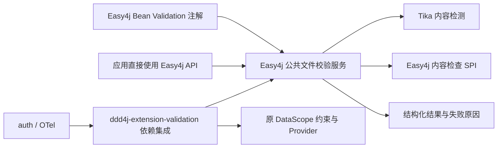

# Validation 与 DataScope 整合

状态：按用户明确要求取消 DDD4J 通用校验兼容包装，直接集成 Easy4j；本地实现与受影响验收完成，未提交或发布。本文是 DDD4J 与 validation-api-extension 本次整合的唯一规格事实源。

## 目标与边界

- 移除 `ddd4j-data-datascope` Maven 模块，将三个权限契约类型及测试移入 `ddd4j-extension-validation`，保留原 Java 包名以兼容已编译调用者；auth 和 OTel 改为依赖 validation。旧 artifact 不再发布，消费者需要修改 Maven 坐标。
- Easy4j 提供唯一的文件规则实现，注解入口与 DDD4J 都调用公共的结构化校验服务。DDD4J 不再实现文件头、ZIP/OLE 检测、文件模型存储、通用大小/扩展名/MIME 判断。
- 直接使用 Easy4j 文件对象、策略、结果、服务、检测器及内容检查 SPI。删除 DDD4J 的 12 个文件类型和转调包装，不为保留名字建立第二套 API。原 DDD4J 文件 API、JSON 构造及异常包装不再作为兼容目标；迁移说明给出对应上游 API。
- 删除 Web 中四个通用约束及四个验证器，消费者直接导入 Easy4j 注解；移除不再包含独有能力的 ddd4j-web-validation 模块及 reactor/BOM 引用。手机号、日期和空值规则统一采用组件行为。
- 保留 Easy4j 注解现有兼容语义：空白名单不检测类型；非严格模式按文件名判断 MIME；仅声明 MIME 白名单时不强制后缀相等；通用 OLE Word 容器兼容规则。程序式调用直接使用上游策略，在严格模式下检查后缀与真实内容，非严格模式使用声明 MIME。Office 范围由调用者白名单表达，不再保留本地 Office 检测器。
- 不改变 ORM SQL 数据范围、数据库、其他版本线；不切分支、不建 worktree、不提交推送或远端发布。

## 验收

1. 仅引入 validation 即可执行原数据权限注解；自定义 provider、拒绝 null、groups/message、auth 桥接及 OTel 行为保持。
2. 真实 Bean Validation 同时执行 Easy4j 文件约束和 DDD4J 数据权限约束；直接使用 Easy4j UploadFile/DefaultUploadFile，不存在 DDD4J 同名文件 API。
3. PDF、OLE Word/Excel、有效 OOXML Word/Excel、伪造后缀、空文件、大小边界、短读流、IO 异常和内容拒绝回归通过。原测试仅包含路径名和无效 XML 的伪 OOXML 夹具替换为 POI 生成的真实文件；损坏容器明确拒绝，不继续接受无效 Office 文档。
4. 公共引擎返回可区分失败原因，SPI 内容检查实际执行；失败不能静默放行。
5. 受影响 Maven reactor clean verify、无 record 检查通过；核实消费的 Easy4j 构件，已有上游测试证据仅适用于未改动的组件源码。
6. 原 Web 四类约束在 validation 模块通过真实 Bean Validation 运行；构建产物不包含已删除的 DDD4J 文件类型或 Web 约束，迁移当前 2.0.x 测试证据引用。

## 跨分支同步（2026-11-25）

用户授权将当前 2.0.x 逻辑应用到维护分支，本分支为 3.0.x。此项扩展原仅限 2.0.x 的范围；沿用本文的行为验收与 BaseRepositoryImpl 入口约定。保留本分支 JDK、命名空间和依赖版本，验证上游组件、领域仓储、真实数据库和消费者。独立克隆实施，不使用 worktree，不覆盖既有工作区，不推送或远端发布。
