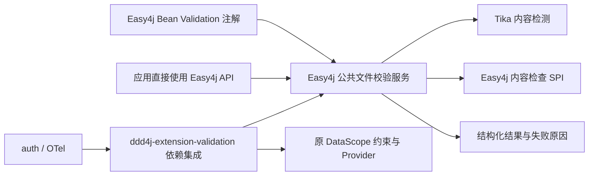

# Validation 与 DataScope 整合

## REQ Tika 兼容功能三线适配（2026-11-25，追加授权）

状态：实现、五组组件回归及三线消费验证完成；详见 `../../reports/2026-11-25-validation-req-parity.md`。

来源为 validation-api-extension 的 feature/REQ-20261118-wandl-tika4-compat，固定提交 d408b1881f7a7f1573c823ee34442083cb6e1d78。在已完成权限下沉的三个版本分支上增量移植全部有效功能，本文仍是两仓唯一规格事实源。

- 公共文件校验 API、约束委托、上传适配、SPI、注解功能以来源分支为对照，保留版本分支新增的权限实现和更完整的测试，不能倒退或丢失。
- 补齐完整流内容检测：字节数组流恢复调用前位置；其他可 mark 流在 1 MiB 内完整检测并恢复位置；大流不因缓冲阈值拒绝或仅检测前缀，允许向前消费；外部传入流不被关闭；UploadFile 自行获取的流由组件关闭。保留异常传播和内容识别不信任文件名。
- Java 8/17/21 保持原基线；通过已有 Commons IO 实现有界读取和关闭屏蔽，不另写流复制器/包装器。保留每条线已经验证的 Tika 2/3 与 javax/jakarta 兼容依赖；REQ 中可兼容的依赖更新一起移植：libphonenumber 9.0.39、Surefire 3.6.0、Javadoc 3.12.0；JUnit 6.1.3 仅用于 JDK 17/21，JDK 8 保留 JUnit 5。Hutool 1.0.x 更新至源分支的 5.8.46，3.0.x 保留已更新的 5.8.47。功能以同一契约验证。
- JDK 17/21 提供 tika4-compatibility 验证 profile，以 Tika 4.0.0 和 POM 类型解析器执行同一套完整回归；基线与兼容路径均纳入 CI，JDK 8 不启用不兼容依赖。
- 迁移有效的 CI 触发范围和实际 Maven 选择，保留维护分支触发，并覆盖 feature→test→main 流程。保持 90% LINE 且 haltOnFailure=true，保留更强测试；补齐源分支的发布/API 兼容 profile 插件绑定并逐项核验，不改成宽松门禁或重复实现。
- 修正文档的命名空间、版本号、构建要求、流行为；本地会话缓存、索引和无行为影响的批量格式/作者注释不作为功能移植。
- 验收：来源分支所有生产源码与测试差异逐项归类；来源 Tika 行为用例及异常/边界用例三线通过；三个上游完整 clean install 与 DDD4J 文件消费回归通过；核验覆盖率报告、分支提交、构件与工作区保护。
- 不切换原工作目录，不使用 worktree，不混入原有修改；本次不推送、发布或部署。

## 数据权限下沉到 Easy4j（2026-11-25，当前授权）

本次同时覆盖 validation-api-extension 与 DDD4J 的 1.0.x、2.0.x、3.0.x，覆盖下文历史阶段的保留包名和版本范围约束。本文继续作为两仓本次变更的唯一规格事实源。

- 上游仅保留一套 constraints.RequiresDataPermissions、constraintvalidators.RequiresDataPermissionsValidator、provider.DataScopeProvider；不引入 DDD4J、Spring 或 ORM 依赖，不建立全局 Provider 注册表。
- 未配置 Provider 时校验必须抛出配置异常，包括被校验值为 null 时；删除默认非空放行策略。配置后保持 null 拒绝、dataType 传递、groups/message/payload 和业务异常传播语义。
- 普通 Bean Validation 通过现有 ConstraintValidatorFactory 显式提供 Provider；Spring 复用 LocalValidatorFactoryBean / SpringConstraintValidatorFactory 和标准 Inject 注入，保留应用定义策略和容器歧义检查，不实现重复工厂。
- 删除 DDD4J validation、auth 中重复的注解、Provider、Validator，以及仅注册默认放行策略/静态上下文的旧配置。auth 保留 Spring 集成依赖入口；OTel 直接接收上游 Provider 并保留允许、拒绝、异常观测。
- 两套旧注解包不提供兼容壳，消费者更新 import 并重编译。DDD4J validation 保留现有文件解析器集成；SQL 数据权限机制不在此次变更范围内。
- 三条线分别使用 JDK 8/17/21，1.0.x 使用 javax，2.0.x/3.0.x 使用 jakarta。上游 2.0.x 补齐 DDD4J 已使用、其余两线已有的文件校验公共 API 前置，保留其已有依赖版本。
- 真实 Bean Validation、Spring 容器注入/缺失/多 Provider、不同数据类型与并发隔离、文件约束并用、OTel 回归通过；核验实际消费构件和删除类型。保护所有原有未提交修改，不创建 worktree，不推送或远端发布。

状态：本次权限下沉的实现和本地验证完成；测试、构件和分支交付证据见 `../../reports/2026-11-25-data-permissions-component.md`。未推送或远端发布。

## 历史阶段记录（以下保留追溯，冲突以本次授权为准）

状态：按用户明确要求取消 DDD4J 通用校验兼容包装，直接集成 Easy4j；本地实现与受影响验收完成，未提交或发布。本文是 DDD4J 与 validation-api-extension 本次整合的唯一规格事实源。

## 目标与边界

- 移除 `ddd4j-data-datascope` Maven 模块，将三个权限契约类型及测试移入 `ddd4j-extension-validation`，保留原 Java 包名以兼容已编译调用者；auth 和 OTel 改为依赖 validation。旧 artifact 不再发布，消费者需要修改 Maven 坐标。
- Easy4j 提供唯一的文件规则实现，注解入口与 DDD4J 都调用公共的结构化校验服务。DDD4J 不再实现文件头、ZIP/OLE 检测、文件模型存储、通用大小/扩展名/MIME 判断。
- 直接使用 Easy4j 文件对象、策略、结果、服务、检测器及内容检查 SPI。删除 DDD4J 的 12 个文件类型和转调包装，不为保留名字建立第二套 API。原 DDD4J 文件 API、JSON 构造及异常包装不再作为兼容目标；迁移说明给出对应上游 API。
- 删除 Web 中四个通用约束及四个验证器，消费者直接导入 Easy4j 注解；移除不再包含独有能力的 ddd4j-web-validation 模块及 reactor/BOM 引用。手机号、日期和空值规则统一采用组件行为。
- 保留 Easy4j 注解现有兼容语义：空白名单不检测类型；非严格模式按文件名判断 MIME；仅声明 MIME 白名单时不强制后缀相等；通用 OLE Word 容器兼容规则。程序式调用直接使用上游策略，在严格模式下检查后缀与真实内容，非严格模式使用声明 MIME。Office 范围由调用者白名单表达，不再保留本地 Office 检测器。
- 不改变 ORM SQL 数据范围、数据库、其他版本线；不切分支、不建 worktree、不提交推送或远端发布。

## 验收

1. 仅引入 validation 即可执行原数据权限注解；自定义 provider、拒绝 null、groups/message、auth 桥接及 OTel 行为保持。
2. 真实 Bean Validation 同时执行 Easy4j 文件约束和 DDD4J 数据权限约束；直接使用 Easy4j UploadFile/DefaultUploadFile，不存在 DDD4J 同名文件 API。
3. PDF、OLE Word/Excel、有效 OOXML Word/Excel、伪造后缀、空文件、大小边界、短读流、IO 异常和内容拒绝回归通过。原测试仅包含路径名和无效 XML 的伪 OOXML 夹具替换为 POI 生成的真实文件；损坏容器明确拒绝，不继续接受无效 Office 文档。
4. 公共引擎返回可区分失败原因，SPI 内容检查实际执行；失败不能静默放行。
5. 受影响 Maven reactor clean verify、无 record 检查通过；核实消费的 Easy4j 构件，已有上游测试证据仅适用于未改动的组件源码。
6. 原 Web 四类约束在 validation 模块通过真实 Bean Validation 运行；构建产物不包含已删除的 DDD4J 文件类型或 Web 约束，迁移当前 2.0.x 测试证据引用。

## 跨分支同步（2026-11-25）

用户授权将当前 2.0.x 逻辑应用到维护分支，本分支为 1.0.x。此项扩展原仅限 2.0.x 的范围；沿用本文的行为验收与 BaseRepositoryImpl 入口约定。保留本分支 JDK、命名空间和依赖版本，验证上游组件、领域仓储、真实数据库和消费者。独立克隆实施，不使用 worktree，不覆盖既有工作区，不推送或远端发布。

## 退役空校验模块

三条版本线移除旧校验构件及其 BOM/reactor 登记。直接依赖 Easy4j 的调用方按需配置 Microsoft 解析器。Web TestKit 保留基础约束、权限与真实文件的消费回归，校验依赖仅用于测试。
