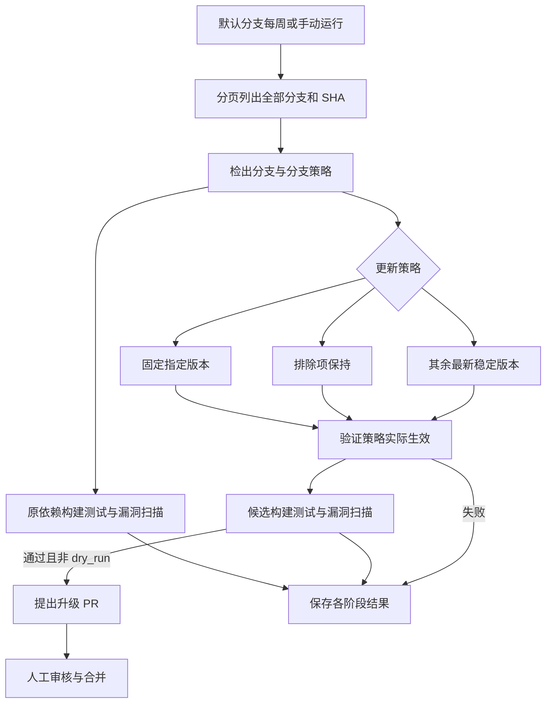

# 每周全分支依赖维护统一契约

日期：2026-10-14。本文件为此次跨仓库 CI 修正的规格事实源，延续已有工程文档，不初始化新的规格体系。

## 行为与验收

- 五个仓库共用 `.github/workflows/weekly-dependencies.yml`、`scripts/dependencies/check_dependencies.py` 和控制器测试；仅 `.github/dependency-policy.json` 体现组件差异。每个本地和 GitHub 分支保留这套文件。
- 每周一北京时间 10:17（UTC 02:17）调度。GitHub schedule 仅在默认分支触发；控制器分页枚举全部分支及 SHA，按不可变 SHA 检出。feature、fix、opt、agent、backup 全部纳入；仅排除本 CI 生成的 `automation/dependencies/`，避免递归。超过 256 分支显式失败，不截断。
- 使用被检查分支的策略文件；分支可独立调整。`branches` 使用 glob，按配置顺序合并，后面的固定版本覆盖前面的固定版本，排除列表累加。
- 固定版本优先于排除：`fixed_properties` 或 `fixed_dependencies` 强制指定版本，允许降级；`exclude` 和 `exclude_properties` 保留版本；其余源码控制的依赖、BOM、外部父版本使用仓库可取得的最新稳定版本，允许 major/minor/patch。项目版本、Java/Maven 工具链及 reactor 版本保持原契约。不在 POM 使用 LATEST。
- Versions Maven Plugin 2.23.0 更新属性和依赖字面量。外部父 POM 中本项目显式引用的版本属性，从 effective POM 解析后在根 POM 覆盖；排除项及共享属性受保护。BOM 隐式管理及传递依赖通过 BOM 升级取得版本，不改写上游 BOM。非属性形式的构建插件升级不在本次依赖更新范围。
- 先构建/测试并扫描当前依赖，再在临时检出中更新、构建/测试并扫描候选。固定项和排除项仍参与直接、传递、test、provided 漏洞扫描。扫描使用 Java 21，构建沿用分支 JDK 和 Wrapper；无 Wrapper 使用经 SHA-512 校验的 Maven 3.9.16 / 4.0.0-rc-7。
- CVSS >= 7、构建/测试失败、策略未生效、解析或扫描失败、报告丢失或为空均失败。即使候选通过，原依赖漏洞仍保留失败状态。兼容旧工程时禁用 Enforcer，因此不能宣称通过完整发布门禁；已有独立发布/安全 CI 保留。
- 无根 POM 分支记录 `not-applicable-no-maven-project`，不宣称完成 Maven 扫描。每分支记录 SHA、阶段日志、策略、补丁、扫描报告和单元测试报告，失败也上传，保留 30 天。
- push/PR 仅运行无凭据控制器测试与策略校验；schedule/手动运行检查全部分支。手动 `dry_run` 默认 true，仍更新临时 POM、构建和扫描，但不创建 PR。定时任务仅为通过的候选提出升级 PR，不自动合并。合并后源码依赖才真正更新。

## 配置示例

```json
{
  "exclude": ["io.ddd4j*:*"],
  "exclude_properties": ["ddd4j*.version"],
  "fixed_properties": {"guava.version": "33.4.8-jre"},
  "fixed_dependencies": {"commons-io:commons-io": "2.19.0"},
  "cvss_threshold": 7,
  "branches": {
    "feature/legacy*": {"fixed_properties": {"guava.version": "31.1-jre"}}
  }
}
```

固定属性/坐标必须存在并最终生效，否则失败。共享属性冲突不能绕过排除：应统一固定相关属性或调整明确策略。示例只演示格式，不是项目推荐版本。

## 现有兼容策略

- ddd4j：沿用原先排除的 Spring、Jackson 2/3、内部 ddd4j 和 Easy4J；有 Disruptor 的分支按 JDK 8 固定 3.4.4、JDK 17/21 固定 4.0.0。
- Boot：沿用原先排除的 Spring、Jackson 2/3 和内部 ddd4j。
- Javalin：沿用原先排除的 Javalin/OpenAPI 和内部 ddd4j。
- Quarkus：`feature/3.3.x` 固定 Quarkus BOM 属性 3.37.4，`feature/4.0.x` 固定 3.38.2，引用该属性的插件一并保持；排除内部 ddd4j。Quarkiverse 扩展有独立版本，不随平台版本强行固定。
- Cloud：沿用原先排除的 Spring、Alibaba Cloud、内部 ddd4j 和对应版本属性。

删除这些显式规则后相应依赖进入默认最新稳定版本更新；这些规则不豁免漏洞扫描。

## 凭据与运行

- `MAVEN_SETTINGS_XML` 兼容原文 XML 和 base64 XML。私有仓库需相应认证；不将凭据写入 artifact。
- 漏洞扫描使用无密钥 Trivy，不需要 `NVD_API_KEY`。漏洞库下载失败会使任务失败，不把空报告当成无漏洞。
- 可选 `DEPENDENCY_UPDATE_TOKEN` 或现有 `RENOVATE_TOKEN`，用于使升级 PR 触发已有 CI。没有时使用 GITHUB_TOKEN，需仓库允许 Actions 创建 PR；其提交不触发普通 push/PR 工作流，本工作流已验证候选。



## 验证边界

控制器单测、actionlint、全分支 POM/策略/工具链检查和真实 Maven 微型项目更新，与各分支完整构建和 Trivy 扫描是不同证据。本地检查不证明全部分支无漏洞；完整运行需检查各分支扫描及构建报告。

## 2026-11-17：2.0.x 的 JDK 17 依赖修复

本轮仅修改当前 `feature/2.0.x`，保留已有人工修改，不切换分支，不使用 worktree，不提交、发布或部署。

三线边界：1.0.x 使用 JDK 8、Spring 5.3.x 终版与 javax.servlet 4.x / Java EE 8；2.0.x 使用 JDK 17、Spring 6.x 最新兼容稳定版与 jakarta.servlet 6.x / Jakarta EE 10；3.0.x 使用 JDK 21、Spring 7.x 最新兼容稳定版与 jakarta.servlet 6.x / Jakarta EE 10。版本号分别保持 `1.0.x.20260630-SNAPSHOT`、`2.0.x.20260630-SNAPSHOT`、`3.0.x.20260630-SNAPSHOT`。本轮不得用 Spring 7 修复 2.0.x 的漏洞；Spring 6 没有公开修复版本时，保留漏洞和修复获取条件。

- 根 POM 与 `ddd4j-dependencies` 的版本属性必须各有唯一维护位置：第三方组件集中在依赖 POM，根构建使用的插件属性由根 POM 管理。相同值的重复声明也应阻断，防止后续更新漂移。
- 扫描当前 BOM 的全部直接管理版本，以及全部非 POM 模块（含样例）实际解析的直接、传递、test、provided 依赖；固定项和升级排除项继续扫描。缺失模块、解析失败、漏洞库不可用必须单独记录，不视为零漏洞。
- 使用实际可用的扫描器记录工具和漏洞库来源；本机已有 OSV-Scanner 可作为本轮扫描工具，既有 Trivy CI 门禁保持原有要求。
- 从当前 Maven 元数据与官方兼容资料选择稳定候选；JDK 17 字节码、既有 Spring/Jackson/API 契约和实际测试共同决定兼容性，不以版本号更大代替验证。无法兼容升级的组件保留明确原因和剩余漏洞。
- 修改前保留输入指纹、原始扫描和 Versions 插件候选报告；修改后重新解析和扫描，并运行版本归属回归、受影响测试及 JDK 17 reactor 检查。报告位于仓库外的 `../deliveries/ddd4j-security-jdk17-20261117/`，避免构建清理删除证据，最终状态以本轮实际执行结果为准。

本轮最终保留 Spring Framework 6.2.19、Spring Security 6.5.11、Boot 3.5.16、Servlet 6.1.0。Shiro 3.0.2 候选导致真实样例登录回归，撤回至 2.2.1；未更改凭据校验业务逻辑，CVE-2026-56130 保留在遗留清单中。Spring 6 企业补丁不可获取的三项公告同样保留，不以 Spring 7、扫描抑制或删除兼容坐标替代修复。

JDK 17 的标准非容器测试通过分段续跑覆盖 121 个 reactor 项目、2894 项测试；906 个实际解析制品的基础字节码检查通过。该结果不代表完整验收：Docker 内部磁盘不足阻塞容器测试，原有 Java 风格检查仍失败，Javalin 商品测试曾出现一次 404，目标测试类及随后整个模块复跑通过。完整输入、日志、漏洞与验证限制见交付目录的 `REPORT.md`、`validation.json`。

补充 Spring 版本归属核对：功能模块经 `ddd4j-dependencies` 继承属性和依赖管理，根聚合 POM 与 `ddd4j-bom` 没有 Spring 属性引用。全体 121 个有效 POM 检查曾发现 CQRS/Projection 两个 Micronaut 模块各有 11 个 Spring 管理项被模块平台 BOM 覆盖为 6.2.16；已在这两个模块的平台 BOM 前导入共享 Spring BOM，仍使用 `${spring-framework.version}`，不另设版本。补齐后，119 个继承项目的 30 个 Spring 版本属性、8371 条 Spring 声明及管理记录无跨模块版本冲突，两个受影响模块 13 项测试通过。根 POM 重复属性的删除据此保留；完整证据见交付目录 `spring-version-consistency/REPORT.md`。该结果针对记录的源码快照与默认模型，不以旧漏洞报告证明检查期间其他并行依赖修改。
